# Manuel pratique et illustré de déchiffrement du *Codex Ravennas 429*
## Apprendre à lire l'écriture byzantine des *Thesmophories* d'Aristophane (ff. 162v–177r)

**Document pédagogique accompagnant l'édition critique et diplomatique**  
**Manuscrit étudié :** Ravenne, Biblioteca Classense, Ms. 429 (*Codex Ravennas 429*, sigle **R**), milieu du Xᵉ siècle (env. 950–980 apr. J.-C.), Constantinople.  
**Section :** *Les Thesmophories* ($\Theta\varepsilon\sigma\mu\circ\varphi\circ\rho\iota\alpha\zeta\circ\upsilon\sigma\alpha\iota$), folios **162v à 177r** (1 231 vers conservés ; *codex unicus* médiéval).

---

## Sommaire du manuel d'apprentissage

1. **[Introduction méthodologique : comment aborder une page du *Ravennas*](#1-introduction-méthodologique--comment-aborder-une-page-du-ravennas)**
   - 1.1. Les quatre registres d'écriture présents sur un même folio (Planche 01)
   - 1.2. La géométrie de la ligne : écriture suspendue et système quadrilinéaire (Planche 02)
   - 1.3. Règle d'or du déchiffreur débutant : les 5 réflexes visuels indispensables
2. **[Leçon 1 — L'abécédaire photographique complet du Scribe A ($\text{R}^1$)](#2-leçon-1--labécédaire-photographique-complet-du-scribe-a-r1)**
   - 2.1. Le « bilinguisme graphique » du Xᵉ siècle : minuscule cursive et réminiscences onciales
   - 2.2. Dictionnaire visuel des 24 lettres grecques dans $\text{R}^1$ : d'*Alpha* ($\alpha$) à *Mu* ($\mu$) (Planche 03)
   - 2.3. Dictionnaire visuel des 24 lettres grecques dans $\text{R}^1$ : de *Nu* ($\nu$) à *Oméga* ($\omega$) (Planche 04)
3. **[Leçon 2 — Les six grands pièges de lecture (« faux-amis » paléographiques)](#3-leçon-2--les-six-grands-pièges-de-lecture--faux-amis-paléographiques)**
   - 3.1. Piège n° 1 : *Nu* minuscule ($\nu$) en `μ` *versus* *Mu* minuscule ($\mu$) à deux ponts (Planche 05)
   - 3.2. Piège n° 2 : *Bêta* bilobé cursif ($\beta$ en `u`) *versus* $\text{B}$ oncial, *Kappa* ($\kappa$) et *Nu* ($\nu$) (Planche 06)
   - 3.3. Piège n° 3 : La triade des hastes hautes — *Êta* ($\eta$ en `h`), *Kappa* ($\kappa$) et *Lambda* ($\lambda$) (Planche 07)
   - 3.4. Piège n° 4 : Les lettres rondes ($\alpha, \omicron, \omega, \theta, \sigma$) et la lecture des surcharges vocaliques (Planche 08)
   - 3.5. Piège n° 5 : Les lettres à potence ($\gamma/\Gamma, \pi/\Pi, \tau$) et les plongeantes sinueuses ($\zeta, \xi, \psi$) (Planche 09)
   - 3.6. Piège n° 6 : La grande spirale finale `-ος` (`@`) *versus* l'idéogramme astronomique `☉` (*hêlios*) (Planche 10)
4. **[Leçon 3 — Le système des ligatures : décomposer les groupes de lettres liés](#4-leçon-3--le-système-des-ligatures--décomposer-les-groupes-de-lettres-liés)**
   - 4.1. Les ligatures d'*epsilon* ($\varepsilon$) : le trait plongeant ($\varepsilon\iota$), l'« as de pique » ($\varepsilon\rho, \varepsilon\sigma, \varepsilon\xi$) et l'arche ($\varepsilon\tau$) (Planche 11)
   - 4.2. Les ligatures de *sigma* ($\sigma$) : groupes $\sigma\pi$, $\sigma\tau$, $\sigma\theta$, $\sigma\kappa$ et $\sigma\chi$ (Planche 12)
   - 4.3. Les ligatures de consonnes ($\pi\rho, \tau\rho, \gamma\omega\iota$) et la gémination du *lambda* ($-\lambda\lambda-$ *vs* $-\lambda-$) (Planche 13)
   - 4.4. Tableau synoptique de résolution des 30 ligatures les plus fréquentes
5. **[Leçon 4 — Esprits, accents, iota muet et ponctuation du dialogue](#5-leçon-4--esprits-accents-iota-muet-et-ponctuation-du-dialogue)**
   - 5.1. La règle absolue de l'iota muet adscrit ($\alpha\iota, \eta\iota, \omega\iota$) et le piège du $-\iota$ déictique (Planche 14)
   - 5.2. Esprits (carrés ou ronds), accents, tréma inorganique ($\ddot{\iota}, \ddot{\upsilon}$) et *scriptio plena* (Planche 15)
   - 5.3. La ponctuation dramatique : *paragraphos* (`—`), *dikôlon* (`:`) et *korônis* strophique (Planche 16)
6. **[Leçon 5 — Les écritures de $\text{R}^2$ : *notae personarum*, tachygraphie des scholies et *parepigraphai*](#6-leçon-5--les-écritures-de-r2--notae-personarum-tachygraphie-des-scholies-et-parepigraphai)**
   - 6.1. Déchiffrer les *notae personarum* : le principe du monogramme par superposition (Planche 17)
   - 6.2. La tachygraphie des scholies marginales ($\Sigma^{\text{R}}$) : suspensions, finales en exposant et sigles (Planche 18)
   - 6.3. Un trésor unique du théâtre antique : les quatre *parepigraphai* (didascalies scéniques) (Planche 19)
7. **[Leçon 6 — Lire les corrections du manuscrit : transpositions et grattages (*in rasura*)](#7-leçon-6--lire-les-corrections-du-manuscrit--transpositions-et-grattages-in-rasura)**
   - 7.1. Chiffres d'ordre ($\alpha', \beta', \gamma', \delta'$), additions supralinéaires et vers restitués en marge (Planche 20)
   - 7.2. Anatomie matérielle des grattages sur parchemin (*in rasura*) : les quatre types (Planche 21)
8. **[Leçon 7 — Parcours d'entraînement progressif en 5 niveaux (8 exercices corrigés)](#8-leçon-7--parcours-dentraînement-progressif-en-5-niveaux-8-exercices-corrigés)**
   - 8.1. Niveaux 1 et 2 (Débutant & Intermédiaire) : le Prologue et la scène du Serviteur (Planche 22)
   - 8.2. Niveaux 3 et 4 (Avancé & Confirmé) : *parepigraphè*, parabase et *Andromède* (Planche 23)
   - 8.3. Niveau 5 (Expert) : barbarismes de l'Archer scythe, *korônis* finale et scholies denses (Planche 24)

---

## 1. Introduction méthodologique : comment aborder une page du *Ravennas*

Ouvrir pour la première fois un feuillet du *Codex Ravennas 429* (milieu du Xᵉ siècle) provoque souvent chez l'helléniste habitué aux polices typographiques modernes (Didot, Porson, Gentium) un sentiment de dépaysement visuel. Certaines lettres paraissent familières, mais d'autres semblent inverser les valeurs de notre alphabet : ce qui ressemble à un `μ` moderne est en réalité un **nu** ($\nu$), ce qui ressemble à un `h` latin est un **êta** ($\eta$), et ce qui ressemble à un `u` est le plus souvent un **bêta** ($\beta$) !

Pourtant, l'écriture du *Ravennas* est l'une des plus régulières, des plus harmonieuses et des plus rigoureuses de toute la calligraphie byzantine de la « Renaissance macédonienne ». Dès que l'œil possède la grille de décodage de ses tracés (*ductus*) et de ses ligatures, le déchiffrement devient non seulement fluide, mais passionnant : on lit directement par-dessus l'épaule des deux copistes constantinopolitains qui nous ont sauvé *Les Thesmophories*.

### 1.1. Les quatre registres d'écriture présents sur un même folio (Planche 01)

Avant de chercher à lire un mot, il faut identifier **dans quelle zone de la page** et **dans quel registre graphique** on se trouve. Une page des *Thesmophories* comporte en effet **quatre registres d'écriture bien distincts**, répartis entre deux mains contemporaines :

- **Le Scribe A ($\text{R}^1$)**, qui copie la colonne centrale du texte poétique d'Aristophane ;
- **Le Scribe B ($\text{R}^2$)**, réviseur et scholiaste du même atelier (*scriptorium*), qui ajoute les titres courants, les sigles des personnages (*notae personarum*), les gloses interlinéaires et les scholies marginales ($\Sigma^{\text{R}}$).

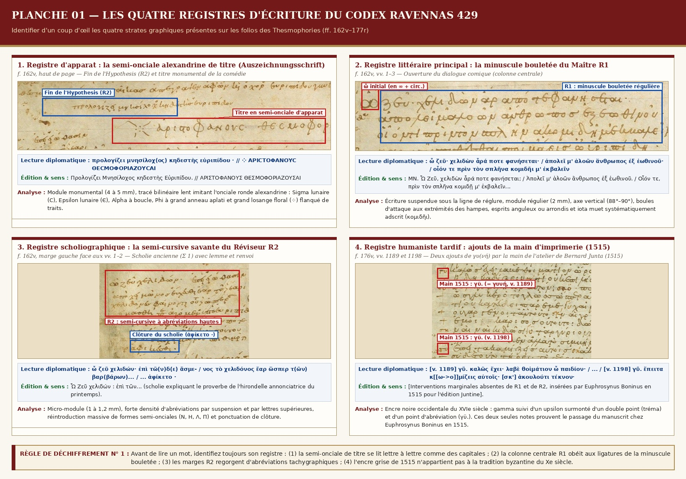

| Registre | Emplacement sur le feuillet | Main | Style calligraphique | Caractéristiques de déchiffrement |
| :--- | :--- | :--- | :--- | :--- |
| **Registre 1** | Marge supérieure ou titre initial | $\text{R}^1$ / $\text{R}^2$ | **Majuscule d'apparat (*Auszeichnungsmajuskel*)** | Lettres capitales d'inspiration épigraphique et onciale ($\text{A}, \text{E}, \Theta, \text{M}, \Sigma, \Phi$), entièrement détachées les unes des autres, sans ligatures. |
| **Registre 2** | Colonne centrale (40 à 43 lignes par page) | $\text{R}^1$ | **Minuscule livresque bouclée (*Perlschrift* précoce)** | Écriture penchée ou droite, souple, suspendue sous la ligne de réglure, riche en ligatures cursives ($\varepsilon\iota, \varepsilon\pi, \sigma\tau, \sigma\pi$) et en allographes mixtes. |
| **Registre 3** | Marge intérieure ou extérieure, au ras des vers | $\text{R}^2$ | **Monogrammes scéniques (*notae personarum*)** | Sigles ultra-compacts de 2 à 5 lettres procédant par **superposition verticale** ($\mu^{\text{H}}_{\nu} = \text{Μνησίλοχος}$, $\theta\varepsilon\rho^{\pi}_{\alpha} = \text{Θεράπων}$). |
| **Registre 4** | Marges latérales, supérieure, inférieure et interlignes | $\text{R}^2$ | **Semi-onciale scholiastique de petit module** | Petites capitales droites très serrées, presque sans ligatures cursives, mais hérissées de signes tachygraphiques et de finales en exposant. |

### 1.2. La géométrie de la ligne : écriture suspendue et système quadrilinéaire (Planche 02)

Deux lois matérielles gouvernent la ligne de texte de $\text{R}^1$ :

1. **L'écriture est suspendue sous la réglure (et non posée dessus)** : contrairement à nos cahiers modernes où les lettres reposent sur la ligne réglée, le scribe byzantin trace à la pointe sèche un sillon horizontal dans le parchemin et **accroche le sommet du corps de ses lettres sous cette ligne directrice**. C'est pourquoi les barres horizontales du $\tau$, du $\pi$, du $\gamma$ et les sommets de $\alpha, \varepsilon, \omicron, \sigma, \omega$ forment un plafond rectiligne continu.
2. **Le système est quadrilinéaire (4 lignes virtuelles délimitant 3 zones)** :
   - **Zone médiane (noyau bilinéaire, env. 2 à 2,5 mm)** : contient toutes les lettres courtes ($\alpha, \varepsilon, \iota, \nu, \omicron, \pi, \sigma, \tau, \upsilon, \omega$).
   - **Zone supérieure (ascendantes)** : où s'élèvent les hampes hautes du $\delta$, de l'êta ($\eta$), du $\kappa$, du $\lambda$, du $\theta$ et des grands allographes onciaux ($\text{B}, \text{H}, \text{N}$).
   - **Zone inférieure (descendantes)** : où plongent les queues verticales ou sinueuses du $\rho$, du $\varphi$, du $\psi$, du $\chi$, du $\zeta$, du $\xi$, ainsi que la hampe d'attaque gauche du $\mu$ et du $\gamma$.

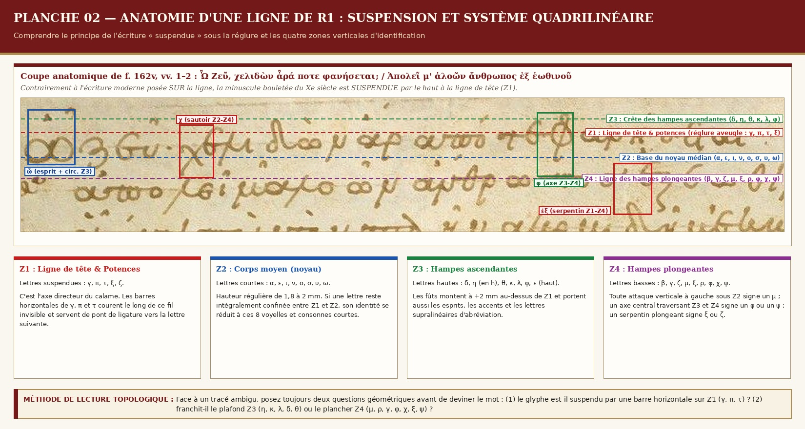

### 1.3. Règle d'or du déchiffreur débutant : les 5 réflexes visuels indispensables

Lorsque vous êtes bloqué devant un mot du *Ravennas*, appliquez systématiquement cette procédure en 5 étapes :

1. **Repérez d'abord les esprits et les accents dans l'interligne supérieur** : même lorsque les mots sont collés les uns aux autres (*scriptio continua*), **chaque mot grec porte son accent propre** et chaque mot à initiale vocalique porte son esprit (`⊢` rude ou `⊣` doux). Compter les accents et les esprits d'une ligne permet de découper instantanément la phrase en mots !
2. **Identifiez les lettres à longues queues plongeantes sous la ligne** ($\rho, \varphi, \chi, \psi, \zeta, \xi, \mu, \gamma$ et les ligatures $\varepsilon\iota, \tau\iota$) : elles constituent les piliers visuels immuables du mot.
3. **Vérifiez toujours si un jambage en forme de `μ` a un ou deux sommets** : un seul creux remontant = $\nu$ (*nu*) ; deux ponts arrondis = $\mu$ (*mu*).
4. **Ne cherchez jamais d'iota souscrit sous $\alpha, \eta, \omega$** : dans le *Ravennas*, l'iota muet est soit **écrit sur la ligne à droite de la voyelle longue** ($\alpha\iota, \eta\iota, \omega\iota$), soit omis.
5. **Regardez si le point en haut (`·`) ou le double point (`:`) suit le mot** : le double point (`:`) signale une réplique d'interlocuteur !

---

## 2. Leçon 1 — L'abécédaire photographique complet du Scribe A ($\text{R}^1$)

### 2.1. Le « bilinguisme graphique » du Xᵉ siècle : minuscule cursive et réminiscences onciales

Pourquoi une même lettre (comme *bêta*, *êta*, *kappa*, *lambda*, *nu*, *pi* ou *sigma*) peut-elle revêtir deux formes complètement différentes à l'intérieur d'un même vers ? Parce qu'au milieu du Xᵉ siècle, la minuscule livresque issue de la réforme studite du IXᵉ siècle a réintroduit, pour aérer la lecture et marquer les pauses, un certain nombre d'**allographes empruntés à l'ancienne majuscule onciale** :

- **En attaque de vers ou en fin de mot**, $\text{R}^1$ aime tracer des formes hautes et majestueuses d'origine onciale ($\text{B}, \Gamma, \text{H}, \text{K}, \Lambda, \text{N}, \Pi, \text{C}$).
- **Au cœur des mots**, il privilégie les formes minuscules cursives rapides ($\beta$ en `u`, $\gamma$ bouclé, $\eta$ en `h`, $\kappa$ en deux traits, $\nu$ en `μ`, $\pi$ bas) qui permettent d'enchaîner les ligatures sans lever le calame.

Les deux planches suivantes (**Planches 03 et 04**) vous donnent, pour chacune des **24 lettres de l'alphabet grec**, un extrait photographique haute définition tiré des folios des *Thesmophories*, avec encadrement précis de la lettre, transcription diplomatique, texte normalisé et explication du *ductus*.

### 2.2. Dictionnaire visuel des 24 lettres grecques dans $\text{R}^1$ : d'*Alpha* ($\alpha$) à *Mu* ($\mu$) (Planche 03)

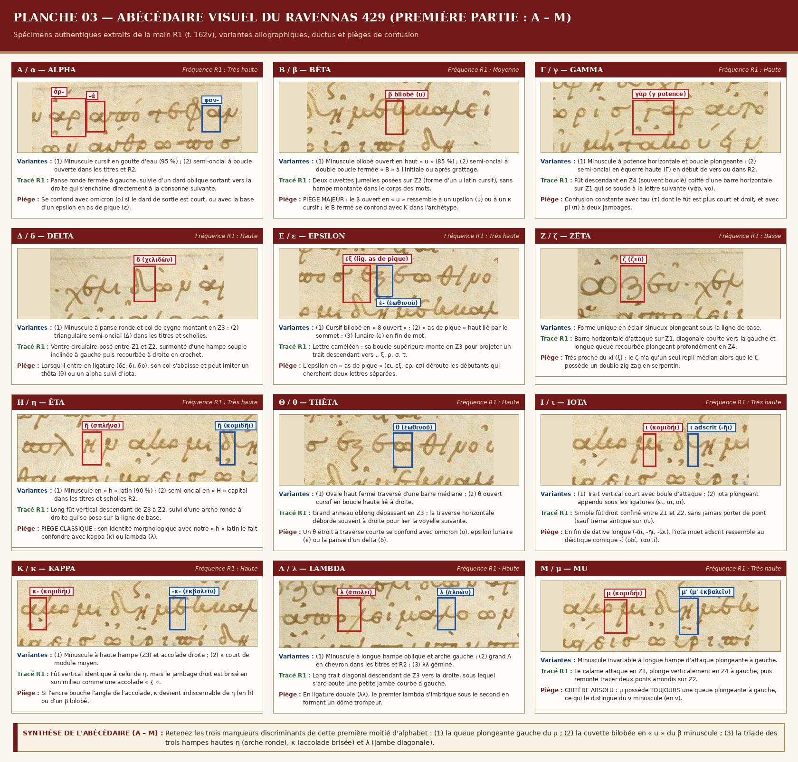

| Lettre | Allographe minuscule (dominant) | Allographe oncial / secondaire | Clé de reconnaissance anatomique (*ductus*) |
| :---: | :--- | :--- | :--- |
| **$\text{A} / \alpha$** | Goutte ronde fermée ou ouverte en haut ($\alpha$) | Triangle à panse basse en vedette | La panse ronde se termine à droite par un trait horizontal ou oblique qui **se lie par le haut** à la lettre suivante ($\alpha\rho, \alpha\gamma, \alpha\lambda, \alpha\nu, \alpha\sigma, \alpha\tau$). |
| **$\text{B} / \beta$** | **Forme bilobée ouverte en haut (`u`)** | **$\text{B}$** capital haut à double boucle | **Piège majeur** : dans 85 % des cas, $\beta$ ressemble à un `u` latin à deux pointes (sans boucle supérieure) ! Le grand $\text{B}$ à deux panses apparaît surtout à l'initiale. |
| **$\Gamma / \gamma$** | Boucle plongeante sous la ligne + barre haute | Potence droite **$\Gamma$** | Le $\gamma$ minuscule descend sous la ligne en formant une petite boucle à gauche ; sa barre supérieure s'allonge pour porter la voyelle suivante ($\gamma\alpha, \gamma\varepsilon, \gamma\omicron, \gamma\omega$). |
| **$\Delta / \delta$** | Panse ronde surmontée d'un grand col oblique | Triangle $\Delta$ (en majuscule de titre) | Le long crochet supérieur monte dans l'interligne, se recourbe à droite et redescend souvent plonger directement dans la voyelle suivante ($\delta\varepsilon, \delta\iota, \delta\omicron$). |
| **$\text{E} / \varepsilon$** | Demi-cercle bilobé ou « as de pique » | Grand **$\text{E}$** lunaire étroit | Lettre caméléon : isolée, elle a deux petits lobes ; liée à $\rho, \sigma, \xi, \pi$, sa boucle supérieure se ferme et bascule vers la droite. |
| **$\text{Z} / \zeta$** | Éclair sinueux à une boucle plongeante | $\text{Z}$ anguleux (titres) | Tête horizontale sur la réglure, suivie d'une panse arrondie qui plonge bas sous la ligne en forme de `3` ou de `S` étiré. |
| **$\text{H} / \eta$** | **Minuscule en forme de `h` latin** | **$\text{H}$** carré à deux hastes verticales | **Piège majeur** : l'êta minuscule possède une haute hampe gauche et un petit pont court à droite, exactement comme notre `h` minuscule ! |
| **$\Theta / \theta$** | Grand ovale fermé traversé d'une barre | $\theta$ cursif ouvert | Déborde légèrement au-dessus du noyau bilinéaire ; sa barre transversale médiane déborde souvent à droite pour lier $\theta\rho, \theta\iota, \theta\varepsilon$. |
| **$\text{I} / \iota$** | Court trait vertical sans point (ou $\ddot{\iota}$ à tréma) | Trait vertical plongeant en ligature | Isolé, il reste strictement dans le noyau bilinéaire. Après $\varepsilon, \gamma, \tau, \chi$, il descend verticalement sous la ligne ($\varepsilon\iota, \tau\iota$). |
| **$\text{K} / \kappa$** | Haste verticale + petit croissant ou accolade | Grand **$\text{K}$** à bras obliques détachés | Tracée en deux temps (haste `|` + accolade `c`), la minuscule peut, si la plume se lève, ressembler à $\iota\varsigma$ ou à $\eta$. |
| **$\Lambda / \lambda$** | Arche oblique à longue jambe droite | Grand chevron symétrique **$\Lambda$** | En minuscule, la jambe gauche est courte et incurvée, tandis que la jambe droite part de haut en une longue diagonale descendante. |
| **$\text{M} / \mu$** | Hampe gauche plongeante + **deux ponts** | $\text{M}$ oncial à anse centrale | **Règle absolue** : commence par une queue verticale qui plonge sous la ligne à gauche, suivie de **deux arches arrondies** (comme notre `m`). |

### 2.3. Dictionnaire visuel des 24 lettres grecques dans $\text{R}^1$ : de *Nu* ($\nu$) à *Oméga* ($\omega$) (Planche 04)

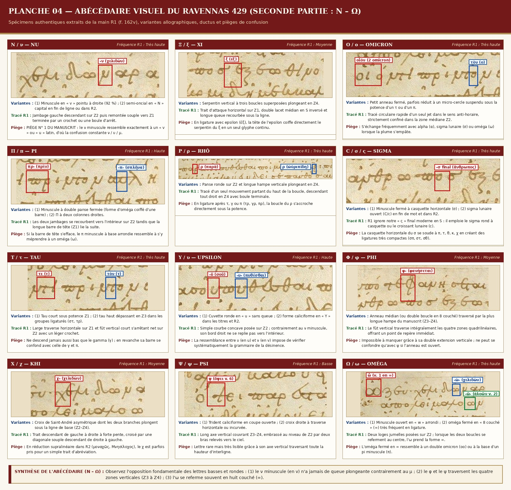

| Lettre | Allographe minuscule (dominant) | Allographe oncial / secondaire | Clé de reconnaissance anatomique (*ductus*) |
| :---: | :--- | :--- | :--- |
| **$\text{N} / \nu$** | **Forme en `μ` à un seul creux remontant** | Grand **$\text{N}$** capital à diagonale | **Le faux-ami n° 1** : le $\nu$ minuscule commence par une hampe plongeante à gauche suivie d'**un seul vallon qui remonte**. Il ressemble exactement à un `μ` moderne ! |
| **$\Xi / \xi$** | Serpentin vertical à trois boucles plongeantes | $\Xi$ à trois barres (titres) | Comme le $\zeta$, il plonge bas sous la ligne, mais il décrit **deux ondulations intermédiaires** avant sa queue inférieure (contre une seule pour $\zeta$). |
| **$\text{O} / \omicron$** | Petit anneau circulaire fermé par le haut | Petit rond en exposant (`^ο` = `-ος`) | Plus étroit et plus parfaitement circulaire que l'alpha ($\alpha$) ; ne possède pas de queue latérale droite. |
| **$\Pi / \pi$** | Double jambage (souvent bouclé en $\varpi$) sous barre | Grand portique **$\Pi$** | La barre horizontale supérieure déborde des deux côtés. À l'intérieur, les deux jambages se recourbent souvent l'un vers l'autre (forme $\varpi$ proche d'$\omega$). |
| **$\text{P} / \rho$** | Petite tête ronde + longue hampe gauche plongeante | $\rho$ enroulé sous $\pi, \tau, \varepsilon$ | La queue verticale descend toujours franchement dans l'interligne inférieur. Après $\varepsilon, \pi, \tau$, la boucle se forme d'un seul trait continu. |
| **$\Sigma / \sigma / \varsigma$** | **Sigma lunaire ($\text{c}$)** lié par sa casquette | Aucun $\varsigma$ en `s` moderne ! | Le *Ravennas* **n'utilise jamais le sigma final en `s` moderne ($\varsigma$)** : en fin de mot comme au milieu, c'est un sigma lunaire (`c`) dont le chapeau s'allonge horizontalement. |
| **$\text{T} / \tau$** | Potence en $\text{T}$ contenue dans le noyau | $\tau$ haut dépassant la réglure | Sa barre horizontale supérieure s'unit à gauche à $\sigma$ ($\sigma\tau$) et à droite aux voyelles ou au $\rho$ ($\tau\rho$). |
| **$\Upsilon / \upsilon$** | Petit godet arrondi en `u` ou en `v` sans queue | $\text{Y}$ caliciforme haut (titres/R²) | Reste strictement contenu dans le noyau bilinéaire ; son flanc droit se recourbe légèrement vers l'intérieur. |
| **$\Phi / \varphi$** | Anneau médian aplati + très longue haste verticale | $\Phi$ à grand disque | C'est la lettre qui possède la plus grande amplitude verticale du manuscrit : sa haste traverse à la fois l'interligne supérieur et l'interligne inférieur. |
| **$\text{X} / \chi$** | Croix oblique dont les branches plongent sous la ligne | Grand $\text{X}$ symétrique | La diagonale descendante gauche-droite est épaisse et plonge largement sous la ligne de base. |
| **$\Psi / \psi$** | Croix ou trident à longue hampe verticale plongeante | $\Psi$ à calice | Les deux bras latéraux se rejoignent (parfois en formant deux petites boucles symétriques) sur un long axe vertical descendant. |
| **$\Omega / \omega$** | Double anneau en `ω` ouvert ou fermé en `8` couché | $\Omega$ en fer à cheval (titres) | Souvent tracé avec ses deux boucles presque refermées au centre (`∞`), ce qui le distingue du $\pi$ (qui a un toit plat au-dessus des boucles). |
| **Spirale `@`** | **Grande boucle finale enroulée = `-ος`** | Petit `^ο` ou `^ς` en exposant | En fin de vers ou devant une pause, la désinence `-ος` est remplacée par une ample spirale enroulée (semblable à un `@`) qui prolonge la dernière consonne. |
| **Sigle `Ϛ`** | **Abréviation tachygraphique de $\kappa\alpha\acute{\iota}$** | — | Dans les scholies et parfois en fin de ligne, un signe en forme de `S` plongeant (`Ϛ`) surmonté d'un accent grave représente la conjonction **$\kappa\alpha\acute{\iota}$**. |

---

## 3. Leçon 2 — Les six grands pièges de lecture (« faux-amis » paléographiques)

Tout lecteur qui débute dans le *Codex Ravennas 429* commet les mêmes six erreurs d'identification. En maîtrisant dès maintenant ces six paires ou groupes de lettres « sosies », vous éliminerez plus de 90 % des blocages de lecture.

### 3.1. Piège n° 1 : *Nu* minuscule ($\nu$ en `v`) *versus* *Mu* minuscule ($\mu$ à queue plongeante) (Planche 05)

C'est **le piège numéro un de la minuscule byzantine** :
- Le **nu minuscule ($\nu$)** de $\text{R}^1$ ressemble à un **`v` ou un `u` pointu** strictement confiné dans le noyau médian ($\text{Z}_2$), dont le jambage gauche s'arrête net sur la ligne de base **sans jamais plonger dans $\text{Z}_4$** (ou avec un simple trait d'attaque court venu de $\text{Z}_1$).
- Au contraire, le **mu minuscule ($\mu$)** commence **toujours** par une **longue hampe verticale plongeante à gauche dans $\text{Z}_4$**, suivie de deux ponts arrondis posés sur $\text{Z}_2$.
- La **Planche 05** réunit trois comparaisons directes sur le manuscrit :
  1. **f. 162v, v. 3** (`οἷόν τε πρὶν τὸν σπλῆνα κομιδῆι μ' ἐκβαλεῖν`) : comparez sur la même ligne les trois $\nu$ courts en `v` de $\pi\rho\grave{\iota}\nu$, $\tau\grave{\omicron}\nu$ et $\dot{\varepsilon}\kappa\beta\alpha\lambda\varepsilon\tilde{\iota}\nu$ avec les deux $\mu$ à longue queue plongeante gauche de $\kappa\omicron\mu\iota\delta\tilde{\eta}\iota$ et $\mu'$.
  2. **f. 163v, v. 94** (`τὸ γὰρ τεχνάζειν· ἡμέτερος ὁ πυραμοῦς`) : opposition immédiate entre le $-\nu$ final de $\tau\varepsilon\chi\nu\dot{\alpha}\zeta\varepsilon\iota\nu$ (en `v` sur $\text{Z}_2$) et les deux $-\mu-$ à queue plongeante de $\dot{\eta}\mu\varepsilons\tau\varepsilon\rho\omicron\varsigma$ et $\pi\upsilon\rho\alpha\mu\omicron\tilde{\upsilon}\varsigma$ (dont la finale $-\omicron\tilde{\upsilon}\varsigma$ a été récrite sur le grattage de $-\acute{\iota}\delta\omicron\varsigma$).
  3. **f. 175v, v. 1114** (`σκέψαι τὸ σῦκον· μή τι μικρὸν φαίνεται;`) : les deux mots $\mu\acute{\eta}$ et $\mu\iota\kappa\rho\grave{\omicron}\nu$ débutent chacun par la longue hampe plongeante gauche du $\mu$, tandis que la finale $-\grave{\omicron}\nu$ de $\mu\iota\kappa\rho\grave{\omicron}\nu$ se referme en `v` court sur $\text{Z}_2$.

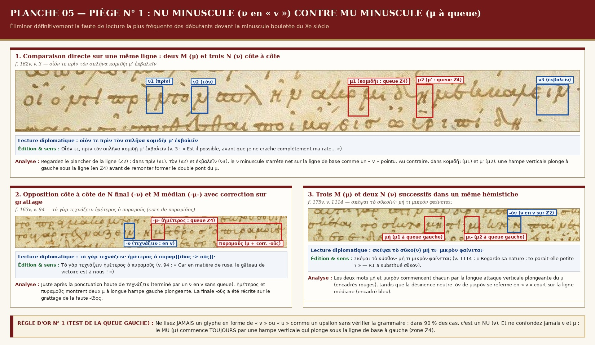

> **Règle mnémotechnique infaillible (Test de la queue gauche) :**  
> **Aucune queue plongeante à gauche sous la ligne ($\text{Z}_4$) = $\nu$ (*nu* en `v`) ou $\upsilon$ (*upsilon* en `u`).**  
> **Longue hampe verticale plongeant à gauche sous la ligne ($\text{Z}_4$) + double pont = $\mu$ (*mu*).**

### 3.2. Piège n° 2 : *Bêta* bilobé cursif ($\beta$ en `u`) *versus* $\text{B}$ semi-oncial, *Kappa* ($\kappa$) et *Nu* ($\nu$) (Planche 06)

Lorsque le lecteur moderne cherche un *bêta* ($\beta$), il s'attend à voir deux boucles superposées verticalement (`B`). Or, dans le corps des mots, $\text{R}^1$ trace presque toujours le **bêta minuscule cursif**, dit « bêta bilobé » ou « bêta en `u` » :
- Le calame descend sur $\text{Z}_2$, remonte au milieu pour former une pointe médiane, redescend pour former une seconde cuvette à droite et se referme vers le haut : le résultat ressemble à un **`u` latin à double fond**, sans aucune boucle supérieure !
- La **Planche 06** illustre ses quatre emplois caractéristiques dans *Les Thesmophories* :
  1. **f. 162v, v. 35** (`βε[[α->β]]ίνηκας`) : ce mot unique réunit côte à côte les deux allographes du bêta : le premier ($\beta\varepsilon-$) est le $\beta$ minuscule bilobé en `u` ; le second ($-\beta\acute{\iota}-$), récrit par $\text{R}^2$ sur le grattage d'un $\alpha$ fautif ($\beta\varepsilon\alpha\acute{\iota}\nu\eta\kappa\alpha\varsigma$), adopte la forme semi-onciale haute « $\text{B}$ » pour occuper tout l'espace du grattage.
  2. **f. 168r, v. 489** (`κύβδ' ἐχομένην τῆς δάφνης`) : dans le groupe consonantique $-\beta\delta-$, la cuvette bilobée du $\beta$ en `u` suit l'upsilon ($\acute{\upsilon}$) et s'attache par la base à la panse ronde du delta ($\delta$).
  3. **f. 173r, v. 895** (`βαΰζα σὺ... βάλλουσα ψόγωι`) : même à l'initiale absolue de mot, $\text{R}^1$ emploie deux fois sur la même ligne le $\beta$ minuscule bilobé en `u` suivi de l'alpha ($\beta\alpha-$).
  4. **f. 176v, $\Sigma$ v. 1174** (`τὸ ἁβρῶς βαδίζειν· ὡς οἱ πέρσαι ÷`) : dans la semi-cursive scholiographique de $\text{R}^2$ également, les deux bêta de $\dot{\alpha}\beta\rho\tilde{\omega}\varsigma$ et de $\beta\alpha\delta\acute{\iota}\zeta\varepsilon\iota\nu$ sont tracés comme de petites cuvettes doubles en `u`.

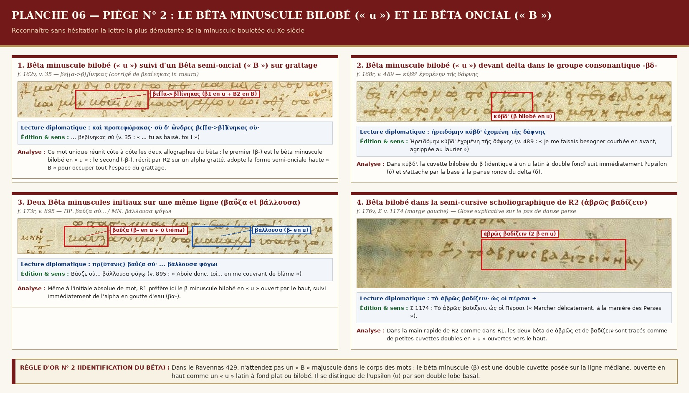

### 3.3. Piège n° 3 : La triade des hastes hautes — *Êta* ($\eta$ en `h`), *Kappa* ($\kappa$) et *Lambda* ($\lambda$) (Planche 07)

Trois lettres fréquentes dressent une haute hampe dans l'interligne supérieur ($\text{Z}_3$) : **$\eta$**, **$\kappa$** et **$\lambda$**. Comment les distinguer au premier coup d'œil avec les quatre exemples de la **Planche 07** ?

1. **L'êta minuscule ($\eta$)** est le sosie parfait de notre **`h` minuscule latin** : une haute haste verticale à gauche, suivie d'un pont arrondi qui redescend sur la ligne de base sans jamais se relever en accolade — voir **Planche 07, n° 1** (`f. 163v, v. 80` : les deux $\eta$ en `h` de $\tau\rho\acute{\iota}\tau\eta$ et $\dot{\eta}\ \mu\varepsilons\sigma\eta$).
2. **Le kappa minuscule ($\kappa$)** possède la même haute haste verticale à gauche, mais sa partie droite est formée d'une **accolade brisée à deux becs (`{` ou `<`)** — voir **Planche 07, n° 4** (`f. 168r, v. 500` : séquence complète $\dot{\varepsilon}\gamma\kappa\varepsilon\kappa\alpha\lambda\upsilon\mu\mu\varepsilons\nu\omicron\nu$ réunissant deux $\kappa$ à accolade, un $\lambda$ en arche, deux $\mu$ à queue et deux $\nu$ en `v`).
3. **Le lambda ($\lambda$)** n'a pas de haste verticale droite à gauche : il débute par une petite jambe courbe à gauche que surmonte une **longue diagonale descendante** allant du haut à gauche vers le bas à droite — voir **Planche 07, n° 2** (`f. 173r, v. 910` : faute de lecture de $\text{R}^1$ écrivant $\dot{\alpha}\varphi\acute{\upsilon}\omega\nu$ au lieu de $\grave{\iota}\kappa\rho\acute{\iota}\omega\nu$, corrigée en marge par $\text{R}^2$ $\grave{\iota}\varphi\acute{\upsilon}\omega\nu$) et **n° 3** (`f. 172r, v. 815` : $\pi\omicron\theta\omicron\tilde{\upsilon}\nu\tau\alpha\varsigma$ de $\text{R}^1$ pour $\dot{\varepsilon}\lambda\theta\omicron\tilde{\upsilon}\sigma\alpha\varsigma$).

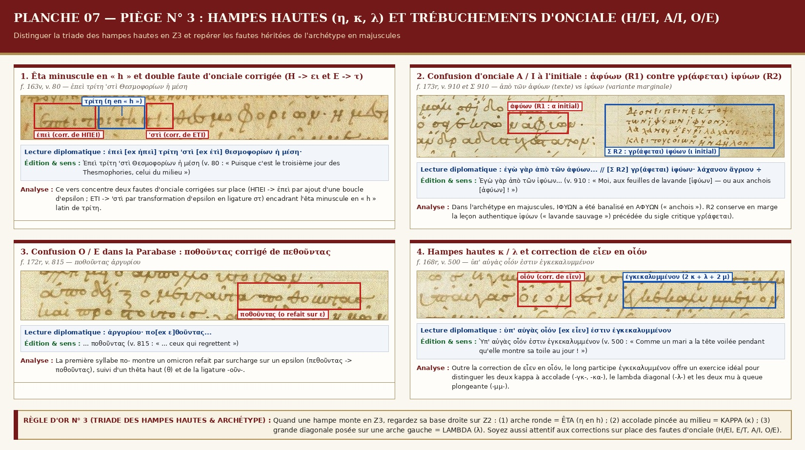

> **Note historique capitale (les « fautes d'onciale ») :**  
> Lorsque le modèle antique d'Aristophane a été translittéré de la majuscule onciale ($\text{A}, \Delta, \Lambda$) vers la minuscule au IXᵉ siècle, les trois lettres triangulaires **$\text{A}$ (alpha)**, **$\Delta$ (delta)** et **$\Lambda$ (lambda)** se ressemblaient tellement qu'elles ont provoqué des confusions célèbres conservées par $\text{R}^1$ :
> - **v. 289 (f. 165v)** : $\theta\upsilon\gamma\alpha\tau\varepsilons\rho\alpha\ \chi\omicron\tilde{\iota}\rho\omicron\nu\ \dot{\alpha}\nu\delta\rho\grave{\omicron}\varsigma$ au lieu de **$\dot{\alpha}\lambda\lambda\grave{\alpha}\ \tau\grave{\omicron}\nu$** ($\text{A}\Lambda\Lambda\text{ATON}$ lu $\text{AN}\Delta\text{POC}$) ;
> - **v. 496 (f. 168r)** : $\sigma\pi\lambda\varepsilon\kappa\omicron\tilde{\upsilon}\nu\tau\iota$ au lieu de **$\sigma\pi\varepsilon\kappa\lambda\omicron\tilde{\upsilon}\nu\tau\iota$**.

### 3.4. Piège n° 4 : Les lettres rondes ($\alpha, \omicron, \omega, \theta, \sigma$) et la lecture des surcharges vocaliques (Planche 08)

Dans le noyau bilinéaire, cinq lettres présentent une silhouette arrondie :
- **Omicron ($\omicron$)** : petit anneau parfaitement fermé au sommet, sans queue latérale.
- **Alpha ($\alpha$)** : panse ronde qui se prolonge à droite par un dard de liaison oblique ou horizontal.
- **Oméga ($\omega$)** : deux anneaux accolés ($\omega$ ou `∞`), souvent refermés au sommet mais **sans barre horizontale droite au-dessus** (ce qui le distingue du $\pi$ bouclé $\varpi$).
- **Sigma ($\sigma$)** : anneau fermé coiffé d'une casquette horizontale (ou croissant lunaire `c` en fin de mot et dans $\text{R}^2$).
- **Thêta ($\theta$)** : grand ovale plus haut que $\omicron$, traversé de part en part par une barre médiane.

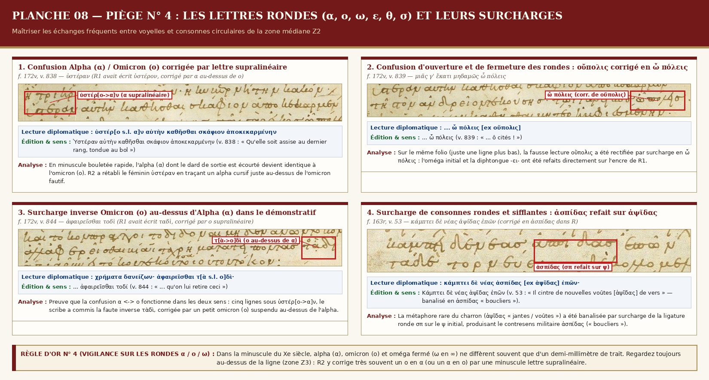

**Les quatre cas d'école de la Planche 08 sur les lettres rondes :**
1. **Correction par surcharge directe $\omicron \rightarrow \alpha$ (`f. 172v, v. 838` : `ὑστέρ[ο->α]ν`)** : $\text{R}^1$ avait commencé par tracer un omicron rond ($\dot{\upsilon}\sigma\tau\varepsilons\rho\omicron\nu$) ; le correcteur l'a transformé en alpha ($\dot{\upsilon}\sigma\tau\varepsilons\rho\alpha\nu$) en rajoutant à droite le dard oblique de sortie.
2. **Confusion entre oméga ($\omega$) et omicron ($\omicron$) (`f. 172v, v. 839` : `ὦ πόλεις` pour `ὁπόλις`)** : trompé par l'isochronie byzantine entre $\omicron$ et $\omega$, $\text{R}^1$ a coupé l'interrogatif $\dot{\omicron}\pi\acute{\omicron}\lambda\iota\varsigma$ en $\tilde{\omega}\ \pi\acute{\omicron}\lambda\varepsilon\iota\varsigma$.
3. **Correction par surcharge $\alpha \rightarrow \omicron$ (`f. 172v, v. 844` : `τ[ὰ->ο]δὶ`)** : la panse de l'alpha fautif ($\tau\grave{\alpha}\delta\grave{\iota}$) a été refermée en anneau rond d'omicron ($\tau\omicron\delta\grave{\iota}$).
4. **Coexistence des deux sigma ($\sigma$ à casquette et `c` lunaire) (`f. 163r, v. 53` : `ἀσπίδας`)** : dans le corps du mot ($\dot{\alpha}\sigma\pi-$), $\text{R}^1$ trace un sigma fermé à casquette horizontale soudée au $\pi$, tandis qu'en fin de mot ($-\delta\alpha\varsigma$), il trace un sigma lunaire ouvert (`c`).

### 3.5. Piège n° 5 : Les lettres à potence ($\gamma/\Gamma, \pi/\Pi, \tau$) et les plongeantes sinueuses ($\zeta, \xi, \psi$) (Planche 09)

Deux familles géométriques méritent une attention particulière, illustrées par les quatre spécimens de la **Planche 09** :

1. **Les lettres à toit horizontal (« à potence » : $\gamma/\Gamma, \pi/\Pi, \tau$)** :
   - **Tau ($\tau$)** : une seule haste verticale courte plantée **au milieu** sous la barre horizontale et s'arrêtant net sur $\text{Z}_2$.
   - **Gamma ($\gamma/\Gamma$)** : en minuscule, la haste plonge profondément sous la ligne ($\text{Z}_4$) en formant une boucle étroite ; en forme haute ($\Gamma$), elle forme une équerre droite. Voir **Planche 09, n° 1** (`f. 162v, vv. 30–31`) : juxtaposition de $\tau$, $\gamma$ et $\pi$ dans $\dot{\omicron}\ \tau\rho\alpha\gamma\omega\iota\delta\omicron\pi\omicron\iota\acute{\omicron}\varsigma$, suivie du jeu de mots $\dot{\alpha}\gamma\dot{\alpha}\theta\omega\nu$ (v. 30) / $\dot{\alpha}\gamma\alpha\theta\tilde{\omega}\nu$ (v. 31, corrigé de $\dot{\alpha}\gamma\dot{\alpha}\theta\omega\nu$).
   - **Pi ($\pi/\Pi$)** : **deux jambages** sous la barre horizontale (recourbés en oméga fermé dans le $\pi$ minuscule). Voir **Planche 09, n° 4** (`f. 172v, vv. 852–853` : `πικρὰν ἑλένην`), où le $\pi-$ initial à double jambage de $\pi\iota\kappa\rho\grave{\alpha}\nu$ a remplacé dans l'archétype le $\mu-$ de $\mu\iota\kappa\rho\grave{\alpha}\nu$.
2. **Les trois descendantes axiales ou sinueuses ($\zeta, \xi, \psi$)** :
   - **Zêta ($\zeta$)** : tête plate sur $\text{Z}_1$ + **une seule courbure** médiane avant la queue plongeante (silhouette de `3`). Voir **Planche 09, n° 2** (`f. 163v, v. 100` : `μύρμηκος ἀτραπούς, ἢ τί διαμινυρίζεται`), qui aligne $\tau\rho$, $\pi$ et le $\zeta$ en éclair de $\delta\iota\alpha\mu\iota\nu\upsilon\rho\acute{\iota}\zeta\varepsilon\tau\alpha\iota$.
   - **Xi ($\xi$)** : tête plate + **deux courbures** serrées en accordéon avant la queue plongeante. Voir **Planche 09, n° 3** (`f. 165v, vv. 288–289` : `ξυνεύχου... χοῖρον`), qui oppose le $\xi-$ initial en triple serpentin de $\xi\upsilon\nu\varepsilon\acute{\upsilon}\chi\omicron\upsilon$ et le $\chi-$ en sautoir de $\chi\omicron\tilde{\iota}\rho\omicron\nu$.
   - **Psi ($\psi$)** : long mât vertical droit traversant $\text{Z}_3$–$\text{Z}_4$, embrassé par un **calice ouvert** sur $\text{Z}_2$ (ex. $\ddot{\omicron}\psi\varepsilon\iota$ v. 6, $\psi\acute{\omicron}\gamma\omega\iota$ v. 895).

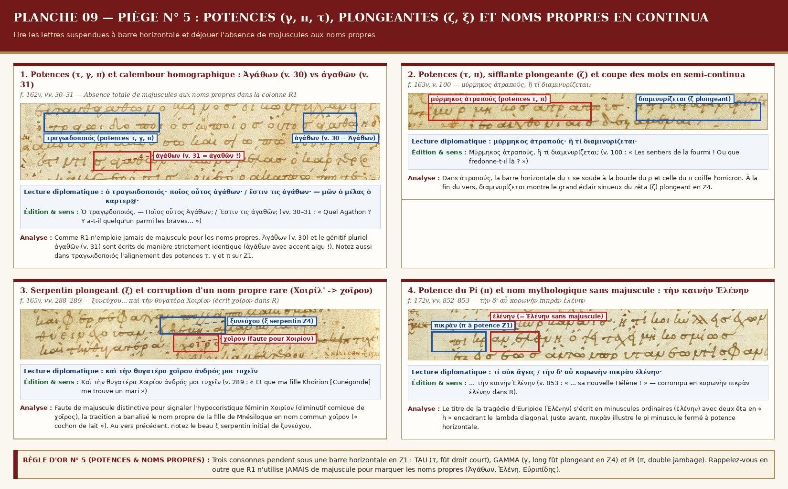

### 3.6. Piège n° 6 : La grande spirale finale `-ος` (`@`) *versus* l'idéogramme astronomique `☉` (*hêlios*) (Planche 10)

En regardant la fin des mots du *Ravennas*, vous remarquerez fréquemment un grand signe circulaire enroulé sur lui-même comme un colimaçon ou un arobase (`@`). Mais dans la marge gauche du **folio 162v (face au v. 17)**, vous rencontrerez aussi un cercle isolé centré d'un point et surmonté d'un rayon oblique (`☉`) ! La **Planche 10** vous apprend à ne jamais les confondre :

- **La spirale ouverte enroulée (`@`) attachée à la fin d'un mot** est la **ligature tachygraphique de la finale `-ος` (parfois `-ον`)** : le calame trace l'omicron et, sans lever la plume, s'enroule autour de lui pour former un grand sigma lunaire enveloppant :
  1. **f. 162v, v. 31** : `μῶν ὁ μέλας ὁ καρτερ@` (= $\kappa\alpha\rho\tau\varepsilon\rho\acute{\omicron}\varsigma$).
  2. **f. 170r, v. 636** : `ξενύλλ@ αἴτησον σκάφην` — cas pathologique fascinant où $\text{R}^1$, habitué à abréger les masculins en $-\omicron\varsigma$ par la spirale `@`, a machinalement affublé le vocatif féminin élidé $\Xi\varepsilons\nu\upsilon\lambda\lambda'$ de la spirale `@` ($\xi\varepsilon\nu\acute{\upsilon}\lambda\lambda\omicron\varsigma$) !
  3. **f. 176v, après le v. 1187** : `ἀνακύπτη· καὶ παρακύπτι· ἀπεψωλημέν@·` (= $\dot{\alpha}\nu\alpha\kappa\acute{\upsilon}\pi\tau\varepsilon\iota\ \kappa\alpha\grave{\iota}\ \pi\alpha\rho\alpha\kappa\acute{\upsilon}\pi\tau\varepsilon\iota\ \dot{\alpha}\pi\varepsilon\psi\omega\lambda\eta\mu\varepsilons\nu\omicron\varsigma$, en fin de la quatrième *parepigraphè* scénique).
- **Le cercle solaire pointé et rayonné (`☉`)** est l'**idéogramme astronomique antique du Soleil ($\ἥ\lambda\iota\omicron\varsigma$)**, employé par le scholiaste $\text{R}^2$ pour remplacer le mot entier sous son cas fléchi ! Au **f. 162v, v. 17** (`ὀφθαλμὸν ἀντίμιμον ἡλίου τροχῶι`, « l'œil imitant la roue du soleil »), $\text{R}^1$ écrit **$\dot{\eta}\lambda\acute{\iota}\omicron\upsilon$** en toutes lettres dans la colonne centrale, tandis qu'en marge gauche ($\Sigma$ v. 17), $\text{R}^2$ écrit : `ὁμοί(ως) δὲ τῶι ☉ τὸ περιφερές` (« car la rondeur est semblable au **soleil** [$\tau\tilde{\ῳ}\ \dot{\eta}\lambda\acute{\iota}\ῳ$] ») en dessinant l'idéogramme `☉` au lieu du mot $\dot{\eta}\lambda\acute{\iota}\omega\iota$ !

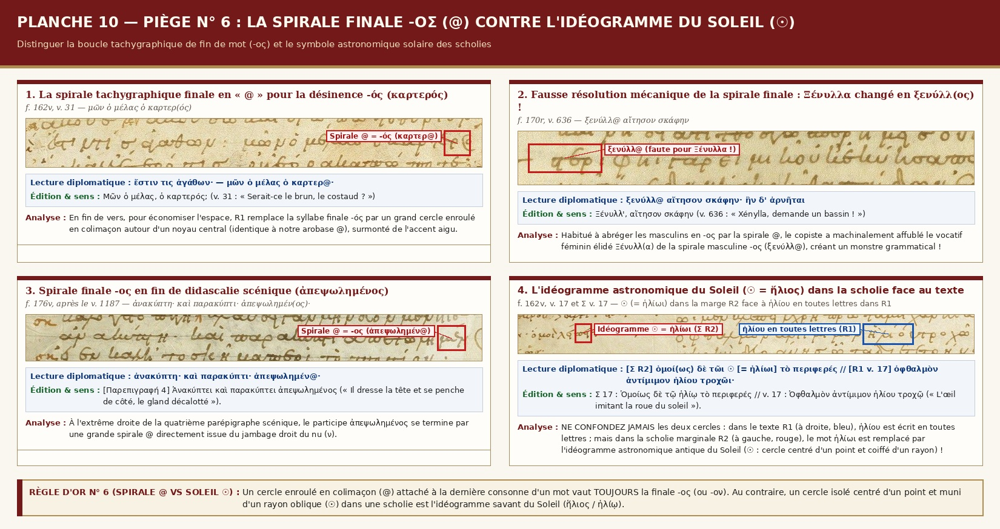

---

## 4. Leçon 3 — Le système des ligatures : décomposer les groupes de lettres liés

Dans l'écriture de $\text{R}^1$, les lettres ne sont pas simplement juxtaposées : certaines lettres dites « liantes » ($\varepsilon, \sigma, \alpha, \gamma, \tau, \pi$) fusionnent leur dernier trait avec le premier trait de la lettre suivante. Apprendre à déchiffrer le *Ravennas* consiste pour moitié à reconnaître instantanément ces **ligatures bilitères ou trilitères**.

### 4.1. Les ligatures d'*epsilon* ($\varepsilon$) : le trait plongeant ($\varepsilon\iota$), l'« as de pique » ($\varepsilon\rho, \varepsilon\sigma, \varepsilon\xi$) et l'arche ($\varepsilon\tau$) (Planche 11)

La voyelle *epsilon* ($\varepsilon$) est le véritable pivot cursif de la minuscule byzantine. Selon la lettre qui la suit, elle adopte trois morphologies distinctes :

1. **La diphtongue $\varepsilon\iota$ (epsilon + iota plongeant)** : le lobe supérieur de l'$\varepsilon$ se prolonge à droite par un **long trait vertical droit qui plonge sous la ligne de base**. Dès que vous voyez un $\varepsilon$ muni d'une béquille verticale descendante à droite, lisez **$\varepsilon\iota$** (ex. $\delta\varepsilon\tilde{\iota}$, $\varepsilon\tilde{\iota}\nu\alpha\iota$, $\dot{\alpha}\pi\omicron\lambda\varepsilon\tilde{\iota}$).
2. **La ligature en « as de pique » ($\varepsilon\rho, \varepsilon\sigma, \varepsilon\pi, \varepsilon\xi$)** : la boucle supérieure de l'$\varepsilon$ se referme en pointe inclinée vers la droite (comme un as de pique renversé) et plonge directement pour former la tête et la queue du $\rho$ ($\varepsilon\rho$), la courbe du $\sigma$ ($\varepsilon\sigma$), le jambage gauche du $\pi$ ($\varepsilon\pi$) ou le serpentin du $\xi$ ($\varepsilon\xi$).
3. **La ligature en arche $\varepsilon\tau$** : le lobe supérieur de l'$\varepsilon$ s'étire horizontalement vers la droite pour devenir la barre transversale du $\tau$, sous laquelle descend la haste verticale.

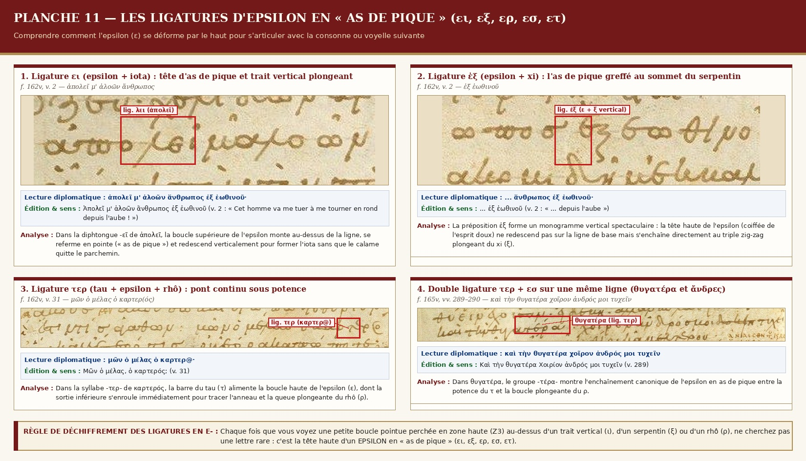

### 4.2. Les ligatures de *sigma* ($\sigma$) : groupes $\sigma\pi$, $\sigma\tau$, $\sigma\theta$, $\sigma\kappa$ et $\sigma\chi$ (Planche 12)

Le sigma lunaire ($\sigma$) possède au sommet une « casquette » horizontale qui sert de pont vers la consonne suivante :
- **$\sigma\tau$ (*sigma-tau*)** : la courbe du $\sigma$ monte former d'un seul jet la barre horizontale du $\tau$.
- **$\sigma\pi$ (*sigma-pi*)** : le chapeau du $\sigma$ s'allonge pour former le toit horizontal du $\pi$ (ex. $\sigma\pi\lambda\tilde{\eta}\nu\alpha$, $\sigma\pi\omicron\upsilon\delta\dot{\alpha}\zeta\varepsilon\iota$).
- **$\sigma\theta$ (*sigma-thêta*)** : le chapeau du $\sigma$ pénètre à mi-hauteur dans l'ovale du $\theta$ pour en former la barre transversale médiane (ex. $\omicron\tilde{\iota}\sigma\theta'$, $\mu\dot{\alpha}\lambda\iota\sigma\theta'$).
- **$\sigma\chi$ (*sigma-chi*)** : le sommet du $\sigma$ se soude à l'extrémité haute de la diagonale descendante du $\chi$ (ex. $\sigma\chi\tilde{\eta}\mu\alpha$).

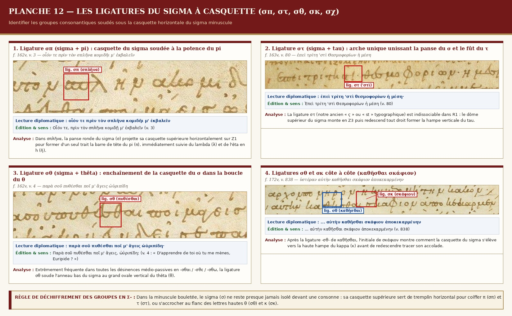

### 4.3. Les ligatures de consonnes ($\pi\rho, \tau\rho, \gamma\omega\iota$) et la gémination du *lambda* ($-\lambda\lambda-$ *vs* $-\lambda-$) (Planche 13)

Trois autres combinaisons consonantiques reviennent à chaque page :
- **$\pi\rho$ et $\tau\rho$** : dans $\pi\rho$ (ex. $\pi\rho\grave{\iota}\nu$), le jambage droit du $\pi$ descend sous la ligne et s'enroule en boucle pour former le $\rho$ ; dans $\tau\rho$ (ex. $\tau\rho\alpha\gamma\omega\iota\delta\omicron\pi\omicron\iota\acute{\omicron}\varsigma$), c'est l'extrémité droite de la barre du $\tau$ qui descend former le $\rho$.
- **Le double lambda ($-\lambda\lambda-$) *versus* le lambda simple ($-\lambda-$)** : lorsque deux $\lambda$ se suivent (ex. $\dot{\alpha}\lambda\lambda'$, $\mu\varepsilons\lambda\lambda\omega$), les deux chevrons s'emboîtent étroitement l'un dans l'autre avec deux longues jambes droites parallèles. La **Planche 13 (n° 4)** vous offre un cas d'école extraordinaire au **f. 175r (vv. 1073–1074)** : à une ligne d'intervalle, $\text{R}^1$ écrit $\sigma\tau\omega\mu\upsilon\lambda\lambda\omicron\mu\varepsilons\nu\eta$ avec un **double $-\lambda\lambda-$** au v. 1073, puis, dans la réplique d'Écho au v. 1074, $\sigma\tau\omega\mu\upsilon\lambda\omicron\mu\varepsilons\nu\eta$ avec un **seul $-\lambda-$** !

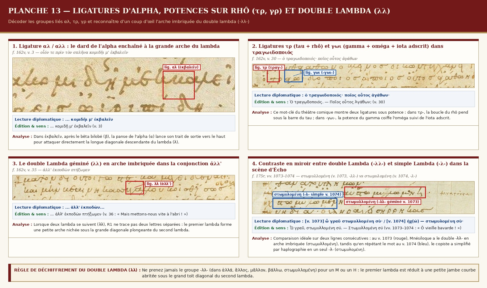

### 4.4. Tableau synoptique de résolution des 30 ligatures les plus fréquentes

| Groupe lié | Aspect visuel dans $\text{R}^1$ | Décomposition du tracé (*ductus*) | Exemple type dans les *Thesmophories* |
| :---: | :--- | :--- | :--- |
| **$\alpha\gamma$** | Panse ronde + boucle basse et potence | Le trait haut de $\alpha$ rejoint le sommet du $\gamma$ | $\dot{\alpha}\gamma\dot{\alpha}\theta\omega\nu$ (f. 162v, v. 29) |
| **$\alpha\iota$** | Panse ronde + petit trait vertical lié | Le trait de sortie de $\alpha$ redescend former $\iota$ | $\kappa\alpha\grave{\iota}$, $\pi\alpha\tilde{\iota}\varsigma$ (passim) |
| **$\alpha\lambda / \alpha\lambda\lambda$** | Panse ronde + 1 ou 2 chevrons obliques | Liaison haute de $\alpha$ vers le sommet du $\lambda$ | $\dot{\alpha}\lambda\lambda'$, $\kappa\alpha\lambda\acute{\omicron}\varsigma$ (f. 162v, v. 35) |
| **$\alpha\rho$** | Panse de $\alpha$ + boucle plongeante de $\rho$ | Le trait supérieur de $\alpha$ enveloppe la tête du $\rho$ | $\tilde{\alpha}\rho\alpha$, $\gamma\grave{\alpha}\rho$ (f. 162v, vv. 1, 11) |
| **$\alpha\sigma$** | Panse de $\alpha$ + croissant lunaire sous barre | Le trait haut de $\alpha$ forme la casquette du $\sigma$ | $\pi\tilde{\alpha}\sigma\alpha$, $\theta\dot{\alpha}\sigma\omicron\nu$ (passim) |
| **$\alpha\tau$** | Panse de $\alpha$ + barre horizontale de $\tau$ | Le trait haut de $\alpha$ devient la barre du $\tau$ | $\kappa\alpha\tau\grave{\alpha}$ (f. 163r, v. 61) |
| **$\gamma\alpha / \gamma\varepsilon / \gamma\omicron$** | Potence haute abritant la voyelle ronde | La barre horizontale du $\gamma$ couvre la voyelle | $\gamma\grave{\alpha}\rho$, $\gamma\varepsilons\rho\omega\nu$, $\lambda\acute{\omicron}\gamma\omicron\varsigma$ (passim) |
| **$\delta\varepsilon / \delta\iota / \delta\omicron$** | Panse ronde + grand col recourbé plongeant | Le crochet haut du $\delta$ redescend tracer $\varepsilon, \iota, \omicron$ | $\delta\varepsilon\tilde{\iota}$, $\delta\iota\grave{\alpha}$ (f. 162v, vv. 8–9) |
| **$\varepsilon\iota$** | $\varepsilon$ suivi d'une longue haste verticale basse | Lobe supérieur de $\varepsilon$ + $\iota$ plongeant sous la ligne | $\dot{\alpha}\pi\omicron\lambda\varepsilon\tilde{\iota}$, $\dot{\varepsilon}\kappa\beta\alpha\lambda\varepsilon\tilde{\iota}\nu$ (f. 162v, vv. 2–3) |
| **$\varepsilon\gamma / \varepsilon\kappa$** | $\varepsilon$ bilobé soudé à mi-hauteur à $\gamma$ ou $\kappa$ | Le lobe supérieur de $\varepsilon$ attaque la haste de $\kappa/\gamma$ | $\dot{\varepsilon}\kappa\beta\alpha\lambda\varepsilon\tilde{\iota}\nu$, $\dot{\varepsilon}\gamma\grave{\omega}$ (f. 162v, v. 3) |
| **$\varepsilon\nu / \varepsilon\mu$** | $\varepsilon$ en as de pique plongeant dans la hampe | La pointe haute de $\varepsilon$ descend former la queue de $\nu/\mu$ | $\mu\grave{\varepsilon}\nu$, $\dot{\varepsilon}\mu\grave{\varepsilon}$ (passim) |
| **$\varepsilon\xi$** | $\varepsilon$ en as de pique + serpentin triple $\xi$ | Le sommet de $\varepsilon$ s'enchaîne aux trois boucles de $\xi$ | $\dot{\varepsilon}\xi\ \dot{\varepsilon}\omega\theta\iota\nu\omicron\tilde{\upsilon}$ (f. 162v, v. 2) |
| **$\varepsilon\pi$** | $\varepsilon$ en as de pique soudé au toit du $\pi$ | La boucle haute de $\varepsilon$ rejoint le jambage gauche de $\pi$ | $\dot{\varepsilon}\pi\varepsilon\grave{\iota}$, $\varepsilon\tilde{\iota}\pi\varepsilon$ (f. 162v, v. 18) |
| **$\varepsilon\rho$** | $\varepsilon$ en as de pique + queue plongeante de $\rho$ | Le lobe fermé de $\varepsilon$ forme d'un trait la tête et la haste de $\rho$ | $\gamma\varepsilons\rho\omega\nu$, $\pi\varepsilon\rho\grave{\iota}$ (f. 163r, v. 63) |
| **$\varepsilon\sigma$** | $\varepsilon$ en as de pique + croissant de $\sigma$ | Le lobe fermé de $\varepsilon$ coiffe le dos du sigma lunaire | $\varepsilon\tilde{\upsilon}\varphi\eta\mu\omicron\varsigma\ \ἔ\sigma\tau\omega$ (f. 162v, v. 39) |
| **$\varepsilon\tau$** | Arche haute de $\varepsilon$ formant le toit du $\tau$ | Le lobe supérieur de $\varepsilon$ s'étire en barre de $\tau$ | $\varphi\alpha\nu\acute{\eta}\sigma\varepsilon\tau\alpha\iota$ (f. 162v, v. 1) |
| **$\theta\rho / \theta\iota$** | Grand ovale $\theta$ dont la barre lie $\rho$ ou $\iota$ | La traverse médiane du $\theta$ sort à droite pour lier | $\ddot{\alpha}\nu\theta\rho\omega\pi\omicron\varsigma$, $\theta\rho\iota\gamma\kappa\omicron\tilde{\upsilon}$ (f. 162v, v. 2 ; f. 163r, v. 61) |
| **$\pi\rho$** | $\pi$ dont le 2e jambage s'enroule en $\rho$ | Le pied droit du $\pi$ descend sous la ligne former $\rho$ | $\pi\rho\grave{\iota}\nu$, $\pi\rho\acute{\omicron}\varepsilon\lambda\theta\varepsilon$ (f. 162v, v. 3) |
| **$\sigma\theta$** | Croissant $\sigma$ soudé à la barre médiane de $\theta$ | Le chapeau de $\sigma$ traverse l'ovale du $\theta$ | $\omicron\tilde{\iota}\sigma\theta'$, $\alpha\grave{\iota}\sigma\theta\dot{\alpha}\nu\varepsilon\iota$ (f. 162v, v. 35) |
| **$\sigma\pi$** | Croissant $\sigma$ prolongé par le toit du $\pi$ | La casquette de $\sigma$ devient la barre supérieure de $\pi$ | $\sigma\pi\lambda\tilde{\eta}\nu\alpha$, $\sigma\pi\varepsilon\tilde{\upsilon}\delta\varepsilon$ (f. 162v, v. 3) |
| **$\sigma\tau$** | Croissant $\sigma$ + haste verticale sous un même toit | La casquette de $\sigma$ forme la barre horizontale de $\tau$ | $\dot{\varepsilon}\sigma\tau\iota\nu$, $\sigma\tau\omega\mu\upsilon\lambda\lambda\omicron\mu\varepsilons\nu\eta$ (passim) |
| **$\sigma\chi$** | Croissant $\sigma$ lié au bras supérieur gauche de $\chi$ | Le chapeau de $\sigma$ attaque la diagonale de $\chi$ | $\sigma\chi\tilde{\eta}\mu\alpha$ (f. 164r, v. 151) |
| **$\tau\iota$** | Potence $\tau$ + long trait droit plongeant à droite | L'extrémité droite du toit de $\tau$ descend en $\iota$ long | $\tau\acute{\iota}\varsigma$, $\dot{\alpha}\nu\tau\grave{\iota}$ (passim) |
| **$\tau\rho$** | Potence $\tau$ + boucle et queue plongeante de $\rho$ | L'extrémité droite du toit de $\tau$ s'enroule en $\rho$ | $\tau\rho\alpha\gamma\omega\iota\delta\omicron\pi\omicron\iota\acute{\omicron}\varsigma$ (f. 162v, v. 30) |

---

## 5. Leçon 4 — Esprits, accents, iota muet et ponctuation du dialogue

### 5.1. La règle absolue de l'iota muet adscrit ($\alpha\iota, \eta\iota, \omega\iota$) et le piège du $-\iota$ déictique (Planche 14)

Dans nos livres imprimés depuis la Renaissance, l'iota muet des datifs singuliers ($\tau\tilde{\eta}\ \kappa\omega\mu\omega\delta\acute{\iota}\alpha$) et des subjonctifs est placé **sous** la voyelle longue (*iota souscrit* : $\ᾳ, \ῃ, \ῳ$).
**Dans le *Codex Ravennas 429*, l'iota souscrit n'existe pas !**
- Lorsqu'il est noté par $\text{R}^1$, l'iota muet est **toujours adscrit sur la ligne**, c'est-à-dire écrit comme un iota normal immédiatement à droite de l'alpha, de l'êta ou de l'oméga : **$\kappa\omicron\mu\iota\delta\tilde{\eta}\iota$** (= $\kappa\omicron\mu\iota\delta\tilde{\eta}$, v. 3), **$\dot{\omicron}\tilde{\upsilon}\sigma\eta\iota$** (= $\omicron\ddot{\upsilon}\sigma\ῃ$, v. 11), **$\tau\rho\alpha\gamma\omega\iota\delta\varepsilon\tilde{\iota}\nu$** (= $\tau\rho\alpha\gamma\ῳ\delta\varepsilon\tilde{\iota}\nu$, v. 28).
- Très souvent aussi, parce qu'il ne se prononçait plus depuis l'époque hellénistique, $\text{R}^1$ l'omet purement et simplement (ex. $\tau\tilde{\omega}$ pour $\tau\tilde{\ῳ}$).
- **Le piège d'hypercorrection ($\text{R}^1$ confondant iota adscrit muet et $-\iota$ déictique prononcé)** : en attique parlé, les démonstratifs prennent souvent un $-\acute{\iota}$ final long et accentué ($\omicron\dot{\upsilon}\tau\omicron\sigma\acute{\iota}$ « celui-ci sous tes yeux », $\delta\varepsilon\upsilon\rho\acute{\iota}$ « par ici », $\nu\upsilon\nu\acute{\iota}$ « à l'instant même »). Or, au **v. 26 (f. 162v)**, devant **$\tau\eta\nu\delta\grave{\iota}$** ($\tau\eta\nu\delta\acute{\iota}$ « cette porte-ci »), $\text{R}^1$ a cru que l'iota final était un iota muet adscrit de datif : il a donc écrit **$\tau\tilde{\eta}\nu\delta\iota$** avec un circonflexe sur l'êta !

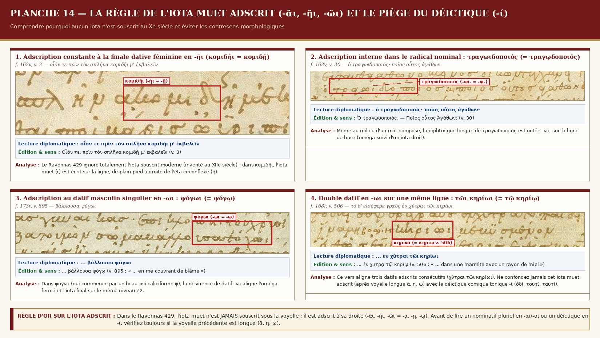

### 5.2. Esprits (carrés ou ronds), accents, tréma inorganique ($\ddot{\iota}, \ddot{\upsilon}$) et *scriptio plena* (Planche 15)

L'observation de l'interligne supérieur fournit de précieux indices de lecture :
1. **Les esprits ont deux formes concurrentes** : la forme ancienne dite « esprit carré » (demi-H coupé en deux : `⊢` pour l'esprit rude, `⊣` pour l'esprit doux) et la forme semi-circulaire (`c` et `ɔ`).
2. **Le tréma « inorganique » sur iota ($\ddot{\iota}$) et upsilon ($\ddot{\upsilon}$)** : $\text{R}^1$ place très souvent deux points (`¨`) au-dessus d'un $\iota$ ou d'un $\upsilon$ initial ou intérieur (ex. $\ddot{\iota}\delta\varepsilon\tilde{\iota}\nu$, $\ddot{\upsilon}\mu\varepsilon\tilde{\iota}\varsigma$), **même lorsqu'il n'y a aucun hiatus**. Ce tréma purement visuel sert à empêcher que le petit trait de $\iota$ ou le godet de $\upsilon$ ne soit confondu avec les jambages des consonnes voisines ($\nu, \mu, \pi$).
3. **La *scriptio plena* (élision écrite en toutes lettres malgré le mètre)** : il arrive fréquemment que $\text{R}^1$ écrive la voyelle finale élidée tout en plaçant l'apostrophe d'élision ! Ainsi, au **v. 15 (f. 162v)**, le manuscrit porte **$\tau\omicron\tilde{\upsilon}\tau\omicron\ '\kappa\alpha\lambda\varepsilons\sigma\alpha\tau\omicron$** là où le trimètre iambique exige l'élision **$\tau\omicron\tilde{\upsilon}\tau'\ \dot{\varepsilon}\kappa\alpha\lambda\varepsilons\sigma\alpha\tau\omicron$**.

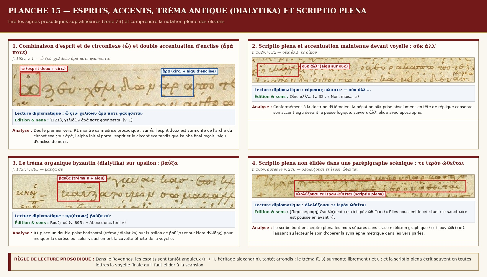

### 5.3. La ponctuation dramatique : *paragraphos* (`—`), *dikôlon* (`:`) et *korônis* strophique (Planche 16)

Comment les changements de répliques et les grandes articulations de la comédie sont-ils signalés dans le manuscrit ? Par un système hérité directement des papyrus alexandrins :

1. **Le *dikôlon* (`:`) dans le cours du vers** : deux points superposés verticalement marquent un changement d'interlocuteur **à l'intérieur même d'un vers** (*antilabè*).
2. **La *paragraphos* (`—`) dans la marge gauche** : un tiret horizontal tracé sous le début de la ligne indique que la réplique a changé au cours de cette ligne ou qu'une nouvelle réplique commence à la ligne suivante.
3. **Les *notae personarum* de $\text{R}^2$** : le réviseur $\text{R}^2$ est venu compléter ces signes géométriques en inscrivant en marge (ou parfois au-dessus du *dikôlon*) le nom abrégé du personnage qui prend la parole.
4. **La *korônis* (`⸎` / crochet ornementé)** : un grand signe calligraphique en forme d'oiseau stylisé ou de hampe barrée à boucles dans la marge gauche signale une **transition métrique et scénique majeure** (entrée ou sortie d'un personnage, début de la parabase, passage du dialogue parlé au chant lyrique, ou fin de la pièce au f. 177r).

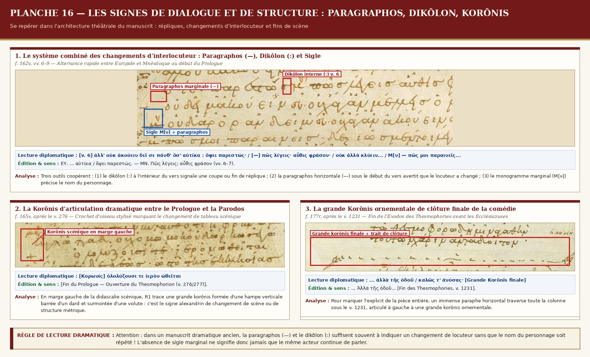

---

## 6. Leçon 5 — Les écritures de $\text{R}^2$ : *notae personarum*, tachygraphie des scholies et *parepigraphai*

Une fois que vous savez lire la colonne poétique centrale de $\text{R}^1$, il vous reste à conquérir les marges du manuscrit, où le réviseur et scholiaste **$\text{R}^2$** a déployé un système d'écriture beaucoup plus condensé.

### 6.1. Déchiffrer les *notae personarum* : le principe du monogramme par superposition (Planche 17)

Pour faire tenir le nom d'un personnage dans un espace marginal de quelques millimètres sans empiéter sur les scholies, $\text{R}^2$ ne se contente pas de tronquer le mot après la 2ᵉ ou la 3ᵉ lettre (suspension simple comme $\varepsilon\dot{\upsilon}\rho/$ pour $\text{Εὐριπίδης}$ ou $\chi\omicron/$ pour $\text{Χορός}$). Il construit de véritables **monogrammes à deux étages** en **perchant la consonne ou la voyelle suivante juste au-dessus** de la dernière lettre écrite sur la ligne !

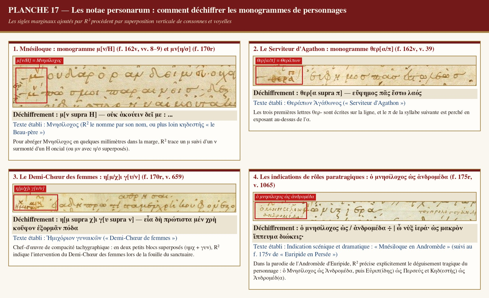

| Sigle dans le manuscrit | Lecture diplomatique | Développement complet | Rôle dans *Les Thesmophories* |
| :---: | :--- | :--- | :--- |
| **$\mu^{\text{H}}_{\nu}$** ou **$\mu\nu^{\sigma}_{\eta}$** | `μ[ν supra Η]` ou `μν[η supra σ]` | **$\text{Μνησίλοχος}$** | Le parent par alliance d'Euripide (que $\text{R}^2$ identifie à Mnésiloque d'après la tradition biographique antique). |
| **$\kappa\eta^{\delta}$** ou **$\kappa\eta\delta/$** | `κη[δ]` | **$\text{Κηδεστής}$** | « Le Beau-père / Parent par alliance » (autre désignation du même personnage dans la 2ᵉ moitié de la pièce). |
| **$\varepsilon\dot{\upsilon}\rho/$** ou **$\varepsilon\dot{\upsilon}^{\rho}_{\iota}$** | `εὐρ/` ou `εὐ[ι supra ρ]` | **$\text{Εὐριπίδης}$** | Le poète tragique Euripide. |
| **$\theta\varepsilon\rho^{\pi}_{\alpha}$** | `θερ[α supra π]` | **$\text{Θεράπων}$** | Le Serviteur d'Agathon (ff. 162v–163r, vv. 39–70). |
| **$\dot{\alpha}\gamma\dot{\alpha}\theta/$** | `ἀγάθ/` | **$\text{Ἀγάθων}$** | Le poète tragique Agathon (ff. 163v–165v). |
| **$\chi\omicron/$** | `χο/` | **$\text{Χορός}$** | Le Chœur des femmes célébrant les Thesmophories. |
| **$\dot{\eta}\mu^{\chi}_{\iota}\ \gamma^{\nu}_{\upsilon}$** | `η[μ supra χ]ι γ[υ supra ν]` | **$\text{Ἡμιχόριον γυναικῶν}$** | Le Demi-Chœur des femmes (f. 170r, v. 659). |
| **$\gamma\upsilon\nu^{\alpha}$** / **$\kappa\rho\iota\tau^{\upsilon}$** | `γυν[α]` / `κριτ[υ]` | **$\text{Γυνή}$ / $\text{Κριτύλλα}$** | Les femmes athéniennes (Mika, Kritylla) à l'assemblée. |
| **$\kappa\lambda\varepsilon\iota\sigma^{\theta}$** | `κλεισ[θ]` | **$\text{Κλεισθένης}$** | L'efféminé Clisthène, messager des femmes (ff. 169r–170r). |
| **$\pi\rho\upsilon^{\tau}$** / **$\tau\omicron\xi^{\omicron}$** | `πρυ[τ]` / `τοξ[ο]` | **$\text{Πρύτανις}$ / $\text{Τοξότης}$** | Le Prytane et l'Archer scythe (*Toxotês*, ff. 173r–177r). |
| **$\dot{\omicron}\ \mu\nu\eta\sigma\acute{\iota}\lambda\omicron\chi\omicron\varsigma\ \dot{\omega}\varsigma\ \dot{\alpha}\nu\delta\rho\omicron\mu\varepsilons\delta\alpha$** | En semi-onciale sur 2 lignes | **$\text{Ὁ Μνησίλοχος ὡς Ἀνδρομέδα}$** | Indication de jeu paratragique au f. 175r (v. 1065), suivie au f. 175v de $\text{Εὐριπ(ίδης) ὡς Περσεύς}$. |

### 6.2. La tachygraphie des scholies marginales ($\Sigma^{\text{R}}$) : suspensions, finales en exposant et sigles (Planche 18)

Pourquoi les scholies marginales de $\text{R}^2$ paraissent-elles d'abord plus difficiles à lire que le texte d'Aristophane, alors même que leurs lettres sont de petites capitales détachées (semi-onciale) ? Parce que $\text{R}^2$ **abrège systématiquement la fin des mots courants** (articles, prépositions, participes, désinences casuelles) au moyen d'un code tachygraphique rigoureux.

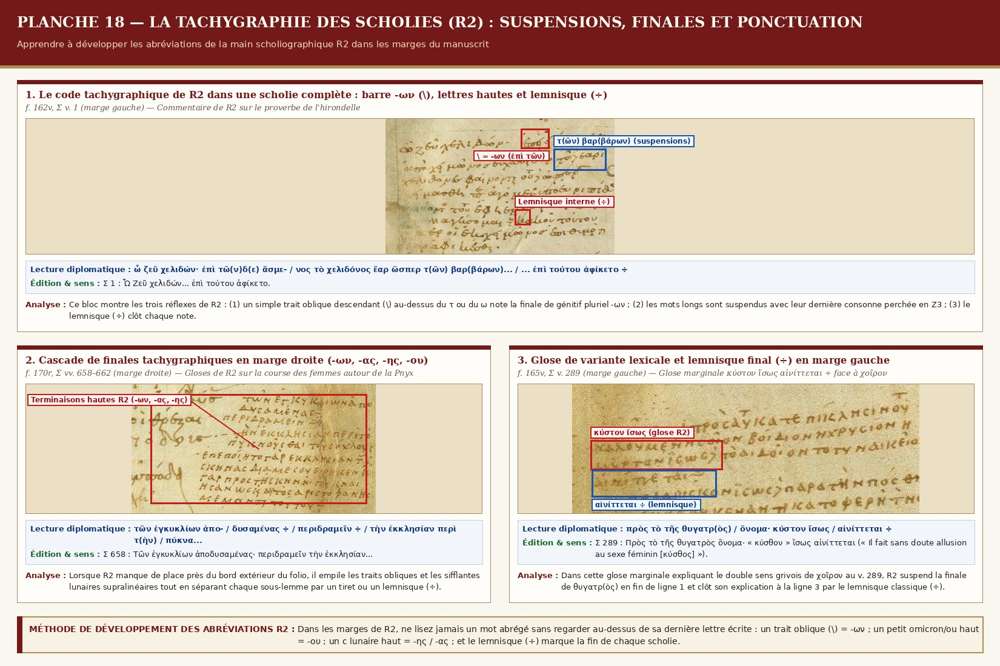

Voici la **table de décodage complète des abréviations de $\text{R}^2$** :

| Signe tachygraphique dans $\Sigma^{\text{R}}$ | Position par rapport au mot | Valeur phonétique (développement) | Exemple dans les scholies des *Thesmophories* |
| :---: | :--- | :--- | :--- |
| **`\`** (trait oblique descendant) | Au-dessus de la dernière consonne | **`-ων`** (génitif pluriel) | `τ\` = $\tau\tilde{\omega}\nu$ ; `ὄντ\` = $\ὄ\nu\tau\omega\nu$ (f. 162v, $\Sigma$ 1) |
| **`^`** ou **`v`** (petit circonflexe/godet) | En exposant après la consonne | **`-ου`** (génitif singulier) | `τ^` = $\tau\omicron\tilde{\upsilon}$ ; `αὐτ^` = $\alpha\dot{\upsilon}\tau\omicron\tilde{\upsilon}$ |
| **`^ο`** ou **`@`** (petit rond ou spirale) | En exposant en fin de mot | **`-ος`** (nominatif singulier) | `χειμῶν^ο` = $\chi\varepsilon\iota\mu\tilde{\omega}\nu\omicron\varsigma$ |
| **`^ς`** (petit sigma lunaire haut) | En exposant en fin de mot | **`-ης`** ou **`-ας`** | `τ^ς` = $\tau\tilde{\eta}\varsigma$ ; `χελιδόν^ς` = $\chi\varepsilon\lambda\iota\delta\acute{\omicron}\nu\alpha\varsigma$ |
| **`//`** (double trait oblique) | En exposant en fin de mot | **`-αις`** ou **`-οις`** (datif pluriel) | `τ//` = $\tau\alpha\tilde{\iota}\varsigma$ / $\tau\omicron\tilde{\iota}\varsigma$ |
| **$\dot{\alpha}\nu^{\iota}_{\tau}\ \tau\omicron\tilde{\upsilon}$** | En tête d'une glose explicative | **$\dot{\alpha}\nu\tau\grave{\iota}\ \tau\omicron\tilde{\upsilon}$** (« employé au sens de ») | $\dot{\alpha}\nu^{\iota}_{\tau}\ \tau(\omicron\tilde{\upsilon})\ \dot{\varepsilon}\pi\grave{\iota}\ \tau\omicron\tilde{\upsilon}\ \theta\rho\iota\gamma\kappa\omicron\tilde{\upsilon}$ (f. 163r, $\Sigma$ 61) |
| **$\gamma\rho/$** | En tête d'une variante | **$\gamma\rho\dot{\alpha}\varphi\varepsilon\tau\alpha\iota$** (« on écrit aussi ») | $\kappa\alpha\grave{\iota}\ \gamma\rho(\dot{\alpha}\varphi\varepsilon\tau\alpha\iota)\ \kappa\acute{\upsilon}\sigma\theta\omicron\nu$ (f. 165v, $\Sigma$ 289) |
| **`Ϛ`** (signe en S plongeant) | Isolé entre deux mots | **$\kappa\alpha\acute{\iota}$** (« et ») | $\tau(\grave{\omicron})\ \ἔ\alpha\rho\ \Ϛ\ \chi\varepsilon\lambda\iota\delta\acute{\omicron}\nu\alpha\varsigma$ (f. 162v, $\Sigma$ 1) |
| **`÷`** (*lemnisque* : tiret entre deux points) | À la fin d'une scholie | **Signe de clôture** de la scholie | Marque la fin d'un commentaire marginal. |

### 6.3. Un trésor unique du théâtre antique : les quatre *parepigraphai* (didascalies scéniques) (Planche 19)

Dans les textes dramatiques grecs, Aristophane et les tragiques n'écrivaient normalement aucune indication de mise en scène hors des paroles prononcées. Toutefois, à l'époque alexandrine, les éditeurs du Musée ont parfois noté en marge ou entre deux vers un jeu de scène muet indispensable à l'intelligence de l'action : c'est ce qu'on appelle une **παρεπιγραφή (*parepigraphè*, « indication scénique intercalée »)**.

Fait exceptionnel dans toute la tradition manuscrite du théâtre grec, le *Codex Ravennas 429* a conservé dans *Les Thesmophories* **quatre *parepigraphai* antiques**, copiées par $\text{R}^1$ dans la colonne même des vers et expressément commentées par les scholies de $\text{R}^2$ !

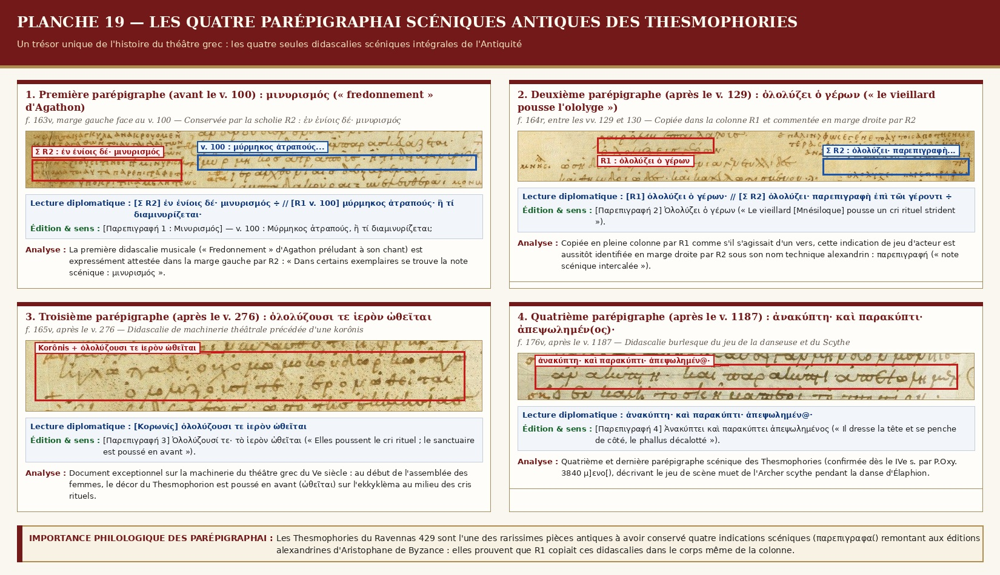

1. **f. 163v (avant le v. 100) — `μινυρισμός`** : indique qu'Agathon, qui vient d'apparaître sur l'*ekkyklêma*, exécute un fredonnement vocal aigu et sans paroles avant d'entonner son chant.
2. **f. 164r (après le v. 129) — `ὀλολύζει ὁ γέρων`** (« le vieillard pousse le cri rituel des femmes ») : la scholie marginale de $\text{R}^2$ confirme en toutes lettres : **$\pi\alpha\rho\varepsilon\pi\iota\gamma\rho\alpha\varphi\grave{\eta}\ \tau\omicron\tilde{\upsilon}\tau\omicron\cdot$** (« ceci est une didascalie scénique »).
3. **f. 165v (après le v. 276) — `ὀλολύζουσι τε ἱερὸν ὠθεῖται`** (« on pousse le cri rituel et le sanctuaire est poussé en avant ») : témoignage inestimable sur la machinerie théâtrale du Vᵉ siècle av. J.-C., commenté par la scholie de $\text{R}^2$ : $\dot{\varepsilon}\kappa\kappa\upsilon\kappa\lambda\varepsilon\tilde{\iota}\tau\alpha\iota\ \dot{\varepsilon}\pi\grave{\iota}\ \tau\grave{\omicron}\ \ἔ\xi\omega\ \tau\grave{\omicron}\ \Theta\varepsilon\sigma\mu\omicron\varphi\acute{\omicron}\rho\iota\omicron\nu$.
4. **f. 176v (après le v. 1187) — `ἀνακύπτη· καὶ παρακύπτι· ἀπεψωλημέν(ος)·`** : décrit le jeu de scène muet et grivois de l'Archer scythe pendant la danse de la joueuse de flûte Élaphion.

---

## 7. Leçon 6 — Lire les corrections du manuscrit : transpositions et grattages (*in rasura*)

### 7.1. Chiffres d'ordre ($\alpha', \beta', \gamma', \delta'$), additions supralinéaires et vers restitués en marge (Planche 20)

Le manuscrit de Ravenne nous montre sur le vif le travail de contrôle philologique effectué dans le *scriptorium* de Constantinople :

1. **La renumérotation par lettres-chiffres ($\alpha', \gamma', \delta', \beta'$) et l'ajout marginal du v. 33** : au **f. 162v (vv. 27–34)**, $\text{R}^1$ avait copié le v. 28 après le v. 30, et avait sauté par *homoioteleuton* le v. 33 (`μῶν ὁ δασυπώγων· / οὐχ ἑόρακας πώποτε·`). Le réviseur $\text{R}^2$ a placé en fin des vv. 27, 29, 30 et 28 les **lettres-chiffres ioniennes $\alpha', \gamma', \delta', \beta'$** pour rétablir l'ordre exact $\alpha \rightarrow \beta \rightarrow \gamma \rightarrow \delta$, et a suppléé le v. 33 sur deux lignes dans la marge droite !
2. **Les additions supralinéaires** : lorsqu'une préposition ou une particule a été oubliée par $\text{R}^1$ (comme $\kappa\alpha\tau\grave{\alpha}$ au **f. 163r, v. 60/61**), elle est insérée en petit module au-dessus de la ligne à l'endroit exact où le sens et le mètre l'appellent.
3. **Les vers restitués en marge inférieure avec signe de renvoi** : au **f. 175v**, $\text{R}^1$ avait sauté deux vers entiers (**vv. 1102–1103**) par *saut du même au même* ($\Gamma\omicron\rho\gamma\acute{\omicron}\nu\omicron\varsigma$... $\Gamma\omicron\rho\gamma\acute{\omicron}\nu\omicron\varsigma$). $\text{R}^2$ a tracé un signe d'appel dans la colonne et copié intégralement les deux vers manquants dans la marge inférieure du feuillet.

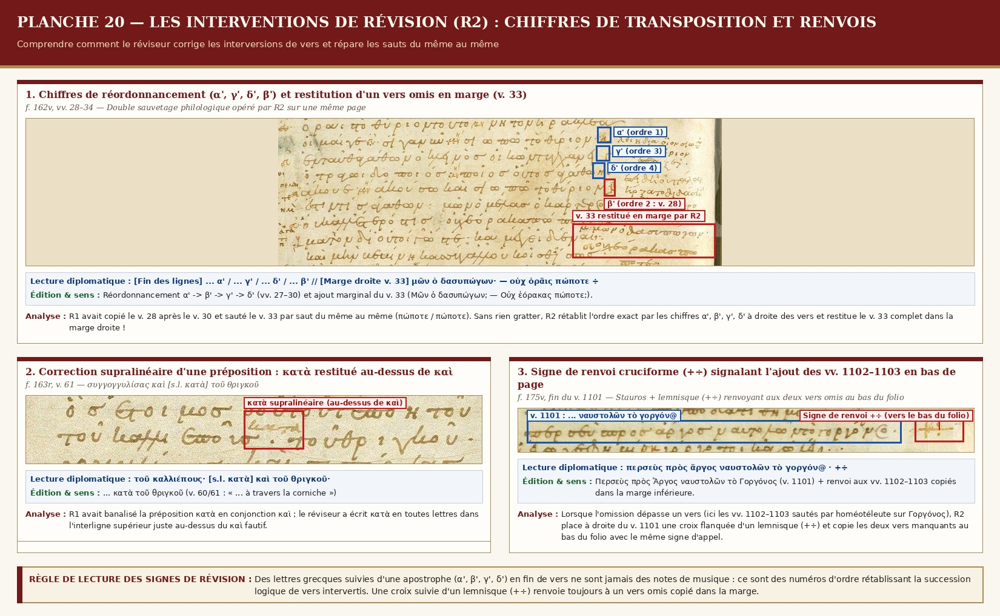

### 7.2. Anatomie matérielle des grattages sur parchemin (*in rasura*) : les quatre types (Planche 21)

Sur le parchemin médiéval, on n'efface pas à la gomme : on gratte la couche superficielle du derme à l'aide de la lame courbe d'un canif (*rasorium*). À l'endroit gratté (dit ***in rasura***), la fibre du parchemin devient plus claire et plus pelucheuse ; si l'on réécrit par-dessus, l'encre bave légèrement dans les micro-sillons du grattage.

La **Planche 21** vous apprend à reconnaître les **quatre types de grattages** attestés dans *Les Thesmophories* :

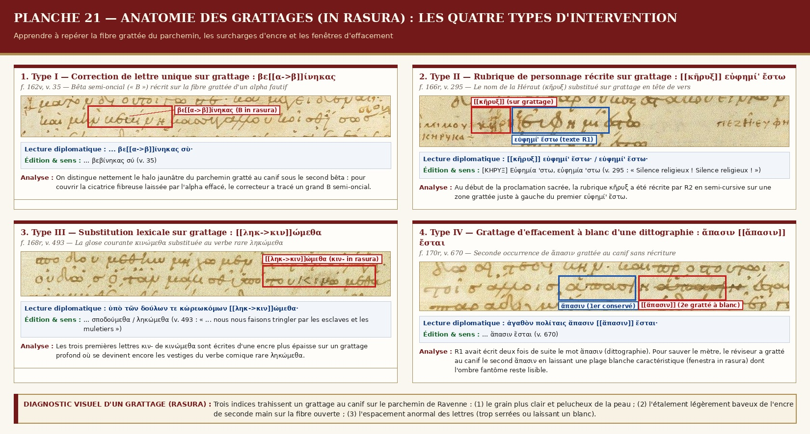

- **Type I — Grattage d'une lettre fautive avec surcharge immédiate** : ex. **f. 162v, v. 35**, $\beta\varepsilon\text{[[}\alpha\rightarrow\beta\text{]]}\acute{\iota}\nu\eta\kappa\alpha\varsigma$, où l'$\alpha$ initial a été gratté et remplacé par un second $\beta$ semi-oncial (`Β`).
- **Type II — Grattage d'un mot intrus laissé à blanc (*vacat*)** : ex. **f. 166r, v. 295**, où le sigle de personnage $\text{[[}\kappa\tilde{\eta}\rho\upsilon\xi\text{]]}$ avait été copié par erreur dans le texte même avant $\varepsilon\dot{\upsilon}\varphi\eta\mu\acute{\iota}\alpha\ '\sigma\tau\omega$, puis gratté sans être remplacé.
- **Type III — Substitution lexicale sur grattage** : ex. **f. 168r, v. 493**, où le verbe rare **$\lambda\eta\kappa\acute{\omega}\mu\varepsilon\theta\alpha$** a vu ses trois premières lettres $\lambda\eta\kappa-$ grattées au canif et remplacées par le radical plus banal **$\kappa\iota\nu-$** ($\kappa\iota\nu\acute{\omega}\mu\varepsilon\theta\alpha$) !
- **Type IV — Grattage d'une dittographie accidentelle** : ex. **f. 170r, v. 670**, où $\text{R}^1$ avait écrit deux fois de suite le mot $\ddot{\alpha}\pi\alpha\sigma\iota\nu$ ($\ddot{\alpha}\pi\alpha\sigma\iota\nu\ \text{[[}\ddot{\alpha}\pi\alpha\sigma\iota\nu\text{]]}\ \ἔ\sigma\tau\alpha\iota$) ; le second a été effacé au grattoir, mais son empreinte fantôme reste perceptible.

---

## 8. Leçon 7 — Parcours d'entraînement progressif en 5 niveaux (8 exercices corrigés)

Vous disposez maintenant de tous les outils paléographiques nécessaires pour lire le manuscrit par vous-même. Pour consolider votre apprentissage, voici **huit exercices progressifs répartis en 5 niveaux de difficulté**, correspondant très exactement aux **Planches 22, 23 et 24**, depuis l'*Hypothesis* et le titre d'apparat jusqu'aux répliques barbares de l'Archer scythe et à la *korônis* finale.

> **Méthode de travail conseillée :**  
> Pour chaque exercice, observez d'abord l'image de la planche correspondante en cachant le corrigé ci-dessous, notez votre transcription diplomatique ligne par ligne, puis vérifiez votre lecture à l'aide du corrigé analytique détaillé.

### 8.1. Niveaux 1 et 2 (Débutant & Intermédiaire) : Titre, Prologue et scène du Serviteur (Planche 22)

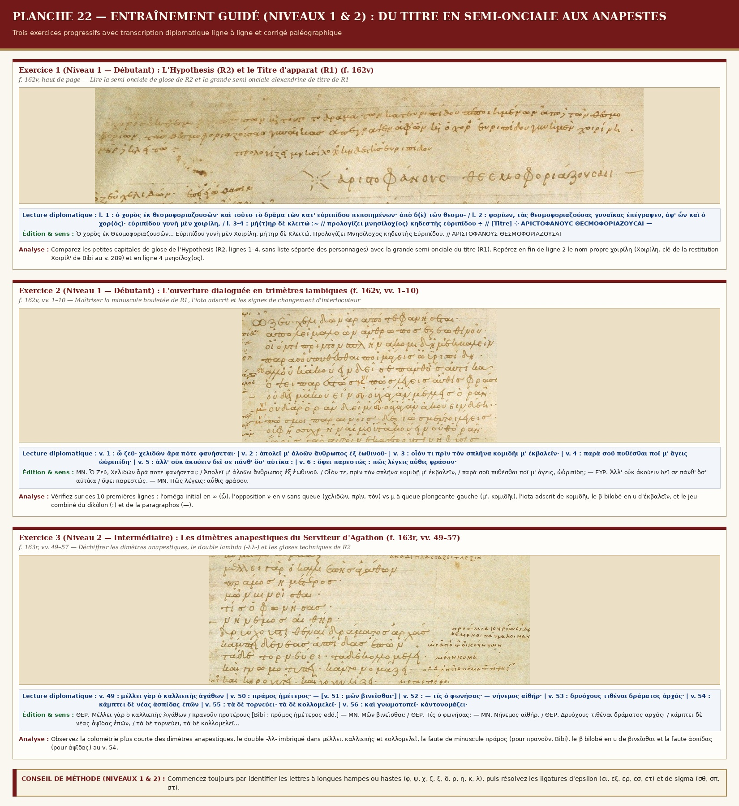

#### Exercice 1 (Niveau 1 — Débutant) : L'*Hypothesis* ($\text{R}^2$) et le Titre d'apparat ($\text{R}^1$) (f. 162v, haut de page)

- **Transcription diplomatique fidèle ($\text{R}^2$ puis $\text{R}^1$)** :
  1. `ὁ χορὸς ἐκ θεσμοφοριαζουσῶν· καὶ τοῦτο τὸ δρᾶμα τῶν κατ' εὐριπίδου πεποιημένων· ἀπὸ δ(ὲ) τῶν θεσμο-`
  2. `φορίων, τὰς θεσμοφοριαζούσας γυναῖκας ἐπέγραψεν, ἀφ' ὧν καὶ ὁ χορ(ός)· εὐριπίδου γυνὴ μὲν χοιρίλη,`
  3. `μή(τ)ηρ δὲ κλειτώ :~`
  4. `προλογίζει μνησίλοχ(ος) κηδεστὴς εὐριπίδου ÷`
  5. **[Titre monumental en semi-onciale d'apparat]** : `⁘ ΑΡΙϹΤΟΦΑΝΟΥϹ ΘΕϹΜΟΦΟΡΙΑΖΟΥϹΑΙ —`
- **Clés de décodage** :
  - Dans le bandeau supérieur (copié par $\text{R}^2$ en semi-onciale de glose sur 4 lignes, sans liste séparée des *dramatis personae*), repérez à la fin de la ligne 2 le nom propre **`χοιρίλη`** ($\text{Χοιρίλη}$, épouse d'Euripide et fille de Mnésiloque, clé de la restitution `Χοιρίλ'` de `Bibi` au v. 289) et sur la ligne 4 centrée **`προλογίζει μνησίλοχ(ος) κηδεστὴς εὐριπίδου ÷`**.
  - Le titre monumental en semi-onciale alexandrine (`⁘ ΑΡΙϹΤΟΦΑΝΟΥϹ ΘΕϹΜΟΦΟΡΙΑΖΟΥϹΑΙ —`), précédé d'un *asteriscus* à quatre points (`⁘`), permet de lire chaque lettre séparément : notez les **sigmas lunaires (`Ϲ`)**, l'alpha à boucle et le phi à grand anneau aplati.

#### Exercice 2 (Niveau 1 — Débutant) : L'ouverture dialoguée en trimètres iambiques (f. 162v, vv. 1–10)

- **Transcription diplomatique fidèle ($\text{R}^1$)** :
  1. `ὦ ζεῦ· χελιδὼν ἄρα πότε φανήσεται·`
  2. `ἀπολεῖ μ' ἀλοῶν ἄνθρωπος ἐξ ἑωθινοῦ·`
  3. `οἷόν τι πρὶν τὸν σπλῆνα κομιδῆι μ' ἐκβαλεῖν·`
  4. `παρὰ σοῦ πυθέσθαι ποῖ μ' ἄγεις ὠὐριπίδη·`
  5. `ἀλλ' οὐκ ἀκούειν δεῖ σε πάνθ' ὅσ' αὐτίκα :`
  6. `ὄψει παρεστώς : πῶς λέγεις αὖθις φράσον·`
- **Décomposition pas à pas des difficultés** :
  - **v. 1** : `ὦ` initial en huit couché (`∞`) coiffé de l'esprit doux et du circonflexe — `ζεῦ·` ($\zeta$ plongeant en `3`) — `χελιδὼν` ($\delta$ à long col oblique, $-\nu$ final en `v` sur $\text{Z}_2$) — `ἄρα πότε` (*falsa divisio* de $\text{R}^1$ pour `ἆρά ποτε`) — `φανήσεται·` (grand $\varphi$ traversant $\text{Z}_3$–$\text{Z}_4$, $\eta$ en `h`).
  - **v. 2** : `ἀπολεῖ` (ligature $\lambda\varepsilon\iota$ à trait vertical plongeant) — `μ'` ($\mu$ à longue queue gauche dans $\text{Z}_4$) — `ἀλοῶν` ($\omega$ fermé en `∞` et $-\nu$ en `v`) — `ἐξ` ($\varepsilon$ en as de pique + serpentin $\xi$).
  - **v. 3** : `οἷόν τι` (faute de $\text{R}^1$ pour `οἷόν τε`, corrigée par $\Sigma^{\text{R}}$) — `πρὶν τὸν σπλῆνα κομιδῆι μ' ἐκβαλεῖν` : observez côte à côte les trois $\nu$ en `v`, les deux $\mu$ à queue gauche, la ligature $\sigma\pi$, l'**iota muet adscrit** dans `κομιδῆι` et le **$\beta$ bilobé en `u`** dans `ἐκβαλεῖν`.
  - **vv. 5–6** : les **dikôla (`:`)** après `αὐτίκα` et après `παρεστώς` marquent les changements d'interlocuteur.

#### Exercice 3 (Niveau 2 — Intermédiaire) : Les dimètres anapestiques du Serviteur d'Agathon (f. 163r, vv. 49–57)

- **Transcription diplomatique fidèle ($\text{R}^1$)** :
  1. *(v. 49)* `μέλλει γὰρ ὁ καλλιεπὴς ἀγάθων`
  2. *(v. 50)* `πράμος ἡμέτερος· —`
  3. *(v. 51)* `μῶν βινεῖσθαι·`
  4. *(v. 52)* `— τίς ὁ φωνήσας· — νήνεμος αἰθήρ·`
  5. *(v. 53)* `δρυόχους τιθέναι δράματος ἀρχάς·`
  6. *(v. 54)* `κάμπτει δὲ νέας ἁσπίδας ἐπῶν`
  7. *(v. 55)* `τὰ δὲ τορνεύει· τὰ δὲ κολλομελεῖ·`
  8. *(v. 56)* `καὶ γνωμοτυπεῖ· κἀντονομάζει·`
- **Clés de décodage** :
  - Observez la colométrie plus courte des dimètres anapestiques, le **double $-\lambda\lambda-$ imbriqué** dans `μέλλει`, `καλλιεπὴς` et `κολλομελεῖ`, la faute de minuscule **`πράμος`** au v. 50 (restituée en `πρανοῦν` par `Bibi` d'après Hésychius $\pi\ 3188$), le **$\beta$ bilobé en `u`** initial de `βινεῖσθαι` (v. 51) et la faute **`ἁσπίδας`** (pour `ἁψῖδας`) au v. 54.

### 8.2. Niveaux 3 et 4 (Avancé & Confirmé) : Prière au Thesmophorion, Parabase et scène d'Écho (Planche 23)

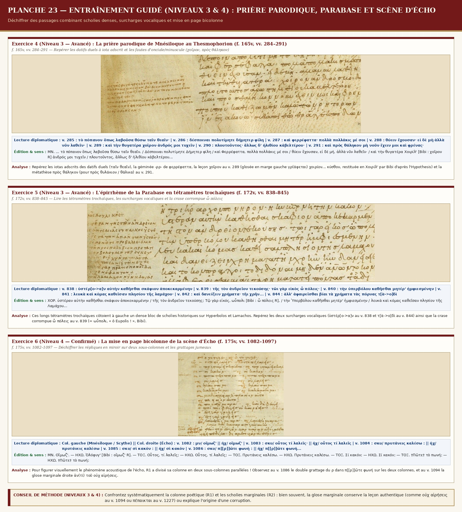

#### Exercice 4 (Niveau 3 — Avancé) : La prière parodique de Mnésiloque au Thesmophorion (f. 165v, vv. 284–291)

- **Transcription diplomatique fidèle ($\text{R}^1 + \Sigma^{\text{R}}$)** :
  1. *(v. 285)* `τὸ πόπανον ὅπως λαβοῦσα θύσω ταῖν θεαῖν·`
  2. *(v. 286)* `δέσποιναι πολυτίμητε δήμητερ φίλη`
  3. *(v. 287)* `καὶ φερρέφαττα· πολλὰ πολλάκις μέ σοι`
  4. *(v. 288)* `θύειν ἔχουσαν· εἰ δὲ μὴ ἀλλὰ νῦν λαθεῖν·`
  5. *(v. 289)* `καὶ τὴν θυγατέρα χοῖρον ἀνδρός μοι τυχεῖν`
  6. *(v. 290)* `πλουτοῦντος· ἄλλως δ' ἠλιθίου κἀβελτέρου·`
  7. *(v. 291)* `καὶ πρὸς θάληκον μὴ νοῦν ἔχειν μοι καὶ φρένας·`
  - **Marge gauche ($\Sigma$ 289 de $\text{R}^2$)** : `ὡς τῆς θυγατρὸς αὐ(τοῦ)... γρ(άφεται) χοιρίον... κύσθον ἴσως αἰνίττεται ÷`
- **Clés de décodage** :
  - Repérez les **iotas adscrits** des datifs duels (`ταῖν θεαῖν`), la géminée `-ρρ-` de `φερρέφαττα`, la leçon **`χοῖρον`** au v. 289 (restituée en **`Χοιρίλ'`** par `Bibi` d'après le nom de la fille de Mnésiloque dans l'*Hypothesis*), le $\beta$ bilobé en `u` de `κἀβελτέρου` (v. 290) et la métathèse **`πρὸς θάληκον`** (pour `πρὸς θυλάκιον` / `θάλικα`, Hésychius $\theta\ 50$) au v. 291.

#### Exercice 5 (Niveau 3 — Avancé) : L'épirrhème de la Parabase en tétramètres trochaïques (f. 172v, vv. 838–845)

- **Transcription diplomatique fidèle ($\text{R}^1$)** :
  1. *(v. 838)* `ὑστέρ[ο->α]ν αὐτὴν καθῆσθαι σκάφιον ἀποκεκαρμένην`
  2. *(v. 839)* `τῆς τὸν ἀνδρεῖον τεκούσης· τῶι γὰρ εἰκὸς ὦ πόλεις·`
  3. *(v. 840)* `τὴν ὑπερβόλου καθῆσθαι μητέρ' ἠμφιεσμένην`
  4. *(v. 841)* `λευκὰ καὶ κόμας καθεῖσαν πλησίον τῆς λαμάχου·`
  5. *(v. 842)* `καὶ δανείζειν χρήματα· τῆι χρῆν...`
  6. *(v. 844)* `ἀλλ' ἀφαιρεῖσθαι βίαι τὰ χρήματα τὰς πόρνας τ[ὰ->ο]δὶ`
- **Clés de décodage** :
  - Ces longs tétramètres trochaïques côtoient à gauche un dense bloc de scholies historiques sur Hyperbolos et Lamachos. Repérez les deux corrections vocaliques par surcharge (**`ὑστέρ[ο->α]ν`** au v. 838 et **`τ[ὰ->ο]δὶ`** au v. 844), les ligatures $\sigma\theta$ (`καθῆσθαι`) et $\sigma\kappa$ (`σκάφιον`), ainsi que la crase corrompue **`ὦ πόλεις`** au v. 839 (= **`ωὖπολι`**, « ô Eupolis ! », restituée par `Bibi`).

#### Exercice 6 (Niveau 4 — Confirmé) : La mise en page bicolonne de la scène d'Écho (f. 175v, vv. 1082–1097)

- **Transcription diplomatique fidèle ($\text{R}^1 + \text{R}^2$, deux sous-colonnes en miroir)** :
  1. *(v. 1082)* `μν/ οἴμωζ'` || `ἠχ/ οἴμωζ'`
  2. *(v. 1083)* `σκυ/ οὗτος τί λαλεῖς·` || `ἠχ/ οὗτος τί λαλεῖς`
  3. *(v. 1084)* `σκυ/ πρυτάνεις καλέσω :` || `ἠχ/ πρυτάνεις καλέσω`
  4. *(v. 1085)* `σκυ/ σὶ κακόν :` || `ἠχ/ σὶ κακόν`
  5. *(v. 1086)* `σκυ/ π[[ρ]]ῶτε φωνή :` || `ἠχ/ π[[ρ]]ῶτε φωνή`
  6. *(vv. 1090–1091)* `μὰ δί' ἀλλὰ γυνὴ πλησίον αὕτη` || `ἠχ/ πλησίον αὕτη`
  7. *(v. 1094)* `ποῖ ποῖ φεύγεις οὐ καιρήσεις` || `[Σ R2 dr.] ἀν(τὶ) τοῦ οὐχ αἱρήσεις`
- **Clés de décodage** :
  - Pour figurer visuellement le phénomène acoustique de l'écho, $\text{R}^1$ a divisé sa colonne en **deux sous-colonnes parallèles** !
  - Observez au v. 1086 le double grattage du $\rho$ dans **`π[[ρ]]ῶτε φωνή`** sur les deux sous-colonnes, et au v. 1094 la glose marginale droite **`ἀν(τὶ) τοῦ οὐχ αἱρήσεις`** qui conserve la véritable réplique parodique d'Écho (`οὐχ αἱρήσεις` répondant au scythe `οὐ καιρήσεις`, restituée par `Bibi`).

### 8.3. Niveau 5 (Expert) : Quatrième *parepigraphè*, barbarismes du Scythe et *korônis* finale (Planche 24)

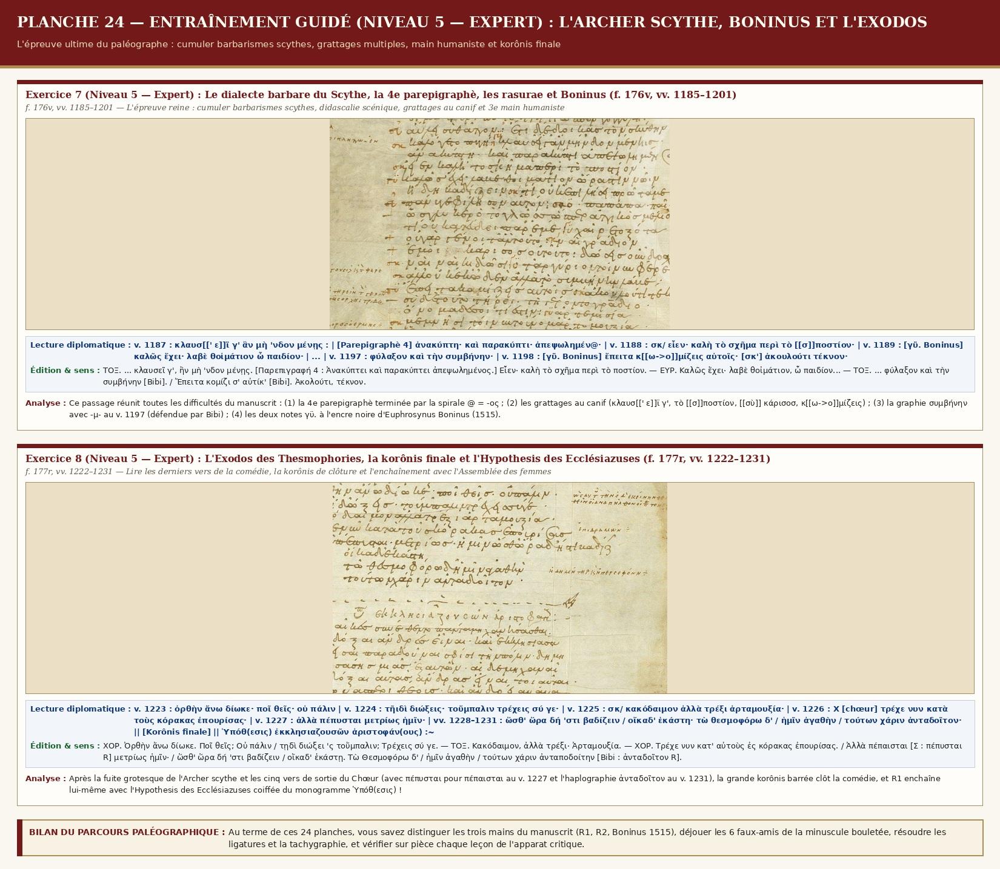

#### Exercice 7 (Niveau 5 — Expert) : Quatrième *parepigraphè*, jargon du Scythe, *rasurae* et main de Boninus (f. 176v, vv. 1185–1201)

- **Pourquoi c'est l'épreuve ultime du déchiffreur** : dans cette scène finale, l'Archer scythe parle un grec « barbare » qui remplace les consonnes aspirées ($\theta, \varphi, \chi$) par des sourdes ($\tau, \pi, \kappa$) et altère les finales. Il faut donc **déchiffrer strictement chaque lettre tracée par $\text{R}^1$**, tout en repérant les grattages au canif et les notes d'Euphrosynus Boninus (1515) !
- **Transcription diplomatique fidèle ($\text{R}^1 + \text{R}^2 + \text{Boninus 1515}$)** :
  1. *(v. 1187)* `καλὸ γε τὸ πυγή· οὐ κλαυσ[[' ε]]ϊ γ' ἂν μὴ 'νδον μένῃς :`
  2. *(post v. 1187 — 4ᵉ parepigraphè)* : `ἀνακύπτη· καὶ παρακύπτι· ἀπεψωλημέν@·`
  3. *(v. 1188)* `σκ/ εἶεν· καλὴ τὸ σχῆμα περὶ τὸ [[σ]]ποστίον·`
  4. *(v. 1189)* `[γϋ. Boninus] καλῶς ἔχει· λαβὲ θοἰμάτιον ὦ παιδίον·`
  5. *(v. 1195)* `[[σὺ]] κάρισοσ οὐ τούτο· δὸς ὁ σὺ ζωμὸ`
  6. *(v. 1197)* `φύλαξον καὶ τὴν συμβήνην·`
  7. *(v. 1198)* `[γϋ. Boninus] ἔπειτα κ[[ω->ο]]μίζεις αὐτοῖς· [σκ'] ἀκουλούτι τέκνον·`
- **Clés de décodage** :
  - **Ligne 2** : la quatrième *parepigraphè* scénique (**`ἀνακύπτη· καὶ παρακύπτι· ἀπεψωλημέν@·`**) est copiée par $\text{R}^1$ dans la colonne même et terminée par la spirale `@` (`-ος`).
  - **Grattages au canif (*in rasura*)** : `κλαυσ[[' ε]]ϊ γ'` (v. 1187), `τὸ [[σ]]ποστίον` (v. 1188), `[[σὺ]] κάρισοσ` (v. 1195) et `κ[[ω->ο]]μίζεις` (v. 1198).
  - **v. 1197** : $\text{R}^1$ conserve la graphie précieuse **`συμβήνην`** (avec $-\mu-$ devant le $\beta$ bilobé en `u`, défendue par `Bibi` d'après Hésychius $\sigma\ 2137$), préparant le calembour obscène sur $\sigma\upsilon\mu\beta\iota\nu\varepsilon\tilde{\iota}\nu$ !
  - **vv. 1189 et 1198** : dans la marge gauche apparaissent les **deux seules interventions autographes d'Euphrosynus Boninus (1515)** (**`γϋ.`** à l'encre noire, préparant l'édition Juntine de 1516).

#### Exercice 8 (Niveau 5 — Expert) : L'*Exodos* des *Thesmophories*, la *korônis* finale et l'*Hypothesis* des *Ecclésiazuses* (f. 177r, vv. 1222–1231)

- **Transcription diplomatique fidèle ($\text{R}^1 + \text{R}^2$)** :
  1. *(v. 1223)* `ὀρθὴν ἄνω δίωκε· ποῖ θεῖς· οὐ πάλιν`
  2. *(v. 1224)* `τῆιδὶ διώξεις· τοὔμπαλιν τρέχεις σύ γε·`
  3. *(v. 1225)* `σκ/ κακόδαιμον ἀλλὰ τρέξι ἀρταμουξία·`
  4. *(v. 1226)* `Χ [chœur] τρέχε νυν κατὰ τοὺς κόρακας ἐπουρίσας·`
  5. *(v. 1227)* `ἀλλὰ πέπυσται μετρίως ἡμῖν·`
  6. *(vv. 1228–1230)* `ὥσθ' ὥρα δή 'στι βαδίζειν / οἴκαδ' ἑκάστη· τὼ θεσμοφόρω δ' / ἡμῖν ἀγαθὴν`
  7. *(v. 1231)* `τούτων χάριν ἀνταδοῖτον·`
  8. **[Grande *korônis* finale et trait horizontal de clôture]**
  9. **[Bandeau de la pièce suivante]** : `Ὑπόθ(εσις) ἐκκλησιαζουσῶν ἀριστοφάν(ους) :~`
- **Clés de décodage** :
  - **vv. 1223–1226** : le Chœur envoie l'Archer scythe courir dans la mauvaise direction (`ὀρθὴν ἄνω δίωκε...`), avec l'iota adscrit de `τῆιδὶ` et le barbarisme scythe `τρέξι ἀρταμουξία`.
  - **v. 1227** : $\text{R}^1$ écrit `πέπυσται` par confusion vocalique au lieu de **`πέπαισται`** (« nous avons assez joué », conservé par $\Sigma^{\text{R}}$ `ἀν(τὶ) τοῦ πέπαικται ÷`).
  - **v. 1231** : $\text{R}^1$ porte **`ἀνταδοῖτον`** par haplographie syllabique (omission de $-\pi\omicron-$ dans `ἀνταποδοίτην`), immédiatement souligné par la **grande *korônis* finale** qui clôt *Les Thesmophories*, avant que $\text{R}^1$ n'enchaîne avec l'*Hypothesis* des *Ecclésiazuses* coiffée du monogramme **`Ὑπόθ(εσις)`** !

---

## Récapitulatif des 24 planches illustrées du dossier (`exemples_dechiffrement/`)

| N° | Fichier dans `exemples_dechiffrement/` | Thème pédagogique illustré |
| :---: | :--- | :--- |
| **01** | [`01_les_quatre_registres_ecriture_ravennas.jpg`](exemples_dechiffrement/01_les_quatre_registres_ecriture_ravennas.jpg) | Les 4 registres d'écriture d'une page du *Ravennas* (titre, $\text{R}^1$, $\text{R}^2$, main 1515) |
| **02** | [`02_anatomie_ligne_R1_suspension_et_quadrilinearite.jpg`](exemples_dechiffrement/02_anatomie_ligne_R1_suspension_et_quadrilinearite.jpg) | Géométrie de la ligne : écriture suspendue sous la réglure et système quadrilinéaire |
| **03** | [`03_abecedaire_visuel_alpha_a_mu.jpg`](exemples_dechiffrement/03_abecedaire_visuel_alpha_a_mu.jpg) | Abécédaire photographique de $\text{R}^1$ (1re partie : d'*Alpha* $\alpha$ à *Mu* $\mu$) |
| **04** | [`04_abecedaire_visuel_nu_a_omega.jpg`](exemples_dechiffrement/04_abecedaire_visuel_nu_a_omega.jpg) | Abécédaire photographique de $\text{R}^1$ (2e partie : de *Nu* $\nu$ à *Oméga* $\omega$) |
| **05** | [`05_piege1_nu_minuscule_vs_mu_minuscule.jpg`](exemples_dechiffrement/05_piege1_nu_minuscule_vs_mu_minuscule.jpg) | Piège n° 1 : *Nu* minuscule ($\nu$ en `v`) *vs* *Mu* minuscule ($\mu$ à queue plongeante gauche) |
| **06** | [`06_piege2_beta_bilobe_u_vs_B_oncial_kappa_nu.jpg`](exemples_dechiffrement/06_piege2_beta_bilobe_u_vs_B_oncial_kappa_nu.jpg) | Piège n° 2 : *Bêta* bilobé cursif ($\beta$ en `u`) *vs* $\text{B}$ semi-oncial |
| **07** | [`07_piege3_eta_kappa_lambda_nu.jpg`](exemples_dechiffrement/07_piege3_eta_kappa_lambda_nu.jpg) | Piège n° 3 : La triade des hastes hautes — *Êta* ($\eta$ en `h`), *Kappa* ($\kappa$) et *Lambda* ($\lambda$) |
| **08** | [`08_piege4_lettres_rondes_alpha_omicron_omega_theta_sigma.jpg`](exemples_dechiffrement/08_piege4_lettres_rondes_alpha_omicron_omega_theta_sigma.jpg) | Piège n° 4 : Lettres rondes ($\alpha, \omicron, \omega, \theta, \sigma$) et surcharges vocaliques |
| **09** | [`09_piege5_potences_gamma_pi_tau_et_zeta_xi_psi.jpg`](exemples_dechiffrement/09_piege5_potences_gamma_pi_tau_et_zeta_xi_psi.jpg) | Piège n° 5 : Lettres à potence ($\gamma, \pi, \tau$) et descendantes sinueuses ($\zeta, \xi, \psi$) |
| **10** | [`10_piege6_spirale_finale_os_vs_soleil_helios.jpg`](exemples_dechiffrement/10_piege6_spirale_finale_os_vs_soleil_helios.jpg) | Piège n° 6 : Spirale finale `-ος` (`@`) *vs* idéogramme astronomique du Soleil (`☉`, f. 162v $\Sigma$ 17) |
| **11** | [`11_ligatures_epsilon_as_de_pique_ei_ex_er_es_et.jpg`](exemples_dechiffrement/11_ligatures_epsilon_as_de_pique_ei_ex_er_es_et.jpg) | Ligatures d'*epsilon* : $\varepsilon\iota$, $\varepsilon\xi$, $\varepsilon\rho$, $\varepsilon\sigma$ (« as de pique ») et $\varepsilon\tau$ |
| **12** | [`12_ligatures_sigma_sp_st_sth_sk_sch.jpg`](exemples_dechiffrement/12_ligatures_sigma_sp_st_sth_sk_sch.jpg) | Ligatures de *sigma* à casquette : $\sigma\pi$, $\sigma\tau$, $\sigma\theta$, $\sigma\kappa$ et $\sigma\chi$ |
| **13** | [`13_ligatures_alpha_tau_gamma_rho_et_double_lambda.jpg`](exemples_dechiffrement/13_ligatures_alpha_tau_gamma_rho_et_double_lambda.jpg) | Ligatures d'*alpha*, potences sur *rhô* ($\tau\rho, \gamma\rho$) et double lambda ($-\lambda\lambda-$ *vs* $-\lambda-$) |
| **14** | [`14_regle_iota_muet_adscrit_et_piege_deictique.jpg`](exemples_dechiffrement/14_regle_iota_muet_adscrit_et_piege_deictique.jpg) | Règle de l'iota muet adscrit ($\alpha\iota, \eta\iota, \omega\iota$) et piège du $-\iota$ déictique |
| **15** | [`15_esprits_accents_trema_et_scriptio_plena.jpg`](exemples_dechiffrement/15_esprits_accents_trema_et_scriptio_plena.jpg) | Esprits, accents, tréma organique ($\ddot{\iota}, \ddot{\upsilon}$) et *scriptio plena* |
| **16** | [`16_signes_dialogue_paragraphos_dikolon_koronis.jpg`](exemples_dechiffrement/16_signes_dialogue_paragraphos_dikolon_koronis.jpg) | Signes de dialogue : *paragraphos* (`—`), *dikôlon* (`:`) et *korônis* |
| **17** | [`17_notae_personarum_monogrammes_par_superposition.jpg`](exemples_dechiffrement/17_notae_personarum_monogrammes_par_superposition.jpg) | Les *notae personarum* de $\text{R}^2$ : monogrammes par superposition verticale |
| **18** | [`18_tachygraphie_scholies_suspensions_et_finales.jpg`](exemples_dechiffrement/18_tachygraphie_scholies_suspensions_et_finales.jpg) | Tachygraphie des scholies ($\Sigma^{\text{R}}$) : suspensions, finales hautes et lemnisque (`÷`) |
| **19** | [`19_les_quatre_parepigraphai_sceniques_antiques.jpg`](exemples_dechiffrement/19_les_quatre_parepigraphai_sceniques_antiques.jpg) | Les quatre *parepigraphai* (didascalies scéniques antiques) des *Thesmophories* |
| **20** | [`20_chiffres_transposition_et_ajouts_marginaux_R2.jpg`](exemples_dechiffrement/20_chiffres_transposition_et_ajouts_marginaux_R2.jpg) | Chiffres d'ordre ($\alpha', \beta', \gamma', \delta'$), ajouts supralinéaires et vers restitués en marge |
| **21** | [`21_anatomie_des_grattages_in_rasura_quatre_types.jpg`](exemples_dechiffrement/21_anatomie_des_grattages_in_rasura_quatre_types.jpg) | Anatomie matérielle des grattages sur parchemin (*in rasura*) : les 4 types |
| **22** | [`22_exercice_progressif_niveau1_et_2_f162v_f163r.jpg`](exemples_dechiffrement/22_exercice_progressif_niveau1_et_2_f162v_f163r.jpg) | Exercices progressifs corrigés — Niveaux 1 (Débutant) et 2 (Intermédiaire) |
| **23** | [`23_exercice_progressif_niveau3_et_4_f165v_f172v_f175v.jpg`](exemples_dechiffrement/23_exercice_progressif_niveau3_et_4_f165v_f172v_f175v.jpg) | Exercices progressifs corrigés — Niveaux 3 (Avancé) et 4 (Confirmé) |
| **24** | [`24_exercice_progressif_niveau5_expert_scythe_et_scholies_f176v_f177r.jpg`](exemples_dechiffrement/24_exercice_progressif_niveau5_expert_scythe_et_scholies_f176v_f177r.jpg) | Exercices progressifs corrigés — Niveau 5 (Expert : Archer scythe et *korônis* finale) |
