# Étude graphologique du *Ravennas*

*Ravenne, Biblioteca Classense, ms. 429 (olim 137, 4, A) : les* Thesmophories *d'Aristophane et leurs scholies, ff. 162v–177r (vv. 1–1231).*

> **Statut.** Document de référence pour l'introduction de l'édition, assemblé le 1er novembre 2026. Il réunit et harmonise les cinq chapitres de travail vérifiés (`graphologie/chapitres/`), ainsi que les résultats de la collation du Monacensis gr. 492 (`../recherche/monacensis_492.md`) et le dossier documentaire (`../recherche/ravennas_dossier.md`). Là où les chapitres divergeaient, j'ai retenu le résultat le plus récent et le mieux contrôlé ; la concordance avec les chapitres, les décisions prises entre eux et les tables de vérification sont signalées à l'annexe C. Le mode d'emploi pratique est `GUIDE_TRANSCRIPTION.md`, qui ne fait pas double emploi avec cette étude : l'étude établit, le guide prescrit.

**Plan.** 1. Le manuscrit ; 2. Les mains et les encres ; 3. L'écriture du copiste ; 4. Mise en page, signes, *notae personarum*, colométrie ; 5. Scholies et gloses ; 6. Corrections et interventions (stratigraphie) ; 7. Pièges de lecture et conséquences pour l'édition ; 8. Index des pages. Annexes : A. Questions ouvertes et examens à demander sur l'original ; B. Planches, spécimens, données et outils ; C. Concordance avec les chapitres de travail.

## Méthode et conventions

**Sources de l'observation.** L'étude repose sur les images à pleine résolution de la Classense (`../dossier_ravennas_thesmophories/folios_individuels_ff162v-177r/`, environ 1900 × 2780 px, 1 px ≈ 0,116 mm), sur trente inventaires de page (`graphologie/folios/fXXX.md` et `fXXX.jsonl`, 2 203 observations ligne à ligne, chacune avec sa boîte, sa main, son degré de certitude et son spécimen), sur le fac-similé phototypique de 1904 pour les ff. 162v–163r (`../ravennas_1904_bnf/`), sur le Monacensis gr. 492 (numérisation BSB `bsb00108707`) et sur la Juntine de 1516 (BSB `bsb10912207`). Chaque chapitre a été soumis à une vérification adversariale : les affirmations les plus lourdes ont été reprises sur l'image pour tenter de les réfuter, et le texte ci-dessous intègre les corrections. Les notes, planches et fichiers LaTeX produits par un précédent assistant et conservés dans `../dossier_ravennas_thesmophories/` n'ont pas été utilisés ; seules les images de ce dossier l'ont été.

**Hiérarchie des autorités.** L'image d'abord ; puis le contrôle propre (« vu », « vérifié », « mesuré ») ; puis les inventaires (« inv. f165r ») ; enfin les imprimés et les auteurs, cités avec leur page et jamais donnés pour observés. Les lectures d'un imprimé ne sont reprises que contrôlées ; le texte établi n'est jamais une preuve.

**Sigles et mains.** Le tableau complet est au § 2.9. En bref :

| Sigle de travail | Sigle imprimé (DiploXML) | Main |
|---|---|---|
| **T** | R (`R1`), R^pc (`R1c`) | le copiste du texte, milieu du Xe s. |
| **S2** | R² (`R2`) | le scholiaste, correcteur ancien (B d'Allen, S2 d'Orsini) |
| **Rsch** | R^sch (`Rsch`) | main de la marge intérieure du f. 162v, troisième main ancienne |
| **R3** | R³ (`R3`) | correcteur ancien à l'encre brun-noir, antérieur à 1505 |
| **main de 1516** | R^XVI (`Rrec`) | préparation de la Juntine (« 2 m. » de Velsen 1871 ; attribution à Euphrosynus Boninus non démontrée) |
| **Rmod** | R^mod (`Rmod`) | mains modernes |
| **R?** | R^? (`R?`) | main indéterminée |

**M** = Monacensis gr. 492, apographe de R (G de Velsen et de Prato, Aug. d'Enger, Mu2 de Wilson) : sigle retenu par l'édition (`../edition/CONVENTIONS.md`, § 2.3). **Iunt.** (Junt. dans les tableaux et chez Velsen) = *editio princeps* de Florence, 28 janvier 1516, imprimée sur R. Les chapitres de travail écrivent encore G pour M et « main M » pour Rsch ; ces deux appellations n'ont plus cours ici, sauf dans les citations textuelles de Velsen, où G reste.

**Lieux.** « f. 165r, l. 12 » : page et ligne d'écriture de la colonne, comptée de haut en bas (1 à 43 ; voir § 4.1.1 pour les réglures vides des ff. 162v et 177r). « v. » : numérotation du texte de l'auteur (`../edition/donnees/travaux_anterieurs/texte_grec.tsv`), qui suit pour l'essentiel la numérotation usuelle ; dans les parties lyriques, un écart d'une unité reste possible avec d'autres éditions (concordance : `../edition/donnees/concordance_vers.tsv` ; étude : `../recherche/numerotation_vers.md`). La page et la ligne font foi. « fXXX #n » : n-ième observation, à partir de 0, du JSONL de la page. Coordonnées x, y en pixels de l'image pleine résolution. Marges : sur un recto, la marge extérieure (large) est à droite et l'intérieure à gauche ; sur un verso, c'est l'inverse.

**Mesures d'encre.** G/R et B/R désignent des rapports d'absorbance, A_G/A_R et A_B/A_R, calculés sur le cœur des traits et rapportés au fond local (§ 2.1.2). ΔB/R est l'écart à T de la même page, à densité égale. « G/R » n'a aucun rapport avec l'ancien sigle G du Monacensis.

**Notation des transcriptions.** « ^ » note une lettre suscrite, les parenthèses le développement d'une abréviation, ⟦ ⟧ un mot biffé ; ϖ, « ʒ », « lc », « ϗ » décrivent des formes (§ 3). Les identifiants entre crochets, comme [n_2], renvoient aux spécimens de `graphologie/planches/specimens_ch2.tsv`.

**Illustrations.** Les planches, versionnées, sont citées par leur chemin relatif à ce fichier. Les spécimens de `graphologie/specimens/` ne sont pas versionnés : ils se régénèrent à partir des boîtes des inventaires et des outils de `../outils/graphologie/` (annexe B).

## Conclusions principales

1. **Une seule main pour le texte, T,** d'une encre brune homogène sur les trente pages. Elle écrit aussi les titres, dans une minuscule espacée à formes lunaires, et non en majuscule. Ni rubrique, ni liste de personnages, ni souscription (§§ 2.2, 4.1.3).
2. **Toutes les scholies et presque toutes les gloses sont de S2,** qui est aussi le correcteur ancien principal. Il écrit une semi-onciale inclinée, de petites majuscules droites pour les gloses, et, au f. 162v, une minuscule à lemmes. Son encre ne se sépare pas de celle de T : à densité égale elle est à peine plus jaune, et l'écart varie selon la place sur la page. L'encre ne distingue donc jamais S2 de T pour un trait isolé (§§ 2.3, 5.2).
3. **Une troisième main ancienne, Rsch,** a écrit deux scholies de la marge intérieure du f. 162v (vv. 27 et 30–32). C'est la « terza mano coeva » d'Orsini. Une identité avec T reste possible et non démontrée (§ 2.4).
4. **Un correcteur à l'encre brun-noir, R3,** récrit des mots sur grattage : vv. 646 et 939 (sûrs), vv. 874 et 493 (probables). Ces leçons sont dans M, donc antérieures à 1505. Sa place par rapport à S2 est inconnue ; il peut être S2 lui-même dans une autre campagne, ou une main du XVe s. (§ 2.5).
5. **Toute l'encre orangée mesurable appartient à la campagne de 1516.** Celle-ci a posé les sigles « imprimables », des corrections, des signes d'insertion et des barres d'annulation. Elle a très probablement aussi repassé des notes pâlies de S2 : c'est l'explication la plus économique des notes de forme S2, attestées par M, qui sont aujourd'hui orangées ; mais aucun tracé brun n'a été observé sous l'orangé. La même campagne emploie une pointe grise pour les repères de pages de la Juntine (§ 2.6).
6. **M date les couches.** La main de M est très probablement celle de Paolo Canal, vers 1505, non d'un copiste du XVe s. M connaît T, S2 et R3 et ignore tout de 1516 : aucun des 114 lieux de la couche de 1516 n'y est repris de façon sûre. La « 2 m. » de Velsen 1871 n'est pas homogène : six corrections de lettres qu'il lui donne sont déjà dans M (§§ 1.7, 6.5).
7. **Le témoignage de l'encre a des limites strictes.** Elle ne décide que dans trois oppositions : orangé contre brun, matière grise contre encre, brun-noir contre brun sur des lettres entières. Les valeurs absolues varient d'un feuillet à l'autre avec le parchemin, et les petits signes mesurent « gris » quelle que soit la main (§ 2.1.3).
8. **L'écriture de T est lisible, mais piégée.** Minuscule ronde, liée, rapide, à petit corps et à très longues hampes, avec des réminiscences onciales réglées par la position. Les confusions majeures sont ν/μ, π en ϖ/ω, β en « u »/κ/υ, ζ/ξ, ει polymorphe, στ en « α », ττ à second τ en γ, -ος en « © » de fin de ligne. T n'a aucun ς et presque aucune abréviation : un compendium de καί (sept relevés), quelques suspensions de fin de ligne, un π̅η̅ρ isolé (§ 3).
9. **Mise en page.** Réglure à la pointe sèche pour 43 lignes, justification de 103–104 mm, bande des sigles de 6–7 mm, écriture suspendue. Un côlon par ligne, eisthesis variable, ekthesis des vers longs. Les fins de ligne de R sont celles de Velsen dans quatorze passages contrôlés, et la Juntine les reproduit. La scène d'Écho est disposée sur deux « colonnes » (§§ 4.1, 4.2).
10. **T ne nomme aucun personnage.** Il n'a que la paragraphos, le dicolon, parfois un blanc ou un point, et il omet environ un tiers des changements en tête de vers. Dans un tiers environ des cas discriminants, la paragraphos suit encore l'usage antique : elle se trouve sous la ligne qui contient le changement. Une paragraphos en tête du v. *n* ne prouve donc pas un changement en tête du v. *n* (§ 4.3).
11. **Trois couches de marques.** T ; les sigles abrégés de S2, témoignage de l'exégèse ancienne ; les sigles de 1516, qui ne sont que les attributions de la Juntine. Le manuscrit appelle surtout le Parent Μνησίλοχος : la formule « Κηδ. R passim » de Coulon est fausse pour R, et aucune des deux désignations n'est de T (§ 4.4).
12. **Accentuation, ponctuation, élision** sont à relever signe pour signe dans la transcription XML ; le livre corrige ensuite les fautes évidentes et d'accentuation, par une couche distincte qui laisse intacte la leçon de R (`../edition/CONVENTIONS.md`, § 1 bis). Une série d'accents « en V » et de grattages normalise après coup l'accentuation de T, d'une ou plusieurs mains que l'image ne désigne pas (§§ 4.5, 4.6, 6.3.4).
13. **Scholies.** Quatre cents notes environ, écrites après le texte et les marques de T, au droit de leur vers. Répertoire de quarante abréviations et signes (§ 5.4) : ce sont les compendia ordinaires de la minuscule, sans aucun des signes « purement tachygraphiques » de Martin. S2 emploie lemmes et renvois, rarement et toujours pour une raison précise, contrairement à ce qu'écrivent Zacher et Orsini (§§ 5.3.5, 5.3.6).
14. **Interventions.** Le répertoire compte 351 entrées (§ 6.4). Un peu moins de la moitié (173) ont une main assurée ; les autres restent « T ou S2 » (35), attribuées à S2 par Velsen seul (37) ou indéterminées (106). 51 entrées ne reposent que sur Velsen. La stratigraphie comprend sept phases (§ 6.5).
15. **Pour l'édition.** Le sigle se définit par la main et ne se cite que si l'image l'établit ; R^pc est la règle par défaut pour un accent ou une lettre isolée ; M et la Juntine datent, mais ne témoignent pas ; les sigles de 1516 n'ont aucune autorité ; une absence de marque de T ne vaut pas attribution (§ 7).

---

## 1. Le manuscrit

Cette partie résume le dossier documentaire (`../recherche/ravennas_dossier.md`), où chaque donnée est discutée avec ses sources. Les observations propres y sont signalées comme telles ; les résultats sur le Monacensis viennent de `../recherche/monacensis_492.md`.

### 1.1 Identification et contenu

R est le MS 429 de la Biblioteca Classense de Ravenne, ancienne cote 137, 4, A (Martin 1882, i ; Zacher 1888, 530 ; Coulon 1928, sigla). Le volume contient onze comédies avec scholies : *Ploutos* (f. 1), *Nuées* (f. 15), *Grenouilles* (f. 33), *Oiseaux* (f. 52), *Cavaliers* (f. 76), *Paix* (f. 92), *Lysistrata* (f. 111), *Acharniens* (f. 128), *Guêpes* (f. 143), *Thesmophories* (f. 162), *Assemblée des femmes* (f. 177) (Mazzatinti 1894, 239 ; Clark 1871, 154 ; détail : Zacher 1888, 530–532 ; Allen 1896, 301–302).

### 1.2 Description codicologique sommaire

**Format.** Parchemin, 191 feuillets numérotés. Les mesures publiées vont de 322 × 210 mm (Mazzatinti 1894, 239 ; catalogue de la Classense) à 325 × 213 mm (Allen 1896, 301), avec 324 × 210 mm au f. 84r selon Orsini 2011, 322 n. 3. Les relieurs ont rogné le volume (van Leeuwen 1908, 270 n. 3).

**Cahiers.** Des quaternions, avec trois exceptions : ff. 73–75 ; f. 116 ajouté ; ff. 141–142 ajoutés (Orsini 2011, 321–322). Les cahiers commencent par le côté chair et suivent la règle de Gregory (Allen 1896, 301). L'alternance mesurée de l'encre de T et du fond d'un feuillet à l'autre a exactement la forme que cette règle prévoit sur les quatorze feuillets des *Thesmophories* (§ 2.1.3 a), mais le côté du parchemin reste à relever sur l'original.

**Réglure.** Type P2 32C1 de Sautel–Leroy, système 1 (Orsini 2011, 322 n. 3), tracée sur le côté poil (Allen 1896, 301). Le cadre du texte mesure en moyenne 0,103 × 0,22 m. Les espaces des scholies sont réglés en haut (0,025 m), à l'extérieur (0,055 m) et en bas (0,04 m) ; la marge intérieure, d'environ 0,033 m, ne l'est pas (Zacher 1888, 534–535). Le compte est de 43 lignes par page, 42 dans les trois premiers cahiers (Zacher 1888, 534 ; Orsini 2011, 324 n. 13 ; van Leeuwen 1908, 270). Le relevé pour les *Thesmophories* est au § 4.1.1.

**Foliotations et signatures.** La foliotation savante (1–191) est à l'encre, dans l'angle supérieur intérieur ; une seconde, au crayon, dans l'angle supérieur extérieur et sur les seuls rectos, compte à partir de la première garde de parchemin : elle est décalée de +2 dans les *Thesmophories* (Orsini 2011, 322 n. 3 ; Martin 1882, x ; § 2.7.1). Les signatures anciennes ne survivent qu'aux ff. 57r (η´) et 116r (ια´) ; une signature moderne en chiffres arabes figure au bas du premier recto des cahiers, en partie rognée : 21 au f. 159r, 22 au f. 167r (Orsini 2011, 322–323 et n. 4 ; Allen 1896, 301–302, 310 n. 1). Le « 22 » du f. 167r est à l'encre brun pâle (§ 2.7.1).

**Gardes.** En tête, une garde de papier et deux de parchemin ; en fin, une garde de parchemin suivie d'une garde de papier (Martin 1882, xii–xiii ; Orsini 2011, 322 n. 3). Au verso de la dernière garde initiale, la note de Cirillo Martini (XVIIIe s.) : « Aristophanis Codex Optimus cum argumentis et scholiis Anonymi / Scriptus saeculo X. / Ita censebat Cyrillus Martinius / Florentinus », puis un index des comédies qui renvoie à la foliotation à l'encre (« 162. verso », « 177. verso ») (Martin 1882, xii–xiii ; Allen 1896, 301 ; vu sur l'image). La garde finale porte le *pinax* grec « ἀριστοφάνους ἀθηναίου κωμῳδίαι ια´ », attribué à Paolo Canal (Eleuteri–Canart 1991, 74 ; Orsini 2011, 322 n. 3), avec dans la marge des traits obliques qui visent *Lysistrata* et *Thesmophories* (Velsen 1871, 6 ; vu). Martin 1882, xiii l'attribuait à Euphrosynus Boninus ; les deux témoignages se concilient si le *pinax* est de 1505 et les traits de 1515–1516.

**État.** L'humidité a surtout touché les marges, donc les scholies (Bekker 1829, vi ; Martin 1882, x ; Velsen 1883, 5 ; van Leeuwen 1908, 270). Les premiers feuillets sont très usés (Velsen 1871, 6 ; Zacher 1888, 529 n. 1). Dans les *Thesmophories*, des taches de réactif bleu-vert couvrent des débuts de scholies sur treize pages (§ 2.7.2), et des pièces de restauration se voient en marge de plusieurs feuillets, sans jamais empiéter sur le texte de T (§ 2.7.3). La date de la reliure actuelle n'est pas établie ; elle est postérieure à la signature moderne qu'elle a rognée (Martin 1882, x).

### 1.3 Les *Thesmophories* dans le volume

La pièce occupe trente pages, sur trois quaternions réguliers (Allen 1896, 302 et 306 ; Orsini 2011, tabl. 1 et 5) :

| Cahier | Feuillets | Contenu |
|---|---|---|
| XXI | ff. 159–166 | *Guêpes* 1271 – *Thesm.* 379 |
| XXII | ff. 167–174 | *Thesm.* 380–1044 |
| XXIII | ff. 175–182 | *Thesm.* 1045 – *Assemblée* 446 |

Les *Guêpes* s'achèvent au f. 162r, dont le reste est laissé blanc (Allen 1896, 302 ; Zacher 1888, 531). La pièce commence au f. 162v, sans hypothesis de T ni liste de personnages (Zacher 1888, 531 ; Velsen 1883, 8 : « Deest index personarum in codd. »). Elle s'achève au milieu du f. 177r, sans souscription ; suivent une ligne ornementale, le titre et l'hypothesis de l'*Assemblée* (§ 4.1.3). Le contenu exact de chaque page a été vérifié sur l'image (§ 8) : les bornes de vers portées dans les noms des fichiers d'images du dépôt sont fausses pour 17 pages sur 30.

### 1.4 Date et lieu

**Date.** Le consensus actuel place la copie vers le milieu du Xe siècle (Orsini 2011, 321 et 326 ; Wilson 2007, I, v ; Scotti 2024, 462), après les datations du XIXe siècle au XIe (Martin 1882, xiii ; Velsen 1883, 5 ; Zacher 1888, 530 ; Mazzatinti 1894, 239, que répète le catalogue en ligne de la Classense) et les positions intermédiaires d'Allen 1896, 301 (fin du Xe ou début du XIe s.) et d'Irigoin 1962, 301 (pas avant le milieu du Xe s.). Prato 2001, xxxi écrit « circa IX–X sec. », sans justification. L'argument décisif est la comparaison d'Orsini avec le Marc. gr. 201, copié par Éphrem en 954, et avec certaines expressions graphiques de Basile, copiste du Vat. gr. 1591 en 964 (Orsini 2011, 326). Les critères de Martin pour le XIe siècle (écriture suspendue, esprits anguleux, onciales Γ, Η, Κ, Λ, Ν) ne se vérifient qu'en partie dans la pièce (§ 3.2.7). Je n'ai pas confronté d'images de ces manuscrits datés : rien de ce que j'observe ne contredit le milieu du Xe siècle, mais je ne peux pas le confirmer par moi-même.

**Lieu.** Aucune des sources lues ne localise la copie. Orsini la place dans la « Rinascenza macedone » (2011, 321) ; Irigoin 1962, 301 cite R sans lui assigner de lieu ; l'origine constantinopolitaine n'est démontrée nulle part (dossier, § 2.2).

**Modèle.** Martin y voyait un manuscrit « assez ancien » (ποεῖν pour ποιεῖν, confusions ο/ω, apostrophe après οὐκ : Martin 1882, xiii) ; Zacher et Allen, un antigraphe à peine plus ancien que R, d'après des fautes propres à la minuscule et aux abréviations tachygraphiques (Zacher 1888, 542–543 ; Allen 1896, 323). Selon Allen, il avait 42 lignes par page (1896, 309 et 323). Le copiste suivait un modèle sans scholies (van Leeuwen 1904, viii, cité par Orsini 2011, 328 n. 28). La pièce ajoute à ce débat des indices d'une paragraphos encore antique (§ 4.3.3).

### 1.5 Histoire

Avant Urbino, rien n'est prouvé. L'arrivée en Italie avec Giovanni Aurispa en 1423 et le passage par Niccolò Niccoli et Angelo Vadio da Rimini sont des hypothèses rapportées par Scotti 2024, 462, d'après Mioni 1964, 364 et Stefec 2012, 146 n. 193, sources que je n'ai pas lues ; la seule lettre d'Aurispa qui mentionne un Aristophane, de juillet 1430, parle de manuscrits envoyés de Sicile et n'identifie pas R (Sabbadini 1931, 71).

| Date | Fait | Sources |
|---|---|---|
| avant 1482 ou 1498–1508 | entrée à Urbino, sous Federico ou sous Guidobaldo (débattu) | Martin 1882, viii–ix ; Scotti 2024, 466–469 ; contra Clark 1871, 159 ; Perusino–Beta 2020, lxxxix, cité par Scotti 2024, 465 |
| 1487–1498 | *Index vetus* d'Urbino, n° 123 : « Aristophanis comoedi insignis comoediae XI. Codex pulcherrimus in croceo », avec en marge « Habuit Petrus Florentinus Cartularius stampandum » | Scotti 2024, 466 et 469–470 |
| 1505 | étape de Paolo Canal et de Pietro Bembo à Urbino : Canal écrit le *pinax* et, très probablement, copie les *Thesmophories* et la *Lysistrata* (M) | Eleuteri–Canart 1991, 74 ; `../recherche/monacensis_492.md`, § 2 |
| sept. 1515 – 28 janv. 1516 | prêt à Florence ; R sert de copie d'impression à l'*editio princeps* des *Thesmophories* et de la *Lysistrata* | Velsen 1871, 2–6 ; Clark 1871, 157–159 ; Martin 1882, iv–v ; Scotti 2024, 470 |
| après 1516 | R ne revient pas à Urbino ; à Florence jusqu'en 1525 (Velsen 1871, 52 ; Prato 2001, xxxiv) ou à Pise chez Boninus (White 1906, II, 257) ; « nell'ombra » à Pise aux XVIe–XVIIe s. | Prato 2001, xxxv |
| mai 1712 | acheté à Pise par l'abbé camaldule Pietro Canneti, transporté à la bibliothèque de Classe | Allen 1896, 324–325 (inventaire Canneti–Fiacchi) ; Mazzatinti 1894, 145 et 239 |
| 1728 | J. Ph. d'Orville voit le manuscrit à Ravenne | Allen 1896, 324 |
| XVIIIe s. | note de Cirillo Martini | § 1.2 |
| 1794 | première utilisation, par Invernizi | Invernizi 1794, I, vii–viii ; Martin 1882, ii |
| 1804 | la Classense devient bibliothèque communale | Martin 1882, i ; Clark 1871, 155 |
| 1818 | collation de Bekker | Bekker 1829, vi |
| 1904 | fac-similé phototypique | § 1.8 |

La date de la Juntine s'entend selon le style florentin : l'achevé d'imprimer « quinto Kl. Februarii M.D.XV » correspond au 28 janvier 1516 (Velsen 1871, 2–3 ; Clark 1871, 157 ; Martin 1882, iv). L'édition de septembre 1515 ne contenait que neuf pièces (Martin 1882, iv ; White 1906, II, 255–256).

### 1.6 Les mains du volume

**Le texte.** Les onze pièces sont d'une seule main (Zacher 1888, 535 ; Allen 1896, 311 ; van Leeuwen 1908, 270 ; Orsini 2011, 325). Orsini la décrit comme une « minuscola informale con una certa pretesa alla formalità », de module carré, au ductus tantôt posé, tantôt cursif (2011, 325). Le Laur. plut. 32.9 passe pour la même main ou une main proche chez Bekker 1829, v et van Leeuwen 1908, 270 n. 2, pour une main différente chez Allen 1896, 321–322 et Orsini 2011, 326.

**Les scholies.** Deux mains principales (Orsini 2011, 327 ; Allen 1896, 312) :

| | S1 | S2 |
|---|---|---|
| Autres sigles | A (Allen) ; R¹ (Martin, qui l'identifie à T) | B (Allen) ; R² (Martin, Velsen 1883) ; « schol. m. » (Velsen 1871) |
| Feuillets | ff. 1r–56r, 58r–75r, 93v–106v | ff. 76r–78r, 111v–191v |
| Pièces | *Ploutos*, *Nuées*, *Grenouilles*, *Oiseaux*, *Paix* jusqu'au v. 1033 | *Cavaliers* jusqu'au v. 214, *Lysistrata*, *Acharniens*, *Guêpes*, *Thesmophories*, *Assemblée* |
| Écriture | mélange de majuscule et de minuscule, légèrement inclinée, environ 2 mm, tracé fin | majuscule inclinée, environ 1,7 mm, tracé anguleux et brisé |
| Disposition | cadre fermé sur quatre marges, lemmes, renvois | marges extérieure et intérieure, lemmes et renvois rares (§ 5.3) |

T et S1 sont une seule main pour Martin 1882, xiv–xvi, Zacher 1888, 535 et Rutherford 1896, I, xxvii ; non pour Allen 1896, 318–319 et Orsini 2011, 327. Le débat ne touche pas directement la pièce, mais il explique que R¹ n'ait pas le même sens chez tous les éditeurs. Le commentaire de S2 est ajouté dans une phase ultérieure mais rapprochée, sans plan de mise en page commun (Orsini 2011, 328).

**Les sigles des éditeurs ne désignent pas les mêmes mains.** Velsen 1871 écrit I m., schol. m., 2 m. Velsen 1883 définit dans sa préface R² (main des scholies), R³ (« paullo recentior ») et Boninus, qu'il annonce ne pas noter ; son apparat des *Thesmophories* n'emploie que R², plus de deux cents fois, et jamais R³. Martin 1882, xiv a R¹ (texte et S1), R², R³ (XIIIe s.), R⁴ (XVe s.). Prato 2001 n'a qu'un R², « manus recentior ». Clark 1871, 154 et 159–160 distingue une main tremblée presque contemporaine, une main à l'encre plus noire du XIVe ou du début du XVe s., surtout dans les *Nuées*, et une ou deux mains à l'encre rougeâtre dans la *Lysistrata* et les *Thesmophories*. Dans l'édition, les sigles sont donc définis par la main (§§ 2.9, 7.4), et le R² de Velsen 1883 n'est jamais repris sans contrôle.

### 1.7 Deux témoins de contrôle : M et la Juntine

Ni l'un ni l'autre n'a d'autorité sur le texte ; leur valeur pour cette étude est de dater les couches de R.

**M, Monacensis gr. 492.** Papier, 230 × 165 mm, 53 feuillets (Tessier 1989, vi) ; *Thesmophories* aux ff. 1r–19r, *Lysistrata* aux ff. 19v–40, puis Eutocius, Archimède et des scholies à Pindare (`../recherche/monacensis_492.md`, § 2.1). C'est le seul apographe connu de la pièce. On le datait du XVe siècle (Velsen 1871, 7 ; Velsen 1883, 5 ; Wilson 2007, II, 68). La comparaison avec le Mon. gr. 546, signé, avec le Pal. gr. 47, autographe de 1505–1506, et avec le *pinax* de R montre que sa main est très probablement celle de **Paolo Canal** (vers 1481/83–1508). Il a donc été copié vers 1505, à Urbino, au plus tard en 1508. Cette identification, implicite chez Diller 1952 et Altomare 2012, reste à contrôler sur l'original (papier, filigranes) ; le microfilm de la BSB, en niveaux de gris, ne dit rien des couleurs, et ses sigles au minium y sont pâles (`../recherche/monacensis_492.md`, §§ 2.3–2.4).

La collation aux lieux-tests (379 lignes de table : `../edition/donnees/mu2_lieux_tests.tsv`) donne le bilan suivant :

| Couche de R | dans M | postérieure à M ou négligée | absente de M | non probant | initiative de M |
|---|---:|---:|---:|---:|---:|
| S2, sigles et notes | 116 | 1 | 0 | 0 | 0 |
| S2, texte, vers, accents | 52 | 3 | 3 | 61 | 0 |
| T, additions | 1 | 0 | 1 | 0 | 0 |
| R3 | 4 | 1 | 0 | 2 | 0 |
| main indéterminée | 9 | 2 | 0 | 7 | 0 |
| 1516 | **0** | **94** | 0 | 13 | 7 |
| post-1516 (κατα, καί) | 0 | 0 | 2 | 0 | 0 |

« Antérieur à M » signifie donc « antérieur à 1505 », et non « antérieur au XVe s. ». M donne à S2 et à R3 un terme très bas : R3 peut appartenir au XVe siècle. Canal corrige (Diller 1952, 23) : un accord de M avec une correction banale ne prouve pas que la correction fût dans R ; seuls le désaccord, ou l'accord sur une forme non banale, sont probants. Ses sigles sont au minium, posés à part (Velsen 1883, 5). Son silence ne prouve rien à lui seul : il omet deux vers suppléés (vv. 33, 1102–1103) et le μέντοι marginal du v. 630, mais les 18 suscriptions de S2 relevées au § 6.3.3 sont toutes chez lui. Les leçons propres de M que Wilson adopte sont, sauf aux vv. 1185 et 1191, des conjectures de Canal : on les cite « M (Canal) » (`../edition/CONVENTIONS.md`, § 2.3).

**La Juntine de 1516.** Elle a été composée sur R : dans les marges des deux pièces, des chiffres et des traits renvoient aux pages de ses cahiers (Velsen 1871, 3–6 ; Clark 1871, 159 ; relevé au tableau 6.4.C). Elle reproduit les fins de ligne de R (§ 4.2.1) et ses sigles proviennent de la main de 1516 (§ 4.4). Elle donne un *terminus ante quem* pour ce qu'elle imprime, mais elle omet des éléments anciens : le v. 647, le γάρ suscrit du v. 149. Elle n'est pas un témoin (Velsen 1871, 52).

**Les papyrus et la tradition indirecte** n'entrent pas dans cette étude : voir `../recherche/papyrus.md` et `../recherche/testimonia.md`.

### 1.8 Collations et reproductions

**Collations.** Invernizi 1794 (première utilisation, jugée sévèrement par Bekker 1829, v) ; Bekker, 1818, éd. 1829 (« far from accurate », Clark 1871, 153) ; E. Miller 1837, pour les scholies ; Velsen 1866–1867 et ses éditions de 1871 et 1883, dont les pp. 8–26 de 1871 donnent vers par vers la marque de T, le sigle de S2 et celui de 1516 : ce relevé reste fondamental ; Martin, été 1880, pour les scholies ; Holzinger 1881 ; Zacher 1888 et Allen 1896 pour la codicologie et les mains ; Rutherford et Graeven 1896 ; van Leeuwen 1904 sur le fac-similé ; Prato 2001, avec vérification sur microfilm et sur l'original (xxxvi) ; Wilson 2007, contrôles ponctuels sur le fac-similé (I, vi). Enger 1844 n'a pas vu R : il en déduit les leçons d'après Bekker, l'Augustanus et la Juntine (Enger 1844 *Lys.*, x ; contra Prato 2001, xxxv). Le titre « Θεσμοφοριάζουσαι πρότεραι », prêté à R par Fritzsche 1838, 585 et Enger 1844, 3, ne s'y lit pas (dossier, § 1).

**Reproductions.** Fac-similé phototypique : *Aristophanis Comoediae undecim cum scholiis. Codex Ravennas 137, 4, A phototypice editus*, préface de J. van Leeuwen, Leyde 1904 (*Codices Graeci et Latini photographice depicti* IX). Il compte pour les zones effacées depuis ; le dépôt n'en a que les ff. 162v–163r. Images couleur de la Classense (IIIF, 196 vues, planches doubles de 3946 × 2780 px, avec mire), qui sont la base de cette étude ; le serveur refuse aujourd'hui les téléchargements directs. Images en JPEG à chrominance sous-échantillonnée (4:2:0), ce qui limite les mesures sur les petits signes (§ 2.1.3 b). Aucune imagerie UV, IR ou multispectrale n'a pu être consultée : les questions qui en dépendent sont réunies à l'annexe A.

### 1.9 Bibliographie

Références complètes, avec fichiers locaux quand ils existent : dossier, § 16. Sont citées ici :

- **Allen 1896** — T. W. Allen, « On the composition of some Greek manuscripts. II. The Ravenna Aristophanes », *Journal of Philology* 24 (1896), 300–326.
- **Altomare 2012** — B. M. Altomare, « Paolo Canal et la géographie grecque », *Camenae* 14 (2012).
- **Austin 1987** — C. Austin, « Textual problems in Ar. Thesm. », *Dodone (philol.)* 16 (1987), 61–92.
- **Bekker 1829** — I. Bekker, *Aristophanis comoediae cum scholiis et varietate lectionis*, I, Londres 1829.
- **Clark 1871** — W. G. Clark, « The history of the Ravenna manuscript of Aristophanes », *Journal of Philology* 3 (1871), 153–160.
- **Coulon 1928** — V. Coulon et H. van Daele, *Aristophane*, IV, Paris 1928.
- **Diller 1952** — A. Diller, *The Tradition of the Minor Greek Geographers* (Philological Monographs of the APA 14), 1952.
- **Dovico 2016** — G. Dovico, « Excerpta manoscritti dalle commedie di Aristofane : per una prima recensio », *FuturoClassico* 2 (2016), 62–118.
- **Dübner 1842** — F. Dübner, *Scholia Graeca in Aristophanem*, Paris 1842.
- **Eleuteri–Canart 1991** — P. Eleuteri et P. Canart, *Scrittura greca nell'umanesimo italiano*, Milan 1991.
- **Enger 1844** — R. Enger, *Aristophanis Thesmophoriazusae cum scholiis*, Bonn 1844 ; *Lysistrata*, Bonn 1844 (*Enger 1844 Lys.*).
- **Fritzsche 1838** — F. V. Fritzsche, *Aristophanis Thesmophoriazusae*, Leipzig 1838.
- **Invernizi 1794** — Ph. Invernizi, *Aristophanis comoediae auctoritate libri praeclarissimi saeculi decimi emendatae*, Leipzig 1794.
- **Irigoin 1962** — J. Irigoin, « Survie et renouveau de la littérature antique à Constantinople (IXe siècle) », *Cahiers de civilisation médiévale* 5 (1962), 287–302.
- **Koster 1963** — W. J. W. Koster, « Aristophane dans la tradition byzantine », *REG* 76 (1963), 381–396.
- **Martin 1882** — A. Martin, *Les scolies du manuscrit d'Aristophane à Ravenne. Étude et collation*, Paris 1882.
- **Mazzatinti 1894** — G. Mazzatinti, *Inventari dei manoscritti delle biblioteche d'Italia*, IV, Forlì 1894.
- **Orsini 2011** — P. Orsini, « L'Aristofane di Ravenna. Genesi e formazione tecnica e testuale di un codice », *Scriptorium* 65 (2011), 321–337, pl. 55–57.
- **Prato 2001** — C. Prato et D. Del Corno, *Aristofane. Le donne alle Tesmoforie*, Milan 2001.
- **Rutherford 1896** — W. G. Rutherford, *Scholia Aristophanica*, I, Londres 1896.
- **Sabbadini 1931** — cité d'après le dossier, § 0 ; référence complète [à vérifier].
- **Scotti 2024** — M. Scotti, « The Odyssey of the Ravenna manuscript : Urbino time », *Sapiens ubique civis* 5 (2024), 461–472.
- **Tessier 1989** — A. Tessier, *Scholia metrica vetera in Pindari carmina*, Leipzig 1989.
- **van Leeuwen 1904** — J. van Leeuwen, *Aristophanis Thesmophoriazusae*, Leyde 1904. **van Leeuwen 1908** — *Prolegomena ad Aristophanem*, Leyde 1908.
- **Velsen 1871** — A. von Velsen, *Über den Codex Urbinas der Lysistrata und der Thesmophoriazusen des Aristophanes*, Halle 1871. **Velsen 1883** — *Aristophanis Thesmophoriazusae*, Leipzig 1883.
- **White 1906** — J. W. White, « The manuscripts of Aristophanes », *Classical Philology* 1 (1906), 1–20 et 255–278.
- **Wilson 2007** — N. G. Wilson, *Aristophanis fabulae*, Oxford 2007.
- **Zacher 1888** — K. Zacher, *Die Handschriften und Classen der Aristophanesscholien*, Leipzig 1888.

Cités de seconde main, non consultés : Mioni 1964 ; Stefec 2012 ; Perusino–Beta 2020 ; Regtuit 2007 ; Holzinger 1882 (dossier, § 16.3). Non lus à ce jour, et à reprendre avant publication de l'introduction : Austin–Olson 2004, lxxxix–xcviii ; Wilson, *Aristophanea*, 1–14 ; la préface de van Leeuwen au fac-similé (dossier, § 16.4).

---

## 2. Les mains et les encres

Cette partie sépare les mains à l'œuvre dans les ff. 162v–177r, établit ce que l'encre permet de décider et fixe les étiquettes de la transcription. L'écriture de T est décrite en détail à la partie 3, celle des scholies à la partie 5, les interventions une à une à la partie 6.

**Illustrations.** `graphologie/chapitres/planches/1_pl1_ecritures.jpg` (pl. M1, les écritures), `graphologie/chapitres/planches/1_pl2_encre_orangee.jpg` (pl. M2, l'encre orangée), `graphologie/chapitres/planches/4_groupe_Rn.png` (groupe R3), `graphologie/chapitres/planches/4_main_1516.png` (main de 1516). Spécimens : `graphologie/specimens/ch1/`, `graphologie/specimens/ch1_verif/`, `graphologie/specimens/ch1_verif2/`. Outil de mesure : `../outils/graphologie/encres_mesure_uniforme.py`. Données : `graphologie/chapitres/donnees/1_encres_pages.json` (T et S2, page par page) et `graphologie/chapitres/donnees/1_ecarts_observations.tsv` (écart à T de chaque observation des inventaires).

### 2.1 Sources, méthode, limites

#### 2.1.1 Corpus

Les trente inventaires couvrent toutes les pages. Chacun donne une synthèse (`graphologie/folios/fXXX.md`) et un relevé ligne à ligne (`graphologie/folios/fXXX.jsonl`), dont chaque observation porte une catégorie, une ligne, un vers, une description, une main, des critères, une certitude, une boîte et un spécimen. Les résumés structurés de `graphologie/resume_pages.json` donnent, pour chaque page, les mains reconnues, les faits saillants et les doutes. Les attributions des inventaires ne lient pas cette étude : les points décisifs ont été repris sur l'image, et le texte ci-dessous les corrige là où il le faut.

#### 2.1.2 Une mesure unique pour toute la pièce

Les inventaires mesurent l'encre de deux façons :

- en **rapports d'absorbance** relatifs au fond (A_G/A_R et A_B/A_R, notés G/R et B/R ; T ≈ 1,2–1,4 et 1,8–2,4), pour la plupart des pages ;
- en **rapports de réflectance** (valeurs RVB du trait ; T ≈ 0,83–0,87 et 0,50–0,56), pour les ff. 173r, 173v, 175r et 177r, et en partie pour les ff. 174r et 174v.

Les deux séries ne se comparent pas directement. J'ai donc repris **toutes** les observations munies d'une boîte (2 002, dont 1 926 mesurables) avec un protocole unique (`../outils/graphologie/encres_mesure_uniforme.py`) :

1. les pixels de trait sont isolés par le masque d'encre brune de `../outils/images/recadrer_facsimile.py` (fonction `masque_encre`), puis érodés d'un pixel (« cœur ») ;
2. le fond local est estimé canal par canal par une convolution normalisée qui exclut les pixels d'encre. Une simple moyenne floue, qui assombrit le fond dans les zones denses, n'est pas employée ;
3. je calcule l'absorbance A = −log10(I/fond) par canal, puis les rapports G/R et B/R ;
4. **référence T de la même page** : je prends la médiane du rapport B/R de T par tranche de densité A_R de 0,02, sur toutes les lignes de la colonne, hors zone des sigles et hors blocs de scholies. L'**écart à T**, noté ΔB/R, est la médiane, sur les pixels de l'objet, de la différence entre son B/R et celui de T à la même densité.

Un ΔB/R positif signale une encre plus jaune-orangée que T, un ΔB/R négatif une encre plus neutre ou plus noire. Pour T lui-même, ΔB/R reste dans la fourchette −0,16 / +0,10 (déciles des 629 observations attribuées à T). Dans une même page, la variation entre gauche et droite de la colonne ne dépasse pas ±0,035. **Du haut au bas de la colonne**, en revanche, elle atteint 0,12–0,14 sur cinq pages sur dix (ff. 163v, 164r, 169r, 172v, 176r), le bas étant plus jaune (jusqu'à +0,08) et le haut plus neutre (jusqu'à −0,08). Elle reste de 0,05–0,06 sur les cinq autres. Un objet isolé en haut ou en bas de page doit donc être comparé à T de la même hauteur.

#### 2.1.3 Quatre limites, qui commandent l'interprétation

**(a) Le parchemin, non la prise de vue.** Les rapports absolus de T changent d'une ouverture à l'autre, et ils sont égaux pour les deux pages d'une même ouverture (tableau 1). Les ouvertures f. 163v–164r, 165v–166r, 167v–168r, 169v–170r, 171v–172r, 173v–174r et 175v donnent pour T un B/R de 2,32–2,45 (tranche 0,10–0,20). Les ouvertures f. 162v–163r, 164v–165r, 166v–167r, 168v–169r, 170v–171r, 172v–173r et 174v–175r donnent 2,10–2,19. Les ff. 176r (2,23), 176v (2,04) et 177r (2,03) sont à part (voir après le tableau 1). Cette alternance n'est pas un effet de la balance des couleurs. Chaque ouverture est photographiée avec une mire, dont le brun mesure B/R 1,58–1,62 (absorbance rapportée au blanc de la mire) sur les clichés des ouvertures 162v–163r, 163v–164r, 164v–165r, 167v–168r, 170v–171r, 171v–172r et 175v–176r : le rendu est donc le même, alors que T y alterne de 2,15 à 2,44. En revanche, le fond du parchemin alterne en phase avec T : il est plus jaune aux ouvertures « hautes » (canal bleu du fond ≈ 159–177) qu'aux ouvertures « basses » (≈ 174–196). La cause est donc matérielle. L'hypothèse la plus simple est l'alternance des côtés poil et chair d'une ouverture à l'autre, les pages en regard étant du même côté (règle de Gregory). Elle passe un test strict : chaque feuillet doit alors avoir un côté « haut » et un côté « bas », et recto moins verso change bien de signe à chaque feuillet, du f. 163 au f. 176, sans exception (écart de 0,19 à 0,33). Ce n'est pas non plus un simple effet de calcul lié à la couleur locale du fond : sur 494 cases de colonne, T suit le jaunissement du fond d'une page à l'autre (r = 0,89 sur les médianes de page), mais presque pas à l'intérieur d'une page (r = 0,17). L'hypothèse reste à vérifier sur l'original. Il s'ensuit qu'**aucune fourchette absolue ne vaut d'une page à l'autre**. Les fourchettes des inventaires ne sont comparables qu'à l'intérieur d'une même page. Quand un inventaire écrit que S2 « se sépare » de T (f. 168r) ou se confond avec l'encre de 1516 (f. 163v), il faut le relire à la lumière de cette limite.

**(b) Les traits fins.** Les images sont des JPEG à chrominance sous-échantillonnée (4:2:0, vérifié). Un point, un accent ou un trait de deux pixels mêle sa couleur à celle du fond et mesure « gris ». Les dicola et les petites paragraphoi de T descendent ainsi jusqu'à ΔB/R −0,4 / −0,55 (ff. 163v l. 34, 169v l. 17, 171v l. 9 et 21). Une teinte neutre mesurée sur un petit signe ne prouve donc jamais une autre encre. De même, les petites corrections de 1516 mesurent souvent comme T (médiane +0,04 pour les « interventions » de cette main, contre +0,60 pour ses sigles).

**(c) Le fond.** Dans les marges jaunies ou tachées, toutes les encres glissent vers l'orangé. Sur 386 notes de S2, l'écart à T croît avec le jaunissement du fond (corrélation 0,34) : il vaut +0,09 sur un fond semblable à celui de la colonne et +0,22 sur un fond jauni.

**(d) Les cartes pixel par pixel.** Sur une carte de l'écart B/R, le bord des traits paraît toujours plus neutre que leur cœur, pour la raison donnée en (b). C'est vrai aussi des sigles de 1516 eux-mêmes. Des « bords bruns autour d'un cœur orangé » ne prouvent donc pas un repassage. Seules les médianes par boîte, comparées à des témoins de la même page, sont probantes.

**Règle d'usage.** L'encre ne décide que dans trois cas :
- orangé contre brun : ΔB/R ≥ +0,4 sur un objet d'au moins une centaine de pixels de cœur ;
- matière grise neutre (plomb, graphite) contre encre ;
- brun-noir contre brun : ΔB/R ≤ −0,3 sur des lettres entières et assez denses.

Pour tout le reste (T ou S2, lettre isolée, accent), seule la forme tranche, ou l'attribution reste indécise.

**Tableau 1 — Encre de T et des scholies de S2, page par page** (mesure unique ; cœur des traits ; B/R médian par tranche de densité A_R).

| Ouverture | Page | T : B/R (A_R 0,10–0,20) | T : B/R (A_R 0,20–0,30) | Scholies de S2 : B/R (0,10–0,20) | Δ S2 − T (0,10–0,20) | Δ S2 − T (0,20–0,30) |
|---|---|---|---|---|---|---|
| f162v–f163r | f162v | 2,19 | 2,13 | 2,34 | +0,15 | +0,14 |
|  | f163r | 2,17 | 2,08 | 2,21 | +0,04 | +0,02 |
| f163v–f164r | f163v | 2,42 | 2,37 | 2,77 | +0,34 | +0,17 |
|  | f164r | 2,44 | 2,42 | 2,65 | +0,20 | +0,11 |
| f164v–f165r | f164v | 2,17 | 2,11 | 2,34 | +0,17 | +0,06 |
|  | f165r | 2,12 | 2,05 | 2,25 | +0,13 | +0,10 |
| f165v–f166r | f165v | 2,32 | 2,29 | 2,61 | +0,28 | +0,23 |
|  | f166r | 2,35 | 2,28 | 2,53 | +0,18 | +0,18 |
| f166v–f167r | f166v | 2,14 | 2,05 | 2,29 | +0,15 | +0,19 |
|  | f167r | 2,19 | 2,10 | 2,43 | +0,25 | +0,25 |
| f167v–f168r | f167v | 2,41 | 2,36 | 2,78 | +0,37 | +0,29 |
|  | f168r | 2,39 | 2,30 | 2,70 | +0,31 | +0,32 |
| f168v–f169r | f168v | 2,17 | 2,10 | 2,30 | +0,13 | +0,10 |
|  | f169r | 2,15 | 2,10 | 2,25 | +0,09 | +0,07 |
| f169v–f170r | f169v | 2,35 | 2,30 | 2,61 | +0,27 | +0,25 |
|  | f170r | 2,42 | 2,35 | 2,62 | +0,20 | +0,17 |
| f170v–f171r | f170v | 2,17 | 2,07 | 2,24 | +0,07 | +0,06 |
|  | f171r | 2,12 | 2,02 | 2,24 | +0,12 | +0,06 |
| f171v–f172r | f171v | 2,43 | 2,32 | 2,53 | +0,10 | +0,11 |
|  | f172r | 2,39 | 2,30 | 2,58 | +0,19 | +0,20 |
| f172v–f173r | f172v | 2,12 | 2,07 | 2,31 | +0,19 | +0,16 |
|  | f173r | 2,10 | 2,01 | 2,30 | +0,20 | +0,18 |
| f173v–f174r | f173v | 2,32 | 2,24 | 2,53 | +0,21 | +0,20 |
|  | f174r | 2,32 | 2,19 | 2,56 | +0,24 | +0,18 |
| f174v–f175r | f174v | 2,12 | 2,02 | 2,25 | +0,13 | +0,12 |
|  | f175r | 2,11 | 2,00 | 2,17 | +0,05 | +0,09 |
| f175v–f176r | f175v | 2,44 | 2,35 | 2,85 | +0,41 | +0,25 |
|  | f176r | 2,23 | 2,15 | 2,27 | +0,04 | −0,03 |
| f176v–f177r | f176v | 2,04 | 1,96 | 2,30 | +0,26 | +0,20 |
|  | f177r | 2,03 | 1,96 | 2,09 | +0,06 | +0,05 |

Les ff. 175v et 176r sont la seule ouverture dont les deux pages diffèrent (2,44 contre 2,23). Elles viennent pourtant du même cliché (planche 14 : les pages individuelles sont des découpes des planches doubles, de même valeur moyenne RVB), et leurs deux fonds sont jaunes. L'auréole d'humidité de la moitié gauche du f. 175v n'explique pas l'écart : T y mesure 2,45 à gauche et 2,43 à droite, 2,43 en haut et 2,45 en bas. **L'anomalie n'est pas propre au f. 176r.** Le f. 176 garde l'alternance (recto 2,23, verso 2,04), mais tout le feuillet est décalé : sa moyenne vaut 2,135, contre 2,21–2,305 pour les treize autres feuillets, et le f. 177r mesure 2,03, contre 2,10–2,19 pour les pages « basses ». T baisse donc de 0,1 à 0,2 à partir du f. 176r. Parchemin différent ou autre charge d'encre : l'image ne le dit pas (annexe A, § 2.8).

---

### 2.2 Le copiste du texte, T (R1)

#### 2.2.1 Écriture

C'est une minuscule ronde et liée, écrite sous la réglure. Les lettres rondes (ο, α) mesurent, traits compris, 16–18 px en médiane (1,9–2,1 mm ; quartile supérieur 20–23 px), et le corps mesuré à mi-densité 13–16 px (ff. 162v, 166v, 170r, 174v ; § 3.2.3). Le chiffre de 18–20 px de l'inventaire du f. 162v est le haut de la fourchette. On y trouve des formes onciales mêlées : Η en H, Ν en N en fin de ligne, grand σ lunaire enveloppant la finale -ος. On y relève aussi le π en ϖ, le β en « u », le κ en « lc », le ν final à jambage plongeant, qui se lit μ, et le second τ de ττ en forme de γ. La ligature ει prend les formes de « q », « 4 » ou « ϥ », et ζ comme ξ s'écrivent en « ʒ ». Le ψ est cruciforme et l'esprit souvent rejeté à gauche de la voyelle. L'inventaire de ces formes et des pièges qu'elles créent relève de la partie 3. Il concorde avec les descriptions d'Orsini 2011, 325 et d'Allen 1896, 319 (dossier § 3.1).

T écrit aussi les **titres** : au f. 162v, ἀριστοφάνους θεσμοφοριάζουσαι, avec ornement et trait final de la même encre (inventaire f162v #0 ; ΔB/R −0,12) ; au f. 177r, le titre ὑπ(όθεσις) ἐκκλησιαζουσῶν ἀριστοφάν(ους) et la ligne ornementale (inv. f177r). Les inventaires parlaient de « majuscule de distinction ». **Sur l'image, ce n'en est pas une** : c'est une minuscule posée, espacée et un peu agrandie. Les formes sont minuscules (α, μ, ρ et φ plongeants, ζ en « ʒ », υ, ω), avec ε et σ lunaires et, au f. 177r, un Η en H et deux Κ en deux traits disjoints (§ 3.3, κ). Il n'y a ni rubrique, ni liste de personnages, ni souscription.

#### 2.2.2 Encre

L'encre de T est **homogène** sur toute la pièce. D'une page à l'autre, les écarts de B/R de T suivent exactement les ouvertures (tableau 1), et le fond du parchemin varie avec eux (§ 2.1.3 a). Dans une même page, ils ne dépassent pas ±0,035 de gauche à droite, mais ils atteignent 0,12–0,14 du haut au bas de la colonne sur certaines pages (§ 2.1.2). Ce gradient est régulier sur certaines pages (ff. 164r, 169r), irrégulier sur d'autres (f. 176r). Le fond local ne l'explique pas : au f. 169r, B/R monte de 2,04 à 2,25 alors que le fond blanchit. Sa cause reste inconnue, mais il n'a pas l'allure d'un changement d'encre. Aucune rupture de main ni de plume ne se voit dans les ff. 162v–177r : les changements signalés par Zacher et Martin (ff. 33/34, 116–117, 143) sont tous antérieurs à la pièce (dossier § 3.1). Le seul changement d'ensemble est le décalage de −0,1 à −0,2 à partir du f. 176r (§ 2.1.3 a), qui peut tenir au parchemin comme à une autre charge d'encre.

#### 2.2.3 Ses marques et ses signaux

- **Marques de changement d'interlocuteur.** T emploie la paragraphos, épaisse à gauche, effilée à droite, posée à mi-hauteur dans la zone des sigles, et le dicolon. Il n'écrit jamais de nom de personnage. L'étude du système (usage antique de la paragraphos, omissions, paragraphoi « fausses ») est à la partie 4.
- **Signaux au correcteur.** Ce sont des signes marginaux de l'encre du texte. Ils sont rares et plusieurs signes en ont l'apparence sans en être :
  - au v. 4, dans la marge droite (f. 162v, x 1636–1712), un petit crochet suivi d'un long trait fin montant, avec un point au-dessus et un point au-dessous : c'est un ÷ incliné à crochet, que Allen 1896, 316 note « √ ». Le crochet a l'encre de T (ΔB/R −0,02) ; le trait fin mesure gris (−0,68), ce que sa finesse explique (§ 2.1.3 b) ;
  - ⋎ pointé devant le v. 807, sans correction (f. 172r, l. 12 : « u » ouvert, point au-dessus et point au-dessous ; ΔB/R +0,03, encre de T ; Allen y voit la faute στρατωνίκην) ;
  - ÷ à barre ondulée qui renvoie au v. 647 omis (f. 170r, l. 11–12, encre plus proche de T que de S2) ;
  - le √ du v. 1135 (f. 176r) et le signe du v. 1176 (f. 176v), donnés par Allen, sont probables. Le second mesure plus gris que T, ce qui n'est pas probant pour un trait fin.

  En revanche, les « + » des ff. 165r, 165v, 175r, 175v, 176v et 177r sont des paragraphoi de T barrées. Aux ff. 175v et 177r, la haste verticale est orangée : la barre est de 1516. Aux ff. 165v et 176v, elle est orangé pâle à l'œil, mais trop fine pour la mesure. Au f. 175r, elle est grise au v. 1076, pâle et plutôt roussâtre au v. 1078 (§ 2.6.3). Au f. 165r, elle a l'encre brune du texte, et sa main reste indécise ; M garde le trait simple aux vv. 232 et 246, ce qui la rend postérieure à M plutôt qu'ancienne. Les ÷ des marges terminent des scholies de S2. Le θ suscrit de αγα^θ et les croix de renvoi appartiennent aux notes de S2.

#### 2.2.4 Les corrections du copiste (R1c)

Elles ont l'encre du texte. T corrige en écrivant, par une biffure ou une exponctuation suivie du bon mot, et en relisant, par des lettres suscrites de même module, plus rarement par un mot en marge (μέντοι au v. 630, attribution présumée). Quelques accents de même encre sont corrigés de la même manière (εἰσιὼν, f. 168r ; κακά, f. 167r, v. 388). Le détail est au § 6.3.2.

- **Limite.** Une lettre suscrite d'une encre « comme T » peut être de S2, dont l'encre se confond souvent avec celle de T (§ 2.3.3). Sans forme distinctive (Ν oncial, esprit en équerre, semi-onciale), l'attribution à T reste probable, non sûre.

---

### 2.3 Le scholiaste et correcteur ancien, S2 (R2)

#### 2.3.1 La semi-onciale des scholies

C'est une majuscule inclinée à droite, de 1,6–2 mm, aux lettres disjointes et anguleuses. On y trouve ε et σ lunaires ; Μ, Ν, Η, Κ, Λ et Δ onciaux ; le Κ souvent fait d'une haste et d'un « c ». Les accents sont posés sur les majuscules. Les compendia sont accentués : ϗ, « ʒ » pour δέ ou -αι, lettres suscrites. Les notes sont ouvertes par un tiret et closes par ÷ ou :–. C'est la « coarser and thicker » écriture de B chez Allen 1896, 320 et le S2 d'Orsini 2011, 327, qui écrit toutes les scholies des ff. 111v–191v. Exemple : pl. M1, d (f. 169v, scholie au v. 616). Le détail des abréviations est à la partie 5.

#### 2.3.2 La minuscule de S2

S2 écrit en minuscule dans deux situations.

- **Ajouts au texte.** Allen 1896, 320 décrit une minuscule « very large, sloped to the right, and fine », d'après des exemples pris dans d'autres pièces (ff. 77v, 114r, 117v, 140r, 159r). Il donne à B les vers suppléés des *Thesmophories* (316–317) : v. 33 (f. 162v, marge droite), v. 169 (f. 164v, marge gauche), v. 647 (f. 170r, marge droite), vv. 1102–1103 (f. 175v, marge inférieure). On la retrouverait aussi dans des lettres ou mots suscrits : πο (f. 167v, v. 434), περ (f. 173v, v. 938), τινα (f. 172r, v. 833), οι (f. 176r, v. 1127), γ(άρ), κα et θ (f. 164r, vv. 149, 151, 155). **Cette description demande à être nuancée** (vue des quatre suppléments à la même échelle) : ils ne forment pas un groupe. Seuls les vv. 1102–1103 sont d'une grande minuscule penchée qui garde des capitales (Γ de Γόργος, Λ de λέγι). Le v. 647 est petit (corps 8 px), à ν minuscules, chargé de lettres suscrites et du compendium de καί, ce qui convient à un scholiaste. Les vv. 33 et 169 (corps 12 px, contre 13–14,5 px pour T sur les mêmes pages) sont ronds et à peine inclinés, et ils ont la morphologie de T : χ long, ρ à queue, κ en « lc », π en ϖ, ξ en zigzag. Le v. 33 (b) répète les mots que T écrit au v. 32 (οὐχ ἑόρακας πώ-) : les formes sont les mêmes, à un module d'environ 0,75 (`graphologie/specimens/ch1_verif2/f162v_v33_contre_T.png`, `graphologie/specimens/ch1_verif2/f164v_v169_supplement.png`). Pour ces deux vers, rien dans la forme ne désigne S2. Leur attribution repose sur la littérature (B d'Allen, R² de Velsen 1883), qui a vu l'original, et je ne la renverse pas ; mais T (R1c) et la troisième main ne sont pas exclus (annexe A, n° 8). Exemples : pl. M1, e–f.
- **Scholies à lemmes du f. 162v.** C'est une série continue dans les marges supérieure et extérieure (vv. 1–24 ; notice sur la pièce et « προλογίζ(ει) … »), en petite minuscule de 10–15 px, un peu inclinée, aux lettres disjointes. Les **lemmes y sont en semi-onciale** (ΑΚΟΥΕΙΝ, avec Ε lunaire et Ν capital), avec un Ζ capital dans ὦ Ζεῦ (pl. M1, c ; `graphologie/specimens/ch1/f162v_marge_g_S2_minuscule.png`). La glose ζωνάριον du f. 164r (l. 18), en minuscule à Ζ capital, relève du même usage. J'accepte ici l'attribution d'Allen 1896, 320–321 (« an experiment on the part of B »).

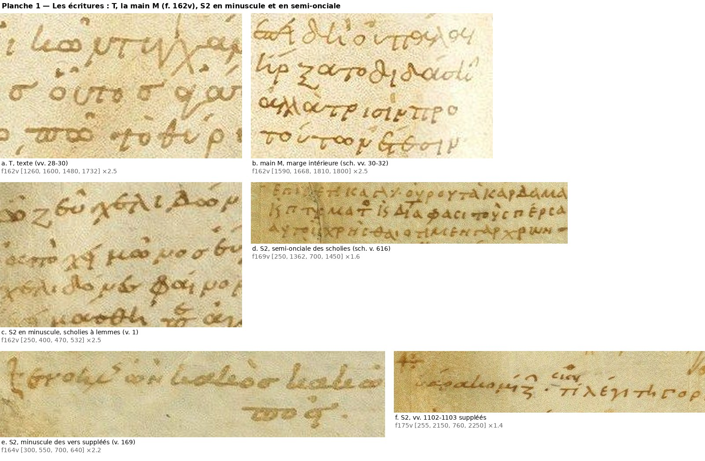

#### 2.3.3 Encre

- **En moyenne**, les scholies de S2 sont à peine plus jaunes que T : ΔB/R médian +0,15 pour 262 scholies (déciles +0,01 / +0,36), +0,13 pour les gloses. La médiane des médianes par page vaut +0,14 sur les trente pages, et l'écart est positif sur vingt-neuf pages (`graphologie/chapitres/donnees/1_ecarts_observations.tsv` ; seul le f. 163r est négatif, −0,05).
- **Une part de cet écart vient du fond.** Il croît avec le jaunissement des marges (§ 2.1.3 c). Les notes que S2 a écrites **dans la colonne même** mesurent comme T. C'est le cas au f. 174v (l. 17 : −0,05 ; l. 20 : −0,13), au f. 163r (χωνεύει, l. 20 : 0,00), au f. 170v (l. 7 : −0,08), au f. 175r (l. 21 : +0,02) et au f. 172r (glose πόρνης ὄνομα, l. 9 : +0,03). D'autres, sur le même fond, sont plus jaunes : f. 174v, l. 33 (+0,41) ; f. 164r, ζωνάριον (+0,38).
- **Les petites corrections de S2 dans le texte** mesurent en médiane comme T (−0,02 pour 64 interventions). Il y a des exceptions nettes, mesurées par les inventaires contre les lettres voisines à densité égale : πο du v. 434 (f. 167v), περ et να des vv. 938 et 954 (f. 173v), seconde boucle de l'ω de ὠόμην au v. 526 (f. 168v).

Il faut donc conclure ainsi : **l'encre de S2 est du même type que celle de T, en séances plus variables**. Elle ne sépare jamais à elle seule S2 de T pour un trait isolé. Les campagnes distinctes que les inventaires ont repérées à l'intérieur de S2 sont réelles, mais il faut les lire selon le § 2.1.3. Ce sont les gloses de la marge intérieure du f. 168r, à l'encre « de T », la 1re ligne grise d'une scholie au f. 166r (v. 329), et la différence entre marge intérieure et marge extérieure au f. 163v. Les sigles « rougeâtres » de S2 du f. 172v (« groupe A ») sont des sigles repassés (§ 2.6.4).

#### 2.3.4 Ce que fait S2

- **Scholies et gloses.** Il les écrit toutes, sauf les deux notes de la troisième main (§ 2.4). Elles occupent surtout les marges extérieure et intérieure, et parfois les marges supérieure et inférieure ou le blanc des lignes lyriques. Le détail est à la partie 5.
- **Sigles de personnages.** Ils sont abrégés par lettre suscrite et posés à gauche de la paragraphos de T : μνη^σ, μνησι^λο, κη^δ, ευρι^π, γυ^ν, αγα^θ, κλεισ^θ, σκυ^θ, χ^ο, χ^ρ et le monogramme χορ, τοξ. On les trouve sur presque toutes les pages où le dialogue l'exige (§ 2.8). Allen écrit, à propos du f. 170v, « nearly all the dram. pers. are by B » : c'est vérifié, avec 8 ou 9 sigles de S2 contre un sûr de 1516.
- **Corrections.** S2 supplée des vers omis : vv. 1102–1103 et probablement v. 647 ; les vv. 33 et 169 lui sont donnés par la littérature, sans appui formel (§ 2.3.2). Il fait des suscriptions et des écrits sur grattage, par exemple -εῖν au v. 370 (f. 166v). Il exponctue (σαλλαβακχοῦσ, v. 805, probable) et corrige ses propres scholies (δαίμων, f. 166r ; ἀμφε sur ⟦ενε⟧, f. 174v). Il ajoute des accents et des esprits, mais ceux que Velsen 1883 lui donne ne sont en général ni visibles ni attribuables sur l'image.
- **Signes de renvoi.** Il en emploie, contre ce qu'écrivent Zacher 1888, 536 et Orsini 2011, 328, mais rarement et toujours pour une raison précise (relevé au § 5.3.6). Le « +: » des vv. 1102–1103, toujours visible aux deux bouts bien qu'Allen 1896, 317 le dise « erased by Giunta », est orangé (ΔB/R +0,75 et +1,13) : c'est un renvoi de S2 repassé en 1516, ou un renvoi de 1516, et il ne compte pas parmi les renvois sûrs de S2.

#### 2.3.5 Place dans la chronologie

S2 écrit **après T** :

- au f. 163v, l. 35, la base du dernier Α de son ΑΓΑ^θ est la paragraphos de T ;
- au f. 169v, il raccourcit deux lignes de scholie pour ne pas toucher les paragraphoi de T des vv. 617–618 (inv. f169v, corrections 1–2) ;
- partout, ses sigles se logent à gauche de ces paragraphoi.

Il écrit **avant M** : M reproduit ses sigles et ses suscriptions (inv. f164r ; collation de M, § 1.7 ; Velsen 1871 et 1883). **M n'a que deux des quatre suppléments de vers.** Il omet le v. 33 (f. 1v, vérifié : le v. 32 y porte un astérisque marginal, de fonction inconnue ; Velsen 1883 : « versum omm. RG ») et les vv. 1102–1103 (f. 17r, `bsb00108707_0037`, du v. 1101 au v. 1104). Il a le v. 169, copié après le v. 170, avec « δ᾽ αὖ » rejeté en marge (f. 3v, relevé de M ; Velsen 1883). Il a aussi le v. 647, qu'il faut chercher non entre les vv. 646 et 648, mais à la fin de la ligne du v. 644, et « καὶ κάτω » est rejeté à droite de la ligne suivante (f. 10v, `bsb00108707_0024` ; `graphologie/specimens/ch1_verif2/G_f10v_v644_v647.png` ; Velsen 1883 : « in textu omissum in margine iuxta v. 644 add. G »). Les vv. 169 et 647 sont donc antérieurs à M. Les deux autres ne sont pas datés par lui : son copiste a pu les négliger, comme il néglige le μέντοι marginal de T au v. 630 (partie 6). Les auteurs jugent S2 contemporain ou presque de T (« fere suppar aetate primae manui », Velsen 1883, 5 ; « nicht viel später », Velsen 1871, 6–7).

---

### 2.4 La troisième main ancienne, en minuscule (`Rsch`)

**Ce qu'elle a écrit.** Deux scholies de la marge intérieure du f. 162v :

- à la hauteur des l. 28–29 (v. 27) : « λεί^π(ει) τὸ ἔνθα· οἷον σιω(πῶ) | διὰ τὸ θύριον | ἔπαιξ(ε) δ(έ)· », lecture de la partie 5 que l'image permet ;
- aux l. 30–33 (vv. 30–32) : « ἐπειδὴ οὐ πάλαι | ἤρξατο διδάσκ(ειν) | ἀλλὰ τρισὶν πρὸ | τούτων ἔτεσιν », selon la lecture de Martin 1882, 196 citée à la partie 5, que l'image permet.

Voir pl. M1, b et `graphologie/specimens/ch1/f162v_marge_int_main_M.png`.

**Ce que j'observe** (images à ×2,5–3 et à même échelle que les autres minuscules, pl. M1) :

- une minuscule **ronde et droite**, aux lettres espacées et régulières, tracée d'une plume assez épaisse. Les lettres rondes mesurent 12–13 px et le corps 10–14 px. On y voit le δ à boucle haute, le θ ovale fermé, le ξ en « ʒ » à longue queue (ἤρξατο) et le ν final plongeant (ἔτεσιν) ;
- elle diffère de la minuscule à lemmes de S2 du même folio (pl. M1, c), qui est inclinée, irrégulière, au tracé grêle, avec des capitales. La minuscule à lemmes n'est pourtant **pas plus petite**. Son corps, mesuré à mi-densité par profil de projection, fait 10–18 px (médiane 15,5), contre 10–14 px (médiane 11) pour M. Les lettres rondes de M mesurent 12–13 px, celles de la minuscule à lemmes 15–16 px (et celles de T 16–18 px). La différence tient à l'axe, à l'espacement et au tracé, non au module ;
- elle diffère aussi de la grande minuscule penchée des vv. 1102–1103 (pl. M1), qui est inclinée, étirée et à plume fine. Elle est plus proche des vv. 33 et 169, ronds et à peine inclinés, dont elle n'a pourtant ni le module ni le π en ϖ (§ 2.3.2) ;
- par le style, elle se rapproche de la minuscule de T (pl. M1, a), en lettres détachées et en plus petit module. La partie 5 y relève des formes de T (π en ϖ, κ en « lc »). Le κ en « lc » se voit dans διδάσκ(ειν). Le π de πάλαι et de πρὸ a, à cette résolution, la forme ordinaire à barre : le π en ϖ n'y est pas reconnaissable.

**Encre.** Note du v. 27 : ΔB/R −0,08, comme T. Note des vv. 30–32 : +0,15, comme les scholies de S2 de la page (+0,13 à +0,21). Les deux notes sont pourtant de la même main : l'encre ne discrimine pas.

**Conclusion.** Ces deux notes ne sont pas de S2, et elles sont d'une même main (ductus, ο ronds, ν plongeant, même ligature initiale dans ἔπαιξε et ἐπειδή ; vue à ×4,5). Elles forment la « troisième main contemporaine » (« terza mano coeva ») qu'Orsini 2011, 327 n. 24 signale expressément pour la scholie au v. 32 : il ne cite pas la note du v. 27, que j'y joins par la comparaison des formes. Allen 1896, 321 range la scholie ἐπειδὴ οὐ πάλαι parmi les minuscules de B : je le contredis sur ce seul point, non sur les autres minuscules du f. 162v. Peut-on l'identifier à T écrivant en petit ? C'est possible, mais l'image seule ne suffit pas. Il faudrait la confronter aux ajouts marginaux sûrs de T dans d'autres pièces (Ploutos 271 et 1129–1130, ff. 4r et 14r) et à la scholie à Ploutos 509 (f. 6v) qu'Orsini donne à la même main. Ces pages ne sont pas dans le dépôt. Étiquette : **Rsch** (« troisième main »), avec la mention « T ? ».

---

### 2.5 Le correcteur ancien à l'encre brun-noir (R3)

Ces interventions ont été réunies à partir des inventaires, puis mesurées deux fois, de façon indépendante : avec le protocole du § 2.1.2 et avec la mesure par classes du § 6.1.2 (planche `graphologie/chapitres/planches/4_groupe_Rn.png`).

| Page, l. | v. | Intervention | ΔB/R (§ 2.1.2) | ΔB/R (§ 6.1.2) | Valeur |
|---|---|---|---|---|---|
| f. 170r, l. 11 | 646 | ἥκει πάλιν sur grattage (`graphologie/specimens/ch1/f170r_v646_hekei_palin.png`) | −0,44 (186 px, A_R 0,25) ; vérif. −0,47 / −0,54 (A_R 0,27–0,29), T de la ligne +0,05 | −0,41 | sûre (mots entiers) |
| f. 173v, l. 22 | 939 | υ de ἀποδύσαντα sur grattage (`graphologie/specimens/ch1/f173v_v939_upsilon.png`) | −0,46 (57 px, A_R 0,33) ; vérif. idem, lettres voisines +0,06 / +0,10 | −0,56 | sûre (lettre dense ; référence T mince à cette densité) |
| f. 168r, l. 28 | 493 | κιν- sur grattage, Κ majuscule en deux traits | −0,21 / −0,28 (vérif. : Κ −0,30 sur 25 px ; ιν −0,28 ; ω suivant −0,11 ; T de la ligne −0,03) | −0,31 | probable par la forme (Κ en deux traits, comme dans ἥκει) ; la mesure ne le sépare pas de T (4,5 % des fenêtres denses de T de la page descendent à −0,30) |
| f. 172v, l. 41 | 874 | ι de ποίου, σ gratté (`graphologie/specimens/ch1_verif2/f172v_v874_iota.png`) | −0,48 (22 px) ; ι presque noir à l'œil à côté des ο de T | −0,53 | probable (une seule lettre) |
| f. 163r, l. 17 | 54 | grave sur le second τάδε (`graphologie/specimens/ch1/f163r_v54_grave_brun_noir.png`) | −0,53 (34 px, A_R 0,24) | −0,44 | possible |
| f. 176r, l. 24 | 1149 | esprit rude « ⊢ » de ἅλσος (`graphologie/specimens/ch1/f176r_v1149_esprit_noir.png`) | −0,39 (48 px, A_R 0,28) | −0,35 | possible (plus noir à l'œil, forme anguleuse ; encre dans la plage des points de T) |
| f. 170r, l. 14 | 650 | aigu ajouté au grave de ἐγὼ | −0,27 (143 px) | −0,43 | possible |

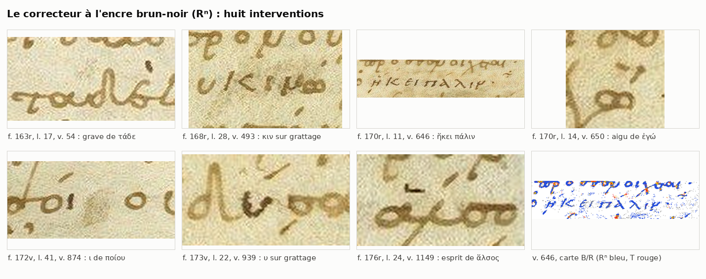

**Ce qui est établi.** Sur des lettres entières et denses, l'encre est nettement plus neutre et plus sombre que celle de T et que celle des scholies de S2, à densité égale. ΔB/R vaut −0,2 à −0,5, alors que T reste au-dessus de −0,16 et que les scholies de S2 restent au-dessus de +0,01 (déciles inférieurs). Le balayage de la colonne par fenêtres le confirme pour les mots entiers : au f. 170r, ἥκει πάλιν descend à −0,62 / −0,66 (A_R 0,30), alors qu'aucune fenêtre dense de T ne passe sous −0,37 ; au f. 173v, seules les empreintes grises atteignent le niveau de l'υ. Les écrits sur grattage ne suffisent pas à l'expliquer : d'autres récritures sur grattage ont l'encre de T, comme γα de τ' ἄργα (f. 172r, −0,03) et εῖ de ἐπιζεῖν (f. 168r, −0,09). L'εῖ de ἐπιζεῖν n'appartient donc pas au groupe (accord avec la partie 6, contre l'inv. f168r).

**Ce qui ne l'est pas : les petits signes.** J'ai mesuré tous les petits signes de la colonne (composantes de 20 à 90 px : accents, esprits, points) aux ff. 163r, 170r et 176r. Leur écart à T a une médiane de −0,22 à −0,29 et un décile inférieur de −0,48 à −0,54. Parmi les signes denses (A_R ≥ 0,22), 39 à 71 % mesurent −0,35 ou moins. Les points de ponctuation de T, aux mêmes pages, mesurent −0,35 à −0,64 et paraissent brun très sombre à l'œil (`graphologie/specimens/ch1_verif/petits_signes_denses_T_vs_R3.png`). Le grave du v. 54 (−0,53) et l'esprit du v. 1149 (−0,39) ne sortent pas de cette plage. L'encre ne les sépare donc pas de T, conformément à la règle du § 2.1.3. L'esprit du v. 1149 paraît plus noir à l'œil et a une forme anguleuse distincte ; il reste le meilleur candidat. Ces signes ne sont rattachés à R3 qu'à titre possible.

**Écriture.** ἥκει πάλιν est une écriture droite, d'un module un peu supérieur à celui des scholies. Elle n'est pas inclinée comme celle de S2. Κ (en deux traits), Π, Α et Λ y sont majuscules, et l'ε est lunaire. Mais l'η a la forme minuscule en « h », et le ν final est **minuscule, à jambage plongeant** : c'est la forme de T, non un Ν. C'est donc une écriture mixte plutôt qu'une semi-onciale pure. Le κιν du f. 168r a un Κ majuscule en deux traits, forme que S2 emploie dans ses sigles. L'esprit en équerre du v. 1149 rappelle l'esprit anguleux de S2.

**Date.** Ces **leçons** sont antérieures à M, qui a ἥκει πάλιν (f. 10v, contrôlé), κινώμεθα (f. 8r), ποίου (f. 14r) et ἀποδύσαντα. M date la leçon, non l'encre (§ 2.6.4, point 5). Aucune reprise n'étant visible sur ces lettres, je tiens l'encre pour celle de la récriture, sans pouvoir le démontrer. La position relative par rapport à S2 est inconnue, faute de superposition observée.

**Attribution.**
- Allen 1896, 316 (B) et Velsen 1883 (R²) donnent ces corrections à S2. Velsen 1871 donne le grave du v. 54 à la « 2 m. », ce que l'encre exclut.
- L'écart d'encre et l'écriture droite plaident pour une campagne distincte, peut-être d'une autre main.
- Velsen 1883, 5 annonce un R³ « paullo recentior » qu'il n'emploie jamais dans l'apparat des *Thesmophories*. Clark 1871, 154 parle d'une main « à l'encre plus noire » (XIVe ou début du XVe s.), surtout dans les Nuées. Je ne peux établir ni l'une ni l'autre identification. M ne donnant qu'un terme très bas, R3 peut aussi appartenir au XVe siècle : il reste à le comparer aux annotations d'Angelo Vadio, ancien possesseur de R selon Stefec 2012, cité par Scotti 2024, 462 n. 7 (`../recherche/monacensis_492.md`, § 6).

**Étiquette.** **R3**, définie par l'encre (« correcteur ancien à l'encre brun-noir, antérieur à M ; R² ipse ? »). Le groupe comprend deux interventions sûres (vv. 646, 939) et deux probables (vv. 493, 874). Les accents et esprits (vv. 54, 650, 1149) n'y entrent qu'à titre possible, puisque l'encre ne discrimine pas les petits signes, et M garde l'état premier aux vv. 54 et 650. Dans l'apparat, ils se notent `R?`, avec la mention « R³ ? ».

---

### 2.6 La campagne de 1516 (Rrec)

#### 2.6.1 Identification

Velsen 1871, 6–7 décrit une « 2 m. » propre à la *Lysistrata* et aux *Thesmophories*, « viel später » (XVe ou XVIe s.). Ses sigles « imprimables » sont ceux de la Juntine et manquent dans M (Velsen 1871, 7–8, liste des cas « bezeichnend »). Les traits et chiffres de la même campagne renvoient aux pages des cahiers de la Juntine (Velsen 1871, 3–6). R. Schöll l'a identifiée à Euphrosynus Boninus, et l'identification a été reprise depuis (Velsen 1883, 5 ; Martin 1882, xiii ; Prato 2001, xxxii ; Scotti 2024, 462 : dossier § 6.3). **Les sources dépouillées ne publient aucune comparaison avec un autographe de Bonini.** Le seul autographe que j'y trouve signalé est un manuscrit de 1493 de la collection Theodorou, décrit par le catalogue en ligne de cette collection, sans reproduction (dossier § 6.3). J'emploie donc « main de 1516 », non « Boninus ».

#### 2.6.2 Encre

L'encre est **orangée**, et c'est le seul critère d'encre vraiment discriminant de la pièce.

- 235 sigles attribués à cette main par les inventaires donnent un ΔB/R médian de +0,60 (quartiles +0,24 / +0,92). La médiane des médianes par page vaut +0,62 sur 19 pages.
- En valeurs absolues, les inventaires donnent G/R 1,36–1,91 et B/R 2,2–4,0 selon l'ouverture (§ 2.1.3 a), et une teinte « rouge-orangé » en décorrélation Lab.
- La signature est la même sur toutes les pages. Les notes de forme S2 attestées par M n'ont pas une autre encre : sur sept pages où elles côtoient des sigles donnés à 1516, leurs pixels orangés (ΔB/R ≥ +0,30) donnent G/R 1,65–1,83 et B/R 2,9–3,7, contre 1,59–1,75 et 2,9–3,4 pour ces sigles. Clark 1871, 160 voit pourtant « an ink like but not identical ». Ni les images ni la mesure ne confirment cette nuance, mais leur résolution ne l'exclut pas.
- Les petites corrections de cette main (accents, virgules, traits) mesurent souvent comme T (médiane +0,04), pour la raison donnée au § 2.1.3 b. Pour elles, il faut s'appuyer sur la liste de Velsen 1871 et sur la forme.

#### 2.6.3 Écriture et façons de faire

**Formes** (relevées dans les inventaires, contrôlées sur les planches) :

- Γ en grand crochet à longue haste, souvent greffé sur le dicolon ou la paragraphos de T (Γϋ, Γυ) ;
- μ à premier jambage descendant ;
- ν suscrit en V, η suscrit en Η capital (μν^η) ;
- κ en croix ou en x ;
- εὐ en Є barré ou cursif ;
- σκ à longue queue, Ηχ à Η capital et grand χ ;
- tréma sur υ et point abréviatif.

Le module des sigles est **grand** (30–45 px). Le « viel kleiner » de Velsen 1871 vaut pour les corrections dans le texte, non pour les sigles (inv. f165r, f167v).

**Ce que fait cette main :**

1. **Sigles imprimables** en tête de vers et dans les vers, sur les marques de T ou dans ses blancs. Il y en a environ 300. Ils font défaut aux ff. 166v, 170r, 171v, 172r et 174r, et sont rares aux ff. 166r, 167r, 167v, 168r, 168v, 169v et 170v (§ 2.8.2). Le relevé de M confirme qu'ils y manquent presque tous. Une dizaine de lieux font exception, de deux sortes. Aux vv. 211, 295, 380, 466, 582 et 584, M conserve un sigle ancien que la main de 1516 a gratté et récrit. Aux vv. 443, 1002, 1084–1085, 1165 et 1218, M a un sigle de forme S2 sans correspondant ancien noté dans R : c'est plutôt une initiative de Canal, qui développe à sa façon (σκυ^θ pour le σκ de R), à moins qu'un sigle ancien ne se cache sous le tracé orangé (annexe A).
2. **Sigle en marge et signe d'insertion « ^ » ou « √ » dans la ligne**, quand T n'a rien marqué (f. 165r, l. 8, 14, 16 ; f. 176v, vv. 1179 et 1187, avec deux attributions fausses). Au v. 552, elle place une croix et un chevron dans le texte (f. 169r).
3. **Annulation des paragraphoi** jugées fausses, par une haste verticale qui forme un « + » :
   - vv. 232, 234, 246 (f. 165r). Ici, la haste n'est **pas orangée** : ΔB/R −0,03 (v. 234), −0,18 (v. 246) et +0,20 (v. 232, sur 26 px), et les cartes sont celles de T. Aux ff. 175v et 177r, au contraire, la haste est franchement orangée (+0,79 et +1,12 au f. 175v ; +0,94 au v. 1221) sur une paragraphos brune (−0,06 à −0,34). L'attribution à 1516 des trois « + » du f. 165r repose donc sur la fonction, non sur l'encre. M garde le trait simple aux vv. 232 et 246 : une main plus ancienne que M est donc peu probable, mais la main reste indécise ;
   - vv. 264, 273, 274 et parépigraphe (f. 165v) ;
   - vv. 1093, 1095 (f. 175v) ;
   - vv. 1184, 1194, 1195, 1204 (f. 176v) ;
   - v. 1221 (f. 177r).

   Aux ff. 165v et 176v, les hastes sont trop fines pour la mesure (A_R ≈ 0,05). À ×6, elles sont orangé pâle, plus claires que la paragraphos (`graphologie/specimens/ch1_verif2/plus_ff165v_176v.png`). M garde le trait simple aux vv. 264, 273, 274, 1184 et 1204 : ces barres sont postérieures à sa copie, ou il les a négligées. Ses propres « + » (vv. 1116, 1194) sont des tirets biffés par lui (Velsen 1871 : « — sed deletum Aug. » au v. 1116), et R n'a pas de barre au v. 1116.

   Au v. 1076, elle barre au trait gris (f. 175r, l. 35 ; Velsen 1871 : « I m. del. 2 m. »). Le même dispositif revient au v. 1078 (l. 39), oublié jusqu'ici : la haste y est pâle et plutôt roussâtre (G/R 1,29–1,45 ; B/R 2,06–2,58), non grise.
4. **Grattage de sigles anciens**, puis récriture :
   - κήρυξ sur le κη^ρυ de S2 que M a encore (f. 166r, v. 295) ;
   - Γυνὴ τίς sur un sigle antérieur que M reproduit (f. 167r, v. 380) ;
   - vv. 34 et 25 (?) (f. 162v), v. 173 (f. 164v), v. 466 (f. 168r), vv. 582 et 584 (f. 169r ; Velsen 1871 : « in rasura », grattage non perceptible sur l'image ; M a χορ et κλεισ^θ), l. 31–32 (f. 173r), l. 31–33 (f. 175v).

   Elle gratte aussi des paragraphoi après la copie de M (f. 176v, v. 1200, où M a encore la paragraphos).
5. **Corrections du texte et de la ponctuation** à l'encre orangée, conformes à la liste de la « 2 m. » de Velsen 1871, 25–26 :
   - grave de παρὰ annulé (v. 803) et grave ajouté sur πρὸς (v. 806) au f. 172r ;
   - seconde boucle de ὀλίγων (v. 443, f. 167v ; +0,21 contre −0,16 pour la première, plus rouge à ×10 ; M a encore ὀλίγον) ;
   - grave de καὶ (v. 1097, f. 175v) ;
   - σκ ὸ tiré de ο ο ο (v. 1191, f. 176v ; brun chaud posé sur T, +0,25 à +0,35 contre +0,50 pour le sigle voisin ; M a encore ο ο ο) ;
   - virgules transformant un point en « ; » (vv. 193 et 252 ; ff. 164v, 165v).

   **Ne sont pas de cette encre**, contre Velsen 1871 :
   - le grave du v. 54 (R3, § 2.5) ;
   - l'αι de λαικάζει (v. 57 : brun dense, type S2) ;
   - ἔφραζον (v. 1173 : brun, déjà dans M, donc S2) ;
   - le β de κύβδ' (v. 489 : déjà dans M) ;
   - l'ι de ναυσιμάχη (v. 804) ;
   - la virgule du v. 222 (f. 165r : +0,02, brune à ×5 ; main indécise ; `graphologie/specimens/ch1_verif2/corrections_1516.png`).

   L'inventaire donne au λ de ἄλ^λως (v. 290, f. 165v) une encre pâle presque neutre, celle des repères de pages (§ 2.6.5). À densité égale, il ne s'écarte pas nettement de T (la diagonale croise d'autres tracés), et M a déjà ἄλλως : la main reste indéterminée.

   La collation de M confirme ces exclusions et les étend : les corrections de lettres des vv. 57, 257, 290, 489, 804 et 1173, ainsi que l'aigu du v. 373, que Velsen 1871, 25–26 range dans sa « 2 m. », sont déjà dans M, et ne sont donc pas de 1516. Sa « 2 m. » n'est pas homogène. Le v. 373 est le plus instructif : M a l'aigu sur ό et encore le circonflexe, ce qui montre deux temps, l'aigu avant 1505, le grattage après.
6. **Imitation des formes de S2.**
   - Le grand monogramme χορ du v. 1170 (f. 176v) a la forme exacte des monogrammes de S2 (pl. M2, h et i). Velsen 1871 le range pourtant parmi les sigles de 1516 que M ignore (vérifié : M, f. 18r, n'a ni sigle ni trait), et son encre est orangée (+1,11).
   - La note « ὡς περσεύς » du v. 871 (f. 172v), imprimée par la Juntine (« Εὐρ. ὡς περσεύς ») et absente de M (f. 13v, vérifié : εὐρι^π seul), reprend la formule de la note de S2 au v. 1098 (f. 175v), où Euripide entre en Persée. Au v. 871, Euripide entre en Ménélas : la note y est fausse.

   La forme de S2 ne suffit donc pas à exclure la main de 1516.

#### 2.6.4 Le repassage des notes de S2

Plusieurs notes et sigles **de la forme de S2** sont aujourd'hui orangés. J'ai réuni tous les cas (pl. M2 et spécimens `graphologie/specimens/ch1/`) :

| Page | v. | Note | ΔB/R | M (apographe) |
|---|---|---|---|---|
| 162v | 5, 19, 39 | ευ^ρ, μνη^σι, θερά^π (lettres suscrites restées brunes) | +0,06 (boîte mêlée à la paragraphos de T) ; +0,62 ; +1,11 | dans M (relevé : εὐ^ρ, μνη^σι, θερ^απ) ; Velsen 1871 : « überzogen von 2 m. » |
| 162v | 33 | vers suppléé (S2 selon la littérature, § 2.3.2), lignes (b)–(c) repassées (partie 6) | — | vers omis par M, ligne (a) comprise |
| 162v | 27–30 | lettres de transposition α, δ, β ; Γ moins orangé, brun-olive | +0,90 ; +0,82 ; +0,46 (Γ +0,21) | M a l'ordre rétabli : indice, voir 6 ci-dessous |
| 163r | 45b–46 | μνησί^λο, εὐ, θερ : λό brun, le reste orangé | +0,81 / +0,92 | dans M, f. 1v (relevé : μνη^σι, θερ^απ) |
| 163v | 101, 104, 114, 117 | ΑΓΑ^θ, χορ (à côté de ΑΓΑ^θ v. 107 et χ^ο v. 111 restés bruns) | +2,13 ; +0,81 ; +0,57 ; +0,99 (contre −0,14 et −0,43) | **dans M, f. 2v, vérifié**, ainsi que les sigles bruns des vv. 107 et 111 |
| 164v | 169 | début du vers suppléé (ὁ δ᾽ αὖ ξενο-), que M lisait mal (partie 6) : **douteux** : la mesure par segments donne +0,51 / +0,69 au début et +0,22 / +0,09 ensuite, mais sur une écriture pâle (A_R 0,11), avec une carte surtout « T » (voir aussi § 6.2.4) | voir ci-contre | M, f. 3v : vers copié après le v. 170, blanc pour δ᾽ αὖ, rejeté en marge |
| 168v | 533 | γυ^νη τίς, intermédiaire entre κη^δ de S2 (v. 540, −0,01) et Γυνη de 1516 (v. 544, +1,01) | +0,41 | dans M, f. 9r (relevé : γυ^ν^ή τ^ι) ; van Leeuwen 1904 : « manus recens » |
| 169r | 574, 592 | κλει (κλ gris-brun, ει déjà orangé) + σ θενησ orangés ; κη^δ | +0,33 / +1,25 ; +1,04 | dans M, f. 9v (relevé : κλεισ^θ, κη^δ). M n'ayant que l'abréviation, -ενησ est plutôt un complément de 1516 qu'un repassage |
| 170r | 655, 659 | χ^ρ ; ἡμι^χ γυν^αικῶν : Ημι brun (−0,02 ; vérif. +0,02), χ, γυν, αικ, ῶν orangés (+0,64 à +1,42 ; vérif. +1,24 à +1,42) | +0,99 ; voir ci-contre | **dans M, f. 10v, vérifié** : χ^ρ du v. 655 ; en marge du v. 659, « ἡμι^χ γυ^ν… » (lecture probable ; `graphologie/specimens/ch1_verif/G_f10v_v659_note.png`) |
| 170v | 689 | γυ^ν(η) sur la paragraphos, cœur orangé | — | dans M, f. 11r (relevé : γυνὴ en toutes lettres) |
| 171r | 730 | μνη^σι | +1,11 | **dans M, f. 11v, vérifié** |
| 171v | 785 | χ^ορ | +0,96 | **dans M, f. 12v, vérifié** |
| 172v | 846, 852, 855, 871 | μνη^σ, γυ^ν, tiret, εὐρι^π (« groupe A » de l'inventaire) | +0,50 à +0,97 | **dans M, f. 13v, vérifié** (μνη^σι, γυνὴ, μνη^σι, εὐρι^π) |
| 173v | 936, 939 | μνη^σ, ΠΡΥ | +1,29 ; +1,15 | **dans M, f. 14v, vérifié** (μνη^σι, πρυ^τ) |
| 174r | 1001 | τοξ(ότης) | +1,47 | **dans M, f. 15v, vérifié** (τοξό^τ) |
| 175r | 1063b | μνη en interligne | — | **pas dans M** : blanc sans sigle (f. 16v, vérifié). Velsen 1883 : R². Attribution à S2 non assurée |
| 175v | 1083, 1098, 1107, 1108 | ηχω ; εὐρι^π ὡς περσεύς ; κη^δ ὡς ἀνδρομε^δ ; σκυ^θ | +0,85 ; +0,95 / +1,10 ; +0,93 / +1,00 ; +0,87 | **dans M, f. 17r, vérifié** pour vv. 1098 (εὐρ… περσ) et 1107 (κη^δ ἀνδρο·) (`graphologie/specimens/ch1/G_f17r_vv1098-1107.png`, non versionné) |
| 176v | 1207 | κη^δ | +1,09 | **dans M, f. 18v, vérifié** ; Velsen 1871, 35 : main des scholies |

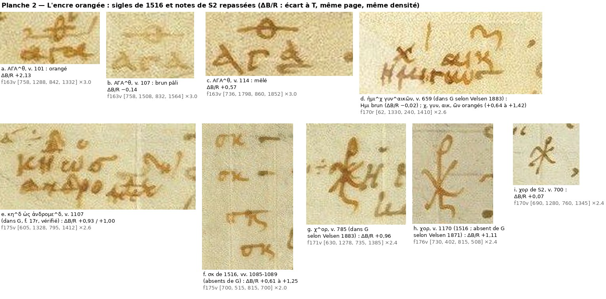

**Deux explications sont possibles** (inv. f170r, f171v, f175v, f176v) : une seconde encre de S2, devenue orangée, ou un repassage de 1516. **Les faits penchent nettement pour le repassage, sans le démontrer directement.**

1. **L'encre est la même.** Sur les mêmes pages, ces notes ne se distinguent pas des sigles de 1516 : au f. 175v, κη^δ ὡς ἀνδρομε^δ mesure +0,93 / +1,00, et les σκ de 1516 aux vv. 1085–1089 mesurent +0,61 à +1,25 (le premier est un témoin moins sûr : M a σκυ^θ à cette ligne). La composition de l'orangé est la même sur sept pages (§ 2.6.2).
2. **Des sigles identiques de S2, sur une même page, ont des encres différentes.** Au f. 163v, ΑΓΑ^θ est brun pâli au v. 107 (−0,20, A_R 0,07) et orangé aux vv. 101 (+2,04) et 114 (pl. M2, a–c ; `graphologie/specimens/ch1_verif/f163v_AGA_v101_x4.png`, `graphologie/specimens/ch1_verif/f163v_AGA_v107_x4.png`, `graphologie/specimens/ch1_verif/f163v_AGA_v114_x4.png`). Au v. 114, les lettres sont toutes orangées : Α +0,82, Γ +0,52, haut du dernier Α +0,43, θ barré +0,60. La part brune de sa boîte est la base du dernier Α, qui est la paragraphos de T. Il y a donc deux états. S2 a écrit ces sigles dans la même séance. Un repasseur, lui, a pu choisir.
3. **Une même note est brune au début et orangée ensuite.** Au f. 170r, v. 659, Ημι est brun et la suite orangée (pl. M2, d). On ne s'arrête pas d'écrire après ἡμι pour changer d'encre. En revanche, on repasse ce qui a pâli. On pourrait objecter que 1516 a complété un ἡμι de S2. Mais M a déjà en marge « ἡμι^χ γυ^ν… » : la partie orangée existait avant 1516.
4. **La main de 1516 repasse ailleurs** : les sigles des vv. 5, 19 et 39 (Velsen 1871, « überzogen »), celui du v. 45b, où le λο suscrit reste brun (−0,15) au-dessus d'un μνησι orangé (+0,88 ; `graphologie/specimens/ch1_verif2/f163r_v45b.png`), et le vers suppléé 33, dont les lignes (b)–(c) sont orangées et la ligne (a) brune. On ne peut pas dire que ce repassage porte sur ce que M ne lisait pas, puisque M omet tout le vers, ligne (a) comprise. Le v. 169 est moins net (tableau ci-dessus et § 6.2.4).
5. **Le témoignage de M porte sur le texte des notes, non sur leur encre** : un sigle de S2 copié par M vers 1505 et repassé en 1516 est attendu dans M.
6. **La série α Γ δ β des vv. 27–30.** R a les vers dans l'ordre 27, 29, 30, 28, avec ces lettres à droite ; M a l'ordre rétabli 27, 28, 29, 30 (`graphologie/specimens/ch1_verif2/G_f1r_vv27-29_ordre.png`). Si M a suivi les lettres, la série existait avant lui. Or α, δ et β sont orangés, et le Γ brun-olive (`graphologie/specimens/ch1_verif2/f162v_lettres_27-30.png`). C'est un indice, non une preuve : M a pu rétablir l'ordre de lui-même, et Allen 1896, 316 voit là les signes d'une main tardive.

**Ce qui reste une inférence.** Aucun tracé brun n'apparaît sous l'orangé, ni à l'œil ni à la mesure. La part de pixels orangés de ces notes va de 0,58 à 1,0, et leur orangé est plutôt un peu plus saturé que celui des sigles de 1516 (écart médian +0,09 en G/R et +0,17 en B/R sur six pages). Une encre posée sur un tracé brun devrait l'être moins, à moins que S2 n'ait presque disparu sous le repassage ; les sigles de 1516, souvent bâtis sur une paragraphos, sont d'ailleurs mêlés eux-mêmes. Le repassage est l'explication la plus économique, non un fait observé (annexe A, § 2.2).

**Conséquences.**
- Ces notes sont de S2 pour le contenu et de la main de 1516 pour l'encre visible.
- Les « deux correcteurs à l'encre rougeâtre » de Clark 1871, 159–160 trouvent ici leur explication. Clark voit une copie de M faite « après le premier, avant le second ». Son « premier correcteur » correspond aux notes de S2 repassées, présentes dans M par leur contenu. Son « second », qui « imite le premier », correspond aux sigles imprimables de 1516, qui imitent parfois S2 (§ 2.6.3, 6). Clark a donc raison de distinguer une couche rougeâtre antérieure à la copie, mais tort d'y voir le copiste de Munich : l'écriture de ces notes n'est pas celle de Canal (contrôle sur les vv. 1098 et 1107).
- **Règle d'attribution** pour un tracé orangé :
  - de forme S2 et attesté par M : R2, repassé par Rrec ;
  - absent de M : Rrec probable, même s'il a la forme de S2 (v. 1170). Le silence de M n'est pas une preuve à lui seul : ses sigles sont au minium, posés à part (Velsen 1883, 5 ; d'où leur pâleur sur la numérisation), il omet des sigles sûrs de S2 (v. 645, ΚΛΕΙΣ^Θ brun) et laisse parfois un blanc (v. 1063b) ;
  - M non consulté : à contrôler sur la numérisation locale de M.
- Une réserve demeure : un repassage intégral a pu altérer une lettre. Pour le texte exact des notes de S2, M et l'original sous UV restent les témoins de contrôle.

#### 2.6.5 La seconde matière : la pointe grise des repères de pages

Les repères de la Juntine sont tracés dans une **matière gris neutre, sans charge d'encre**. Leurs valeurs (G/R ≈ 0,97–1,16 ; B/R ≈ 1,2–1,6) sont celles du crayon de la foliotation moderne (f. 167r, « 169 » : 1,01 / 1,34). Sur une image en couleurs, on ne peut distinguer graphite et pointe de plomb. La date de 1516 rend vraisemblable un stylet de plomb, le crayon de graphite ne se répandant que plus tard au XVIe s. (connaissance générale, non vérifiée sur ce manuscrit). Les chiffres sont humanistiques (4 ouvert : ff. 170r, 171v). Ces repères ont été relevés par les inventaires et confrontés à la liste de Velsen 1871, 5–6 :

- **Retrouvés** : la plupart des repères de Velsen, de a 12 (v. 178, f. 164v) à d 4 (v. 1191, f. 176v) et d 5 (?) (f. 177r). Le relevé complet est au tableau 6.4.C.

- **Non retrouvés** : a 11 (v. 150, f. 164r), b 4 et b 5 (vv. 388, 414, f. 167r), c 13 et c 14 (f. 174v ; pour c 14, seulement une plage grise douteuse à la l. 40), d 3 (v. 1167, f. 176r), le trait de b 12 au bas du f. 169r, et les chiffres « 15 » (f. 170r), « 3 » (f. 171v).
- **Variantes de matière** : plusieurs repères sont d'une encre pâle presque neutre plutôt que de la pointe grise (ff. 165v, 170r, 170v, 171v ; c 1 « ocre pâle » au f. 171r). La même campagne employait donc pointe ou encre diluée. Le « repère orangé » que les inventaires donnaient pour c 13 n'en est pas un : ce trait à crochet (f. 174v, x 1722–1792) porte les jambes du π suscrit de ΕΥΡΙ^Π et a la forme des barres d'abréviation de S2 (ff. 173v, 176r) ; il mesure comme T (+0,01, −0,15, −0,29), et l'orangé n'est que l'auréole de la tache voisine (`graphologie/specimens/ch1_verif2/f174v_barre_pi_c13.png`). Aucun repère n'est donc à l'encre des sigles.
- **Empreintes d'atelier** : des empreintes digitales grises à stries, de signature « carbone » (encre d'imprimerie), sont visibles au f. 173v (l. 26–27 et, non relevée jusqu'ici, l. 38–39, x ≈ 1150–1240 ; `graphologie/specimens/ch1_verif2/f173v_empreinte_l38.png`), au f. 176v (l. 31, probable) et au bas du f. 173r (douteux). Ce sont les candidates à la « printer's black thumb-mark » que Clark 1871, 159 signale sur une page sans la situer ; le f. 173v, avec ses deux marques, est la meilleure.

#### 2.6.6 Une main ou deux au XVIe siècle ?

- **Velsen 1871** voit une seule « 2 m. », « viel kleiner und mit einer viel blasseren Tinte ».
- **Clark 1871** voit « one if not two » mains à l'encre rougeâtre, la seconde imitant la première (dossier §§ 5.1, 10.1).
- **Sur l'image**, toute l'encre orangée a une seule signature, et le « premier correcteur » de Clark se ramène aux repassages (§ 2.6.4). Il n'y a donc **qu'une campagne d'encre orangée**.
- Le « viel blasser » de Velsen convient aux repères gris, à l'encre pâle du λ du v. 290 et à quelques corrections, non aux sigles.
- Les repères de pages relèvent de la préparation de la composition (calibrage des pages), les sigles et les corrections de la révision du texte : rien n'empêche que deux personnes de l'atelier aient travaillé sur le manuscrit. Une même fonction (barrer une paragraphos) s'exerce pourtant avec les deux matières (ff. 175r et 175v). Je retiens donc **une campagne, deux matières, une main probable**, sous une seule étiquette Rrec, avec un attribut d'instrument pour les repères (§ 2.9).

---

### 2.7 Les interventions modernes (Rmod)

#### 2.7.1 Foliotations et signature

- **Foliotation à l'encre**, dans l'angle supérieur intérieur, en chiffres italiques, souvent cachée par le pli. On la voit aux ff. 164r (« …64 »), 166r (trace au bord), 167r (« (1)67 »), 170r (« 170 »), 171r (« 171 »), 172r (« 172 »), 175r (« [1]75 »), 176r (trace au bord) et 177r (« …77 »). Son encre est neutre et sombre (f. 167r : G/R 1,11 ; B/R 1,68, `graphologie/specimens/ch1/f167r_foliotation_encre_67.png`). Ce sont les numéros de l'index de Martini sur la garde (« 162. verso », « 177. verso » ; dossier § 6.1) : elle existait au plus tard au XVIIIe s. C'est la foliotation de la littérature (Orsini 2011, 322 n. 3).
- **Foliotation au crayon de graphite** de la Classense, dans l'angle supérieur extérieur, sur les seuls rectos et décalée de +2 (« 165 » au f. 163r … « 179 » au f. 177r ; f. 167r : 1,01 / 1,34, `graphologie/specimens/ch1/f167r_foliotation_crayon_169.png`). Elle compte les gardes ; Martin 1882, x la connaît déjà. Aux ff. 164r et 171r, les inventaires donnent les deux numéros au crayon : c'est une erreur pour le numéro intérieur. Le « 171 » est tracé à la plume (7 à tête empâtée, traits effilés ; G/R 1,10, comme les numéros à l'encre, 1,10–1,13, contre 1,00–1,04 pour le crayon), et le « …64 » mesure de même (G/R 1,14 ; `graphologie/specimens/ch1_verif2/f171r_171_encre.png`).
- **Signature « 22 »** au centre de la marge inférieure du f. 167r, premier feuillet du cahier XXII. Elle est **à l'encre brun pâle, non au crayon** (G/R 1,27 ; B/R 1,98, contre 1,01 / 1,34 pour le crayon voisin ; `graphologie/specimens/ch1/f167r_signature_22.png`). Cela confirme l'inventaire du f. 167r et corrige le dossier (§ 1 : « au crayon »). Aucun « 23 » n'est visible au f. 175r. Martin 1882, x dit les signatures modernes emportées par la rognure : celle-ci a survécu.

#### 2.7.2 Le réactif bleu-vert

Des traînées bleu-vert ou gris-bleu couvrent exactement les débuts de lignes pâlis de scholies, et une fois une ligne entière. On les relève aux ff. 162v, 164r (marge supérieure, x 1372–1498, `graphologie/specimens/ch1_verif2/f164r_reactif.png`), 164v, 165r, 165v, 166v, 168v, 170v, 171r, 174v, 176v et 177r. Au f. 176r, la tache a traversé le parchemin depuis le f. 176v. Un balayage automatique des trente pages ne trouve rien d'autre. Des taches se répondent en miroir sur des pages en regard (f. 170v, x 249–376 ; f. 171r, x 1462–1594 ; de même ff. 176v et 177r) : l'une peut être le décalque de l'autre. Leurs rapports d'absorbance sont inversés (G/R < 1 : 0,73–0,87 au f. 162v, 0,75–0,80 au f. 176v ; B/R ≈ 0,65 au f. 168v), ce qu'aucune encre ne donne. Les lettres touchées sont noircies et auréolées (f. 168v) : il ne faut y voir ni une autre encre ni une autre main.

C'est le traitement d'un lecteur qui voulait raviver les scholies pâlies. Une réaction du fer de l'encre, du type des teintures du XIXe s., est vraisemblable. L'opérateur et la date ne sont pas documentés ; la « teinture de Gioberti » citée par certains inventaires reste une hypothèse. Le « perished, and been partly revived » qu'Allen 1896, 316 dit du v. 28, et qui convient au v. 33, peut viser le repassage orangé de 1516 (partie 6) autant qu'un réactif. Il ne date donc pas celui-ci.

#### 2.7.3 Crayons, restaurations, mains de lecteurs

- **Crayon rouge** soulignant la parépigraphe ὀλολύζεις γέρων (f. 164r, l. 8). Traits de crayons rouge vermillon et bleu-gris au bord de la marge extérieure du f. 173r.
- **Traits de graphite** de fonction inconnue : f. 164r (après κωτῶι), f. 166v (l. 14 et 26), f. 168r (sous ἐρειδόμην), f. 169v (traînée des l. 30–34).
- **Restaurations** : pièces de tulle sur la fente de la marge extérieure et dans la marge supérieure du f. 165v ; pièces de peau aux ff. 169r et 171r ; coins restaurés aux ff. 174r, 176r et peut-être 175v. Aucune n'empiète sur le texte de T.

#### 2.7.4 Deux ajouts discutés : κατα (v. 60) et καί (v. 306)

- **κατα suscrit au v. 60** (f. 163r, l. 24 ; `graphologie/specimens/ch1/f163r_v60_kata.png`). Velsen 1871, 43 et 1883 le donnent à la main des scholies. Austin 1987, 71 en fait une conjecture moderne, parce qu'il manque dans M et dans la Juntine et qu'Invernizi l'imprime le premier (dossier §§ 5.4, 11). **Sur l'image**, c'est une petite minuscule légère, penchée, dans l'interligne au-dessus du v. 60 (x 582–665), avec un κ en « u » à haste gauche montante. Cette forme du κ n'est pas propre à S2 : c'est aussi celle de T (le κ en « lc » du § 2.2.1), et une main humanistique pouvait l'employer. Son encre est brune (ΔB/R −0,14 ; −0,13 sur 265 px à A_R 0,10, trait mince, non probant). Elle n'a ni l'orangé de 1516 ni le gris des repères. À ×6, le tracé est cursif et très léger, à longue barre de τ, sans trait propre à T ni à S2 (`graphologie/specimens/ch1_verif2/f163r_v60_kata_x3.png`). Il figure sur le fac-similé de 1904. Prise isolément, l'absence de M et de la Juntine ne serait pas décisive : M omet aussi les vv. 33 et 1102–1103, et la Juntine omet le v. 647 et le γάρ suscrit du v. 149, que M a pourtant lus. Mais M a les dix-huit suscriptions de S2 : le silence conjoint des deux témoins sur une addition interlinéaire pèse. **Attribution : `R?` d'après l'image seule, aucun critère ne désignant T ni S2. Le témoignage de M et de la Juntine fait conclure à un ajout postérieur à 1516 (§ 6.2.5).**
- **καί suscrit au v. 306** (f. 166r, l. 13). Il est petit et pâle, et absent de M comme de la Juntine. Velsen 1871 le donne à la « 2 m. », mais il n'est pas orangé (1,41 / 2,23, plage de S2 sur cette page) : **R?**, ajout postérieur à 1516 selon le § 6.2.5.

---

### 2.8 Chronologie relative et répartition par page

#### 2.8.1 Superpositions et repères de datation

| Relation observée | Lieu | Conclusion |
|---|---|---|
| La base du dernier Α du sigle ΑΓΑ^θ de S2 est la paragraphos de T | f. 163v, l. 35 | S2 après T |
| S2 raccourcit deux lignes de scholie devant les paragraphoi de T | f. 169v, vv. 617–618 | S2 après T |
| Sigles de S2 logés à gauche des paragraphoi de T | passim | S2 après T |
| Ajouts de S2 (γ(άρ), κα, θ ; sigles ; vv. 169, 647) présents dans M | f. 164r ; passim | S2 avant 1505 |
| Vers suppléés 33 et 1102–1103 absents de M (vérifié, M ff. 1v et 17r) | ff. 162v, 175v | antériorité à M non établie par M (omission du copiste de M possible) |
| vv. 1102–1103 imprimés par la Juntine, v. 647 omis par elle (vérifié, images 56 et 38) | ff. 175v, 170r | vv. 1102–1103 avant 1516 ; l'absence de la Juntine ne date pas une addition |
| ἥκει πάλιν et κινώμεθα de R3 présents dans M | ff. 170r, 168r | R3 avant 1505 (ordre S2 / R3 inconnu) |
| Sigles de 1516 posés sur la paragraphos ou le dicolon de T | passim | 1516 après T |
| μν de 1516 écrit par-dessus la fin d'une note de S2 | f. 175r, l. 21 | 1516 après S2 |
| Sigle de 1516 sur le grattage d'un sigle que M reproduit | ff. 166r (v. 295), 167r (v. 380) | grattage et récriture après M |
| Notes de S2 repassées en orangé, présentes dans M | § 2.6.4 | repassage après M |
| Paragraphos grattée que M a encore | f. 176v, v. 1200 | grattage après M (1516 probable) |
| Junt. imprime ἧν ἅλισθ' ἥμιν, lisant comme un ν le μ suscrit | f. 166v, v. 376 | μ suscrit avant 1516 |
| Junt. imprime des sigles aujourd'hui illisibles (vv. 48b–51b, 57b, 58). M a ceux des vv. 48b, 49, 50b, non les suivants. La tache et les lacunes sont déjà sur le fac-similé de 1904 | f. 163r, l. 9–15, 21–22 | sigles de S2, puis de 1516 si la Juntine les lisait dans R ; lavage après M, après 1516 dans ce cas, avant 1904 |
| σκ du v. 1191 : M lit encore ο ο ο, la Juntine imprime Σκ | f. 176v | correction écrite entre 1505 et 1516 |
| κατα et καί suscrits : absents de M et de la Juntine, κατα présent en 1794 | ff. 163r, 166r | après 1516 (§ 6.2.5) |
| Repères gris aux coupures des pages de la Juntine | § 2.6.5 | atelier de 1516 |
| Foliotation à l'encre = index de Martini ; crayon de la Classense qui compte les gardes | gardes ; passim | encre : au plus tard au XVIIIe s. ; crayon : après la reliure actuelle |
| Réactif sur les scholies pâlies | § 2.7.2 | date inconnue (XIXe s. probable) |

**Séquence.**
1. T (milieu du Xe s. selon Orsini 2011, 326), avec ses corrections ; Rsch peut-être dans le même temps.
2. S2 : scholies, sigles, corrections, vers suppléés. R3 se place à une date indéterminée par rapport à S2, mais avant M ; il peut être du XVe s.
3. M (vers 1505).
4. Campagne de 1516 : encre orangée et pointe grise ; sigles, corrections, grattages, repassages.
5. Impression (28 janvier 1516).
6. Lavage du bord de colonne au f. 163r (sigles de S2, et de 1516 si la Juntine les y lisait), avant 1904.
7. Ravenne (1712) : foliotation à l'encre (au plus tard au XVIIIe s.), signature, foliotation au crayon ; réactif, crayons et restaurations, de dates inconnues.

#### 2.8.2 Répartition par page

D'après les inventaires et mes contrôles. Les nombres de sigles sont des ordres de grandeur. Tous les cas « S2 repassé » sont détaillés au § 2.6.4. T écrit le texte de toutes les pages et S2 toutes les scholies, sauf les deux notes de M au f. 162v.

| Folio (vv.) | S2 : sigles et corrections notables | 1516 (Rrec) : sigles ; autres | S2 repassé en orangé | R3 | Repères de 1516 (matière grise) | Moderne (Rmod) et divers |
|---|---|---|---|---|---|---|
| 162v (1–42) | μνη^σι, μ·, ευ^ρ, ευ·, θερά^π ; v. 33 suppléé (S2 selon la littérature) ; minuscule à lemmes ; **troisième main** (2 scholies) | Εὐ, Μν(η) en tête de 12 vers et dans 12 vers ; grattages vv. 34, 25 (?) ; « ; » vv. 32–33 | vv. 5, 19, 39 ; v. 33 (b–c) ; α β δ (vv. 27–30, probable) | — | aucun attendu | réactif (marge g.) |
| 163r (43–79) | 19 scholies et gloses ; λό (v. 45b) ; αι (v. 57) | εὐ, θε·, μ^ν (vv. 64–78) ; paragraphos barrée (v. 75) | vv. 45b–46 | grave v. 54 | — | crayon « 165 » ; κατα (v. 60) : R? |
| 163v (80–122) | ΑΓΑ^θ ×3, χορ ×3 | μ^ν, ευ(ρ), αγ (vv. 81 ?–100, 120) | vv. 101, 104, 114, 117 | — | — | — |
| 164r (123–164) | ΜΝΗΣΙ^λο (v. 130), ἀγά^θ (v. 146) ; γρ. (v. 141) ; γ(άρ), κα, θ ; renvois ∈ ·϶· ✕ ; ζωνάριον | μν^η (vv. 153, 157), ἀγ (vv. 154, 159) | — | — | a 11 non retrouvé | crayon rouge (parépigraphe) ; « 166 » (crayon), « …64 » (encre) ; réactif (marge sup.) |
| 164v (165–208) | μνη^σ, ευ^ρ, αγα^θ (vv. 200–203) ; v. 169 suppléé (S2 selon la littérature) + croix | 23 sigles ; trait prolongeant la croix ; « ; » v. 193 | v. 169 (début) | — | a 12 (gris) | réactif (marge sup.) |
| 165r (209–251) | ευ^ρ (v. 249) | ≈ 37 sigles ; 3 signes d'insertion ; « ; » v. 222 ; 3 paragraphoi barrées d'une haste **brune** (main indécise, § 2.6.3) | μνη^σ (v. 210) | — | a 14 | traces de réactif |
| 165v (252–293) | ν suscrit (v. 263) | 29 sigles ; 4 paragraphoi barrées ; « ; » v. 252 ; λ de ἄλ^λως (encre pâle) | — | — | a 15, a 16 (encre pâle) | tulle ; réactif |
| 166r (294–336) | χ^ρ (v. 312) | κήρυξ sur grattage (v. 295), esprit de εὐφημί, κηρ (v. 331) | — | — | b 1 | καί suscrit (v. 306) : R? ; foliotations « 168 » (crayon), « 166 » (encre) |
| 166v (337–379) | χ^ο (v. 352), κη^ρ (v. 372) ; -εῖν sur grattage (v. 370) ; μ suscrit (v. 376) | aucun sigle | — | — | b 2/b 3 | traits de graphite ; réactif |
| 167r (380–422) | καλλιλεξία γυ^ν (v. 383) | Γυνὴ τίς sur grattage (v. 380) | — | — | b 4, b 5 non retrouvés | « 169 » (crayon), « (1)67 » (encre), signature « 22 » (encre) |
| 167v (423–465) | πο suscrit, χ^ο (v. 434), χ^ρ (v. 459) | ἑτ(έρα) γυνή (v. 443 ; M a déjà ce sigle) ; ὀλίγων (v. 443) | — | — | b 6 | — |
| 168r (466–508) | βοώιη (v. 506) ; gloses de la marge int. | κηδ· ευ· sur grattage (v. 466) | — | κιν (v. 493) | b 7 | trait de graphite ; « 170 » |
| 168v (509–550) | χ^ρ (v. 520), κη^δ (v. 540) ; ὠόμην (v. 526) | Γυνη (v. 544), κηδ (v. 549) | γυ^νη τίς (v. 533) | — | b 9 (prob.) | réactif |
| 169r (551–592) | χ^ο (v. 571), κλει (v. 574) ; renvoi ·×· ; τα (v. 557) | sigles à presque chaque réplique ; + et ʌ (v. 552) | σ θενησ (v. 574), κη^δ (v. 592) | — | trait de b 12 non retrouvé | pièce de restauration |
| 169v (593–635) | 13 sigles (κλεισ^θ, χ^ρ, κη^δ, γυ^ν μία, μνη^σ) | κλ, κη (v. 604), κλ (v. 608) | — | (aigu de ἐγώ ?) | b 12 (?), b 13 | traînée de graphite |
| 170r (636–678) | μνη^σ, κλεισ^θ, γυ^ν (bruns) ; v. 647 suppléé | — | χ^ρ (v. 655), ἡμι^χ γυν^αικῶν (v. 659) | ἥκει πάλιν (v. 646), aigu de ἐγώ (v. 650), καιρός (?) | b 14, b 15 (encre pâle) | « 172 » (crayon), « 170 » (encre) |
| 170v (679–720) | 8–9 sigles (μνη^σ, γυ^ν, χορ) ; Η suscrit (v. 693) | Γυ (v. 710) ; Κ et zigzag (v. 709) | γυ^ν(η) (v. 689) | — | b 16 (encre pâle) | réactif |
| 171r (721–763) | πρὸ(ς) τ(ὰς) γυναῖκας (v. 726), ἄλλη γυ(νή) (v. 760) ; χ, σι suscrits | 11 Γυ/Γϋ (vv. 739–751) | μνη^σι (v. 730) | — | c 1 (ocre pâle) | réactif ; pièce |
| 171v (764–800) | μνη^σ (v. 765) ; renvoi → | aucun sigle | χ^ορ (v. 785) | — | c 3 (?), c 4 (encre pâle) | — |
| 172r (801–834) | exponctuation (v. 805) ; τινα (v. 833) | graves de παρὰ et πρὸς (vv. 803, 806) | — | (grave de εἰσὶν ?) | c 5 | « 174 » (crayon), « 172 » (encre) |
| 172v (835–876) | αἷσιν | 11 sigles ; « ὡς περσεύς » (v. 871) | μνη^σ, γυ^ν, εὐρι^π (« groupe A ») | ι de ποίου (v. 874) | c 6, c 7 | — |
| 173r (877–919) | 12 sigles | 16 sigles (2 sur grattage) | — | — | c 8 (?), c 9 | crayons rouge et bleu ; grattages d'accents (R?) |
| 173v (920–958) | ευρι^π, μνη^σ, ·ΠΡΥΤΑΝΙϹ, χ^ρ ; περ, ν α, υ de ὀλίγου | 7 sigles ; δί' | μνη^σ (v. 936), ΠΡΥ (v. 939a) | υ de ἀποδύσαντα (v. 939) | c 10 | empreinte grise (l. 26–27) |
| 174r (959–1001) | 5 scholies, 3 gloses | — | τοξ (v. 1001) | — | c 11, c 12 | « 176 » ; coin restauré |
| 174v (1002–1044) | μνη, ΕΥΡΙ^Π, μνη^σ ; ν suscrit | τοξ ×3, μν ×3 | — | — | c 13, c 14 non retrouvés (§ 2.6.5) | réactif |
| 175r (1045–1081) | ὁ μνησίλ(ο)χ(ος) ὡς ἀνδρομέδα, ηχω, εὐρι(πίδης) ἠχώ | μν / Ηχ (« roux ») | μνη (v. 1063b ; absent de M) | — | c 15 (gris) ; paragraphos barrée au gris (v. 1076) ; barre pâle (v. 1078) | « 177 » (crayon), « [1]75 » (encre) |
| 175v (1081–1126) | σκυ^θ brun ; vv. 1102–1103 suppléés + « +: » | σκ, Ηχ, μν, εὐ ; paragraphoi barrées ; grattages | ηχω, εὐρι^π ὡς περσεύς, κη^δ ὡς ἀνδρομε^δ, σκυ^θ | — | c 16 | coin (restauration ?) |
| 176r (1127–1168) | σκυ^θ, μνη^σ, χ^ορ, ευρι^π, χ^ρ ; οι suscrit | σκ, μν, εὐ | — | esprit de ἅλσος (v. 1149) | d 3 non retrouvé | « 178 » ; coin restauré ; réactif traversant |
| 176v (1169–1210) | σκυ^θ, ευρι^π ὡσ γραῦσ, κη^δ ; ἔφραζον (v. 1173) | ≈ 27 sigles ; χορ (v. 1170) ; 4 paragraphoi barrées ; grattages (vv. 1193, 1200) | κη^δ (v. 1207) | — | d 4 | réactif ; empreinte (l. 31 ?) |
| 177r (1211–1231) | χορ (l. 9, S2 ?) | σκ ×5, χο ×3, χορ ×2 ; paragraphos barrée (v. 1221) | — | — | d 5 (?) | « 179 » (crayon), « …77 » (encre) |

---

### 2.9 Étiquettes définitives : sigles et couleurs

#### 2.9.1 Tableau des mains

Les étiquettes sont celles du format de transcription (`FORMAT_TRANSCRIPTION.md`, `GUIDE_TRANSCRIPTION.md`, § 1.1) et des conventions de l'édition (`../edition/CONVENTIONS.md`, § 2.3).

| Étiquette (DiploXML) | Sigle imprimé | Main | Ce qui en relève | Critères décisifs | Correspondances |
|---|---|---|---|---|---|
| `R1` | R | T, copiste (milieu du Xe s.) | texte, titres, parépigraphes, paragraphoi, dicola, ponctuation, accents de première main, signaux √ ⋎ ÷ | minuscule ronde liée (§ 2.2.1) ; encre brune de référence | T (Allen), I m. (Velsen 1871) |
| `R1c` | R^pc (R¹) | T qui se corrige | biffures et exponctuations en écrivant ; lettres et mots suscrits de même module et de même encre ; μέντοι (v. 630) | même main, même encre ; sinon `R?` | — |
| `R2` | R² | S2, scholiaste et correcteur ancien | scholies, gloses, sigles à lettre suscrite, vers suppléés (vv. 647, 1102–1103 ; vv. 33, 169 d'après la littérature, § 2.3.2), suscriptions en minuscule penchée, renvois, corrections des scholies | semi-onciale inclinée ; minuscule penchée à capitales (vv. 1102–1103 ; les vv. 33, 169, 647 n'en ont pas, § 2.3.2) ; abréviations de S2 | S2 (Orsini), B (Allen), R² (Velsen 1883, Martin 1882), schol. m. (Velsen 1871), « corrector » (van Leeuwen) |
| `R2` + `repasse="Rrec"` | R² (rep. R^XVI) | contenu de S2, encre de 1516 | notes et sigles de S2 repassés en orangé (§ 2.6.4), vers 33 en partie (169 douteux) | forme de S2 + encre orangée + présence dans M | « premier correcteur rougeâtre » de Clark ; « manus recens » de van Leeuwen (vv. 533, 592, 1107, 1207) |
| `R3` | R³ | correcteur ancien à l'encre brun-noir, antérieur à 1505 (S2 dans une autre campagne ?) | vv. 646, 939 (sûrs) ; 493, 874 (probables) ; accents et esprit des vv. 54, 650, 1149 (possibles seulement, notés `R?` « R³ ? ») | ΔB/R ≤ −0,3 sur lettres entières (§ 2.5) ; jamais sur un petit signe | B / R² (Allen, Velsen 1883) ; « R³ paullo recentior » (Velsen 1883, préface), défini ici par l'encre |
| `Rsch` | R^sch | main de la marge intérieure, troisième main ancienne en minuscule | les deux scholies de la marge intérieure du f. 162v (vv. 27, 30–32) | minuscule ronde et droite, lettres détachées (§ 2.4) | 3e main d'Orsini 2011, 327 n. 24 ; B pour Allen ; T ? |
| `Rrec` | R^XVI | campagne de 1516 (« Boninus » non démontré) | sigles imprimables, corrections et « ; » orangés, signes d'insertion, paragraphoi barrées, grattages de sigles et de paragraphoi, imitations de S2 (v. 1170, v. 871) | encre orangée (ΔB/R ≥ +0,4) ; absence dans M ; présence dans la Juntine | 2 m. (Velsen 1871), manus recens (van Leeuwen), second correcteur rougeâtre (Clark) |
| `Rrec` + `instrument="mine"` | (sans sigle dans l'apparat) | atelier de 1516 | repères de pages de la Juntine (traits, chiffres), paragraphos barrée au v. 1076, empreintes d'imprimeur | matière grise neutre (G/R ≈ 1,0–1,2) ; chiffres humanistiques ; coïncidence avec les pages de la Juntine | « faint pencil marks » (Clark) |
| `Rmod` | R^mod | mains modernes | foliotations (encre ; crayon de la Classense), signature « 22 », crayons rouge et bleu, traits de graphite | matière et formes modernes | — |
| `R?` | R^? | main indéterminée | accents isolés, grattages sans contexte, lettres « T ou S2 », κατα du v. 60, καί du v. 306 | — | — |

#### 2.9.2 Ce qui ne relève d'aucune main

Il faut le noter comme **état matériel**, non comme intervention d'une main :

- le réactif bleu-vert ;
- les auréoles d'humidité, qui font virer les encres à l'orangé ;
- les décalques et transparences, comme les scholies du f. 176v imprimées en miroir au f. 177r ou celles du f. 172v au f. 173r ;
- les pièces de restauration.

#### 2.9.3 Règles d'attribution, dans l'ordre

1. Un tracé orangé (ΔB/R ≥ +0,4 sur un objet suffisant) relève de `Rrec`. S'il a la forme de S2 et que M l'atteste, il relève de `R2` avec `repasse="Rrec"`. S'il n'a pas la forme de S2 mais que M a un sigle au même lieu (v. 443), il reste `Rrec`, avec la mention « sigle attesté par M ». L'absence de M ne donne jamais à elle seule un tracé brun à `Rrec` (vv. 33, 1102–1103).
2. Une matière grise neutre sans charge d'encre relève de `Rrec` avec `instrument="mine"` si elle coïncide avec une coupure de la Juntine, de `Rmod` sinon.
3. Une encre brun-noir sur des lettres entières (ΔB/R ≤ −0,3) relève de `R3`.
4. Sinon, on décide par la forme : semi-onciale, Ν oncial, esprit en équerre, minuscule penchée à capitales → `R2` (l'absence de ces traits n'exclut pas S2 : les vv. 33, 169 et 647 n'en ont pas, § 2.3.2) ; même module et même ductus que le texte → `R1c` ; minuscule ronde détachée de la marge intérieure du f. 162v → `Rsch`.
5. À défaut : `R?`, avec l'attribution de la littérature en note (« R² Velsen »). On n'adopte jamais une attribution de Velsen 1883 que l'image ne permet pas de contrôler.

#### 2.9.4 Couleurs proposées

Les couleurs actuelles de `../edition/thesmo.cls` (« à ajuster après l'étude graphologique ») sont lisibles, mais trois paires posent problème. R1c #6B5235 et Rsch #6B4E16 sont deux bruns voisins (ΔE 15 en vision normale). R2 et Rsch d'une part, R3 et Rrec d'autre part, se confondent en deutéranopie (ΔE 7). R1c et R2 se confondent en protanopie (ΔE 10). Je propose la palette suivante. Elle donne un contraste d'au moins 4,95 : 1 sur blanc (lisible en petit corps, à l'écran comme à l'impression) et un écart ΔE ≥ 17 entre les mains fréquentes (R1, R2, Rrec), y compris en deutéranopie et en protanopie simulées (matrices de Machado 2009 ; calcul refait ici ; minimum 17,6 pour R2 et Rrec en deutéranopie).

| Étiquette | Couleur | Hex | Contraste sur blanc | Remarque |
|---|---|---|---|---|
| `R1` | noir d'encre | #161616 | 18 : 1 | inchangée |
| `R1c` | vert-de-gris foncé | #4F5D2F | 7,1 : 1 | remplace #6B5235, trop proche de Rsch et confondu avec le rouge en protanopie |
| `R2` | rouge carmin | #B2182B | 6,9 : 1 | proche de l'actuelle #A4161A |
| `R3` | violet | #7A3E9D | 7,0 : 1 | inchangée |
| `Rsch` | sarcelle | #00727A | 5,7 : 1 | remplace #6B4E16 (troisième main, deux notes) |
| `Rrec` | orange brûlé | #A85400 | 5,3 : 1 | remplace #1D4E89 ; rappelle l'encre orangée de 1516 ; les repères à la mine se rendent dans la même couleur, en trait pointillé |
| `Rmod` | bleu | #1D4E89 | 8,4 : 1 | remplace #2D6A4F |
| `R?` | gris | #707070 | 4,95 : 1 | inchangée |

**Paires faibles qui subsistent**, et comment on les compense :

- R3 et Rmod (ΔE 7 en deutéranopie) : les deux étiquettes sont rares et ne se rencontrent jamais au même endroit (texte contre marges).
- Rsch et R? (ΔE 9 en protanopie) : Rsch n'existe qu'au f. 162v.
- R1c et R2 (ΔE 12 en protanopie) : la notation de la correction, R^pc ou R², reste toujours écrite dans la transcription.

**Rendus combinés.**
- Une note de S2 repassée en 1516 se rend dans la couleur de R2, soulignée d'un pointillé orange brûlé.
- Une écriture sur grattage garde le fond `fondras` déjà prévu.
- En impression monochrome, les sigles imprimés (R¹, R², R³, R^sch, R^XVI) suffisent.

---

### 2.10 Confrontation avec la littérature

Les affirmations des auteurs viennent du dossier `../recherche/ravennas_dossier.md`. Le verdict porte sur ce que montrent les images.

| Affirmation | Source | Ce que montre l'image | Verdict |
|---|---|---|---|
| Une seule main pour le texte des onze pièces | Zacher 1888, 535 ; Allen 1896, 311 ; Orsini 2011, 325 | une seule main et une seule encre dans les ff. 162v–177r (§ 2.2) | accord |
| Encre de couleur différente pour le texte et les scholies | Clark 1871, 154 | S2 à peine plus jaune en moyenne (+0,14), surtout dans les marges jaunies ; notes de S2 dans la colonne identiques à T (§ 2.3.3) | accord faible : différence de séance, non critère de main |
| Toutes les scholies des *Thesmophories* sont de S2 | Orsini 2011, 327 ; Martin 1882, xiv | oui, sauf les deux notes de la marge intérieure du f. 162v (§ 2.4) | accord, avec une exception |
| Les minuscules du f. 162v sont « an experiment on the part of B » | Allen 1896, 320–321 | vrai pour la minuscule à lemmes (marges supérieure et gauche) ; faux pour la marge intérieure | accord partiel |
| Une troisième main contemporaine écrit la scholie au v. 32 | Orsini 2011, 327 n. 24 | minuscule ronde et droite, distincte des deux minuscules de S2, proche de T (§ 2.4) | accord |
| S2 n'emploie ni lemmes ni signes de renvoi | Zacher 1888, 536 ; Orsini 2011, 328 | lemmes au f. 162v ; renvois aux ff. 164r, 164v, 166v, 169r, 171v, 175v (§ 2.3.4) | désaccord pour les renvois |
| S2 ajoute les vers omis et les noms de personnages, en minuscule « very large, sloped, fine » | Zacher 1888, 536 ; Allen 1896, 316–320 (exemples tirés d'autres pièces) | vrai pour les vv. 1102–1103 (grande minuscule penchée à Γ et Λ capitales) et pour des suscriptions ; le v. 647 est petit et abrégé ; les vv. 33 et 169 ont les formes de T, à module réduit | accord partiel ; vv. 33 et 169 à réexaminer |
| « Nearly all the dram. pers. are by B » (f. 170v) | Allen 1896, 316 | 8–9 sigles de S2, un seul sûr de 1516 | accord |
| Le v. 28 est omis par T et ajouté en marge par B | Allen 1896, 316 | le v. 28 est dans la colonne, transposé ; ordre rétabli par α β δ (orangés) et Γ (brun-olive) ; M a déjà l'ordre rétabli | désaccord (déjà au dossier § 11) |
| Le renvoi des vv. 1102–1103 « has been erased by Giunta » | Allen 1896, 317 | le « +: » est visible aux deux bouts, mais à l'encre orangée (S2 repassé ou 1516) | désaccord sur l'effacement |
| ἥκει πάλιν (v. 646), κιν (v. 493) sont de B / R² | Allen 1896, 316 ; Velsen 1883 | encre brun-noir distincte de S2 et de T, leçons antérieures à M (§ 2.5) | réserve : R3 (S2 dans une autre campagne ?) |
| R³ « paullo recentior » | Velsen 1883, 5 (préface ; jamais employé dans l'apparat) | candidat unique : le groupe à l'encre brun-noir | identification proposée, non démontrée |
| Une seule main moderne, « viel kleiner », « viel blasser » | Velsen 1871, 6–7 | une seule campagne d'encre orangée ; sigles de grand module ; « blasser » vrai seulement des repères gris et de quelques corrections | accord sur l'unité ; désaccord sur la description |
| Une ou deux mains à l'encre rougeâtre, la seconde imitant la première ; M copié entre les deux | Clark 1871, 154, 159–160 | le « premier » correcteur répond aux notes de S2 repassées par 1516 ; le second (1516) imite S2 (§ 2.6.4, 2.6.6). Les deux encres « like but not identical » de Clark ne se séparent pas à la mesure (§ 2.6.2) | désaccord d'interprétation ; observation de Clark expliquée, non démontrée |
| M (Monac. gr. 492) est du XVe s. | Velsen 1871, 7 ; Velsen 1883, 5 ; Wilson 2007, II, 68 | main de Paolo Canal, vers 1505, d'après le microfilm (§ 1.7) | désaccord, à contrôler sur l'original |
| Main de 1516 = Euphrosynus Boninus | Schöll chez Velsen 1871, 6–7, puis Velsen 1883, Martin, White, Prato, Scotti | aucun autographe confronté | non vérifié |
| Corrections de la « 2 m. » (liste des vv. 11 … 1191) | Velsen 1871, 25–26 | confirmées à l'encre orangée pour les vv. 443, 803, 806, 1097, et, sans encre orangée nette, pour le v. 1191 ; déjà dans M aux vv. 57, 257, 290, 489, 804, 1173 ; non orangé au v. 54 | accord partiel : la « 2 m. » n'est pas homogène |
| κηδ des vv. 592, 1107, 1207 de la « manus recens » | van Leeuwen 1904, 1 n. 2 | encre de 1516, mais contenu de S2 (M a les vv. 1107 et 1207) | accord sur l'encre, désaccord sur l'auteur |
| μνησι^λο du v. 130 écrit par le copiste | van Leeuwen 1904, 1 n. 2 (contre R² de Velsen 1883) | majuscule et encre des scholies (inv. f164r) | Velsen a raison |
| κατα (v. 60) est une conjecture moderne | Austin 1987, 71 | petite minuscule cursive et légère, κ en « u », trait trop mince pour juger de l'encre ; aucun critère de main ; absente de M, qui a toutes les suscriptions de S2, et de la Juntine (§§ 2.7.4, 6.2.5) | accord : ajout postérieur à 1516 |
| Corrections d'accents et d'esprits de R² (nombreux « corr. ex ») | Velsen 1883 | souvent invisibles à cette résolution ; jamais attribuables par l'encre (traits fins) | à ne pas reprendre sans contrôle sur l'original |
| Foliotation savante à l'encre (1–191) ; foliotation au crayon (1–193) depuis la première garde | Orsini 2011, 322 n. 3 ; Martin 1882, x | encre dans l'angle intérieur ; crayon de graphite décalé de +2 dans l'angle extérieur (§ 2.7.1) | accord |
| Signature moderne « 22 » au f. 167r | Orsini 2011, 322 n. 4 ; dossier § 1 (« au crayon ») | encre brun pâle, non graphite | accord avec Orsini ; correction du dossier |
| « Faint pencil marks » et « printer's black thumb-mark » | Clark 1871, 159 | repères gris (pointe métallique) ; empreintes grises de signature « carbone » aux ff. 173v, 176v (§ 2.6.5) | accord |

---

---

## 3. L'écriture du copiste

### 3.1 Objet et méthode

Cette partie décrit l'écriture de T sur les trente pages. Elle sert deux buts : caractériser la main, pour la situer parmi les minuscules du Xe siècle et attribuer les petites interventions ; donner un répertoire de toutes les formes de lettres, qui prévienne les mélectures. Les mains des scholies, des sigles et des corrections n'y sont abordées que lorsqu'elles se confondent avec T dans la colonne de texte.

Toutes les observations « forme » et « piège » des inventaires ont été relues (157 et 519 entrées). Les points décisifs ont été contrôlés sur l'image à ×2–×8 avec grille de coordonnées : le critère ν/μ, le critère ζ/ξ, le σ final, le β, le κ oncial, les formes de π, les ligatures ει et στ, les abréviations ϗ, πατήρ, -αι, -ειν. 139 spécimens ont été découpés, cinq planches composées (`../outils/graphologie/planches_ecriture.py`), le module mesuré sur toutes les lignes des trente pages (`../outils/graphologie/mesures_ecriture.py`, résultats dans `graphologie/chapitres/mesures_ecriture.json`).

La résolution suffit pour les formes des lettres, mais non pour les plus petits signes : points, esprits et accents corrigés restent souvent indécidables. Les comparaisons avec d'autres manuscrits (Laur. plut. 32.9, Marc. gr. 201, Vat. gr. 1591) n'ont pas été faites sur des images : ce qui est dit du rapport aux minuscules du Xe siècle vient de la littérature.

Les planches sont citées pl. E1 à E5 (`graphologie/planches/ch2_pl1_abecedaire_1.png` à `graphologie/planches/ch2_pl5_formes_ambigues.png`). Les spécimens sont cités par leur identifiant entre crochets : `graphologie/specimens/ch2/<id>.png`, coordonnées dans `graphologie/planches/specimens_ch2.tsv`.

### 3.2 Vue d'ensemble : type, module, ductus, inclinaison, rapport à la réglure

#### 3.2.1 Une seule main, homogène sur les 30 pages

Les 30 inventaires attribuent tout le texte, la ponctuation, les esprits, les accents, les paragraphoi et les dicola à une seule main. Aucun ne relève de changement de copiste, de plume ou d'encre dans la pièce.
- **Encre.** Partout brun moyen, homogène sur toute la pièce (§ 2.2.2). T se sépare toujours de la main de 1516 ; il ne se sépare de S2 que par endroits, et jamais sur un trait isolé (§ 2.3.3).

- **Accidents d'encre.** Ils sont locaux et ne trahissent pas une autre main. Une plume fraîchement rechargée donne un tracé plus dense (πρ et Η de προΐῃ, f. 163r l. 33, v. 69). Une plume épuisée donne un tracé gris et fin, puis T reprend de l'encre ([D_ink] : οὖν δρ|αχμήν, f. 176v l. 28, v. 1195, vérifié).
- **Littérature.** Elle est unanime : une seule main pour les onze pièces (§ 1.6). Les changements d'encre et de plume signalés par Zacher et Martin (ff. 33–34, 116–117, 143r) précèdent tous les *Thesmophories* ; il n'y en a pas d'autre dans les ff. 162v–177r.

#### 3.2.2 Type d'écriture

**Ce que je vois.** C'est une minuscule ronde, liée et rapide, à petit corps et à longues hampes. On la reconnaît à quatre traits.

1. **Un corps rond.** α, ε, ο, σ, ω et les panses de φ et de β sont arrondis. Les angles sont rares : ils apparaissent dans la ligature ει « en q » [L_ei_q2], dans le ξ en zigzag [x_4] et dans les esprits triangulaires (f. 162v l. 2).
2. **Des liaisons par le haut.** Le trait de tête de beaucoup de lettres sert de ligature : barre du τ, barre du π en ϖ, langue de l'ε, trait d'attaque du θ, trait supérieur du σ fermé. Ces barres se prolongent d'une lettre à l'autre et dessinent, à hauteur de tête, une chaîne continue. C'est la cause des « fausses biffures » que relèvent presque toutes les pages : εὔχεσθε, f. 166r l. 4, 17, 38 ; πεπύσμην, f. 169v l. 4 ; Παλλάδα, πότνιαι, θεσμοφόρω, f. 176r l. 10, 24, 31.
3. **Des traits descendants très longs.** Ils se croisent d'une ligne à l'autre : premier jambage du ν et du μ, diagonale du λ, ρ, ι initial, γ, χ, φ, ψ, queues de ζ et de ξ. Le corps n'occupe qu'environ le tiers de l'interligne (§ 3.2.3), ce qui laisse de la place à ces traits ; aux dernières lignes de page, ils deviennent démesurés ([r_q] : σπάρτην, f. 173r l. 43, v. 919 ; ξ de λέξεις, f. 170v l. 43 ; φ de φορμὸν, f. 172r l. 21, v. 813, [f_3]).
4. **Un mélange de formes minuscules et onciales** (§ 3.4). La base reste minuscule. Les formes onciales tiennent à la place de la lettre : début ou fin de mot, fin de ligne, initiale de réplique.

**Ce qu'en disent les auteurs.**
- Allen 1896, 319 : « a firm and free hand, rounded, ligatured, and very connected together, with a tendency to notch and finish off letters ».
- Orsini 2011, 325 : « minuscola informale con una certa pretesa alla formalità », de module carré et de stylisation arrondie, au ductus tantôt posé, tantôt cursif. Ces deux descriptions s'accordent avec ce que je vois.
- Orsini ajoute trois détails :
  - Le second τ de ττ a la forme d'un γ : c'est constant dans la pièce (§ 3.5.4).
  - ρ et φ se lient peu à la voyelle suivante : je le vérifie, sans exception relevée. Dans κυρκανᾶισ (f. 172v l. 18), le bras de l'υ entre dans la panse du ρ, mais le ρ reste séparé du κ qui suit : la liaison va vers le ρ, non à partir de lui, et ne contredit donc pas la remarque.
  - α et ε sont simplement accolés à ζ et à ξ, sans ligature : c'est à nuancer. Dans δεξιάν (f. 165r l. 13, v. 221, [x_3]) et ἔξεστ' (f. 166r l. 1), la barre de tête du ξ part de la langue de l'ε. Sur l'image, c'est une liaison graphique, même si la forme du ξ n'est pas altérée.

#### 3.2.3 Module

Je l'ai mesuré sur toutes les lignes de texte des 30 pages. Le profil horizontal du masque d'encre donne deux valeurs (fichier `graphologie/chapitres/mesures_ecriture.json`) :
- **Corps des lettres** (bande où la densité dépasse la moitié du maximum) : médiane par page de 14 à 16 px, soit **1,6–1,9 mm**, sur 27 pages. Trois pages donnent des valeurs aberrantes : f. 165v (35 px), f. 166v (20 px) et f. 167r (17 px). Ce sont des artefacts des boîtes de ligne de la segmentation, qui y englobent des morceaux de deux lignes ; je ne les retiens pas.
  - Une remesure indépendante (profil redressé selon la pente de chaque ligne, 8 lignes sur chacune des pages f. 163r, 170r, 173v et 176v) donne des médianes de 13 à 15 px. D'une ligne à l'autre, la valeur va de 11 à 28 px, à cause des accents et des hampes. Le chiffre dépend donc de la méthode à 1 px près : **≈ 13–16 px, soit 1,5–1,9 mm**.
- **Hauteur totale des lettres rondes**, traits compris (seuil au quart du maximum) : médiane par page de 18 à 24 px, soit **2,1–2,8 mm**. Les « 18–20 px (2,3–2,5 mm) » de l'inv. f. 162v et les « 15–20 px » de l'inv. f. 166v correspondent à cette mesure.
- **Valeurs locales des inventaires** pour le ο : ≈ 13 px (f. 167v l. 2) et 15–18 px (f. 164r).
- **Interligne** (pas de la segmentation) : 41,9–43,8 px, soit **4,9–5,1 mm**, pour 43 lignes par page. Le compte de 43 lignes vient des inventaires : la segmentation automatique n'en trouve que 42 aux ff. 168r et 171r, où elle manque une ligne.
  - Le f. 162v compte 42 lignes, dont le titre.
  - Le f. 175v compte 43 lignes, plus les vv. 1102–1103 ajoutés en marge inférieure.
  - Le f. 177r est la fin de la pièce : 23 lignes pour les vv. 1211–1231, puis le titre de l'*Assemblée*.

Le corps des lettres vaut donc à peu près le tiers de l'interligne.

Le module est **constant** d'une page à l'autre. Il ne varie qu'à l'intérieur des lignes :
- lettres plus serrées et lettres finales surélevées dans les lignes trop longues : ἀγορεύ^ει, ἅπαν^τα, ἐπιθυμ^εῖ (f. 171v l. 23, 24, 39) ;
- initiales agrandies (§ 3.4.2).

#### 3.2.4 Ductus et tracé

- **Rapide et continu.** Les mots sont souvent tracés d'un seul mouvement, avec des chaînes de ligatures du type ε-ϖ-ει (ἐπεὶ, f. 163v l. 1, v. 80, [L_ei_t]) ou σ-ϖ (ἀσπίδας, f. 163r l. 16, v. 53, [L_sp1]). Le copiste coupe pourtant volontiers les mots composés (§ 4.6.6).
- **Attaques et sorties.**
  - Goutte d'encre à l'attaque du τ ([tau_g] : τῶν, f. 165v l. 42, v. 292). Elle passe pour un point (inv. f. 165v, f. 167r, f. 167v).
  - Long trait d'attaque horizontal du θ et du π ([t_1] : θεσ-, f. 163v l. 1).
  - Allongement de la dernière lettre en fin de ligne, en trait de remplissage : σ, ε ou α ([s_bar] : ὁρᾶις, f. 168r l. 31 ; [D_fill] : δεκα, f. 172v l. 43, v. 876).
- **Plume.** Elle est assez large et donne un contraste modéré entre pleins et déliés. Les traits horizontaux sont plus épais que les obliques montantes.
- **Corrections en écrivant.** Elles sont rares, faites à la même encre. Exemples : υ refait sur ι (ἐμοῦ, f. 162v l. 22) ; δ barré corrigé en θ (δέξασθε, f. 171v l. 16) ; surcharge et biffure (f. 170r l. 34, 36). Ce sont les indices d'un copiste attentif à son modèle, mais rapide.

#### 3.2.5 Inclinaison

**Ce que je vois.** Le corps des lettres est droit. Les hampes de φ, ρ, ι long et κ penchent vers la droite. Les jambages plongeants du ν et du μ et la diagonale du λ sont des obliques de construction, non une pente de l'écriture.

**Mesures ponctuelles.** J'ai pointé à la main, sur agrandissements gradués, quelques traits isolés. Quand le trait était bien isolé, j'ai contrôlé par l'axe principal de ses pixels d'encre :
- ι long : ἱκέτης ≈ 5°, ἴβυκος ≈ 13° ([i_j1], [i_j2]) ;
- φ : φορμὸν ≈ 10° ([f_3]) ;
- queues de ρ : σπάρτην ≈ 17–18° ([r_q]), π̅η̅ρ (f. 172v l. 27) ≈ 20°, στρατιᾶσ (f. 176v l. 1) ≈ 20°.

La pente va donc d'environ 5° à 20°, et les queues de ρ sont les plus penchées. Sur des traits de 10 à 20 px, l'incertitude est de 5 à 10°.

**Limite de la mesure automatique.** J'ai tenté une mesure automatique : axes des composantes allongées au-dessus et au-dessous du corps des lettres. Elle n'est pas utilisable. Elle est dominée par les accents aigus, inclinés à 30–45°, et par les obliques de construction des lettres.

#### 3.2.6 Rapport à la réglure

Martin 1882, xiii et Allen 1896, 301 décrivent une écriture « au-dessous de la ligne ». Les inventaires voient la réglure à la pointe sèche par endroits :
- lignes horizontales du texte (inv. f. 165r, profil de luminance) ;
- trait fin dans l'interstice au-dessus des lettres (f. 172v l. 25, y ≈ 1442, au-dessus de lettres posées vers y ≈ 1450–1474).

Ces deux indices s'accordent avec une écriture suspendue sous la réglure. Je n'ai pas refait de relevé systématique.

#### 3.2.7 Place parmi les minuscules du Xe siècle (littérature et observations)

**Ce qu'affirment les auteurs** (détails dans `../recherche/ravennas_dossier.md`, § 3.2–3.3).
- **Datation.** Elle est aujourd'hui fixée vers le milieu du Xe siècle (Orsini 2011, 321 et 326 ; Wilson 2007, I, v ; Scotti 2024, 462), après les datations des XIXe–XXe s. au XIe siècle (Martin 1882, xiii ; Velsen 1883, 5 ; Zacher 1888, 530).
- **Comparaisons d'Orsini** : Marc. gr. 201, copié par Éphrem en 954, et certaines expressions graphiques de Basile, copiste du Vat. gr. 1591 en 964 (Orsini 2011, 326).
- **Laur. plut. 32.9.** Les uns y voient la même main ou une main très proche (Bekker 1829, v ; van Leeuwen 1908, 270 n. 2), les autres une main différente (Allen 1896, 321–322 ; Orsini 2011, 326).
- **Critères de Martin pour le XIe siècle** : écriture suspendue, esprits souvent anguleux, fréquence des formes onciales Γ, Η, Κ, Λ, Ν (Martin 1882, xiii). Orsini ne les retient pas.

**Ce que mes observations permettent d'en dire.**
1. **Esprits.** T emploie à la fois des esprits anguleux (petits triangles pleins, f. 162v l. 2, [D_spir1] pour un esprit en point) et des esprits ronds ou ponctiformes (f. 167r, f. 172v, f. 173r). L'« esprit anguleux » n'est donc pas un trait exclusif de la main.
2. **Formes onciales.** Η et Ν sont très fréquents, Γ, Є, C, Ο et Π occasionnels. Je n'ai trouvé **aucun Κ oncial dans le texte de T** (§ 3.4.1) ; T ne l'emploie que dans le titre de l'*Assemblée*. Le Λ ne se distingue pas : le λ minuscule de T a déjà la forme du lambda majuscule. La liste de Martin ne se vérifie donc qu'en partie dans les *Thesmophories*.
3. **Usage des formes onciales.** Elles sont réglées par la position (initiales, finales, fin de ligne, initiales de réplique) plus que par le hasard.
4. **Conclusion.** Rien de ce que j'observe ne contredit la datation au milieu du Xe siècle. Je ne peux pas la confirmer par moi-même sans comparer les images des manuscrits datés.

### 3.3 L'alphabet de T, lettre par lettre

Planches : [pl. E1 (α–λ)](graphologie/planches/ch2_pl1_abecedaire_1.png), [pl. E2 (μ–ω)](graphologie/planches/ch2_pl2_abecedaire_2.png).

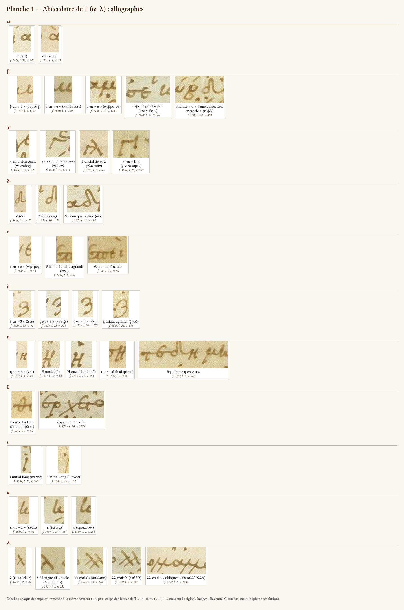

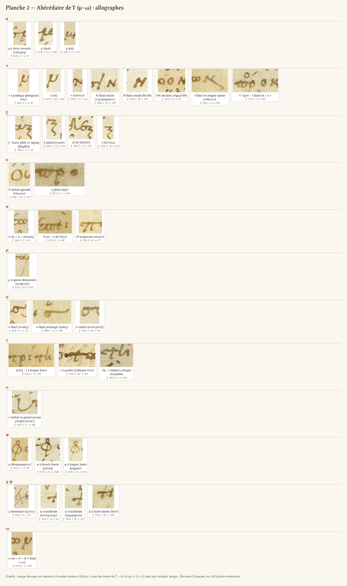

Pour chaque lettre, je donne :
- les allographes, du plus fréquent au plus rare ;
- leur place dans le mot ;
- les confusions qu'ils provoquent ;
- les spécimens, entre crochets.

#### α
- **Forme courante** : α minuscule à panse ronde fermée, avec un court trait vertical à droite qui sert de départ à la ligature ([a_dia] : δία, f. 165r l. 32, v. 240 ; [a_pnoas] : πνοὰς, f. 163r l. 1, v. 43).
- **En fin de ligne**, la sortie de l'α s'allonge en trait de remplissage, jusqu'au bord de la colonne :
  - δεκα, f. 172v l. 43, v. 876 [D_fill] ;
  - τάλαντα, f. 172r l. 18 ;
  - αἰτιώμεθα et μασώμεθα, f. 168r l. 8 et 29.

  Parfois elle descend en paraphe jusqu'à deux lignes plus bas (πόδα, f. 170r l. 24, inv.). Ce n'est ni un tiret ni un renvoi.
- **Titre de la pièce** (écriture de titre, f. 162v l. 1) : α en forme de « d » (inv. f. 162v).
- **Confusion.** La ligature στ prend l'aspect d'un α accentué (§ 3.5.2).

#### β
- **Forme unique de T : β en « u ».** Ce sont deux jambages arrondis ouverts en haut, le gauche un peu plus haut, sans boucle supérieure fermée. Exemples : βομβάξ, f. 163r l. 4, v. 45 [b_u1] ; λαμβάνετε, f. 165v l. 1, v. 252 [b_u2] ; ἄμβροτον, f. 176r l. 29, v. 1154 [b_u3]. Je n'ai vu aucun β fermé de la main de T : le contrôle a porté sur une quinzaine de β de neuf pages, dont διέβαλλε (f. 177r, v. 1214), où l'inv. f. 177r voyait un β « en 6 » ; le « 6 » y est l'ε, et le β est en « u ».
- **Le β fermé « ϐ » n'appartient pas à la minuscule courante de T.** On ne le trouve que dans des corrections ou des ajouts.
  - κύβδ' (f. 168r l. 24, v. 489 [b_corr]) a un β à deux panses. C'est **probablement** une correction de κύνδ'. Velsen 1871 la donne pour telle et l'attribue à la « 2 m. », c'est-à-dire à la main de 1516 (p. 26 : « κύνδ' 1 m., κύβδ' 2 m. R » ; p. 44 : « κύβδ' corr. 2 m. ex κύνδ' R »). Velsen 1883 donne κυνδ' pour R. Mais à ×8, je ne vois ni grattage ni trace de ν.
  - Le supplément βοώιη (f. 168r l. 41) a le même β (vu).
  - Le premier β de βάρβιτος (f. 164r l. 16) est un B oncial, plus chargé d'encre que le β « u » de T qui suit dans le même mot (vu). L'inv. f. 164r y voit une correction.
  - **Encre.** Les trois β fermés ont l'encre du texte de T. J'ai mesuré à contraste égal les rapports A_G/A_R et A_B/A_R : κύβδ' 1,31 et 2,14 ; βοώιη 1,32 et 2,17 ; B de βάρβιτος 1,31 et 2,08. Le texte voisin de T donne 1,30–1,32 et 2,08–2,23. Les scholies de S2 du f. 168r donnent 1,35–1,43 et 2,34–2,71, un sigle de 1516 1,68 et 3,23 (f. 175v). L'encre contredit donc l'attribution de κύβδ' à la main de 1516. Elle ne distingue pas non plus ces β de T.

  Un β fermé dans la colonne signale donc une **intervention** : correction ou ajout. Il n'en désigne pas l'auteur. Ce peut être un correcteur ancien qui use de la même encre, ou T lui-même, dans une autre campagne et dans l'écriture plus posée de ses titres. Pour κύβδ', l'argument est en partie circulaire, car c'est la forme fermée elle-même qui fait conclure à une correction.
- **Confusions** (inv. de presque toutes les pages) :
  - υ, ι + ι, κ : « uάδιζε » ; βραχὺ lu « ἱεραχύ », f. 173v l. 21 ; ἀσεβοῦσιν, f. 166v l. 31 [b_k] ;
  - μ : « λαμμάνετε », f. 165v l. 1 ; « ὑμρίζειν », f. 168v l. 27.

  Critère de l'inv. f. 175r : le β a la haste gauche basse, le κ la haste haute (βάρβαρον, l. 7). Ce n'est qu'une tendance. Il vaut pour les deux β de βάρβαρον, mais non pour ἀσεβοῦσ' (f. 166v l. 31, v. 367) : la haste du β y monte aussi haut que celle du κ d'ἀδικοῦσί, dans la même ligne, et les deux lettres prennent la même forme « l + u » (vu à ×3,5). Seul le contexte permet alors de trancher.

#### γ
Trois allographes :
1. **γ minuscule en « v » plongeant**, dont la branche gauche descend sous la ligne ([g_v] : γενναῖος, f. 165r l. 12, v. 220).
   - Il se lit ν : ὀχληρά γ' lu ὀχληρὰν (f. 175r l. 34) ; σύ γε lu σὺν (f. 172v l. 31).
   - Quand l'ε lui est lié au-dessus, il ressemble à γ^ε, une abréviation, ou à un τ ([g_ge] : γέρων, f. 167r l. 32, v. 411).
2. **Γ oncial**, à barre horizontale.
   - Il est attesté à l'initiale : γλαυκόν, f. 163r l. 3, v. 45 [g_G], où la barre se lie au λ ; γέροντ', f. 177r l. 2.
   - Il entre dans la ligature γι « en Π », où la barre du Γ va jusqu'à l'ι : γινώσκεθ', γινώσκομεν, f. 169v l. 14, 15, 22, v. 606–607 [g_gi]. Lectures fautives : *πνώσκομεν*, *τινώσκομεν*.
   - Le Γ se confond avec τ.
3. **γγ en « W »** : deux v liés ([L_gg1] : γογγυλίσας, f. 163r l. 25, v. 61 ; [L_gg2] : σπογγιεῖ, f. 165r l. 39, v. 247). On le lit ψ, ш ou ψψ.

#### δ
- **δ minuscule** : petite panse ronde, hampe qui revient vers la gauche en crosse ([d_1] : δὲ, f. 163r l. 1 ; [d_2] : ἀσπίδας, f. 163r l. 16, v. 53).
- **Variantes** :
  - panse basse et petite, à hampe oblique, qu'on lit λ (μὴ δαμῶς, f. 165r l. 20, inv.) ;
  - dans δι, l'ι forme la queue du δ ([L_di] : διὰ, f. 167r l. 35, v. 414). On lit δ' ἀ, δη ou δγ (διάρριψον, δικαίως, f. 170r l. 30, 40).
- **Confusion avec le θ ouvert.** La hampe du θ s'incurve vers la droite, celle du δ revient vers la gauche (inv. f. 164v).

#### ε
1. **ε minuscule à boucle haute, en « 6 » ou en « б ».** C'est la forme la plus fréquente. L'ε se lie presque toujours à la lettre suivante par sa langue ([e_6] : νήνεμος, f. 163r l. 1, v. 43). Dans les ligatures, il prend des formes très diverses (§ 3.5.3).
2. **Є lunaire oncial agrandi**, en tête de mot et souvent en tête de vers : ἐπεὶ, f. 163v l. 1, v. 80 [e_E] ; Ἔπειτα, f. 164v l. 23, 25, « grand Є lié au ϖ » (inv.) ; ἐξαπατᾶι, ἑταῖρα, ἐκκλησίαν, f. 166v (inv.).
- **Confusions** :
  - ε fermé lu σ (φερε σε, f. 173r l. 39) ;
  - ε fermé barré lu θ (οὐπώποτ' εἶπεν, f. 168r l. 32) ;
  - ε lu β (εὐριπίδου lu « βυριπίδου », f. 167r l. 8).
- **La langue prolongée de l'ε** fait un trait de remplissage en fin de ligne (πώποτε, f. 170r l. 6 ; γε, f. 172r l. 15 ; ἐὲ, f. 174v l. 41) ou une fausse biffure à l'intérieur (εὔχεσθε, f. 166r).

#### ζ
- **ζ en « 3 »** : deux lobes arrondis superposés, le supérieur ouvert à gauche, et une queue sous la ligne. Exemples : Ζεῦ, f. 163r l. 35, v. 71 [z_1] ; κάθιζε, f. 165r l. 13, v. 221 [z_2] ; Ζεῦ, f. 172v l. 36, v. 870 [z_3].
- **À l'initiale, ζ agrandi** (ζητῶ, f. 164r l. 24, v. 145 [z_4]).
- **Dans le titre** (f. 162v l. 1), ζ en « Ƶ », à queue revenant à gauche (inv.).
- **Critère ζ/ξ** : voir ξ et le § 3.8.

#### η
Deux formes, souvent dans la même ligne :
1. **η minuscule en « h »** ([h_h] : νή-, f. 163r l. 1, v. 43). On le lit κ, ιι, « l + ι », et même « καί » (η 'στί, f. 177r l. 6, inv.).
2. **Η oncial**, à barre médiane. Il est très fréquent :
   - à l'initiale : ἦ, f. 163r l. 27, v. 63 [h_H1] ; ἡ, f. 164v l. 19, v. 184 [h_H2]. Au f. 166v, huit vers commencent par ἢ : six ont le Η oncial (vv. 339, 342, 343, 346, 348, 365), un le « h » minuscule (v. 345), un le « н » étroit (v. 361) ;
   - à la finale : μέσΗ, f. 163v l. 1, v. 80 [h_H3] ; πάσΗ, προΐΗ, f. 163r l. 29, 33 ;
   - dans ΤΗ de τῆι (f. 166v l. 36–37, inv.).
- **Variante étroite « н »**, qui se lie à la lettre précédente : δη μήτηρ, f. 170r l. 7, v. 642 [L_demeter] ; R y soude δὲ (écrit δη) à μήτηρ.
- **Confusions.** Le Η oncial se lit Ν : la Juntine imprime βοῶν pour βοώιη (f. 168r l. 41, inv.). Il se confond aussi avec le Η suscrit des sigles μν^η de 1516. Le « h » ressemble à la ligature ει « en q » (§ 3.5.1).

#### θ
- **θ cursif ouvert**, couché, précédé d'un long trait d'attaque horizontal ([t_1] : θεσ-, f. 163v l. 1, v. 80). Parfois il prend une forme en « 4 » (ἀποθανουμένῳ, κροκῶθ', θεαῖν, f. 173v, inv.). Sa barre se poursuit sur la lettre suivante : fausse biffure (ἔλθετον, ἀντόμεθ', f. 176r l. 30).
- **θ fermé ovale**, à barre prolongée, dans le titre (f. 162v l. 1, inv.).
- **Confusions** : δ, ψ, et la ligature ετ, qui ressemble à θ (§ 3.5.3, [L_et2]). θ cursif lié à l'ο lu « τὸ » : ταῦθ' ὁρᾶις lu « ταυτὸ », f. 168r l. 31.

#### ι
- **ι court**, simple trait.
- **ι initial long, en « j »** : il descend loin sous la ligne, parfois jusqu'à la ligne suivante. Exemples : ἱκέτης, f. 164v l. 15, v. 180 [i_j1] ; ἴβυκος, f. 164r l. 40, v. 161 [i_j2] ; ἰὴ, f. 166r l. 18 ; ἰδεῖν, ἰδέσθαι, f. 171v l. 40, 43. Ce n'est ni un signe marginal ni une paragraphos verticale (inv. f. 166r, f. 171r).
- **ι adscrit** : §§ 3.7, 4.6.3.

#### κ
- **Forme unique de T : κ minuscule en deux temps.** C'est une haste suivie d'une panse en « u » bouclé ou en « c », liée à la voyelle suivante ([k_lu] : κῦμα, f. 163r l. 2, v. 44 ; [k_lc] : ἱκέτης, f. 164v l. 15, v. 180 ; [k_2] : κροκωτὸν, f. 165v l. 2, v. 253). On le lit « lc », « ιc », « lu », « ις », ιε, λυ, ου, ιι : κροκωτοῖς lu « ἱεροκωτοῖς », f. 173v l. 24 ; κεκό lu « lιblo », f. 176r l. 1 [L_kekopsoi].
- **Pas de Κ oncial chez T dans le texte** (§ 3.4.1). Hors des titres, le seul Κ oncial de la colonne est celui de κιν, récrit sur grattage (f. 168r l. 28, v. 493). Il est fait de deux traits disjoints (« Ι< »), d'une encre plus grise, sur un fond éclairci (vu à ×6). Ce Κ « Ι< » a pourtant la forme des deux Κ du titre de l'*Assemblée* (ἐκκλησιαζουσῶν, f. 177r, vu à ×5), qui est de T (§ 3.4.2). La forme seule ne désigne donc pas un correcteur pour κιν : c'est le grattage, joint à un Κ que T n'emploie jamais dans son texte et à une encre au seuil de la règle (§ 2.5).

#### λ
- **λ à très longue diagonale**, qui descend sous la ligne vers la gauche. La lettre suivante s'attache au sommet ([l_1] : κελαδείτω, f. 163r l. 2 ; [l_2] : λαμβάνετε, f. 165v l. 1, v. 252). Sans haste montante visible, il se lit ρ ou μ : λαθεῖν lu « μαθεῖν », f. 167r l. 29, v. 408, contrôlé à ×5,5 par l'inventaire.
- **λ + ι** ressemble à μ (πολιός, f. 164v l. 25 ; ἠλιθίου, f. 165v l. 40).
- **λλ** : deux variantes, voir § 3.5.4.

#### μ
- **μ minuscule** : premier jambage plongeant sous la ligne, puis **deux arceaux**, le second terminé par un crochet ([m_1] : νήνεμος, f. 163r l. 1 ; [m_2] : ἐμοὶ, f. 165r l. 32, v. 240 ; [m_3] : μὴ, f. 163r l. 2, v. 44).
- **Confusions** avec ν (voir ν) et, dans le groupe μβ, avec β.

#### ν
La lettre la plus trompeuse de la main.
1. **ν minuscule** : premier jambage plongeant sous la ligne, comme celui du μ, puis **un seul arceau** terminé par une pointe montante ([n_1] : νή-, f. 163r l. 1, v. 43 ; [n_2] : νὴ, f. 165r l. 32, v. 240 ; [n_3] : πόντου, f. 163r l. 2, v. 44).
   - **Critère vérifié** sur f. 163r l. 1–2 et f. 165r l. 32 : le μ a deux arceaux, le second fermé en crochet ; le ν a un arceau, puis une pointe.
   - **Limite.** Dans l'écriture rapide, ou quand la lettre suivante s'attache à la pointe du ν (νη, νυ, νο), seul le nombre d'arceaux reste. D'où les mélectures en série que relèvent toutes les pages : νὴ lu « μὴ » ; νῦν lu « μῶ » ; τὸν νοῦν lu « τὸμ μοῦν » ; διδόναι lu « διδόμαι » ; πλυνεῖ lu « πλυμεῖ » ; μόνην lu « μόμημ » ; ἐλιννύειν lu « ἐλιμμύειν ».
   - **Règle pratique** : lire d'abord ν à toute finale, puis trancher par le contexte.
2. **Ν oncial** en fin de mot, surtout en fin de ligne : τεχνάσμασιΝ, f. 164v l. 33, v. 198 [n_N1] ; θεῶΝ, f. 165r l. 20, v. 228 [n_N2] ; λύχνοΝ, f. 165r l. 30 ; λέγουσιΝ, f. 166v l. 28. Il se combine avec un Ο oncial dans τήμερΟΝ (f. 163v l. 4, v. 83 [n_ON]).
3. **Ν réduit en « н »**, qu'on lit η ou κ (ἅπασιν, f. 170r l. 34, inv.). Ν et Η onciaux ont le même gabarit (inv. f. 174v).
4. **ν final en longue queue oblique** en fin de vers ([n_q] : εἰδότων, f. 169v l. 4, v. 596 ; κοθωκιδῶν, l. 28). Ce n'est ni un λ ni un trait de renvoi.
5. **ν final en « x »** : πόρον, f. 171v l. 6, v. 769 [n_x], avec ο suscrit ; πάρεστιν, l. 42 (inv.) ; πρώκτισον, f. 175v l. 41, v. 1124 (vu). Ne pas lire χ.

#### ξ
- **ξ** : trait de tête plat, parfois amorcé par un petit crochet et souvent lié à la lettre précédente, puis un zigzag de deux ou trois angles et une longue queue sous la ligne. Exemples : βομβάξ, f. 163r l. 4, v. 45 [x_1] ; ξυρόν, f. 165r l. 11, v. 219 [x_2] ; δεξιάν, f. 165r l. 13, v. 221 [x_3] ; ξένους, f. 172v l. 38, v. 872 [x_4].
- **Critère vérifié** sur les ff. 163r, 165r, 168v, 172v, 175v et 177r :
  - ζ = deux lobes ronds (« 3 ») ;
  - ξ = barre de tête et zigzag (« Ƶ », « ʒ »).

  Ce critère est formulé, en des termes différents, par les inv. f. 165r, f. 166v, f. 172v, f. 174v, f. 175v et f. 176v (« ζ à deux étages, ξ à trois »). Il permet de lire ἀρτομουξία (f. 176v l. 34), ἀρ ταμουξία (f. 177r), ὀτότυζε (f. 175v l. 1, deux fois) et οἰμώζετ' (f. 165r l. 40).
  - Pour ὀτότυζε, ma lecture s'accorde avec celle de Velsen 1883 : il imprime ὀτότυζ' et note « ὀτότυζε RG » (p. 77 ; de même la liste des fins de ligne, p. 79). Le « ὀτότυξε » que l'inv. f. 175v prête à Velsen est une faute de la couche texte (OCR) du scan, qui lit ξ là où l'image porte ζ. La même faute se trouve dans le répertoire critique (`../edition/donnees/repertoire_critique/velsen1883_1086-1231.jsonl`, notice « colometria » des vv. 1078–1097).
- **Pas d'exception relevée.** L'inv. f. 177r jugeait le ζ de βαδίζ(ειν) (f. 177r, fin de la ligne des vv. 1227–1228) de même forme que le ξ. À ×5, ce ζ est un « 3 » à deux lobes ronds. Le « 7 » qui le précède, trait horizontal puis jambage descendant, est l'ι lié en queue au δ, comme dans διὰ ([L_di]).
- **Confusion propre à la ligature ει à ι descendant**, qui prend l'aspect d'un ξ (§ 3.5.1).

#### ο
- **ο petit et rond** ; il est parfois **plein**, en disque de la taille d'une lettre ([o_plein] : προ, f. 167v l. 2, v. 424). On le prend alors pour un point.
- **Ο agrandi** en tête de vers ([o_O] : Οὐκοῦν, f. 164r l. 32, v. 153, deux fois le module ; Ὅταν, l. 36, en saillie ; οὐπώποτ', f. 168v l. 40).

#### π
1. **π en « ϖ »** : deux boucles sous une barre. C'est la forme normale, attestée par plus de quinze exemples par page ([p_varpi] : πνοὰς, f. 163r l. 1, v. 43 ; [p_varpi2] : ἐπεὶ, f. 163v l. 1).
   - On le lit ω si la barre est pâle ou absorbée par la ligature : ὅπως lu « ὅωως » ; τὸ πόπανον lu « τὸ ωόωανον », f. 165v l. 35 ; ἀπο- lu « αὐτο- », f. 173v l. 21.
   - Sa barre déborde souvent à gauche et passe alors pour une paragraphos (f. 162v vv. 4, 22, 38 ; f. 164v l. 8 ; f. 171v l. 6, 9, 14, 37).
   - Elle se prolonge aussi à droite en fausse biffure (πε- à longue barre, f. 174r l. 40–42 ; f. 174v l. 14, 26, 28, 31, 36).
   - Inversement, le ω de ῥήτωρ prend la forme d'un ϖ (f. 168v l. 22, inv.).
2. **Π majuscule à barre de tête plate**, rare ([p_Pi] : ποιεῖν, f. 170r l. 42, v. 677 ; -ποις, l. 29, inv.).

#### ρ
- **ρ à longue hampe**, penchée à droite d'environ 15–20° (§ 3.2.5). Elle devient démesurée sur les dernières lignes de page : σπάρτην, f. 173r l. 43, v. 919 [r_q], dont la queue descend d'environ 65 px (7,5 mm) sous la ligne de base, pour une lettre haute d'environ 90 px en tout ; ἄρα, f. 175v l. 43 ; προεδρίαν et σκίροις, f. 172r l. 43.
- **Sortie du ρ** en petite virgule sous la ligne, qu'on prend pour une ponctuation (f. 167r l. 34, 37, inv., douteux).
- **ρ peu lié** à la voyelle suivante (Orsini 2011, 325, vérifié).

#### σ
1. **σ rond, fermé par un trait supérieur horizontal** qui sert de ligature ([s_init] : σωστράτη, f. 166v l. 38, v. 374). Fermé, il se lit ο : σκάφιον lu « οικάφιον », f. 169v l. 41 ; σῶσον lu « σῶων », f. 174v l. 13 ; σὺ κισσοφόρε lu « οὐ », f. 174r l. 30.
2. **σ final = σ médial.**
   - Je n'ai trouvé **aucun ς** dans la main de T. Exemples vérifiés : πνοὰς, f. 163r l. 1, v. 43 [s_fin] ; ὁρᾶις, f. 168r l. 31, v. 496 [s_bar] ; μείρακας, f. 167r l. 31, v. 410.
   - Les « ς final prolongé » des inv. f. 168r et f. 167r sont en réalité des σ ronds dont le trait supérieur s'allonge en remplissage.
   - Transcrire σ, sans normaliser.
3. **σ final détaché** du mot (γεγηθὼ σ, f. 168v l. 2 ; ταύτη σ, l. 30) ou **lié au mot suivant**.
   - τί σ ἐμὸν se lit « τί σεμὸν » (f. 175r l. 4). L'inventaire y voit l'origine probable de τὶ σεμνὸν dans M.
   - στ chevauche la coupure des mots : αὐτός τε lu « αὐτὸ πτε », f. 164v l. 1 ; διώκοις lié à ταυτηΐ, f. 177r l. 13.
4. **C lunaire** :
   - dans la ligature -ος de fin de ligne (§ 3.5.5) ;
   - dans le « grand sigma lunaire » qui monte au-dessus de la ligne (ἐπουρίσασ, f. 177r l. 19, inv.) ;
   - dans les titres.

#### τ
- **τ à barre de tête très longue** (≈ 25 px, inv. f. 163v), souvent lancée par une **goutte d'attaque** isolée ([tau_g] : τῶν, f. 165v l. 42, v. 292). La goutte imite un point médian : « ἐπισμῆι· τῶν », « ὑγιές : τὰς », f. 167r l. 10, 15 ; « τω·τέχνηι », f. 167v l. 8, 10, 11. La barre prolongée à gauche imite une paragraphos (f. 163r l. 13, 37 ; f. 171r l. 13).
- **τ sans fût apparent**, réduit à une barre qui sort du σ et croise l'ι (τρίτη στί, f. 163v l. 1, v. 80 [tau_1]).
- **τ initial à attaque recourbée** ([tau_b] : τῆι, f. 166v l. 2, v. 338), qu'on lit « στῆι ». **τ à pied recourbé** vers la droite, proche de ρ ou de γ (f. 170r l. 29, 43, inv.).
- **ττ** : § 3.5.4.

#### υ
- **υ en « u »** ou en « v », souvent étroit. Il se lit alors ι : δρυόχους, f. 163r l. 15, que la Juntine lit δρυόχοις ; τοὺς, f. 166v l. 23 ; σύ γε, f. 172v l. 31.
- **υ initial en grand arceau** parti de haut à gauche, qui déborde dans la bande des sigles ([u_init] : ὑποβλέπουσ', f. 167r l. 17, v. 396 ; ὑπὸ, l. 7).
- **Υ « ϒ » à boucle** (ὑμῶν, f. 171v l. 42, inv.).
- **Ligatures** : ου à υ réduit, υν en « ω » (§ 3.5.5).

#### φ
- **φ à grande panse ronde et longue hampe** ([f_1] : θεσμοφορίων, f. 163v l. 1, v. 80).
- **φ à boucle haute** : la hampe se termine en haut par une petite boucle fermée posée sur la panse ([f_2] : φύλαξ, f. 174v l. 25, v. 1026 ; ἀποφυγὼν, ἐφέστηκ', ὑφηλίκων, ψῆφον). On le lit δο ou θ (inv. f. 174v).
- **Hampe démesurée** ([f_3] : φορμὸν, f. 172r l. 21, v. 813, sur trois lignes ; φήσει, f. 170r l. 37).

#### χ
- **χ à longues diagonales**, parfois démesuré, qui traverse l'interligne ([c_1] : ἐχέτω, f. 163r l. 1, v. 43, où l'ε est absorbé par le χ ; μοιχὸς, χθροῖς, f. 166v ; χρή, f. 170r l. 19 ; f. 172v l. 37). On le prend pour une biffure ou une croix.

#### ψ
- **ψ cruciforme** : haste haute, traversée par une courbe ou par une barre ([y_1] : συστρέψας, f. 163r l. 25, v. 61 ; [y_2] : ψηφίσματα, f. 166v l. 25, v. 361 ; [y_3] : ὄψιν, f. 176r l. 29, v. 1154).
- **Confusions** : τ (ὄψιν lu « ὄτιν »), « + », †, le signal « + » du copiste.
- **ψ réduit**, dont la haste se lit ι (ἐξέθρεψε lu « ἐξέθρει χώρα », f. 168v l. 14).

#### ω
- **ω minuscule à deux boucles fermées**, en « ∞ » ([w_1] : -ων, f. 163v l. 1). Il est très large à l'initiale (ὦ, f. 162v l. 2). Réduit à deux petites boucles, il se lit οο (f. 172v l. 17, 20, 37).
- **Confusion avec ϖ** dans les deux sens (voir π).

### 3.4 Réminiscences onciales

#### 3.4.1 Inventaire

| Forme onciale | Fréquence chez T | Place | Spécimens / exemples |
|---|---|---|---|
| **Η** | très fréquent, à côté du « h » | initiale (ἢ, ἡ, ἦ), finale (-Η), τῆι (ΤΗ) | [h_H1], [h_H2], [h_H3] ; « н » : [L_demeter] |
| **Ν** | fréquent | finale, surtout en fin de ligne ; « н » | [n_N1], [n_N2], [n_ON] |
| **Γ** | occasionnel | initiale ; ligature γι « en Π » | [g_G], [g_gi] |
| **Є** lunaire | fréquent à l'initiale | initiale agrandie, souvent en tête de vers | [e_E] ; Ἔπειτα (f. 164v l. 23, 25) |
| **Ο** agrandi | occasionnel | initiale de vers | [o_O], [n_ON] |
| **C** lunaire | dans des positions fixes | ligature -ος de fin de ligne ; « grand sigma » (f. 177r l. 19) | [L_os1]–[L_os4] |
| **Π** à barre plate | rare | dans le mot | [p_Pi] |
| **Υ** (ϒ) | rare | initiale | ὑμῶν (f. 171v l. 42) |
| **Κ** | **non observé dans le texte de T** ; « Ι< » dans le titre de l'*Assemblée* | titre seulement | le Κ « Ι< » de κιν (f. 168r l. 28) est récrit sur grattage par un correcteur |
| **Λ** | indiscernable | — | le λ minuscule de T a la forme du lambda majuscule |

#### 3.4.2 Ce que règle l'usage

1. **L'initiale.** Les lettres initiales sont souvent agrandies et prennent alors volontiers la forme onciale : Є, Η, Ο, Γ, et aussi ζ et ι longs. L'inv. f. 164r se demandait si T agrandit l'initiale d'une nouvelle réplique (Οὐκοῦν, l. 32 ; Ὅταν, l. 36). Les autres pages répondent : l'agrandissement est fréquent en tête de vers, **qu'il y ait ou non changement d'interlocuteur**.
   - Changement d'interlocuteur : f. 164r l. 32 et 36 ; f. 168v l. 25 et 36.
   - Pas de changement : ὑποβλέπουσ', f. 167r l. 17, v. 396.
   - Début de section : Ἡμεῖς, en tête de la parabase, f. 171v l. 22.

   Ce n'est donc pas un critère de changement d'interlocuteur.
2. **La fin de mot en fin de ligne** : Ν, ΟΝ, -ος en « © ». Ces formes gagnent de la place, ou ferment la ligne contre la marge.
3. **Des ligatures fixes** : γι en « Π », ΤΗ.
4. **Les titres**, dans une minuscule espacée mêlée de formes onciales (§ 2.2.1).
   - Titre des *Thesmophories* (f. 162v l. 1) : σ et ε lunaires, Ν, ζ en « Ƶ », θ ovale, α en « d » (inv.).
   - Titre de l'*Assemblée* (f. 177r l. 25) : ε lunaire, deux Κ en deux traits disjoints « Ι< » (vu), λ, η en « н », σ lunaire, α oncial, ζ en « Z », ω minuscule (inv.).

   La forme Κ n'apparaît, chez T, que dans cette écriture de titre.

#### 3.4.3 Portée

Martin tirait de la fréquence des onciales Γ, Η, Κ, Λ, Ν un argument pour le XIe siècle (Martin 1882, xiii). Dans les *Thesmophories*, la liste se réduit à Η, Ν et, plus rarement, Γ. Ces formes sont réglées par la position. Je n'en tire aucun argument chronologique : la question relève de la comparaison avec des manuscrits datés (§ 3.2.7).

Pour la transcription, elles n'ont pas de valeur propre : Η = η, Ν = ν. Il faut seulement les distinguer :
- des **sigles** de S2 et de 1516 : H suscrit de μν^η, Κη ;
- des **lettres suscrites** de correction : ν suscrit en Ν (f. 165v l. 12) ; Η suscrit de ἀφῆτ' (f. 170v l. 16).

### 3.5 Ligatures et groupes

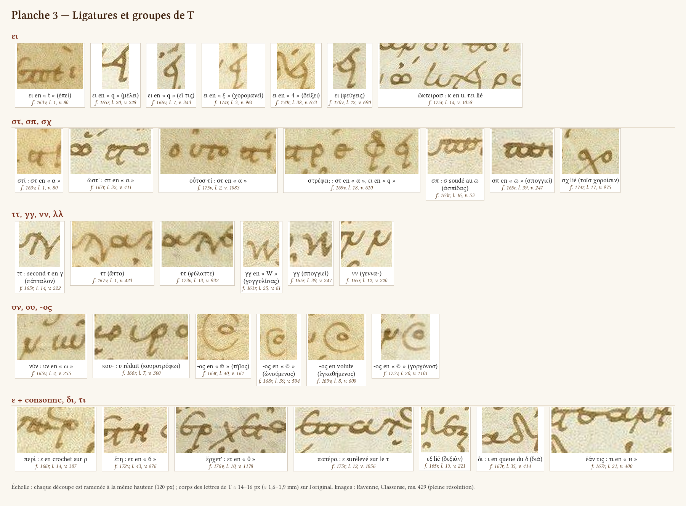

#### 3.5.1 ει : la ligature la plus polymorphe

Je compte au moins six formes, relevées sur toutes les pages. Elles sont décisives pour la lecture :

| Forme | Description | Exemples | Lectures fautives |
|---|---|---|---|
| en « t » | ε dont la langue rejoint un ι montant | ἐπεὶ, f. 163v l. 1, v. 80 [L_ei_t] | — |
| en « q » | boucle triangulaire, haste descendant à gauche | μέλει, f. 165r l. 20 [L_ei_q1] ; εἴ τις, f. 166v l. 7, v. 343 [L_ei_q2] ; εἴπερ, f. 171v l. 27, 32 | α, ο, σ, φ, ψ, ᾳ ; **avec accent ou esprit : ἢ, ἡ** (εἴπερ lu ἤπερ ; εἶτα lu ἢ τα ; εἶδεσ lu « ἦδεσ », f. 177r l. 10) |
| en « ξ » ou « ζ » | ι descendant sous la ligne en zigzag | χορομανεῖ, f. 174r l. 3, v. 961 [L_ei_xi] ; παίζει ; ἥξει, κλύεισ, f. 174v | ξ, ζ, ϙ, φ |
| en « 4 » | ε anguleux et ι croisé | δείξει, f. 170r l. 38, v. 673 [L_ei_4] ; ποιεῖν ; εἰσὶν, f. 172r l. 29 | chiffre 4 |
| ε fermé en boucle, ι montant puis redescendant avec un pied | | φεύγεις, f. 170v l. 12, v. 690 [L_ei_v] | η (**φεύγης**) : le η de T est un « h », un Η ou un « н » étroit, jamais cette forme. Dans la même ligne, μενεῖσ a ε et ι séparés |
| en « α à crochet », en « ἕ » | | κλεισθένης, προτείνειν, ἀφείλετ', f. 173v l. 10, 17, 20 | α, ἀφ' ἕλετ' |
| ι long oblique, montant au-dessus de la ligne | | εἰσὶν, f. 167r l. 12 | accent (« ἔσὶν ») |

Dans les ligatures, τει et σει prennent des formes propres :
- ὤκτειρασ, lu « ὤιιτλρασ » (f. 175r l. 14, v. 1058 [L_oktiras]) ;
- φύσει, ποήσεις, σ + ει en crochet (f. 164v l. 3, 43) ;
- λεύσειν, où σει à ι descendant ressemble à un α à queue (f. 175r l. 8) ;
- δράσει, lu « δράος » (f. 177r l. 7).

**Règle de lecture** : devant un signe en « q » ou en « 4 » surmonté d'un accent, penser d'abord à ει.

#### 3.5.2 στ, σπ, σχ, σο

- **στ en « α »**. Le σ ouvert se prolonge dans la barre du τ, et le tout a l'aspect d'un α, souvent surmonté de l'accent de la voyelle suivante (ί). Ce qui le distingue de l'α : la boucle est fermée en haut par un trait horizontal qui file vers la lettre suivante (barre du τ), alors que l'α a un court trait vertical à droite (comparaison des deux στ et des deux α de λαλῖσ au f. 175v l. 2). Exemples : στί, f. 163v l. 1, v. 80 [L_st_a1] ; ὥστ', lu « ὥ ἀ », f. 167r l. 32, v. 411 [L_st_a2] ; οὗτοσ τί, lu « οὗτο αἰ », f. 175v l. 2, v. 1083 [L_st_a3] ; στρέφει, lu « ἀρέφει », f. 169v l. 18, v. 610 [L_strephei] ; νηστεύωμεν, lu « μὴ ἀθεο μεν », f. 174r l. 26, v. 984 [L_nesteuomen] ; ὑστέραν lu « ὑαβραν », τῆσ τὸν lu « τῆ ἀὸν », f. 172v l. 4–5.
- **Autres formes de στ** :
  - en « ϛ » dans ἐστιν (f. 164v l. 18, 32, 37) ;
  - en « q », boucle et haste, dans 'στί et πέπυσται (f. 177r l. 6, 20) ;
  - εστ en « δα » : ἐστιν lu « δαιμ » (f. 173r l. 28).
- **σπ** : le σ est soudé au ϖ, et l'on voit « trois panses sous une barre » ([L_sp1] : ἀσπίδας, f. 163r l. 16, v. 53 ; [L_sp2] : σπογγιεῖ, f. 165r l. 39, v. 247 ; σπονδὰς, f. 176r l. 36). Dans σπέος (f. 164r l. 21, v. 142), la première panse est un amas d'encre très chargé, suivi de deux panses sous la même barre. Si l'on prend l'amas pour une tache, on lit « πέος ». Mais on compte bien trois panses, alors que le ϖ de ποῦ, dans la même ligne, n'en a que deux ; la structure est celle de σπογγιεῖ ([L_sp2]) (vu à ×5 et ×8). R a donc σπέος, comme le dit Velsen 1883 (« καὶ ποῦ σπέος R καὶ ποῦ πέος G »).
- **σχ** : le σ final est une boucle soudée au χ ([L_sch] : τοῖσ χοροῖσιν, f. 174r l. 17, v. 975, lu « τοῖ χοροῖσιν »).
- **σο** : deux petites boucles, qu'on lit σσ ou οο (εἰσορᾶν, f. 176r l. 26). Dans κάρισοσ οὐ, il prend l'aspect du ϖ (f. 176v l. 28).

#### 3.5.3 ε + consonne ; δι, τι, γι

- **ετ** :
  - en « б » (ἔτη, f. 172v l. 43, v. 876 [L_et1]) ;
  - ε à grande boucle soudé au τ, qui se lit θ ([L_et2] : ἔρχετ', f. 176v l. 10, v. 1178 ; ἔτι, l. 35).
- **τε** : l'ε est surélevé au-dessus de la barre du τ (πατέρα, f. 175r l. 12, v. 1056 [L_ete_patera]). Ce n'est pas une abréviation πατρ(ά) : le mot est écrit en entier.
- **ερ** : ε en crochet posé sur le ρ (περὶ, f. 166r l. 14, v. 307 [L_peri], lu « πρὶ » ou « πάρι ») ; ε à boucle haute lié au ρ, qui se lit βρ (f. 172v l. 4).
- **εσ** : haste montante qui imite un aigu (θεσμο-, μεση, f. 163v l. 1).
- **επ** : en « M » ou en θ (ἐπ' ἀναφύσα, δ' ἐπὶ lu « δθὶ », f. 176v l. 7, 14) ; en ε barré (ἐπειδή, f. 164r l. 24).
- **εγ, γε, εμ** : ligatures en forme de β (ἄγε lu « ἀβ », ἐμοὶ lu « βμοὶ », f. 165r). Avec εγ, en forme de δ : « δκυκλον », f. 165v l. 4.
- **εκ** : longue barre horizontale (ἕκαστος, f. 172r l. 6).
- **εξ** : la barre de tête du ξ part de la langue de l'ε ([x_3] : δεξιάν).
- **δι** : l'ι fait la queue du δ ([L_di]).
- **τι** en « н » : ἐάν τις, lu « ἐάνη », f. 167r l. 21, v. 400 [L_ti].
- **γι** en « Π » ([g_gi]).

#### 3.5.4 Lettres doubles

- **ττ** : le premier τ est réduit à sa barre, le second a la forme d'un γ ([L_tt1] : πάτταλον, f. 165r l. 14, v. 222 ; [L_tt2] : ἄττα, f. 167v l. 1, v. 423 ; [L_tt4] : φύλαττε, lu « φύλαγε », f. 173v l. 13, v. 932 ; μολοττικοὺς, f. 167r l. 37). La forme est constante dans la pièce. Orsini (2011, 325) la donne déjà comme caractéristique de la main.
  - Elle explique le « πράγττοιτο » de Velsen (f. 172v l. 9, inv.) et des lectures fautives comme « ἀγατα » pour ἀττατα (f. 165r).
- **λλ** : deux variantes, parfois sur la même page.
  - Deux λ croisés en « XX », qu'on lit χχ ou ψ ([ll_X1] : πολλοὺς, f. 164v l. 13, v. 178 ; [ll_X2] : πολλὰ, f. 167r l. 9, v. 388).
  - Deux longues obliques parallèles, qu'on lit μ, μμ ou une biffure ([ll_obl] : δύσκολλ' ἀλλὰ, f. 177r l. 1, v. 1211).
  - Le premier λ peut être recourbé et se lire ζλ (f. 168v l. 35).
  - Chez S2, c'est l'inverse : λλ s'écrit en « Μ » (f. 177r, scholie).
- **νν** : deux jambages plongeants, qu'on lit μμ ([L_nn] : γεννα-, f. 165r l. 12, v. 220).
- **γγ** : en « W » ([L_gg1], [L_gg2]).

#### 3.5.5 υν, ου, -ος

- **υν** : double arceau qui se lit ω ([L_un] : νῦν, f. 165v l. 4, v. 255). D'où νῦν lu « μῶ », οὖν lu « οω », τοίνυν lu « τοίμω », ἁ νῦν lu « ἀμῶ » (f. 176r l. 43).
- **ου** : l'υ est réduit à un petit trait après l'ο (κουροτρόφωι, f. 166r l. 7, v. 300 [L_ou], lu « κοιρο- »). Ailleurs, l'υ est haut et sinueux (μ' οὖσαν, f. 174r l. 6).
- **-ος de fin de ligne en « © »**. Un petit ο, parfois plein, est inscrit dans un grand C lunaire ou dans une spirale.
  - Exemples : τήϊος, f. 164r l. 40, v. 161 [L_os1] ; ὠνούμενος, f. 168r l. 39, v. 504 [L_os2] ; ἐγκαθήμενος, f. 169v l. 8, v. 600 [L_os3] ; γοργόνοσ, f. 175v l. 20, v. 1101 [L_os4]. Autres : ἠξώπιος, f. 173r l. 5 et 8 ; αἴτιος, f. 171v l. 3 ; ἀπεψωλημένοσ, f. 176v l. 20 ; ἀποκεκρυμμένος, f. 167r l. 18 (inv., probable).
  - À l'intérieur de la ligne, T écrit -ος en deux lettres (f. 169v l. 1, 8, inv.).
  - **Piège majeur** : ce n'est ni un signe de renvoi ⊙ ni un sigle. L'inv. f. 164r avait d'abord lu un renvoi au v. 161, puis s'est corrigé.

#### 3.5.6 Autres groupes

- μπ et πτ en ligature serrée (χρέμπτεται, f. 167r l. 2).
- σκ : le σ rond est lié au κ, qui a une haste haute ; on lit ολ ou οι (σκεῦος, f. 167r l. 23).
- σι : ὁσια (f. 170v l. 1), qu'il ne faut pas lire « ὁ σχ… ».
- φ et ρ restent presque toujours séparés de la lettre suivante.

### 3.6 Abréviations du texte

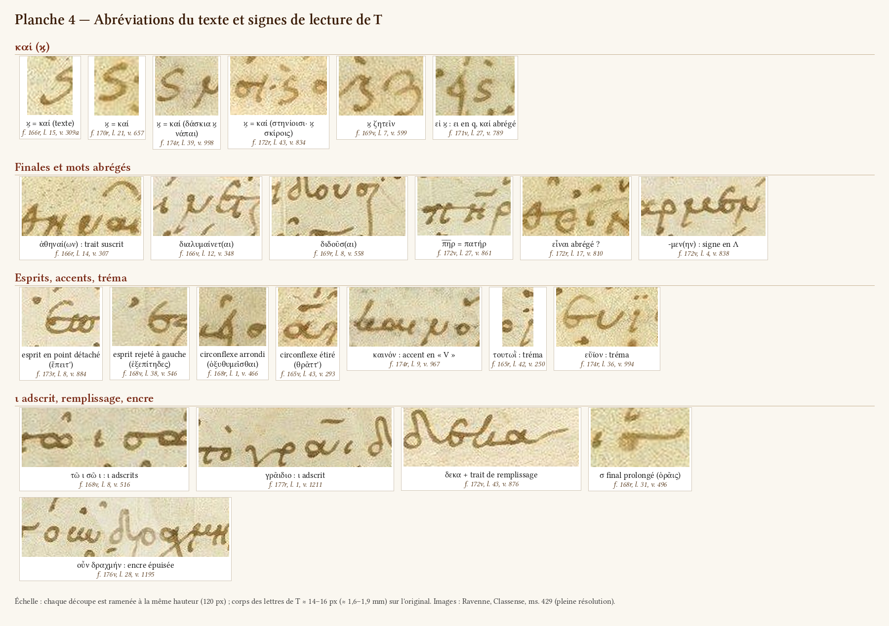

T abrège **très peu**. C'est conforme à Allen 1896, 324, qui signale comme rares, dans le texte, les compendia de ἀνήρ et de -ευς ; je n'en ai trouvé aucun dans la pièce. Le texte de l'auteur compte 178 καί, crases non comprises : le copiste en écrit donc environ 170 en toutes lettres. Les abréviations de T relevées dans les *Thesmophories* se réduisent aux cas suivants. Ce relevé vient des inventaires ; je n'ai pas balayé moi-même les 30 pages (§ 3.6.1).

#### 3.6.1 Le compendium de καί (ϗ)

**Forme.** C'est un « S » ou un « ʒ » couché, à queue descendante, parfois accentué. On ne doit le lire ni ζ ni ς ([A_kai1]–[A_kai4]).

**Sept occurrences relevées** dans le texte de T. Ce sont celles des inventaires. Je les ai toutes revues, et j'ai balayé entièrement deux pages (ff. 170r et 172r) sans en trouver d'autre. Le chiffre est donc un minimum, non un compte exhaustif :

| Page, ligne | Vers | Contexte | Spécimen | Contrôle |
|---|---|---|---|---|
| f. 166r l. 15 | 309a | en tête de ligne : ϗ τὸν τῶν γυναικῶν | [A_kai1] | vu |
| f. 169v l. 7 | 599 | ϗ ζητεῖν, ϗ suivi d'un ζ « en 3 » de forme voisine | [A_kaizeta] | vu |
| f. 170r l. 21 | 657 | ἐσεληλυθεν ϗ περὶθρέξαι | [A_kai2] | vu |
| f. 170r l. 22 | 658 | σκηνὰς ϗ τὰς, après un καί en toutes lettres dans la même ligne | — | vu |
| f. 171v l. 27 | 789 | εἰ ϗ κακὸν, ει en « q » puis ϗ | [L_ei_kai] | vu |
| f. 172r l. 43 | 834 | dernière ligne de la page | [A_kai4] | vu |
| f. 174r l. 39 | 998 | δάσκια ϗ νάπαι | [A_kai3] | vu |

**Ce qu'on en tire.** Le ϗ n'est pas réservé à la fin de ligne : il apparaît en tête de ligne et au milieu du vers. Il est sporadique. On peut y voir une habitude du copiste ou un reflet du modèle ; rien ne permet de trancher.

#### 3.6.2 Suspensions et compendia de finale, en fin de ligne

Tous les cas sont en **fin de ligne**, là où la place manque. Ce sont des abréviations de mise en page plutôt que des habitudes d'écriture.

| Mot | Page, ligne, vers | Signe | Spécimen | Certitude |
|---|---|---|---|---|
| ἀθηναί(ων) | f. 166r l. 14, v. 307 | trait courbe « ⌒ » au-dessus de -αι | [A_on] | sûre (vue) |
| διαλυμαίνετ(αι) | f. 166v l. 12, v. 348 | crochet ondulé au bout de la barre du τ | [A_ai1] | probable (vue) |
| διδοῦσ(αι) | f. 169r l. 8, v. 558 | long trait courbe après le σ | [A_ai2] | probable (vue) |
| βαδίζ(ειν) | f. 177r l. 20, v. 1228 | long trait oblique montant au-dessus et à droite d'un grand ζ en « 3 » | spécimen de l'inventaire (ci-dessous) | probable (vue) |
| εἶ(ναι) ou εἶν(αι) | f. 172r l. 17, v. 810 | ε, ι, puis un signe en X ; ce X a exactement la forme du ν final « en x » (comparé à πόρον, f. 171v l. 6) : ce peut être un ν écrit, avec -αι suspendu | [A_einai] | probable (vue) |
| ἀποκεκαρμέν(ην) | f. 172v l. 4, v. 838 | signe en Λ après -μεν | [A_men] | possible (renvoi ?) |
| ἀποδύσ(ας) | f. 170r l. 20, v. 656 | σ final prolongé | — | possible (inventaire) |

Spécimen de βαδίζ(ειν) : `graphologie/specimens/f177r/f177r_l20_badiz.jpg`.

#### 3.6.3 Une contraction de type *nomen sacrum* : π̅η̅ρ

Au f. 172v l. 27 (v. 861, πατὴρ ἐκεῖνός ἐστι;), T écrit **π̅η̅ρ** ([A_pater], vu à ×6) : un π de forme Π à barre plate, et non le ϖ habituel, un η en « h » et un ρ. Un trait horizontal, crocheté à droite, surmonte l'η ; il commence à l'aplomb de l'intervalle π–η et ne couvre pas le π. Le mot ne porte pas d'autre accent. C'est la contraction des *nomina sacra* appliquée à un père profane (Tyndare). La ligne précédente (f. 172v l. 26, v. 860, πατὴρ δὲ Τυνδάρεως) porte **ϖατὴρ en toutes lettres** (vérifié).

L'abréviation est isolée. μήτηρ est écrit en entier au v. 642 (δη μήτηρ, f. 170r l. 7). Les formes de θεός et d'ἄνθρωπος que j'ai rencontrées dans la colonne sont toutes pleines. Dans les scholies, au contraire, S2 contracte ἄνθρωποι (ἀνοι surligné, f. 170v, inv.).

#### 3.6.4 Ce qui n'est pas une abréviation

Quelques graphies prennent l'aspect d'abréviations sans en être :
- **lettres finales surélevées** dans les lignes serrées (ἀγορεύ^ει, ἅπαν^τα, ἐπιθυμ^εῖ, f. 171v) ;
- **ligature τε à ε surélevé** (πατέρα, [L_ete_patera]) ;
- **γ^ε** de γέρων ([g_ge]) ;
- **blanc intérieur** de γρ αμματέως (f. 167v l. 10), qu'il ne faut pas prendre pour γρ(άφεται) ;
- **traits de remplissage** de fin de ligne (§ 3.7) ;
- **circonflexe étiré** de θρᾶττ', « θρ̄ᾶττ' » chez Velsen ([D_circ2], f. 165v l. 43, v. 293).

**Pour l'édition.** Les abréviations de S2 dans les scholies (lettres suscrites, ʒ = δέ ou -αι, ·/· = ἐστί, φ^η = φησί, etc.) relèvent de la partie 5. On ne les rencontre dans la colonne que dans les gloses et les sigles. **Le ʒ de S2 vaut δέ ou -αι, alors que le ϗ de T vaut καί** : la confusion des deux signes est un piège réel dans la bande des sigles.

### 3.7 Signes de lecture de T : les formes

Le système des esprits, accents, élisions et coupes est décrit aux §§ 4.5 et 4.6. Je n'en retiens ici que les formes qui produisent des mélectures.

- **Esprits.** Petits coins anguleux, triangles pleins ou points ronds (f. 162v, l. 2 ; [D_spir1] : ἔπειτ', f. 173r, l. 8, v. 884). On distingue rarement le doux du rude ; sur les crases ἀνὴρ, ἀδελφὸς, ἄνδρες (vv. 403, 405, 409, f. 167r), l'esprit est un point ou un point à peine crochu. Ils sont souvent rejetés à gauche de l'initiale, parfois loin dans la bande des sigles ([D_spir2] : ἐξεπίτηδες, f. 168v, l. 38, v. 546), où on les prend pour des points, des paragraphoi ou des sigles.
- **Accents.** Traits courts, souvent déportés à droite. Le circonflexe a trois formes : crochet arrondi ([D_circ1] : ὀξυθυμεῖσθαι, f. 168r, l. 1, v. 466), angulaire, trait plat (τᾶι, βοᾶι, f. 164r, l. 3–4) ; il se réduit parfois à un point, ou s'étire ([D_circ2] : θρᾶττ', f. 165v, l. 43, v. 293, « θρ̄ᾶττ' » chez Velsen). L'accent en V est une correction ([D_accV] : καινόν, f. 174r, l. 9, v. 967). Les signes de la ligne suivante remontent dans le blanc de fin de ligne (f. 168v, l. 14 et 20 ; f. 172v, l. 17 ; f. 177r, l. 4, 8, 14, 16).
- **Iota adscrit.** Sur la ligne, de module plein ou en trait court ([D_iota1] : τῶ ι σῶ ι, f. 168v, l. 8, v. 516 ; [D_iota2] : γρᾶιδιο, f. 177r, l. 1, v. 1211). Il est parfois brisé en deux touches, d'où de faux dicola : πάσΗ:, f. 163r, l. 29 ; κλοπῆι, τῆι, f. 173r, l. 18, 41 ; γᾶι, f. 163v, l. 31.
- **Tréma.** Sur ι et υ ([D_trema1] : τουτωῒ, f. 165r, l. 42, v. 250, que Velsen omet pour R ; [D_trema2] : εὔϊον, f. 174r, l. 32 et 36, v. 994).
- **Signe d'union (ὑφέν ?).** Virgule sous καθῆ σθαι (f. 172v, l. 6) ; deux virgules sous ἐν ἱ ερῶ (f. 174r, l. 6).
- **Traits de remplissage.** La dernière lettre de la ligne se prolonge en long trait horizontal : langue de l'ε, trait supérieur du σ, sortie de l'α ([s_bar], [D_fill] ; λόγους, f. 176r, l. 2 ; ἄνδρασ, f. 174r, l. 6). Ce n'est ni un tiret, ni une biffure, ni une abréviation, ni un renvoi.

### 3.8 Formes ambiguës : table des confusions

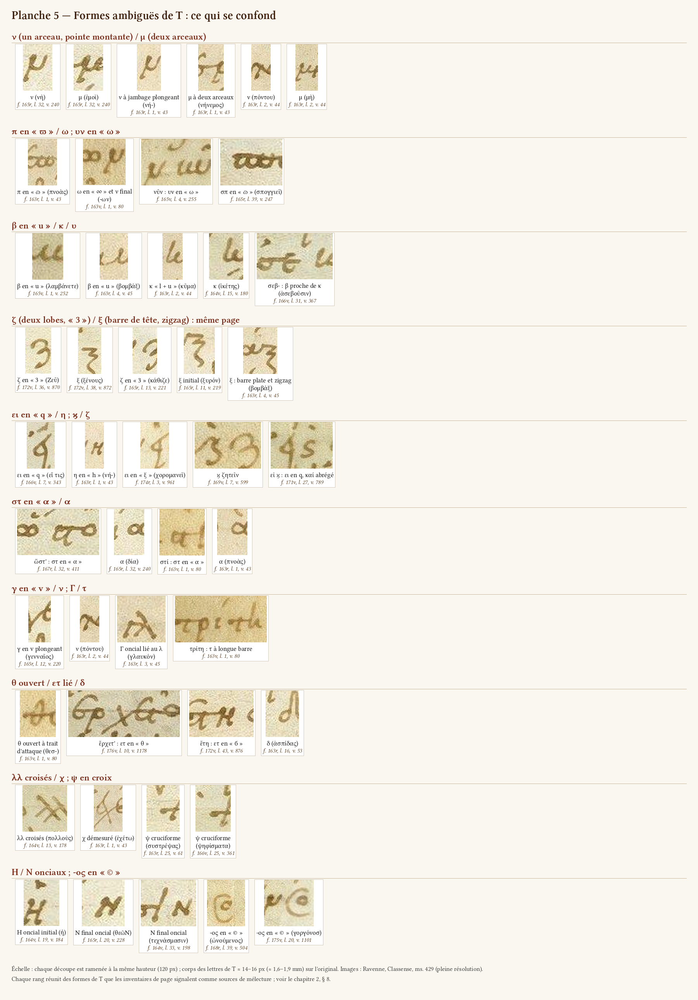

La table va de ce que l'on croit voir à ce qu'il faut lire, avec le critère discriminant et des exemples tirés des inventaires et vérifiés pour la plupart.

| On croit voir | Il peut s'agir de | Critère | Exemples |
|---|---|---|---|
| μ | **ν** | ν : un arceau et une pointe montante ; μ : deux arceaux, le second en crochet | νὴ lu « μὴ » (f. 165r l. 32 ; f. 164v l. 41) ; νῦν lu « μῶ » ; [n_2]/[m_2] |
| ω | **π (ϖ)** ; **υν** | barre du ϖ, même pâle ; υν : arceau ouvert à gauche | ὅπως lu « ὅωως » ; οὖν lu « οω » ; [p_varpi], [L_un] |
| υ, κ, ιι, μ | **β** | β : deux jambages, d'ordinaire sans haste montante ; κ : haste haute. Le critère peut faillir (ἀσεβοῦσ', f. 166v l. 31) : contexte | λαμβάνετε lu « λαμμάνετε » ; βραχὺ lu « ἱεραχύ » ; [b_u2], [k_lu], [b_k] |
| ζ | **ξ** | ξ : barre de tête et zigzag ; ζ : deux lobes ronds | ἔξεστι lu « ἔζεστι » ; [z_3]/[x_4] (même page) |
| ξ, ζ, φ, q, ἢ | **ει** | accent ou esprit au-dessus ; contexte | εἴπερ lu ἤπερ ; φεύγεις lu φεύγης ; [L_ei_q2], [L_ei_xi] |
| α (accentué) | **στ** | boucle fermée en haut par un trait horizontal (barre du τ) qui file vers la lettre suivante ; l'α n'a qu'un court trait vertical à droite | ὥστ' lu « ὥ ἀ » ; στρέφει lu « ἀρέφει » ; [L_st_a2] |
| ν | **γ** | γ : v plongeant, sans arceau | σύ γε lu σὺν ; [g_v] |
| τ | **Γ** ; **ψ** | Γ : barre plus courte, liée à la lettre suivante ; ψ : courbe sur la haste | γινώσκομεν lu *τινώσκομεν* ; ὄψιν lu « ὄτιν » ; [g_gi], [y_3] |
| θ | **ετ** ; **δ** | ετ : boucle de l'ε au-dessus de la barre ; δ : hampe vers la gauche | ἔρχετ', ἔτι ; [L_et2], [d_2] |
| χχ, ψ, μμ, biffure | **λλ** | deux diagonales de même longueur | πολλοὺς ; δύσκολλ' ἀλλὰ ; [ll_X1], [ll_obl] |
| ρ, μ | **λ** | diagonale descendante à gauche | λαθεῖν lu « μαθεῖν » (f. 167r l. 29) ; [l_2] |
| ο | **σ** fermé | trait supérieur qui se lie à la lettre suivante | σκάφιον lu « οικάφιον » ; σὺ lu « οὐ » |
| κ, Ν | **Η** | barre médiane horizontale | βοώιη lu βοῶν (Juntine) ; [h_H2]/[n_N2] |
| ι, paragraphos verticale | **ι long** initial | continuité avec le mot | ἱκέτης, ἴβυκος ; [i_j1] |
| ⊙, ©, renvoi | **-ος** de fin de ligne | position en fin de ligne, mot incomplet sans lui | τήϊος, γοργόνοσ ; [L_os1], [L_os4] |
| ζ, ς | **ϗ** (καί) | forme en S couché, contexte | ϗ ζητεῖν ; [A_kaizeta] |
| point, ponctuation | goutte d'attaque du **τ** ; **ο** plein ; circonflexe réduit ; esprit rejeté | position au contact de la lettre | [tau_g], [o_plein], [D_spir2] |
| biffure | barre de **τ, π, θ** ou langue de l'**ε** prolongée | continuité avec la lettre | εὔχεσθε (f. 166r) ; f. 176r passim |
| paragraphos | barre de **π** ou de **τ** débordant à gauche ; fin de scholie ; esprit rejeté | position (bande des sigles, mi-hauteur) | f. 162v vv. 4, 22, 38 ; f. 163r l. 13 |
| dicolon | ι adscrit brisé ; ι accentué ; point + accent de la ligne suivante | égalité et superposition exacte des deux points | f. 163r l. 29 ; f. 173r l. 18 ; f. 170r l. 18 |
| « + », crux | **ψ** cruciforme ; paragraphos barrée par 1516 ; accent biffé | encre (orangée = 1516) ; contexte | [y_1] ; f. 165r l. 24 |

---

## 4. Mise en page, signes, *notae personarum*, colométrie

Cette partie décrit ce que le copiste a disposé sur la page, puis ce que S2 et la main de 1516 ont fait de ce dispositif. Planches : `graphologie/planches/5_planche_mise_en_page.jpg`, `graphologie/planches/5_planche_paragraphos.jpg`, `graphologie/planches/5_planche_sigles_parent.jpg`, `graphologie/planches/5_planche_accents_ponctuation.jpg`. Les comptages des §§ 4.3 et 4.4 proviennent d'un dépouillement semi-automatique des tableaux de sigles des inventaires, confronté aux attributions du texte de l'auteur (`edition/donnees/travaux_anterieurs/texte_grec.tsv`), puis relu à la main : ce sont des ordres de grandeur. Les mesures sont les rapports d'absorbance des inventaires, comparables à l'intérieur d'une même page seulement (§ 2.1.3).

### 4.1 Mise en page

#### 4.1.1 Le cadre : réglure, lignes, justification

**Réglure.** Elle est faite à la pointe sèche, sans encre, et n'est visible qu'en lumière rasante numérique (filtre passe-haut, CLAHE, canal bleu). Le schéma est le même sur toutes les pages où les inventaires ont pu la suivre (par ex. f163r #66, f164v #90, f165r #1, f169r #3, f170v #31, f172v #2, f175r #1, f176v #1, f177r #1) :

| Élément | Position | Remarques |
|---|---|---|
| horizontales | pas de 42,0–43,8 px, soit ≈ 4,9–5,1 mm | prolongées dans les marges ; deux horizontales marginales en tête et en pied (par ex. f172v, f174v, f177r) |
| double verticale gauche | écart ≈ 50–60 px (6–7 mm) | la ligne intérieure porte le début des trimètres ; la bande entre les deux est la **bande des sigles**, où T place ses paragraphoi (f164v #90, f165r #1, f166v #1, f176r #55) |
| double verticale droite | même écart | les vers longs (tétramètres) la dépassent souvent (f169r, f171r, f172v) |
| verticale de la marge extérieure | à ≈ 50–60 mm du texte | borne la colonne des scholies (f163v, f174v, f176v #80) |

La justification (de la verticale intérieure gauche à la verticale droite) mesure ≈ 886–896 px, soit **≈ 103–104 mm** (f169v #47, f170v #31), ce qui concorde avec les 0,103 m de Zacher 1888, 534. Le copiste écrit **suspendu sous la réglure** (sur toutes les pages), les scholies ne suivent pas la réglure du texte (≈ 25 px par ligne, f165v).

**Nombre de lignes.** Toutes les pages sont réglées pour **43 lignes**, et toutes les 43 sont écrites sauf aux ff. 162v et 177r :
- **f. 162v** : l'inventaire compte « 42 lignes réglées » (titre + 41 vers). Le titre est sur la première réglure (sillon à y ≈ 370–372, f162v #2) ; la ligne de base du v. 1 est à y ≈ 490, soit **deux pas** plus bas. Sur un profil passe-haut du canal bleu, mesuré dans trois bandes verticales de la marge (x 1500–1600, 1600–1700, 1730–1800), on retrouve un sillon horizontal à y ≈ 409–416, entre le titre et le v. 1, puis à y ≈ 454–458 (réglure du v. 1). La page a donc, comme les autres, **43 réglures, dont la 2e est restée vide** sous le titre (vue de contrôle correction de f162v #19, à confirmer sur l'original).
- **f. 177r** : 23 lignes pour les vv. 1211–1231, une réglure vide, une ligne ornementale, le titre de l'*Assemblée*, 12 lignes d'hypothesis et 5 réglures vides (f177r #0, #45 ; § 4.1.3).
- Les nombres différents de la segmentation automatique (`ravennas/segmentation/`) sont des erreurs de celle-ci : 42 lignes au f. 168r (l. 43 manquée), 42 au f. 171r (l. 3 omise), 45 au f. 175v (les deux lignes des vv. 1102–1103 ajoutées dans la marge inférieure), 34 au f. 177r (lignes fusionnées).

**Bornes des pages.** Le contenu de chaque page, vérifié sur les images, et ses particularités de mise en page sont donnés à l'index (§ 8).

#### 4.1.2 Marges et répartition des notes

Sur un verso, la marge extérieure (large) est à gauche et la marge intérieure (étroite, contre le pli) à droite ; c'est l'inverse sur un recto. La disposition est constante :
- **scholies de S2** dans la marge extérieure, ancrées à la hauteur du vers commenté ; elles commencent souvent par un tiret « en vedette » et finissent par « ÷ » (f166r #55 ; f163v #57) ; elles sont écrites après le texte, en partant de la fin de la ligne de texte (f168r) ;
- **gloses et scholies courtes** dans la marge intérieure ; parfois dans un blanc de la colonne : l. 20 du f. 163r (χωνεύει), ll. 2 et 7 du f. 170v (à droite d'une ligne lyrique courte), l. 37 du f. 173r (dans le renfoncement), l. 18 du f. 173v ;
- **marges supérieure et inférieure** rarement employées : notice du f. 162v, six lignes en tête du f. 163v, trois en tête et huit en pied du f. 164r, deux en tête des ff. 164v et 167v, une en tête du f. 168v, scholie de six lignes en pied du f. 162v.

Les signes de renvoi de S2 sont rares mais réels (§ 5.3.6).

#### 4.1.3 Titre, absence d'hypothesis et de liste de personnages, fin de la pièce

**Le titre (f. 162v, l. 1 ; planche `graphologie/planches/5_planche_mise_en_page.jpg`).** « ἀριστοφάνους· ·θεσμοφοριάζουσαι », de la main de T, dans une **minuscule de titre** espacée (§ 2.2.1 : σ et ε lunaires, ν en N, ζ en Ƶ, φ à boucle fermée, α final en d), de module plus grand que le texte (≈ 25 px contre 18–20 px), précédé d'un **ornement en astérisque** (quatre traits incurvés autour de trois ou quatre points) et suivi d'un trait montant (f162v #0, #1 ; spécimens `graphologie/specimens/f162v/f162v_l01_aristophanous.png`, `graphologie/specimens/f162v/f162v_l01_ornement.png`, `graphologie/specimens/f162v/f162v_l01_trait_final.png`). Les deux points entre les mots sont des points séparateurs, non un dicolon (f162v #2, `graphologie/specimens/f162v/f162v_l01_points.png`). Le titre est accentué. **Il est à l'encre du texte : il n'y a aucune rubrique** dans les *Thesmophories* de R (vu sur l'image ; aucune source ne signale de rubrication dans R, dossier § 8.1). Le titre « Θεσμοφοριάζουσαι πρότεραι » prêté à R par Fritzsche et Enger ne s'y lit pas (dossier § 0, 14).

**Pas d'hypothesis ni de liste de personnages de T.** La marge supérieure porte une notice de deux lignes et demie sur la pièce (début effacé ; « … καὶ τοῦτο τὸ δρᾶμα τῶν κατ᾽ Εὐριπίδου πεποιημένων ἀπὸ τῶν Θεσμοφορίων … »), puis, centrée au-dessus du titre, la ligne **« προλογίζ(ει) μνησίλοχ(ος) κηδεστ(ὴς) εὐριπίδου »**, toutes deux dans la minuscule des scholies, que les indices (lemmes en semi-onciale, Z majuscule) rattachent à S2 (f162v #54, #55 ; `graphologie/specimens/f162v/f162v_marge_sup_hypothesis.png`). Ce ne sont pas des éléments de la mise en page de T, mais des notes du scholiaste.

**Fin de la pièce (f. 177r).** Après le v. 1231 (τούτων χάριν ἀνταδοῖτον·), **pas de souscription** (τέλος …) : la 24e réglure reste vide ; à la 25e, une **ligne ornementale** (tirets et petits crochets, avec un fleuron en plume aux deux bouts) ; à la 26e, le **titre de l'*Assemblée*** : « ὑπ(όθεσις) ἐκκλησιαζουσῶν ἀριστοφάν(ους) :– », dans la même écriture de titre, terminé par un dicolon et un tiret ; puis l'**hypothesis** de l'*Assemblée*, en 12 lignes de la minuscule de T, sur toute la largeur de la colonne, close par « ὦ λαμπρὸν ὄμμα :— » ; les cinq dernières réglures sont vides (f177r #0, #45 ; `graphologie/specimens/f177r/f177r_mep_ornement_titre.jpg`). Le contraste est net : l'*Assemblée* s'ouvre sur une hypothesis copiée par T, les *Thesmophories* n'en ont aucune de sa main.


#### 4.1.4 Vers omis, transposés ou ajoutés ; lignes qui ne sont pas des vers

**Vers omis par T et suppléés en marge**, chaque fois avec un signe de renvoi (sauf au v. 33) :

| Vers | Folio | Lieu de l'ajout | Main | Renvoi |
|---|---|---|---|---|
| 33 | 162v | marge droite, en trois lignes, à la hauteur des ll. 34–36 | S2 selon la littérature (§ 2.3.2) ; sigles εὐ et « ; » de 1516. Encre : 1re ligne brune (1,45/2,32, comme T), suite plus orangée (1,62/3,13) | aucun visible (f162v #31) |
| 169 | 164v | marge extérieure, à la hauteur des ll. 5–6 | S2 selon la littérature (§ 2.3.2) | croix « × » après le v. 168 (f164v #85) |
| 647 | 170r | marge droite, à la hauteur des ll. 9–10 | S2 | « ÷ » à barre ondulée en tête du vers ajouté et après la l. 11, « ·/· » devant la l. 12 (f170r #31, #39, #56) |
| 1102–1103 | 175v | marge inférieure, deux lignes | S2 (signes de renvoi orangés : S2 repassé ou 1516, § 2.3.4) | « —+:— » après la l. 20 et « +: » en tête de l'ajout (f175v #24, #25) |

**Transposition** : vv. 27, 29, 30, 28 (f162v ll. 28–31), ordre rétabli par des lettres numérales α–δ dans la marge droite ; γ est brun (S2 ?), α, β, δ orangés (1516) (f162v #29). Le v. 28 n'est pas un ajout marginal, contrairement à Allen 1896, 316 (dossier § 0, 14).

**Lignes de la colonne qui ne sont pas des vers des éditions** :
- **parépigraphes** copiées par T comme des lignes du texte, en retrait comme les lignes lyriques : ὀλολύζεις γέρων· (f164r l. 8, départ x ≈ 345 ; sans sigle ni paragraphos ; soulignée par un lecteur postérieur d'un trait ondulé rouge pâle, matière non ferro-gallique, crayon ou craie rouge ? f164r #17, #18, `graphologie/specimens/f164r/f164r_l08_parepigraphe_trait_rouge.jpg`) et ὀλολύζουσί τε· ἱερὸν ὠθεῖται. (f165v l. 26, départ x ≈ 895 contre 770 ; précédée d'une paragraphos de T barrée par la main de 1516, f165v #57, `graphologie/specimens/f165v/f165v_l26_parepigraphe.jpg`) ;
- **ligne supplémentaire** ἀνακύπτη· καὶ παρακύπτι· ἀπεψωλημένοσ· (f176v l. 20), copiée après le v. 1187 comme un trimètre ordinaire, sans marque (Velsen 1883, 85) ;
- **ligne annulée** f173v l. 15 (anticipation du début du v. 934, barrée et exponctuée), puis l. 18 ἱστιορράφος seul (fin du v. 935 récrite après ἱστιοφόρον barré, l. 17) ;
- **ligne exponctuée** στυγνᾶς ὦσσε (f176r l. 17), ligne de plein droit dans la colonne ;
- **mots en débord** centrés sur une ligne propre : ἀθρῆσαι (f170r l. 23, fin du v. 658), ἁπαξ ἁπάσας (f168v l. 43, fin du v. 550, souligné d'un trait ondulé, f168v #47) ;
- **vers coupés en deux lignes à la réplique** : v. 567 (f169r ll. 17–18, la seconde réplique sur une ligne courte) et v. 874 (f172v ll. 40–41).


#### 4.1.5 Initiales agrandies et ekthesis

T n'a ni initiales ornées ni lettrines, mais il **agrandit ou fait saillir l'initiale** de certaines répliques ou sections, sans régularité :
- ω de ὦ en tête de la pièce (f162v l. 2, x 689 contre ≈ 740) ;
- ω de ὦ πρέσβυ (f164r l. 25, v. 146), grands Ο de Οὐκοῦν et de Ὅταν (ll. 32, 36 ; vv. 153, 157) ;
- **Ο agrandi, en saillie**, aux deux entrées de la première femme (f168v vv. 533, 544) : ≈ 29 px de haut contre 12–13 px pour un ο ordinaire, donc un module **double** environ ; au v. 548, sans changement, un ο moins agrandi (≈ 20 px) ;
- **Φ** de φίλαι en ekthesis, à longue queue fine, à l'entrée de Clisthène (f169r l. 25, v. 574), répondant à la queue en S du ξ de λέξει qui clôt les tétramètres (l. 24) : c'est la seule « marque de section » de la page (f169r #2, #46 ; `graphologie/specimens/f169r/l25_phi_initial.jpg`, `graphologie/specimens/f169r/l24_queue_xi.jpg`) ;
- **Η** initial agrandi au début des anapestes du chœur (f170r l. 19, v. 655) ;
- Π de παραδοὺς et φ de φορμὸν (f172r ll. 15, 21), dans les anapestes de la parabase.

Ce sont des indices d'appoint : ni systématiques, ni réservés aux changements de locuteur.

---

### 4.2 Colométrie des parties lyriques et anapestiques

#### 4.2.1 Les principes observés

La colonne ne change jamais de largeur ; c'est le **point de départ des lignes** qui distingue les mètres. Les inventaires l'ont mesuré page par page (abscisse du premier trait, sur le masque d'encre ou sur des vues à règle) :

1. **Trimètres** : alignés sur la verticale intérieure de gauche, un vers par ligne, fin de ligne libre.
2. **Parties lyriques** : **un côlon par ligne**, en **renfoncement** (eisthesis) de 3–4 lettres (f163v) à 14–20 mm (f166v), souvent irrégulier à l'intérieur d'un même chant ; les côla longs repartent de l'alignement des trimètres (f164r ll. 4–6 ; f167v ll. 18, 20, 41, 43).
3. **Vers longs** (tétramètres) : soit simplement plus longs, débordant la double verticale de droite (f167r vv. 381–382 ; f169r vv. 551–573 ; f171r vv. 726–727), soit **en saillie** (ekthesis) sur la verticale extérieure (f171v vv. 785–800, 3–4 mm ; f172v vv. 835–845 ; f170v), soit, sur une page lyrique, dans la bande des sigles (f174r ll. 3, 10, 30, 43).
4. **Débordements** : la fin d'un tétramètre trop long est reportée sur la ligne suivante, renfoncée vers le milieu de la colonne (f171v : six cas, φέρε δὴ νῦν l. 26, εἴπερ ἀληθῶς l. 32, λαμβάνετ᾽ ἔνδον l. 34, καὶ κοπιῶσαι l. 36, ἐπιδήλως l. 41, ἰδέσθαι l. 43 ; f172r : neuf tétramètres sur 13 aux vv. 801–813 ; f173v : vv. 947–948). Ailleurs, T serre la fin de ligne et surélève les dernières lettres (ἀγορεύ^ει, ἅπαν^τα, ἐπιθυμ^εῖ, f171v ll. 23, 24, 39).
5. **Extra metrum** et répliques brèves sur une ligne propre : γλαυκόν, βομβάξ, σίγα· τί λέγει;, etc. (f163r ll. 3–21) ; ἄ α· et ἔα ἔα, centrés (f170v ll. 11, 22) ; πρῶ, seul et en ekthesis (f174r l. 10) ; ἀρταμουξία (f177r ll. 4, 8, 15, en retrait, mais pas au v. 1225, l. 18).
6. **Mots coupés en fin de ligne** : quinze cas relevés par les inventaires (relevé non exhaustif : d'autres peuvent avoir échappé), **sans trait d'union** sauf un ; T coupe aussi bien après une consonne que dans un groupe consonantique.

| Folio, lignes | Coupe |
|---|---|
| 163v, 35/36 et 36/37 | δρυογόνοι\|σι ; ἄρ\|τεμιν |
| 166v, 21/22, 27/28, 33/34 | παραβαίνου\|σί ; ἐ\|χθροῖς (l'ε prolongé en long trait horizontal) ; ὥσ\|θ᾽ |
| 171r, 3/4 | μεταβαλοῦ-\|σ᾽ (**seul trait d'union de T** : court trait à mi-hauteur, f171r #10, `graphologie/specimens/f171r/l03_trait_union.jpg`) |
| 173v, 32/33 | ἀνέχω\|μεν |
| 174r, 17/18 et 25/26 | ἐμ\|παίζει ; οἱ\|άπερ |
| 174v, 30/31 et 33/34 | ἔχου\|σ᾽ ; ξυμ\|παιῶνι |
| 175r, 23/24 | διφρεύου\|σ᾽ |
| 176r, 20/21, 28/29, 33/34 | γυναι\|κῶν ; φαι\|νετον ; ἀφίκε\|σθον |

Au f. 166r, l. 27, un **tiret** après παῖ relie la fin de ligne au côlon suivant (λατοῦς χρυσώπιδος ἔρνος), « παῖ — (sic) R » chez Velsen 1883 (f166r #24, `graphologie/specimens/f166r/f166r_l27_pai_tiret.jpg`).

**Concordance avec Velsen 1883.** Velsen consigne, passage par passage, les mots qui terminent chaque ligne de R et de M (« ita distributa sunt, ut singuli versus finiantur vocibus… RG », dossier § 8.4). Les inventaires ont vérifié sur l'image que les fins de ligne de R sont celles de Velsen pour les vv. 45–57 (f163r), 101–129 (f163v–164r), 295–330 (f166r), 352–371 (f166v), 434–442 et 459–465 (f167v), 520–530 (f168v), 721–725 (f171r), 947–958 (f173v), 959–1001 (f174r, sur les 43 lignes), 1065–1077 (f175r), 1081–1097 (f175v), 1136–1159 (f176r) et 1229–1231 (f177r). La concordance n'est pas affirmée pour les vv. 655–688 (f170r) et 1015–1055 (f174v–175r), dont la colométrie est décrite comme « propre à R ». Le sigle « RG » de Velsen montre que M reproduit les fins de ligne de R ; la **Juntine** les reproduit aussi ligne pour ligne aux vv. 295–337 (pages a 16 / b 1, f166r) et 1015–1040 (page c 13, coupures de mots et ponctuation comprises, f174v).

#### 4.2.2 Relevé par passage

| Vers | Folio, lignes | Disposition dans R | Particularités |
|---|---|---|---|
| 39–42 | 162v, 39–42 | quatre anapestes renfoncés d'≈ 15 mm, sans changement de module | seul renfoncement de la page |
| 43–62 | 163r, 1–26 | un côlon par ligne, renfoncement variable (x ≈ 230–330 contre 205–220) | répliques brèves sur une ligne propre |
| 101–122 | 163v, 22–43 | renfoncement de 3–4 lettres, irrégulier | deux mots coupés ; dicolon en fin de l. 34 |
| 123–129 | 164r, 1–7 | ll. 1–2 très renfoncées, l. 3 moins, ll. 4–6 longues à la justification, l. 7 renfoncée | parépigraphe en retrait (l. 8) |
| 295–309 | 166r, 2–16 | prière en prose, un membre par ligne, renfoncée (x ≈ 330–385) | trois points devant ταύτην (l. 16, f166r #12) |
| 310–311 | 166r, 17–18 | **en saillie**, à l'alignement des trimètres | formule finale et péan |
| 312–330 | 166r, 19–37 | un côlon par ligne, renfoncé (x ≈ 340–365) | tiret après παῖ (l. 27) |
| 352–371 | 166v, 16–35 | renfoncement de 14–20 mm | trois mots coupés ; χ^ο de S2 logé dans le blanc du retrait (l. 16) |
| 381–382 | 167r, 2–3 | tétramètres non distingués, sauf par la longueur | — |
| 434–442 ; 459–465 | 167v, 11–20 ; 37–43 | renfoncement variable (x ≈ 910–950) ; lignes longues à l'alignement des trimètres | la l. 43 déborde à droite pour finir la strophe sur la page |
| 520–530 | 168v, 12–22 | renfoncement (x ≈ 864–901 contre 756–790) | vv. 526–527 sur la seule l. 18 |
| 531–550 | 168v, 23–43 | tétramètres longs | ἁπαξ ἁπάσας seul, centré, souligné (l. 43) |
| 551–573 | 169r, 1–24 | tétramètres longs, débordant à droite | queue en S du ξ de λέξει (l. 24) et Φ en ekthesis (l. 25) |
| 655–688 | 170r, 19–43 | anapestes 655–658 **en ekthesis** de 8–9 mm ; **lyrique 663 ss. non renfoncé** | ἀθρῆσαι seul, centré (l. 23) ; vv. 664 + 664a (l. 29) et 666 + 667 (l. 31) réunis ; v. 675 sur trois lignes ; ekthesis des ll. 26 et 31 |
| 679–688 ; 700–701 ; 707–713 ; 718–720 | 170v, 1–8, 23–24, 30–36, 41–43 | renfoncement ; trimètres sur le filet intérieur ; tétramètres légèrement en saillie | ἄ α· et ἔα ἔα centrés ; deux gloses écrites dans le blanc de lignes courtes (ll. 2, 7) |
| 721–725 | 171r, 1–5 | renfoncement (x ≈ 262–285 contre 200) | trait d'union de T (l. 3) |
| 776–784 | 171v, 13–21 | renfoncement d'≈ 17 mm | dicolon en fin de l. 21 (fin de la monodie) |
| 785–800 | 171v, 22–43 | tétramètres en saillie de 3–4 mm ; six débordements renfoncés | lettres finales surélevées |
| 801–813 | 172r, 1–22 | neuf tétramètres coupés en deux lignes, la fin renfoncée vers le milieu | départs de plus en plus à gauche (x 250 → 162) ; Π et φ agrandis (ll. 15, 21) |
| 814–829 | 172r, 23–38 | pnigos, un vers par ligne, léger retrait | monomètres aux ll. 32, 37 ; points de pause |
| 830–845 | 172r, 39–43 ; 172v, 1–11 | tétramètres trochaïques à gauche (sur la verticale extérieure au f. 172v) | — |
| 913–914 | 173r, 37–38 | deux côla dochmiaques renfoncés (x ≈ 350) | glose de S2 dans le blanc (l. 37) |
| 947–958 | 173v, 30–43 | tétramètres débordants, fins renfoncées ; dimètres et côla renfoncés | deux côla des éditions réunis (ll. 40, 41) ; ἀνέχω\|μεν |
| 959–1000 | 174r, 1–42 | côla renfoncés (x ≈ 300–380) ; vers longs en ekthesis dans la bande des sigles | deux mots coupés ; trois lignes réunissent deux côla (ll. 14, 22, 30) |
| 1015–1055 | 174v, 14–43 ; 175r, 1–11 | trente lignes toutes renfoncées (x ≈ 880–910), puis onze (x ≈ 305–335) | colométrie propre à R, reproduite par la Juntine ; κλύεισ ὦ seul (f174v l. 17) |
| 1056–1097 | 175r, 12–43 ; 175v, 1–16 | scène d'Écho (§ 4.2.3) | — |
| 1136–1159 | 176r, 10–34 | lignes courtes renfoncées (x ≈ 290–325) | trois mots coupés ; l. 17 exponctuée ; aucun sigle de demi-chœur |
| 1213–1231 | 177r, 4–23 | ἀρταμουξία en ligne propre renfoncée ; ll. 21–23 renfoncées | vv. 1227–1228 sur une seule ligne débordante (l. 20) |

**Exceptions et incohérences.** Le copiste n'applique pas ses principes partout : les lyriques 663 ss. du f. 170r ne sont pas renfoncés (alors que les anapestes qui précèdent sont en saillie) ; les tétramètres des ff. 167r et 169r ne sont distingués que par la longueur ; certaines lignes réunissent deux côla des éditions (f173v ll. 40–41 ; f174r ll. 14, 22, 30 ; f170r ll. 29, 31). Ces écarts sont des faits de tradition à relever dans l'apparat métrique ou dans l'introduction, non des fautes à corriger dans la transcription.

#### 4.2.3 La scène d'Écho (vv. 1056–1097)

La mise en page de la scène est la plus élaborée de la pièce (planche `graphologie/planches/5_planche_mise_en_page.jpg` ; `graphologie/specimens/f175r/f175r_sigles_l26_37.png`, `graphologie/specimens/f175v/f175v_mep_blocs.jpg`) :

- **f. 175r, ll. 21–43** (vv. 1065–1081) : lignes courtes, commençant vers x ≈ 335, précédées d'une large bande de sigles (x ≈ 250–335). Les répliques de Mnésiloque et d'Écho occupent chacune une ligne ; T met une paragraphos devant la plupart des lignes qui commencent une réplique (il n'en met pas aux vv. 1065 et 1074, ni, dans les trimètres qui précèdent, aux vv. 1058, 1059 et 1064), mais aussi devant λίαν (l. 35, v. 1076a) et παῦσαι (l. 39, v. 1078a), qui terminent des répliques de Mnésiloque : il a pris ces mots, que l'écho va répéter, pour des répliques séparées (paragraphoi barrées d'un trait gris, sans doute pour l'impression).
- **f. 175r, ll. 39–43, et f. 175v, ll. 1–16** : **deux répliques par ligne**. La première (Mnésiloque, puis le Scythe) commence à la justification ; après un blanc, la répétition d'Écho forme une **seconde colonne** (vers x ≈ 600 au f. 175r, x ≈ 1050–1250 au f. 175v), introduite par une **paragraphos de T en milieu de ligne** — trait mince, de la même encre que le texte et que les paragraphoi de la bande des sigles (f175v ll. 4, 6–8 : G/R 1,35–1,42, B/R 2,22–2,42, A_R 0,12–0,16 ; texte des mêmes lignes 1,42–1,44/2,49–2,55, A_R 0,15 ; paragraphoi de gauche, ll. 3–5, 1,29–1,36/2,26–2,49) : elle n'est pas nettement plus pâle que le texte. Exceptions : ff. 175v ll. 9–12 et 16, sans répétition ; le v. 1095 sur deux lignes (ll. 13–14) ; les répétitions d'Écho aux vv. 1093–1094 manquent dans R (l. 12).
- **Sigles.** S2 écrit des notes développées : εὐρι(πίδης) ἠχώ (f175r l. 12, v. 1056 : Euripide joue Écho), ηχω (f175r l. 26 ; f175v l. 2), ὁ μνησίλ(ο)χ(ος) ὡς ἀνδρομέδα (f175r l. 21), et la note de jeu ἠρέμα ὁ κηδεστ(ής), [τὸ] πρὸς τ(ὸν) εὐρι(πίδην) (f175r l. 19, f175r #64). La main de 1516 pose Ηχ et μν (μ réduit à un crochet aux ll. 41–43) sur les paragraphoi de T, ou greffe sur elles les hastes du Η (f175r ll. 39–43 ; f175v ll. 6–7).
- **Annulations de 1516.** La main de 1516 barre d'une haste orangée la paragraphos de milieu de ligne du v. 1092b et, dans la bande des sigles, celles des vv. 1093 et 1095 (f175v ll. 11–13, f175v #11, `graphologie/specimens/f175v/f175v_l12_13_paragraphoi_biffees.jpg` ; croisements orangés sur trait brun, contrôlés sur la carte des encres). Aux vv. 1092b et 1093, ce sont de vrais changements de locuteur, dans le texte de R comme dans celui de l'édition. Au v. 1095, en revanche, le changement n'existe que dans le texte restitué : la l. 12 de R ne porte que les répliques de l'archer (« ποῖ ποῖ φεύγεις· οὐ καιρήσεις· », 1093a + 1094a, sans les échos 1093b–1094b), et la l. 13 (« ἔτι γὰρ γρύζεις », 1095a) est encore de l'archer ; l'annulation s'accorde donc ici avec le texte de R. La Juntine n'imprime pas de sigle à ces endroits.


---

### 4.3 Les marques de réplique du copiste : paragraphos, dicolon, blanc, point

Bekker l'avait vu : « interlocutores ubi mutantur, lineola versui praefigitur, qui Platonicis quoque codicibus mos est » (Bekker 1829, vi) ; Velsen précise que la première main marque l'entrée d'un nouveau personnage « vor dem Verse durch einen Strich (—) und in der Mitte des Verses durch zwei Punkte (:) » (Velsen 1871, 8 ; dossier § 8.2). L'image confirme ce système et en montre les limites.

#### 4.3.1 Les formes

- **Paragraphos** : trait horizontal de 25 à 42 px (3–5 mm), **à mi-hauteur du corps des lettres**, dans la bande des sigles, juste avant le premier mot ; attaque épaissie à gauche (« en massue », « en goutte »), fin effilée à droite ; parfois à crochet initial (f162v v. 1 ; f170v ll. 38, 40). Encre du texte (par ex. 1,22/1,81 au f. 169r, l. 22 ; 1,30/2,11 au f. 164v, l. 37 ; 1,30/2,09 au f. 168v, l. 32). Spécimens : `graphologie/specimens/f162v/f162v_l15_paragraphos.png`, `graphologie/specimens/f164v/l37_paragraphos_T.jpg`, `graphologie/specimens/f170v/l28_chor_paragraphos.jpg`.
- **Dicolon** : deux points égaux superposés, dans le blanc ménagé entre deux répliques (forme « pure » au f. 162v, v. 31, f162v #72, `graphologie/specimens/f162v/f162v_l32_dicolon_T.png` ; ff. 165v l. 4, 174v ll. 1–5).
- **Dicolon en fin de ligne**, devant un changement en tête de la ligne suivante : f163v l. 34 (v. 113, `graphologie/specimens/f163v/f163v_l34_dicolon_fin.png`), f164v vv. 194 et 199 (`graphologie/specimens/f164v/l29_l34_dicolon_final.jpg`, non relevés par Velsen 1883), f171v l. 21 (χρή :, fin de la monodie), f172v l. 40 (μέλαθρα :, non relevé par Velsen) ; au f. 162v, v. 6, « φράσον : — » (dicolon suivi d'un trait, f162v #14).
- **Blanc** (« spat. rel. » de Velsen 1871) à la place du dicolon : f165r ll. 26, 35 ; f165v ll. 6, 17, 19 ; f171r v. 746.
- **Point simple** au lieu du dicolon : f169r vv. 562–563 ; f169v v. 621 (ποῖον·) ; f170r l. 16 (δρῶμεν·) ; f171r v. 752 ; f173r v. 878b ; f173v v. 939b ; et en fin de ligne dans le chant d'Agathon (f163v ll. 24, 27, 31, 40).
- **Paragraphos en milieu de ligne** dans la scène d'Écho (§ 4.2.3).

#### 4.3.2 Fréquence et omissions

T ne marque rien sur des pages entières : f166r (prière et chant : aucune paragraphos, aucun dicolon), f166v (aucune marque), f167r (le seul dicolon du v. 380), f167v (une seule paragraphos, au v. 443, d'encre de type S2, f167v §3), f172r (parabase, un seul locuteur), f174r (aucune paragraphos ; au v. 1001 un trait oblique fin). Ailleurs, il omet souvent. Confrontées aux attributions de l'édition, les marques relevées par les inventaires donnent, en ordre de grandeur (pages dont les tableaux ont pu être dépouillés, soit toutes sauf ff. 167r, 167v, 172r, 174r et 175v) :

| Changement de locuteur (texte de l'édition) | Marque de T |
|---|---|
| **en tête de vers** (≈ 305 cas) | paragraphos vue : ≈ 160 ; présumée sous un sigle de 1516 (Velsen) ou douteuse : ≈ 35 ; barrée ou grattée après coup : ≈ 14 ; **aucune : ≈ 97 (≈ 32 %)** |
| **à l'intérieur du vers** (≈ 125 cas renseignés) | dicolon (souvent sous un sigle de 1516) : ≈ 83 ; point simple : ≈ 10 ; blanc : ≈ 4 ; rien : ≈ 9 ; indéterminé : ≈ 18 |

Ces chiffres reposent sur les attributions modernes et sur la visibilité actuelle des marques ; ils suffisent à montrer qu'**une absence de marque de T ne vaut pas attribution** (dossier § 8.2 : Velsen 1883 note « om. R » à chaque fois).

#### 4.3.3 Survivance de l'usage antique : la paragraphos sous la ligne du changement

Plusieurs inventaires ont relevé des paragraphoi « fausses » ou « décalées » : en tête d'un vers où le locuteur ne change pas (f162v vv. 7, 14 ; f165r vv. 217, 225 ; f169v vv. 622, 623 ; f173v vv. 926, 935, 940 ; f176v vv. 1184, 1192, 1194, 1195…). L'inventaire du f. 173v a proposé d'y voir la convention antique, où la paragraphos est tracée **sous la ligne qui contient le changement**, le dicolon marquant le point exact (f173v § 3). Je l'ai éprouvée sur toute la pièce (planche `graphologie/planches/5_planche_paragraphos.jpg`) :

- **cas retenus** : un changement à l'intérieur du v. *n*−1, aucun en tête du v. *n* ; on en compte une soixantaine sur les pages renseignées ;
- **résultat brut** : T met une paragraphos en tête du v. *n* dans 25 cas sur 61 (≈ 40 %), et rien dans les autres ;
- **résultat corrigé** : dans 8 de ces 25 cas (vv. 7, 216, 622, 623, 742, 1006, 1194, 1195, marqués « ‡ » ci-dessous), le v. *n* contient **lui-même** un changement intérieur ; la paragraphos y est donc aussi bien rattachée à la ligne du changement (la règle que j'invoque plus bas pour les vv. 234, 1193 et 1200) que placée sous la ligne précédente : ces cas ne discriminent pas. Restent comme cas vraiment discriminants (v. *n* sans aucun changement) ≈ 47 vers (décompte brut, avant relecture), où T met une paragraphos dans **14 cas** (vv. 14, 217, 225, 246, 620, 744, 750, 875, 926, 935, 940, 1184, 1192, 1221 ; celle du v. 744 seulement probable), plus 2 présumées sous un sigle de 1516 (vv. 898, 1219) et 1 douteuse (v. 1119) : **environ un tiers** (30–36 %).

| Paragraphos devant le v. | Folio, l. | Changement intérieur au vers précédent | Sort de la paragraphos |
|---|---|---|---|
| 7 ‡ | 162v, 8 | 6 (Euripide → Parent) | laissée |
| 14 | 162v, 15 | 13 (Parent → Euripide) | laissée (vue : `graphologie/specimens/f162v/f162v_l15_paragraphos.png` ; revue : trait épais, brun) |
| 216 ‡ | 165r, 8 | 215 (Parent → Euripide) | laissée (changement aussi dans le v. 216) |
| 217 | 165r, 9 | 216 (Euripide → Parent) | laissée (revue : en massue, brune, 1,31/2,04) |
| 225 | 165r, 17 | 224 (Euripide → Parent) | laissée (revue : brune, 1,34/1,92) |
| 246 | 165r, 38 | 245 (Euripide → Parent) | barrée par 1516 (`graphologie/specimens/f165r/l38_paragraphos_barree.jpg`) |
| 620 | 169v, 28 | 619 (Clisthène → Parent) | annulée en ⊥ d'**encre brune** (T ou S2, f169v #74) |
| 622 ‡ | 169v, 30 | 621 (Clisthène → Parent) | laissée (vue) |
| 623 ‡ | 169v, 31 | 622 (Parent → Clisthène) | laissée (vue) |
| 742 ‡ | 171r, 22 | 741 (Parent → Mica ; **sans dicolon** dans le v. 741) | laissée (1516 pose ses Γϋ sur les dicola intérieurs du v. 742) |
| 744 | 171r, 24 | 743 (Parent → Mica) | **probable** : trait contigu à la fin de la glose χωροῦν de S2 (« soudée à la glose », inventaire), qui peut en être le prolongement |
| 750 | 171r, 30 | 749 (Mica → Parent) | laissée (revue : nette) |
| 875 | 172v, 42 | 874 (Parent → Critylla) | 1516 y greffe Γϋ |
| 898 | 173r, 22 | 897 (Parent → Critylla) | sous la barre du Γϋ de 1516 (vue par Velsen 1871 ; f173r n° 80) |
| 926 | 173v, 7 | 925 (Parent → Euripide) | barrée (main indéterminée) |
| 935 | 173v, 17 | 934 (prytane → Critylla) | barrée (1516 selon Velsen 1871) |
| 940 | 173v, 23 | 939 (prytane → Parent) | 1516 y pose μν, que la Juntine n'imprime pas |
| 1006 ‡ | 174v, 5 | 1005 (archer → Parent) | laissée |
| 1119 | 175v, 36 | 1118 (Euripide → archer) | **douteuse** : trait court (≈ 13 px, contre 25–42 px pour une paragraphos), semblable à la marque placée devant οὐκ à la l. 37 (v. 1120, sans changement) ; esprit rejeté ou trace |
| 1184 | 176v, 16 | 1183 (Euripide → archer) | barrée par 1516 (deux encres, f176v #9) |
| 1192 | 176v, 25 | 1191 (Euripide → archer) | laissée (vue ; revue : brune) |
| 1194 ‡ | 176v, 27 | 1193 (archer → Euripide) | barrée par 1516 (vue ; croisement orangé) |
| 1195 ‡ | 176v, 28 | 1194 (Euripide → archer) | barrée par 1516 (vue ; croisement orangé) |
| 1219 | 177r, 11 | 1218 (archer → coryphée) | sous le σκ de 1516 (Velsen) |
| 1221 | 177r, 13 | 1220 (archer → coryphée) | barrée par 1516 |

Deux détails vont dans le sens de l'interprétation, sans la prouver :
- au v. 742, T ne met **aucun dicolon** dans le v. 741 (vu), mais une paragraphos en tête du v. 742 : elle peut signaler le changement intérieur de la ligne précédente ; mais le v. 742 contient lui-même deux changements (ἤνεγκον. | ἤνεγκας σύ; | νὴ τὴν Ἄρτεμιν), et la paragraphos peut aussi bien se rapporter à eux : le cas n'est pas décisif ;
- au v. 875, T a coupé le v. 874 en deux lignes à la réplique (ll. 40–41 ; le tiret devant la seconde, signalé par Velsen 1871, est aujourd'hui caché sous l'εὐ de 1516 et ne se voit pas sur l'image) et garde *en plus* la paragraphos du v. 875 (sous le Γϋ de 1516), alors que le v. 875 est tout entier de Critylla : il la tient peut-être d'un modèle où le v. 874 tenait sur une ligne et où la paragraphos, sous cette ligne, signalait son changement intérieur.

**Paragraphoi de division du discours.** D'autres paragraphoi, sans aucun changement de locuteur, tombent à une articulation du sens, comme la paragraphos antique dans un texte continu : f168r vv. 498 et 502, dans le discours de Mnésiloque (après la pause intérieure du v. 497, οὐπώποτ᾽ εἶπεν. εἰ δὲ Φαίδραν…, puis au début d'une nouvelle anecdote, ἑτέραν δ᾽ ἐγᾦδ᾽…), où l'inventaire les note « tirets » et recommande de les transcrire sans les interpréter ; f169v v. 601 (le coryphée se tourne vers Clisthène) et v. 635 (après le δεῦρ᾽ ἐλθὲ … ὦ Κλείσθενες du v. 634) ; f176v vv. 1199 et 1204 (changements d'interlocuteur adressé dans la scène de l'archer).

**Résidu inexpliqué** : f163r v. 72 (paragraphos nette, sans changement dans le texte reçu ; le modèle répartissait-il autrement les vv. 70–72 ?), f165r v. 234 (barrée par 1516), f176v vv. 1193 et 1200 (grattées ; l'Augustanus a encore celle du v. 1200, Velsen 1883) et v. 1198 (?). Les vv. 234, 1193 et 1200 contiennent eux-mêmes un changement intérieur : la paragraphos y est rattachée à la ligne du changement plutôt que placée sous elle.

**Interprétation.** Le système de T est **mixte**. La paragraphos sert d'abord, comme dans les éditions modernes, à signaler une réplique qui commence en tête de ligne ; mais dans un tiers environ des cas discriminants, elle suit encore la règle antique, et quelques fois elle marque une simple division du discours. Le plus vraisemblable est que T (ou un ancêtre proche) a reporté en tête de ligne, à mi-hauteur, une paragraphos qui, dans un modèle plus ancien, était tracée **entre** deux lignes : selon qu'il la rattachait à la ligne d'au-dessus ou à celle d'au-dessous, elle tombe en tête de la réplique nouvelle ou en tête du vers qui suit le changement. Le système n'était déjà plus compris au Xe siècle : une paragraphos de type antique (v. 620), et une autre qui marque pourtant un vrai changement (v. 608, « ipsa I m. delevit », Velsen 1871, 11), sont annulées à l'encre brune ; la main de 1516, qui ne connaît que la convention de la Juntine, barre ou couvre les autres.

**Conséquences.** Une paragraphos en tête du v. *n* signifie seulement : « changement de locuteur en tête du v. *n*, ou à l'intérieur du v. *n*−1, ou articulation du discours ». Elle ne justifie pas à elle seule une attribution nouvelle (c'était déjà la prudence de l'inventaire du f. 162v pour les vv. 7 et 14). Dans l'apparat des attributions, il faut citer la marque telle qu'elle est (« — R ante v. *n* »), à la manière de Coulon 1928 (sigle « par. »), et non la traduire en nom de personnage.

#### 4.3.4 Le dicolon : changement, pause, ponctuation

Le dicolon marque d'abord le changement à l'intérieur du vers. Mais T l'emploie aussi :
- **en fin de ligne** devant une réplique qui commence à la ligne suivante (§ 4.3.1) ;
- **comme pause forte, sans changement de locuteur** : f165r ll. 21 (με : χώρει, v. 229 ; vu), 24 (κακοδαίμων : ψιλὸς), 36 (σοι : τὰ, `graphologie/specimens/f165r/l36_dicolon_ta.jpg`) ; f168r l. 12 (πόλλ᾽ ⁚) ; f169v v. 605 (ἤρου :) ; f170r ll. 22, 30, 34 ; f171v l. 9 (πλάται : πόθεν) ; f173v l. 14 (αὐτόν : ἀλλὰ) ; f176r l. 41 (κομίσωμαι :, où Velsen 1883 imprime « · ») ; f176v l. 18 (avant ἔτι) ;
- **comme ponctuation lyrique** : f174r ll. 12, 14, 24, 29 (μέλπουσα :, ἑκάεργε : ὄπαζε…), f173v l. 41 ;
- en clôture : « :– » à la fin de la l. 29 du f. 174r, « :— » à la fin de l'hypothesis de l'*Assemblée*, « :– » après le titre de celle-ci.

Le dicolon se transcrit donc comme un signe, sans préjuger de sa valeur. Inversement, beaucoup de « dicola » apparents n'en sont pas (§ 4.5.2).

#### 4.3.5 La réception du système : S2 et la main de 1516

- **S2** complète le système là où T n'a rien mis, ou à côté de la paragraphos (sans la recouvrir), ou au-dessus du dicolon, dans l'interligne (f169v ll. 11, 23 ; f170r l. 14) ; il n'annule jamais une marque de T, sauf peut-être aux vv. 608 et 620 (encre brune indiscernable de celle de T).
- **La main de 1516** transforme les marques muettes de T en sigles imprimables (§ 4.4.2) : elle écrit le sigle **sur la paragraphos**, qui devient la barre du Є, le corps du μ, la barre du Γ ou la traverse du Η (f165r, f165v, f175r, f176v) ; **sur le dicolon**, dont les deux points deviennent la haste d'un Γ (Γϋ, f171r ll. 22–28 ; f173v l. 16 ; f176v l. 26) ou les extrémités d'un ε (f163r l. 34) ; dans le blanc ménagé par T. Là où T n'a rien marqué au milieu du vers, elle met le sigle **en marge avec un signe d'insertion** « ^ » ou « √ » dans la ligne (f165r ll. 8, 14, 16 ; f169r v. 552, renvoi en croix vers la marge supérieure ; f176v ll. 11, 19). Elle **barre d'une haste verticale** les paragraphoi qui ne conviennent pas aux attributions de la Juntine (« + », « I m. del. 2 m. » de Velsen 1871) et **gratte** parfois paragraphoi et dicola (f162v v. 32 ; f175v v. 1114 ; f176v vv. 1193, 1200).

Paragraphoi annulées après coup, et ce qu'en dit le texte de l'édition :

| Vers | Folio, l. | Annulation | Changement dans le texte de l'édition ? |
|---|---|---|---|
| 75 | 163r, 39 | biffure ondulée, 1516 (`graphologie/specimens/f163r/f163r_l39_biffure_paragraphos.jpg`) | **oui** (Parent → Euripide) |
| 232 | 165r, 24 | haste, 1516 (`graphologie/specimens/f165r/l24_paragraphos_barree.jpg`) | **oui** (Euripide → Parent) |
| 234 | 165r, 26 | haste, 1516 | non (changement intérieur au v. 234) |
| 246 | 165r, 38 | haste, 1516 | non, mais changement intérieur au v. 245 (§ 4.3.3) |
| 264, 273, 274 | 165v, 13, 22, 23 | haste, 1516 (deux encres, f165v #39, #53) | **oui** dans les trois cas |
| parépigraphe | 165v, 26 | haste, 1516 | changement entre 276 et 277 |
| 608 | 169v, 16 | trait vertical brun (T selon Velsen 1871) | **oui** (coryphée → Clisthène) |
| 620 | 169v, 28 | ⊥ brun (T ou S2) | non, mais changement intérieur au v. 619 |
| 926, 935 | 173v, 7, 17 | haste (935 : 1516 selon Velsen 1871) | non, mais changement intérieur aux vv. 925, 934 |
| 1076a, 1078a | 175r, 35, 39 | trait gris | non (erreur de T dans la scène d'Écho) |
| 1092b, 1093, 1095 | 175v, 11–13 | haste orangée | **oui** aux vv. 1092b et 1093 ; au v. 1095, seulement dans le texte restitué (R omet les échos 1093b–1094b, § 4.2.3) |
| 1114 | 175v, 31 | grattée | **oui** (Euripide → archer) |
| 1184, 1194, 1195 | 176v, 16, 27, 28 | haste orangée | non, mais changement intérieur aux vv. 1183, 1193, 1194 |
| 1193, 1200 | 176v, 26, 33 | grattées (1200 après la copie de M) | non (changement intérieur au v. lui-même) |
| 1204 | 176v, 37 | haste | non (articulation du discours) |
| 1221 | 177r, 13 | haste roussâtre, 1516 | non, mais changement intérieur au v. 1220 |

Sur ces vingt-cinq annulations, neuf suppriment donc un **vrai** changement de locuteur (dix avec le v. 1095, où le changement n'existe que dans le texte restitué ; et l'une d'elles, au v. 608, est brune, non de 1516), et huit une paragraphos placée sous la ligne d'un changement (dont deux, vv. 1194–1195, sur des vers qui contiennent eux-mêmes un changement, § 4.3.3) : la main de 1516 corrige T d'après la Juntine, non d'après le sens. Ses barres ne doivent jamais être lues comme le signal « + » du copiste (piège signalé par tous les inventaires concernés).

---

### 4.4 Les notae personarum

#### 4.4.1 Trois couches

1. **T n'écrit aucun nom de personnage.** Aucun inventaire n'a trouvé de sigle de sa main. Le seul cas allégué, « μνησι^λο » devant le v. 130, que van Leeuwen 1904 donne au copiste (dossier § 8.2), est un sigle de S2 : petites majuscules ΜΝΗΣΙ et λ suscrit enfermant un ο (vérifié sur l'image). L'argument d'encre de l'inventaire (1,39/2,33, contre 1,33–1,36/2,13–2,27 pour T ; f164r #71) ne résiste pas à la mesure uniforme (fond local, outil de la partie 2) : ΜΝΗΣΙ 1,41/2,38, texte de la même ligne 1,42/2,50, texte de la page 1,39–1,41/2,36–2,47, scholies de la page 1,41–1,51/2,52–2,76 ; seul le petit λο (1,53/2,97, 31 px) s'écarte un peu. L'attribution à S2 repose donc sur la **forme** (suspension, petites capitales, lettre suscrite) et la **position**, non sur l'encre.
2. **S2** (Xe s.) écrit des sigles **abrégés par suspension**, avec une lettre suscrite (μνη^σ, κη^δ, ευρι^π, αγα^θ, κλεισ^θ, γυ^ν, σκυ^θ, χ^ρ…), en petites majuscules ou en semi-onciale, de l'encre brune des scholies, à gauche de la paragraphos de T sans la recouvrir, ou dans l'interligne au-dessus du dicolon ; parfois des **notes développées** (καλλιλεξία γυ^ν, v. 383 ; γυ^ν μία, v. 605 ; ΠΡΥΤΑΝΙϹ, v. 929 ; εὐρι^π ὡς περσεύς, v. 1098 ; ὁ μνησίλ(ο)χ(ος) ὡς ἀνδρομέδα, v. 1065 ; κη^δ ὡς ἀνδρομε^δ, v. 1107 ; ευρι^π ὡς γραῦς, vv. 1177, 1181) et des **indications de jeu** (πρὸ(ς) τ(ὰς) γυναῖκας, v. 726 ; ἠρέμα ὁ κηδεστ(ής), [τὸ] πρὸς τ(ὸν) εὐρι(πίδην), v. 1063b).
3. **La main de 1516** écrit des sigles « **imprimables** » (Εὐ, Μν, Ἀγ, Γυ, Κλ, Σκ, Ηχ, Χο…), d'encre orangée, souvent suivis d'un point d'abréviation, pour l'imprimeur de la Juntine, qui les reproduit tels quels (Velsen 1871, 7–26) ; elle repasse ou gratte parfois les sigles de S2 (f162v vv. 5, 19, 39 repassés ; v. 34 gratté et récrit ; f163r vv. 45b–c repassés ; f165r v. 210 repassé ; f168r v. 466 gratté et récrit) ; d'autres sigles, dont certains de sa main que la Juntine imprime, ont été grattés plus tard (f163r vv. 57b, 58, 63, 77 ; f175v v. 1116).

**Attention à l'encre.** L'orangé ne suffit pas à désigner un sigle de 1516 : des notes de forme S2, que M reproduit déjà, sont aujourd'hui orangées (§ 2.6.4). Pour attribuer un sigle, l'ordre des critères est : **forme** (suspension et semi-onciale pour S2 ; sigle imprimable, Η capital, grand χ descendant, σκ à queue pour 1516) ; **témoignage de M** ; **position** ; **encre** en dernier (f175v #50). La règle complète est au § 2.9.3.

#### 4.4.2 Répertoire des sigles par personnage

| Personnage | S2 (brun, suspension) | Main de 1516 (orangé, « imprimable ») |
|---|---|---|
| Euripide | ευ^ρ (vv. 5, 202, 249), ευ· (32), ευρι^π / ΕΥΡΙ^π (877, 885, 889, 896, 902, 918, 924, 1015, 1160, 1208…), εὐρι(πίδης) ἠχώ (1056), εὐρι^π ὡς περσεύς (1098 ; au v. 871, ὡς περσεύς est ajouté par 1516 après l'εὐρι^π de S2), ευρι^π ὡς γραῦς (1177, 1181) | Εὐ, εὐ, Єὐ, Єυ·, ευρ (84) |
| le Parent | μνη^σ, μνη^σι, μνησι^λο, ΜΝΗΣΙ^λο, μ· (≈ 27, § 4.4.4) ; κη^δ (5) | μν, μν^η, Μν, μ^ν, μν·, μ réduit à un crochet (≈ 90) ; κηδ, κη^δ, Κη^δ (9) |
| Agathon | αγα^θ / ΑΓΑ^θ, θ en lentille barrée (101, 107, 114, 146, 203) | ἀγ, Αγ, αγ |
| le serviteur | θερά^π (39) | θερ (46), θε· (66) |
| le chœur, le coryphée | χ^ο (Χ et ο suscrit), monogramme χ + ρ « en astérisque » ou « en chrisme » (χ^ρ, χορ), χ^ορ | χ^ο, grand χο, monogramme χορ (vv. 582, 586, 589, 1170, 1223, 1226), χο au milieu des vers (1218–1220) |
| demi-chœur | ἡμι^χ γυν^αικ^ῶν (659, orangé, M) | — |
| le héraut | κη^ρ (372 ; à lire κη^ρ, non κ^ρη, contre Velsen 1883) ; κη^ρυξ abrégé au v. 295, gratté (M) | κήρυξ en toutes lettres sur grattage (295), κηρ (331) |
| les femmes | γυ^ν (626, 649, 652, 689 ?, 706, 852, 879, 882, 892), γυ^ν μία (605), γυ^νη τίς (533), καλλιλεξία γυ^ν (383), ἄλλη γυ(νή) (760) | Γυνὴ τίς (380), ἑτ(έρα) γυνή (443), Γυνη (544, 551, 554), Γυ, Γϋ (avec tréma), Γυ^η |
| Clisthène | κλεισ^θ, κλεσ^θ, κλει(σ) (574, 595, 603, 606, 610, 615, 645) | κλ, κλ· ; complète κλει(σ) de S2 en Κλεισθένης (574) |
| le prytane | ΠΡΥΤΑΝΙϹ (929), ΠΡΥ (939, forme S2, encre de 1516) | πρυ (943) |
| l'archer scythe | τοξ^ότης (1001), σκυ^θ (1083, 1084, 1108, 1133, 1135, 1176, 1210…) | τοξ (1002, 1003, 1006), σκ |
| Écho | ηχω (1069b ; f175v l. 2) | Ηχ, ἠχ |

#### 4.4.3 Répartition par page

Le relevé ligne par ligne (marque de T, sigle de S2, sigle de 1516, témoignage de Velsen) est dans la section « sigles » de chaque inventaire (`graphologie/folios/fXXX.md`). Les nombres ci-dessous sont des ordres de grandeur.

| Folio | Marques de T | Sigles de S2 | Sigles de 1516 | Remarques |
|---|---|---|---|---|
| 162v | paragraphoi, dicola | 5 | ≈ 24 | 1516 repasse, gratte et récrit |
| 163r | paragraphoi, dicola | 1–2 (repassés) | ≈ 10 | sigles grattés aux vv. 57b, 58, 63, 77, dont des sigles de 1516 que la Juntine imprime |
| 163v | paragraphoi ; presque rien dans le chant | ≈ 6 (ΑΓΑ^θ, χ^ο, χορ) | ≈ 17 | Euripide et le Parent intervertis par 1516 jusqu'au v. 92 |
| 164r | 3 paragraphoi | 2 | 4 | — |
| 164v | paragraphoi, dicola, dicola de fin de ligne | 3 | ≈ 24 | — |
| 165r | paragraphoi, dicola, blancs | 1 (+1 repassé) | ≈ 35 | insertions en marge avec « ^ » ou « √ » |
| 165v | paragraphoi, dicola, blancs | 0 | ≈ 25 | — |
| 166r | rien | 1 (χ^ρ) | 2 (κήρυξ, κηρ) | — |
| 166v | rien | 2 (χ^ο, κη^ρ) | 0 | — |
| 167r | 1 dicolon | 1 | 1 | — |
| 167v | 1 paragraphos (encre de type S2) | 2 | 1 | — |
| 168r | tirets de division | 0 (note grattée au v. 466) | 1 (κηδ ευ) | — |
| 168v | paragraphoi, Ο agrandis | 3 | 2 | — |
| 169r | paragraphoi, dicola | 2 (+ 592 ?) | ≈ 18 | — |
| 169v | 25 paragraphoi, 13 dicola | 13 | 2 | 1516 n'ajoute plus rien des vv. 618 à 649 (Velsen 1871) |
| 170r | paragraphoi, dicola | ≈ 6 (+ 2 orangés, M) | 0 | aucun sigle de 1516 des vv. 608 à 710 (Velsen 1871) |
| 170v | 7 paragraphoi, 1 dicolon | 8–9 | 1 | « nearly all the dram. pers. are by B » (Allen 1896, 316) |
| 171r | paragraphoi, dicola | 3 | 11 (Γυ seulement, vv. 739–751) | — |
| 171v | 1 paragraphos, 2 dicola | 1 (+ χ^ορ orangé, M) | 0 | — |
| 172r | rien (un seul locuteur) | 0 | 0 | — |
| 172v | paragraphoi, dicolon final | 4 | ≈ 10 | — |
| 173r | paragraphoi, dicola | 12 (ll. 1–20, 26, 42) | 16 | 1516 n'écrit jamais là où S2 a écrit |
| 173v | paragraphoi, dicola | 3–5 | ≈ 8 | — |
| 174r | rien | 1 (τοξ, orangé) | 0 | — |
| 174v | paragraphoi, dicola (ll. 1–5) | 3 | 5 | — |
| 175r | paragraphoi (Écho) | 4 notes | ≈ 25 | — |
| 175v | paragraphoi (Écho), dicola | ≈ 8 notes | ≈ 25 | — |
| 176r | paragraphoi | 6 | 3 | — |
| 176v | paragraphoi, dicola | 6 | ≈ 25 | 1516 n'ajoute rien là où S2 a écrit |
| 177r | paragraphoi, dicola | 0–1 | ≈ 10 | — |

Les deux couches sont **complémentaires** : là où S2 a pourvu le texte de sigles lisibles (ff. 169v–171v, haut du f. 173r, ff. 176r–176v), la main de 1516 s'abstient ou presque ; là où S2 manque, elle transforme les marques muettes de T. Velsen l'avait observé pour les listes de la « 2 m. », qui sautent les vv. 608–710 et 751–858 (dossier § 8.2 ; f169v, f170r, f171v). Ses sigles reproduisent ceux de la Juntine, y compris ses erreurs : interversion d'Euripide et du Parent jusqu'au v. 93 (« Euripidis et Mnesilochi personae perversae sunt in R sicut in Junt. », Velsen 1871, 31 ; f163r, f163v), ἀγ aux vv. 173, 208, 209, 253 ; εὐ aux vv. 206, 252 (intérieur), 254 ; μν^η au v. 265 ; Γυ au v. 710 et devant des répliques du Parent aux vv. 742–748 ; γϋ au v. 928 ; σκ aux vv. 1125, 1179, 1188 ; μν au v. 1128 ; γυ après πυγή (v. 1187). Velsen 1871, 30 juge ce travail « flüchtig ». **Les sigles de 1516 n'ont aucune autorité de tradition** : ce sont les attributions de l'*editio princeps*, à citer comme telles (« Junt. ») et non comme leçons de R.

#### 4.4.4 Le nom du « Parent » d'Euripide

**La question.** Les éditeurs nomment le personnage tantôt Μνησίλοχος, tantôt Κηδεστής. Coulon écrit : « Κηδ. R passim, Σ compluribus locis : Μνη. R compluribus locis, Σ passim » ; Wilson : « R et sch. saepe eum ita nominant, saepe autem Mnesilochum » ; Sommerstein parle d'abréviations de Μνησίλοχος qui « appear sporadically » dans R ; Velsen est le premier éditeur à écrire Κηδεστής, à l'instigation de Hiller (van Leeuwen 1904, 1–2 n. 2) (citations d'après le dossier § 8.2). Il fallait établir sur l'image quelle main écrit κηδ. et quelle main écrit μν(η).

**Relevé complet** (planche `graphologie/planches/5_planche_sigles_parent.jpg`) :

*a) S2 — le nom propre (≈ 27 occurrences)*

| Vers | Folio, l. | Forme | Remarques |
|---|---|---|---|
| 19 | 162v, 20 | μνη^σι | repassé μνη par 1516 |
| 33 | 162v, marge | μ· | en tête du vers suppléé |
| 45b | 163r, 4 | μνησι^λο | λό brun (S2), μνησι repassé en orangé (f163r #12) |
| 130 | 164r, 9 | ΜΝΗΣΙ^λο | vu ; non de T par la forme (§ 4.4.1), l'encre ne tranche pas |
| 200 | 164v, 35 | μνη^σ | — |
| 210 | 165r, 2 | μνη^σ | R² selon Velsen 1883 ; encre actuelle de 1516 (repassé) |
| 615, 630 | 169v, 23, 38 | μνη^σ | au-dessus du dicolon ; en marge |
| 637, 650 | 170r, 2, 14 | μνη^σ | au v. 650, dans l'interligne au-dessus du dicolon |
| 692, 704, 709, 714 | 170v, 15, 27, 32, 37 | μνη^σ (σ en c suscrit) | v. 692 vu ; au v. 709, Κ et zigzag orangés sur μνη |
| 730 | 171r, 10 | μνη^σι | forme de S2, encre actuelle orangée |
| 765 | 171v, 2 | μνη^σ | « corrector » chez van Leeuwen |
| 846, 855 | 172v, 12, 21 | μνη^σ | — |
| 878, 886, 895 | 173r, 2, 10, 19 | μνη^σ | — |
| 925a, 936 | 173v, 6, 19 | μνη^σ | v. 936 : forme de S2, encre de 1516 |
| 1002, 1022 | 174v, 1, 21 | μνη (petit c suscrit), μνη^ϲ | — |
| 1065 | 175r, 21 | ὁ μνησίλ(ο)χ(ος) ὡς ἀνδρομέδα ÷ | note ; 1516 écrit μν sur sa fin |
| 1134 | 176r, 8 | μνη^σ | — |

*b) S2 — la parenté (5 sigles et une note)*

| Vers | Folio, l. | Forme | Remarques |
|---|---|---|---|
| 466 | 168r, 1 | note **grattée** ; M : κή^δ εὐ^ριπ (Velsen 1871, 10) | récrite par 1516 κηδ : ευ· (§ c) |
| 540 | 168v, 32 | **κη^δ** : Κ en deux pièces, Η barré d'une longue oblique, δ suscrit souligné ; brun (1,26/1,91) | vu (`graphologie/specimens/f168v/f168v_l32_sigle_ked_paragraphos.jpg`) ; seul κηδ du « corrector » chez van Leeuwen |
| 603 | 169v, 11 | **κη^δ** suscrit au-dessus du dicolon, Κ en \|c, Η oncial, petit Δ ; brun | vu ; M : « κηδ. minio superscriptum » (Velsen 1883) : antérieur à 1516, contre Velsen 1871, 21 et van Leeuwen |
| 1063b | 175r, 19 | ἠρέμα ὁ κηδεστ(ής) πρὸς τ(ὸν) εὐρι(πίδην) | indication de jeu servant de note de personnage |
| 1107 | 175v, 24 | κ^η^δ ὡς ἀνδρομε^δ, encre orangée | M : κη^δ ανδρο^μδ : antérieur à 1516 (contre van Leeuwen, « manus recens ») |
| 1207 | 176v, 40 | κη^δ, capitales de grand module, encre orangée empâtée, restes bruns | M : κη^δ ; note de S2 repassée en 1516 ? (f176v #72) |
| (592) | 169r, 43 | κη^Δ | R² selon Velsen 1883 ; encre actuelle de 1516 : à trancher |

*c) Main de 1516*

- **μν** (μν, μν^η, μ^ν, Μν, μν·, μ) : environ 90 fois, de la première page (vv. 6–34) à la scène d'Écho (vv. 1058–1081 ; v. 1082 au f. 175v) et au v. 1128.
- **κηδ** seulement aux vv. **466** (κηδ : ευ·, κηδ(εστὴς) Εὐ(ριπίδου), sur le grattage de la note de S2 ; vu), **549** (κηδ), **552** (κη^δ dans la marge supérieure, avec renvoi en croix), **555, 558, 560** (κη^δ), **592** (?), **604** (κη + Λ, dans le vers ; vu) et **1209** (Κη^δ, dans le vers). Le κηδ que van Leeuwen donne à la « manus recens » aux vv. 567 s. n'a pas été retrouvé par l'inventaire du f. 169r.

*d) Scholies et gloses de S2* : notice initiale « προλογίζ(ει) μνησίλοχ(ος) κηδεστ(ὴς) εὐριπίδου » (f162v, marge supérieure) ; glose ὁ μνησίλοχ(ος) sur οὑτοσί (f165v l. 15, v. 266) ; scholie au v. 603 « μνησίλοχ(ος) τοῦτο διὰ τὸ μέλλειν ἔρευναν γίνεσθαι » (f169v #34) ; scholie au v. 633 « … τί εἴπη ὁ κηδεστ(ὴς) … » (f169v #44).

**Ce qu'on en tire.**
1. **Aucune des deux désignations n'est de T.** Le copiste du texte n'a transmis aucun nom de personnage ; R ne contient pas de liste des personnages des *Thesmophories*. Les noms sont l'œuvre du scholiaste du Xe siècle, puis de la main de 1516.
2. **S2 connaît les deux** et les emploie indifféremment, comme sa notice initiale qui les juxtapose (« Μνησίλοχος, κηδεστὴς Εὐριπίδου ») : à la même page, il suscrit κη^δ au v. 603 et μνη^σ aux vv. 615 et 630, il écrit μνησίλοχος dans la scholie au v. 603 et ὁ κηδεστής dans la scholie au v. 633 (f169v) ; pour le même rôle, il note ὁ μνησίλοχος ὡς ἀνδρομέδα au v. 1065 et κηδ ὡς ἀνδρομέδα au v. 1107. Mais le **nom propre domine nettement** : environ 27 sigles contre 5.
3. Les κηδ de **1516** ne sont pas une donnée indépendante : ils se concentrent dans le passage où S2 a lui-même écrit κηδ (vv. 466–604 : 466, 540, 603) et au v. 1209, deux vers après le κη^δ de S2 au v. 1207 ; partout ailleurs, la main de 1516 écrit μν. Elle a donc suivi localement l'usage de S2, et la Juntine imprime en conséquence Κηδ. à ces endroits (Velsen 1871, 10 et 33 : « 466 κηδ. εὐ. 2 m. in rasura R Κηδ. Junt. »).
4. Le relevé **contredit** la formule de Coulon pour R : toutes mains confondues, la désignation dominante du manuscrit est Μν(ησίλοχος) (≈ 117 sigles contre ≈ 14) ; dans les scholies, les deux noms apparaissent à égalité. Il corrige aussi van Leeuwen, qui ne donne au « corrector » que le κηδ du v. 540 : ceux des vv. 466, 603, 1107 et 1207 sont antérieurs à 1516, puisque M les connaît.
5. Pour l'édition, R n'apporte donc **aucun argument de tradition** en faveur de Κηδεστής contre Μνησίλοχος, ni l'inverse : les deux désignations appartiennent à l'exégèse byzantine, la seconde est la plus fréquente dans le manuscrit, et le texte lui-même ne désigne le personnage que par sa parenté (Εὐριπίδην … ἄνδρα κηδεστήν τινα, v. 584 ; κηδεστὴς ἐμός, v. 1165 ; le mot s'applique aussi, en sens inverse, à Euripide aux vv. 74 et 210) : le nom de Μνησίλοχος vient de l'exégèse. Le choix du nom relève de la convention éditoriale ; l'apparat des personnages peut s'en tenir à « μνη^σ R² passim, κη^δ R² 466, 540, 603, 1107, 1207 ».

### 4.5 La ponctuation

Planche : `graphologie/planches/5_planche_accents_ponctuation.jpg`.

#### 4.5.1 Les signes de T

| Signe | Forme et place | Emplois relevés | Exemples |
|---|---|---|---|
| point | surtout **à mi-hauteur** ; parfois haut ; le point final est souvent détaché loin à droite (f172v ll. 5, 18, 20, 31, 43) | fin de phrase, de vers ou de côlon ; après un vocatif ; **à la place du point d'interrogation** ; pauses intérieures du pnigos | ὦ ζεῦ· … φανήσεται· (f162v v. 1, vu) ; τούτοις·, μᾶλλον·, βωμολόχους· (f172r ll. 25–27) ; points de pause du pnigos (f172r #23) |
| point-virgule « ; » | point haut et virgule descendante | **interrogation** le plus souvent ; parfois simple pause | σίγα· τί λέγει; (f163r l. 5 ; le « ; » ne se lit pas à cette résolution, zone frottée : à vérifier) ; τί σ πάτρα; (f164r l. 15, vu) ; ἐπινοεῖ; (f166v l. 2) ; στρέφει; (f169v l. 18, revu) ; ἡμᾶσ; (f172r l. 3, revu) ; με; (f176v l. 23, vu ; virgule brune, 1,36/2,17) — dans ces quatre cas revus, point et virgule sont bruns, sans orangé sur la carte des encres ; pause : συγκλείσας ; (f162v v. 40, `graphologie/specimens/f162v/f162v_l40_semicolon_epi.png`) ; après γυναικὸς et λεγούσης, sans question (f167v l. 13) |
| virgule basse | sous la ligne de base | valeur incertaine : hypodiastole (séparation) ou pause | καθῆ σθαι, γεγένημαι, πικρὰν, ἐμοὶ (f172v ll. 6, 12, 19, 25) ; ἀνίστασ , ὀρθός (f170r l. 8) ; σὲ (f174r l. 31) ; ἐμέ, (f176v l. 26, vu) |
| dicolon | deux points superposés | changement de locuteur ; pause forte ; question (§ 4.3.4) | κέκραγας : (f165r l. 14), changé en « ; » par 1516 selon Velsen 1871 (encre de la virgule non distincte, voir ci-dessous) |
| tiret, point allongé | trait horizontal à mi-hauteur en fin de ligne | fin de période | f173r l. 25 (v. 901) ; f174r ll. 3, 39 |
| « :– », « :— » | dicolon et tiret | clôture | f174r l. 29 ; titre et fin de l'hypothesis de l'*Assemblée* (f177r) |
| trois points | trois petits points alignés | renvoi ou rattachement ? | devant ταύτην νικᾶν (f166r l. 16, f166r #12, `graphologie/specimens/f166r/f166r_l16_trois_points.jpg`) |

La ponctuation est **fréquente mais non systématique** : beaucoup de fins de vers n'en ont pas (f168v ll. 1, 13), et le point peut couper ce que les éditions lient (« προσμάθοι· μὴ » pour προσμάθοιμι, f162v v. 24, f162v #46). Le **point d'interrogation moderne** n'est pas en usage de façon régulière : T emploie indifféremment le point, le point-virgule ou le dicolon après une question.

**Interventions de la main de 1516.** Elle ajoute une virgule orangée sous un point ou un dicolon de T pour en faire un « ; » à l'usage de l'imprimeur : v. 193 (f164v l. 28, `graphologie/specimens/f164v/l28_point_interrogation_1516.jpg` ; virgule 1,58/2,80 contre 1,21/2,02 pour le point, orangée sur la carte des encres), v. 252 (f165v l. 1, non signalé par Velsen ; virgule 1,66/3,14, plus orangée que T à densité égale), vv. 32 et 33 (πώποτε· → πώποτε;, Velsen 1871, 25 ; au v. 33 suppléé, le « ; » est orangé, f162v #31) ; elle gratte le dicolon du v. 32 (f162v #51). Au v. 222 (κέκραγας : → κέκραγας;, Velsen 1871, `graphologie/specimens/f165r/l14_kekragas_point_interrogation.jpg`), l'ajout n'est **pas confirmé par l'encre** : la virgule (1,29/2,07) a l'encre du point qu'elle prolonge (1,32/2,07) et du texte (1,33/2,15) ; seuls la forme et le témoignage de Velsen la donnent à 1516. Ces signes sont la ponctuation de la Juntine, non de R.

**La ponctuation des scholies** (quatre points, hypodiastole, point haut avant les citations : Rutherford 1896, I, xxix, dossier § 8.3) relève de la partie 5.

#### 4.5.2 Ce qui ressemble à de la ponctuation et n'en est pas

Les inventaires signalent sur presque chaque page de faux points et de faux dicola. Les plus fréquents :
- **ι adscrit** tracé en deux touches, ou court, au-dessus d'un accent de la ligne suivante (f163v l. 31 γᾶι ; f173r ll. 18, 41 κλοπῆι, τῆι ; f163r ll. 29–30, à trancher) ;
- **esprits et accents de la ligne suivante**, qui montent dans l'interligne : f164v l. 25 (point de T et esprit de εὐ- : faux dicolon) ; f168v l. 14 ; f169v l. 19 (l'apostrophe de τοῦτ᾽ de la l. 20) ; f171r l. 29 ; f172v l. 17 ; f177r l. 16 (« : » après δίωκε) ;
- **esprits initiaux rejetés à gauche**, en point, dans la bande des sigles (f166v l. 15, vu, `graphologie/specimens/f166v/f166v_l15_esprit_rejete.jpg` ; f167r ll. 20, 28, 35, 42 ; f167v ll. 5–7, 24, `graphologie/specimens/f167v/f167v_l05-07_esprits_initiaux.jpg` ; f168r ll. 20, 22, 23, 32, 37, 42 ; f168v ll. 38, 39, 41 ; f170v ll. 4, 5, 9, 23, 39 ; f165r l. 22) ;
- **goutte d'attaque du τ**, isolée devant la lettre (f163r l. 13 ; f167r ll. 10, 15 ; f167v ll. 8, 10, 11) ;
- **apostrophe + point** (θ᾽ :, f167r l. 31) ; **sortie du ρ** en virgule (f167r ll. 34, 37) ; **ο plein** pris pour un point (f166v l. 5 ; f167v l. 2) ;
- **clôtures de scholies** « ÷ » ou « :– » tombées au bord de la colonne (f172v l. 16) ; souillures (f166v l. 4).

Il faut donc, devant chaque point ou dicolon douteux, vérifier à fort grossissement la forme (deux points égaux et superposés pour le dicolon de T), la hauteur, et l'appartenance à la ligne.

### 4.6 Accentuation, esprits, iota adscrit, élision, tréma, coupe des mots

#### 4.6.1 Les accents

**T accentue presque tous les mots, titre compris.** Formes : aigu en simple trait oblique ; grave ; circonflexe arrondi, anguleux ou en crochet, souvent **réduit à un point** (φῶς, δεῖ, ποῦ, τῶν, f164r ll. 4, 21, 29, 31 ; πρᾶο, νῦν, f177r ll. 1, 19), parfois en long trait horizontal surmonté d'une pointe (θρᾶττ᾽, f165v l. 43). Les accents sont souvent **déportés vers la droite** (νήνεμος, αἰθήρ, f163r l. 27 ; esprit rude et aigu de ἅμα au-dessus du μ, f174r l. 1), ou **très hauts**, jusqu'au pied de la ligne précédente (f168v l. 12 ; f169v l. 2 θεώ).

**Accentuation propre à R, à ne pas normaliser** : doubles accents (κ᾽ ἄλλός et περὶθρέξαι, f170r l. 21 ; ἔργόν, f176v v. 1172 ; μὴδὲν, f163r l. 30) ; mots sans accent (βαϋζα, f173r l. 19 ; ἐξαιρε et δε, f174r ll. 23, 37 ; επηκοω, f176r ; τι δέ με τοῦτο, f169v l. 39 ; λάλο…, f175v v. 1097) ; accents « fautifs » (ἐπι δημεῖ, f162v v. 40 ; πάσαν:, f170r l. 22 ; κριτύλλά, f173r l. 22). Velsen 1883 en signale beaucoup d'autres, que les inventaires n'ont pas tous contrôlés (f171v §e, f172r §e).

**La règle de l'oxyton et sa correction.** T met parfois le grave sur une finale oxytone même devant une ponctuation ou un enclitique. Un correcteur ancien a corrigé une quinzaine de ces graves en aigus (une vingtaine si l'on compte les corrections que Velsen 1883 signale et que l'image ne montre pas), **sans gratter le grave** : il trace un aigu qui part du pied du grave, d'où un accent « **en V** », « **en ✓** » ou « **en croix** » :

| Mot | Folio, l. (v.) | Forme | Source |
|---|---|---|---|
| καινόν·, ἁγνήν·, εἰκός· | 174r, 9, 13, 16 (967, 971, 974) | « ✓ » : grave épais et court, aigu long et mince ; celui de ἁγνήν est placé très haut, dans l'interligne, sous les lettres de la l. 12 (τοξοφόρον) : à ne pas rattacher à cette ligne | f174r #10, #50 ; Velsen 1883 « corr. ex καινὸν· » ; vu (`graphologie/specimens/f174r/f174r_l09_kainon_accent.png`) ; καινόν et εἰκός revus |
| ἐγώ·, καιρός (devant ἐστι) | 170r, 14, 26 (650, 661) | V : grave de T et aigu à l'encre neutre | f170r §d (contre Velsen 1883, qui donne le sens inverse au v. 650) |
| ἀεί | 169r, 27 | V | f169r §e |
| κακόν, παρών | 164v, 30, 23 (195, 188) | croix ; aigu seul | f164v §d |
| σεαυτόν | 165r, 26 (234) | croix | f165r #36 |
| κακά, γυνή, διός, δυσμενήσ | 167r l. 9 (388) ; 166v l. 9 (345) ; 165v l. 21 (272) ; 171r l. 37 (757) | aigu à tête épaissie ou V | inventaires correspondants |
| τουτί | 163r, 37 (73) | grave et aigu superposés en V | f163r §4 |
| ἐγώ | 164r, 37 (158) | aigu à tête épaissie | f164r §d |

Dans l'autre sens, un aigu est barré et un grave posé au-dessus (εἰσιὼν, f168r l. 30), un grave est ajouté à côté de l'aigu de T (εἰσὶν, f172r l. 29) ; la main de 1516 ajoute un grave orangé sur πρὸς (f172r l. 10) et barre celui de παρὰ pour obtenir παραβάλλουσαι (f172r l. 5, d'où le « × » de la ligne). La main du correcteur (T en relecture, S2, ou un « correcteur à l'encre neutre » au f. 170r) ne se laisse pas trancher par l'encre, les accents étant trop petits pour une mesure fiable.

**Pièges** : l'accent en V n'est pas un circonflexe ; l'accent en « ✓ » n'est pas le signal √ du copiste (qui est en marge) ; l'accent en croix n'est pas un signe critique (f167r l. 15 ἀνδράσι ; f172r l. 5).

#### 4.6.2 Les esprits

- **Formes.** Sur les premières pages, esprits **triangulaires** ou en **coin anguleux** (┤, ⊢), qui ne distinguent pas toujours le rude du doux (f162v, f163r, f167v ll. 11, 34, 41) ; crochet en « ↄ » (f163v l. 19, ἄνδρ᾽) ; ailleurs, **petits points ou virgules arrondies**, doux et rude indistincts (f172v ; f167r #75 pour les crases ἀνὴρ, ἀδελφὸς, ἄνδρες, que Velsen 1883 et Wilson lisent avec l'esprit doux). L'esprit et l'accent sont deux signes séparés (en « flèche » sur ἤδη, f167r l. 6 ; deux points juxtaposés qui imitent un tréma, f167v, f168v l. 14).
- **Place.** En haut à gauche de la voyelle initiale, parfois bas et loin à gauche (f163v l. 19), jusque dans la bande des sigles en tête de vers (§ 4.5.2). Sur une diphtongue, sur la seconde voyelle ; une fois sur les deux (ὀὐμὸσ, f172v l. 33).
- **Omissions** fréquentes : περὶ εμοῦ, δ᾽ εστιν, εστὶν, ὴ, ειμὶ (f163v) ; η, article, sans esprit (f163v l. 1) ; όσαις (f166v l. 19) ; αλιμέδον (f166r) ; εφέποντας, εσται (f170r ll. 40, 43) ; ἐπαυτὸν (f171v l. 6) ; ἑαυτῷ (f173v v. 952) ; επηκοω (f176r) ; ἠν avec le seul doux (f163r l. 33).
- **Corrections** signalées par Velsen 1883 (ἐξεύροιμ᾽, v. 23 ; esprit ajouté sur ᾧ, v. 16) : la seconde est visible (petit esprit rude à gauche du circonflexe, S2 selon Velsen, f162v), la première ne l'est pas à cette résolution.

#### 4.6.3 L'iota adscrit

T écrit l'iota **sur la ligne**, comme une lettre pleine (f172v, f174v) ou réduite à un trait court (f167r), parfois **détachée** du mot (ταυτῶ ι, χωρίω ι, εὐριπίδη ι, f175r ll. 16–17). **Jamais souscrit.** Il est **irrégulier** :
- *présent* : ὀλέθρωι, ξυνελευθέραι, γᾶι (f163v) ; τέχνηι, τῆι (f163r, f167v) ; προδῶισ, ὤιμοι, σιωπᾶισ, δᾶιδ᾽, φροντίσηισ (f165r) ; θεσμοφόρωι, ἠραρμόσηι (f165v) ; τραγωιδίαις, δρᾶι (f167v) ; τῶι κορινθίωι ξένωι (f167r l. 25) ; στεριφῆι, πανταχῆι, κύκλωι, λάθηι, τούτωι (f170r) ; σ᾽ οὐξηιρήσατο (f171r l. 41) ; ἔργωι πορίμωι, πολλῆι σπουδῆι (f171v) ; τρόπωι, φωνῆι, κύκλωι (f174r) ; δρᾶισ, ὁρᾶισ, γαμηλίωι, δεσμίωι, γλαυκέτηι (f174v) ; κλοπῆι, τῆι (f173r) ; ἐφ᾽ ὧι (f176r v. 1162) ; γρᾶιδιο, γρᾶιο (f177r) ; βοώιη (f168r l. 41, dont la Juntine a lu le Η comme un Ν : βοῶν) ;
- *absent* : τραγωδῶ, λάθρα (f163v) ; ἐλπίσης (f164v l. 30) ; ἱερῶ (f174r l. 6) ; δάκη, ὑπο λίθω (f168v vv. 529–530) ; γρᾶ́διο, ταύτη (f177r) ; τῆ μιαρά à côté de τῆι (f175v v. 1096).

Dans les scholies, Rutherford imprime des ι adscrits là où l'image montre de petits signes de valeur incertaine (f166r, vv. 295, 300) : voir § 5.6, n° 9.

#### 4.6.4 Élision, apostrophe, crase

- **L'apostrophe est notée le plus souvent** (γ᾽, τ᾽, θ᾽, δεῦρ᾽, εἶτ᾽, f163r) ; formes : petit crochet, chevron (πότ᾽, f168v l. 18), point (τάδ᾽ εὔγματα, f166v l. 18).
- **Elle manque souvent** : μὴδὲν, ἱκέτευ (f163r l. 30) ; εὐφημί ἔστω, deux fois (f166r ll. 2–3) ; λέξουσ, ποοῦσ (f167r) ; λακωνὶκ ἄττα (f167v l. 1) ; χ ἥτις, ὧδ (f168v vv. 522, 525) ; ἀνίστασ (f170r l. 8, « RG ») ; μὸ (f177r l. 5).
- **Apostrophe ajoutée après une consonne finale**, surtout **οὐκ᾽ / οὐχ᾽**, habitude du copiste déjà notée par Martin 1882, xiii (dossier ; f162v vv. 5, 7, 8 selon Velsen 1883) : οὐκ᾽ οὖν (f165r l. 18), οὐχ᾽ ὀμώμοκ᾽ (f165v l. 25, v. 276 ; et non l. 9), οὐκ᾽ (f164v l. 23 ; f167v ll. 29, 40 ; f168v ll. 18, 41), κ᾽ οὐκ᾽ ἐκύησα (f170r l. 6 ; l'apostrophe de οὐκ᾽ est visible), κ᾽ οὐκ᾽ ἔστιν (f173v v. 946) ; aussi ῥήτωρ᾽ (f168v l. 22), ἀπόλλω᾽ (f165v). Au f. 174r l. 7, l'apostrophe que Velsen lit après οὐκ n'est pas distincte. **Réserve** : tous ces οὐκ précèdent une voyelle ; quand on ne voit qu'**une** marque entre les deux mots (οὐκ οὖν, f165r l. 18 ; οὐχ ὀμώμοκ᾽, f165v l. 25), elle peut être l'esprit, rejeté à gauche, du mot suivant (§ 4.5.2) ; l'apostrophe n'est sûre que là où l'esprit du mot suivant est vu à part (f170r l. 6). L'« habitude » est donc probable, non démontrée .
- **Crase.** T écrit souvent la crase de καί comme une élision : κ᾽ ἀλκαῖος, κ᾽ ανακρέων (f164r l. 42), κ᾽ ἄλλός (f170r l. 21), κ᾽ ἀξ, κ᾽ ἀπάγορεύετε (f171v ll. 24, 28), κ᾽ ἀνδραποδιστάς (f172r l. 27) ; ailleurs avec le crochet de crase (κᾆτ᾽, κᾆθ᾽, f168r ll. 17, 21 : ce n'est pas une brève, contre l'impression de Velsen 1883). ὠϋριπίδη (f162v v. 4), avec tréma, est accompagné en marge du signal ÷ de T (f162v #11).

#### 4.6.5 Le tréma

T met le tréma sur ι et υ après voyelle ou en tête de mot, sans régularité : ἴβϋκος et τηΐος (f164r l. 40), ϊκρίων (f167r l. 16), τουτωῒ (f165r l. 42 ; Velsen 1883 l'omet), ϊὴ παιών (f166r l. 18), εὐΐον, συῒ (f174r ll. 32, 36, 37), -στρεϊα (f175r l. 15), ταυτηΐ (f177r l. 13), βαϋζα (f173r l. 19), ὠϋριπίδη (f162v v. 4). Le Γϋ de la main de 1516 porte lui aussi un tréma.

#### 4.6.6 La coupe des mots

La minuscule de T groupe les mots selon l'accent plus que selon le lexique :
- **préverbes détachés** : ἐπι δημεῖ (f162v v. 40), περί θου, ἀν ἔστην (f167r), πρὸ σαγαγοίμην (f172v l. 15), ὑπερ ἀποκρίνῃ (f164v l. 21), ὑπο λίθω (f168v v. 529) ;
- **mots soudés** : ἅμαδὲκαὶ (f174r l. 1), ἐνβραχὺ, κἀνεκβάληι, προτοῦ (f167r), ἐπαυτὸν (f171v l. 6), κατόρεα (f174r l. 34), προσεμε (f176r v. 1161) ;
- **blancs fortuits** : κλαί ειν, δή μητρα, ἡμί κραι ραν (f165r), πο ο ῦσ᾽, οἰ νο πό τι δας (f167r), ἑορ ταῖσ, τῆ στὸν, καθῆ σθαι (f172v), πρὸ σθάλη κον (f165v l. 41) ;
- **coupes qui produisent une autre lecture** : ἀρ ἀπό τε pour ἆρα πότε (f162v v. 1, f162v #6, `graphologie/specimens/f162v/f162v_l02_ara_pote.png`) ; προσμάθοι· μὴ (v. 24) ; δημήτηρ pour δὲ μήτηρ (f170r l. 7) ; τὸ δὶ δὴ ἔκυψε (f170r l. 9) ; δι εκίνων (f164r l. 42) ; ἐν ἱ ερῶ, avec deux petites virgules sous la coupe (signe d'union ? f174r l. 6).

La transcription garde ces coupes selon la règle des trois zones du guide (`GUIDE_TRANSCRIPTION.md`, § 2.7) : celles de la dernière liste sont à l'origine de leçons des collations et de la Juntine.

---

---

## 5. Scholies et gloses

Les scholies des *Thesmophories* ne sont transmises que par R (Dindorf, préface reproduite par Dübner 1842, II–III ; `../recherche/scholies.md`, § 2.1). Leur transcription diplomatique se fait donc tout entière sur ce manuscrit, sans contrôle par un autre témoin. Cette partie réunit ce qu'il faut savoir pour les lire sans erreur : qui les a écrites, où et comment elles sont placées, quelles abréviations et quels signes elles emploient, quels pièges leur sont propres.

La photographie ne permet de voir ni les grattages légers, ni l'ordre des tracés, ni la superposition de deux encres de teinte voisine. Les lectures citées servent à identifier les signes ; elles ne remplacent pas une édition, et elles ont été confrontées à Martin 1882, Rutherford 1896 et Dübner 1842 (lu par OCR, donc à vérifier sur l'imprimé). Dans les tableaux, † signale une entrée vérifiée sur l'image pour cette étude ; les autres reposent sur les inventaires. Planches, citées pl. S1 à S4 : `graphologie/planches/ch3_pl1_ecritures.jpg`, `graphologie/planches/ch3_pl2_abreviations.jpg`, `graphologie/planches/ch3_pl3_renvois.jpg`, `graphologie/planches/ch3_pl4_pieges.jpg` (légendes à l'annexe B) ; contrôles : `graphologie/planches/ch3_verif/`.

### 5.1 Le corpus des notes marginales

#### 5.1.1 Volume et nature

Les inventaires comptent 374 observations « scholie » ou « glose », dont certaines regroupent plusieurs notes. Au total, il y a de 400 à 425 notes, inégalement réparties : de 4 notes au f. 176r à 24 au f. 164r. La pièce est la plus annotée des trois dernières du manuscrit (Zacher 1888, 538, à propos des *Guêpes*, des *Thesm.* et de l'*Assemblée*). Les notes se rangent en cinq types :

- **scholies** proprement dites : explication, histoire, citation, comme celle de Didyme et d'Aristophane de Byzance au v. 162 (f. 164r, marge inf.) ou celle d'Agathon aux vv. 30–32 ;
- **gloses**, équivalents d'un ou deux mots (ζωνάριον pour στρόφιον, f. 164r, l. 18 ; ὦ μέθυσοι, f. 171r, l. 15) ;
- **notes sur le texte** : γρ(άφεται) σύ τ' αὐτό(ς) (f. 164r, l. 20, v. 141) ; γρ(άφεται) κ(αὶ) φῶτα ἀντομένα (f. 174v, v. 1040) ; χωρ(ὶς) τ(οῦ) ε γρ(άφεται) (f. 175v, l. 1, v. 1083) ; πέπαικτ(αι) en face de πέπυσται (f. 177r, l. 20) ;
- **indications de jeu et de personnage** rédigées en mots, qui se distinguent mal des sigles (Rutherford 1896, I, vi n. 2) : πρὸ(ς) τ(ὰς) γυναῖκας (f. 171r, l. 6, v. 726) ; ἄλλη γυ(νή) (f. 171r, l. 40, v. 760) ; τοῦτο ὁ χ(ορὸς) ἢ ὁ γέρων (f. 175v, l. 9, v. 1090) ; ἠρέμα ὁ κηδεστ(ής) πρὸς τ(ὸν) εὐρι(πίδην) (f. 175r, l. 19) ; τοῦ προλόγου ἀνδρομέδας εἰσβολή (f. 175r, l. 21) ;
- **notices** du haut du f. 162v : « … καὶ τοῦτο τὸ δρᾶμα τῶν κατ' Εὐριπίδου πεποιημένων… » et « προλογίζ(ει) μνησίλοχ(ος) κηδεστὴς εὐριπίδου ».

Les vers suppléés en marge (vv. 33, 169, 647, 1102–1103) ne sont pas des scholies ; leur écriture est décrite aux §§ 2.3.2 et 5.2.3.

#### 5.1.2 Tableau par page

Lecture du tableau : « ext. », « int. », « sup. », « inf. » = marges ; « col. » = notes écrites dans la colonne ou dans l'interligne. Le nombre de notes est celui des synthèses de page et reste approximatif là où des notes s'enchaînent. Pour l'ouverture et la clôture, voir le § 5.3.4 ; pour les renvois, le § 5.3.6.

| Page (vers) | Marges | Notes | Ouverture / clôture | Lemmes | Renvois et particularités |
|---|---|---|---|---|---|
| 162v (1–42) | sup., ext., int., inf. | ≈ 12 | ÷ | **oui, réguliers** (souvent en semi-onciale) | trois écritures (§ 5.2.4) ; ligne ravivée au réactif sous πρόσεχε (§ 5.8) ; aucun renvoi |
| 163r (43–79) | ext., int., col. | 19 | point simple | non | χωνεύει écrit dans la ligne du v. 57a |
| 163v (80–122) | sup. (6 l.), int., ext., inf. | 15 | point, ÷ | Σ 80 (ἐπεὶ τρίτη ᾽στί) | numéraux ια΄, ιβ΄ ; le « renvoi » de la l. 17 est la finale -ος de T (§ 5.3.6) |
| 164r (123–164) | sup. (3 l.), ext., int., inf. (8 l.) | 24 | ÷ | ἄρσενι·, Γενετυλλίδες·, λυκουργίας·, ὀλολύζει· | **renvois** ∈ et ·϶· (sûrs), ✕ (probable) ; scholie coupée entre deux marges (v. 131) |
| 164v (165–208) | sup. (2 l.), ext., int. | 11 | ÷ | non | croix pour le v. 169 suppléé |
| 165r (209–251) | ext. (11), int. (1) | 12 | point, tiret ou trait tiré depuis la fin du vers / « :– » | non | traînées de réactif sur les fins de ligne |
| 165v (252–293) | ext. (12), int. (7), interligne | 20 | tiret / ÷ | non | glose ὁ μνησίλοχ(ος) dans l'interligne |
| 166r (294–336) | int. (5), ext. (6) | 12 | un tiret / ÷ | δαίμων (?) | 1re ligne de la scholie au v. 329 d'une encre grise |
| 166v (337–379) | ext., int. | 15 | ÷ | non | scholie au v. 339 répartie sur les deux marges, avec un trait de renvoi ; ·✓· |
| 167r (380–422) | ext., int. | ≈ 17 | « – » / ÷ | non | lemme οἰνοπίπας ≠ texte οἰνοπότιδας |
| 167v (423–465) | sup. (2 l.), ext., int. | 16 | « – » / « :– » | non | gloses intérieures d'encre intermédiaire |
| 168r (466–508) | ext. (12), int. (3) | 15 | tiret / ÷ | non | gloses intérieures à l'encre de T |
| 168v (509–550) | sup. (1 l.), int., ext. | 10 | ÷ | non | débuts emportés par une bande effacée |
| 169r (551–592) | ext., int. | ≈ 17 | tiret / ÷ | non | **renvoi ·×·** ; même glose écrite deux fois (vv. 562, 564) ; doublet partiel (v. 585) |
| 169v (593–635) | ext., int. | 13 | tiret / ÷ | non | mots coupés sans trait d'union ; S2 raccourcit ses lignes devant les paragraphoi de T |
| 170r (636–678) | ext., int. | ≈ 10 | tiret / ÷ ou « :- » | non | signes ÷ ondulés pour le v. 647 suppléé |
| 170v (679–720) | ext., int., col. | ≈ 13 | point ou tiret / ÷ | non | scholie au v. 717 qui commente le v. 693, sans renvoi ; gloses dans le blanc des lignes lyriques |
| 171r (721–763) | ext., int. | ≈ 17 | tiret / ÷ | ἀπὸ ἔθους (?) | indications de scène ; rature dans la scholie au v. 758 |
| 171v (764–800) | ext., int. | 12 | tiret / ÷ | non | fin de scholie « …εὐρι^π ÷ » contre la colonne (§ 5.6, n° 10) ; flèche (?) |
| 172r (801–834) | sup. (3 l. ½), ext., int., inf. (2 l.) | ≈ 13 | tiret / ÷ | ναυσιμάχης μέν·, κλεοφῶν·, ~ τάλαντα ~ | tilde marginal pour ἄλλ(ως) ; points « • » devant les explications |
| 172v (835–876) | ext. (15), int. (2) | 17 | un tiret / « :– » | αἰκάλλει (glose) | débuts effacés par l'humidité |
| 173r (877–919) | ext., int. | 11 | tiret / ÷ | non | gloses dans le blanc des côla renfoncés ; décalque du f. 172v |
| 173v (920–958) | ext., int., col. | 15 | tiret / ÷ | ἡ σπάρτ(ος) | scholie dans le blanc de la colonne (l. 18) |
| 174r (959–1001) | int. (3), ext. (5) | 8 | tiret / ÷ | non | — |
| 174v (1002–1044) | ext. (12), int. (5), col. (3) | 21 | ÷, une fois un trait ondulé | [π]ορμὸς | correction ἐνέ → ἀμφέ en écrivant |
| 175r (1045–1081) | int., ext., col. | 16 | tiret / ÷ | non | gloses à droite des vers ; λ(είπει) |
| 175v (1081–1126) | ext. (11), int. (6), inf. | 17 | tiret / ÷ | non | vv. 1102–1103 suppléés, renvoi « +: » |
| 176r (1127–1168) | ext., int. | 4 | ÷ | non | aucune abréviation |
| 176v (1169–1210) | ext., int. | 16 | ÷ | non | scholie au v. 1197 commencée dans la marge intérieure et poursuivie dans l'extérieure |
| 177r (1211–1231) | int. (3), ext. (6) | 9 | ÷ | non | décalque du f. 176v dans la marge extérieure |

### 5.2 Les mains

#### 5.2.1 La semi-onciale de S2 (scholies)

**Description.** Les inventaires concordent, et je l'ai vérifié sur les ff. 162v, 165r, 165v, 166v, 169r, 171v, 173v, 174v et 177r (pl. S1, g et h ; pl. S2). C'est une majuscule inclinée à droite, aux lettres disjointes, courtes et carrées. Le module est remarquablement constant : 11 à 14 px, soit 1,3 à 1,6 mm, sur toutes les pages mesurées (ff. 162v, 163v, 164r, 166r, 168r, 171v, 174v, 177r ; `graphologie/planches/ch3_verif/v22_modules_meme_echelle.png`). Au f. 174v, l'écriture est plus droite, mais elle n'est pas plus grande : 12–13 px dans la zone même de la pl. S1, h. Les formes caractéristiques sont les suivantes :

- ε et σ lunaires ;
- Μ, Ν, Η, Λ, Κ onciales ;
- Κ en deux pièces, une haste et un C (aspect « Ις » ou « ιc ») ;
- Υ en Y, Δ à base débordante ;
- ξ en Z à queue (proche du ζ) ;
- θ ovale à barre débordant des deux côtés (au f. 167r, l. 1–3, pl. S4, n° 6) ;
- esprits anguleux, l'esprit rude en « ͱ » (f. 172r, l. 34) ;
- accents posés sur les majuscules, compendia accentués.

Cela correspond aux descriptions publiées : « maiuscola ad asse inclinato a destra, con altezza delle lettere mediamente di mm 1,7 », au « disegno … angoloso e spezzato » (Orsini 2011, 327) ; « coarser and thicker … the letters are short, square, without tails » (Allen 1896, 320) ; scribe qui « commonly accents the compendia of accented syllables » (Rutherford 1896, I, xxvii).

**Ductus.** La mise en page est relâchée : les lignes ne suivent pas la réglure (inv. f165v), les mots sont coupés en fin de ligne sans trait d'union (inv. f169v : χρῶν|ται), et l'écriture se resserre et s'amincit quand la place manque. C'est le « thin and shaky » d'Allen. Dans une même note, S2 passe parfois à la minuscule en fin de ligne (f. 175r, l. 10 : « …δαιμόν^ν^ων τὰ ἄχη », pl. S4, n° 5). Ce changement d'écriture ne signale donc pas un changement de main (§ 5.6, n° 15).

#### 5.2.2 Les gloses en petites majuscules droites

Les gloses courtes de la marge intérieure, et souvent les notes de personnage, sont en petites majuscules plus droites que la semi-onciale des scholies. L'inventaire du f. 164v le note pour κακ(ὸς) ἤμην (l. 8), ἐὰν τ(οῦ)το ποιήσω(μεν) (l. 31) et ἀληθῶς (l. 42). C'est aussi le cas au f. 171r. L'inventaire de cette page parle de « petite minuscule droite » ; j'y vois des majuscules (vérifié ; pl. S1, i et j). Dans πρὸ(ς) τ(ὰς) γυ|ναῖκας, σπινθῆρ(α), ὦ μέθυσοι, τρεῖς κο|τύλας οἴν(ου) | χωροῦν, on trouve Π, Ρ, Τ, Γ, Υ, Ν en « Н », Κ en deux pièces, C lunaire, Θ barré, avec seulement quelques formes minuscules (ω, ρ). La glose ὅπου du f. 176r (l. 28) est du même type (Π à barre débordante, Υ en Y ; vérifié, pl. S1, l).

#### 5.2.3 La minuscule de S2

S2 écrit aussi en minuscule, dans trois cas.

1. **Vers suppléés et corrections du texte.** Des quatre suppléments de vers, seuls les vv. 1102–1103 (f. 175v, marge inf.) ont la grande minuscule penchée, à plume fine, qu'Allen 1896, 320 décrit comme « very large, sloped to the right, and fine ». Ils commencent en minuscule (κάρα κομίζ(ων)), puis passent à des formes de semi-onciale : Π, Λ, Η, Ν, Γ, Ο, Ρ dans « … τὴν γοργόνος πέρι » (vérifié ; pl. S1, f). Le v. 647 (f. 170r) est petit et chargé d'abréviations ; les vv. 33 et 169 ont la morphologie de T à module réduit, et leur attribution à S2 vient de la littérature (§ 2.3.2). Les suscriptions τινα (v. 833, f. 172r, l. 42, petite minuscule inclinée, ν en Ν onciale), περ (v. 938, f. 173v, l. 21) et οι (v. 1127, f. 176r, l. 1) sont de même type. Le mot βοώιη, ajouté dans une lacune au v. 506 (f. 168r, l. 41), mêle un Η majuscule et un β fermé.
2. **Quelques gloses**, par exemple ζωνάριον (f. 164r, l. 18, pl. S1, k). Le f. 174v a aussi des notes courtes en « minuscule mêlée (ω en w) » (inv. f174v).
3. **Une série de scholies au f. 162v** (§ 5.2.4).

Ce mélange de formes est l'indice le plus sûr pour attribuer une minuscule à S2 : ce scribe de semi-onciale garde dans sa minuscule des capitales et des formes de semi-onciale. L'absence de ces traits n'exclut pas S2 (§ 2.9.3).

#### 5.2.4 Le cas du f. 162v : trois écritures dans les marges

Le f. 162v est la seule page où les notes ne sont pas toutes dans la semi-onciale de S2. Les sources s'opposent. Pour Allen 1896, 320–321, toutes les scholies en minuscule sont de B, « an experiment on the part of B », avec les mêmes lettres disjointes et la même teinte d'encre. Pour Orsini 2011, 327 n. 24, la scholie au v. 32, dans le bas de la marge intérieure, est d'une troisième main contemporaine. Comparaison sur l'image : pl. S1, a–g ; `graphologie/planches/ch3_verif/v01_f162v_trois_minuscules.png` ; `graphologie/specimens/f162v/f162v_comparaison_mains_scholies.png`.

**(a) Marge supérieure et marge extérieure, vv. 1–24 : minuscule de S2.** La notice du haut, « προλογίζ(ει) … », et les scholies de la marge gauche (ὦ ζεῦ χελιδών·…, ἔξωθεν ἐν κύκλῳ περιάγων…, οἷόν τε· δυνατὸν ἐρωτηματικῶ(ς), ἀκούειν· ὁ μὲν τραγικώτερ(ον)…, ξυνετέκνου·…) sont écrites dans une minuscule un peu inclinée, aux lettres disjointes et non liées. Les lemmes y sont en semi-onciale : ΑΚΟΥΕΙΝ, avec Ε lunaire et Ν capital (vérifié, pl. S1, b), Ζ capital dans ὦ Ζεῦ. Les suspensions sont marquées par un trait (τραγικώτερ(ον), ταπεινότερ(ον)). Le corps, mesuré à mi-densité, fait 10–18 px (médiane 15,5), les lettres rondes 15–16 px. L'encre est celle de la semi-onciale de S2 sur la même page : G/R 1,30–1,32 et B/R 2,12–2,15 pour la minuscule, 1,32 et 2,10–2,15 pour la semi-onciale ; seule la notice du haut est un peu plus jaune (1,38–1,42 ; 2,30–2,35). **Je retiens l'attribution d'Allen** : c'est S2 qui écrit ici en minuscule. Les lemmes en capitales ne sont qu'un indice, l'usage étant commun ; l'argument le plus fort est l'encre.

**(b) Marge intérieure, vv. 27 et 30–32 : Rsch.** Les deux notes « λεί^π(ει) τὸ ἔνθα· οἷον σιω(πῶ) | διὰ τὸ θύριον | ἔπαιξ(ε) δ(έ)· » (v. 27) et « ἐπειδὴ οὐ πάλαι | ἤρξατο διδάσκ(ειν) | ἀλλὰ τρισὶν πρὸ | τούτων ἔτεσιν » (vv. 30–32 ; Martin 1882, 196 : « 32. Ἐπειδὴ — ἔτεσιν. Int. ») sont droites, rondes et espacées, sans lemme en capitales (pl. S1, c). Leur main est décrite au § 2.4 : elle se distingue de la minuscule (a) par l'axe, l'espacement et le tracé, non par le module, qui est égal ou un peu plus petit. L'alphabet ne départage pas : la minuscule (a) a aussi le ϖ (εὐριϖίδου), et le v. 33 a le δ à boucle haute (`graphologie/planches/ch3_verif/v01_f162v_pi_en_varpi.png`). L'encre non plus : la note du v. 27 a celle de T (1,25 ; 1,92, contre 1,24–1,27 ; 1,89–1,99 pour le texte des l. 29–31), celle des vv. 30–32 celle de S2 sur la même page (1,32–1,33 ; 2,15–2,16). Ce n'est pas un argument pour séparer les deux notes (§ 2.4), mais c'en est un contre une identification trop rapide à T.

Un premier essai a été fait sur le f. 14r, d'après le PDF intégral du dépôt (`../ravennas_1904_bnf/Ravennas_MS429_INTEGRAL_11_Comedies_Tome1_planches_001-100.pdf`, pl. S17, soit environ 0,2 mm par pixel). Les vv. 1129–1130 du *Ploutos* y sont restitués deux fois (Martin 1882, xv–xvi). Dans la marge extérieure, c'est la minuscule liée du texte. Dans la marge supérieure, c'est une minuscule ronde, droite et détachée, que Martin dit écrite « d'après le système d'écriture des scolies » par le copiste lui-même (mais S1, distinct de T, selon Allen 1896, 318–319 et Orsini 2011, 327). À cette résolution, Rsch ressemble à cette seconde restitution plus qu'à la première. La troisième main serait alors celle qui écrit en minuscule les notes et les restitutions de la première partie du manuscrit, T ou S1 selon l'opinion qu'on adopte, et non S2. Il faudra le vérifier à pleine résolution, avec la scholie à *Ploutos* 509 qu'Orsini donne à la même main (f. 6v).

**(c) Semi-onciale de S2.** Elle couvre le bas de la marge extérieure (δασυπώγων·…, avec le lemme du v. 33 que T omet), πρόσεχε· ἀν^τ τ^ου μνῆσαι, les deux scholies au v. 38 (marge int.), la scholie de six lignes au v. 21 (marge inf. : οἷόν γε ποῦ ᾽στιν αἱ σοφαί·…, pl. S1, g) et ὁ ἱερὸς χορός.

Allen 1896, 321 constate que la « feeble » minuscule disparaît au f. 163v et revient au f. 164v. Je ne retrouve de minuscule de scholie au f. 164v que dans le supplément du v. 169, et au f. 164r que dans la glose ζωνάριον. Après le f. 162v, S2 n'écrit plus de scholie suivie en minuscule.

#### 5.2.5 Ce qui n'est pas de T

Deux notes ont été attribuées à la main du texte. La glose ὅπου du f. 176r (l. 28, v. 1152–1153) est « de la main du texte » selon Martin 1882, 208 (« 1151. Ὅπου. Main du texte »). Sur l'image, c'est une très petite semi-onciale : ο rond, Π à barre débordante, ο, Υ en Y. On n'y trouve aucune forme de T, ni le π en ϖ, ni la minuscule liée (vérifié, pl. S1, l ; `graphologie/specimens/f176r/f176r_glose_l28_opou.jpg`). Elle est très probablement de S2, comme le propose l'inventaire : le Π et l'Υ sont ceux de λάθρα ποιεῖτε ÷ (l. 43). Mais le témoignage tient en quatre lettres, et l'encre ne tranche pas : 1,28 ; 1,99, comme le texte des l. 27–29 (1,25–1,28 ; 2,00–2,11) et la scholie de S2 de la l. 4 (1,26 ; 2,04). La glose χωνεύει, écrite dans la ligne même du v. 57a (f. 163r, l. 20 : « καὶ χοανεύει χωνεύει »), est en semi-onciale de S2, avec un petit ω suscrit au χ (`graphologie/specimens/f163r/f163r_gl_l20_choneuei.jpg`). Le scholiaste a utilisé le blanc de la ligne : ce n'est pas une glose entrée dans le texte.

#### 5.2.6 Encres et campagnes d'écriture

La question générale est traitée aux §§ 2.1.3 et 2.3.3. Je n'ajoute ici que ce qui concerne les notes. Les mesures de ce paragraphe sont des absorbances relatives au fond local de la zone, calculées sur le cœur des traits (les 40 % de pixels d'encre les plus absorbants) : elles ne se comparent qu'à l'intérieur d'une même page et d'une même zone.

**Effet de position.** Les inventaires voyaient des campagnes distinctes dans les écarts entre gloses de la marge intérieure et scholies de la marge extérieure. Au f. 168r, les gloses intérieures et le supplément βοώιη ont une encre très proche de celle de T (B/R 2,09–2,25 et G/R 1,32–1,36, contre 2,02–2,19 et 1,25–1,28 pour T près de la marge intérieure), moins rousse que celle des scholies extérieures (2,31–2,70), alors que l'écriture est la semi-onciale de S2 (`graphologie/specimens/f168r/f168r_l07_08_gloses_detail.jpg`). Les gloses du f. 167r (l. 7, 33) et du f. 167v (ὀδόντ(ας), φανερῶς) sont d'une encre intermédiaire. Au f. 163v, les scholies intérieures (B/R 2,1–2,4) diffèrent des extérieures (2,7–2,9).

**Ces écarts ne prouvent pas deux séances d'écriture.** Une même scholie continue varie autant selon sa place sur la page. Au f. 168r, la Σ 506 (l. 41–43) mesure 2,25–2,39 près de la colonne, 2,54–2,60 au milieu et 2,90–3,26 au bord extérieur. Au f. 163v, la scholie de six lignes de la marge supérieure (Σ 80) va de 2,79–2,93 à gauche, au-dessus de la marge extérieure, à 2,21–2,30 à droite, au-dessus de la marge intérieure (`graphologie/planches/ch3_verif/v21_f168r_sch506.png`). Les scholies extérieures mesurent plus « roux » parce qu'elles sont au bord de la page, et pas forcément parce que leur encre est autre. Une comparaison entre deux marges n'a de valeur que sur des traits voisins et à densité égale.

**Un cas résiste à ce contrôle.** Au f. 166r, la 1re ligne de la scholie gauche du v. 329 est d'une encre gris-brun (1,18–1,26 ; 1,51–1,67, contre 1,30–1,33 ; 2,04–2,20 pour la 2e ligne, à densité égale). L'écriture est la même.

**Notes de personnage de forme S2 à l'encre orangée.** Elles sont réunies et discutées au § 2.6.4. Quelques mesures faites pour les scholies les confirment, chaque fois contre un témoin de la même zone :

| Page, élément | G/R | B/R | Témoins de la même zone |
|---|---|---|---|
| 174r, τοξ(ότης), l. 43 | 1,60 | 3,09 | scholie de S2, même ligne : 1,37 / 2,50 ; texte contigu, à densité égale : 1,40–1,44 / 2,46–2,55 |
| 171v, χ^ορ, l. 22 | 1,59 | 2,99 | scholie de S2, même ligne : 1,44 / 2,87 ; T : 1,34 / 2,26 |
| 175v, ηχω, l. 2 (hors tache) | 1,55 | 2,86 | σκυ^θ de S2, l. 2–3 : 1,30 / 2,23 ; T : 1,37 / 2,40 ; Ηχ de 1516, l. 3 : 1,44 / 2,53 |
| 175v, εὐρι^π ὡς περσεύς, l. 17 (dans la tache) | 1,60 | 2,97 | scholie brune de S2, même hauteur, dans la tache : 1,40 / 2,76 |
| 175v, κηδ ὡς ἀνδρομεδ, l. 24 (dans la tache) | 1,57 | 3,02 | scholie de S2, l. 24–25 : 1,45 / 3,02 |
| 176v, κη^δ, l. 40 | 1,46 (bords 1,73) | 2,51 (bords 3,12) | εὐρι^π de S2, l. 41 : 1,23 / 2,06 ; T : 1,24 / 1,94 |

La différence est nette pour τοξ(ότης), pour ηχω et pour le κη^δ du f. 176v (Κ et Η orangés, Δ suscrit brun ; `graphologie/planches/ch3_verif/v19_f176v_ked_orange.png`). Elle est faible pour le χ^ορ du f. 171v. Dans la tache d'humidité du f. 175v, elle ne prouve rien, puisque les scholies brunes de S2 y mesurent elles aussi « orangé ». Pour la transcription, on note la forme, celle de S2, et la couleur ; le rattachement au repassage suit la règle du § 2.9.3.

### 5.3 Disposition : espaces, ancrage, ouverture et clôture, lemmes, renvois

#### 5.3.1 L'espace réglé et son usage

Zacher 1888, 534–535 décrit la réglure de R. Le cadre du texte mesure en moyenne 0,103 × 0,22 m ; il est limité par deux verticales de chaque côté et porte 43 lignes, 42 dans les trois premiers cahiers. Les espaces des scholies sont réglés sur les marges supérieure (0,025 m de hauteur), extérieure (0,055 m) et inférieure (0,04 m), par une horizontale en haut et en bas et une verticale au bord extérieur. La marge intérieure n'est pas réglée (largeur libre d'environ 0,033 m) ; les notes qu'on y lit « erscheinen somit mehr als glossen ». Les inventaires retrouvent ces doubles verticales du cadre (ff. 165r, 165v, 169v, 170v, 174v) et constatent, au f. 165v, que les scholies ne suivent pas la réglure horizontale.

S2 n'exploite pas cet espace comme le faisait le premier scholiaste, qui l'utilisait « a cornice chiusa », sur les quatre marges (Orsini 2011, 328). Il écrit surtout dans les marges extérieure et intérieure (Zacher 1888, 538 ; Orsini 2011, 328), ce que confirment les 30 inventaires. La marge supérieure ne sert que sur sept pages (ff. 162v, 163v, 164r, 164v, 167v, 168v, 172r) ; elle reçoit soit une longue scholie qui ne tient pas ailleurs (Σ 80 sur six lignes au f. 163v ; Σ 804–805 sur trois lignes et demie au f. 172r), soit une note qui ouvre la pièce (f. 162v). La marge inférieure reçoit les longues scholies des ff. 162v (v. 21, six lignes) et 164r (vv. 161–162, huit lignes), le débordement de Σ 120 au f. 163v, deux lignes au f. 172r et le supplément des vv. 1102–1103 au f. 175v. La marge intérieure porte en général moins de notes, et plus courtes (Zacher 1888, 538). Quelques pages font exception, avec une longue scholie dans cette marge : Σ 101b sur neuf lignes au f. 163v, Σ 274 sur neuf lignes au f. 165v, Σ 567 sur onze lignes au f. 169r.

#### 5.3.2 Ancrage des notes

**Au droit du vers.** Chaque note est écrite en face du vers qu'elle commente, parfois avec un décalage d'une ou deux lignes (f. 168r : la note au v. 487 est à la l. 23, celle au v. 505 deux lignes plus haut ; f. 173v : celle au v. 944 en face des l. 28–29). Quand plusieurs notes se suivent, elles forment un bloc continu, « eine scheinbar zusammenhangend fortlaufende masse » (Zacher 1888, 536). Seuls les tirets et les ÷ les séparent alors (§ 5.3.4).

**Les notes sont postérieures au texte.** S2 s'adapte à des lignes déjà écrites :

- les scholies commencent là où finit la ligne du vers (f. 168r : « x ≈ 945–1240 ») ;
- au f. 163v (l. 4), une ligne de scholie commence plus à droite pour éviter le ΟΝ final de τήμερον ;
- au f. 169v, S2 raccourcit deux lignes de la scholie au v. 616 devant les paragraphoi de T des vv. 617–618.

S2 travaille donc après T, et après les paragraphoi de T. Cela concorde avec l'idée d'un commentaire ajouté dans une phase ultérieure, sans plan de mise en page commun (Orsini 2011, 328).

**Notes déplacées, coupées ou doublées.**

- **Notes déplacées.** Quand la marge est pleine, S2 déplace la note et, le plus souvent, pose un renvoi : au f. 164r, la scholie au v. 135 (✕, appariement probable) ; au f. 169r, celle au v. 566, renvoyée en haut de la marge extérieure (·×·). Au f. 170v, la note « κάθηται ἐπὶ βωμοῦ ὡς ἱκε(τεύων)… » est écrite à la hauteur du v. 717 alors qu'elle commente le v. 693, sans renvoi ; Rutherford l'édite au v. 693.
- **Notes coupées entre les deux marges.** Au f. 164r, la scholie au v. 131 commence dans la marge gauche et finit dans la droite, avec le renvoi ·϶·. Au f. 166v, celle au v. 339 est répartie de la même façon, avec un trait de renvoi. Au f. 169v, l'explication du v. 624 occupe les deux marges ; au f. 176v, la scholie au v. 1197 commence dans la marge intérieure et se poursuit dans l'extérieure.
- **Notes doublées.** Au f. 169r, la même glose ὡς ϗ τ(ού)τ(ου) πάλ(ιν) γενομένου est écrite deux fois, pour les vv. 562 et 564. La scholie au v. 585 a un doublet partiel dans la marge intérieure. Au f. 173v, R sépare en deux morceaux, chacun clos par ÷, des scholies que Dübner donne d'un seul tenant (vv. 928, 935).

#### 5.3.3 Notes dans la colonne et dans l'interligne

S2 se sert des blancs de la colonne :

- à la fin d'une ligne courte : χωνεύει au f. 163r, l. 20 ; les gloses des l. 2 et 7 du f. 170v, dans le blanc des lignes lyriques ; πάλιν ἐξ ἀνδρομέδ(ας), ὡς ἐν κωμωδίαι ÷ et κ(αὶ) τοῦτο ἐξ ἀνδρομέδας ÷ au f. 174v, l. 17, 20 et 33 ; τοῦ προλόγου ἀνδρομέδας εἰσβολή ÷, λ(είπει) μέλλουσα τυχεῖν et φλυαροῦσα à droite des vers du f. 175r ;
- dans le renfoncement d'une ligne lyrique : glose du v. 913 au f. 173r, l. 37 ; scholie au v. 935 à droite de ἱστιορράφος, seul sur la l. 18 du f. 173v ;
- dans l'interligne, près de la marge : ὁ μνησίλοχ(ος) au f. 165v, l. 15 ; λαλεῖς au f. 175v, l. 13–14 ; ἀντὶ τῆς ἐνθουσιαστικῆ(ς) au f. 164r, l. 4–5.

Ce sont les « intermarg. » de Rutherford 1896, I, xxviii. Je ne trouve aucune glose interlinéaire au sens strict, c'est-à-dire écrite au-dessus du mot glosé à l'intérieur de la ligne (inv. f162v, f165r, f173r). Allen ne prête à B que de « rare glosses » (Allen 1896, 320).

#### 5.3.4 Ouverture, séparation et clôture

| Signe | Fonction | Exemples (page, ligne, vers) | Remarques |
|---|---|---|---|
| tiret « – » en vedette, à gauche du début | ouvre une note, surtout quand elle commence au droit d'une ligne de texte | 165v (vv. 261, 278, 282, 291, parépigraphe) ; 166r, l. 7 (v. 300 ; seul cas de la page, `graphologie/specimens/f166r/f166r_l07_scholie_tiret_initial.jpg`) ; presque toutes les notes du f. 167r et de la marge gauche du f. 167v ; 168r, 169v, 170r, 170v (v. 682), 171r (l. 26, 27, 40), 171v, 172r, 173r (l. 21–23), 173v, 174r (v. 1001), 175r (l. 12–13) | contredit l'absence de séparations chez S2 (Orsini 2011, 328 ; Zacher 1888, 536), comme le note déjà l'inv. f173r ; se confond avec une paragraphos de T (§ 5.6, n° 11) |
| point « · » initial | même fonction | 165r (v. 224, 237) ; 170v (v. 693) ; 175v (vv. 1096, 1118) ; « ·– » au f. 170r (v. 658) ; « ·:· » au f. 169r (v. 585) | — |
| trait fin tiré depuis la fin du vers jusqu'à la note | relie le vers à sa scholie | 165r, fin des l. 19, 23 et 41 (`graphologie/specimens/f165r/l23_trait_ouverture_scholie.jpg`) | à ne pas prendre pour une marque de la Juntine (inv. f165r) |
| « ÷ » (obèle pointé) | ferme la note | presque toutes les pages, du f. 162v au f. 177r | ressemble au signal ÷ de T et à un dicolon (§ 5.6, n° 7) ; quand la note finit au bord de la colonne, il tombe dans la bande des sigles (167v, 169v, 172v, 173v, 174v) |
| « :– » (dicolon et tiret) | ferme la note | 165r, 167v, 172v ; « :- » au f. 170r | Rutherford 1896, I, xxviii : S2 termine d'ordinaire par un point haut ; « At parts, however, e.g. Thesmo. ll. 100 ff, he employs the sign :— ». ÷ et :– sont deux formes du même signe final |
| point simple | ferme la note | 163r (ἡλίῳ·, ᾠδαῖς·) ; 176r, l. 1 (sans signe) ; 168r, l. 16 (sans signe) | — |
| trait ondulé | ferme la note | 174v, v. 1040 (marge g.) | — |
| ÷ à l'intérieur d'une ligne | sépare deux scholies qui se suivent | 163v (« …παρεπιγράφεται ÷ ὁ ἀγάθων… ») ; 167r | — |
| ἄλλ(ως), et tilde marginal | introduit une seconde explication | 166v (v. 346) ; 168r (v. 506) ; 171r (v. 747) ; 173v (v. 948) ; tilde dans la marge au f. 172r (v. 804–805) | — |
| points « • » ; « ~ … ~ » | devant les explications introduites par ἢ ; lemme encadré | 172r, scholie A (v. 808) ; « ~ τάλαντα ~ » au f. 172r (v. 811) | — |

#### 5.3.5 Lemmes

**Au f. 162v, les lemmes sont réguliers.** Les scholies en minuscule de la marge extérieure en ont presque toutes, souvent en semi-onciale : ὦ ζεῦ χελιδών·, ΑΚΟΥΕΙΝ·, εὖ ἴσθ᾽ ὅτι·, ξυνετέκνου·. Les scholies en semi-onciale en ont aussi : δασυπώγων·, πρόσεχε·, οἷόν γε ποῦ ᾽στιν αἱ σοφαί·. Martin 1882, 196 sépare de même lemme et note (« Ὦ Ζεῦ, χελιδών · ἐπεὶ εἰώθασιν… »). Cela confirme Zacher 1888, 538 : dans ces trois pièces, les lemmes ne se trouvent qu'à la première page des *Thesm.*, puis « nur vereinzelt ».

**Ailleurs, les lemmes sont sporadiques et ne se distinguent pas du reste de la note.** Le premier mot de la note reprend le mot du texte, suivi d'un point haut : Σ 80 (ἐπεὶ τρίτη ᾽στί) au f. 163v ; ἄρσενι· εὐτόνω·, Γενετυλλίδες·, λυκουργίας·, ὀλολύζει· au f. 164r ; ναυσιμάχης μέν·, κλεοφῶν·, ~ τάλαντα ~ au f. 172r ; αἰκάλλει σαίνει au f. 172v ; ἡ σπάρτ(ος) au f. 173v ; [π]ορμὸς au f. 174v. Comme l'écrit Zacher 1888, 536, S2 « hat die lemmata durch nichts als solche gekennzeichnet », souvent sans même un point. Le lemme n'aide donc pas à repérer la note : il faut se fier à sa position.

**Lemme et texte de R diffèrent souvent.** C'est l'un des pièges de lecture (§ 5.6, n° 12) et une donnée pour l'apparat :

- γε (lemme) et τε (texte) au v. 21, f. 162v ;
- lemme δασυπώγων alors que T omet le v. 33 ;
- la scholie au v. 220 du f. 165r lit δουροδόκης, contre ξυροδίκησ dans R ;
- οἰνοπίπας, οἰνοπίπους contre οἰνοπότιδας, f. 167r, v. 393 ;
- ἰφύων contre ἀφύων, f. 173r, v. 910 ;
- πυλάξηι contre πυλάξι, f. 174v, v. 1007 ;
- la scholie des l. 21–23 du f. 175v cite κάρα κομίζων (v. 1102), que T omet ;
- πέπαικτ(αι) en face de πέπυσται, f. 177r, v. 1227 ;
- au f. 164v, la scholie du v. 179 glose καινῇ alors que R a κοινὴ.

#### 5.3.6 Renvois : vrais et faux

**Ce que disent les sources.** S2 n'aurait ni lemmes, ni séparations, ni signes de renvoi (Orsini 2011, 328 : S2 « non utilizza né modalità simbolica né modalità verbale » ; Zacher 1888, 536). Rutherford 1896, I, xxvii est plus nuancé : quand la note ne peut pas être placée en face de son vers, S2 se fie d'ordinaire à un lemme ; « It is only now and again (e.g. Eq. 166 : Lys. 108) that he uses a sign to place the note correctly ».

**Ce que montrent les images.** Rutherford a raison, et les inventaires ajoutent des exemples dans les *Thesm.* Les renvois sont rares et chaque fois motivés : la note est loin de son vers, coupée entre deux marges, ou il s'agit d'un vers suppléé.

| Page, vers | Signe dans le texte | Signe en tête de la note | Motif | Contrôle |
|---|---|---|---|---|
| 164r, v. 127 (fin de la l. 5) | ∈ (ε lunaire à langue prolongée), après ὀπός | même ∈ devant « πάλιν φῶς ἐγένετο αὐτοῖς… » (l. 7) | note décalée de deux lignes | vérifié (pl. S3, 1a–1b) |
| 164r, v. 131 (fin de la l. 10) | ·϶· (point, antisigma, point) | même signe devant « πολλαῖς γλώτταις… » (marge dr., l. 19) | scholie commencée dans la marge g. (l. 11–13) | inv. f164r ; `graphologie/specimens/f164r/f164r_l10_renvoi.jpg` |
| 164r, v. 135 (interligne 13/14) | petit signe au-dessus de λυ- | ✕ à bouts bouclés (marge dr., l. 21) | note déplacée vers le bas | probable : le signe de l'interligne (boucle à queue horizontale) n'a pas la forme du ✕ bouclé de la note |
| 166v, v. 339 | petit trait oblique après παιδίον (fin de la l. 3) | — | seconde moitié de la scholie dans l'autre marge | inv. f166v |
| 166v, v. 370 | — | ·✓· devant la glose συμμαχεῖν | glose au bout de la ligne | inv. f166v (`graphologie/specimens/f166v/f166v_l34_renvoi_glose.jpg`) |
| 169r, v. 566 (interligne 15/16) | ·×· au-dessus de θεὼ | ·×· devant « ὡς τὼ χεῖρε· οὐκέτι δ(ὲ) μὰ τοῖν θεοῖν… » (en haut de la marge ext.) | marge voisine occupée par les scholies des vv. 557–565 | vérifié (pl. S3, 2a–2b) |
| 164v, v. 169 | croix pointée (brune) prolongée d'un trait orangé | — | vers suppléé en marge | inv. f164v |
| 170r, v. 647 | ÷ à barre ondulée après la l. 11 ; ·/· devant la l. 12 | même ÷ en tête du vers marginal | vers suppléé ; signe plus proche de l'encre de T | inv. f170r (`graphologie/specimens/f170r/f170r_renvois_l12_m647_l11.jpg`) |
| 175v, v. 1101 (l. 20) | « —+:— » | « +: » en tête des vv. 1102–1103 (marge inf.) | vers suppléés ; encre orangée (B/R 2,82 et 3,59, contre 2,48–2,63 pour le supplément) : main indéterminée, S2 non établi | vérifié (pl. S3, 3 ; pl. S1, f ; `graphologie/planches/ch3_verif/v16_f175v_renvois_orange.png`). Allen 1896, 317 dit le signe « erased by Giunta » : les deux sont visibles |

Deux cas restent incertains. Au f. 175r, un trait horizontal sous κη- de κηφέα (l. 12) pourrait répondre au tiret de la scholie « — πατὴρ γὰρ τῆς ἀνδρομέδας ὁ κηφεύς ÷ » (inv. f175r). Au f. 171v, une « flèche » d'encre de S2 passe sous la fin de la l. 18, vers la glose de la marge intérieure (inv. f171v).

**Faux renvois : la finale -ος de T.** En fin de ligne, T écrit souvent -ος sous la forme d'un grand sigma lunaire de 5 à 6 mm qui enferme un petit ο, suivi d'un point. Le signe ressemble à « Ͼ », « ⊙ » ou « © » :

- f. 164r, l. 40, τήιος ; l'inventaire y voit déjà la finale et non un renvoi ;
- f. 169v, l. 8, ἐγκαθήμενος (correction 4 de l'inv. f169v) ;
- f. 167r, l. 18, ἀποκεκρυμμένος, proposé par l'inventaire ;
- f. 175v, l. 20, γοργόνος (pl. S3, 3, à gauche du renvoi « —+:— ») ;
- f. 165v, l. 31, λιγνύος, en spirale.

L'inventaire du f. 163v prend le même signe, à la fin de la l. 17 (v. 96, après οὑκκυκλούμεν-), pour un « sigma pointé, signe de renvoi » qui relierait le mot à Σ 96. Il ajoute que « la terminaison du mot … finit avant (-μενος) ». Sur l'image, le mot s'arrête sur le ν de T à jambage plongeant, qui ressemble à un ρ. Le grand C enfermant un ο et suivi d'un point est la finale -ος, exactement comme au f. 164r, l. 40 (vérifié ; pl. S3, 5a–5b). La scholie commence ensuite, sans signe de renvoi. Le f. 163v n'a donc **aucun** renvoi (correction, § 5.8).

### 5.4 Répertoire des abréviations et des signes tachygraphiques

#### 5.4.1 Principes

Les scholies abrègent beaucoup plus que le texte (Martin 1882, xvi). S2 combine quatre procédés :

1. la **suspension**, marquée par un trait, un apex ou un accent ;
2. la **lettre suscrite**, qui donne la terminaison ;
3. les **compendia** : signes conventionnels hérités de la tachygraphie, qui notent une syllabe ou un mot entier (ϗ, « ʒ », ·/·, λ̸…) ;
4. le **trait suscrit** sur des mots fréquents et sur les chiffres.

Comme l'a vu Rutherford 1896, I, xxvii, S2 accentue ses abréviations. L'accent de la syllabe supprimée se pose sur le signe, ou il tient lieu à lui seul de signe de suspension : ὁδ' = ὁδ(όν), αὐτ̀ = αὐτ(όν), τ̀ = τ(όν) ou τ(ό), κ̀ = κ(αί). Il faut donc lire l'accent d'une abréviation comme une indication de développement, et non comme une faute d'accentuation.

#### 5.4.2 Tableau

Les exemples renvoient à la page, à la ligne (ou à la marge) et au vers commenté ; « pl. S2, n° » renvoie aux vignettes de la planche `graphologie/planches/ch3_pl2_abreviations.jpg`. Les entrées marquées † ont été vérifiées sur l'image ; les autres reposent sur les inventaires de page.

| # | Signe | Forme dans R | Développement | Exemples (page, ligne ou marge, vers) | Illustration | Remarques, pièges |
|---|---|---|---|---|---|---|
| 1 † | ϗ | chez S2, le κ en deux pièces (haste + C) suivi d'une queue descendante : aspect « Ις », « ιʒ » ou « ις » ; décrit aussi comme un « S couché avec point » | καί | 164v, marge sup. (v. 168) et l. 12–14 (vv. 177, 179) ; 165v, l. 27–29 (v. 278) ; 167v, l. 7 (v. 429) ; 171v, l. 5–12 (vv. 770–773) ; 176v (vv. 1197, 1203) ; 177r, l. 22 (v. 1229) | pl. S2, n° 1, 2, 16 ; pl. S3, n° 4 ; `graphologie/specimens/f176v/f176v_sch_v1203_kai_compendium.jpg` | se lit à tort εἰς, ις, ἰξ ou ἐξ (inv. f171v, f176v). Dans le texte de T, ϗ a la forme d'un « S » (166r, l. 15 ; 170r, l. 21–22 ; 171v, l. 27) |
| 2 | κ̀, κ pointé | κ surmonté d'un grave ou d'un point | καί (suspension accentuée) | 174r, l. 15–17 (vv. 974–975, deux fois) et l. 28 (v. 986) ; 175v, l. 17–18 (v. 1098) | — | à ne pas lire κ(ατά) |
| 3 † | « ʒ » isolé | trait de tête et longue queue oblique, séparé par des blancs ; variantes « ʒ » suivi d'une apostrophe, « ϶ », δ à crochet suscrit, δ' | δέ | 165v, l. 4–5 (v. 254, deux fois), l. 7–12 (v. 258), l. 12–14 (v. 263) ; 166r, l. 31 (v. 324) ; 166v, l. 37 (v. 373) ; 171r, l. 14 (v. 734) ; 174v, l. 1–2, 13–15, 38–41 (vv. 1003, 1016, 1040 : forme « ϶ ») ; 175v, l. 21–23 (v. 1102) ; 176v (v. 1197) | pl. S2, n° 3, 6 ; `graphologie/specimens/f166r/f166r_l31_scholie_de_compendium.jpg` | même forme que n° 4 : le signe isolé, qui suit un mot complet, vaut δέ (inv. f165v) ; ne pas lire ζ, ξ ni ἤ (le « ἢ » de l'inv. f165r, v. 231, est un δ(έ), § 5.8) |
| 4 † | « ʒ » attaché | le même signe, lié à un τ ou à un θ écrits, ou réduit à un crochet | -αι (le τ de -ται est écrit) | 165r, l. 30–31, 37–38 (-ζοντ(αι), καλεῖτ(αι), vv. 237, 245) ; 165v, l. 26–29 (ἐκκυκλεῖτ(αι), γίνεσθ(αι), τίθετ(αι), μιμεῖτ(αι), vv. 277–279) ; 166r, l. 2 et 35–36 (χρῶντ(αι), γενέσθ(αι), vv. 295, 329) ; 169v (κρύπτετ(αι), v. 600) ; 171v (ἀγάλλετ(αι), v. 773) ; 173r (« -ται en ζ », vv. 898, 917) ; 174v, l. 31–32 (δηλοῦτ(αι), v. 1033) ; 177r, l. 5 et 20 (παρακελεύετ(αι), πέπαικτ(αι)) | pl. S2, n° 4–5 ; `graphologie/planches/ch3_verif/v13_compendium_ai.png` | à ne pas lire comme une lettre ; dans les dix cas contrôlés, le τ ou le θ précède le signe : développer καλεῖτ(αι), et non καλεῖ(ται) ; dans la note du v. 1227 (177r, l. 20), le petit signe final en « τ » est encore à interpréter |
| 5 † | ·/· | trait oblique entre deux points (obèle couché) ; forme réduite « /· » après δέ | ἐστί(ν) | 166v, l. 37–39 et 40–41 (vv. 373 deux fois, 377) ; 165r, l. 24 (v. 231 : μύζειν δ(έ) ἐστι…) ; 171v, l. 18, marge int. (v. 781 : ἐν ᾧ τὸ ρ̄ ἐστί) ; 162v, marge inf. (v. 21, avant σοφοκλ-) ; 164r, l. 12 (v. 131, après ἡδύ ; probable) ; 165v, l. 4 (v. 254, forme réduite) | pl. S2, n° 3, 6 ; pl. S4, n° 4 ; `graphologie/specimens/f166v/f166v_sch_g_373_esti.jpg` | se confond avec le ÷ final (obèle droit pointé), avec le signal ÷ de T et avec le renvoi ·/· du f. 170r (l. 12). Le texte garantit la lecture : Martin 1882, 205 (« ἐν ᾧ τὸ ρ ἔστι ») ; Dübner 1842, lu par OCR (« χρηματίζειν ἐστὶ… », « ἐπιστάτις ἐστὶν… ») |
| 6 † | ·//· | deux traits obliques entre deux points (aspect « % ») | εἰσί(ν) | 173v, l. 17 (v. 935 : λινοποιοί εἰσιν) | pl. S2, n° 7 ; `graphologie/specimens/f173v/f173v_sch_935_marge_g.png` | doublement du signe de ἐστί pour le pluriel |
| 7 † | λ̸ | λ (ou Λ) dont la jambe droite se prolonge sous la ligne en crochet vers la gauche, sans trait qui le traverse ; même forme aux trois occurrences | λείπει | 168r, l. 20, marge int. (v. 485 : λ(είπει) τὸ ἔφη) ; 175r, l. 10, marge ext. (v. 1054 : λ(είπει)· ἔσχον ἐκ τῶν δαιμόνων τὰ ἄχη…) et l. 30 (v. 1072 : λ(είπει) μέλλουσα τυχεῖν) | pl. S2, n° 8–9 ; pl. S4, n° 5 | au f. 175r, l'inventaire y voit un « ʒ (ἤγουν ?) » : la lecture λείπει est celle de Martin 1882, 207–208 (« Λείπει — ἄχη ἔσχον », « Λείπει μέλλουσα τυχεῖν ») et de Rutherford, qui traduit « supply » (§ 5.8) ; ailleurs, λεί^π(ει) par suspension (162v, marge int., vv. 27, 38) |
| 8 † | -ος | ο suscrit, souvent réduit à un point plein ; petit signe bouclé ; ο au-dessus d'un τ barré | -ος | 166r, l. 34 (ἀπόλλων(ος), v. 327) ; 164r, marge sup. (ἀπόλλω^ν(ος), v. 125) ; 165v, l. 11 (κροκωτ^ο(ς), v. 261) ; 168r (vv. 487, 489) ; 169v (μνησίλοχ^ο(ς), πτύσματ^ο(ς), οἰνηΐδ^ο(ς), vv. 603, 616, 620) ; 163v, l. 14 (εἶδ(ος), πλακοῦντ(ος), v. 94) | pl. S2, n° 14 ; `graphologie/specimens/f163v/f163v_scholie_S94_eidos.png` | le point se prend pour un esprit ou une ponctuation ; le signe bouclé, pour un ε ou pour δέ (« ἐκ δ(ὲ) », première lecture fautive de l'inv. f163v) |
| 9 | -ον | trait suscrit, apex, ο suscrit | -ον | 162v, marge ext. (τραγικώτερ(ον), ταπεινότερ(ον)) ; 168r (ἐλελίσφακ(ον), v. 486) ; 169v (οὐροδόχ^ο(ν), v. 633) ; 171v (θάνατ̄ = θάνατ(ον), v. 771) ; 165v (σημεῖ(ον), v. 278) | pl. S1, b | — |
| 10 † | -ου | ου suscrit, ȣ, ou petit arc (« ˘ ») au-dessus du τ : τ̆ | -ου ; τ^ου = τοῦ | 164v, l. 31 (τ^ȣ(το), v. 196) ; 165v (τ(οῦ), αὐτ(οῦ), μωρ(οῦ), vv. 254, 258, 290) ; 170r, l. 6 et 13 (τ̆, vv. 641, 649) ; 174v (τ̆, vv. 1007, 1022, 1041) ; 166r (τ^ου, vv. 300, 327) | pl. S2, n° 10, 14, 15 | τ̆ n'est pas un τ accentué : l'arc est le signe de ου |
| 11 | -ων | arc ou circonflexe posé sur la dernière lettre écrite | -ῶν, -ων | 166r, l. 21 (θεσμοφοριαζουσ(ῶν), v. 312) ; 173v, l. 8–9 (ἐπιχειρούντ(ων), v. 928) ; 163r (τ(ῶν) : τ + circonflexe, vv. 53, 68) ; 168v (ἀναφερομέν(ων), v. 529) | — | le circonflexe d'abréviation se prend pour l'accent du mot |
| 12 | -ιν, -ειν | trait courbe montant | -ιν, -ειν | 166r, l. 2 (εἰσάγωσ(ιν), v. 295) ; 174v, l. 18–19 (λαμβάν(ειν), v. 1019) | — | même signe pour -ην, -ειν et -ιν dans tout R (Martin 1882, xvii) |
| 13 | -ης, -ις | petit signe en « ς » suscrit ; ς suscrit | -ης | 165v, l. 10–11 (τ(ῆς) κλίν(ης), v. 261) ; 163r, l. 31–35 (ἀριστοφάν(ης), vv. 67–69) | `graphologie/specimens/f165v/f165v_sch261_int_klinis.jpg` | Martin 1882, xvii : le même signe sert pour -ης, -εις et -ις |
| 14 | -α | lettre suscrite suivie d'un point, ou suspension | -α | 165v, l. 8 (πάντ(α), v. 259) ; 171r, l. 9 (σπινθῆρ(α), v. 729) ; 165r (ταῦ^τ(α), v. 215) | — | Martin 1882, xvi : dans les scholies de R, l'α est d'ordinaire abrégé par un trait horizontal |
| 15 | -μεν, -μεθα | μ surligné ; θ suscrit | -μεν ; -μεθα | 173v (παίσωμ(εν), v. 947) ; 174v (λάβωμ(εν), v. 1040) ; 169v, l. 39 (ἐδεξιούμε^θ(α), v. 631) | — | — |
| 16 | -αι, -ες suscrits | lettres suscrites en fin de mot | -αι, -ες | 170r, l. 21–22 (μόν^αι, γυναῖκ^ες, vv. 656–658) | — | — |
| 17 † | ἀν^τ, ἀν^τ τ̆ | α + ν, avec τ suscrit (parfois αν et τ surlignés), suivi de τ^ου ou τ̆ | ἀντί ; ἀντὶ τοῦ | 162v, l. 26 (πρόσεχε· ἀν^τ τ^ου μνῆσαι, v. 25) ; 169v (v. 600) ; 170r, l. 6 et 13 (vv. 641, 649) ; 174r, l. 43 (v. 1001) ; 174v, l. 5–6, 10, 40 (vv. 1007, 1011, 1041) ; 175v, l. 4 et 12 (vv. 1085, 1094) ; 176v, l. 2 (v. 1170) | pl. S2, n° 10 | ouvre de nombreuses gloses : c'est presque la marque du genre |
| 18 | γ', γ̄, γ suscrit | γ suivi d'une apostrophe ou surmonté d'un trait | γάρ | 164r (vv. 126, 129, 131) ; 164v, l. 25 (v. 190) ; 169v (v. 616) ; 173v (v. 948) ; 174r, l. 15–17 (v. 975, là où Dübner imprime δὲ) ; 174v, l. 10–11 (v. 1012) ; 175v, l. 19 (v. 1099) | — | à distinguer de δ(έ) (inv. f163v, Σ 98 : δ(ὲ) ou γ(ὰρ) ?) |
| 19 | π^ε ; π(ερι)- | π surmonté d'un ε ; π suscrit en composé | περί | 163v (v. 98) ; 164v, l. 12 (v. 177) ; 166r, l. 6 (v. 299) ; 172v (π(ερι)βλέπεσθ(αι), v. 852) ; 173r (v. 917) ; 177r, l. 16–17 (v. 1224) | pl. S2, n° 16 | — |
| 20 | πρ^ο | π + ρ, avec ο suscrit | πρός, πρό | 163v (v. 101) ; 164r, marge inf. (πρ(ὸς) λύραν, v. 161) ; 171r, l. 6 (πρὸ(ς) τ(ὰς), v. 726) ; 175r, l. 27 (προ suscrit dans τοῦ προλόγου, v. 1070) | pl. S1, i | — |
| 21 † | φ^η | φ, parfois barré, avec η suscrit | φησί(ν) | 163r (vv. 67–69) ; 164r (v. 130) ; 169v (vv. 616, 633) ; 170v (v. 710) ; 172v (v. 852) ; 173r (v. 917) ; 173v (vv. 940, 948) ; 174v (v. 1031) ; 175v (vv. 1118, 1119) ; 177r, l. 14 (v. 1222) | pl. S2, n° 11 | au v. 852, Enger 1844 imprime φασίν (inv. f172v) [à vérifier] |
| 22 | φ^α | φ avec α suscrit | φασί(ν) | 164r (v. 130) ; 172r, marge inf. (v. 834) | — | — |
| 23 | εἶ^π | εἶ avec π suscrit, ou un signe | εἶπεν | 170v, l. 4 (v. 682) | — | — |
| 24 | σ^η | σ couché surmonté d'un η | σημαίνει | 176v, l. 5–6 (v. 1174) | — | Dübner 1842 : « σημαίνει δὲ τὸ ἁδρῶς βαδίζειν » (l'image a ἁβρῶς, inv. f176v) |
| 25 † | γρ | Γ dont le ρ pend sous la ligne, suivi d'un signe | γράφεται | 164r, l. 20 (v. 141 : γρ(άφεται) σύ τ' αὐτό(ς)) ; 166v (v. 346) ; 174v, l. 38–41 (v. 1040 : γρ(άφεται) κ(αὶ) φῶτα ἀντομένα) ; 175v, l. 1 (v. 1083) | pl. S2, n° 12 ; `graphologie/specimens/f164r/f164r_sch_g_141_gr.jpg` | se confond avec le sigle χ^ρ (χορός) ; au f. 167v, l. 37, c'est χ^ρ (Velsen ; inv. f167v), et non « γρ. » (Allen). Au v. 126 (164r), « γρ(άφοντες) » reste [à vérifier] |
| 26 | ἄλλ̄, ἄλλ(ως) ; tilde marginal | ἄλλ surligné, ou tilde dans la marge en face de la seconde explication | ἄλλως | 166v (v. 346) ; 168r, l. 41–43 (v. 506) ; 171r, l. 27–31 (v. 747) ; 172r, marge sup. (v. 804–805, tilde) ; 173v, l. 31–35 (v. 948) | `graphologie/specimens/f171r/sch_747_abrev_eupolis_allos.jpg` | — |
| 27 † | σύντ(αξις) | σύν + τ suscrit sur une barre horizontale (aspect « T ») | σύνταξις | 173v, l. 25 (ἀττικὴ δ(ὲ) ἡ σύντ(αξις), v. 942 ; Dübner 1842 : Ἀττικὴ δὲ ἡ σύνταξις) | `graphologie/specimens/f173v/f173v_l25_syntaxis_bande_sigles.png` | tombe dans la bande des sigles, devant γέλωτα : à ne pas prendre pour une paragraphos ni pour un sigle |
| 28 | τ^ου(το), τοῦ^τ(ο), τ(οῦ)τ(ο) | τ surmonté de υ, puis το ; ou τοῦ avec τ suscrit | τοῦτο | 164v (v. 196) ; 168r ; 169v, l. 11 (v. 603) ; 171r, l. 26, 34, 36 (vv. 746, 754, 756) ; 175r, l. 26 (v. 1069) ; 177r, l. 10 (v. 1217) | pl. S2, n° 15 | — |
| 29 | τ̀, τ surligné, τ à crochet | τ surmonté d'un trait, d'un grave ou d'un crochet | τόν, τό, τήν, τάς, τῆς, τῶν | 165v, l. 13 (τ(όν), v. 263) ; 171r, l. 6 (τ(ὰς), v. 726) ; 171v, l. 5–12 (τ(ὸν), v. 771) ; 174v, l. 18–19 (τ̀ = τ(ὸ), v. 1019) ; 175r, l. 6–7 (τ̀ = τ(ὸν), v. 1050) | pl. S2, n° 2 | le crochet se prend pour un accent (inv. f171r) |
| 30 | αὐτ^ου, αὐτ̀, αὐ^τ | lettres suscrites ou accent de suspension | αὐτοῦ, αὐτόν, αὐτῷ | 165v (vv. 254, 261, 289, 290) ; 170v (αὐ^τ = αὐτῷ) ; 174v, l. 1–2 et 23–24 (αὐτ̀ = αὐτ(ὸν), vv. 1003, 1024) ; 177r, l. 16 (αὐτ^ου, v. 1223) | — | — |
| 31 † | ὁδ' | δ suivi d'un accent qui sert de suspension | ὁδόν | 177r, l. 14 et 16 (vv. 1222, 1223) | pl. S2, n° 11 | — |
| 32 | suspensions simples | trait, apex ou apostrophe après la dernière lettre écrite | finale à restituer | 164v, l. 12 (ἔλεγ(ον), σοφιστ(άς), v. 177) ; 170r, l. 12–15 (εἷλκ(ον), ἐκάλ(ουν), v. 648) ; 170v (κροκωτ', παιδί', ἱκε', θυγα', ἔ' = ἔξεστιν) ; 171r (μην(ῶν), οἴν(ου)) ; 172r (Κλεώνυμ(ον), αἰνίττε(ται), v. 829) | pl. S2, n° 16 | le développement se fait d'après le contexte : le noter entre parenthèses |
| 33 † | εὐρι^π | ευρι + π suscrit, à longue barre (parfois en forme de « ΤΤ ») ; ou εὐρι(πίδης), εὐριπ(ίδης) | Εὐριπίδης, -ου, -ην | 163v (v. 93) ; 164v, l. 25 et 28 (vv. 190, 194) ; 165v (v. 272) ; 171v (vv. 770–781) ; 172v (vv. 855, 870, 871) ; 173r (v. 910) ; 175r (vv. 1056, 1059, 1063b) ; 177r, l. 9–12 (v. 1217) | pl. S2, n° 13 ; `graphologie/specimens/f164v/mgg_l28_scholie.jpg` | même abréviation que dans les notes de personnage de S2 (§ 5.5) |
| 34 | ἀγάθ(ων) | θ barré suscrit | Ἀγάθων | 163v, l. 19–30 (vv. 98, 101) | — | même forme que le sigle ΑΓΑ^θ du texte |
| 35 † | χ^ο ; χ bouclé | χ surmonté d'un ο, ou d'une petite boucle | χορός | 164r, marge sup. (v. 125) ; 166r, l. 19 (v. 312) ; 163v (χ^ο(ρὸν), v. 101) ; 175v, l. 9 (v. 1090) ; 177r, l. 9 (v. 1217) | pl. S2, n° 13 | à ne pas lire χ isolé ni sigle (inv. f166r) |
| 36 | autres noms propres et mots fréquents | suspension ou lettre suscrite | — | κηδεστ(ής), τ suscrit barré (169v, v. 633 ; 175r, v. 1063b) ; μνησίλοχ(ος) (165v, v. 266 ; 169v, v. 603) ; Σύμμαχ(ος) (167r, v. 393) ; Σθενεβοί(ας) (167r, v. 404) ; ἀνδρομέδ(ας), δ suscrit et virgule (174v, v. 1018) ; Ἀλέξαν^δ(ρος), Θουκυ^δ(ίδου) (170v, v. 682) ; Ἡσιόδ(οις) (164v, v. 168) ; εὔπ(ολις), π surmonté d'un grand Λ (171r, v. 747) ; παλ(αμήδει) (171v, v. 772) | pl. S2, n° 1 | — |
| 37 | mots surlignés | lettres extrêmes surmontées d'un trait | ἄν(θρωπ)οι ; π(ατέ)ρα | 170v, l. 4 (ἀνοι surligné, v. 682) ; 171v, l. 9 (π̄ρ̄ᾱ, v. 771) ; 172v (v. 840) | pl. S2, n° 2 | abréviations du type *nomina sacra* |
| 38 | chiffres et lettres nommées | lettre surlignée ou suivie d'un apex | nombre ; nom de lettre | 163v, marge sup. (ια΄, ιβ΄, Σ 80 : jours du mois) ; 172r, marge inf. (θ̄ = le 9 de Pyanepsion, v. 834) ; 171v, marge int. (ρ̄, la lettre ρ dont parle la note, v. 781) ; 175v, l. 1 (χωρ(ὶς) τ(οῦ) ε̅, v. 1083) | — | au f. 171r (v. 728), « ἔχει τὸ ᾱ » désigne l'alpha long, non un chiffre (inv. f171r) |
| 39 | lettres écrites au-dessus du mot | voyelle ou syllabe suscrite, faute de place ou par oubli | — | 165v, l. 10–11 (στρ^ῶ^μα, ω suscrit en « ∞ », v. 261) ; 166r, l. 2 (ἐπ^ει^δὰν, v. 295) ; 175r, l. 10 (δαιμόν^ν^ων, v. 1054) ; 177r, l. 9 (ἐμπαίζ^ει, v. 1217) | pl. S4, n° 5 | le « ∞ » se prend pour un signe de renvoi (inv. f165v) |
| 40 | ὅτι | ὅ suivi de τ suscrit ; ligature ο + τι en « ΟΠ » | ὅτι | 166v, l. 27 (« δηλοῖ ἐνταῦθ(α) ὅ(τι) λέγου(σι) », v. 363) ; 174r, l. 10, marge int. (« ΟΠ » = ὅτι, v. 968) | — | d'ordinaire en toutes lettres (165r, v. 231 ; 168r, vv. 501, 505), ce qui concorde avec Martin 1882, xiv : l'abréviation de ὅτι est « rare chez R² » |

#### 5.4.3 Interprétation : quelle « tachygraphie » ?

**Origine des signes.** La plupart des abréviations régulières de la minuscule viennent de la tachygraphie, qui notait la prononciation et non l'orthographe. Un même signe servait donc pour des syllabes homophones : -ην, -ειν et -ιν d'un côté, -ης, -εις et -ις de l'autre (Martin 1882, xvi–xvii). On retrouve ce caractère chez S2 :

- un trait montant note -ιν et -ειν (n° 12) ;
- un même « ʒ » vaut δέ quand il est isolé, -αι quand il est attaché à un τ ou à un θ (n° 3–4) ;
- le signe de ἐστί, doublé, donne celui de εἰσί (n° 5–6) ;
- κ(αί) prend la forme de la lettre κ telle que S2 la trace (n° 1).

**Ce que je ne trouve pas.** Martin 1882, xviii–xix décrit une « échappée sur le terrain tachygraphique » : des abréviations « purement tachygraphiques », non passées dans la minuscule, du type ὕπξ = ὑπέρ, ὥσπξ = ὥσπερ, et le signe de -ευς. Elles appartiennent toutes au premier scholiaste (R¹), à la fin des *Oiseaux* et au début de la *Paix* ; un seul passage, douteux, est dans la *Lysistrata*. Dans les quelque quatre cents notes des *Thesm.*, ni les inventaires ni mes contrôles n'en relèvent aucune. Un sondage sur les mots où ces signes seraient attendus va dans le même sens : ὥσπερ est écrit en toutes lettres aux ff. 162v (deux fois, Σ 21), 169v (Σ 616) et 171v (Σ 770), et ὑπέρ au f. 168r (l. 4–6). Seule une lecture intégrale garantirait l'absence. Le répertoire de S2 est celui de la minuscule commune, abondant mais banal. La seule singularité est la forme graphique de certains signes (ϗ en « Ις », λ̸ à crochet), qui suit la semi-onciale de S2.

**Conséquence pour la transcription.** Une transcription diplomatique doit garder chaque signe tel qu'il est écrit, avec son accent, et noter le développement entre parenthèses. Il faut s'en tenir au contexte pour les signes à double valeur (n° 3–4, 12–13) et signaler en note les développements incertains : γ(άρ) ou δ(έ) au f. 163v (Σ 98) ; « γρ(άφοντες) » au f. 164r (v. 126) ; « πλ^ι » au f. 165r (v. 232).

### 5.5 Les notes de personnage de S2 : écriture et abréviations

Le système des marques de changement de locuteur est étudié à la partie 4. On ne retient ici que ce que les notes de personnage de S2 apprennent sur son écriture.

**Répertoire des formes** (inventaires de page ; vérifié sur les ff. 164v, 169v, 170v, 171r, 173v, 175v, 177r) :

| Personnage | Forme chez S2 | Exemples (page, ligne, vers) |
|---|---|---|
| le Parent | μνη^σ, avec σ lunaire suscrit et souvent un trait de fuite oblique sous l'Η ; μνη^σι ; μνησί^λο, ΜΝΗΣΙ^λο | 164v, l. 35 (v. 200) ; 169v, l. 23 et 38 (vv. 615, 630) ; 170r, l. 2 et 13–14 (vv. 637, 650) ; 170v, l. 15, 27, 32, 37 (vv. 692, 704, 709, 714) ; 172v, l. 12 (v. 846) ; 173r, l. 10 (v. 886) ; 174v, l. 21 (v. 1022) ; 162v, l. 20 (v. 19, μνη^σι) ; 163r, l. 4 (v. 45b) ; 164r, l. 9 (v. 130) |
| le Parent | κη^δ : Κ en deux pièces, Η, δ suscrit souligné | 168v, l. 32 (v. 540) ; 169v, l. 11 (v. 603, au-dessus du dicolon de T) ; 176v, l. 40 (v. 1207 ; Κ et Η à l'encre orangée, sans doute repassés, § 5.2.6) |
| Euripide | ευ^ρ ; εὐρι^π, π suscrit à longue barre ; « εὐρι^π ὡς περσεύς », « εὐρι^π ὡς γραῦς » | 164v, l. 37 (v. 202) ; 165r, l. 41 (v. 249) ; 173v, l. 5 (v. 924) ; 174v, l. 14 (v. 1015) ; 175v, l. 17 (v. 1098) ; 176v, l. 9, 13, 41 (vv. 1177, 1181, 1208) |
| Agathon | ΑΓΑ surmonté d'un θ ovale barré (« lentille barrée ») | 163v, l. 22, 28, 35 (vv. 101, 107, 114) ; 164r (v. 146) ; 164v, l. 38 (v. 203) |
| Clisthène | κλεισ^θ, κλε(ι)σ^θ, θ barré suscrit | 169v (vv. 595, 603, 606, 610, 615) ; 170r, l. 10 (v. 645) ; κλει au f. 169r, l. 25 (v. 574), complété en 1516 |
| femmes | γυ^ν (Γ à barre prolongée, Υ en Y, ν suscrit) ; γυ^ν μία ; γυ^νη τίς ; καλλιλεξία γυ^ν ; ἄλλη γυ(νή) | 169v, l. 13 et 34 (vv. 605, 626) ; 170r, l. 16 (v. 652) ; 170v, l. 29 (v. 706) ; 173r, l. 3 et 6 (vv. 879, 882) ; 168v, l. 25 (v. 533, repassé en 1516) ; 167r, l. 4 (v. 383) ; 171r, l. 40 (v. 760) |
| chœur | χ^ο ; monogramme χ traversé par la haste d'un ρ (aspect d'astérisque) | 163v, l. 25 et 32 (vv. 104, 111) ; 166r, l. 19 (v. 312) ; 166v, l. 16 (v. 352) ; 167v, l. 11 et 37 (vv. 434, 459) ; 168v, l. 12 (v. 520) ; 169v, l. 5, 15, 21 (vv. 597, 607, 613) ; 170v, l. 22–23, 28, 38 (vv. 699, 705, 715) ; 173v, l. 30 (v. 947) ; 176r, l. 10 (v. 1136) ; 177r, l. 9 (v. 1217, attribution probable) |
| autres | κη^ρ (héraut) ; σκυ^θ (Scythe) ; ·ΠΡΥΤΑΝΙC ; θερά^π, θερ (serviteur) ; τοξ°της, à l'encre orangée ; ηχω, à l'encre orangée | 166v, l. 36 (v. 372) ; 175v, l. 2–3 (vv. 1083–1084) et 176v, l. 43 (v. 1210) ; 173v, l. 10 (v. 929) ; 162v, l. 39 (v. 39) et 163r (v. 46) ; 174r, l. 43 (v. 1001) ; 175v, l. 2 |

**Ce que ces formes montrent.**

1. **Même écriture, mêmes abréviations que les scholies.** Les notes sont en petites majuscules de semi-onciale : Κ en deux pièces, Η, σ lunaire, θ en lentille barrée. Certaines sont en minuscule fine : μνη^σ dans l'interligne au f. 169v, l. 23 ; μνη^σι au f. 171r, l. 10 ; μνη^σ aux ff. 173r, l. 10 et 174v, l. 21. Les noms sont abrégés comme dans les scholies : εὐρι^π, κηδεστ(ής) avec τ suscrit, μνησίλοχ(ος), χ^ο(ρός), ἀγάθ(ων) avec θ barré suscrit. L'inventaire du f. 163v le constate (« mêmes abréviations dans les sigles et dans les scholies »). C'est l'argument le plus solide pour attribuer ces notes à S2 quand l'encre ne tranche pas.
2. **Ces formes ne sont pas « imprimables ».** Les abréviations de S2 étaient inutilisables pour un compositeur (Velsen 1871, 8, d'après le dossier, § 5.4) ; la main de 1516 les double ou les remplace par μν, εὐ, γυ, κηδ, σκ, Ηχ, χο. La forme suffit à séparer les deux systèmes, même quand l'encre est orangée dans les deux cas (§ 5.2.6).
3. **Place.** S2 écrit ses notes dans la bande des sigles (x ≈ 590–800), à gauche de la paragraphos de T ou à sa place. Pour une réplique qui commence au milieu d'un vers, il les écrit dans l'interligne, au-dessus du dicolon de T (169v, v. 603 ; 170r, v. 650 ; 169v, v. 615). Il les écrit donc après les marques de T.
4. **Pièges.** Le θ barré suscrit de αγα^θ ressemble à un ÷ ou à un + (164v, l. 38). Le monogramme χ + ρ ressemble à un astérisque (169v, 170v). La fin d'une note de personnage se colle au bout d'une ligne de scholie (170v, l. 11 et 15). Le σ suscrit de μνη^σ se loge dans le γι de la ligne au-dessus (169v, l. 22–23). Inversement, une fin de scholie qui arrive dans la bande des sigles passe pour une note de personnage (§ 5.6, n° 10).

### 5.6 Difficultés de lecture propres aux scholies

Les pièges de l'écriture de T sont traités à la partie 3. Voici ceux qui tiennent à la main S2 et à la position des notes. Les numéros renvoient aux vignettes de la pl. S4 (`graphologie/planches/ch3_pl4_pieges.jpg`) et de la pl. S2.

| # | Piège | Exemples (page, ligne, vers) | Règle de lecture |
|---|---|---|---|
| 1 † | ΛΛ lié en « Μ », et Μ qui ressemble à ΛΛ | ἀπόλλων(ος) lu « ἀπόμων » (166r, l. 34, v. 327) ; ἀλλὰ μὰ ταῖν θεαῖν (169r, marge sup., v. 566) ; καλλιλεξία lu « καμιλεξία » (167r, l. 4) ; προβάλλει, πολλὰ, διαβάλλεται, αἰκάλλει (172v) ; τὸν ἀπόλλωνα (174r, l. 11) ; διαβάλλεται, et inversement δημήτηρ (177r, l. 6 et 22) | se fier au sens et comparer avec les Μ sûrs de la même note (pl. S4, n° 1 ; pl. S2, n° 14) |
| 2 † | Ν à diagonale presque horizontale, pris pour Η | ναῖκας lu « ηαικας » (171r, l. 6) ; ν suscrit en Ν pris pour un Η (165v, l. 12, ὀῦ^ν) ; Ν de S2 proche de Η (168r, l. 26–27 ; 175r) | comparer avec les Ν et les Η sûrs de la même note ; l'Η de S2 a souvent la barre haute (inv. f163v) (pl. S4, n° 2) |
| 3 | Κ en deux pièces (« Ις », « ιc ») lu comme deux lettres | κίνησιν (166r, l. 31) ; σκυ^θ lu « ϲικυ » (176v, l. 43) ; κ en « ιc » (177r) | une haste suivie d'un C ouvert vaut κ |
| 4 | ξ en Z à queue, proche de ζ | ξιφομάχαιρα (176r, l. 1) ; ἐσπάραξαν (172v) ; v. 329 (166r) ; καλλιλεξία (167r) | trancher d'après le sens ; S2 écrit ξ comme un ζ |
| 5 † | ϗ en « Ις » ou « ιʒ », lu comme des lettres | εἰς, ἰξ ou ἐξ au lieu de καί (171v, 176v, 167v, 164v, 165v) | entre deux mots, ce groupe vaut καί (§ 5.4, n° 1) |
| 6 † | « ʒ » à triple valeur | δέ quand il est isolé, -αι quand il est attaché à un τ ou à un θ (165v, 166r, 177r) ; au f. 175r, λ̸ = λείπει lu « ʒ » (inv.) ; δέ lu ἤ (inv. f165r, v. 231) | décider par la position ; vérifier si le premier trait est un Λ (λείπει) |
| 7 † | quatre signes en obèle | ÷ final (obèle droit pointé) ; ·/· = ἐστί (oblique pointé) ; ·//· = εἰσί ; ·/· ou ÷ ondulé pour un renvoi (170r, l. 11–12) ; et le signal ÷ de T, rare dans la pièce (f. 162v, v. 4, sous une forme inclinée ; peut-être les ÷ ondulés du v. 647, f. 170r) | dans une ligne de scholie, l'oblique pointé entre deux mots vaut ἐστί ; en fin de note, l'obèle vaut clôture |
| 8 | -ος réduit à un point, ou en petit signe bouclé | ἀπόλλων(ος) (166r, l. 34) ; εἶδ(ος) d'abord lu « ἐκ δ(ὲ) » (163v, l. 14) ; ο de ἀπὸ en forme de « e » (166r, l. 19, `graphologie/specimens/f166r/f166r_l19_scholie_apo_omicron_en_e.jpg`) | un point au-dessus de la dernière lettre d'un mot tronqué note une terminaison, non un esprit |
| 9 | ι adscrit ou ponctuation | petits traits hauts après πεζῆ et après γῆ, τῆ, ἑστία (166r, l. 2 et 7–9 : ι adscrits selon Rutherford) | S2 écrit l'ι adscrit (φυλάξηι, πυλάξηι, τῆι ἑλένηι, κωμωδίαι, 174v ; ἡλίωι, 163r) : noter le signe tel quel |
| 10 † | note placée au bord de la colonne et rattachée au texte, ou prise pour un sigle | « ·ἀεὶ γ(ὰρ) », début de Σ 93, sur la ligne même du v. 93 (163v, l. 14) ; « …ἅτε εὐρι^π ÷ » au bord de la l. 12 (171v), d'où vient sans doute le « ευρί^π ὦ » de M au v. 776 (inv. f171v ; pl. S4, n° 3) ; σύντ(αξις) en « T » dans la bande des sigles (173v, l. 25) ; ÷ dans la bande des sigles (174v, l. 29–30 ; 167v, l. 36 ; 172v, l. 16) ; fins de scholies relevées comme « sigles » par la segmentation automatique (168v, 174v) | toute écriture de petit module en semi-onciale appartient aux scholies, même si elle touche la colonne |
| 11 | tiret d'ouverture et paragraphos de T | trait final de la scholie au v. 600, ou paragraphos du v. 601 (169v, l. 9 : paragraphos selon la correction de l'inv.) ; paragraphoi des vv. 617–618 en bout des lignes de la scholie au v. 616 (169v) ; paragraphos soudée à la glose χωροῦν (171r, l. 24) ; tiret de S2 croisé par un μ de 1516 (172v, l. 30) | un trait en massue placé entre x ≈ 650 et 725, à mi-hauteur d'une ligne du texte, est a priori une paragraphos de T (inv. f169v) ; un tiret plus mince, en tête d'une ligne de scholie, est de S2 |
| 12 | lemme ou citation qui diffère du texte | voir la liste du § 5.3.5 (οἰνοπίπας et οἰνοπότιδας, ἰφύων et ἀφύων, πέπαικτ(αι) et πέπυσται…) | ne jamais aligner le texte de R sur la scholie, ni l'inverse ; ces écarts vont à l'apparat |
| 13 † | altérations matérielles | réactif bleu-vert ou gris-bleu qui noircit les débuts ou les fins de ligne (162v, 164v, 165r, 165v, 166v, 168v, 170v, 171r, 174v, 177r ; pl. S4, n° 4) ; bandes d'humidité qui effacent les débuts de ligne (168v, 172v, 176v : restitution d'après Enger, Dübner ou Rutherford, à signaler) ; tulle (165v) ; pièces de restauration (169r, 171r) | une lettre noircie par le réactif n'est ni une autre encre ni une correction (inv. f168v) ; lire sur le canal bleu ou rouge |
| 14 | transparence et décalque | scholie du f. 169r vue au verso (169v, marge sup.) ; décalque des scholies du f. 172v (173r, marge ext.) et du f. 176v (177r, marge ext.) ; transparence du f. 176v (176r) et du f. 168v (168r) | ne pas transcrire ; contrôler en retournant l'image en miroir (méthode de l'inv. f177r) |
| 15 | changement d'écriture dans une même note | passage à la minuscule en fin de ligne (175r, l. 10) ; lemmes en capitales dans une note en minuscule (162v) ; supplément mixte (175v) | ne pas en conclure à un changement de main |
| 16 | mesures d'encre trompeuses | dans la tache du f. 175v, les scholies brunes mesurent « orangé » (1,40–1,45 ; 2,76–3,02) ; les traits fins mesurent « gris » (169v, 174r) ; la notice du haut du f. 162v est plus jaune ; une même scholie change de valeur selon sa place sur la page (168r, Σ 506 : B/R 2,3 à 3,2) | comparer avec un témoin voisin, à densité égale (§ 5.2.6) |

### 5.7 Confrontation avec la littérature

Sur le f. 162v, les renvois des vv. 1102–1103 et le v. 28, voir aussi le § 2.10 et le § 5.8, n° 7.

| Auteur | Affirmation | Ce que montrent les images et les inventaires | Verdict |
|---|---|---|---|
| Martin 1882, xiv | R² (S2) a écrit les scholies des *Thesm.* ; R³ et R⁴ n'y ont qu'une part « des plus faibles » | toutes les notes sont de S2, sauf deux au f. 162v (§ 5.2.4) | confirmé |
| Martin 1882, xiv | l'abréviation de ὅτι est rare chez R² | ὅτι est presque toujours écrit en toutes lettres ; ὅ(τι) une fois au f. 166v, la ligature « ΟΠ » une fois au f. 174r | confirmé |
| Martin 1882, xvi–xvii | un même signe sert pour -ην, -ειν, -ιν, un autre pour -ης, -εις, -ις | trait montant pour -ιν et -ειν chez S2 (166r, 174v) | confirmé (petit nombre de cas) |
| Martin 1882, xviii–xix | abréviations « purement tachygraphiques », toutes chez R¹ (*Oiseaux*, *Paix*) | aucune dans les *Thesm.* | confirmé par défaut |
| Martin 1882, 196 | v. 25 : « πρόσεχε… main ordinaire de R² ; au-dessous, à moitié effacé…, le vers 28, qui manque au texte » | πρόσεχε est bien de S2. La ligne effacée existe : c'est la bande bleuie de la l. 28, une ligne de minuscule que je ne lis pas. Mais le v. 28 ne manque pas au texte : T l'a copié après le v. 30 (lettres α–δ) | à moitié confirmé (§ 5.8, n° 7) |
| Martin 1882, 208 | « 1151. Ὅπου. Main du texte » | formes de la petite majuscule de S2 (176r, l. 28) ; encre identique à celle du texte voisin | contesté (S2 probable) |
| Zacher 1888, 534–535 | réglure des espaces de scholies ; marge intérieure non réglée, dont les notes « erscheinen … mehr als glossen » | S2 écrit surtout dans les marges ext. et int. ; la marge intérieure reçoit les gloses et les notes courtes, avec des exceptions (§ 5.3.1) | confirmé |
| Zacher 1888, 536 | S2 ne marque pas les lemmes, sépare mal ses notes ; ses scholies forment une masse continue | lemmes non marqués, blocs continus ; mais tirets d'ouverture et ÷ de clôture fréquents | à nuancer |
| Zacher 1888, 538 | lemmes à la seule première page des *Thesm.*, puis « nur vereinzelt » | lemmes réguliers au f. 162v, sporadiques ensuite | confirmé |
| Rutherford 1896, I, xxvii | S2 accentue ses compendia ; il se fie en général au lemme et n'emploie que « now and again » un signe de renvoi | compendia accentués (ὁδ', αὐτ̀, τ̀, κ̀) ; renvois rares et motivés (§ 5.3.6) | confirmé ; c'est la description la plus juste |
| Rutherford 1896, I, xxviii | S2 termine ses notes par un point haut, mais vers le v. 100 des *Thesm.* par « :— » | point simple au f. 163r ; ÷ ou :– ensuite, et déjà au f. 162v | confirmé, avec l'exception du f. 162v |
| Orsini 2011, 328 | S2 : ni lemmes, ni séparations, ni renvois ; marges ext. et int. seulement | lemmes rares, séparations et renvois réels mais rares ; marges sup. et inf. occasionnelles | à nuancer |
| Invernizi 1794, I, xi (d'après le dossier, § 8.3) | des « lineolae » qui font office de signes critiques sont en fait des renvois vers les scholies | les renvois de S2 sont des signes figurés (∈, ·϶·, ✕, ·×·, ·✓·), mais un trait relie aussi une note à son vers au f. 166v (v. 339) et peut-être au f. 175r (v. 1056) ; les longs traits qui partent de la fin du vers au f. 165r jouent le même rôle | plausible |

### 5.8 Lectures rectifiées

Ces lectures corrigent les inventaires ou la littérature. Tous les points ont été vérifiés sur l'image ; les découpes sont sur les planches pour la plupart.

1. **f. 175r, l. 10 (v. 1054) et l. 30 (v. 1072).** Le signe initial des deux notes n'est pas un « ʒ (ἤγουν ?) ». C'est λ̸ = λείπει, de même forme que celui du f. 168r, l. 20 (pl. S2, n° 8–9). Martin 1882, 207–208 lit « Λείπει » dans les deux cas ; Rutherford traduit « supply ». Lire : λ(είπει)· ἔσχον ἐκ τῶν δαιμόν^ν^ων τὰ ἄχη ἔσχον ÷ ; λ(είπει) μέλλουσα τυχεῖν.
2. **f. 165r, l. 22–25 (v. 231).** Le passage « ζειν· ἢ ·/· τὸ τοῖς μυκτῆρσι… » se lit μύζειν δ(έ) ·/· (= ἐστι) τὸ τοῖς μυκτῆρσι…. Le « ἢ » est le « ʒ » de δέ ; ·/· est le compendium de ἐστί (pl. S4, n° 4). Martin 1882, 199 donne « μύζειν δέ ἐστι τὸ τοῖς μυκτῆρσι ».
3. **f. 163v, l. 17 (v. 96).** Le « sigma pointé, signe de renvoi » est la finale -ος de οὑκκυκλούμενος : grand C qui enferme un ο, suivi d'un point, comme au f. 164r, l. 40 (pl. S3, n° 5a–5b). La page n'a aucun renvoi, et l'entrée « piège » qui parle d'un « -ος semblable à un ρ » vise en fait le ν de T à jambage plongeant. Le résumé du f. 163v est à corriger dans le même sens.
4. **f. 167r, l. 1–3 (v. 380).** Le « compendium en θ barré [à identifier] » n'est pas un compendium : c'est le θ de S2, à barre débordante, dans στεφανοῦσθαι (le σ est écrit, et la barre du θ le touche) et dans περί|θου (pl. S4, n° 6 ; `graphologie/planches/ch3_verif/v08_f167r_stephanousthai.png`). Dübner 1842 donne le texte : « ἔθος γὰρ ἦν τοῖς λέγουσι στεφανοῦσθαι πρῶτον. τὸ δὲ περίθου, ὅπερ ἡμῖν σύνηθες ἐπίθου λέγειν ». Le premier mot se lit ἀντὶ τὸν, comme chez Martin 1882, 200 (« Ἀντὶ τὸν στέφανον »), là où Dübner a ἀντὶ τοῦ.
5. **f. 171r, marge int.** Les gloses πρὸ(ς) τ(ὰς) γυναῖκας, σπινθῆρ(α), ὦ μέθυσοι et τρεῖς κοτύλας οἴν(ου) χωροῦν ne sont pas en « petite minuscule droite ». Ce sont de petites majuscules droites, avec quelques formes minuscules (ω, ρ), comme les gloses du f. 164v (pl. S1, i–j).
6. **f. 176r, l. 28.** L'inventaire attribue la glose ὅπου à « S2 probable ». C'est juste, contre Martin 1882, 208 (« main du texte ») : Π à barre débordante, Υ en Y, aucune forme de T (pl. S1, l). L'encre, identique à celle du texte voisin, ne permet pas d'aller au-delà de « probable ».
7. **f. 162v, marge ext., l. 28.** L'inventaire ne lisait que « ὑπὸ … » dans la ligne de minuscule teintée de bleu-vert, sous πρόσεχε. Le dossier et l'inventaire en concluent que la notice d'Allen sur le v. 28 (« perished, partly revived ») « convient au v. 33 », et qu'il n'existe « aucune copie marginale ». Or Martin 1882, 196 situe au même endroit (« au-dessous » de πρόσεχε, marge extérieure) une ligne « à moitié effacée et presque illisible » qu'il prend pour le v. 28. C'est exactement la ligne ravivée par le réactif. Le v. 28 est bien dans la colonne, transposé après le v. 30, et Martin comme Allen se trompent en le disant omis. Mais la ligne marginale existe, et on ne peut pas exclure que ce soit un doublet du v. 28 écrit par S2. Elle reste illisible sur la photographie, même sur les canaux rouge et bleu, même après rehaussement de contraste. Le fac-similé de 1904 la montre déjà aussi effacée, à une résolution plus faible ; Allen la disait déjà « partly revived » en 1896. Il faut la lire aux UV avant de trancher.
8. **f. 162v, l. 26 (glose πρόσεχε).** Je lis ἀν^τ τ^ου μνῆσαι, comme Martin 1882, 196, plutôt que νοῆσαι (inv. f162v). Le fac-similé de 1904 (`../ravennas_1904_bnf/Ravennas_1904_f162v_Thesmophoriazusae_vv1-42.png`), où la glose est nette, confirme ΜΝΗCΑΙ.
9. **f. 164v, marge sup. et l. 12–14.** Le ϗ « en S couché avec point » est la même forme « Ις » que celle de S2 sur les autres pages : κ en deux pièces suivi d'une queue (pl. S2, n° 1 et 16). Il n'y a pas deux formes de καί chez S2, mais des réalisations plus ou moins liées d'une seule.
10. **Variantes de description d'un même signe**, à unifier dans le guide des transcripteurs : « ϶ » au f. 174v et « ʒ » ou « δ en ʒ + apostrophe » ailleurs désignent le même compendium de δέ ; « τ̆ » (f. 170r, f. 174v) est τ surmonté du signe de ου ; « ʹ/ » et « ʒ' » pour ἐστί (f. 165v) sont des formes réduites de ·/·.

---

## 6. Corrections et interventions

### 6.1 Objet, sources et méthode

#### 6.1.1 Ce que couvre le répertoire

Le répertoire du § 6.4 recense **toutes les interventions sur le texte et ses marges** que relèvent les inventaires : 351 entrées, une entrée pouvant grouper deux lignes ou plusieurs accents du même type. Chaque entrée a été revue, reclassée par procédé et par main, et rapprochée de son spécimen ; les points qui décident de la stratigraphie ou d'une leçon ont été repris sur l'image. Trois tableaux complètent ce répertoire : **B**, les interventions sur les marques de locuteur (les sigles simplement ajoutés relèvent du § 4.4) ; **C**, les repères de l'impression de 1516 ; **D**, les interventions modernes. Le tableau maître, avec le renvoi à l'observation d'origine, est dans `graphologie/chapitres/4_repertoire.json`.

#### 6.1.2 Mesures

Une mesure unique a été reprise pour les interventions (`../outils/graphologie/encres_interventions.py`). Les pixels de trait sont retenus sans condition de teinte, pour ne pas exclure les encres neutres ; l'intervention et le texte de T sont comparés **à densité égale**, par classes d'absorbance rouge (0,10–0,15 ; 0,15–0,20 ; 0,20–0,25 ; 0,25–0,32 ; 0,32–0,45), sur les lignes voisines de la même page. Un « Δ » est l'écart à l'encre de T ainsi mesurée, donné pour G/R puis pour B/R. Données : `graphologie/chapitres/4_mesures_encres.json` et `graphologie/chapitres/4_verification_mesures.json` ; planche : `graphologie/chapitres/planches/4_encres_corrections.png`.

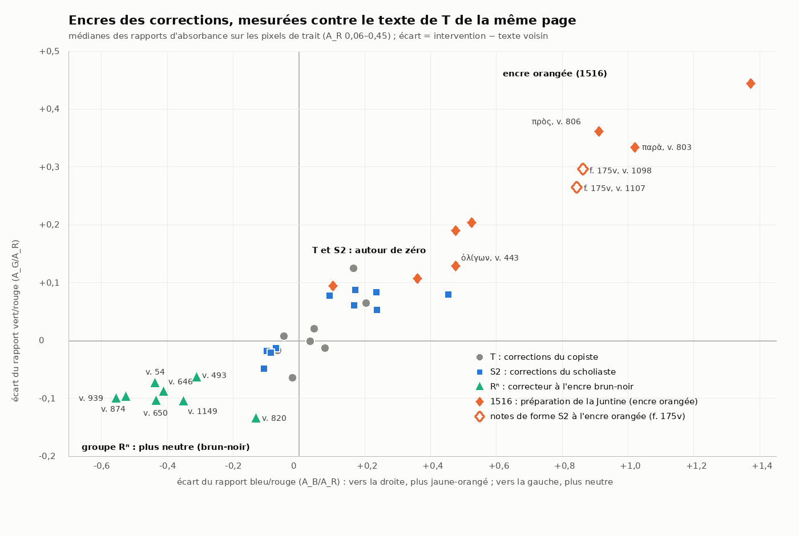

#### 6.1.3 Repères de datation

- **M**, copié sur R vers 1505, donne un *terminus ante quem* pour toute correction dont il a la leçon, à la réserve près que Canal corrige de lui-même (§ 1.7). Il est fiable pour les lettres et les mots, peu sûr pour les accents.
- **La Juntine** donne un *terminus ante quem* pour ce qu'elle imprime. Elle n'est pas fiable pour ce qu'elle omet : elle saute le γάρ suscrit du v. 149, que M a pourtant lu (inv. f164r, vérifié dans M et dans la Juntine).
- **Invernizi 1794** imprime le κατα du v. 60 « ita liber noster » (Austin 1987, 71) : c'est un *terminus ante quem* pour cet ajout.

### 6.2 Les mains et les encres des interventions

Les mains sont définies à la partie 2. Je ne donne ici que ce qui concerne les corrections.

#### 6.2.1 Écriture et encre des corrections, par main

| Main | Écriture des corrections | Encre (Δ G/R ; Δ B/R) | Ce qu'elle fait |
|---|---|---|---|
| **T** | minuscule ronde et liée du texte ; lettres suscrites de même module | référence : de −0,06 à +0,12 ; de −0,06 à +0,20 (8 mesures) | corrections en écrivant ; relecture ; lacune laissée au v. 506 ; signaux marginaux (§ 6.3.2) |
| **S2** | semi-onciale inclinée (sigles, notes, -εῖν du v. 370) ; minuscule (§ 5.2.3) ; esprit rude anguleux « ⊢ » ; circonflexe en « ^ » | souvent un peu plus roux que T : de −0,05 à +0,09 ; de −0,11 à +0,45 (10 mesures), plages qui recouvrent celles de T | vers suppléés, lacune comblée, suscriptions, écrits sur grattage, exponctuations, accents et esprits, corrections de ses scholies, sigles abrégés, renvois |
| **R3** | écriture droite et espacée, mêlant formes majuscules et minuscules (§ 2.5) | plus neutre et plus sombre pour les lettres récrites : de −0,06 à −0,10 ; de −0,31 à −0,56 (4 mesures) ; pour les accents isolés, l'écart ne dépasse pas celui des petits signes de T | écrits sur grattage (vv. 493, 646, 874, 939) |
| **1516, encre orangée** | cursive humanistique ; sigles « imprimables » ; Η capital suscrit ; tréma sur υ | plus jaune-rouge : de +0,09 à +0,44 ; de +0,10 à +1,37 (8 mesures ; les plus faibles viennent de sigles posés sur une paragraphos de T) | sigles, repassages, grattages de sigles, paragraphoi barrées, signes d'insertion, « ; », quelques accents et lettres |
| **1516, pointe grise ou encre pâle** | traits fins, chiffres arabes humanistiques | gris neutre : G/R ≈ 1,0–1,1 ; B/R ≈ 1,2–1,5 | repères de pages de la Juntine ; barre du v. 1076 |
| **après 1516** | petite minuscule cursive très légère (κατα, v. 60) ; compendium de καί (v. 306) | brune, non distinctive (κατα) ; trop pâle pour une mesure par classes (καί) | κατα et καί suscrits (§ 6.2.5) ; effacements et grattages (§ 6.5.2) |

Je ne trouve dans la pièce aucune trace d'un correcteur du XIIIe ou du XIVe s. du type que Martin ou Clark signalent ailleurs dans le manuscrit (§ 1.6).

#### 6.2.2 Ce que l'encre permet

La règle générale est au § 2.1.3. Trois précisions pour les corrections :

1. **T et S2.** Pour une lettre ou un accent isolés, l'attribution repose sur la forme (semi-onciale, Ν majuscule, esprit en équerre, circonflexe en « ^ » chez S2) ou reste indécise : c'est la raison des 35 entrées « T ou S2 ». Au f. 173v, l'encre de S2 est un peu plus rousse à densité égale (περ, v. 938 : Δ +0,09/+0,17 ; υ de ὀλίγου, v. 935 : Δ +0,08/+0,09) ; mais ailleurs plusieurs corrections de S2 sont légèrement plus neutres que T (le ν et l'α du v. 954, -εῖν au v. 370, χ au v. 726, σι au v. 734). L'encre n'est pas un critère de main pour S2.
2. **Les grattages ne gardent pas d'encre.** Leur main est presque toujours indéterminée, d'où les 39 grattages seuls rangés en « indét. » (§ 6.3.1). Seuls le contexte (sigle de 1516 écrit sur le grattage), la chronologie (leçon de M) ou une série homogène permettent de les rattacher à une campagne.
3. **Les petits signes.** Points et accents de moins de 25 px mesurent « gris » quelle que soit la main, et, dans les auréoles d'humidité, toutes les encres glissent vers l'orangé (inv. f170r, f175v). Aucun accent isolé n'est attribué sur la seule foi de l'encre.

#### 6.2.3 Compléments sur R3

Les inventaires avaient isolé, page par page, plusieurs interventions « plus neutres » sans les relier entre elles. Elles sont réunies et jugées au § 2.5. Mesures par classes (§ 6.1.2), sur le cœur des traits :

| Page, l. | v. | Intervention | n px | G/R ; B/R | T voisin | Δ G/R ; Δ B/R |
|---|---|---|---|---|---|---|
| f. 163r, l. 17 | 54 | grave sur le second τάδε | 33 | 1,19 ; 1,51 | 1,26 ; 1,94 | −0,07 ; −0,44 |
| f. 168r, l. 28 | 493 | κιν sur grattage | 615 | 1,25 ; 1,95 | 1,32 ; 2,26 | −0,06 ; −0,31 |
| f. 170r, l. 11 | 646 | ἥκει πάλιν sur grattage | 1 390 | 1,23 ; 1,85 | 1,32 ; 2,27 | −0,09 ; −0,41 |
| f. 170r, l. 14 | 650 | aigu ajouté sur ἐγὼ | 52 | 1,22 ; 1,83 | 1,32 ; 2,27 | −0,11 ; −0,43 |
| f. 172r, l. 29 | 820 | grave ajouté sur εἰσίν | 37 | 1,18 ; 2,12 | 1,32 ; 2,25 | −0,13 ; −0,13 |
| f. 172v, l. 41 | 874 | ι de ποίου, σ gratté | 58 | 1,20 ; 1,56 | 1,29 ; 2,08 | −0,10 ; −0,53 |
| f. 173v, l. 22 | 939 | υ de ἀποδύσαντα sur grattage | 169 | 1,22 ; 1,72 | 1,32 ; 2,28 | −0,10 ; −0,56 |
| f. 176r, l. 24 | 1149 | esprit rude de ἅλσος | 26 | 1,13 ; 1,64 | 1,24 ; 1,99 | −0,11 ; −0,35 |

Par classes de densité, l'écart se maintient à chaque niveau : pour ἥκει πάλιν, 1,22–1,26 / 1,82–1,90 contre 1,29–1,32 / 2,25–2,38 pour T. Les écrits sur grattage d'autres mains ne dévient pas, ce qui écarte un effet du support gratté. L'aigu de καιρός (v. 661) va dans le même sens (Δ −0,05/−0,31), mais sur 11 px seulement. L'εῖ récrit sur grattage de ἐπιζεῖν (v. 468), que l'inventaire rapprochait de κιν, a l'encre de T à densité égale : il n'appartient pas au groupe.

Sont donc à écarter du groupe, à ce stade : le grave du v. 820, qui ne s'écarte qu'en G/R, et l'aigu du v. 661. Pour les vv. 54, 650 et 1149, qui restent possibles, le témoignage de l'image s'ajoute à celui de M : M garde l'état premier aux vv. 54 et 650, et le v. 1149 y est illisible. M n'est pas sûr pour les accents, mais il ne donne aucun appui. Velsen 1871 donne le grave du v. 54 à la « 2 m. » : l'encre n'est pas orangée (1,51, alors qu'un trait orangé de taille voisine garde sa couleur : haste du v. 1194, 3,38). Aucune superposition n'a été observée entre R3 et S2, ni entre R3 et 1516.

Planche : `graphologie/chapitres/planches/4_groupe_Rn.png` ; contrôles des formes : `graphologie/specimens/chap4/verif_f170r_l11_v646_hekei_palin_formes.png`, `graphologie/specimens/chap4/verif_f168r_l28_v493_kin.png`.

#### 6.2.4 Compléments sur la main de 1516

La campagne est décrite au § 2.6. Ses sigles passent dans la Juntine avec leurs erreurs : fausses attributions aux vv. 173, 206 et 208 (inv. f164v), et d'autres encore (§ 4.4.3).

**Corrections à l'encre orangée.**

- grave de παρὰ barré au v. 803 (Δ +0,33/+1,02 ; la branche qui barre mesure B/R 3,19, le grave de T 1,63) ;
- grave ajouté sur πρὸς au v. 806 (Δ +0,36/+0,91 ; B/R 2,62 contre 2,26 pour T) ;
- seconde boucle de ὀλίγων au v. 443 (Δ +0,13/+0,48 ; B/R 2,79 contre 2,19 pour la première boucle, écart faible sur une ligne de T déjà rousse, 2,49) ;
- grave de καὶ au v. 1097 (B/R 3,49 contre 2,32 pour T).

**Corrections d'une autre encre.** Les graves de κατὰ τὸ au v. 1180 mesurent 1,60 et 1,78, moins que T (1,89) : leur attribution à 1516 ne repose que sur Velsen 1871, et M a déjà τὸ. Le σκ tiré de ο ο ο au v. 1191 mesure à peu près comme le troisième ο, que personne n'a corrigé (2,27–2,29 contre 2,15) ou un peu plus (§ 2.6.3), sans plage orangée nette. Or M lit encore ο ο ο et la Juntine imprime Σκ : ce σκ a donc été écrit entre 1505 et 1516. L'encre orangée n'est donc pas la seule de cette campagne (`../recherche/monacensis_492.md`, § 6).

**Le v. 33 (f. 162v).** Il a trois lignes dans la marge intérieure. La ligne (a), μῶν ὁ δασυπώγων, est brune ; les lignes (b) et (c), οὐχ ἑόρακας πώ|ποτε, ainsi que le δ de δασυπώγων, sont repassées en orangé (B/R : (a) 1,91, δ 2,66, (b) 2,63, (c) 2,53, contre 2,03 pour T et 2,09 pour la scholie voisine). L'εὐ et le « ; » sont ajoutés (`graphologie/specimens/chap4/f162v_v33_marge.png`, `graphologie/specimens/chap4/f162v_v33_marge_carte_BR.png`). M omet tout le vers (Velsen 1883 : « versum omm. RG »). La Juntine l'imprime : « Μν· μῶν ὁ δασυπώγων ; Εὐ· οὐχ ἑώρακας πώποτε ; » (f. a iii v°, contrôlé), avec les sigles et la ponctuation de 1516. Le repassage a servi l'impression.

**Le v. 169 (f. 164v).** Tout le supplément est plus roux que la scholie voisine (B/R 2,11) et que T (2,00) : tiret 2,88, ὁ δ᾽ αὖ 2,54, ξενο- 2,59, κακὸς κακῶς 2,48, ποεῖ 2,62 ; seul -κλῆς ὢν l'est moins (2,25). Une autre mesure, par segments, voit un début plus orangé, mais sur une écriture trop pâle pour conclure (§ 2.6.4). M a laissé un blanc à la place de δ᾽ αὖ, ajouté ensuite en marge. Le v. 169 a pu être repassé en entier, ou écrit d'une encre plus rousse : le repassage y reste douteux (`graphologie/specimens/chap4/verif_f164v_v169_carteBR.png`).

**Les contours bruns ne prouvent rien.** L'inventaire du f. 176v voit des pixels bruns sur les contours du κη^δ du v. 1207. Les sigles orangés de 1516 de la même page (σκ, l. 17 et 19) ont eux aussi des contours « bruns » (52 % et 31 % des pixels de bord, contre 55 %) : c'est un effet du bord du trait et de la compression (§ 2.1.3 d).

**Matières.** La préparation de 1516 emploie au moins deux matières. Au f. 175r, la paragraphos du v. 1076 est barrée d'un trait gris ; au f. 165r, les barres des vv. 232 et 234 ne sont pas orangées (§ 2.6.3). La distinction ne se réduit pas à « sigles à l'encre, repères à la pointe ». Il peut s'agir d'une seule main en plusieurs passes ou de deux mains (§ 2.6.6).

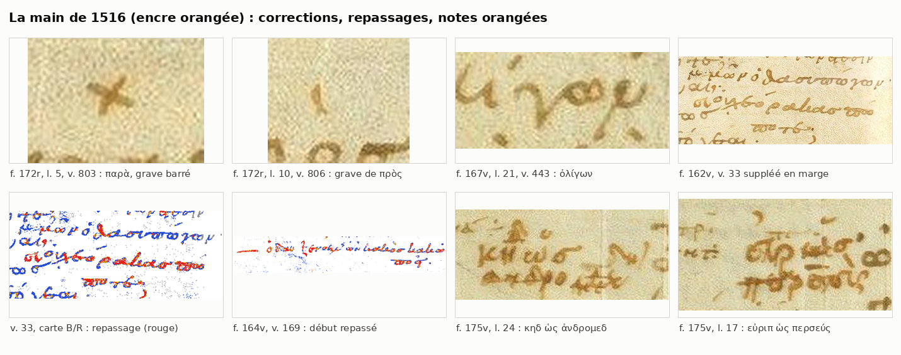

#### 6.2.5 Ajouts postérieurs à 1516 : κατα (v. 60) et καί (v. 306)

Deux suscriptions de mots manquent à la fois dans M et dans la Juntine.

- **v. 60, κατα suscrit** (f. 163r, l. 24 ; `graphologie/specimens/chap4/f163r_l24_v60_kata_suscrit.png`). M lit « τοῦ καλλιεποῦς τοῦ θριγκοῦ » sans κατά (f. 2r, contrôlé). L'écriture est une très petite minuscule cursive, légère, penchée ; l'encre brune n'est pas distinctive à la mesure (G/R 1,24 ; B/R 2,03 contre 1,28 ; 1,97). Velsen 1871 et 1883 l'attribuent à la main des scholies ; Austin 1987, 71 y voit une conjecture moderne, imprimée d'abord par Invernizi en 1794.
- **v. 306, compendium de καί suscrit** (f. 166r, l. 13 ; `graphologie/specimens/chap4/f166r_l13_v306_kai_suscrit.png`). M lit « καὶ τὴν δρῶσαν τὴν ἀγορεύουσαν » sans second καί (f. 5v, contrôlé). Le signe est très pâle et n'est pas orangé. Velsen 1871 le donne à la « 2 m. ».

La réserve qu'imposent les omissions de M vaut pour les vers et les notes en marge, non pour les suscriptions : M reprend les dix-huit suscriptions de S2 du § 6.3.3. Hors de la couche de 1516, κατα et καί sont, avec δεῦρ᾽ ὦ (v. 634, attribution faible), les seuls ajouts interlinéaires que M n'ait pas. Je les tiens donc pour postérieurs à 1516, et antérieurs à 1794 pour κατα : Austin a raison contre Velsen. Le § 2.7.4 donne l'attribution que permet l'image seule (`R?`).

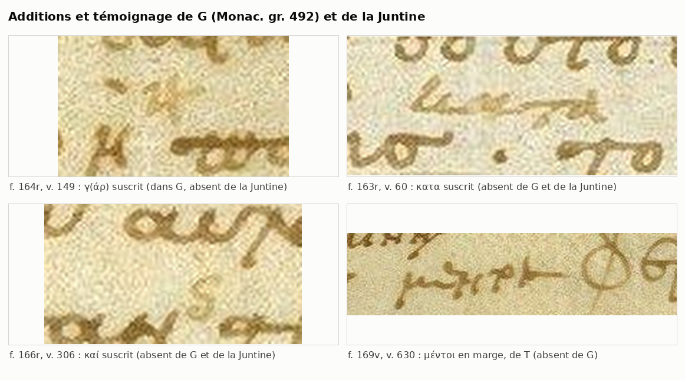

### 6.3 Typologie

#### 6.3.1 Bilan chiffré

Le tableau croise le procédé et la main pour les 351 entrées du répertoire A, dans le classement des inventaires revus ; les décisions prises depuis (v. 222, § 2.6.3 ; κατα et καί, § 6.2.5) n'en changent que quelques unités. Une entrée qui associe deux procédés est comptée au premier dans l'ordre du tableau. Les colonnes « T + S2 » et « S2 + 1516 » réunissent les cas où deux mains interviennent sur le même objet : par exemple, une biffure de T avec les points d'exponctuation de S2, ou un vers suppléé par S2 et repassé en 1516. La colonne « S2 (Velsen seul) » regroupe les attributions à R² que l'image ne permet ni de confirmer ni d'exclure.

| Procédé | T | T + S2 | T ou S2 | S2 | S2 + 1516 | S2 (Velsen seul) | R3 | 1516 | post-M | moderne | indét. | Total |
|---|---|---|---|---|---|---|---|---|---|---|---|---|
| ajout marginal (vers, mot, lacune) | 2 | · | · | 3 | 2 | · | · | · | · | · | · | 7 |
| ajout suprascrit | 7 | 1 | 7 | 18 | · | 3 | · | · | 2 | · | 2 | 40 |
| grattage + récriture | 4 | 1 | 2 | 6 | · | 2 | 4 | · | · | · | 2 | 21 |
| grattage seul | 1 | · | 2 | 5 | · | 6 | · | · | · | · | 39 | 53 |
| surcharge (sans grattage) | 5 | 1 | 8 | 9 | · | 5 | · | 2 | · | · | 5 | 35 |
| biffure, exponctuation, frottis | 9 | 3 | 1 | 4 | · | 2 | · | 1 | · | · | 3 | 23 |
| accent, esprit (sans grattage) | 10 | · | 12 | 14 | · | 18 | 5 | 6 | · | · | 32 | 97 |
| ponctuation | · | · | · | · | · | · | · | 4 | · | · | 1 | 5 |
| signes (renvois, insertion, signal) | 2 | · | 3 | 1 | 3 | · | · | 5 | · | · | 4 | 18 |
| marques de locuteur (dans les tableaux d'interventions) | 2 | · | · | · | 2 | · | · | 22 | · | · | 3 | 29 |
| repères d'impression, lecteurs | · | · | · | · | · | · | · | 3 | · | 2 | · | 5 |
| correction de Velsen non visible | 2 | · | · | · | · | 1 | · | · | · | · | 15 | 18 |
| **Total** | **44** | **6** | **35** | **60** | **7** | **37** | **9** | **43** | **2** | **2** | **106** | **351** |

Par objet, les accents et les esprits représentent 142 entrées, autant que les lettres et les mots (142). Viennent ensuite les marques de locuteur (29), les signes (18), les vers et lignes entières (6), la ponctuation (5), les repères (5) et les scholies (4). Sur les 351 entrées, 51 ne reposent que sur Velsen : la correction qu'il signale ne se voit pas sur la photographie, même si le signe actuel est visible.

#### 6.3.2 Les corrections de T

**En écrivant.** Une biffure suivie du bon mot sur la même ligne prouve la correction *currente calamo*. On en trouve sept exemples :

- ἐξ ⟦ἐλέγχων⟧ ἔλαχον (v. 1071a, f. 175r) ;
- ⟦τί⟧ φέρε (v. 768, f. 171v) ;
- ⟦τὸ⟧ δὸς (v. 754, f. 171r) ;
- la dittographie ἅπασιν ⟦ἅπασιν⟧ (v. 669, f. 170r) ;
- κρο⟦τ⟧κωτῶι et ψό⟦ι⟧γον (vv. 138, 146, f. 164r) ;
- δέξασ⟦δ⟧θε (v. 779, f. 171v).

Au f. 172v (v. 855), le δ superflu de νειλου δ μὲν est effacé, probablement par un frottis à l'encre encore fraîche. Trois anticipations du texte suivant sont abandonnées :

- la ligne « παῖ᾽ ἦν προσήει τίς » au f. 173v (l. 15, v. 934) ;
- ἱστιοφόρον au v. 935, le bon mot ἱστιορράφος étant copié à la ligne suivante ;
- παυ, amorce de Παύσων au v. 948.

La biffure est de T pour les deux premières. Pour παυ, comme pour γε au v. 942, la barre a une encre de type S2 (inventaire du f. 173v). Les points d'exponctuation des deux premières sont de S2 selon Velsen 1883 (pour ἱστιοφόρον : « quod delevit R, expunxit R² »).

**En relecture.** T ajoute au-dessus de la ligne la lettre ou le mot omis, dans son module et son encre :

- τ de τιτθία (v. 143) ; ὢν (v. 170) ; κ de ἐκ^κλησίαν (v. 375) ;
- η sur ει de εἰσέφερε, avec grattage du σ (v. 512) ;
- κ sur le γ de ἔγμαγμα (v. 514) ; ν sur le ρ de ἂρ (v. 549) ;
- ν de ἀποστερουμένη^ν (v. 698) ; κ de κα^κ^κάσκι (v. 1089) ; θ de πα^θ^ρνον (v. 1105).

Il écrit aussi en marge : μέντοι au v. 630 (`graphologie/specimens/chap4/f169v_l38_v630_mentoi_T.png`, `graphologie/specimens/chap4/verif_f169v_l38_v630_mentoi.png`) ; τὼ ajouté en tête du v. 1183, hors justification. Pour μέντοι, la main de T est probable, non prouvée. L'encre est celle de T (Δ +0,03/+0,11), mais elle ne départage pas T et S2 (§ 6.2.2). C'est la forme qui décide : une petite minuscule rapide, de module inférieur au texte, avec le μ à longue haste de T, et non la minuscule penchée de grand module des vers suppléés par S2.

**Lacune et signaux.** Au v. 506, T laisse un blanc que S2 comble par βοώιη. Il laisse aussi des **signaux** au correcteur, sans corriger lui-même (attribution d'Allen 1896 ; voir la réserve ci-dessous) :

- signe incliné à crochet après ὠϋριπίδη au v. 4 (f. 162v) ;
- « ⋎ » arrondi devant le v. 807, au f. 172r (la faute présumée est στρατωνίκην, Allen 1896, 317) ;
- « √ » pointé au v. 1135, au f. 176r ;
- trait oblique en « √ » au v. 1176, au f. 176v (main probable).

Ce sont les seuls signaux relevés par les inventaires. Tous les autres « + » des bandes de sigles sont des paragraphoi barrées (tableau B). Les quatre signes sont de la même famille : un trait oblique ou en « √ », flanqué de deux points. Leur attribution à T vient d'Allen 1896 et ne se vérifie pas à l'image. Aux vv. 1135 et 1176, le signe touche le σκυ^θ de S2 et en a l'encre pâle : S2 n'est pas exclu.

#### 6.3.3 Les corrections de S2

**Vers omis.** Les quatre omissions de vers entiers sont suppléées en marge. La littérature les donne toutes à S2 ; pour la forme, voir le § 2.3.2. Deux sont des sauts du même au même : le v. 169 et les vv. 1102–1103 (d'après les inventaires) :

| v. | Page | Remarque |
|---|---|---|
| 33 | f. 162v, marge droite | sigle μ· de S2 ; repassé en partie en 1516, qui ajoute εὐ et « ; » |
| 169 | f. 164v, marge extérieure | croix de renvoi de S2 prolongée par un trait de 1516 ; supplément roux d'un bout à l'autre, repassage en 1516 incertain |
| 647 | f. 170r, marge droite | encadré par des ÷ de renvoi ; ἰσθμὸν corrigé (ο sur une trace abrasée) |
| 1102–1103 | f. 175v, marge inférieure | signe de renvoi « —+:— » / « +: » ; jargon du Scythe normalisé (γοργόνος, κεφαλῆ) |

**Suscriptions.** S2 rétablit des lettres et des mots :

- γ(άρ) (v. 149), κα (v. 151), θ (v. 155) ;
- ν de ὀῦ^ν (v. 263) ; πο de οὐπώ^πο^τε (v. 434) ; μ de ἧ ^μ ἄλισθ᾽ (v. 376) ;
- τα de ἔπει^τα (v. 557) ; ν de φράσω^ν (v. 579) ; Η de ἀφῆτ᾽ (v. 693) ;
- χ de χρῆν (v. 726) ; σι de περ^σι^κὰς (v. 734) ;
- τινα au-dessus de ποτε barré (v. 833) ; περ de καί^περ (v. 938) ; ν et α de ποσί^ν ^ἄ^γ᾽ (v. 954) ;
- ν de κακοδαίμω^ν (v. 1006) ; οι de ἀποκεκόψοι (v. 1127) ; σι de ἀνθρώποι^σι (v. 1116) ; ζ de ἔφρα^ζ^ον (v. 1173).

**Écrits sur grattage.**

- αι de λαικάζει (v. 57b) ;
- Β onciale de βάρβιτος (v. 137), récrite sur une autre lettre ;
- -εῖν onciale de παραστατεῖν (v. 370 ; M a « ατ in correct. », d'après Velsen 1883) ;
- υ de ὀλίγου (v. 935) ;
- τ de στεριπὸ (v. 1185 ; « στεριπὸ est in G ») ;
- πόψετ de ἐπόψεται (v. 1049, attribution de Velsen).

**Exponctuations.** Le second λ de σαλλαβακχοῦσ (v. 805) ; la ligne « στυγνᾶς ὦσσε », écrite par T dans la colonne après le v. 1142 et exponctuée (selon Velsen 1883, par R²).

**Ses propres scholies.** S2 y corrige au fil de la plume : δαίμων tiré de δαίμον (spartie 399), ἀμφ- au-dessus de ⟦ενε⟧ (spartie 2044), προ et ν suscrits (f. 175r), rature dans ἱερεί[..]αις (sch. 758).

Les leçons de M montrent que ces corrections sont antérieures à 1505 : τάδ᾽ (v. 355), καὶ περ (v. 938), ποσὶν ἄγ᾽ (v. 954), ἀποκεκοψο (v. 1127), το κεπαλῆς (v. 1126), στεριπὸ (v. 1185), d'après Velsen 1883.

#### 6.3.4 Les accents : une correction de grammairien

Les accents et les esprits forment 40 % du répertoire (142 entrées sur 351), autant que les lettres et les mots. Trois séries se dégagent.

1. **L'« accent en V » : un aigu ajouté au grave, sans grattage.** Il touche les oxytons devant une pause ou un enclitique :
   - θεώ, σύ, ἐγώ (vv. 594, 603, 604, f. 169v) ;
   - ἐγώ et καιρός (vv. 650, 661, f. 170r) ;
   - ἀεί (v. 576) ; κακόν (v. 335) ; δυσμενής (v. 757) ;
   - καινόν, ἁγνήν, εἰκός (vv. 967, 971, 974, f. 174r) ;
   - en croix : κακόν (v. 195), σεαυτόν (v. 234), πόντου (v. 44), τουτί (v. 73).

   Le correcteur applique la règle de l'oxyton à la pause et laisse visible le grave de T. La forme n'est pas uniforme. Aux vv. 594, 603, 604, 967 et 974, l'accent est un « ✓ » soudé : un trait court et épais, prolongé par un délié capillaire montant. Les aigus ordinaires de T sur les mêmes lignes sont des traits simples, ce qui confirme une correction. Au v. 650, au contraire, deux traits séparés et de même poids forment un « \ / ». Au v. 650, l'aigu a une encre plus neutre que le grave voisin, qui a celle de T ; R3 n'y est pourtant que possible (§ 2.5). Au v. 661, 11 px ne suffisent pas, et les déliés des « ✓ » sont trop fins pour être mesurés. Partout, on reste entre T relisant, S2 et R3.
2. **Le sens inverse : un grave ajouté contre l'aigu de T.** C'est le cas de εἰσὶν (v. 820 ; l'encre du grave n'est plus neutre que celle de T qu'en G/R, ce qui ne suffit pas à le donner à R3) et de στρατηγὸν (v. 833).
3. **Accents grattés.** Un grave ou un circonflexe est supprimé sur les enclitiques et les monosyllabes : εἰμι (v. 190), ἐστιν (vv. 904, 1172), γαρ (v. 898), νη (v. 745 ; v. 623 selon Velsen seul), ὁς (v. 621, selon Velsen seul). Un second accent est supprimé : ἀνταυγεῖς (v. 902), ὕμνων (v. 124), ἀπόλλω (v. 748), τιμοκλεῖ (v. 373), ἡμῖν changé en ἥμιν (v. 376). Ces grattages ne gardent pas d'encre. Le correcteur est indéterminé, mais la correction est systématique et de même esprit que la série 1 : une normalisation grammaticale de l'accentuation de T.

À cela s'ajoutent des accents et des esprits simplement **ajoutés** sur des mots que T n'accentuait pas : huit au f. 174r, plusieurs aux ff. 173r, 173v, 174v, 176v. Velsen 1883 les donne à R². Ils sont minces, souvent hauts placés, et l'encre ne tranche pas (§ 6.2.2).

#### 6.3.5 Ponctuation, signes, marques de locuteur

**Ponctuation.** La main de 1516 transforme le point en « ; » par une virgule orangée aux vv. 193 et 252, et ajoute le « ; » du v. 33 ; au v. 222, la virgule est brune et sa main indécise (§ 2.6.3). Le dicolon du v. 32 est gratté, probablement par elle.

**Signes.** Les renvois de S2 entre le texte et les scholies (∈, ·϶·, ✕ au f. 164r ; ·×· au f. 169r ; ·✓· au f. 166v ; flèche au f. 171v) contredisent l'absence de renvois que la littérature prête à S2 (Orsini 2011, 328 ; Zacher 1888, 536, d'après le dossier). La main de 1516 ajoute des signes d'insertion (« ^ », « √ ») qui renvoient à ses sigles marginaux : vv. 216, 222, 224, 1179, 1187.

**Marques de locuteur.** Voir le tableau B. La main de 1516 y est l'agent principal :

- sigles écrits sur les sigles grattés de S2 (vv. 34, 173, 211, 295, 380, 466, 907–908) ;
- repassages ;
- paragraphoi barrées d'une haste quand la Juntine ne veut pas de changement de locuteur (vv. 232, 234, 246, 264, 273, 274, 1076a, 1078a, 1092b, 1093, 1095, 1184, 1194, 1195, 1204, 1221). La haste est orangée aux vv. 1194 et 1204 (vérifié : B/R 3,38 et 2,53, contre 2,08 et 1,69 pour la paragraphos). Elle est grise ou brun pâle aux vv. 232 et 234 (1,93 et 1,83, comme la paragraphos, alors que le sigle orangé voisin mesure 2,69) et au v. 1076a. Là, l'attribution à 1516 repose sur Velsen 1871 (« — I m. del. 2 m. »).

La barre du v. 608 annule à tort un changement de locuteur réel. Elle n'est pas de 1516 : sa haste a l'encre brune de la paragraphos (B/R 2,09 contre 2,37), alors que le κλ orangé de 1516, juste à côté, mesure 3,90. Velsen 1871 écrit « ipsa I m. delevit » (tableau B).

---

### 6.4 Répertoire page par page

#### 6.4.A Interventions dans le texte et les marges

Chaque tableau reprend, abrégée, la description de l'inventaire de la page. J'ai ajouté, en gras, mes propres contrôles et rectifications.

- **Colonnes.** Procédé : « add. supra » = ajout suprascrit ; « add. marg. » = ajout marginal ; « ras. » = grattage ; « ras. + écr. » = écrit sur grattage ; « surch. » = surcharge sans grattage ; « biff. » = biffure ; « expunct. » = exponctuation ; « acc. » = accent ou esprit ; « loc. » = marque de locuteur ; « impr. » = repère d'impression. La colonne « Cert. » reprend la certitude de l'inventaire ; « Velsen seul » signale une correction que seule l'édition de Velsen atteste.
- **Mains.** « T/S2 » = T ou S2 ; « S2 (Velsen) » = attribution de Velsen 1883 que l'image ne départage pas ; « S2 + 1516 » = écrit par S2, retouché en 1516 ; « tardive ? » = postérieure à M.
- **Spécimens.** Le nom de fichier renvoie au dossier `graphologie/specimens/<page>/`, indiqué en tête de chaque page.

##### f162v

Spécimens : `graphologie/specimens/f162v/`.

| l. | v. | Intervention | Procédé | Objet | Main | Cert. | Spécimen |
|---|---|---|---|---|---|---|---|
| 5 | 4 | marge droite après ὠϋριπίδη — signal ÷ incliné à crochet (le « √ » d'Allen), sans correction | signe | signe | T | moyenne | f162v_l05_signal_obele.jpg |
| 7 | 6 | παρεστώς — aigu à tête épaissie ; « corr. ex -ὼς » (Velsen) non démontrable | acc. | accent/esprit | T | faible ; Velsen seul | f162v_l07_parestos_accent.png |
|  | 6-7 | interligne 7/8, milieu de la colonne — marque « ·ʃ· » (chiffre 5 encadré de points ? renvoi ?) | signe | signe | indét. | faible | f162v_l07_08_marque_interlineaire.png |
| 13 | 12 | ἴσθ᾽ — ι final surchargé en croix, devenu apostrophe | surch. | lettre/mot | T/S2 | moyenne | f162v_l13_isth_corr.png |
| 17 | 16 | ᾧ — petit esprit rude ajouté à gauche du circonflexe | acc. | accent/esprit | S2 | moyenne | f162v_l17_omega_esprit.png |
| 21 | 20 | τουτὶ — circonflexe gratté sur -ου- | ras. | accent/esprit | indét. | haute (grattage) | f162v_l21_touti_rasura.png |
| 23 | 22 | ἐμοῦ — υ refait sur ι, accent récrit (« corr. ex ἐμοί ») | surch. | lettre/mot | T | moyenne | f162v_l23_emou_corr.png |
| 24 | 23 | ἐξεύροιμ᾽ — changement d'esprit (Velsen) non vérifiable | acc. | accent/esprit | indét. | faible ; Velsen seul | f162v_l24_exeuroim_esprit.png |
| 26 | 25 | tête du vers — sigle gratté (Velsen) : fond rugueux, sans encre | loc. | locuteur | 1516 ? | faible | f162v_l26_tete_rasura.png |
| 26 | 25 | ἰδού — correction de grave en aigu (Velsen) non visible | acc. | accent/esprit | T | faible ; Velsen seul | f162v_l26_mnh_idou.png |
| 28-31 | 27-30 | marge droite — lettres numérales α, γ, δ, β rétablissant l'ordre des vers | signe | signe | S2 + 1516 | moyenne | f162v_numerales_alpha_delta.png |
| 33 | 32 | entre τις· et οὐχ᾽ — dicolon gratté | ponct. | ponctuation | 1516 | moyenne | f162v_l33_dicolon_rasura.png |
|  | 33 | marge droite — vers suppléé en 3 lignes, en partie repassé ; εὐ et « ; » ajoutés **[Contrôle : lignes (b)-(c) et δ repassés en orangé ; v. 33 absent de M, imprimé par la Juntine avec Μν·/Εὐ· et « ; ».]** | add. marg. | vers/ligne | S2 + 1516 | moyenne | f162v_v33_marge.png |
| 34 | 34 | καὶ μέγ᾽ — ι gratté (Velsen) : trace grise | ras. | lettre/mot | indét. | faible | f162v_l34_kai_rasura.png |
| 35 | 35 | βεβίνηκας — β refait sur α (Velsen) ? tracé un peu plus dense | surch. | lettre/mot | T | faible | f162v_l35_bebinekas.png |
| 36 | 36 | πτήξωμεν — finale -μεν récrite sur -μαι | surch. | lettre/mot | T/S2 | moyenne | f162v_l36_ptexomen.png |
| 40 | 40 | συγκλείσας — aigu épais en coin sur un circonflexe | acc. | accent/esprit | S2 | moyenne | f162v_l40_synkleisas_accent.png |

##### f163r

Spécimens : `graphologie/specimens/f163r/`.

| l. | v. | Intervention | Procédé | Objet | Main | Cert. | Spécimen |
|---|---|---|---|---|---|---|---|
| 1 | 43 | πνοὰσ — grave épais ; trace angulaire pâle au-dessus (circonflexe gratté ?) | ras. | accent/esprit | indét. | incertaine | f163r_l01_pnoas_accent.jpg |
| 2 | 44 | πόντου — accents croisés : l'état πὸντού est corrigé en πόντου | acc. | accent/esprit | T/S2 | probable | f163r_l02_ponto_accents_corriges.jpg |
| 5 | 45c | λέγει — rasure de la fin du mot ; seuls des résidus bruns y restent | ras. | lettre/mot | indét. | probable (rasure) | f163r_l05_legei_grattage.jpg |
| 6 | 46 | κατακοιμάσθω — grave gratté sur κατα ? | ras. | accent/esprit | indét. | incertaine | f163r_l06_kata_grave_gratte_bleu.jpg |
| 17 | 54 | 1er τάδε — grave sur δε | acc. | accent/esprit | T/S2 | incertaine | f163r_l17_tade_grave.jpg |
| 17 | 54 | 2e τάδε — grave brun-noir sur δε ; hachures sur l'α (aigu gratté ?) **[Contrôle : encre brun-noir, Δ −0,07/−0,44 à densité égale : groupe R3.] [Contrôle : trace dense de 35 px, non orangée ; un point de T de la même ligne mesure de même (1,14/1,60 contre 1,19/1,51) : R3 possible, non démontré.]** | acc. | accent/esprit | R3 ? | possible (encre non concluante) | f163r_l17_tade2_grave_sombre.jpg |
| 21 | 57b | λαικάζει — αι sur rasure (état premier λεκ- ?) | ras. + écr. | lettre/mot | S2 | probable | f163r_l21_ai_sur_grattage.jpg |
| 24 | 60 | καλλιεποῦσ ^κατα^ τοῦ — κατα suscrit en petite minuscule **[Contrôle : encre non distincte de T ; κατα absent de M (f. 2r, contrôlé) et de la Juntine.]** | add. supra | lettre/mot | post-1516 (§ 6.2.5) | sûre ; main incertaine | f163r_l24_kata_suscrit.jpg |
| 27 | 63 | ὢν — accent empâté par surcharge (ὧν → ὢν) | surch. | accent/esprit | S2 | probable | f163r_l27_on_accent.jpg |
| 33 | 69 | πρ-, Η de προΐῃ — encre plus dense | surch. | lettre/mot | T | incertaine | f163r_l33_encre_dense.jpg |
| 37 | 73 | τουτί — grave et aigu superposés en V | acc. | accent/esprit | indét. | probable | f163r_l37_touti_accents.jpg |
| 39 | 75 | paragraphos — biffure ondulée | loc. | locuteur | 1516 | probable | f163r_l39_42_sigles_XVIe.jpg |
| 9–15, 21, 22, 27, 41 | 48b–52, 57b, 58, 63, 77 | sigles — effacements : lavage aux ll. 9–15, grattage aux ll. 21 et 41 | loc. | locuteur | indét. (1516 ?) | probable ; incertaine pour les ll […] | f163r_l09_15_sigles_effaces_ds.jpg |

##### f163v

Spécimens : `graphologie/specimens/f163v/`.

| l. | v. | Intervention | Procédé | Objet | Main | Cert. | Spécimen |
|---|---|---|---|---|---|---|---|
| 9 | 88 | τραγωδωδιδάσκαλον corrigé en τραγωδο- : seconde boucle de l'ω comblée ou surchargée | surch. | lettre/mot | S2 ? | correction certaine ; main probable | f163v_l09_tragodo_correction_hyphen.png |
| 9 | 88 | long trait ondulé sous τραγωδο\|διδάσκαλον, écrit en deux mots (trait de liaison, ὑφέν ?) | signe | signe | T/S2 | probable | f163v_l09_tragodo_correction_hyphen.png |
| 15 | 94 | πυραμούς → πυραμοῦς : circonflexe ajouté, aigu biffé d'un petit trait (x) | biff. | accent/esprit | indét. | correction certaine | f163v_l15_pyramous_accent.png |
| 17 | 96 | esprit de οὑκ- en amas très dense, sans doute repassé (doux → rude ?) | surch. | accent/esprit | indét. | possible | f163v_l17_esprit_oukk.png |
| 18 | 97 | τυφλός → τυφλὸς et μὲν → μέν (Velsen 1883) | acc. | accent/esprit | indét. | douteuse | f163v_l18_tyflos_men.png |
| 28 | 107 | blanc d'environ 80 px avant ἄγε : ἀλλ᾽ gratté selon Velsen 1883 | ras. | lettre/mot | indét. | grattage probable ; texte gratté […] | f163v_l28_blanc_avant_age.png |
| 16 | 95 | μ^ν suscrit dans l'interligne au-dessus de -γα τί | loc. | locuteur | 1516 | certain (compté aussi en c) | f163v_l16_mu_nu_suscrit_v95.png |

##### f164r

Spécimens : `graphologie/specimens/f164r/`.

| l. | v. | Intervention | Procédé | Objet | Main | Cert. | Spécimen |
|---|---|---|---|---|---|---|---|
| 2 | 124 | ὕμνων : deux points pâles au-dessus de -νω-, restes d'un circonflexe gratté (corr. ex ὑμνῶν, Velsen 1883) | ras. | accent/esprit | T/S2 | possible | f164r_l02_hymnon_circonflexe_gratte.jpg |
| 8 | parép. | soulignement rouge pâle sous « -ζεις γέρων » | lecteur | repère | moderne | certaine (trait) | f164r_l08_trait_rouge_ds.jpg |
| 13 | 134 | ε de εἴ repassé, plus dense (« ε in εἴ ex corr. ») | surch. | lettre/mot | T/S2 | probable | f164r_l13_ei_correction.jpg |
| 16 | 137 | βάρβιτος : premier β en B onciale récrit sur une lettre (σ selon Velsen) ; le second β est le β « en u » de T | ras. + écr. | lettre/mot | S2 | probable | f164r_l16_barbitos_B_corrige.jpg |
| 17 | 138 | κρο⟦τ⟧κωτῶι : lettre biffée en croix dans un blanc | biff. | lettre/mot | T | probable | f164r_l17_kro_tau_biffe.jpg |
| 17 | 138 | κεκρυφάλωι : αι de καί récrit en ε, empâtement ; aigu résiduel de καί | surch. | lettre/mot | S2 | probable | f164r_l17_kekryphalo_surcharge.jpg |
| 22 | 143 | τιτθία : τ suscrit | add. supra | lettre/mot | T | probable | f164r_l22_titthia_tau_suscrit.jpg |
| 25 | 146 | ψό⟦ι⟧γον : ι biffé d'un trait (aspect de croix ou de ψ) | biff. | lettre/mot | T | probable | f164r_l25_psogon_iota_biffe.jpg |
| 28 | 149 | χρὴ ^γ(ὰρ) ποητὴν : compendium suscrit pâle (γ prolongé d'un trait horizontal) ; absent de la Juntine, présent dans M **[Contrôle : signe très pâle ; γάρ présent dans M, absent de la Juntine.]** | add. supra | lettre/mot | S2 | probable | f164r_l28_gar_suscrit.jpg |
| 30 | 151 | αὐτί^κα : κα suscrit en minuscule ; accents de γυναικεῖ' ἢν (Velsen : R²) non attribuables à l'œil | add. supra | lettre/mot | S2 | probable | f164r_l30_ka_suscrit.jpg |
| 34 | 155 | τοῦ^θ' ἃ δ' οὐ : θ suscrit et apostrophe | add. supra | lettre/mot | S2 | probable | f164r_l34_touth_theta_suscrit.jpg |
| 37 | 158 | ἐγώ : aigu à tête épaissie (corr. ex ἐγὼ selon Velsen), sans grave visible | acc. | accent/esprit | indét. | possible | f164r_l37_ego_accent.jpg |
| 38 | 159 | ἄλλ' ως (corr. ex ὡς) et ἐστι (corr. ex ἐστιν) selon Velsen | non visible | lettre/mot | indét. | non visibles ; Velsen seul | f164r_l38_allos.jpg |

##### f164v

Spécimens : `graphologie/specimens/f164v/`.

| l. | v. | Intervention | Procédé | Objet | Main | Cert. | Spécimen |
|---|---|---|---|---|---|---|---|
| 2 | 166 | sigle gratté (Velsen 1883) ; zone abrasée, résidus ponctuels | loc. | locuteur | 1516 | possible | l02_zone_grattee_166.jpg |
| 4 | 168–169 | renvoi : croix « × » pointée après ποεῖ·, prolongée par un long trait | signe | signe | S2 + 1516 | probable | l04_signe_renvoi.jpg |
| marge, l. 5–6 | 169 | vers omis par T (saut du même au même), suppléé : ὁ δ᾽ αὖ ξενοκλῆς ὢν κακὸς κακῶς / ποεῖ· **[Contrôle : tout le supplément est plus roux que la scholie voisine (B/R 2,25–2,88 contre 2,11), ποεῖ (2,62) autant que le début ; le repassage limité au début n'est pas établi.]** | add. marg. | vers/ligne | S2 + 1516 | écriture S2 probable ; repassage […] | mg_v169.jpg |
| 5 | 170 | ὢν omis, ajouté au-dessus de la ligne | add. supra | lettre/mot | T | probable | l05_on_supra.jpg |
| 8 | 173 | sigle gratté, remplacé par ἀγ | loc. | locuteur | 1516 | certain | l08_sigle_ag_rasura.jpg |
| 23 | 188 | παρών : aigu (corr. ex παρὼν, Velsen) ; aucune trace du grave | acc. | accent/esprit | T/S2 | possible | l23_parwn_accent.jpg |
| 25 | 190 | εἰμὶ → εἰμι : accent grave gratté au-dessus du ι final (résidu pâle) | ras. | accent/esprit | indét. | probable | l25_eimi_accent_gratte.jpg |
| 28 | 193 | « ; » final : virgule orangée ajoutée sous un point | ponct. | ponctuation | 1516 | probable | l28_point_interrogation_1516.jpg |
| 30 | 195 | κακὸν → κακόν : aigu tracé sur le grave (accent en croix) | acc. | accent/esprit | T/S2 | probable | l30_kakon_accent_corrige.jpg |
| 30 | 195 | grattage d'une lettre ou d'un signe entre ἐλπίσης et τὸ | ras. | lettre/mot | indét. | probable | l30_rasura_elpises.jpg |

##### f165r

Spécimens : `graphologie/specimens/f165r/`.

| l. | v. | Intervention | Procédé | Objet | Main | Cert. | Spécimen |
|---|---|---|---|---|---|---|---|
| 2 | 210 | marge des sigles — sigle μνη^σ (lettres superposées) repassé ou récrit | loc. | locuteur | S2 + 1516 | possible | l02_sigle_mnes.jpg |
| 3 | 211 | marge des sigles — εὐ écrit sur une plage grattée | loc. | locuteur | 1516 | probable | l03_eu_sur_grattage.jpg |
| 8 | 216 | ἀφεύειν ^ ἀλλὰ — signe d'insertion | signe | signe | 1516 | probable | l08_signe_insertion.jpg |
| 12 | 220 | εἶ — circonflexe pointu au-dessus de la ligature ει | acc. | accent/esprit | S2 (Velsen) | possible | l12_eis_circonflexe.jpg |
| 14 | 222 | κέκραγας ; — virgule ajoutée au point inférieur du dicolon, qui devient « ; » | ponct. | ponctuation | indét. (1516 selon Velsen 1871 ; virgule brune, § 2.6.3) | possible | l14_kekragas_point_interrogation.jpg |
| 14 | 222 | ὤιμοι √ τί — signe d'insertion en coche | signe | signe | 1516 | probable | l14_signe_insertion_v.jpg |
| 16 | 224 | θεῖσ ^ εἰσ — signe d'insertion | signe | signe | 1516 | probable | l16_signe_insertion_zoom.jpg |
| 24, 26, 38 | 232, 234, 246 | bande des sigles — paragraphos de T barrée d'un trait vertical **[Contrôle : hastes des vv. 232 et 234 non orangées (B/R 1,93 et 1,83 ; sigle orangé voisin 2,69) : 1516 d'après Velsen 1871 seulement.]** | loc. | locuteur | 1516 | probable | l24_paragraphos_barree.jpg |
| 26 | 234 | σεαυτόν — accent en croix : grave changé en aigu | surch. | accent/esprit | T/S2 | possible | l26_seauton_accent_corrige.jpg |
| 27 | 235 | ὁρᾶι^σ — petit σ suscrit ajouté | add. supra | lettre/mot | T/S2 | probable | l27_horais_sigma_suscrit.jpg |
| 37 | 245 | ἰοὺ — grave traversé (reste du circonflexe ?) | acc. | accent/esprit | S2 | possible | l37_ious_accent_corrige.jpg |
| 40 | 248 | marge intérieure — long trait horizontal (x ≈ 15–133) | signe | signe | 1516 | probable (fonction inconnue) | l40_trait_marginal.jpg |
| 23–24 | 231/232 | marge intérieure — chiffre « 14 » | impr. | repère | 1516 | probable | l23_chiffre_14_mine.jpg |

##### f165v

Spécimens : `graphologie/specimens/f165v/`.

| l. | v. | Intervention | Procédé | Objet | Main | Cert. | Spécimen |
|---|---|---|---|---|---|---|---|
| 1 | 252 | après λάβω — virgule orangée sous le point : « ; » | ponct. | ponctuation | 1516 | moyenne | f165v_l01_virgule_1516.jpg |
| 6 | 257 | δεῖ — δε → δεῖ selon Velsen 1871 (« 2 m. ») et 1883 (« aut R² aut Euphrosynus Boninus ») | non visible | lettre/mot | indét. | basse ; Velsen seul | f165v_l06_dei.jpg |
| 7 | 258 | ἣν — ἧν → ἣν selon Velsen 1871 (« 2 m. ») | non visible | accent/esprit | indét. | basse ; Velsen seul | f165v_l07_hn.jpg |
| 10 | 261 | ἐγκυκλον — grattage probable de l'ι (εγκύκλιον), « corr. R² » chez Velsen 1883 | ras. | lettre/mot | indét. | basse | f165v_l10_egkyklon.jpg |
| 10 | 261 | κλινίδος — courbe finale du σ prolongée autour des scholies intérieures : renvoi ? | signe | signe | T/S2 | basse | f165v_l10_kliniDos_courbe.jpg |
| 12 | 263 | ου → ὀῦ^ν — ν suscrit (N onciale), esprit et circonflexe ajoutés | add. supra | lettre/mot | S2 | moyenne | f165v_l12_oun_correction.jpg |
| 13, 22, 23, 26 | 264, 273, 274, parép. | zone des sigles — paragraphos de T barrée d'un trait vertical | loc. | locuteur | 1516 | haute | f165v_l22_26_croix.jpg |
| 13 | 264 | δέει — second ε récrit sur une autre lettre (δέηι selon Velsen 1883) | ras. + écr. | lettre/mot | T | moyenne | f165v_l13_deei.jpg |
| 19 | 270 | ὀμόσης, ἐμοὶ — « corr. ex ὀμόσεις », « ex ἐμοί » (Velsen 1883) | non visible | lettre/mot | indét. | basse ; Velsen seul | f165v_l19_omoses_emoi.jpg |
| 21 | 272 | διός — aigu épais, peut-être grave transformé (Velsen 1883 : « ex διὸς ») | acc. | accent/esprit | T | basse | f165v_l21_dios.jpg |
| 27 | 277 | ταχέως — « corr. ex ταχεῶς » (Velsen 1883) | non visible | accent/esprit | indét. | basse ; Velsen seul | f165v_l22_26_croix.jpg |
| 30 | 280 | θέασαι — point au-dessus de l'α : reste d'un accent gratté (θεάσαι) ? | ras. | accent/esprit | T | basse | f165v_l30_theasai.jpg |
| 32 | 282 | δέξασθέ — « corr. ex δέξασθαί » (Velsen 1883) | non visible | lettre/mot | indét. | basse ; Velsen seul | f165v_l32_dexasthe_me.jpg |
| 39 | 289 | θυγατέρα. — ν final gratté, point conservé | ras. | lettre/mot | indét. | moyenne | f165v_l39_rasura_renfort.png |
| 39 | 289 | δοκεῖν τυχεῖν — δοκεῖν biffé d'un trait continu ; τυχεῖν poussé en marge, d'une écriture plus posée (ε lunaire, Ν onciale) | biff. | lettre/mot | 1516 | moyenne | f165v_l39_dokein_biffe_tychein.jpg |
| 40 | 290 | ἄλ^λως — λ ajouté à ἄλως **[Contrôle : à densité égale, encre non distincte de T à ma mesure.]** | add. supra | lettre/mot | indét. | moyenne | f165v_l40_allos_renfort_lab.jpg |

##### f166r

Spécimens : `graphologie/specimens/f166r/`.

| l. | v. | Intervention | Procédé | Objet | Main | Cert. | Spécimen |
|---|---|---|---|---|---|---|---|
| 2 | 295 | marge gauche — sigle gratté, puis κήρυξ écrit sur le grattage | loc. | locuteur | 1516 | certaine | f166r_l02_sigle_kerux.jpg |
| 2 | 295 | εὐφημί (1er) — esprit doux ajouté, encre orangée (G/R 1,55 ; B/R 2,67) | acc. | accent/esprit | 1516 | probable | f166r_l02_esprit_eu_orange.jpg |
| 13 | 306 | δρῶσαν ^ τὴν — compendium de καί suscrit (signe en « ς ») **[Contrôle : compendium très pâle, non orangé ; καί absent de M (f. 5v, contrôlé) et de la Juntine.]** | add. supra | lettre/mot | post-1516 (§ 6.2.5) | présence certaine ; main incertaine | f166r_l13_kai_suscrit.jpg |
| 23 | 316 | ὃς — ο large et repassé, sur un ω, sans grattage visible | surch. | lettre/mot | indét. | probable | f166r_l23_hos_surcharge.jpg |
| 23 | 316 | ἱεράν — accent corrigé ? (seul un aigu est visible) | acc. | accent/esprit | indét. | douteuse | f166r_l23_hieran_accent.jpg |
| 25 | 318 | γλαυκῶπι — ο complété en ω, circonflexe ? (même encre que la ligne) | surch. | lettre/mot | S2 (Velsen) | douteuse | f166r_l25_glaukopi_omega.jpg |
| 27 | 320 | θηροφόνε — boucle droite d'un ω grattée : il reste ο, et une boucle fantôme | ras. | lettre/mot | indét. | probable | f166r_l27_therophone_omega_gratte.jpg |
| 31 | 324 | οἰστροδόνητον — petit tiret au-dessus de οι (esprit ajouté ?) | acc. | accent/esprit | S2 (Velsen) | douteuse | f166r_l31_oi_esprit.jpg |
| 34 | 327 | χρυσέα — accent corrigé ? | acc. | accent/esprit | indét. | douteuse | f166r_l34_chrusea_accents.jpg |
| 42 | 335 | κακόν — accent en « V » : l'aigu, plus gris, a été ajouté sans effacer le grave | acc. | accent/esprit | indét. | probable | f166r_l42_kakon_accent_V.jpg |
| 43 | 336 | κ^η^υρυκεύεται — petit η en « н » écrit au-dessus de l'υ, qui reste visible | add. supra | lettre/mot | T/S2 | probable | f166r_l43_eta_suscrit.jpg |
| 6 (scholie) | 299 | δαίμων (marge droite) — ο fermé changé en ω par l'ajout d'une boucle à droite, sans grattage ; même encre (1,39 / 2,25–2,37) | surch. | lettre/mot | S2 | probable | f166r_l06_scholie_daimon_omega_ex_o.jpg |

##### f166v

Spécimens : `graphologie/specimens/f166v/`.

| l. | v. | Intervention | Procédé | Objet | Main | Cert. | Spécimen |
|---|---|---|---|---|---|---|---|
| 9 | 345 | γυνή : aigu long à tête épaissie, peut-être un grave transformé (« corr. ex γυνὴ R », Velsen 1883) ; aucun grattage | acc. | accent/esprit | T/S2 | possible | f166v_l09_gyne_aigu.jpg |
| 19 | 355 | τάδ' : ο changé en α par un trait oblique appuyé qui part trop haut (« τόδ' R corr. in τάδ' R² ») | surch. | lettre/mot | S2 | probable | f166v_l19_tad_alpha.jpg |
| 34 | 370 | παραστατεῖν : -εῖν en onciale (Ε lunaire empâté, Ν majuscule, circonflexe « ^ ») sur grattage ; mêmes formes que la glose συμμαχεῖν ; leçon primitive illisible (-ῆν selon Velsen) | ras. + écr. | lettre/mot | S2 | probable (main), certain (grattage) | f166v_l34_parastatein.jpg |
| 37 | 373 | τι μόκλει : résidu gris en étoile au-dessus de λε, reste du circonflexe gratté de τιμοκλεῖ ; aigu fin sur ό, d'encre brune | ras. | accent/esprit | indét. | probable | f166v_l37_timoklei.jpg |
| 39 | 375 | ἐκ^κλησίαν : second κ suscrit, en minuscule ; même encre et même forme que le κ de la ligne | add. supra | lettre/mot | T | certain (ajout) | f166v_l39_kappa_suscrit.jpg |
| 40 | 376 | ἧ ^μ ἄλισθ' : μ minuscule suscrit (encre 1,33 ; 2,26) ; aigu fin sur ἄ, de la main des scholies selon Velsen ; la Juntine imprime « ἧν ἅλισθ' » | add. supra | scholie | S2 | certain (ajout) | f166v_l40_mu_suscrit.jpg |
| 40 | 376 | ἥμιν : circonflexe gratté sur ι (résidu gris, même aspect qu'à la l. 37) et aigu ajouté sur Η (« corr. in ἥμιν R² ») ; correction antérieure à 1516 (la Juntine a ἥμιν) | ras. | accent/esprit | S2 | probable | f166v_l40_hemin.jpg |
| 42 | 378 | ἐκεῖνον· : point simple ; le dicolon de Velsen 1883 n'est pas visible (point supérieur gratté ?) | ponct. | ponctuation | indét. | question | f166v_l42_ekeinon_point.jpg |

##### f167r

Spécimens : `graphologie/specimens/f167r/`.

| l. | v. | Intervention | Procédé | Objet | Main | Cert. | Spécimen |
|---|---|---|---|---|---|---|---|
| 1 | 380 | marge intérieure — grattage d'un sigle (γυνή τις, à en juger par M), puis récriture « Γυνὴ τίς. » | loc. | locuteur | 1516 | moyenne | f167r_l01_sigle_gyne_tis_1516.jpg |
| 9 | 388 | κακά — grave changé en aigu (Velsen 1883 : « corr. ex κακὰ R ») ; l'aigu est haut placé et empâté à son pied | surch. | accent/esprit | T | moyenne | f167r_l09_kaka_accent.jpg |
| 15 | 394 | ἀνδράσι — circonflexe changé en aigu : une petite croix, l'aigu long coupant le reste de la branche descendante | surch. | accent/esprit | S2 | moyenne | f167r_l15_andrasi_accent_croix.jpg |

##### f167v

Spécimens : `graphologie/specimens/f167v/`.

| l. | v. | Intervention | Procédé | Objet | Main | Cert. | Spécimen |
|---|---|---|---|---|---|---|---|
| 6 | 428 | τούτω — ο changé en ω par une boucle ajoutée | surch. | lettre/mot | T | moyenne | f167v_l06_toutw_correction.jpg |
| 11 | 434 | οὐπώ^πο^ τε — « πο » suscrit entre ώ et τε, sans doute avec l'aigu de ώ ; τε non effacé | add. supra | lettre/mot | S2 | haute | f167v_l11_chi_po_S2.jpg |
| 17 | 439 | διεζητημένους — trait court de l'encre de T au-dessus de l'ε ; correction « ex διἔζ- » (Velsen 1883) non visible | non visible | accent/esprit | indét. | basse ; Velsen seul | f167v_l17_diezetemenous.jpg |
| 18–20 | 440 | trait diagonal — trait de mine, de x≈430 (milieu des scholies) à x≈1670 (fin de la l. 20) ; coupe scholies et texte | impr. | repère | 1516 (mine) | moyenne | f167v_l18_trait_graphite.jpg |
| 21 | 443 | ὀλίγον → ὀλίγων — seconde boucle ajoutée à droite de l'ο **[Contrôle : boucle droite orangée, Δ +0,13/+0,48.] [Contrôle : boucle droite B/R 2,79, boucle gauche 2,19 ; écart confirmé, mais faible sur une ligne rousse (T 2,49).]** | surch. | lettre/mot | 1516 | moyenne | f167v_l21_oligwn_contraste.jpg |
| 27 | 449 | τέως — correction « ex τεὼς » (Velsen 1883) non visible : aigu sur ε, pas de grave ni de grattage sur ω | ras. | accent/esprit | indét. | basse ; Velsen seul | f167v_l27_teos.jpg |
| 34 | 456 | αὐτοστραφεὶς — esprit anguleux en croix sur l'υ, d'encre de type S2 (1,49 ; 2,83) | acc. | accent/esprit | T/S2 | basse | f167v_l34_esprit_croix.jpg |
| 36 | 458 | σὐνθηματιαίους — σ très foncé et épais, fond éclairci autour de συ (grattage probable) ; l'esprit resté sur l'υ trahit l'ancienne leçon οὐν- | ras. | lettre/mot | S2 ? | moyenne | f167v_l36_syn_grattage.jpg |

##### f168r

Spécimens : `graphologie/specimens/f168r/`.

| l. | v. | Intervention | Procédé | Objet | Main | Cert. | Spécimen |
|---|---|---|---|---|---|---|---|
| 3 | 468 | ἐπιζεῖν : εῖ (x ≈ 752–780) récrit sur grattage ; circonflexe anguleux **[Contrôle : à densité égale, encre de T ou de S2 : pas le groupe R3.]** | ras. + écr. | lettre/mot | S2 ? | reprise certaine ; leçon première […] ; Velsen seul | f168r_l03_zei_rasura_detail.jpg |
| 10 | 475 | δρώσας : aigu épais ; traces pâles d'un circonflexe | acc. | accent/esprit | S2 ? | probable | f168r_l10_drosas_accent.jpg |
| 12 | 477 | ξύνοιδ' : circonflexe gratté sur οι, aigu ajouté sur υ | ras. | accent/esprit | S2 ? | probable | f168r_l12_xynoid_accents.jpg |
| 19 | 484 | ὤνερ : première panse du ω en forme d'α (Velsen : ω corr. ex α) | surch. | lettre/mot | indét. | possible | f168r_l19_onero_omega.jpg |
| 23 | 488 | trait au graphite sous ἐρειδόμην | lecteur | repère | moderne | probable | f168r_l23_crayon_ereid.jpg |
| 24 | 489 | κύβδ' : β fermé « ϐ », peut-être sur un ν | surch. | lettre/mot | indét. | possible | f168r_l24_agyia_kybd.jpg |
| 24 | 489 | ἀγυιᾶ : crochet sur l'α final | acc. | accent/esprit | indét. | incertaine | f168r_l24_agyia_kybd.jpg |
| 28 | 493 | κινώμεθα : κιν récrit sur grattage ; nuage gris et bande oblique de grattage **[Contrôle : Δ −0,06/−0,31 : groupe R3.]** **[Contrôle : Κ en deux traits, ι et ν minuscules ; Δ −0,07/−0,30 par classes de contraste.]** | ras. + écr. | lettre/mot | R3 | grattage certain ; leçon première […] | f168r_l28_kin_rasura.jpg |
| 30 | 495 | ἵν' : arc d'un η gratté (ἦν > ἶν), la haste restant comme ι | ras. | lettre/mot | S2 (Velsen) | probable | f168r_l30_in_rasura.jpg |
| 30 | 495 | εἰσιὼν : aigu barré (petite croix), grave au-dessus | acc. | accent/esprit | T | probable | f168r_l30_eision_accents.jpg |
| 41 | 506 | βοώιη ajouté dans une lacune laissée par T | suppl. lac. | lettre/mot | S2 | ajout certain | f168r_l41_boie_supplement.jpg |

##### f168v

Spécimens : `graphologie/specimens/f168v/`.

| l. | v. | Intervention | Procédé | Objet | Main | Cert. | Spécimen |
|---|---|---|---|---|---|---|---|
| 1 | 509 | ἦτρον : circonflexe en chevron sur η ; ombre d'un aigu gratté sur ο (Velsen 1883 : ητρόν corr. R²) | ras. | accent/esprit | indét. | circonflexe certain ; grattage faible | f168v_l01_hetron.png |
| 4 | 512 | εἰσέφερε → ἡ ἔφερε : σ gratté, η minuscule suscrit sur ει ; esprit (R² selon Velsen) | ras. + add. | lettre/mot | T | correction certaine ; Velsen seul | f168v_l04_hephere_rasura.jpg |
| 6 | 514 | ἔγμαγμα → ἔκμαγμα : κ suscrit sur le γ, point sous le κ (exponctuation ?) | add. supra | lettre/mot | T | certaine | f168v_l06_autekmagma_kappa.jpg |
| 10 | 518 | ἡμεῖς (Velsen : ex ἥμεις R²) : circonflexe plus sombre, aucun grattage visible | acc. | accent/esprit | indét. | non vérifiée ; Velsen seul | f168v_l10_hemeis.jpg |
| 18 | 526 | οἰόμην → ὠόμην : seconde boucle du ω tracée sur l'ancien ι, esprit en point | surch. | lettre/mot | S2 | certaine | f168v_l18_oiomen_omega.jpg |
| 21 | 529 | παλαιάν (Velsen : corr. ex παλαιὰν) | non visible | accent/esprit | indét. | non vérifiée ; Velsen seul | f168v_l21_palaian.jpg |
| 37 | 545 | κακὰ : grave ajouté (Velsen : R²) | acc. | accent/esprit | indét. | possible ; Velsen seul | f168v_l37_kaka_accent.jpg |
| 41 | 549 | ἂρ → ἂν : ν suscrit, ρ ni gratté ni exponctué | expunct. | lettre/mot | T | certaine | f168v_l41_ar_nu_suscrit.jpg |
| 43 | 550 | ἁπαξ ἁπάσας : -ας ajouté par R² selon Velsen ; sur l'image, tracé continu et encre homogène | acc. | accent/esprit | T | faible (à trancher) | f168v_l43_hapasas_finale.jpg |

##### f169r

Spécimens : `graphologie/specimens/f169r/`.

| l. | v. | Intervention | Procédé | Objet | Main | Cert. | Spécimen |
|---|---|---|---|---|---|---|---|
| 7 | 557 | τα suscrit sur ἐπεὶ (→ ἔπειτα) | add. supra | lettre/mot | S2 | haute (ajout), moyenne (main) | l07_gy_milieu_vers_et_ta.jpg |
| 9 | 559 | accent de φαμέν (Velsen : corr. ex φαμὲν) | acc. | accent/esprit | indét. | basse, non résolu sur l'image | l09_gy_milieu_vers_phamen.jpg |
| 19 | 568 | φιλίστη : ι sur grattage d'un η | ras. + écr. | lettre/mot | T/S2 | grattage net | l19_philiste_rasura.jpg |
| 21 | 570 | χεσεῖν ποήσω « in ras. » (R², Velsen 1883) | ras. + écr. | lettre/mot | indét. | basse ; Velsen seul | l21_chesein_poeso.jpg |
| 23 | 572 | circonflexe de ὁμοῦ (R², Velsen) | acc. | accent/esprit | indét. | Velsen seul | — |
| 27 | 576 | ἀεί : aigu ajouté sur le grave, accent en V | acc. | accent/esprit | indét. | moyenne | l27_aei_double_accent.jpg |
| 30 | 579 | φράσω^ν (ν suscrit) ; ἀγγελῶν (corr. ex ἀγγέλων, Velsen) | add. supra | lettre/mot | S2 | ν : haute | l30_phrason_nu_suscrit.jpg |

##### f169v

Spécimens : `graphologie/specimens/f169v/`.

| l. | v. | Intervention | Procédé | Objet | Main | Cert. | Spécimen |
|---|---|---|---|---|---|---|---|
| 2 | 594 | θεώ : aigu long à départ en crochet, grave transformé en aigu (Velsen : « corr. ex θεὼ ») | acc. | accent/esprit | T/S2 | moyenne | f169v_l02_theo_accent.jpg |
| 11 | 603 | σύ : accent en V, aigu ajouté au grave sans grattage (Velsen : « corr. ex σὺ ») **[Contrôle : « ✓ » soudé : trait court et épais prolongé par un délié montant ; les aigus ordinaires de T sont simples. Même forme aux vv. 594 et 604.]** | acc. | accent/esprit | T/S2 | haute (correction) | f169v_l11_su_accent_V.jpg |
| 12 | 604 | ἐγώ· : accent en V (Velsen : « corr. ex ἐγὼ· ») | acc. | accent/esprit | T/S2 | moyenne | f169v_l12_ego_accent_V.jpg |
| 16 | 608 | paragraphos barrée d'un trait vertical fin et pâle **[Contrôle : haste brune (B/R 2,09 ; paragraphos 2,37), alors que le κλ orangé voisin mesure 3,90 : pas l'encre de 1516.]** | loc. | locuteur | T | moyenne | f169v_l16_kl_1516_croix.jpg |
| 17 | 609 | τίτθην η δι' : traces d'un grave et de points grattés au-dessus de τιτθην et de η (Velsen : « corr. ex τιτθὴν ἥ (vel ἤ) ») | ras. | accent/esprit | indét. | moyenne | f169v_l17_titthen_grattage.jpg |
| 28 | 620 | paragraphos annulée par un petit trait vertical (⊥) | loc. | locuteur | T | haute | f169v_l28_paragraphos_annulee.jpg |
| 29 | 621 | ὁς : grave gratté selon Velsen, invisible sur l'image | ras. | accent/esprit | indét. | faible ; Velsen seul | f169v_l29_poion_esth_o_os.jpg |
| 31 | 623 | νη : grave gratté selon Velsen (« ras. »), invisible sur l'image | ras. | accent/esprit | indét. | faible ; Velsen seul | f169v_l31_ne_dia.jpg |
| 38 | 630 | μέντοι, omis, écrit en marge dans la zone des sigles et relié au vers par un trait **[Contrôle : minuscule et encre de T ; M omet μέντοι.]** **[Contrôle : encre de T (Δ +0,03/+0,11), qui ne sépare pas T et S2 ; petite minuscule rapide à μ de T : main de T probable par la forme.]** | add. marg. | lettre/mot | T | moyenne | f169v_l38_mentoi_marge.jpg |
| 42 | 634 | δεῦρο → δεῦρ' ὦ : point et crochet au-dessus de ρο, ω de deux boucles accolées | non visible | lettre/mot | S2 (Velsen) | faible ; Velsen seul | f169v_l42_deuro_corr.jpg |

##### f170r

Spécimens : `graphologie/specimens/f170r/`.

| l. | v. | Intervention | Procédé | Objet | Main | Cert. | Spécimen |
|---|---|---|---|---|---|---|---|
| marge dr., l. 9–10 | 647 | vers omis ajouté : ÷ ἰσ^θμὸν τίν' ἔχ^εις ὤνθρ^ε ἄνω τε καὶ κάτω, suivi d'un petit x **[Contrôle : encre de S2 (Δ +0,08/+0,23).]** | add. marg. | vers/ligne | S2 | certaine | f170r_add647_marge.jpg |
| id. | 647 | ἰσθμὸν : ο d'encre un peu différente, trace pâle et abrasée au-dessus de -ον ; cela s'accorde avec « ἰσθμον ras. corr. ex ἰσθμὶν » (Velsen 1883) | ras. | lettre/mot | S2 | probable | f170r_isthmon_m647.jpg |
| 11 | 646 | ἥκει πάλιν écrit sur un grattage qui dépasse les mots vers la droite (jusqu'à x ≈ 1100) ; leçon grattée illisible **[Contrôle : Δ −0,09/−0,41 à densité égale : groupe R3 ; M a déjà ἥκει πάλιν.]** **[Contrôle : Δ −0,09/−0,42 par classes de contraste ; Κ, Α, Π, Ε de type majuscule, η et ν minuscules ; M (BSB 0024) a bien « ἀλλὰ δεῦρ᾽ ἥκει πάλιν ».]** | ras. + écr. | lettre/mot | R3 | grattage et autre écriture : certains […] | f170r_hekei_palin_l11_clahe.jpg |
| 11, 12, marge | 646–648 | signes de renvoi : ÷ à barre ondulée après la fin de la l. 11 et en tête du v. 647 (formes identiques) ; variante oblique devant la l. 12 | signe | signe | T ? | formes : certaines ; main : hypothèse | f170r_renvois_l12_m647_l11.jpg |
| 14 | 650 | ἐγώ : accent en V. Grave de T et aigu ajouté à l'encre neutre, donc ἐγὼ· corrigé en ἐγώ·. C'est l'inverse de Velsen 1883 (« ἐγὼ· corr. ex ἐγώ· ») ; M a ἐγὼ **[Contrôle : aigu Δ −0,11/−0,43 : groupe R3.]** **[Contrôle : deux traits séparés « \ / » ; grave 1,34/2,26 (= T), aigu 1,23/1,86 : sens ἐγὼ → ἐγώ confirmé.]** | acc. | accent/esprit | R3 | deux accents : certaine […] | f170r_ego_accents_l14.jpg |
| 26 | 661 | καιρός : même V, grave de T et aigu ajouté ; s'accorde avec « corr. ex καιρὸς » (Velsen) **[Contrôle : aigu plus neutre que T (Δ −0,05/−0,31), sur 11 px seulement.]** | acc. | accent/esprit | R3 ? | probable | f170r_kairos_accents_l26.jpg |
| 27 | 662 | ὡς : esprit rude, puis un aigu qui appartient à ὡς ou à τάχιστ'. Aucune trace de grattage : la correction ὣς → ὡς (Velsen) n'est pas vérifiable | acc. | accent/esprit | T | non vérifiable ; Velsen seul | f170r_hos_l27.jpg |
| 29 | 664 | τό‿ποις : blanc d'environ 4 mm et surface abrasée entre τό et π ; π à barre prolongée vers la gauche. Cela s'accorde avec « τούτοις R corr. in τόποις R² » | ras. | lettre/mot | S2 (Velsen) | grattage : probable | f170r_topois_l29_clahe.jpg |
| 29 | 664a | λέλη^θ ὤν : -θεν omis dans la ligne, θ barré suscrit. La segmentation range ce groupe comme glose de la l. 28 | add. supra | lettre/mot | T/S2 | probable | f170r_lelethen_l29.jpg |
| 32 | 668 | ἦν : petit point d'encre plus neutre sous l'esprit, peut-être la trace de la correction ἧν → ἦν (Velsen) | acc. | accent/esprit | indét. | possible | f170r_hen_l32.jpg |
| 34 | 669 | dittographie ἅπασιν ἅπασιν : le second est barré d'un trait horizontal épais et reste lisible ; deux points après lui | biff. | lettre/mot | T | biffure : certaine | f170r_biffure_l34.jpg |
| 36 | 671 | τρόπων : ω surchargé (τρωόπων) ; ἀθέων : aigu sur ε et trait dense sur ω. L'accent sur ω et la surcharge ont la même encre, dense et rouge | surch. | lettre/mot | T/S2 | surcharge : certaine ; même […] | f170r_tropon_l36.jpg |

##### f170v

Spécimens : `graphologie/specimens/f170v/`.

| l. | v. | Intervention | Procédé | Objet | Main | Cert. | Spécimen |
|---|---|---|---|---|---|---|---|
| 5 | 683 | accent de ἐστίν : aigu à petit crochet (grave repris ?) ; Velsen : corr. ex ἐστὶν R² | acc. | accent/esprit | indét. | basse | l05_estin_accent.jpg |
| 16 | 693 | ἀφεῖτ' → ἀφῆτ' : la ligature ει reste intacte dans la ligne ; un petit Η onciale est écrit au-dessus, dans l'interligne 15/16, entre deux points. Velsen 1871, 34 : ἀφεῖτ' avec η suscrit dans R, ἀφείητ' dans la Juntine […] | add. supra | lettre/mot | T + S2 | haute (correction) ; moyenne (main) | l16_eta_suscrit.jpg |
| 18 | 695 | ἐγώ : aigu à gros point d'attaque ; Velsen : corr. ex ἐγὼ | acc. | accent/esprit | indét. | basse | l18_ego_accent.jpg |
| 20 | 697 | τρόπαιον : aigu épais sur ρό, pas de circonflexe sur αι. La correction en τροπαῖον signalée par Velsen n'est pas retrouvée | acc. | accent/esprit | indét. | basse | l20_tropaion.jpg |
| 21 | 698 | ἀποστερουμένης → -ην par un ν suscrit au-dessus du σ (Velsen 1871 : a I m.) | add. supra | lettre/mot | T | haute (ajout) | l21_nu_suscrit.jpg |
| 26 | 703 | αὖ ×2 : esprit + crochet ; circonflexe en ʌ. Velsen : corr. ex αὐ R² | acc. | accent/esprit | indét. | basse | l26_au_1.jpg |
| 29 | 706 | ἔχει : aigu fin sans esprit ; Velsen : add. R² | acc. | accent/esprit | indét. | basse | l29_echei_accent.jpg |
| 37 | 714 | ἐπεύχομαι → ἀπεύχομαι par un α suscrit au-dessus de l'ε | add. supra | lettre/mot | T/S2 | haute (correction) | l37_alpha_suscrit.jpg |

##### f171r

Spécimens : `graphologie/specimens/f171r/`.

| l. | v. | Intervention | Procédé | Objet | Main | Cert. | Spécimen |
|---|---|---|---|---|---|---|---|
| 2 | 722 | μειψόμεσθ' άσ' → μειψόμεσθά σ' (Velsen 1883) : aigu pâle sur α, point au-dessus du θ | acc. | accent/esprit | indét. | basse | l02_accents_meipsomestha.jpg |
| 6 | 726 | χ suscrit : ῥῆν σ' → χρῆν σ' | add. supra | lettre/mot | S2 | haute (ajout) | l06_chi_sur_rhen.jpg |
| 11 | 731 | τοῦ : plage grattée à droite de l'ο (τῶ → τοῦ, Velsen 1883) | ras. | lettre/mot | S2 (Velsen) | moyenne | l11_tou_grattage.jpg |
| 14 | 734 | σι suscrit : περκὰσ → περσικὰσ | add. supra | lettre/mot | S2 | haute (ajout) | l14_si_suscrit.jpg |
| 21 | 741 | μῆνασ (circonflexe retouché ?) ; ἐγὼ (aigu barré d'un grave ?) | acc. | accent/esprit | indét. | basse | l21_accents_menas_ego.jpg |
| 25 | 745 | νη : trace d'un grave gratté | ras. | accent/esprit | indét. | basse | l25_ne_grave_gratte.jpg |
| 28 | 748 | ἀπόλλω : circonflexe gratté (corr. ex ἀπολλῶ, Velsen 1883) | ras. | accent/esprit | indét. | moyenne | l28_apollo_circonflexe_gratte.jpg |
| 34 | 754 | [τὸ] biffé devant δὸσ | biff. | lettre/mot | T | haute | l34_biffure_to.jpg |
| 34 | 754 | σφαγεῖον : ει sur ι ? Le circonflexe est de la main de 1516 pour Velsen 1871, 34, de R² pour Velsen 1883 | acc. | accent/esprit | T/S2 | basse | l34_sfageion.jpg |
| 37 | 757 | δυσμενήσ : aigu tracé sur un grave (accent en V) | acc. | accent/esprit | indét. | moyenne | l37_dysmenes_accent_V.jpg |
| 40 | 760 | ταλαντάτη : accent effacé sur le premier α | ras. | accent/esprit | indét. | basse | l40_point_dicolon.jpg |
| marge | 758 (sch.) | rature d'une ou deux lettres dans ἱερεί[..]αισ | biff. | lettre/mot | S2 | haute | sch_758_rature_hiereiais.jpg |

##### f171v

Spécimens : `graphologie/specimens/f171v/`.

| l. | v. | Intervention | Procédé | Objet | Main | Cert. | Spécimen |
|---|---|---|---|---|---|---|---|
| 5 | 768 | τί biffé devant φέρε, par un trait horizontal médian (Velsen : « φέρε corr. ex τί φέρε ») | biff. | lettre/mot | T | biffure certaine ; main probable | f171v_biffure_ti_l05.jpg |
| 16 | 779 | δ barré entre σ et θ de δέξασθε. Le δ barré a l'aspect d'un θ (Velsen : « deletum est δ ») | biff. | lettre/mot | T | certaine | f171v_delta_biffe_l16.jpg |
| 16 | 779 | circonflexe de σμιλῆς, anguleux, un peu décalé à droite | acc. | accent/esprit | S2 (Velsen) | ajout non vérifiable ; Velsen seul | f171v_circonflexe_smiles_l16.jpg |
| 3 | 766 | -ος de αἴτιος : ο inscrit dans un grand ϲ, d'encre plus jaune que le mot. Velsen ne dit rien | surch. | lettre/mot | T/S2 | possible | f171v_aitios_l03.jpg |
| 18 | 781 | μοχθηρόν : correction d'accent (Velsen : « corr. ex μοχθηρὸν ») non vérifiable, car la zone est encombrée par les hastes de la l. 17. Après le mot, point haut et petit trait oblique (aspect de « ; ») […] | signe | signe | S2 | signes certains ; correction non […] ; Velsen seul | f171v_mochtheron_fleche_l18.jpg |
| 25 | 788 | ἔρ⟦ ⟧ιδες : blanc d'une lettre grattée entre ρ et ι, avec un petit signe pâle en croix ou « = » (Velsen : « littera erasa (ε ut videtur) ») | ras. | lettre/mot | indét. | grattage probable ; lettre illisible | f171v_eridos_l25.jpg |
| 30 | 792 | ἐξέλθη : η épais et surchargé, avec une masse d'encre à sa base, sans doute sur -οι (Velsen : « corr. ex ἐξέλθοι ») | surch. | lettre/mot | T/S2 | surcharge probable | f171v_exelthe_l30.jpg |
| 37 | 796 | περινοστῶν : le grattage de περὶ νοστῶν signalé par Velsen n'est pas visible | non visible | lettre/mot | indét. | non vérifiable ; Velsen seul | f171v_perinoston_l37.jpg |
| 39 | 798 | αἰσχυνθεὶς : ligature ει retouchée, sur η (Velsen 1883 : « corr. ex αἰσχυνθῆσ » ; Velsen 1871 : « corr. I m. ») | surch. | lettre/mot | T/S2 | correction probable ; main à trancher | f171v_aischyntheis_l39.jpg |

##### f172r

Spécimens : `graphologie/specimens/f172r/`.

| l. | v. | Intervention | Procédé | Objet | Main | Cert. | Spécimen |
|---|---|---|---|---|---|---|---|
| 3 | 802 | κἀντι‿τιθῶμεν : le second τ est écrit sur une lettre grattée. Un trait pâle oblique reste au-dessus de la barre du τ (x 846–860, y 478–496). Velsen : « alterum τ in rasura est R » | ras. + écr. | lettre/mot | T | grattage probable | f172r_l03_tithomen_rasura.jpg |
| 5 | 803 | παρὰ βάλλουσαι : le grave de παρὰ (encre de T) est barré par un trait orangé qui passe par-dessus, d'où le « × » de x 276–300, y 539–560. La correction donne παραβάλλουσαι. La coupe des mots n'est pas touchée **[Contrôle : barre orangée, Δ +0,33/+1,02.]** **[Contrôle : branche qui barre B/R 3,19 ; grave de T 1,63 : confirmé.]** | acc. | accent/esprit | 1516 | barre : certaine ; main : probable | f172r_l05_para_grave_barre.jpg |
| 7 | 804 | ναυσ‿μάχη : ι à tréma suscrit au-dessus de σ\|μ (→ ναυσιμάχη) ; trace pâle sur -αυ- (circonflexe gratté de ναῦσ ?) | add. supra | lettre/mot | T/S2 | ajout certain ; main à trancher | f172r_l07_nausimache_iota.jpg |
| 7 | 804 | τ' ἄργα : γα écrit sur grattage ; court trait pâle au-dessus de ρ\|γ = aigu ajouté sur ἄ | ras. + écr. | lettre/mot | T/S2 (+ R3 ? pour l'aigu) | probable | f172r_l07_targa_rasura.jpg |
| 9 | 805 | σαλλαβακχοῦσ : le second λ est exponctué par trois points au-dessus et un ou deux au-dessous (Allen : B ; Velsen : R²) | expunct. | lettre/mot | S2 | certaine | f172r_l09_salla_exponctuation.jpg |
| 10 | 806 | πρὸς (début de ligne) : le grave est ajouté en encre orangée (x 241–250, y 772–789) **[Contrôle : grave orangé, Δ +0,36/+0,91.]** **[Contrôle : B/R 2,62 contre 2,26 pour T : confirmé.]** | acc. | accent/esprit | 1516 | probable | f172r_l10_pros_grave_orange.jpg |
| 12 | 807 | ἐγχειρεῖ : le circonflexe est un petit crochet mince et anguleux, différent des circonflexes en vague de T. Velsen : « εγχειρει R corr. in εγχειρεῖ R² » | acc. | accent/esprit | S2 ? | probable | f172r_l12_egcheirei_circonflexe.jpg |
| 29 | 820 | εἰσὶν : l'aigu de T (tache dense « / ») est gardé, et un grave mince « \\ » est ajouté à sa droite. Velsen : « εἰσὶν corr. ex εἰσίν R » **[Contrôle : grave plus neutre en G/R (Δ −0,13), à peine en B/R.]** **[Contrôle : grave 1,21/2,10 ; rang 3 % en G/R mais 21 % en B/R parmi les petits signes de T : non démontré.]** | acc. | accent/esprit | R3 ? | probable | f172r_l29_eisin_accents.jpg |
| 31 | 822 | τ' ἀντίον : τ pâle, bande claire sur le ν, point au-dessus de τ\|α (Velsen : « corr. ex τ᾽ ἀντίον ») | non visible | accent/esprit | indét. | non vérifiable ; Velsen seul | f172r_l31_tantion.jpg |
| 33 | 824 | ἀνδρασι(ν) : pas d'accent sur le second α ; une trace très faible au-dessus de -ρα-. Velsen : « corr. ex ἀνδρᾶσιν » | acc. | accent/esprit | indét. | possible | f172r_l33_andrasi.jpg |
| 42 | 833 | ποτε barré, τινα suscrit : ποτε est barré d'un trait horizontal épais (x 990–1108) ; τινα est écrit dans l'interligne en petite minuscule inclinée, avec un ν en Ν onciale et un long trait final. Velsen : « τινα] corr. ex ποτε R » | biff. + add. supra | lettre/mot | S2 | biffure et suscription certaines | f172r_l42_pote_tina.jpg |
| 42 | 833 | λαμβάνει(ν) : Velsen donne « λαμβάνει R corr. in λαμβάνειν R² ». Entre ει et τιμὴν, il n'y a qu'un trait oblique serré | non visible | lettre/mot | indét. | non vérifiable ; Velsen seul | f172r_l42_lambanein.jpg |
| 42 | 833 | στρατηγὸν· : l'accent est composite, un long grave terminé par un petit trait montant (reste de l'aigu ?). Velsen : « corr. ex στρατηγόν· » | acc. | accent/esprit | indét. | à contrôler | f172r_l42_strategon_accent.jpg |
| 43 | 834 | τηνίοισι· : marque très pâle au-dessus de η\|ν, reste d'un accent gratté ? (Velsen : « corr. ex τήνιοισι· ») | ras. | accent/esprit | indét. | possible | f172r_l43_stenioisi.jpg |

##### f172v

Spécimens : `graphologie/specimens/f172v/`.

| l. | v. | Intervention | Procédé | Objet | Main | Cert. | Spécimen |
|---|---|---|---|---|---|---|---|
| 1 | 835 | αἷσιν — esprit rude anguleux et circonflexe ajoutés sur le début de α ; trace pâle d'un signe gratté sur ι | ras. | accent/esprit | S2 | probable | f172v_l01_aisin_esprit_corrige.png |
| 2 | 836 | ἢν — « corr. ex ἦν » (Velsen) : rien de visible | non visible | accent/esprit | indét. | non confirmée ; Velsen seul | f172v_l02_hn.jpg |
| 4 | 838 | ὑστέραν — accent de υ gratté ; ο → α possible (Velsen : « ὕστερον R corr. R² ») | ras. | accent/esprit | S2 (Velsen) | probable / possible | f172v_l04_usteran.jpg |
| 10 | 844 | τὸδὶ — α exponctué, ο suscrit, grave | expunct. + add. supra | lettre/mot | T/S2 | sûr (main indécidable) | f172v_l10_todi_exponctuation.jpg |
| 10 | 844 | τὰ — grave ajouté (Velsen : R²) | acc. | accent/esprit | indét. | possible | f172v_l10_ta_grave.jpg |
| 11 | 845 | ἀξία — α initial couvert d'une goutte d'encre (ἄξια → ἀξία, Velsen : R²) | surch. | lettre/mot | S2 ? | surcharge sûre, main possible | f172v_l11_axia_alpha_surcharge.jpg |
| 11 | 845 | τεκοῦ^σα — σα suscrit (Velsen : R²) | add. supra | lettre/mot | T/S2 | ajout sûr, main indécise | f172v_l11_tekou_sa_suscrit.jpg |
| 18 | 852 | αὖ — esprit ajouté ? (Velsen : « αῦ R corr. R² ») | acc. | accent/esprit | indét. | possible | f172v_l18_au_esprit.jpg |
| 21 | 855 | νειλου δ μὲν — δ superflu effacé par frottis à l'encre fraîche | frottis | lettre/mot | T | probable | f172v_l21_delta_supprime.jpg |
| 23 | 857 | μέλανο συρμαῖον — long trait fin et ondulé sous συρμαῖον (liaison ?) ; Velsen : « mut. in μέλανο συρμαῖον R² » | signe | signe | T/S2 | à trancher | f172v_l23_trait_ondule_melanosyrmaion.jpg |
| 26 | 860 | σύ τ' — tache floue sous l'υ (σί → σύ ?), υ net | ras. | lettre/mot | indét. | possible | f172v_l26_su_detail.jpg |
| 27 | 861 | μὲν οὖν — petit grave sur μεν (séparation μενοῦν → μὲν οὖν, Velsen : R²) | acc. | accent/esprit | indét. | possible | f172v_l27_men_oun.jpg |
| 41 | 874 | ποίου — σ gratté (plage abrasée x 842–865) et ι ajouté contre l'ο : πόσου → ποίου **[Contrôle : ι brun-noir, Δ −0,10/−0,53 : groupe R3, non l'encre de S2.]** **[Contrôle : plage abrasée et ι presque noir vus (×5) ; Δ −0,13/−0,51.]** | ras. + add. | lettre/mot | R3 | grattage et ajout sûrs ; main probable | f172v_l41_poiou_sigma_gratte.jpg |
| 42 | 875 | θεώ / θεὼ — grave épais au pied d'un long trait fin en direction d'aigu (« flèche ») ; Velsen : « θεὼ· corr. ex θεώ· R » | acc. | accent/esprit | T | probable | f172v_l42_theo_accent_fleche.jpg |

##### f173r

Spécimens : `graphologie/specimens/f173r/`.

| l. | v. | Intervention | Procédé | Objet | Main | Cert. | Spécimen |
|---|---|---|---|---|---|---|---|
| 22 | 898 | γαρ γηττόθεν : accent grave gratté sur γαρ (Velsen 1883 : « corr. ex γὰρ ») | ras. | accent/esprit | indét. | probable | l22_gar_trace_accent.png |
| 26 | 902 | ἀνταυγεῖς : l'aigu sur υ est gratté, le circonflexe intact (R avait deux accents) | ras. | accent/esprit | indét. | probable | l26_antaugeis_accent_gratte.png |
| 28 | 904 | εστιν : accent grave gratté (εστὶν → εστιν) | ras. | accent/esprit | indét. | probable | l28_estin_accent_gratte_ligature.png |
| 6 | 882 | ναυτιᾶις : trace pâle d'un accent gratté au-dessus du premier ι (Velsen : « corr. ex ναυτίαις ») | ras. | accent/esprit | indét. | possible | l06_nautiais_trace_accent.png |
| 31–32 | 907–908 | Anciennes marques de réplique grattées, remplacées par ευ et μν du XVIe s. | loc. | locuteur | 1516 | probable | l31-32_sigles_XVIe_sur_grattage.png |
| 16 | 892 | αὐτὸν → αὖτὸν : petit signe anguleux au-dessus de υ | acc. | accent/esprit | S2 (Velsen) | possible | l16_auton_signe_triangulaire.png |
| 20 | 896 | κακορροθοῦσά : circonflexe anguleux, différent des circonflexes ondulés de T | acc. | accent/esprit | S2 ? | possible | l20_kakorrothousa_circonflexe.png |
| 29, 31 | 905, 907 | εἶ : petit esprit doux en point, à gauche du circonflexe | acc. | accent/esprit | S2 (Velsen) | possible | l29_ei_esprit.png |
| 36 | 912 | ἐσχάρας : aigu fin sur α | acc. | accent/esprit | S2 (Velsen) | possible | l36_escharas_accent.png |
| 17 | 893 | ξένε : aigu, encre de T | acc. | accent/esprit | S2 (Velsen) | non démontrable ; Velsen seul | l17_xene_accent.png |
| 1 | 877 | ποίαν (Velsen : ποῖαν corrigé par R²) : aucune trace de grattage | non visible | accent/esprit | indét. | non confirmée ; Velsen seul | l01_poian_accent.png |
| 33 | 909 | ἑλένης : esprit rude qui serait une correction du XVIe s. (Velsen 1871) ; encre de T, aucune retouche visible | acc. | accent/esprit | indét. | non confirmée ; Velsen seul | l33_sigle_eu_XVIe_helenes.png |
| 3 | 879 | Petit signe gris en z entre τί et τῶι (le vers omet τούτῳ) | signe | signe | indét. | signe sûr, sens inconnu | l03_ti_signe_gris.png |
| 16 | 892 | Petit signe en z après ἐξαπατᾶι | signe | signe | indét. | signe sûr, sens inconnu | l16_signe_z_apres_apata.png |
| 15 | 891 | Trait et tiret gris après λέχος | signe | signe | indét. | fonction inconnue | l15_trait_final_lexos.png |

##### f173v

Spécimens : `graphologie/specimens/f173v/`.

| l. | v. | Intervention | Procédé | Objet | Main | Cert. | Spécimen |
|---|---|---|---|---|---|---|---|
| 15 | (934) | ligne entière annulée (« παῖ' ἦν προσήει τίς ») : trait de biffure ; points au-dessus (exponctuation selon Velsen) | biff. + expunct. | vers/ligne | T + S2 | sûre ; probable | f173v_l15_ligne_biffee.png |
| 15–16 | 934 | grattage au-dessus de νη (résidu brun) ; accent et apostrophe de δί' | ras. | accent/esprit | indét. + 1516 | sûre ; probable | f173v_l16_di_signes_1516.png |
| 17 | 935 | ὀλίγου : υ écrit sur le grattage de deux lettres (la Juntine lit ὀλίγον) **[Contrôle : encre de S2 (Δ +0,08/+0,09).]** | ras. + écr. | lettre/mot | S2 | probable | f173v_l17_oligou_upsilon_S2.png |
| 17 | 935 | ἱστιοφόρον barré, points sous les lettres ; mot juste à la l. 18 | biff. + expunct. | lettre/mot | T + S2 | sûre ; probable | f173v_l17_histiophoron_biffe.png |
| 17 | 935 | ἀφείλετ' : grattage après τ (Velsen : ο effacé ?) | ras. | lettre/mot | indét. | non confirmé ; Velsen seul | f173v_l17_apheilet.png |
| 7, 17 | 926, 935 | paragraphoi barrées d'un trait vertical | loc. | locuteur | 1516 ? | probable | f173v_l07_paragraphos_barree.png |
| 21 | 938 | καί^περ^ : περ suscrit (T avait καὶ) **[Contrôle : encre de S2 (Δ +0,09/+0,17).]** | add. supra | lettre/mot | S2 | sûre ; probable | f173v_l21_kaiper_S2.png |
| 22 | 939 | ἀποδύσαντα : υ sur grattage, très sombre ; grave de ἀπὸ resté visible (« ο corr. ex ὸ R ») **[Contrôle : υ brun-noir, Δ −0,10/−0,56 : groupe R3.]** **[Contrôle : υ noirâtre, Δ −0,43 à −0,74 contre six zones voisines de T ; grattage sous le υ non discernable à cette résolution.]** | ras. + écr. | lettre/mot | R3 | probable ; main incertaine | f173v_l22_apo_signe.png |
| 25 | 942 | γε biffé après παρέχω (T avait παρέχω γε τοῖς) | biff. | lettre/mot | T + S2 ? | sûre ; probable | f173v_l25_ge_biffe.png |
| 33 | 948 | παυ commencé puis biffé (anticipation de Παύσων) | biff. | lettre/mot | S2 ? | sûre ; probable | f173v_l33_pau_biffe.png |
| 34–35 | 949–950 | premières lettres empâtées, plus rousses (repassées ?) | surch. | lettre/mot | indét. | incertaine | f173v_l34-35_debuts_empates.png |
| 39 | 954 | ποσί^ν^ ^ἄ^γ' : ν (onciale) et α ajoutés (T : ποσί. γεσ) | add. supra | lettre/mot | S2 | sûre ; probable | f173v_l39_posin_ag_S2.png |
| 13 | 932 | προσιέναι : αι petit et serré (« in ras. R² ») ; έ de μηδένα (« in ras. ») | ras. + écr. | lettre/mot | S2 (Velsen) | probable ; non vérifié ; Velsen seul | f173v_l13_prosienai_medena.png |
| 10, 11, 14, 21, 40 | 929, 930, 933, 938, 955 | accents que Velsen 1883 attribue à R² : κλεισθένης, δῆσον, μάστιγ', ἀποθανουμένῳ, σύναπτε χεῖρα | acc. | accent/esprit | S2 (Velsen) | incertaine (rien de visible) ; Velsen seul | f173v_l40_synapte_accents.png |

##### f174r

Spécimens : `graphologie/specimens/f174r/`.

| l. | v. | Intervention | Procédé | Objet | Main | Cert. | Spécimen |
|---|---|---|---|---|---|---|---|
| 9, 13, 16 | 967, 971, 974 | καινόν, ἁγνήν, εἰκός : accent en « ✓ ». Un grave court et épais est prolongé par un aigu mince ajouté, sans grattage. Velsen : « corr. ex καινὸν / ἁγνὴν / εἰκὸς R » **[Contrôle : « ✓ » vu aux vv. 967 et 974 ; délié plus pâle que le trait épais au v. 967.]** | acc. | accent/esprit | T/S2 | probable | f174r_l09_kainon_accent.png |
| 36 | 994 | ἀν^α^χορεύων : α suscrit entre ν et χ (ανχορεύων corrigé) ; petit esprit doux sur l'α initial | add. supra | lettre/mot | T/S2 | correction certaine ; main incertaine | f174r_l36_ana_alpha_suscrit.png |
| 43 | 1001 | αἰτρίαν : τ « in ras., corr. ex θ, ut videtur R ». Sur l'image, τ plus sombre que ses voisines (contraste 105 contre 80–86), même teinte que T, aucune trace de θ | ras. + écr. | lettre/mot | T (Velsen) | incertaine ; Velsen seul | f174r_l43_aitrian_tau.png |
| 8 | 966 | χρὴ : « accentu in ras. correcto R » ; accent un peu plus gris, rasure non visible | acc. | accent/esprit | T (Velsen) | incertaine ; Velsen seul | f174r_l08_chrh_accent.png |
| 14, 25, 26, 27, 30, 31, 37, 39 | 972, 983, 984, 985, 987–988, 989, 995, 997 | accents ou esprits ajoutés sur des mots non accentués par T : ἑκάεργε, παίσωμεν, δὲ, πάλλ', βάκχειε, σὲ, ἀμφὶ, ὄρη. Tous visibles, minces, souvent hauts ; l'accent de δὲ est déporté au-dessus du π de πάντωσ | acc. | accent/esprit | S2 (Velsen) | présence certaine ; main incertaine | f174r_l14_hekaerge_gamma.png |
| marge g. 43 | 1001 | sigle τοξ(ότης) ajouté | loc. | locuteur | S2 + 1516 ? | main incertaine | f174r_l43_sigle_toxotes.png |

##### f174v

Spécimens : `graphologie/specimens/f174v/`.

| l. | v. | Intervention | Procédé | Objet | Main | Cert. | Spécimen |
|---|---|---|---|---|---|---|---|
| 5 | 1006 | κακοδαίμω + ν suscrit | add. supra | lettre/mot | S2 | probable | f174v_l05_nu_suscrit_geron_gratte.png |
| 5 | 1006 | γέρ⟦ω⟧ον : partie droite d'un ω grattée, ce qui laisse un faux « α » | ras. | lettre/mot | indét. | probable (grattage) | f174v_l05_nu_suscrit_geron_gratte.png |
| 6 | 1007 | πυλάξι : aigu mince placé très haut | acc. | accent/esprit | S2 | incertaine | f174v_l06_pylaxi_accent.png |
| 11 | 1012 | ἀνδρομέδαν : plage grattée au-dessus du second α et du ν ; α « in ras. » | ras. + écr. | lettre/mot | indét. | probable (grattage) ; main incertaine | f174v_l11_andromedan_grattage.png |
| 11 | 1012 | πάντως : aigu ajouté, détaché | acc. | accent/esprit | S2 | probable (ajout) ; main incertaine | f174v_l11_pantos_accent.png |
| 13 | 1014 | σῶσον : aigu complété en circonflexe par un crochet | surch. | accent/esprit | T + S2 (Velsen) | possible | f174v_l13_soson_accent.png |
| 18 | 1019 | προσαιδοῦσσαι : circonflexe fin et pâle | acc. | accent/esprit | S2 | possible | f174v_l18_prosaidoussai_accent.png |
| 34 | 1035 | δε → δὲ : grave fin, haut, décalé à droite | acc. | accent/esprit | S2 | possible | f174v_l34_desmioi_de_grave.png |
| 38 | 1039 | αλλαν → ἀλλὰν : esprit fin et pâle | acc. | accent/esprit | S2 | possible | f174v_l38_allan_esprit.png |
| 39 | 1040 | λιτομεναν → λιτομέναν : aigu long et mince, très haut, petit point dessous | acc. | accent/esprit | S2 | possible | f174v_l39_litomenan_accent.png |
| 42 | 1043 | ἀπεξύρησε : grattage au-dessus du υ, avec restes de tracé ; υ d'une encre plus pâle et moins saturée que ses voisines ; aigu posé sur la zone grattée | ras. | lettre/mot | T/S2 | probable (grattage) ; mains incertaines | f174v_l42_apexyrese_grattage.png |
| 43 | 1044 | ὁσεμὲ → ὃσ ἐμὲ : petit signe gris au-dessus de σε (esprit ?) | acc. | accent/esprit | S2 | à vérifier | f174v_l43_enedusen_ponct.png |
| marge g., l. 42-43 | spartie 2044 | ΕΝΕ barré, « ἀμφε » écrit au-dessus, trait oblique vers le point d'insertion : ἀμφέδυσεν | add. supra | lettre/mot | S2 | probable | f174v_sch1044_marge_g_l42-43_correction.png |

##### f175r

Spécimens : `graphologie/specimens/f175r/`.

| l. | v. | Intervention | Procédé | Objet | Main | Cert. | Spécimen |
|---|---|---|---|---|---|---|---|
| 4 | 1049 | ἐπόψεται : πόψετ écrit sur une surface grattée (nuage granuleux, tracés plus chargés d'encre) ; αι rejeté sous la ligne avec un long paraphe | ras. + écr. | lettre/mot | S2 (Velsen) | probable ; premier état illisible | f175r_l04_epopsetai.png |
| 15 | 1059 | ἐπικοκκάστρ(ε)ϊα : deux points au-dessus du ε, qui est épais ; le tréma de T est sur le ι. Lecture corrigée : ἐπικοκκάστρια (Velsen : « corr. ex ἐπικοκκάστρεια ») | expunct. | lettre/mot | indét. | exponctuation probable | f175r_l15_epikokkastreia.png |
| 19 | 1063b | μνη· en interligne, après le dicolon de T | loc. | locuteur | 1516 | main à trancher | f175r_sigle_l19_mne.png |
| 21 | 1065 | μν roux écrit sur la fin de la note de S2 | loc. | locuteur | 1516 | probable | f175r_sigle_l21_mn_sur_S2.png |
| 23 | 1067 | διφρεου : petit υ accentué suscrit, d'où διφρεύου(σ') | add. supra | lettre/mot | S2 (Velsen) | probable ; Velsen seul | f175r_l23_diphreuou_corr.png |
| 23 | 1067 | ἀστεροειδέα : petit trait pâle au-dessus de ει (accent gratté ?) | ras. | accent/esprit | indét. | incertaine | f175r_l23_diphreuou_corr.png |
| 28 | 1071a | ἐξ ⟦ελέγχων⟧ ἔλαχον : biffure continue, puis le bon mot écrit à la suite | biff. | lettre/mot | T | sûre | f175r_l28_biffure_T.png |
| 32 | 1073 | στωμυ[λ]λωμένη : trace oblique grise d'un λ gratté (Velsen : « corr. ex στωμυλλωμένη ») | ras. | lettre/mot | indét. | probable | f175r_l32_rasure_lambda.png |
| 35 | 1076a | paragraphos de T devant λίαν barrée d'un trait fin gris (Velsen 1871 : « — I m. del. 2 m. ») | loc. | locuteur | 1516 (gris) | probable | f175r_l35_paragraphos_barree.png |
| 39 | 1078a | paragraphos de T devant le premier παῦσαι barrée d'un trait vertical | loc. | locuteur | 1516 ? | probable | f175r_l39_paragraphos_barree.png |
| 39 | 1078a | circonflexe anguleux « ^ » sur le α du premier παῦσαι ; T met un circonflexe arrondi sur le υ du second (Velsen : « παυσαι R corr. in παῦσαι R² ») | acc. | accent/esprit | S2 (Velsen) | probable | f175r_l39_pausai_accents.png |
| marge g., l. 27 | — | dans une note de S2, προ ajouté au-dessus de λόγου | add. supra | scholie | S2 | probable | — |
| marge d., l. 10 | — | dans une scholie, ν ajouté au-dessus de δαιμο-ων | add. supra | scholie | S2 | probable | f175r_sch_d_l10.png |

##### f175v

Spécimens : `graphologie/specimens/f175v/`.

| l. | v. | Intervention | Procédé | Objet | Main | Cert. | Spécimen |
|---|---|---|---|---|---|---|---|
| 2 | 1083 | λαλεῖσ (×2) : Velsen « λαλεῖς R corr. in λαλίς R² » ; ligature ει intacte, petits signes suscrits. La scholie de la l. 1, « χωρὶς τοῦ ε γράφεται », vise cette correction (ε supprimé, par exponctuation ?) | expunct. | scholie | S2 (Velsen) | présence probable ; nature incertaine | f175v_l02_lalis_corr.jpg |
| 5 | 1086 | πρῶτε → π(ρ)ωτε (×2) : ρ gratté sans trace, place comblée par un trait de liaison | surch. | lettre/mot | S2 (Velsen) | probable | f175v_l05_pr_ote_rasure.jpg |
| 8 | 1089 | κα^κ^κάσκι : κ suscrit (1re occurrence) ; 2e occurrence κακκάσκι écrite en entier (Velsen : corrigée en κακάσκι, rien de visible) | add. supra | lettre/mot | T | probable / incertaine ; Velsen seul | f175v_l08_kappa_suscrit.jpg |
| 11 (milieu), 12, 13 | 1092b, 1093, 1095 | paragraphoi barrées en « + » | loc. | locuteur | 1516 | probable | f175v_l12_13_paragraphoi_biffees.jpg |
| 16 | 1097 | accent grave de καὶ ajouté (Velsen 1871 : « καί I m. καὶ 2 m. » ; l'Augustanus est sans accent) ; accent de γύναικο non concluant **[Contrôle : grave orangé, B/R 3,49 contre 2,32 pour T : confirmé.]** | acc. | accent/esprit | 1516 | probable / incertaine | f175v_l16_accent_kai_tardif.jpg |
| 17 | 1098 | accent gratté sur le 1er α de βαρβάρων (Velsen) : rien de visible | ras. | accent/esprit | indét. | non vérifiée ; Velsen seul | f175v_l17_barbaron.jpg |
| 20 | 1101 | ναυτολων → ναυτολῶν (circonflexe ; Velsen) | acc. | accent/esprit | S2 (Velsen) | non vérifiée ; Velsen seul | f175v_l20_ligature_os.jpg |
| 20 et marge inf. | 1101-1103 | signe de renvoi « —+:— » / « +: » (Allen : signe « erased by Giunta » ; ici visible) | signe | signe | S2 ou 1516 | probable | f175v_l20_signe_renvoi.jpg |
| marge inf. | 1102-1103 | vers omis (saut du même au même τὸ Γοργόνος / τὴν Γοργόνος) suppléés en minuscule : κάρα κομίζ(ων)· σκυ^θ τί λέγι τῆ γοργόνος πέρι· / τὸ γραμματέο σὺ τῆ κεφαλῆ· τὴν γοργόνο(ς)· — jargon du Scythe normalisé (γοργόνος, κεφαλή) **[Contrôle : minuscule de S2 ; encre non distincte de la marge voisine.]** | add. marg. | vers/ligne | S2 | probable | f175v_margeinf_ajout_1102_1103.jpg |
| 22 | 1105 | πάρνον avec θ suscrit : πα^θ^ρνον | add. supra | lettre/mot | T | probable | f175v_l22_parthenon_theta_suscrit.jpg |
| 24, 25 | 1107, 1108 | accent de ξένε, circonflexe de λῦσον (Velsen) | acc. | accent/esprit | S2 (Velsen) | non vérifiées ; Velsen seul | — |
| 31-33 | 1114-1116 | marques de locuteur grattées (§ 6.3) | loc. | locuteur | 1516 ? | probable | f175v_l31_33_marques_grattees.jpg |
| 33 | 1116 | ἄνθρωποι → ἀνθρώποισι : σι suscrit | add. supra | lettre/mot | S2 (Velsen) | probable | f175v_l33_si_suscrit.jpg |
| 39, 40 | 1122, 1123 | ἔσθ' → ἔστ', ἐπιθυμεῖς → ἐπιτυμεῖς (Velsen) : aucun θ visible dessous | surch. | lettre/mot | S2 (Velsen) | incertaine ; Velsen seul | f175v_l39_41_corrections.jpg |
| 41 | 1124 | πρωκτισον → πρώκτισον (aigu visible) | acc. | accent/esprit | S2 (Velsen) | probable (accent) | f175v_l39_41_corrections.jpg |
| 43 | 1126 | « : καὶ παλῆς » → « τὸ κεπαλῆσ » : τὸ ajouté, de petit module ; αι réduit à ε ; trait de liaison | add. + surch. | lettre/mot | S2 (Velsen) | probable | f175v_l43_to_kepales.jpg |
| glose 12 | 1094 | χ de χαιρήσεις repassé ou écrit sur une autre lettre | surch. | lettre/mot | S2 | incertaine | f175v_l12_glose_ou_chairesis.jpg |

##### f176r

Spécimens : `graphologie/specimens/f176r/`.

| l. | v. | Intervention | Procédé | Objet | Main | Cert. | Spécimen |
|---|---|---|---|---|---|---|---|
| 1 | 1127 | ἀποκέκοιψ' → ἀποκεκόψοι : οι suscrit en minuscule après ψ, aigu déplacé sur κό, trace pâle d'un ι gratté (Velsen 1883) | add. supra | lettre/mot | S2 | probable | f176r_l01_apokekopsoi.jpg |
| 9 | 1135 | μαστηγᾶν → μαστιγαν : ι à haste anormale, trace rose du η dessous ; circonflexe sur αν barré en croix (Velsen 1871 : « ι est a schol. m. … ~ super αν delevit I m. »). Allen 1896 écrit « μαστιγων → μαστιγῶν » : l'image montre un α | ras. + surch. | lettre/mot | T + S2 (Velsen) | probable | f176r_l09_mastigan.jpg |
| 11 | 1137 | καλᾶν → καλεῖν (Velsen) : point dense sur l'ε, aucun α visible | non visible | lettre/mot | T ? | non vérifiable ; Velsen seul | — |
| 15 | 1141 | κρατὸς → κράτος (R² selon Velsen) | non visible | accent/esprit | indét. | non vérifiable ; Velsen seul | f176r_l15_kratos.jpg |
| 17 | après 1142 | ligne « στυγνᾶς ὦσσε » exponctuée : une rangée de points court au-dessus des lettres | expunct. | vers/ligne | S2 (Velsen) | exponctuation sûre | f176r_l17_exponctuation.jpg |
| 19 | 1144 | στυγνοὺσ → στυγοῦσ : délié du γ à l'ο à la place du ν, circonflexe anguleux | acc. | accent/esprit | S2 | probable | f176r_l19_stygous.jpg |
| 19 | 1144 | apostrophe de στυγοῦσ' : trait court, plus jaune (1,35 ; 2,31) | acc. | accent/esprit | 1516 ? | ajout probable ; main possible | f176r_l19_apostrophe.jpg |
| 23 | 1148 | ευφρονες → εὔφρονες (R² selon Velsen) | non visible | accent/esprit | indét. | non vérifiable ; Velsen seul | f176r_l23_euphrones.jpg |
| 24 | 1149 | ἀλσος → ἅλσος : esprit rude anguleux ⊢ à l'encre presque noire **[Contrôle : esprit noir, Δ −0,11/−0,35 : groupe R3.]** **[Contrôle : esprit en « ⊢ » très foncé, mais de mêmes rapports que l'aigu voisin (1,15/1,78 contre 1,21/1,82) ; rang 6 % parmi les petits signes de T : R3 possible.]** | acc. | accent/esprit | R3 ? | ajout sûr ; encre non concluante | f176r_l24_halsos_esprit_noir.jpg |
| 25 | 1150 | ἀνδρασιν → ἀνδράσιν (R² selon Velsen) : aigu de la couleur de T | acc. | accent/esprit | indét. | non vérifiable ; Velsen seul | f176r_l25_andrasin_queue_lambda.jpg |
| 27 | 1152 | ὅργια → ὄργια (Velsen, correcteur non précisé) : esprit en pâté dense, plus foncé que les lettres, de la même teinte | acc. | accent/esprit | T/S2 | retouche possible | f176r_l27_orgia_esprit.jpg |
| 35 | 1160 | βούλεσθαι → βούλεσθε : ε final très chargé (A_R 0,38 contre 0,19–0,25), trait de remplissage dans la place de -αι | surch. | lettre/mot | S2 (Velsen) | probable | f176r_l35_boulesthe.jpg |
| 43 | 1168 | ἀνδρᾶσιν → ἀνδράσιν (R² selon Velsen) : aigu dans l'interligne, au-dessus du σ, de la couleur des lettres ; aucun circonflexe visible | acc. | accent/esprit | indét. | non vérifiable ; Velsen seul | f176r_l43_andrasin.jpg |

##### f176v

Spécimens : `graphologie/specimens/f176v/`.

| l. | v. | Intervention | Procédé | Objet | Main | Cert. | Spécimen |
|---|---|---|---|---|---|---|---|
| 4 | 1172 | ἐμὸν γ' : γ' supprimé selon Velsen (« del. I m. ») ; rien de visible | non visible | lettre/mot | T (Velsen) | incertaine ; Velsen seul | f176v_l04_emon_gamma.jpg |
| 4 | 1172 | ἐστιν : accent grave gratté (trace pâle au-dessus du ι) | ras. | accent/esprit | indét. | incertaine | f176v_l04_ergon_estin_rasure.jpg |
| 5 | 1173 | ἔφρον → ἔφραζον : trait et ζ suscrits, encre brune ; déjà dans M | add. supra | lettre/mot | S2 | probable | f176v_l05_ephrazon_zeta.jpg |
| 6 | 1174 | κ' ἀνακόλπασον, accent supprimé selon Velsen : signes suscrits, sans rasure visible | add. supra | accent/esprit | indét. | incertaine | f176v_l06_kanakolpason.jpg |
| 11 | 1179 | ὀρχῆσι → ὀρκῆσι : trace pâle d'un jambage sous le κ | surch. | lettre/mot | S2 (Velsen) | incertaine | f176v_l11_orkesi.jpg |
| 11 | 1179 | trait d'insertion orangé entre μελετῆσι et οὐ, renvoyant au σκ marginal | signe | signe | 1516 | probable | f176v_l11_trait_insertion.jpg |
| 12 | 1180 | ἐλαμπρὸσ → ἐλαπρὸσ : μ gratté, reste de jambage | ras. | lettre/mot | S2 (Velsen) | probable | f176v_l12_elapros_mu_gratte.jpg |
| 12 | 1180 | κατὰ τὸ : deux accents graves minces **[Contrôle : graves non orangés (B/R 1,60 et 1,78 ; T 1,89) : 1516 d'après Velsen 1871 seulement.]** | acc. | accent/esprit | 1516 ? | probable | f176v_l12_kata_to_accents.jpg |
| 14 | 1182 | ἐπι → ἐπὶ : accent séparé, encre de T | acc. | accent/esprit | S2 (Velsen) | incertaine | f176v_l14_epi_ligature.jpg |
| 15 | 1183 | τὼ ajouté en tête, hors justification | add. (ligne) | lettre/mot | T | probable | f176v_l15_to_ajoute.jpg |
| 15 | 1183 | προτεινον → πρότεινον : accent décalé au-dessus du ρ | acc. | accent/esprit | S2 (Velsen) | incertaine | f176v_l15_proteinon_accent.jpg |
| 15 | 1183 | ναί(κι) : κι gratté en fin de ligne | ras. | lettre/mot | indét. | certaine | f176v_l15_nai_rasure_ki.jpg |
| 17 | 1185 | σπεριπο → στεριπὸ : τ récrit sur un π gratté | ras. + écr. | lettre/mot | S2 | probable | f176v_l17_steripo_tau_rasure.jpg |
| 19 | 1187 | γυ orangé et trait d'insertion entre πυγή et κλαυσῖ | loc. + signe | locuteur | 1516 | certaine | f176v_l19_gy_insertion.jpg |
| 21 | 1188 | (σ)ποστίον : σ gratté devant le π | ras. | lettre/mot | indét. | probable | f176v_l21_postion_rasure_sigma.jpg |
| 24 | 1191 | ο ο ο → σκ ὸ : deux ο transformés en σκ ; deux points bruns sur le 3e ο (exponctuation ?) **[Contrôle : σκ (B/R 2,27–2,29) mesure comme le 3e ο non corrigé (2,15) ; pas d'orangé sur la carte B/R : 1516 non démontré par l'encre.]** | surch. | lettre/mot | 1516 ? | probable | f176v_l24_ooo_corrige_sk.jpg |
| 26 | 1193 | paragraphos grattée | loc. | locuteur | indét. (post-M) | probable | f176v_l26_paragraphos_grattee.jpg |
| 26 | 1193 | τι → τί : accent non séparable du ι | acc. | accent/esprit | S2 (Velsen) | incertaine | f176v_l26_ti_accent.jpg |
| 27 | 1194 | γενοιτ' → γένοιτ' : accent mince et grisâtre (1,11 ; 1,77) | acc. | accent/esprit | S2 (Velsen) | probable | f176v_l27_genoit_accent.jpg |
| 28 | 1195 | rasure d'environ deux lettres entre ἐμοὶ et κάρισο | ras. | lettre/mot | indét. | certaine | f176v_l28_rasure_emoi_kariso.jpg |
| 31 | 1198 | κωμίζεις → κομίζεις par rasure (Velsen) : rien de visible | ras. | lettre/mot | indét. | incertaine ; Velsen seul | f176v_l31_komizeis.jpg |
| 33 | 1200 | paragraphos grattée (M l'a encore) | loc. | locuteur | indét. (post-M) | probable | f176v_l33_paragraphos_grattee.jpg |
| 39 | 1206 | την → τὴν : accent de même encre que T | acc. | accent/esprit | S2 (Velsen) | incertaine | f176v_l39_ten_accent.jpg |
| 41 | 1208 | λέλυσον → λέλυσο : ν noyé sous une tache d'encre étoilée (ni rasure ni barre) ; déjà dans M | tache | lettre/mot | indét. (ante-M) | probable | f176v_l41_lelyso_nu_biffe.jpg |
| 43 | 1210 | τυγάθριον → τυγάτριον : restes gris au-dessus du τ (boucle de θ grattée) | ras. | lettre/mot | indét. | probable | f176v_l43_tygatrion_rasure.jpg |
| 16, 27, 28, 37 | 1184, 1194, 1195, 1204 | paragraphoi barrées d'une haste orangée (« + ») | loc. | locuteur | 1516 | certaine | f176v_l16_paragraphos_barree.jpg |

##### f177r

Spécimens : `graphologie/specimens/f177r/`.

| l. | v. | Intervention | Procédé | Objet | Main | Cert. | Spécimen |
|---|---|---|---|---|---|---|---|
| 2 | 1212 | ἀπόλωλο : petit trait suscrit sur le ο final, et signe « ; » après le mot. Velsen 1871 y voit une apostrophe « effacée par la 1re main », que la Juntine a lue ν (ἀπόλωλον). Velsen 1883 : « corr. ex ἀπόλωλ' » […] | signe suscrit | accent/esprit | T (Velsen) | tracé sûr ; nature incertaine | f177r_l02_apololo.jpg |
| 2 | 1212 | ἐντευ[θ/τ]ενί : zone claire et granuleuse au-dessus de la lettre qui précède -ενί ; encre un peu plus rousse. Velsen 1883 : « ἐντευθενί R corr. in ἐντευτενί » | ras. | lettre/mot | S2 (Velsen) | grattage possible | f177r_l02_enteutheni.jpg |
| 3 | 1213 | οὐκ ἐπαινῶ : Velsen 1883 signale une correction (« corr. ex ἐπ' αἰνῶ ») que je ne vois pas : aucun grattage, aucune apostrophe effacée. Les signes suscrits sont de l'encre de T | acc. | accent/esprit | indét. | non vérifiable à l'image ; Velsen seul | f177r_l03_oukepaino.jpg |
| 7 | 1216 | γρᾶ́διο : double accent sur α, une barre (circonflexe, plus pâle à l'œil) et un aigu au-dessus. Encres indiscernables de T. L'apparat antérieur de l'auteur ne retient que l'aigu | acc. | accent/esprit | T ? | tracés sûrs ; ordre et main incertains | f177r_l07_gradio_double_accent.jpg |
| 10–19 | 1218–1226 | Sigles roux, dont deux χο écrits sur les dicola de T (l. 10, 12) | loc. | locuteur | 1516 | sûre | f177r_sigles_sk_l10-14.jpg |
| 13 | 1221 | Paragraphos de T barrée d'un trait vertical (Velsen 1871 : « — I m. del. 2 m. ») | loc. | locuteur | 1516 | probable | f177r_l13_paragraphos_barree.jpg |
| 19 | 1226 | τρέχε : Velsen 1883 signale une correction d'accent (τρεχὲ → τρέχε). Je ne vois qu'un aigu, sans grattage | acc. | accent/esprit | indét. | non vérifiable à l'image ; Velsen seul | f177r_l19_treche.jpg |
| marge dr., l. 7–8 | après 1216 | Trace grise fine (arc et branche descendante) : marque de la page d 5 de la Juntine, ou pli ? | impr. | repère | 1516 ? | incertaine | f177r_imprimeur_v1216.jpg |

#### 6.4.B Interventions sur les marques de locuteur

Je ne retiens ici que les marques **modifiées ou détruites** : sigles grattés, récrits ou repassés, paragraphoi barrées ou grattées. Les sigles ajoutés sans toucher une marque antérieure relèvent du § 4.4). Sources : sections « Système des sigles » des inventaires, entrées `sigle` des JSONL, Velsen 1871 et 1883 tels que les inventaires les citent.

| Page | l. | v. | Intervention | Main | Témoins, remarques |
|---|---|---|---|---|---|
| f162v | 6 | 5 | ευ^ρ de S2 repassé en orangé | S2, puis 1516 | Velsen 1871, 8 : « schol. m. überzogen von 2 m. » |
| f162v | 20 | 19 | μνη^σι de S2 : μνη repassé en orangé, σι resté brun | S2, puis 1516 | même formule chez Velsen 1871 |
| f162v | 39 | 39 | θερά^π de S2 repassé | S2, puis 1516 | id. |
| f162v | 34 | 34 | sigle gratté ; μ^ν écrit sur le grattage | 1516 | Velsen 1871 : « μν 2 m. in rasura » ; 1883 : « erasa est nota personae » |
| f162v | 26 | 25 | sigle gratté selon Velsen 1883 ; fond rugueux, sans encre | 1516 ? | faible |
| f162v | 33 | 32 | dicolon de T gratté entre τις· et οὐχ᾽ | 1516 probable | — |
| f163r | 4 | 45b | μνησί^λο : μνησι repassé en orangé, λό brun | S2, puis 1516 | « deux encres dans le même sigle » |
| f163r | 9–15 | 48b–52 | sigles effacés par lavage (nuage brun-gris, points orangés) | effacement : postérieur aux sigles de 1516 | la Juntine imprime Μν·, Θε·, Μν·, Εὐ·, Θε· : sigles de 1516 effacés après la composition, ou repentir du préparateur |
| f163r | 21 | 57b | sigle de 1516 gratté (point orangé résiduel) | effacement après 1516 ? | Velsen 1871, 20 : « personae nota a 2 m. praefixa erasa est R Μν. Junt. » |
| f163r | 22, 27 | 58, 63 | sigles effacés (rasure invisible au v. 58 ; traces faibles au v. 63) | ? | Velsen 1883 : « erasa est » ; la Juntine imprime Θε· au v. 58, rien au v. 63 |
| f163r | 41 | 77 | sigle gratté (résidus orangés) | effacement après 1516 ? | Velsen 1883 : « erasa est ante versum nota pers. » |
| f163r | 39 | 75 | paragraphos de T biffée d'un trait ondulé orangé (le « petit μ couché ») | 1516 | Velsen 1871 : « — I m. del. 2 m. » |
| f164v | 2 | 166 | sigle gratté ; zone abrasée | 1516 ? | Velsen 1883 : « ras. deleta est nota pers. » |
| f164v | 8 | 173 | sigle antérieur gratté ; ἀγ écrit dessus | 1516 | fausse attribution (le vers est d'Euripide), imprimée par la Juntine |
| f165r | 2 | 210 | μνη^σ (de S2 ?) repassé à l'encre de 1516 | S2 ?, puis 1516 | Velsen 1883 : « corr. R² » |
| f165r | 3 | 211 | εὐ écrit sur une plage grattée | 1516 | Velsen 1871 : « in rasura » |
| f165r | 24, 26, 38 | 232, 234, 246 | paragraphoi de T barrées d'un trait vertical (« + ») | 1516 (Velsen) | Velsen 1871 : « — I m. delevit 2 m. » ; hastes des vv. 232 et 234 grises ou brun pâle, non orangées |
| f165v | 13, 22, 23, 26 | 264, 273, 274, parépigraphe | paragraphoi de T barrées (« + ») | 1516 | haste orangée sur paragraphos brune |
| f166r | 2 | 295 | sigle gratté ; κήρυξ écrit en toutes lettres sur le grattage | 1516 | M, copié avant le grattage, a κη^ρυξ, forme de S2 (Velsen 1871, 10) |
| f167r | 1 | 380 | sigle gratté ; « Γυνὴ τίς. » écrit dessus | 1516 | M a γυνή τις (inventaire) |
| f168r | 1 | 466 | note grattée ; κηδ· ευ· écrit sur le grattage | 1516 | Velsen 1883 : « erasa est nota personae » |
| f168v | 25 | 533 | sigle de S2 (γυ^νη τίς) repassé ou complété en orangé ; trait oblique au-dessus | S2, puis 1516 | hypothèse de l'inventaire |
| f169r | 25 | 574 | κλει de S2 complété en orangé (σ, θενησ) | S2, puis 1516 | — |
| f169r | 33, 35 | 582, 584 | restes bruns grattés sous le χ^ο de 1516 (v. 582) ; κλ « in rasura » (v. 584) | 1516 | Velsen 1883 (v. 582), Velsen 1871 (v. 584) |
| f169r | 43 | 592 | κη^δ : encre actuelle de 1516, sur un sigle de S2 ? | S2 ?, puis 1516 | — |
| f169v | 16 | 608 | paragraphos barrée, alors que le changement Coryphée → Clisthène est réel | T, puis main pâle (T ou S2 ?) | Velsen 1871 : « ipsa I m. delevit » |
| f169v | 28 | 620 | paragraphos annulée par un petit trait vertical (annulation juste) | T, puis T ou S2 | — |
| f170r | 24 | 659 | paragraphos repassée sous ἡμι^χ γυν^αικῶν orangé | 1516 | — |
| f170v | 11 | 689 | sigle repassé (cœur des traits orangé) | S2 ?, puis 1516 | — |
| f170v | 32 | 709 | μνη de S2 couvert d'un zigzag orangé, Κ au-dessus | S2, puis 1516 | biffure ou repassage ; rien chez Velsen |
| f171r | 10 | 730 | μνη^σι : encre actuelle de 1516 | S2 ?, puis 1516 | — |
| f173r | 31–32 | 907–908 | anciennes marques grattées ; ευ et μν écrits dessus | 1516 | Velsen 1883 : « erasa est nota personae » |
| f173v | 7, 17 | 926, 935 | paragraphoi barrées d'un trait vertical | 1516 selon Velsen 1871 (v. 935) ; v. 926 indéterminé | — |
| f173v | 19, 22 | 936, 939a | μνη^σ et ΠΡΥ de forme S2 à l'encre orangée | S2, repassé en 1516 ? | Velsen 1883 : « πρυ. add. R² » |
| f174r | marge g., 43 | 1001 | τοξ(ότης) de forme S2 à l'encre orangée | S2, repassé en 1516 ? | R² selon Velsen 1883 |
| f175r | 27–43 | 1070–1081 | μν de 1516 bâtis sur les paragraphoi de T, repassées en roux | 1516 | Velsen 1871 : « — I m. μν. 2 m. » |
| f175r | 35, 39 | 1076a, 1078a | paragraphoi barrées (trait gris au v. 1076a) | 1516 | Velsen 1871 : « — I m. del. 2 m. » |
| f175r | 19, 21 | 1063b, 1065 | μνη· interlinéaire roux ; μν roux sur la fin d'une note de S2 | 1516 | Velsen 1883 attribue le μνη· à R² |
| f175v | 11, 12, 13 | 1092b, 1093, 1095 | paragraphoi barrées d'une haste orangée | 1516 | — |
| f175v | 31–33 | 1114–1116 | grattage de la paragraphos de T (v. 1114), d'une *nota* (v. 1115) et de l'εὐ de 1516 (v. 1116) | 1516 ou plus tard | Velsen 1871 : εὐ « sed erasum » ; seule la marque du v. 1116 était fausse |
| f175v | 2, 17, 24, 25 | 1083, 1098, 1107, 1108 | notes de forme S2 à l'encre orangée (ηχω ; εὐριπ ὡς περσεύς ; κηδ ὡς ἀνδρομεδ ; σκυθ) | S2, repassé en 1516 ? | M les reproduit déjà (Velsen 1883) ; § 2.6.4 |
| f176v | 16, 27, 28, 37 | 1184, 1194, 1195, 1204 | paragraphoi barrées d'une haste orangée | 1516 | la Juntine imprime pourtant Εὐ. au v. 1204 |
| f176v | 26, 33 | 1193, 1200 | paragraphoi grattées | après M (v. 1200) | M a encore la paragraphos du v. 1200 (Velsen 1883) |
| f176v | 40 | 1207 | κη^δ de S2 à l'encre orangée, pixels bruns sur les contours | S2, repassé en 1516 ? | M la reproduit (Velsen 1871, 35) ; les contours bruns se voient aussi sur des sigles de 1516 de la même page : non probants |
| f177r | 13 | 1221 | paragraphos barrée d'un trait vertical roussâtre | 1516 | Velsen 1871 : « — I m. del. 2 m. » |
| f177r | 10, 12 | 1218, 1220 | χο de 1516 écrits sur les dicola de T | 1516 | — |

Bilan :

- **Sigles grattés puis récrits par 1516** : 10 cas sûrs ou probables (vv. 34, 173, 211, 295, 380, 466, 582, 584, 907, 908) et 3 possibles (vv. 25, 166, et 1084, où Velsen voit le σκυ^θ « in ras. »). M permet de lire deux des marques grattées : au v. 295, κη^ρυξ, forme abrégée de S2 « inutilisable pour l'imprimeur » (Velsen 1871, 8 et 10, d'après le dossier et l'inventaire) ; au v. 380, γυνή τις.
- **Sigles de S2 repassés en orangé** : une douzaine de cas, sans compter les notes orangées attestées par M.
- **Paragraphoi barrées** : 22. La haste est orangée au f. 176v, là où je l'ai mesurée (vv. 1194 et 1204 ; celle du v. 1184 est trop fine) ; elle ne l'est pas aux vv. 232 et 234 (f165r) ni au v. 1076a (f175r), où l'attribution à 1516 repose sur Velsen 1871. Celle du v. 608 a l'encre brune de T (§ 6.3.5) ; celles des vv. 620 et 926 restent indéterminées.
- **Effacements après coup** de sigles de 1516 ou de marques que M avait encore : ff. 163r, 175v, 176v. C'est la trace d'une campagne de **nettoyage postérieure** à la pose des sigles de 1516. Elle est peut-être immédiate (repentir) ; elle est en tout cas postérieure à la composition pour les sigles du f. 163r que la Juntine imprime.

#### 6.4.C Repères de l'impression de 1516 (pages de la Juntine)

Coupures données par Velsen 1871, 5–6 (d'après les inventaires) ; leur présence sur R a été vérifiée page par page par les inventaires. Les coupures « vérifiées » l'ont été sur l'exemplaire numérisé de la Juntine (BSB `bsb10912207`).

| Page de R | Coupure de la Juntine | Marque visible sur R | Matériau |
|---|---|---|---|
| f164r | a 11 (v. 150/151) | non retrouvée ; trait brun isolé après le v. 149, sans rapport probable | — |
| f164v | a 12 (v. 178/179) | trait fin et « 1[2] » dans la marge intérieure | gris neutre |
| f165r | a 14 (v. 231/232) | « 14 » | mine grise |
| f165v | a 15 (v. 258/259) ; a 16 (v. 284/285) | traits fins ; « 16 » très pâle | gris neutre |
| f166r | b 1 (v. 311/312) | traits horizontaux très pâles ; trait sous la l. 43, douteux | crayon gris |
| f166v | b 3 (v. 363/364) | trait de mine fin devant χθροῖς | mine |
| f167r | b 4 (v. 388), b 5 (v. 414) | rien ; une empreinte du trait du verso traverse les ll. 18–20 | — |
| f167v | b 6 (v. 440) | long trait diagonal à la règle (ll. 18–20) | mine |
| f168r | b 7 (v. 491/492) | trait fin, gris et courbe | graphite |
| f168v | b 9 (v. 543) | touche gris ardoise en fin de vers | mine ? |
| f169r | b 12 (après le v. 592) | non retrouvée ; traits pâles indéterminés | neutre |
| f169v | b 12 (v. 593) ; b 13 (v. 618/619) | « 12 » très pâle ; trait et reste de chiffre | gris |
| f170r | b 14 (v. 644/645) ; b 15 (v. 670/671) | « 14 » et trait ; trait (« 15 » non retrouvé) | gris pâle |
| f170v | b 16 (v. 695/696) | trait très fin | neutre |
| f171r | c 1 (v. 721/722) ; c 2 (v. 747) | trait oblique ocre pâle, peut-être un « c » ; c 2 : trace grise douteuse | ocre pâle ; mine ? |
| f171v | c 3 (v. 778 selon Velsen) ; c 4 (v. 795/796) | trait dans l'interligne 12/13 (v. 775/776, décalé) ; « 4 » et trait | gris pâle |
| f172r | c 5 (v. 812/813) | trait et « 5 » | crayon |
| f172v | c 6 (v. 837/838) ; c 7 (v. 863/864) | trait et « 6 » ; trait | gris |
| f173r | c 8 (v. 888/889) ; c 9 (v. 914/915) | petit trait ; « 9 » | gris |
| f173v | c 10 (v. 938/939) | trait et « 10 » | gris neutre |
| f174r | c 11 (v. 964/965) ; c 12 (v. 989/990) | « 11 » ; petite croix | crayon |
| f174v | c 13 (v. 1014/1015) ; c 14 (v. 1040) | non retrouvés : le trait à crochet, pris pour c 13, est la barre d'abréviation du π suscrit de ΕΥΡΙ^Π (§ 2.6.5) ; plage grise douteuse pour c 14 ; croix grise hors coupure (v. 1029/1030) | — ; mine ? |
| f175r | v. 1066/1067 | trait gris dans la bande des sigles | gris |
| f175v | c 16 (v. 1090/1091) | « 16 » | crayon |
| f176r | d 3 (v. 1167) | non retrouvée | — |
| f176v | d 4 (v. 1191/1192) | « 4 » et trait | crayon |
| f177r | d 5 (v. 1216) | non retrouvée ; trace grise douteuse | — |

Ces repères confirment que R a servi de copie d'impression. La Juntine reproduit aussi la colométrie, les coupes et la ponctuation de R (contrôle de l'inventaire du f. 174v sur la p. c 13).

#### 6.4.D Interventions modernes

| Nature | Pages, lieu | Remarques |
|---|---|---|
| Taches bleu-vert ou gris-vert alignées sur les débuts ou les fins de lignes de scholies | f162v (marge g., l. 7–28) ; f164r et f164v (marge sup.) ; f165r (l. 12–30) ; f165v (l. 25–30) ; f166v (l. 12) ; f168v (spartie 416, 533) ; f170v (l. 9–10) ; f174v (spartie 2044) ; f176r (l. 4–5) ; f176v (l. 3–6) ; f177r (l. 5, 9) | rapports d'absorbance inversés (G/R < 1) ; probablement un réactif appliqué pour raviver l'encre des scholies pâlies (XIXe s. ?). Il ne touche jamais la colonne de texte |
| Pièces de restauration | tulle : f163v (coin inf.), f165v (fente de la marge ext., marge sup.) ; parchemin : f169r (coin sup.), f173r (marge dr.), f174r, f175v, f176r (coins inf.) | aucune n'atteint le texte |
| Crayon rouge | f164r, l. 8 (soulignement de la parépigraphe « -ζεις γέρων ») ; f173r (traits vermillon et bleu-gris au bord) | lecteurs modernes |
| Graphite | f168r, l. 23 (trait sous ἐρειδόμην) ; f166v (deux traits fins) ; foliotations au crayon (165–179) | — |
| Foliotations et signature à l'encre | « 167 », « 170 », « 172 »… ; signature « 22 » (f167r) | — |

---

### 6.5 Stratigraphie

#### 6.5.1 Les relations de recouvrement observées

La chronologie relative ne repose que sur ce que l'image montre : une main écrit sur une autre, sur son grattage ou à côté. Les témoins datés (M, la Juntine, Invernizi) servent ensuite de bornes.

| Relation | Exemples (page, v.) | Valeur |
|---|---|---|
| S2 écrit sur T : suscription, écrit sur grattage, exponctuation | λαικάζει (f163r, 57b) ; παραστατεῖν (f166v, 370) ; ὀλίγου (f173v, 935) ; σαλλαβακχοῦσ (f172r, 805) | certaine |
| S2 comble une lacune laissée par T | βοώιη (f168r, 506) | certaine |
| R3 écrit sur un grattage du texte de T | κιν (f168r, 493) ; ἥκει πάλιν (f170r, 646) ; ποίου (f172v, 874) ; ἀποδύσαντα (f173v, 939) | certaine |
| R3 ajoute un accent à côté de l'accent de T | ἐγώ (f170r, 650) ; εἰσὶν (f172r, 820) | la juxtaposition est certaine ; la main R3 est possible au v. 650, non démontrée au v. 820 |
| 1516 écrit sur la paragraphos ou le dicolon de T | sigles bâtis sur la paragraphos (ff. 165r, 165v, 169r, 172v, 175r) ; Γ et χο sur le dicolon (ff. 176v, 177r) | certaine (deux encres sur un même tracé) |
| 1516 repasse des écritures de S2 | sigles des vv. 5, 19, 39 ; vers 33 en partie ; vers 169 ? | inférence la mieux appuyée pour les sigles (lettres suscrites restées brunes) ; probable pour le v. 33 ; incertaine pour le v. 169, roux d'un bout à l'autre ; aucun tracé brun n'est observé sous l'orangé (§ 2.6.4) |
| 1516 gratte des sigles de S2 et récrit dessus | κήρυξ (f166r, 295 ; M a la forme de S2) ; vv. 34, 173, 211, 380, 466, 907–908 | certaine pour le v. 295 |
| Effacement de sigles | f163r (vv. 48b–52, 57b, 77 : sigles de S2, que M a encore aux vv. 48b, 49, 50b, puis de 1516 si la Juntine les lisait dans R) ; f175v (εὐ du v. 1116) | certaine pour le fait (résidus orangés) ; deux couches au f. 163r (§ 2.8.1) |

Aucune superposition n'a été observée entre S2 et R3, ni entre R3 et 1516.

#### 6.5.2 Les phases

**Phase 1 — T, en écrivant et en relisant (milieu du Xe s.).** Le copiste corrige au fil de la plume ses anticipations et ses dittographies : biffure suivie du bon mot (§ 6.3.2), frottis à l'encre fraîche (v. 855), surcharges dans la même encre (τρόπων, ἀθέων, v. 671). En relisant, il ajoute au-dessus de la ligne les lettres et les mots omis, et deux additions marginales (μέντοι, v. 630 ; τὼ, v. 1183). Il laisse une lacune (v. 506) et, selon Allen, quatre signaux pour le correcteur (vv. 4, 807, 1135, 1176 ; S2 n'est pas exclu, § 6.3.2). Ce système de signaux est celui qu'Allen décrit pour l'ensemble du manuscrit (dossier, § 5.2). Dans les *Thesmophories*, aucun signal n'est suivi d'une correction certaine au même endroit, sauf au v. 1135 (μαστιγαν, ι de S2 selon Velsen 1871).

**Phase 2 — S2, le correcteur du livre (Xe s.).** S2 annote toute la pièce et la corrige :

- quatre vers suppléés en marge (vv. 33, 169, 647, 1102–1103 ; sur les vv. 33 et 169, § 2.3.2) ;
- la lacune du v. 506 comblée ;
- une vingtaine de suscriptions ;
- des écrits sur grattage et des exponctuations ;
- des accents et des esprits anguleux ;
- des sigles abrégés et des renvois.

Ses corrections sont antérieures à M, qui en a les leçons (§ 6.3.3). La forme seule (semi-onciale, minuscule penchée de grand module) les identifie à coup sûr. Pour une lettre ou un accent isolés, on ne peut souvent pas choisir entre S2 et T relisant (35 entrées « T ou S2 »).

**Phase 3 — R3, le correcteur à l'encre brun-noir (avant 1505).** Ce correcteur récrit sur grattage quatre passages d'une encre plus neutre que celle de T et de S2 ; les accents qu'on lui prêtait restent possibles (vv. 54, 650, 1149) ou non démontrés (vv. 661, 820). Il est antérieur à M (v. 646). Sa place par rapport à S2 est inconnue : il peut s'agir de S2 dans une autre campagne, ou d'une autre main. Je le range après S2 par convention, sans preuve ; le XVe s. n'est pas exclu.

**Phase 4 — Grammairien(s) des accents (date indéterminée, avant 1516 pour une partie).** Les séries d'accents en V et de grattages d'accents (§ 6.3.4) normalisent l'accentuation de T. Aucune n'est attribuable à R3 avec probabilité : au v. 650, il reste possible ; aux vv. 661 et 820, l'encre ne permet pas de conclure. Les autres ne gardent pas d'encre attribuable, et la forme diffère entre le « ✓ » soudé des ff. 169v et 174r et le « \ / » séparé du v. 650. Il est plausible, sans plus, qu'une même campagne de relecture grammaticale soit à l'œuvre aux ff. 169v–174r.

**Phase 5 — La préparation de l'*editio princeps* (Florence, achevée le 28 janv. 1516).** Le préparateur pose les sigles « imprimables », en grattant ou en repassant ceux de S2. Il repasse les vers suppléés par S2 qui avaient pâli : le v. 33, que M avait omis, passe ainsi dans la Juntine. Il barre les paragraphoi que l'édition ne retient pas, ajoute des signes d'insertion et des « ; ». Il corrige quelques accents (παρὰ barré, πρὸς, καὶ) et une forme (ὀλίγων, v. 443), à l'encre orangée. Les graves de κατὰ τὸ (v. 1180) lui reviennent selon Velsen 1871, mais leur encre n'est pas orangée. Le σκ tiré de ο ο ο (v. 1191) n'a pas non plus d'orangé net, mais il est bien de ce temps : M a encore ο ο ο, la Juntine imprime Σκ (§ 6.2.4). Il marque les pages de la Juntine à la pointe grise, parfois à l'encre pâle (§ 2.6.5). L'identification de cette main avec Euphrosynus Boninus reste une conjecture de Schöll (Velsen 1871, 6–7, d'après le dossier), jamais vérifiée sur un autographe.

**Phase 6 — Après la composition de 1516.** Plusieurs gestes sont postérieurs aux sigles de 1516 ou à M :

- l'effacement, par lavage ou grattage, de sigles du f. 163r (de S2, et de 1516 si la Juntine les y lisait) ;
- le grattage de l'εὐ de 1516 au v. 1116 et de paragraphoi que M avait encore (v. 1200) ;
- les suscriptions κατα (v. 60) et καί (v. 306), que n'ont ni M ni la Juntine ; κατα est dans R en 1794 (Invernizi, « ita liber noster », d'après Austin 1987, 71).

**Phase 7 — Interventions modernes (XVIIIe–XXe s.).** Elles ne touchent jamais la lettre du texte : réactif bleu-vert sur les scholies pâlies, restaurations, soulignement au crayon rouge, traits de graphite, foliotations (tableau 6.4.D).

#### 6.5.3 Schéma

```
Xe s.     T  ── corrections en écrivant, relecture, signaux, lacune (v. 506)
           │
           ├─ S2 ── vers suppléés (33 ?, 169 ?, 647, 1102-1103), suscriptions, grattages + récriture,
           │        exponctuations, accents, sigles abrégés, renvois
           │
  ? ─────  ├─ R3 ── encre brun-noir : κιν (493), ἥκει πάλιν (646), ποίου (874), ύ (939) ;
           │        accents possibles (54, 650, 1149)  [ordre S2 / R3 inconnu ; XVe s. non exclu]
           │
v. 1505   M (Monac. gr. 492, Paolo Canal) copie R : terminus ante quem pour S2 et R3 (lettres et mots)
           │
1505-1516 Préparation de la Juntine : sigles, repassages (33, 169 ?, sigles de S2), grattages de sigles,
           │        paragraphoi barrées, « ; », accents (803, 806, 1097 ; 1180 ?), ὀλίγων (443), σκ (1191),
           │        repères de pages (pointe grise ou encre pâle)
           │
après     effacement de sigles (f. 163r), grattages (1116, 1200),
1516      κατα (60) et καί (306) suscrits ; κατα attesté en 1794 (Invernizi)
           │
XIXe-XXe  réactif sur les scholies, restaurations, crayon rouge, graphite, foliotations
```

---

---

## 7. Pièges de lecture et conséquences pour l'édition

Le guide de transcription (`GUIDE_TRANSCRIPTION.md`) donne la table complète des pièges (§ 3), les fiches de page (§ 3.7), le protocole de lecture (§ 5) et des exemples commentés (§ 6). Je n'en retiens ici que ce qui engage l'édition : les familles de pièges, ce que l'étude change dans les lectures reçues, les règles de l'apparat.

### 7.1 Principes

1. **L'image d'abord.** Aucun texte imprimé avant la fin de la lecture. Les imprimés et le texte de référence ne sont que des listes de points à contrôler. Velsen, Coulon, les inventaires eux-mêmes ont été pris en défaut sur l'image.
2. **Le signe, non sa fonction.** Un dicolon se note comme dicolon, qu'il y ait ou non changement de personnage ; une paragraphos se note même si elle paraît fausse. L'interprétation appartient à l'apparat.
3. **Une marque, un objet.** La paragraphos de T et le sigle de 1516 posé dessus sont deux objets, chacun avec sa main.
4. **L'encre ne décide que dans trois cas** (§ 2.1.3). Partout ailleurs, la forme tranche, ou l'attribution reste `R?`.
5. **Ne pas forcer l'attribution.** Un sigle de main ne se cite que si l'image l'établit ; une correction que seul Velsen atteste ne se donne pas pour un fait.
6. **Dater n'est pas témoigner.** M et la Juntine bornent les couches de R ; leurs leçons propres n'ont pas d'autorité.

### 7.2 Les familles de pièges

| Famille | Pièges principaux | Critère | Où |
|---|---|---|---|
| Lettres de T | ν lu μ ; ϖ lu ω ; β en « u » lu κ, υ, ιι ; κ en deux temps lu « lc » ; ζ et ξ ; λ lu ρ ou μ ; σ fermé lu ο ; ν final en queue ou en « x » | compter les arceaux ; barre de tête du ϖ ; lobes du ζ contre zigzag du ξ ; à la finale, penser d'abord ν | § 3.3 ; § 3.8 ; guide, § 3.1 |
| Ligatures | ει en « q », « 4 », « ξ » (φεύγεις lu φεύγης, εἴπερ lu ἤπερ) ; στ en « α » ; σπ à trois panses ; ττ à second τ en γ ; λλ en « XX » ou en obliques ; υν en « ω » ; -ος en « © » | sous un accent ou un esprit, penser d'abord à ει ; barre du τ qui file vers la lettre suivante | § 3.5 ; guide, § 3.2 |
| Faux signes | goutte d'attaque du τ, ο plein, circonflexe réduit, esprit rejeté lus comme des points ; ι adscrit en deux touches lu dicolon ; barre prolongée lue biffure ; ψ lu « + » | contact avec la lettre ; égalité et superposition des deux points ; encre de la haste | §§ 3.7, 3.8, 4.5.2 ; guide, § 3.3 |
| Bande des sigles | sigle de 1516 lu comme lettre du texte ; sigle fusionné avec la marque de T ; fin de scholie lue comme sigle ; ʒ de S2 (δέ, -αι) contre ϗ de T (καί) | encre et module ; relire la ligne sans le sigle ; la semi-onciale de petit module appartient aux scholies | §§ 4.3.5, 5.5 ; guide, § 3.4 |
| Accidents matériels | plis et réglure lus comme des traits ; réactif qui noircit les lettres ; décalques et transparences ; grattages apparents | vérifier en lumière normale ; miroir pour les décalques ; lire sur les canaux bleu ou rouge | §§ 2.7.2, 2.9.2, 5.6 ; guide, § 3.5 |
| Scholies | ΛΛ lié en « Μ » ; Ν à diagonale plate lu Η ; Κ en deux pièces ; ξ de S2 proche du ζ ; ϗ en « Ις » ; « ʒ » à plusieurs valeurs ; quatre signes en obèle ; changement d'écriture dans une note | valeur par la position ; comparer aux lettres sûres de la même note ; une note, une main | §§ 5.4, 5.6 ; guide, §§ 3.6, 4 |
| Attributions | l'orangé pris pour la signature de 1516 ; une paragraphos prise pour un changement en tête de vers ; une absence de marque prise pour une attribution ; le R² de Velsen pris pour une main contrôlée | §§ 2.9.3 et 4.3.3 | §§ 2.6.4, 4.3 ; guide, § 1.5 |

Le fait le plus trompeur est un fait de masse. Les confusions ν/μ, β/κ/υ, ει/η et στ/α se produisent à toutes les lignes, et le contexte les résout le plus souvent en faveur du texte attendu : c'est là que le lecteur cesse de regarder. D'où la double lecture indépendante, directe puis par passes, que prescrit le protocole (guide, § 5).

### 7.3 Ce que l'image change dans les lectures reçues

Ce tableau réunit les lieux où l'étude corrige une collation, un apparat ou un inventaire. Il ne préjuge pas du texte à imprimer. La liste des corrections aux inventaires est au guide, § 3.8.

| Lieu | Reçu | Sur l'image | Portée |
|---|---|---|---|
| titre, f. 162v | « Θεσμοφοριάζουσαι πρότεραι » (Fritzsche 1838, 585 ; Enger 1844, 3) | ἀριστοφάνους θεσμοφοριάζουσαι : πρότεραι ne se lit ni là, ni dans l'index de Martini, ni dans le *pinax* | titre fantôme, à ne plus citer pour R |
| v. 1, f. 162v, l. 2 | ἆρα πότε | ἀρ ἀπό τε : coupe de R | à signaler, origine de lectures |
| v. 28, f. 162v | « om. T, add. in marg. B » (Allen 1896, 316) | dans la colonne, copié après le v. 30 ; ordre rétabli par α Γ δ β. Une ligne ravivée de minuscule, illisible, subsiste sous πρόσεχε | Velsen a raison ; ligne à lire aux UV (§ 5.8, n° 7) |
| v. 29, f. 162v | ἐνθάδε δ' (Invernizi) ; ἐνθάδ' (Enger) | ἐνταῦθ᾽ ἀγάθων | fausse leçon d'Invernizi |
| v. 60, f. 163r ; v. 306, f. 166r | κατα et καί de R² (Velsen 1883) | ajouts postérieurs à 1516 (§ 6.2.5) | ce ne sont pas des leçons anciennes |
| v. 130, f. 164r | μνησι^λο du copiste (van Leeuwen 1904, 1 n. 2) | ΜΝΗΣΙ^λο de S2, par la forme (§ 4.4.1) | T ne nomme aucun personnage |
| v. 142, f. 164r, l. 21 | πέος dans M et dans le texte reçu | R a σπέος : trois panses sous la barre (§ 3.5.2 ; Velsen 1883) | leçon de R à citer |
| v. 374, f. 166v, l. 38 | Ζωστράτη (Hall–Geldart ; texte de l'auteur) | σωστράτη : σ initial rond à queue horizontale, non le ζ « en 3 » de T (revu à ×3). P.Oxy. 1176 a aussi Σωστράτη (`../recherche/papyrus.md`) | à trancher à l'établissement |
| v. 439, f. 167v | ἀνηῦρεν R (Prato 2001, 50) | ἀνεῦρεν : ε, tracé comme dans εὖ qui suit (Velsen 1883 : RG) | rapport de Prato à corriger |
| v. 489, f. 168r, l. 24 | κύβδ' de la « 2 m. » (Velsen 1871, 26, 44) | β fermé d'encre de T, sans grattage visible ; déjà dans M | ni 1516, ni correction démontrée (§ 3.3, β) |
| v. 506, f. 168r, l. 41 | βοῶν (Juntine) | βοώιη, de S2, dans une lacune de T : Η lu Ν par le compositeur | erreur de lecture de la Juntine |
| v. 646, f. 170r, l. 11 | dicolon (inv. ; Velsen 1883) | point-virgule de T, ΔB/R −0,16 (guide, § 3.3) | signe à corriger |
| v. 650, f. 170r, l. 14 | sens inverse chez Velsen 1883 | ἐγὼ· corrigé en ἐγώ·, le grave restant visible | apparat à corriger |
| v. 1006, f. 174v | γέρων R¹ *in ras.* (Prato 2001, 108) | γέρον, avec à droite du ο une plage grattée : ω réduit à ο (Velsen, Wilson) | rapport de Prato à corriger |
| v. 1081, f. 175v, l. 1 | « ὀτότυξε » (inventaire, répertoire) | ὀτότυζε : deux ζ en « 3 » ; Velsen 1883 a ὀτότυζε RG, la faute vient de l'OCR | répertoire à corriger |
| vv. 1093–1094, f. 175v, l. 12 | échos 1093b–1094b dans le texte reçu | R n'a que les répliques de l'archer | apparat (§ 4.2.3) |
| v. 1142, f. 176r, l. 17 | « interiectum del. R » (Prato 2001, 122) | στυγνᾶς ὦσσε sur une ligne propre, sous une rangée de points | Velsen a raison ; main indécise |
| v. 1191, f. 176v | ὅ ter comme leçon de M (Wilson 2007) | état premier de R, attesté par M ; σκ ὸ écrit entre 1505 et 1516 | citer « R^ac teste M » |
| personnages | « Κηδ. R passim » (Coulon 1928) | Μνησίλοχος domine, toutes mains confondues (≈ 117 contre ≈ 14) ; aucun nom n'est de T | formule à abandonner (§ 4.4.4) |

### 7.4 Sigles et apparat critique

#### 7.4.1 Sigles définis par la main

Les sigles sont définis par la main, avec la règle de citer la main seulement quand l'image l'établit. Ils sont harmonisés ici avec `../edition/CONVENTIONS.md`, § 2.3, et le guide, § 1.1.

| Sigle | Définition | Quand l'employer |
|---|---|---|
| **R** | le texte de T | leçon de première main ; pour une correction de T faite en écrivant, citer seulement le texte final, et noter la biffure si elle a un intérêt textuel (anticipations, dittographies) |
| **R^ac / R^pc** | avant / après correction, correcteur non identifiable | règle par défaut pour les accents et les lettres isolés : 35 entrées « T ou S2 », 37 entrées « S2 (Velsen) », 106 entrées « indét. » |
| **R²** | S2, identifié par la forme | suscriptions et écrits sur grattage en semi-onciale ou dans sa minuscule, esprits « ⊢ », circonflexes « ^ », vers suppléés ; ne pas reprendre sans contrôle le R² de Velsen 1883 ; M prouve qu'une correction est antérieure à 1505, non qu'elle est de S2 |
| **R³** | correcteur à l'encre brun-noir (§ 2.5), antérieur à 1505 | vv. 493, 646, 874, 939 (lettres récrites), sans le « paullo recentior » de Velsen, qui ne se contrôle pas. Les accents des vv. 54, 650, 1149 passent à R^pc |
| **R^XVI** | préparation de 1516 | à citer comme une conjecture ancienne, sans autorité (= Iunt.) quand elle touche le texte ; ne pas écrire « Boninus » |
| **R^rec** | main postérieure à 1516 | κατα et καί |

Le R³ de Velsen 1881 et de Martin 1882 désigne d'autres mains dans d'autres pièces : le sens du sigle doit être rappelé au conspectus. M et la Juntine ne sont pas des témoins. Ils servent à dater une correction, et on peut les nommer dans ce rôle : « (iam M) », « (om. M Iunt.) ». Leurs leçons propres se citent comme conjectures : « M (Canal) ».

#### 7.4.2 Règles de notation

1. **Accent en V** (aigu ajouté au grave, sans grattage) : R^ac porte le grave, R^pc l'aigu. La correction est grammaticale, et l'édition l'adopte d'ordinaire : il suffit d'une notice collective dans l'introduction, plutôt que d'une note à chaque vers.
2. **Grattage sans leçon première lisible** : noter « in ras. R^pc (ou R², R³) ». Ne pas tirer un R^ac de l'« ut videtur » de Velsen sans l'en créditer (« R^ac ut vid. Velsen »).
3. **Corrections que seul Velsen atteste** (51 entrées) : ne pas les donner pour un fait. Écrire « sec. Velsen », ou mieux, les contrôler sur l'original, sous lumière rasante ou UV.
4. **Vers suppléés** : « om. R, in mg. add. R² » pour les vv. 647 et 1102–1103. Pour les vv. 33 et 169, dont la forme ne désigne pas S2 (§ 2.3.2), le sigle R² est à revoir sur l'original avant impression. Pour le v. 33, ajouter « partim refictum R^XVI ; om. M ». Pour μέντοι (v. 630) : « in textu om., in mg. add. R » (main de T probable, par la forme ; M l'omet).
5. **Lignes annulées.** La ligne « στυγνᾶς ὦσσε » après le v. 1142 (exponctuée) et la ligne « παῖ᾽ ἦν προσήει τίς » au v. 934 (biffée par T) ne font pas partie du texte, mais les signaler documente le modèle de T, qui lui a fait anticiper ou répéter.
6. **Interventions de 1516.** Ce sont des conjectures d'éditeur, à citer R^XVI (= Iunt.) quand elles touchent le texte : vv. 443, 803, 806, 1097 (encre orangée), v. 1191 (M, Iunt.) ; v. 1180 d'après Velsen 1871 seul. Sont à retirer de cette couche les vv. 57, 257, 290, 489, 804, 1173 et l'aigu du v. 373, déjà dans M. Les sigles et les barres de paragraphoi de 1516 n'ont aucune autorité pour les attributions.
7. **Encre orangée présente dans M** (notes de forme S2 : § 2.6.4) : citer R², car le texte est antérieur à 1505 ; le repassage éventuel ne change pas la leçon.
8. **M témoin d'un état perdu de R.** Citer « R^ac teste M » quand M atteste un état gratté depuis : v. 1191 ; vv. 295, 380, 466 pour les sigles ; « sigla R² nunc erasa, teste M » aux vv. 48b, 49, 50b.

#### 7.4.3 Formulations proposées pour les cas décisifs

Ce sont des propositions de notation, non des choix de texte : l'établissement du texte reste à faire.

| v. | Formulation proposée | Fondement |
|---|---|---|
| 33 | om. R M, in mg. suppl. R² (?), partim refictum R^XVI | f. 162v ; §§ 2.3.2, 6.2.4 |
| 54 | τάδε alterum : gravis super δε additus R^pc ; τάδε M | f. 163r, l. 17 ; R³ possible |
| 60 | κατα s.l. add. R^rec ; om. M Iunt. | f. 163r, l. 24 ; § 6.2.5 |
| 149 | γάρ s.l. add. R² ; habet M, om. Iunt. | f. 164r, l. 28 |
| 169 | om. R, in mg. add. R² (?) ; refictum ut vid. R^XVI | f. 164v ; § 6.2.4 |
| 306 | καί s.l. add. R^rec ; om. M Iunt. | f. 166r, l. 13 ; § 6.2.5 |
| 443 | ὀλίγων R^XVI : ὀλίγον R M | f. 167v, l. 21 |
| 468 | ἐπιζεῖν : εῖ in ras. R^pc (R² Velsen, B Allen) | f. 168r, l. 3 ; encre de T ou de S2 |
| 493 | κιν- in ras. R³ | f. 168r, l. 28 |
| 506 | βοῴη lacuna relicta om. R, suppl. R² | f. 168r, l. 41 |
| 630 | μέντοι in mg. add. R ; om. M | f. 169v, l. 38 |
| 646 | ἥκει πάλιν in ras. longiore R³ ; iam M | f. 170r, l. 11 |
| 647 | om. R, in mg. add. R² ; hab. M, om. Iunt. | f. 170r |
| 650 | ἐγώ· R^pc : ἐγὼ· R^ac (contra Velsen 1883, qui inverse le sens) | f. 170r, l. 14 |
| 803 | παραβάλλουσαι R^XVI (gravis deletus) : παρὰ βάλλουσαι R | f. 172r, l. 5 |
| 806 | πρὸς R^XVI : προς R | f. 172r, l. 10 |
| 874 | ποίου R³ (σ eraso, ι add.) : πόσου R^ac ut vid. | f. 172v, l. 41 |
| 939 | ἀποδύσαντα : ύ in ras. R³ | f. 173v, l. 22 |
| 1102–1103 | om. R M, in mg. inf. add. R² ; hab. Iunt. | f. 175v |
| post 1142 | στυγνᾶς ὦσσε in col. scripsit R, expunxit R^pc (R² Velsen) | f. 176r, l. 17 |
| 1149 | ἅλσος R^pc (spiritus asper atramento obscuriore) : ἀλσος R^ac | f. 176r, l. 24 ; R³ possible |
| 1191 | ὅ ter R^ac teste M : σκ ὅ R^XVI | f. 176v ; § 6.2.4 |

### 7.5 Attributions de répliques

- Seules les marques de T sont des données de R au sens strict. On les cite telles quelles (« — R ante v. *n* », à la manière de Coulon 1928), sans les traduire en nom de personnage.
- Une paragraphos en tête du v. *n* signifie seulement : changement en tête du v. *n*, ou à l'intérieur du v. *n*−1, ou articulation du discours (§ 4.3.3). Elle ne justifie pas à elle seule une attribution nouvelle.
- Une absence de marque ne vaut pas attribution : T omet environ un tiers des changements en tête de vers (§ 4.3.2).
- Les sigles de S2 sont des témoignages de l'exégèse ancienne (R²). Ceux de 1516 sont la Juntine (« Iunt. »), avec ses erreurs (§ 4.4.3). Une barre de 1516 sur une paragraphos corrige T d'après la Juntine, non d'après le sens : neuf des vingt-cinq annulations suppriment un vrai changement de locuteur (§ 4.3.5).
- Le choix entre Μνησίλοχος et Κηδεστής relève de la convention éditoriale : R n'apporte d'argument de tradition ni pour l'un ni pour l'autre (§ 4.4.4).

### 7.6 Colométrie, accentuation, ponctuation

- Les fins de ligne de R sont une donnée de tradition, que Velsen 1883 relève passage par passage et que la Juntine reproduit. Les écarts du copiste à ses propres principes (§ 4.2.2) vont à l'apparat métrique ou à l'introduction : ce ne sont pas des fautes à corriger dans la transcription.
- L'accentuation, l'iota adscrit, l'apostrophe et la ponctuation de T ne sont pas normalisés dans la transcription (§§ 4.5, 4.6). Dans le texte établi, ils relèvent de l'éditeur ; seuls ceux qui touchent une leçon vont à l'apparat. Les coupes de R qui expliquent des leçons des collations et de la Juntine sont à signaler (§ 4.6.6).
- Les « ; » de 1516 sont la ponctuation de la Juntine, non de R (§ 4.5.1).

### 7.7 Scholies

- R est le seul témoin : aucune lecture ne se contrôle ailleurs. Les développements incertains se signalent (annexe A), et chaque signe se garde avec son accent, l'accent d'une abréviation indiquant son développement (§ 5.4.1).
- Lemme et texte de R diffèrent souvent (§ 5.3.5). On n'aligne jamais l'un sur l'autre, et ces écarts vont à l'apparat : δουροδόκης contre ξυροδίκησ (v. 220), οἰνοπίπας contre οἰνοπότιδας (v. 393), ἰφύων contre ἀφύων (v. 910), πυλάξηι contre πυλάξι (v. 1007), πέπαικτ(αι) contre πέπυσται (v. 1227).
- Les notes sur le texte (γρ(άφεται), χωρ(ὶς) τ(οῦ) ε̅) témoignent de variantes anciennes : elles relèvent de l'apparat, non du seul commentaire.

### 7.8 Ce que le guide fixe

| Sujet | Guide | Format |
|---|---|---|
| mains, couleurs, ordre d'attribution, attributions déjà fixées | § 1 | `FORMAT_TRANSCRIPTION.md`, tableau des mains |
| lettres, accents, esprits, ponctuation, coupe des mots (règle des trois zones), paragraphoi, colométrie, scholies, interventions | § 2 | balises DiploXML |
| table des pièges, fiches de page, erreurs connues | § 3 | — |
| abréviations des scholies | § 4 | — |
| protocole : deux lectures indépendantes, confrontation, contrôles, arbitrage | § 5 | — |
| exemples commentés de cinq lignes difficiles | § 6 | — |

Trois points discutés dans les chapitres de travail y sont réglés : le dicolon reste « : » (le caractère ⁚ proposé n'est pas retenu), le retrait négatif note la saillie, et la coupe des mots suit la règle des trois zones.

---

## 8. Index des pages

Contenu de chaque page, vérifié sur les images (dossier, § 1). Le lien renvoie à l'inventaire ligne à ligne. La première colonne donne le nombre de notes marginales (§ 5.1.2), puis les interventions et les pièges relevés par l'inventaire. La répartition détaillée des mains par page est au § 2.8.2, celle des sigles au § 4.4.3, le répertoire des interventions au § 6.4, les fiches de lecture au guide, § 3.7. Les repères (a 12, b 6…) sont ceux des pages de la Juntine (§ 2.6.5).

| Page (vers) | Disposition | Mains et couches | Points saillants |
|---|---|---|---|
| **[f. 162v](graphologie/folios/f162v.md)** (titre, 1–42). Cahier XXI. ≈ 12 notes ; 15 interv. ; 14 pièges | notice et « προλογίζ(ει) » en marge sup. ; titre (l. 1), 2e réglure vide, 41 vers ; anapestes 39–42 renfoncés | seule page à trois écritures de notes : minuscule à lemmes de S2, Rsch (2 notes), semi-onciale. 1516 : Εὐ, Μν en tête de 12 vers et dans 12 vers | transposition 27, 29, 30, 28, avec α Γ δ β ; v. 33 suppléé, marge droite, repassé en partie ; repassages vv. 5, 19, 39 ; signal au v. 4 ; ligne ravivée sous πρόσεχε ; lemmes réguliers ; coupes ἀρ ἀπό τε (l. 2), προσμάθοι· μὴ (l. 25), ἐπι δημεῖ (l. 40) ; fac-similé de 1904 |
| **[f. 163r](graphologie/folios/f163r.md)** (43–79). 19 notes ; 13 interv. ; 19 pièges | anapestes en côla (l. 1–26), renfoncement variable ; répliques brèves sur une ligne propre | S2 : scholies, λό (v. 45b), αι de λαικάζει (v. 57). 1516 : εὐ, θε·, μ^ν (vv. 64–78) | zone frottée à gauche : sigles déjà illisibles en 1904, M les a aux vv. 48b, 49, 50b ; κατα (l. 24), ajout postérieur à 1516 ; grave du v. 54 ; χωνεύει écrit dans la ligne (l. 20) ; paragraphos barrée (v. 75) ; paragraphos inexpliquée (v. 72) ; δρυόχους, lu δρυόχοις par la Juntine |
| **[f. 163v](graphologie/folios/f163v.md)** (80–122). 15 notes ; 6 interv. ; 13 pièges | lyrique 101–122 renfoncé (l. 22–43) ; Σ 80 sur six lignes en marge sup. | S2 : ΑΓΑ^θ, χορ. 1516 : μ^ν, ευ(ρ), αγ, qui intervertissent Euripide et le Parent jusqu'au v. 93 | deux états d'un même sigle : ΑΓΑ^θ brun (v. 107), orangé (vv. 101, 114) ; base du dernier Α formée par la paragraphos de T (v. 114) ; **aucun renvoi** : le faux renvoi de la l. 17 est la finale -ος ; ·ἀεὶ γ(ὰρ) est une scholie (l. 14) ; plis (l. 25–28) |
| **[f. 164r](graphologie/folios/f164r.md)** (123–164). 24 notes, la page la plus annotée ; 13 interv. ; 12 pièges | fin du chant (l. 1–7) ; parépigraphe ὀλολύζεις γέρων (l. 8) ; huit lignes de scholie en marge inf. | S2 : ΜΝΗΣΙ^λο (v. 130), suscriptions γ(άρ), κα, θ, ζωνάριον. 1516 : μν^η, ἀγ | renvois ∈, ·϶·, ✕ ; γρ(άφεται) (v. 141) ; corrections de T (κρο⟦τ⟧κωτῶι, ψό⟦ι⟧γον) ; **σπέος** (l. 21) ; Β de βάρβιτος ; -ος en « © » (l. 40) ; souligné au crayon rouge ; réactif ; a 11 non retrouvé |
| **[f. 164v](graphologie/folios/f164v.md)** (165–208). 11 notes ; 10 interv. ; 21 pièges | trimètres ; v. 169 suppléé en marge extérieure | S2 : μνη^σ, ευ^ρ, αγα^θ ; croix du v. 168. 1516 : 23 sigles | fausses attributions de 1516 aux vv. 173, 206, 208 ; repassage du v. 169 douteux ; dicola de fin de ligne (vv. 194, 199) ; faux dicolon (l. 25) ; κοινὴ, que la scholie glose καινῇ ; « ; » orangé (v. 193) ; a 12 ; réactif |
| **[f. 165r](graphologie/folios/f165r.md)** (209–251). 12 notes ; 12 interv. ; 13 pièges | trimètres seuls | S2 : ευ^ρ (v. 249), μνη^σ repassé (v. 210). 1516 : ≈ 37 sigles, signes d'insertion (l. 8, 14, 16) | trois « + » à haste **brune** (vv. 232, 234, 246), main indécise ; virgule brune du v. 222 ; dicola de pause (l. 21, 24, 36) ; traits reliant fin de vers et scholie (l. 19, 23, 41) ; μύζειν δ(έ) ἐστι (v. 231) ; a 14 |
| **[f. 165v](graphologie/folios/f165v.md)** (252–293). 20 notes ; 17 interv. ; 24 pièges | parépigraphe ὀλολύζουσί τε· ἱερὸν ὠθεῖται (l. 26) ; pièces de tulle | S2 : ν suscrit (v. 263), glose ὁ μνησίλοχ(ος). 1516 : 29 sigles, « ; » du v. 252 | quatre paragraphoi barrées ; λ de ἄλ^λως, déjà dans M ; πρὸ σθάλη κον (l. 41) ; θρᾶττ', circonflexe étiré (l. 43) ; a 15, a 16 à l'encre pâle |
| **[f. 166r](graphologie/folios/f166r.md)** (294–336). 12 notes ; 11 interv. ; 21 pièges | prière en prose (l. 2–16), formule en saillie (l. 17–18), chant (l. 19–37) | **aucune marque de T.** S2 : χ^ρ (v. 312). 1516 : κήρυξ sur grattage (v. 295 ; M a κη^ρυ), κηρ (v. 331) | καί suscrit (v. 306), postérieur à 1516 ; ϗ (l. 15) ; ἀθηναί(ων) (l. 14) ; trois points (l. 16) ; παῖ — (l. 27) ; 1re ligne de Σ 329 d'encre grise ; b 1 |
| **[f. 166v](graphologie/folios/f166v.md)** (337–379). 15 notes ; 7 interv. ; 18 pièges. Fin du cahier XXI | chant 352–371 renfoncé de 14–20 mm | **aucune marque de T, aucun sigle de 1516.** S2 : χ^ο, κη^ρ, -εῖν sur grattage (v. 370), μ suscrit (v. 376) | huit ἢ de trois formes ; **σωστράτη** (l. 38) ; ἐκ^κλησίαν (T) ; Σ 339 sur deux marges ; ·✓· ; b 2/b 3 ; traits de graphite |
| **[f. 167r](graphologie/folios/f167r.md)** (380–422). ≈ 17 notes ; 3 interv. ; 24 pièges. Début du cahier XXII | trimètres, deux tétramètres non distingués (381–382) ; signature « 22 » à l'encre brun pâle | T : le seul dicolon du v. 380. S2 : καλλιλεξία γυ^ν. 1516 : Γυνὴ τίς sur grattage (M a le sigle antérieur) | esprits des crases (l. 24–30) ; οἰ νο πό τι δας ; lemme οἰνοπίπας contre οἰνοπότιδας ; λαθεῖν lu μαθεῖν (l. 29) ; θ de S2 à barre débordante ; b 4, b 5 non retrouvés |
| **[f. 167v](graphologie/folios/f167v.md)** (423–465). 16 notes ; 6 interv. ; 18 pièges | chants 434–442 et 459–465 ; la l. 43 déborde pour finir la strophe sur la page | T : une seule paragraphos (v. 443), d'encre de type S2. S2 : πο suscrit, χ^ο, χ^ρ. 1516 : ὀλίγων (v. 443) | **ἀνεῦρεν** (v. 439), non ἀνηῦρεν ; ἑτ(έρα) γυνή (v. 443), sigle déjà dans M ; χ^ρ, non γρ (l. 37) ; b 6, long trait à la règle |
| **[f. 168r](graphologie/folios/f168r.md)** (466–508). 15 notes ; 11 interv. ; 20 pièges | trimètres ; tirets de division (vv. 498, 502) ; transparence du f. 168v | S2 : βοώιη (v. 506), gloses intérieures. R3 : κιν (v. 493, probable). 1516 : κηδ· ευ· sur grattage (v. 466 ; M a κή^δ εὐ^ριπ) | lacune de T comblée (v. 506), lue βοῶν par la Juntine ; κύβδ' et β fermés ; εῖ de ἐπιζεῖν, encre de T ; εἰσιὼν, aigu barré ; effet de position, Σ 506 ; b 7 |
| **[f. 168v](graphologie/folios/f168v.md)** (509–550). 10 notes ; 9 interv. ; 37 pièges | chant 520–530 ; tétramètres 531–550 ; ἁπαξ ἁπάσας seul, centré, souligné (l. 43) | S2 : χ^ρ (v. 520), κη^δ (v. 540), ὠόμην (v. 526). 1516 : Γυνη, κηδ ; γυ^νη τίς repassé (v. 533) | corrections de T par lettres suscrites (vv. 512, 514, 549) ; Ο agrandis en saillie (vv. 533, 544) ; σ finals détachés ; mots soudés ; débuts de scholies emportés ; b 9 (probable) ; réactif |
| **[f. 169r](graphologie/folios/f169r.md)** (551–592). ≈ 17 notes ; 7 interv. ; 5 pièges | tétramètres débordants ; v. 567 sur deux lignes ; Φ en ekthesis (l. 25) | S2 : χ^ο, κλει (v. 574). 1516 : sigles à presque chaque réplique ; croix et chevron (v. 552) ; κη^δ en marge sup. | renvoi ·×· ; note doublée (vv. 562, 564), doublet partiel (v. 585) ; κλει complété en σθενησ ; κη^Δ du v. 592 à trancher ; pièce de restauration |
| **[f. 169v](graphologie/folios/f169v.md)** (593–635). 13 notes ; 10 interv. ; 29 pièges | trimètres ; 25 paragraphoi, 13 dicola | S2 : 13 sigles, dont κη^δ suscrit au-dessus du dicolon (v. 603). 1516 : κλ, κη (vv. 604, 608) | accents en ✓ (vv. 594, 603, 604) ; barres brunes (vv. 608, 620) ; μέντοι en marge (v. 630, T probable, omis par M) ; ϗ ζητεῖν ; γι en Π ; S2 raccourcit ses lignes devant les paragraphoi de T (vv. 617–618) ; b 12 (?), b 13 |
| **[f. 170r](graphologie/folios/f170r.md)** (636–678). ≈ 10 notes ; 11 interv. ; 12 pièges | anapestes 655–658 en ekthesis ; lyrique 663 ss. non renfoncé ; ἀθρῆσαι seul, centré (l. 23) ; v. 675 sur trois lignes | **R3 : ἥκει πάλιν** (v. 646, sûr). S2 : sigles bruns ; aucun sigle de 1516 | v. 647 suppléé, ÷ ondulés, dans M, omis par la Juntine ; ἡμι^χ γυν^αικῶν : Ημι brun, suite orangée (v. 659) ; point-virgule du v. 646 ; ἐγώ (v. 650) ; ἅπασιν biffé ; δη μήτηρ (l. 7) ; dicola de pause ; ϗ (l. 21, 22) ; b 14, b 15 |
| **[f. 170v](graphologie/folios/f170v.md)** (679–720). ≈ 13 notes ; 8 interv. ; 7 pièges | interjections ἄ α· (l. 11), ἔα ἔα (l. 22), centrées ; gloses dans le blanc (l. 2, 7) | S2 : 8–9 sigles, Η suscrit (v. 693). 1516 : un seul sigle sûr | scholie au v. 717 qui commente le v. 693, sans renvoi ; φεύγεις (l. 12) ; γυ^ν(η) repassé (v. 689) ; b 16 ; réactif |
| **[f. 171r](graphologie/folios/f171r.md)** (721–763). ≈ 17 notes ; 12 interv. ; 15 pièges | fin de chant renfoncée (l. 1–5) ; tétramètres débordants | S2 : πρὸ(ς) τ(ὰς) γυναῖκας (v. 726), ἄλλη γυ(νή) (v. 760), gloses en petites majuscules. 1516 : 11 Γυ/Γϋ (vv. 739–751) | seul trait d'union de T : μεταβαλοῦ- (l. 3) ; Γϋ bâtis sur les dicola ; pas de dicolon au v. 741 ; τὸ biffé (v. 754) ; μνη^σι repassé ; c 1 ; pièce ; réactif |
| **[f. 171v](graphologie/folios/f171v.md)** (764–800). 12 notes ; 9 interv. ; 10 pièges | monodie 776–784 ; tétramètres en saillie de 3–4 mm, six débordements | **aucun sigle de 1516**, sauf χ^ορ repassé (v. 785). S2 : μνη^σ, renvoi → | Ἡμεῖς agrandi, tête de la parabase (l. 22) ; lettres finales surélevées (l. 23, 24, 39) ; ϗ (l. 27) ; fin de scholie εὐρι^π ÷ contre la colonne (l. 12) ; c 3 (?), c 4 |
| **[f. 172r](graphologie/folios/f172r.md)** (801–834). ≈ 13 notes ; 14 interv. ; 13 pièges | neuf tétramètres sur deux lignes ; pnigos 814–829 | un seul locuteur : aucune marque, aucun sigle. S2 : exponctuation (v. 805), τινα (v. 833). 1516 : graves des vv. 803, 806 | signal ⋎ devant le v. 807 ; ϗ (l. 43) ; εἶ(ναι) (l. 17) ; Σ 804–805 en marge sup. ; grave de εἰσὶν ; c 5 |
| **[f. 172v](graphologie/folios/f172v.md)** (835–876). 17 notes ; 13 interv. ; 28 pièges | v. 874 coupé à la réplique (l. 40–41) ; tétramètres sur la verticale extérieure | S2 : αἷσιν ; notes repassées (« groupe A »). 1516 : 11 sigles, « ὡς περσεύς » (v. 871), imitation fausse. **R3 : ποίου** (v. 874, probable) | **π̅η̅ρ** (l. 27, v. 861), contraction isolée ; δ effacé au frottis (v. 855) ; σύ γε (l. 31) ; débuts de scholies effacés ; c 6, c 7 |
| **[f. 173r](graphologie/folios/f173r.md)** (877–919). 11 notes ; 14 interv. ; 18 pièges | côla dochmiaques renfoncés (l. 37–38) ; σπάρτην, hampe démesurée (l. 43) | S2 : 12 sigles. 1516 : 16 sigles, là où S2 n'écrit pas | décalque du f. 172v ; grattages d'accents ; ἠξώπιος, -ος en « © » (l. 5, 8) ; εστιν (l. 28) ; lemme ἰφύων contre ἀφύων ; crayons rouge et bleu ; c 8 (?), c 9 |
| **[f. 173v](graphologie/folios/f173v.md)** (920–958). 15 notes ; 17 interv. ; 14 pièges | l. 15 biffée (anticipation du v. 934) ; ἱστιορράφος seul (l. 18) ; anapestes et lyrique (l. 30–43) | S2 : ευρι^π, ·ΠΡΥΤΑΝΙϹ, περ, ν α. **R3 : υ de ἀποδύσαντα** (v. 939, sûr). 1516 : 7 sigles, δί' | φύλαττε lu φύλαγε (l. 13) ; ·//· (l. 17) ; σύντ(αξις) dans la bande des sigles (l. 25) ; empreintes d'imprimeur (l. 26–27, 38–39) ; μνη^σ, ΠΡΥ repassés ; c 10 |
| **[f. 174r](graphologie/folios/f174r.md)** (959–1001). 8 notes ; 15 interv. ; 18 pièges | page presque entièrement lyrique ; vers longs en ekthesis dans la bande des sigles | **aucune paragraphos.** τοξ repassé (v. 1001). Aucun sigle de 1516 | accents en ✓ (vv. 967, 971, 974) ; huit accents ajoutés ; dicolon lyrique ; νηστεύωμεν (l. 26) ; τοῖσ χοροῖσιν (l. 17) ; ἐν ἱ ερῶ (l. 6) ; ϗ (l. 39) ; ΟΠ = ὅτι ; c 11, c 12 ; coin restauré |
| **[f. 174v](graphologie/folios/f174v.md)** (1002–1044). 21 notes ; 13 interv. ; 23 pièges. Fin du cahier XXII | monodie d'Andromède (l. 14–43), colométrie propre à R, reproduite par la Juntine | S2 : μνη, ΕΥΡΙ^Π, ν suscrit (v. 1006). 1516 : τοξ ×3, μν ×3 | γέρον (v. 1006) ; gloses dans la colonne (l. 17, 20, 33) ; ἐνέ corrigé en ἀμφέ ; γρ(άφεται) (v. 1040) ; barre de ΕΥΡΙ^Π prise pour un repère ; c 13, c 14 non retrouvés ; réactif |
| **[f. 175r](graphologie/folios/f175r.md)** (1045–1081). 16 notes ; 8 interv. ; 14 pièges. Début du cahier XXIII | monodie (l. 1–11), trimètres, scène d'Écho (l. 21–43), deux répliques par ligne dès la l. 39 | S2 : ὁ μνησίλ(ο)χ(ος) ὡς ἀνδρομέδα, εὐρι(πίδης) ἠχώ. 1516 : μν, Ηχ, sur les paragraphoi de T | λ(είπει) (l. 10, 30) ; ἐξ ⟦ἐλέγχων⟧ ἔλαχον (l. 28) ; barres des vv. 1076 (grise), 1078 ; μν de 1516 sur la fin d'une note de S2 ; τί σ ἐμὸν (l. 4) ; aucune signature « 23 » ; c 15 |
| **[f. 175v](graphologie/folios/f175v.md)** (1081–1126). 17 notes ; 17 interv. ; 15 pièges | Écho sur deux « colonnes » (l. 1–16), paragraphos en milieu de ligne ; tache d'humidité | S2 : σκυ^θ brun ; ηχω, εὐρι^π ὡς περσεύς, κη^δ ὡς ἀνδρομε^δ repassés. 1516 : σκ, Ηχ, μν, εὐ, barres | vv. 1102–1103 suppléés, grande minuscule penchée, omis par M, imprimés par la Juntine ; renvoi « +: » orangé ; **ὀτότυζε** (l. 1) ; échos des vv. 1093–1094 absents ; mesures trompeuses dans la tache ; κ et θ suscrits (T) ; c 16 |
| **[f. 176r](graphologie/folios/f176r.md)** (1127–1168). 4 notes, la page la moins annotée ; 13 interv. ; 19 pièges | hymne 1136–1159 renfoncé (l. 10–34) ; l. 17 exponctuée | S2 : σκυ^θ, μνη^σ, χ^ορ, οι suscrit. 1516 : σκ, μν, εὐ | décalage de T de −0,1 à −0,2 à partir de cette page ; esprit de ἅλσος (v. 1149) ; glose ὅπου (S2, contre Martin) ; barres de liaison, aucune biffure ; transparence du f. 176v ; √ du v. 1135 ; d 3 non retrouvé ; coin restauré |
| **[f. 176v](graphologie/folios/f176v.md)** (1169–1210). 16 notes ; 25 interv., le record de la pièce ; 17 pièges | ligne supplémentaire ἀνακύπτη… (l. 20), copiée sans marque | S2 : ἔφρα^ζ^ον, ευρι^π ὡσ γραῦσ, κη^δ repassé (v. 1207). 1516 : ≈ 27 sigles, grand χορ imité de S2 (v. 1170) | ο ο ο corrigé en σκ ὸ (v. 1191), entre 1505 et 1516 ; quatre paragraphoi barrées ; grattages (vv. 1193, 1200) ; encre épuisée, puis reprise (l. 28) ; Σ 1197 sur deux marges ; d 4 ; réactif |
| **[f. 177r](graphologie/folios/f177r.md)** (1211–1231). 9 notes ; 5 interv. ; 19 pièges | 23 lignes ; réglure vide ; ligne ornementale ; titre et 12 lignes d'hypothesis de l'*Assemblée*, de T ; réglures vides. Pas de souscription | 1516 : σκ ×5, χο ×3, χορ ×2. S2 : χορ (l. 9, ?) | ἀρταμουξία en ligne propre (l. 4, 8, 15) ; βαδίζ(ειν) (l. 20) ; πέπαικτ(αι) contre πέπυσται ; paragraphos barrée (v. 1221) ; décalque du f. 176v ; d 5 (?) |

---

## Annexe A. Questions ouvertes et examens à demander sur l'original

Les images disponibles sont des JPEG en couleurs à environ 0,116 mm par pixel, dont la chrominance est sous-échantillonnée. Elles ne permettent pas de trancher les questions suivantes. Il faudrait une imagerie multispectrale (UV, IR), une lumière rasante et, pour les encres, une fluorescence X (rapports fer/cuivre/zinc, qui distinguent des lots d'encre ferro-gallique). Ces questions ne se tranchent pas à la transcription : on les signale en note.

**Mains et encres**

1. **R3 et S2.** Le groupe brun-noir est-il S2 dans une autre campagne, une autre main ancienne, ou une main du XVe s. ? Comparer par fluorescence X ἥκει πάλιν (v. 646), κιν (v. 493) et l'υ du v. 939 avec les scholies de S2 de la même page ; chercher une superposition entre R3 et S2 ; chercher la même encre dans les autres pièces annotées par S2 ; comparer lettre à lettre l'écriture de ἥκει πάλιν à celle des scholies, et aux annotations d'Angelo Vadio.
2. **Le repassage de 1516.** Chercher un premier tracé brun sous l'orangé, en UV et en IR, aux vv. 101 (f. 163v), 785 (f. 171v), 1001 (f. 174r), 1098, 1107 (f. 175v). Chercher un sigle antérieur sous les tracés de 1516 que M connaît déjà (vv. 443, 1002, 1084–1085, 1165, 1218).
3. **La main de la marge intérieure (Rsch).** La comparer avec les ajouts marginaux sûrs de T (*Ploutos* 271 et 1129–1130, ff. 4r et 14r) et avec la scholie à *Ploutos* 509 (f. 6v), à pleine résolution : le PDF intégral du dépôt ne donne qu'environ 0,2 mm par pixel. T écrivant en lettres détachées, S1 ou troisième main contemporaine ?
4. **Boninus.** Obtenir des reproductions du manuscrit de 1493 de la collection Theodorou et d'autres autographes, pour les comparer aux sigles et aux chiffres de la campagne de 1516.
5. **La pointe grise.** Plomb ou graphite ? Relever en lumière rasante les repères non retrouvés : a 11, b 4, b 5, trait de b 12, c 13, c 14, d 3.
6. **Le réactif.** Sa nature (ferrocyanure ? sulfure ?), son opérateur, sa date. Dépouiller les collations du XIXe s. pour y trouver une mention.
7. **Côté poil, côté chair.** Relever le côté du parchemin ouverture par ouverture, et chercher la cause du décalage de −0,1 à −0,2 qui touche les ff. 176r–177r : autre parchemin, ou autre charge d'encre ?
8. **Les vers suppléés.** Les vv. 33 et 1102–1103 manquent dans M ; le copiste a pu les négliger, ils peuvent aussi lui être postérieurs. La Juntine les imprime. Les vv. 33 et 169 ont les formes de T : les confronter sur l'original aux ajouts marginaux de T (μέντοι, v. 630), à Rsch et aux notes sûres de S2 de la même page, avant de maintenir « add. R² ».
9. **Le signe « erased by Giunta »** des vv. 1102–1103 (Allen 1896, 317) : les deux signes « +: » étant visibles et orangés, Allen visait-il un troisième signe, gratté dans la colonne ?

**Écriture de T**

10. **Inclinaison.** Étendre les pointés du § 3.2.5 à un échantillon par page, en isolant les hampes de φ, ρ, ι et κ.
11. **Κ et Λ onciaux.** Vérifier dans les autres pièces, sur lesquelles se fondait Martin, si T emploie un Κ oncial hors des titres.
12. **ϗ et καί.** Compte exact des καί en toutes lettres (environ 170) et des ϗ (7 relevés, ff. 170r et 172r seuls balayés en entier), sur la transcription complète ; rapport éventuel avec le modèle.
13. **Abréviations de fin de ligne.** Contrôler les signes de εἶ(ναι) (f. 172r, l. 17), de -μεν(ην) (f. 172v, l. 4) et de ἀποδύσ(ας) (f. 170r, l. 20).
14. **π̅η̅ρ.** Rechercher sur la transcription complète toute autre contraction de type *nomen sacrum* : θεός, ἄνθρωπος, οὐρανός, μήτηρ, πατήρ.
15. **κύβδ'** (f. 168r, l. 24). Le β fermé est-il une correction ? Un cliché sous ultraviolet pourrait montrer un ν sous-jacent.
16. **Comparaison paléographique** sur images avec le Laur. plut. 32.9 (main 1), le Marc. gr. 201 et le Vat. gr. 1591. C'est la seule façon de discuter la datation et la thèse de l'identité des mains par l'observation.
17. **ζ/ξ.** Dresser, sur la transcription complète, la liste de tous les ζ et ξ, pour éprouver le critère.

**Mise en page et signes**

18. **Réglure du f. 162v.** La 2e réglure est-elle bien vide (sillon à y ≈ 414) ? Le titre est-il écrit sur la réglure, et non suspendu dessous ?
19. **Paragraphoi présumées sous les sigles de 1516** (vv. 22, 26 au f. 162v ; ff. 164v, 173r, 175r, 175v, 177r) : sont-elles réellement présentes ?
20. **Annulations brunes** des vv. 608, 620 (f. 169v) et 926 (f. 173v) : T en relecture ou S2 ? L'ordre des traits se lit-il au microscope ?
21. **κη^Δ du v. 592** : sigle de S2 repassé, ou de 1516 ? Le κηδ des vv. 567 s. signalé par van Leeuwen existe-t-il ?
22. **v. 72.** La paragraphos nette du f. 163r témoigne-t-elle d'une autre répartition des vv. 70–72 dans le modèle ?
23. **Fin du v. 6** (« φράσον : — ») : marque d'un changement en tête du v. 7 dans le modèle, ou ponctuation forte suivie d'un trait de remplissage ?
24. **Petits signes inexpliqués** : « ·ʃ· » de l'interligne 7/8 du f. 162v ; « ~ » sur χωρὶς (v. 11) ; trois points devant ταύτην (f. 166r, l. 16) ; deux virgules sous ἱ|ερῶ (f. 174r, l. 6) ; point isolé de la bande des sigles (f. 173r, l. 29) ; paires de traits « // » du f. 170r.
25. **Colométrie des vv. 655–688 et 1015–1055** : à confronter ligne à ligne à Velsen 1883 (pp. 49 et 75–79) et, pour la première, à la Juntine.
26. **Signaux du copiste** (vv. 4, 807, 1135, 1176) : forme, attribution, rapport aux corrections voisines, à confronter au système décrit par Allen 1896, 312–317.

**Scholies**

27. **La ligne ravivée du f. 162v** (marge extérieure, l. 28) : doublet du v. 28 de la main de S2, ou scholie ? Lecture aux UV (§ 5.8, n° 7).
28. **Développements incertains** : γ(άρ) ou δ(έ) dans la Σ 98 (f. 163v) ; γρ(άφοντες) au v. 126 (f. 164r) ; πλ^ι au v. 232 (f. 165r) ; le petit signe final de πέπαικτ(αι) (f. 177r, l. 20) ; φη(σί) ou φασί au v. 852 (f. 172v).
29. **Renvois incertains** : le trait sous κηφέα (f. 175r, l. 12) ; la croix marginale du f. 175r (l. 20/21) et celle du f. 173v (l. 7), qui n'ont pas de répondant.
30. **Gloses et scholies : une ou deux campagnes ?** Neutraliser l'effet de position (§ 5.2.6), puis étendre la mesure à toutes les pages.

**Interventions**

31. **Les accents en V et les grattages d'accents** sont-ils d'une seule campagne ? Les formes diffèrent (« ✓ » soudé aux ff. 169v et 174r, « \ / » séparé au v. 650). Reprendre une à une, en lumière rasante, les attributions d'accents de Velsen 1883 à R².
32. **Les 51 corrections attestées par Velsen seul**, surtout des accents : à vérifier sur l'original (ainsi παρεστώς, ἐξεύροιμ᾽, ἰδού au f. 162v ; τέως au f. 167v).
33. **κατα et καί.** Date de ces ajouts : contrôler les éditions qui ont pu utiliser R entre 1516 et 1794, comme la Juntine de 1525 ou Grynaeus 1532.
34. **Les effacements du f. 163r** : repentir du préparateur, ou nettoyage plus tardif ? Même question pour les grattages des vv. 1116 et 1200.
35. **La barre de ποτε au v. 833** a, selon l'inventaire, une encre « plus orangée » (1,49 ; 2,91) que τινα, écrit au-dessus. Biffure de 1516 sur une variante de S2 ? À remesurer.

**Monacensis** (`../recherche/monacensis_492.md`, § 9)

36. Contrôler sur l'original le papier, les filigranes, le minium, la main des sigles (Canal ou rubricateur ?) et la date de la roulette W G. Canal a-t-il touché R lui-même, en dehors du *pinax* ? Rien ne le montre.
37. Collationner la *Lysistrata* de M ; lire Irigoin 1952, Rollo et Stefec 2012.

## Annexe B. Planches, spécimens, données et outils

### B.1 Planches

| Cité | Fichier | Contenu |
|---|---|---|
| pl. M1 | `graphologie/chapitres/planches/1_pl1_ecritures.jpg` | les écritures à la même échelle : T, Rsch, S2 en minuscule et en semi-onciale |
| pl. M2 | `graphologie/chapitres/planches/1_pl2_encre_orangee.jpg` | l'encre orangée : sigles de 1516 et notes de S2 repassées |
| — | `graphologie/chapitres/planches/4_encres_corrections.png` | encres des corrections, mesures |
| — | `graphologie/chapitres/planches/4_groupe_Rn.png` | groupe R3 (nommé Rⁿ dans le fichier) |
| — | `graphologie/chapitres/planches/4_main_1516.png` | main de 1516 |
| — | `graphologie/chapitres/planches/4_additions_G_Juntine.png` | additions et témoignage de M et de la Juntine |
| pl. E1, E2 | `graphologie/planches/ch2_pl1_abecedaire_1.png`, `graphologie/planches/ch2_pl2_abecedaire_2.png` | abécédaire de T, α–λ et μ–ω, allographes |
| pl. E3 | `graphologie/planches/ch2_pl3_ligatures.png` | ligatures et groupes |
| pl. E4 | `graphologie/planches/ch2_pl4_abreviations_signes.png` | abréviations du texte, esprits, accents, tréma, ι adscrit, remplissage, encre |
| pl. E5 | `graphologie/planches/ch2_pl5_formes_ambigues.png` | formes ambiguës |
| — | `graphologie/planches/5_planche_mise_en_page.jpg` | titre, fin de la pièce et titre de l'*Assemblée*, scène d'Écho sur deux colonnes, renfoncement lyrique (ff. 162v, 177r, 175r, 166v) |
| — | `graphologie/planches/5_planche_paragraphos.jpg` | la paragraphos de T sous la ligne du changement (ff. 162v, 169v, 173v, 176v) |
| — | `graphologie/planches/5_planche_sigles_parent.jpg` | Μνησίλοχος et κηδεστής : notice initiale, sigles de S2 et de 1516 (ff. 162v, 164r, 168r, 168v, 169v, 170v) |
| — | `graphologie/planches/5_planche_accents_ponctuation.jpg` | accent corrigé en crochet et en V, esprit rejeté, iota adscrit, οὐκ᾽, point-virgule, dicolon de pause, dicolon pur |
| pl. S1 | `graphologie/planches/ch3_pl1_ecritures.jpg` | (a) notice de la marge sup. du f. 162v ; (b) minuscule de S2 à lemme ΑΚΟΥΕΙΝ ; (c) Rsch ; (d) T, l. 30 ; (e) v. 33 ; (f) vv. 1102–1103, f. 175v ; (g) semi-onciale, f. 162v, marge inf. ; (h) semi-onciale plus droite, f. 174v ; (i–j) petites majuscules des gloses, f. 171r ; (k) ζωνάριον, f. 164r ; (l) ὅπου, f. 176r |
| pl. S2 | `graphologie/planches/ch3_pl2_abreviations.jpg` | (1–2) ϗ ; (3) δ(έ) isolé et ἐστί réduit ; (4–5) -αι attaché au τ ou au θ ; (6) ·/· = ἐστί ; (7) ·//· = εἰσί ; (8–9) λ̸ = λείπει ; (10) ἀν^τ τ̆ ; (11) φ^η et ὁδ' ; (12) γρ(άφεται) ; (13) χ^ο, εὐρι^π, ἐμπαίζ^ει ; (14) -ος en point et ΛΛ en « Μ » ; (15) τ^ȣ ; (16) ϗ, π^ε, suspensions, ÷ |
| pl. S3 | `graphologie/planches/ch3_pl3_renvois.jpg` | (1a–1b) ∈, f. 164r ; (2a–2b) ·×·, f. 169r ; (3) —+:—, f. 175v, à côté de la finale -ος de γοργόνος ; (4) tiret initial, ϗ et clôture, f. 167v ; (5a–5b) faux renvoi : la finale -ος de T, ff. 163v et 164r |
| pl. S4 | `graphologie/planches/ch3_pl4_pieges.jpg` | (1) ΛΛ = « Μ » ; (2) Ν = « Η » ; (3) fin de scholie prise pour un sigle ; (4) réactif et ·/· ; (5) λ(είπει), passage à la minuscule, lettre suscrite ; (6) θ à barre débordante |
| — | `graphologie/planches/ch3_verif/` | contrôles : trois minuscules du f. 162v, π en ϖ, μνῆσαι en couleur et en 1904, finale -ος, στεφανοῦσθαι, renvois du f. 164r, ὅπου, compendium de -αι, ·//·, σύντ(αξις), renvois orangés du f. 175v, κη^δ orangé, Σ 506, modules à la même échelle |
| — | `graphologie/planches/guide_pl1.jpg` à `graphologie/planches/guide_pl4.jpg` | planches du guide : lettres, ligatures, faux signes et abréviations de T, lignes des exemples (coordonnées : `graphologie/planches/specimens_guide.tsv`) |

### B.2 Spécimens

Non versionnés, régénérables. `graphologie/specimens/fXXX/` : spécimens des inventaires, à partir des boîtes des `.jsonl` (les noms de fichiers sont cités dans le répertoire du § 6.4). `graphologie/specimens/ch1/`, `ch1_verif/`, `ch1_verif2/` : mains et encres. `graphologie/specimens/ch2/` : 139 découpes (`graphologie/planches/specimens_ch2.tsv`, avec coordonnées, page, ligne, vers et légende). `graphologie/specimens/chap4/` : interventions. `graphologie/specimens/chap5/` : mise en page. `graphologie/specimens/guide/` : guide.

Spécimens utiles pour les scholies : `f162v/f162v_comparaison_mains_scholies.png`, `f162v/f162v_marge_g_lemmes_onciaux.png`, `f162v/f162v_marge_d_scholie_epeide.png`, `f164r/f164r_renvoi_e_texte_l05.jpg`, `f164r/f164r_renvoi_e_scholie_l07.jpg`, `f164r/f164r_l10_renvoi.jpg`, `f164r/f164r_renvoi_x_scholie.jpg`, `f164v/haut_kai_hesiod_abrev.jpg`, `f164v/mgg_l13_signe_final_scholie.jpg`, `f165v/f165v_sch254_ext.jpg`, `f165v/f165v_sch276_278_ext.jpg`, `f165v/f165v_sch261_int_klinis.jpg`, `f166r/f166r_l31_scholie_de_compendium.jpg`, `f166r/f166r_l34_scholie_apollonos_lambda.jpg`, `f166v/f166v_sch_g_373_esti.jpg`, `f166v/f166v_l34_renvoi_glose.jpg`, `f168r/f168r_l20_glose_leipei.jpg`, `f169r/renvoi_l15_texte.jpg`, `f169r/renvoi_l15_scholie_l1.jpg`, `f170r/f170r_renvois_l12_m647_l11.jpg`, `f171v/f171v_scholies_bloc1.jpg`, `f171v/f171v_euripi_fin_scholie_l12-13.jpg`, `f173v/f173v_sch_935_marge_g.png`, `f173v/f173v_l25_syntaxis_bande_sigles.png`, `f174v/f174v_sch1003_marge_g_l1-2.png`, `f175r/f175r_gl_l30_ellousa.png`, `f175v/f175v_l20_signe_renvoi.jpg`, `f175v/f175v_margeinf_signe_renvoi.jpg`, `f176r/f176r_glose_l28_opou.jpg`, `f176v/f176v_sch_v1203_kai_compendium.jpg`, `f177r/f177r_glose_l22_demeter.jpg` (dans `graphologie/specimens/`). Pour l'écriture de T : `f165r/forme_zeta_xi.jpg`, `f165r/forme_nu_comme_mu.jpg`, `f168r/f168r_cmp_beta_T_correcteur.jpg`, `f169v/f169v_l08_enkathemen_os_ligature.jpg`, `f174v/f174v_forme_xi_ei.png`.

### B.3 Données

| Fichier | Contenu |
|---|---|
| `graphologie/folios/fXXX.md`, `fXXX.jsonl`, `fXXX_texte.jsonl` | inventaires de page, relevés détaillés |
| `graphologie/resume_pages.json` | résumés structurés des trente pages |
| `graphologie/chapitres/donnees/1_encres_pages.json` | T et S2, page par page |
| `graphologie/chapitres/donnees/1_ecarts_observations.tsv` | écart à T de chaque observation |
| `graphologie/chapitres/mesures_ecriture.json` | module et interligne |
| `graphologie/chapitres/4_repertoire.json` | tableau maître du répertoire des interventions |
| `graphologie/chapitres/4_mesures_encres.json`, `graphologie/chapitres/4_verification_mesures.json` | mesures d'encre des interventions |
| `../edition/donnees/mu2_lieux_tests.tsv` | collation de M aux lieux-tests |

### B.4 Outils (`../outils/graphologie/`)

`encres_mesure_uniforme.py` (mesure unique du § 2.1.2) ; `encres_interventions.py` (mesure par classes du § 6.1.2) ; `mesures_ecriture.py` (module et interligne) ; `planches_ecriture.py`, `planches_chap3.py`, `specimens_ch3_verif.py`, `specimens_guide.py` (spécimens et planches) ; `verif_ch4.py`. Le masque d'encre brune est la fonction `masque_encre` de `../outils/images/recadrer_facsimile.py`.

## Annexe C. Concordance avec les chapitres de travail

Les cinq chapitres restent dans `graphologie/chapitres/`, comme dossier de preuve : on y trouve les tables de vérification adversariale, qui ne sont pas reprises ici, et les corrections aux inventaires, point par point. Ils n'ont pas été mis à jour après leur vérification : en cas de divergence, cette étude prévaut, et ils emploient encore G pour M et « main M » pour Rsch.

| Étude | Chapitre de travail | Sections non reprises (fichier) |
|---|---|---|
| § 2 | `graphologie/chapitres/1_mains_encres.md`, §§ 1–10 (§ 2.n = § n) | § 11 (contrôles et corrections), § 12 (→ annexe A), § 13 (vérifications, 48 contrôles) |
| § 3 | `graphologie/chapitres/2_ecriture_copiste.md`, §§ 2–8 (§ 3.n = § n ; § 7 condensé en § 3.7) | § 9 (corrections), § 10 (→ annexe A), § 11 (→ annexe B), § 12 (vérification, 22 contrôles) |
| § 4 | `graphologie/chapitres/5_mise_en_page_signes.md`, §§ 1–6 (§ 4.n = § n ; table des bornes du § 1.1 → § 8) | §§ 1.3, 2.3, 4.5, 5.3, 6.7, 7 (consignes de transcription → guide), § 8 (→ annexe A), § 9 (→ annexe B), §§ 10–12 |
| § 5 | `graphologie/chapitres/3_scholies_tachygraphie.md`, §§ 1–8 (§ 5.n = § n ; §§ 2.3, 2.4, 2.6 refondus) | § 9 (→ annexe B), § 10 (→ annexe A), § 11 (vérification) |
| § 6 | `graphologie/chapitres/4_interventions.md`, §§ 1–5 (§ 6.n = § n ; §§ 1–2 refondus) | § 6 (→ § 7.4), § 7 (contrôles), § 8 (→ annexe A), § 9 (vérification) |
| § 7 | `GUIDE_TRANSCRIPTION.md` ; chap. 4, § 6 ; chap. 5, § 7 | — |

**Décisions prises entre les chapitres.**

1. **Titres.** Minuscule de titre (chap. 1), non « majuscule de distinction » (chap. 2, 5). Contrôlé sur l'image pour cette étude : base minuscule, ε et σ lunaires, Η en H ; au f. 177r, deux Κ en deux traits.
2. **Rsch.** Corps de 10–14 px, minuscule à lemmes égale ou plus grande (chap. 1, § 4), contre chap. 3, § 2.4. Le π en ϖ n'y est pas reconnaissable.
3. **Vers suppléés.** Seuls les vv. 1102–1103 ont la grande minuscule penchée d'Allen (chap. 1, § 3.2), contre chap. 3, § 2.3 et chap. 4, § 3.3.
4. **R3.** Noyau de quatre lettres récrites, accents seulement possibles (chap. 1, § 5), contre « probable » pour le v. 650 au chap. 4. κιν reste probable, par le grattage et le Κ joints à une encre au seuil de la règle, ce qui concilie les chap. 1 et 2.
5. **Repassage.** Inférence la plus économique, non fait observé (chap. 1, § 6.4). Le v. 169 est douteux, et l'argument « là où M ne lisait pas » est retiré (chap. 4).
6. **f. 163v.** Aucun renvoi (chap. 3, § 3.6), contre chap. 5, § 1.2.
7. **c 13.** Barre d'abréviation de ΕΥΡΙ^Π, non repère orangé (chap. 1, § 6.5), contre chap. 4.
8. **v. 222.** Virgule brune, main indécise (chap. 1, § 6.3 ; chap. 5, § 5.1), contre chap. 4, § 3.5.
9. **λ de ἄλ^λως (v. 290).** Main indéterminée (chap. 4, § 7 ; M), contre chap. 1, § 6.3.
10. **M.** Vers 1505, Paolo Canal (`../recherche/monacensis_492.md`), contre « XVe s. » dans tous les chapitres. « Antérieur à G » devient « antérieur à 1505 ». Les sigles de M sans correspondant dans R sont répartis entre sigles perdus et initiatives de Canal.
11. **κατα et καί.** `R?` sur l'image seule (chap. 1, § 7.4) ; postérieurs à 1516 d'après M et la Juntine (`../recherche/monacensis_492.md`, § 7).
12. **Sigles imprimés.** R^sch pour Rsch, R^XVI pour la main de 1516 (guide, § 1.1 ; `../edition/CONVENTIONS.md`, § 2.3) ; R^rec est réservé aux mains postérieures à 1516. Le chapitre 4 et la monographie sur M employaient R^rec pour les deux.
13. **Vv. 1093, 1095.** Barres dans la bande des sigles, non en milieu de ligne (guide, § 3.8), contre chap. 5, § 2.3.
14. **Coupe des mots.** Règle des trois zones du guide, § 2.7, contre chap. 2, § 7.4 et chap. 5, § 6.7.
