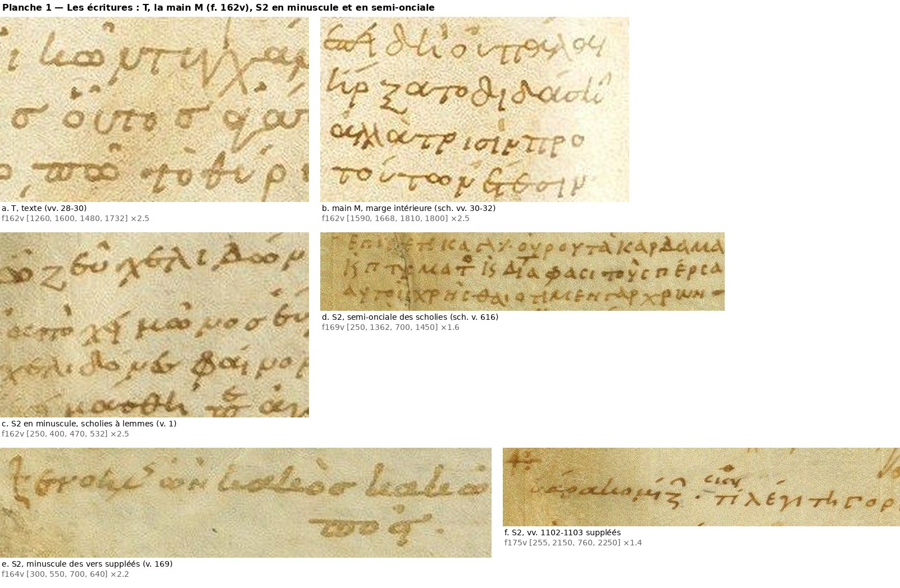
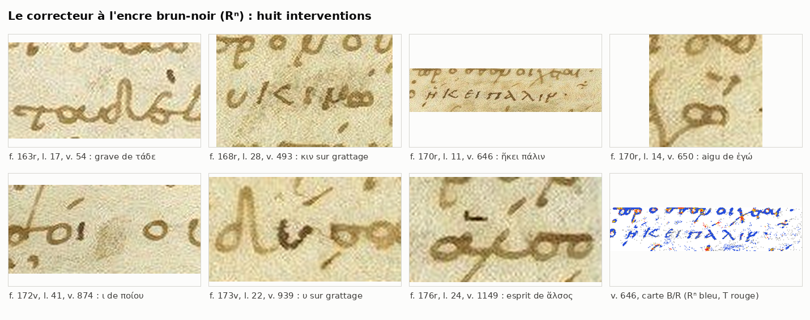
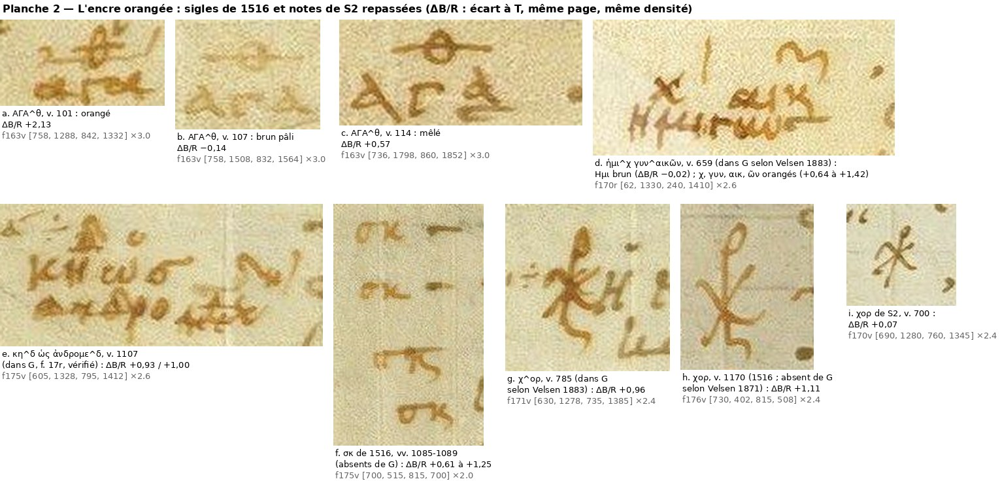

# Chapitre 1 — Les mains et les encres

*Étude graphologique de R (Ravenne, Biblioteca Classense, ms. 429, olim 137, 4, A), Thesmophories, ff. 162v–177r (vv. 1–1231).*

> **Statut** : rédaction du 28 octobre 2026, revue le même jour par une vérification adversariale sur l'image (§ 13.1–13.2), puis le 1er novembre 2026 par une seconde passe portant surtout sur G, la Juntine et le fac-similé de 1904 (§ 13.3). Les corrections sont reportées dans le texte. Sources : les trente inventaires de page (`../folios/fXXX.md`, `../folios/fXXX.jsonl`, environ 2 200 observations, et les relevés détaillés `fXXX_texte.jsonl`, `f173v_marges.jsonl`), les résumés `../resume_pages.json`, le dossier de littérature `recherche/ravennas_dossier.md`, et des contrôles nouveaux sur les images à pleine résolution (`dossier_ravennas_thesmophories/folios_individuels_ff162v-177r/`), sur l'apographe G (Monac. gr. 492, numérisation BSB `bsb00108707`, dans `.sources/`, non versionné). Je distingue toujours ce que j'observe (« sur l'image », « mesuré ») de ce qu'affirment les auteurs.
>
> **Illustrations.** Planches de ce chapitre : `planches/1_pl1_ecritures.jpg`, `planches/1_pl2_encre_orangee.jpg` ; planche du groupe à l'encre brun-noir du chapitre 4 : `planches/4_groupe_Rn.png`. Spécimens (≤ 600 px, régénérables, dossiers ignorés par git) : `../specimens/ch1/`, `../specimens/ch1_verif/`, `../specimens/ch1_verif2/`. Outil de mesure : `outils/graphologie/encres_mesure_uniforme.py`. Données : `donnees/1_encres_pages.json` (T et S2, page par page) et `donnees/1_ecarts_observations.tsv` (écart à T de chaque observation des inventaires). Vues de contrôle, non versionnées : `.travail/ch1/vues/`.
>
> **Conventions.** l. = ligne réglée de la colonne (1 à 43) ; v. = vers (numérotation de l'édition) ; « fXXX #n » = n-ième observation (à partir de 0) du JSONL de la page. G = Monac. gr. 492 (XVe s.), apographe de R ; Junt. = *editio princeps* de Florence (28 janvier 1516), composée sur R. Les étiquettes de mains sont définies au § 9 (tableau final).

## Conclusions principales

1. **Une seule main pour le texte (T = R1)**, d'une encre brune homogène sur les trente pages (seule réserve : le décalage des ff. 176r–177r, point 8). Ses propres corrections (R1c) se font en écrivant ou en relisant, à la même encre. Le titre de la pièce et celui de l'hypothesis de l'*Assemblée* sont aussi de T. Ils sont écrits dans une minuscule de titre espacée, à ε et σ lunaires, et non en majuscule (§ 2.1, § 13).
2. **Toutes les scholies et presque toutes les gloses sont de S2 (R2)**, qui est aussi le correcteur ancien principal. Il écrit en semi-onciale inclinée ses scholies, ses gloses et ses sigles. Il écrit en minuscule, d'une part une série de scholies à lemmes au f. 162v, d'autre part des lettres et des vers qu'il ajoute au texte. Des quatre suppléments de vers, seuls les vv. 1102–1103 ont sa grande minuscule penchée. Le v. 647 est à part, et les vv. 33 et 169 ont les formes de T : leur attribution à S2 vient de la littérature, non de la forme (§ 3.2). Son encre ne se sépare pas de celle de T : en moyenne elle est à peine plus jaune (écart médian +0,14 du rapport B/R à densité égale), mais l'écart varie d'une note à l'autre et disparaît pour des notes écrites dans la colonne même.
3. **Une troisième main ancienne, en minuscule ronde et droite (M = Rsch)**, a écrit les deux scholies de la marge intérieure du f. 162v (vv. 27 et 30–32). C'est la « troisième main » d'Orsini, et non une minuscule de S2 comme le voulait Allen. Elle est proche de la minuscule de T. Elle se distingue de la minuscule à lemmes de S2 par l'axe droit et l'espacement, non par le module, qui est égal ou un peu plus petit (§ 4).
4. **Un correcteur ancien à l'encre brun-noir (R3)** a récrit des mots sur grattage : vv. 646 et 939 sûrs, v. 874 probable, v. 493 probable par la forme (la mesure du κιν ne le sépare pas de T). Sur ces lettres entières, son encre est nettement plus neutre que celle de T et de S2 à densité égale : au f. 170r, ἥκει πάλιν sort de la plage de toutes les lettres de T. Les accents et l'esprit qu'on lui prête (vv. 54, 650, 1149) ne se séparent pas, par l'encre, des points et accents denses de T : leur attribution reste possible, non probable (§ 5, § 13). Ses leçons sont antérieures à G. Les sources l'attribuent à S2, et l'hypothèse d'une campagne distincte de S2 n'est pas exclue. Je propose, sans pouvoir le démontrer, d'y voir le R³ « paullo recentior » que la préface de Velsen 1883 annonce sans l'employer.
5. **Toute l'encre orangée mesurable appartient à une seule campagne, celle de 1516 (Rrec).** Cette campagne a écrit les sigles « imprimables », des corrections, des signes d'insertion et des barres d'annulation. Elle a aussi, très probablement, **repassé** des notes de S2 pâlies. C'est pourquoi des notes de la forme de S2, que G reproduit déjà, sont aujourd'hui orangées. Arguments : sur une même page, des sigles ΑΓΑ^θ identiques de S2 sont l'un brun pâli (v. 107), les deux autres orangés (vv. 101 et 114, f. 163v) ; une même note de S2 est brune au début et orangée ensuite (f. 170r, v. 659), alors que G en a déjà la partie orangée ; les lettres suscrites restent brunes au-dessus de sigles orangés (vv. 5, 19, 39, 45b) ; sur sept pages, l'orangé de ces notes a la composition de celui des sigles de 1516 (§ 6.2). G atteste ces notes, sauf le v. 33 et le μνη du v. 1063b (§ 6.4). Le repassage reste une inférence : aucun tracé brun n'est observable sous l'orangé, et seule l'imagerie UV/IR le démontrerait. L'hypothèse d'une « seconde encre » orangée de S2 n'est pas nécessaire. Les « deux correcteurs à l'encre rougeâtre » de Clark s'expliquent ainsi : son premier correcteur, antérieur à G, correspond aux notes de S2 repassées. Sa remarque sur deux encres « like but not identical » ne se vérifie pas à la mesure, sans que la mesure l'exclue.
6. **La même campagne de 1516 emploie une seconde matière, grise et neutre** : une pointe métallique (plomb probable) pour les repères de pages de la Juntine, et une fois pour barrer une paragraphos. Il faut y ajouter des empreintes grises d'imprimeur.
7. **Interventions modernes (Rmod).** Elles comprennent deux foliotations : l'une à l'encre, dans l'angle intérieur, ancienne ; l'autre au crayon de graphite, dans l'angle extérieur, celle de la Classense, décalée de +2. S'y ajoute la signature « 22 » (f. 167r), qui est à l'encre brune et non au crayon. On relève encore des taches de réactif bleu-vert sur les débuts de scholies de treize pages (XIXe s. probable), des traits de crayons rouge et bleu, et des restaurations au tulle et à la pièce de peau.
8. **Le témoignage de l'encre a des limites.** Les rapports absolus varient d'une ouverture à l'autre : pour T, le rapport B/R vaut 2,3–2,45 aux ouvertures f. 163v–164r, 165v–166r, etc., et 2,1–2,2 aux autres. La cause n'est pas la prise de vue, puisque les mires de couleur photographiées avec les ouvertures ont le même rendu dans les deux groupes. Elle tient au parchemin : l'écart entre recto et verso change de signe à chacun des quatorze feuillets, comme le veut l'alternance des côtés poil et chair, qui reste à vérifier sur l'original (§ 1.3 a, § 13). À partir du f. 176r, T baisse en outre de 0,1 à 0,2, pour une raison inconnue. Dans une même page, T varie aussi du haut au bas de la colonne (jusqu'à 0,14), sans que le fond local l'explique. Les traits fins mesurent « gris », quelle que soit la main. Une auréole d'humidité jaunit les mesures. Seuls les écarts à T mesurés sur la même page et à densité égale sont comparables. Ils ne sont décisifs que pour trois oppositions : orangé contre brun, gris neutre (plomb, graphite) contre encre, brun-noir contre brun sur des lettres entières. Ailleurs, la forme seule tranche.

---

## 1. Sources, méthode, limites

### 1.1 Corpus

Les trente inventaires couvrent toutes les pages (ff. 162v–177r). Chacun donne une synthèse (`fXXX.md`) et un relevé ligne à ligne (`fXXX.jsonl`), dont chaque observation porte une catégorie, une ligne, un vers, une description, une main, des critères, une certitude, une boîte et un spécimen. Les résumés structurés de `../resume_pages.json` donnent, pour chaque page, les mains reconnues, les faits saillants et les doutes. Je les ai tous lus. Les attributions des inventaires ne lient pas ce chapitre : j'ai repris les points décisifs sur l'image (§ 11.1) et je signale les corrections au § 11.2.

### 1.2 Une mesure unique pour toute la pièce

Les inventaires mesurent l'encre de deux façons :

- en **rapports d'absorbance** relatifs au fond (A_G/A_R et A_B/A_R, notés G/R et B/R ; T ≈ 1,2–1,4 et 1,8–2,4), pour la plupart des pages ;
- en **rapports de réflectance** (valeurs RVB du trait ; T ≈ 0,83–0,87 et 0,50–0,56), pour les ff. 173r, 173v, 175r et 177r, et en partie pour les ff. 174r et 174v.

Les deux séries ne se comparent pas directement. J'ai donc repris **toutes** les observations munies d'une boîte (2 002, dont 1 926 mesurables) avec un protocole unique (`outils/graphologie/encres_mesure_uniforme.py`) :

1. les pixels de trait sont isolés par le masque d'encre brune de `outils/images/recadrer_facsimile.py` (fonction `masque_encre`), puis érodés d'un pixel (« cœur ») ;
2. le fond local est estimé canal par canal par une convolution normalisée qui exclut les pixels d'encre. Une simple moyenne floue, qui assombrit le fond dans les zones denses, n'est pas employée ;
3. je calcule l'absorbance A = −log10(I/fond) par canal, puis les rapports G/R et B/R ;
4. **référence T de la même page** : je prends la médiane du rapport B/R de T par tranche de densité A_R de 0,02, sur toutes les lignes de la colonne, hors zone des sigles et hors blocs de scholies. L'**écart à T**, noté ΔB/R, est la médiane, sur les pixels de l'objet, de la différence entre son B/R et celui de T à la même densité.

Un ΔB/R positif signale une encre plus jaune-orangée que T, un ΔB/R négatif une encre plus neutre ou plus noire. Pour T lui-même, ΔB/R reste dans la fourchette −0,16 / +0,10 (déciles des 629 observations attribuées à T). Dans une même page, la variation entre gauche et droite de la colonne ne dépasse pas ±0,035. **Du haut au bas de la colonne**, en revanche, elle atteint 0,12–0,14 sur cinq pages sur dix (ff. 163v, 164r, 169r, 172v, 176r), le bas étant plus jaune (jusqu'à +0,08) et le haut plus neutre (jusqu'à −0,08). Elle reste de 0,05–0,06 sur les cinq autres (ff. 162v, 166v, 171r, 175v, 177r ; contrôle de la vérification, § 13). Un objet isolé en haut ou en bas de page doit donc être comparé à T de la même hauteur.

### 1.3 Quatre limites, qui commandent l'interprétation

**(a) La prise de vue.** Les rapports absolus de T changent d'une ouverture à l'autre, et ils sont égaux pour les deux pages d'une même ouverture (tableau 1). Les ouvertures f. 163v–164r, 165v–166r, 167v–168r, 169v–170r, 171v–172r, 173v–174r et 175v donnent pour T un B/R de 2,32–2,45 (tranche 0,10–0,20). Les ouvertures f. 162v–163r, 164v–165r, 166v–167r, 168v–169r, 170v–171r, 172v–173r et 174v–175r donnent 2,10–2,19. Les ff. 176r (2,23), 176v (2,04) et 177r (2,03) sont à part (voir après le tableau 1). J'avais attribué cette alternance à la photographie, c'est-à-dire à la balance des couleurs propre à chaque cliché de double page. **La vérification réfute cette explication** (§ 13). Chaque ouverture est photographiée avec une mire de couleur. Le brun de la mire mesure B/R 1,58–1,62 (absorbance rapportée au blanc de la mire) sur les clichés des ouvertures 162v–163r, 163v–164r, 164v–165r, 167v–168r, 170v–171r, 171v–172r et 175v–176r : le rendu est donc le même, alors que T y alterne de 2,15 à 2,44. En revanche, le fond du parchemin alterne en phase avec T : il est plus jaune aux ouvertures « hautes » (canal bleu du fond ≈ 159–177) qu'aux ouvertures « basses » (≈ 174–196). La cause est donc matérielle. L'hypothèse la plus simple est l'alternance des côtés poil et chair d'une ouverture à l'autre, les pages en regard étant du même côté (règle de Gregory). **La seconde passe la soumet à un test plus strict** (§ 13.3) : chaque feuillet doit alors avoir un côté « haut » et un côté « bas ». C'est ce qu'on observe : recto moins verso change de signe à chaque feuillet, du f. 163 au f. 176, sans exception (écart de 0,19 à 0,33). Ce n'est pas non plus un simple effet de calcul lié à la couleur locale du fond : sur 494 cases de colonne, T suit le jaunissement du fond d'une page à l'autre (r = 0,89 sur les médianes de page), mais presque pas à l'intérieur d'une page (r = 0,17). L'hypothèse reste à vérifier sur l'original. Il s'ensuit qu'**aucune fourchette absolue ne vaut d'une page à l'autre**. Les fourchettes des inventaires ne sont comparables qu'à l'intérieur d'une même page. Quand un inventaire écrit que S2 « se sépare » de T (f. 168r) ou se confond avec l'encre de 1516 (f. 163v), il faut le relire à la lumière de cette limite.

**(b) Les traits fins.** Les images sont des JPEG à chrominance sous-échantillonnée (4:2:0, vérifié). Un point, un accent ou un trait de deux pixels mêle sa couleur à celle du fond et mesure « gris ». Les dicola et les petites paragraphoi de T descendent ainsi jusqu'à ΔB/R −0,4 / −0,55 (ff. 163v l. 34, 169v l. 17, 171v l. 9 et 21). Une teinte neutre mesurée sur un petit signe ne prouve donc jamais une autre encre. De même, les petites corrections de 1516 mesurent souvent comme T (médiane +0,04 pour les « interventions » de cette main, contre +0,60 pour ses sigles).

**(c) Le fond.** Dans les marges jaunies ou tachées, toutes les encres glissent vers l'orangé. Sur 386 notes de S2, l'écart à T croît avec le jaunissement du fond (corrélation 0,34) : il vaut +0,09 sur un fond semblable à celui de la colonne et +0,22 sur un fond jauni.

**(d) Les cartes pixel par pixel.** Sur une carte de l'écart B/R, le bord des traits paraît toujours plus neutre que leur cœur, pour la raison donnée en (b). C'est vrai aussi des sigles de 1516 eux-mêmes (`.travail/ch1/vues/f175v_sk_x5.png`). Des « bords bruns autour d'un cœur orangé » ne prouvent donc pas un repassage. Seules les médianes par boîte, comparées à des témoins de la même page, sont probantes.

**Règle d'usage.** L'encre ne décide que dans trois cas :
- orangé contre brun : ΔB/R ≥ +0,4 sur un objet d'au moins une centaine de pixels de cœur ;
- matière grise neutre (plomb, graphite) contre encre ;
- brun-noir contre brun : ΔB/R ≤ −0,3 sur des lettres entières et assez denses.

Pour tout le reste (T ou S2, lettre isolée, accent), seule la forme tranche, ou l'attribution reste indécise.

**Tableau 1 — Encre de T et des scholies de S2, page par page** (mesure unique ; cœur des traits ; B/R médian par tranche de densité A_R).

| Ouverture | Page | T : B/R (A_R 0,10–0,20) | T : B/R (A_R 0,20–0,30) | Scholies de S2 : B/R (0,10–0,20) | Δ S2 − T (0,10–0,20) | Δ S2 − T (0,20–0,30) |
|---|---|---|---|---|---|---|
| f162v–f163r | f162v | 2,19 | 2,13 | 2,34 | +0,15 | +0,14 |
|  | f163r | 2,17 | 2,08 | 2,21 | +0,04 | +0,02 |
| f163v–f164r | f163v | 2,42 | 2,37 | 2,77 | +0,34 | +0,17 |
|  | f164r | 2,44 | 2,42 | 2,65 | +0,20 | +0,11 |
| f164v–f165r | f164v | 2,17 | 2,11 | 2,34 | +0,17 | +0,06 |
|  | f165r | 2,12 | 2,05 | 2,25 | +0,13 | +0,10 |
| f165v–f166r | f165v | 2,32 | 2,29 | 2,61 | +0,28 | +0,23 |
|  | f166r | 2,35 | 2,28 | 2,53 | +0,18 | +0,18 |
| f166v–f167r | f166v | 2,14 | 2,05 | 2,29 | +0,15 | +0,19 |
|  | f167r | 2,19 | 2,10 | 2,43 | +0,25 | +0,25 |
| f167v–f168r | f167v | 2,41 | 2,36 | 2,78 | +0,37 | +0,29 |
|  | f168r | 2,39 | 2,30 | 2,70 | +0,31 | +0,32 |
| f168v–f169r | f168v | 2,17 | 2,10 | 2,30 | +0,13 | +0,10 |
|  | f169r | 2,15 | 2,10 | 2,25 | +0,09 | +0,07 |
| f169v–f170r | f169v | 2,35 | 2,30 | 2,61 | +0,27 | +0,25 |
|  | f170r | 2,42 | 2,35 | 2,62 | +0,20 | +0,17 |
| f170v–f171r | f170v | 2,17 | 2,07 | 2,24 | +0,07 | +0,06 |
|  | f171r | 2,12 | 2,02 | 2,24 | +0,12 | +0,06 |
| f171v–f172r | f171v | 2,43 | 2,32 | 2,53 | +0,10 | +0,11 |
|  | f172r | 2,39 | 2,30 | 2,58 | +0,19 | +0,20 |
| f172v–f173r | f172v | 2,12 | 2,07 | 2,31 | +0,19 | +0,16 |
|  | f173r | 2,10 | 2,01 | 2,30 | +0,20 | +0,18 |
| f173v–f174r | f173v | 2,32 | 2,24 | 2,53 | +0,21 | +0,20 |
|  | f174r | 2,32 | 2,19 | 2,56 | +0,24 | +0,18 |
| f174v–f175r | f174v | 2,12 | 2,02 | 2,25 | +0,13 | +0,12 |
|  | f175r | 2,11 | 2,00 | 2,17 | +0,05 | +0,09 |
| f175v–f176r | f175v | 2,44 | 2,35 | 2,85 | +0,41 | +0,25 |
|  | f176r | 2,23 | 2,15 | 2,27 | +0,04 | −0,03 |
| f176v–f177r | f176v | 2,04 | 1,96 | 2,30 | +0,26 | +0,20 |
|  | f177r | 2,03 | 1,96 | 2,09 | +0,06 | +0,05 |

Les ff. 175v et 176r sont la seule ouverture dont les deux pages diffèrent (2,44 contre 2,23). Elles viennent pourtant du même cliché (planche 14 : les pages individuelles sont des découpes des planches doubles, de même valeur moyenne RVB), et leurs deux fonds sont jaunes. L'auréole d'humidité de la moitié gauche du f. 175v n'explique pas l'écart : T y mesure 2,45 à gauche et 2,43 à droite, 2,43 en haut et 2,45 en bas. **L'anomalie n'est pas propre au f. 176r** (seconde passe, § 13.3). Le f. 176 garde l'alternance (recto 2,23, verso 2,04), mais tout le feuillet est décalé : sa moyenne vaut 2,135, contre 2,21–2,305 pour les treize autres feuillets, et le f. 177r mesure 2,03, contre 2,10–2,19 pour les pages « basses ». T baisse donc de 0,1 à 0,2 à partir du f. 176r. Parchemin différent ou autre charge d'encre : l'image ne le dit pas (§ 12, 8).

---

## 2. Le copiste du texte, T (R1)

### 2.1 Écriture

C'est une minuscule ronde et liée, écrite sous la réglure. Les lettres rondes (ο, α) mesurent, traits compris, 16–18 px en médiane (1,9–2,1 mm ; quartile supérieur 20–23 px), et le corps mesuré à mi-densité 13–16 px (vérification sur les ff. 162v, 166v, 170r, 174v ; voir chap. 2). Le chiffre de 18–20 px de l'inventaire du f. 162v est le haut de la fourchette. On y trouve des formes onciales mêlées : Η en H, Ν en N en fin de ligne, grand σ lunaire enveloppant la finale -ος. On y relève aussi le π en ϖ, le β en « u », le κ en « lc », le ν final à jambage plongeant, qui se lit μ, et le second τ de ττ en forme de γ. La ligature ει prend les formes de « q », « 4 » ou « ϥ », et ζ comme ξ s'écrivent en « ʒ ». Le ψ est cruciforme et l'esprit souvent rejeté à gauche de la voyelle. L'inventaire de ces formes et des pièges qu'elles créent relève du chapitre 2. Il concorde avec les descriptions d'Orsini 2011, 325 et d'Allen 1896, 319 (dossier § 3.1).

T écrit aussi les **titres** : au f. 162v, ἀριστοφάνους θεσμοφοριάζουσαι, avec ornement et trait final de la même encre (inventaire f162v #0 ; ΔB/R −0,12) ; au f. 177r, le titre ὑπ(όθεσις) ἐκκλησιαζουσῶν ἀριστοφάν(ους) et la ligne ornementale (inv. f177r). Les inventaires parlaient de « majuscule de distinction ». **Sur l'image, ce n'en est pas une** : c'est une minuscule posée, espacée et un peu agrandie. Les formes sont minuscules (α, μ, ρ et φ plongeants, ζ en « ʒ », υ, ω), avec ε et σ lunaires et, au f. 177r, un Η en H (vérification, § 13). Il n'y a ni rubrique, ni liste de personnages, ni souscription.

### 2.2 Encre

L'encre de T est **homogène** sur toute la pièce. D'une page à l'autre, les écarts de B/R de T suivent exactement les ouvertures (tableau 1), et le fond du parchemin varie avec eux (§ 1.3 a). Dans une même page, ils ne dépassent pas ±0,035 de gauche à droite, mais ils atteignent 0,12–0,14 du haut au bas de la colonne sur certaines pages (§ 1.2). Ce gradient est régulier sur certaines pages (ff. 164r, 169r), irrégulier sur d'autres (f. 176r). Le fond local ne l'explique pas : au f. 169r, B/R monte de 2,04 à 2,25 alors que le fond blanchit (§ 13.3). Sa cause reste inconnue, mais il n'a pas l'allure d'un changement d'encre. Aucune rupture de main ni de plume ne se voit dans les ff. 162v–177r : les changements signalés par Zacher et Martin (ff. 33/34, 116–117, 143) sont tous antérieurs à la pièce (dossier § 3.1). Le seul changement d'ensemble est le décalage de −0,1 à −0,2 à partir du f. 176r (§ 1.3 a), qui peut tenir au parchemin comme à une autre charge d'encre.

### 2.3 Ses marques et ses signaux

- **Marques de changement d'interlocuteur.** T emploie la paragraphos, épaisse à gauche, effilée à droite, posée à mi-hauteur dans la zone des sigles, et le dicolon. Il n'écrit jamais de nom de personnage. L'étude du système (usage antique de la paragraphos, omissions, paragraphoi « fausses ») est au chapitre 5.
- **Signaux au correcteur.** Ce sont des signes marginaux de l'encre du texte. Ils sont rares et plusieurs signes en ont l'apparence sans en être :
  - au v. 4, dans la marge droite (f. 162v, x 1636–1712), un petit crochet suivi d'un long trait fin montant, avec un point au-dessus et un point au-dessous : c'est un ÷ incliné à crochet, que Allen 1896, 316 note « √ ». Le crochet a l'encre de T (ΔB/R −0,02) ; le trait fin mesure gris (−0,68), ce que sa finesse explique (§ 1.3 b) ;
  - ⋎ pointé devant le v. 807, sans correction (f. 172r, l. 12 : « u » ouvert, point au-dessus et point au-dessous ; ΔB/R +0,03, encre de T ; Allen y voit la faute στρατωνίκην) ;
  - ÷ à barre ondulée qui renvoie au v. 647 omis (f. 170r, l. 11–12, encre plus proche de T que de S2) ;
  - le √ du v. 1135 (f. 176r) et le signe du v. 1176 (f. 176v), donnés par Allen, sont probables. Le second mesure plus gris que T, ce qui n'est pas probant pour un trait fin.

  En revanche, les « + » des ff. 165r, 165v, 175r, 175v, 176v et 177r sont des paragraphoi de T barrées. Aux ff. 175v et 177r, la haste verticale est orangée : la barre est de 1516. Aux ff. 165v et 176v, elle est orangé pâle à l'œil, mais trop fine pour la mesure. Au f. 175r, elle est grise au v. 1076, pâle et plutôt roussâtre au v. 1078 (§ 6.3). Au f. 165r, elle a l'encre brune du texte, et sa main reste indécise ; G garde le trait simple aux vv. 232 et 246, ce qui la rend postérieure à G plutôt qu'ancienne (§ 6.3, vérification § 13). Les ÷ des marges terminent des scholies de S2. Le θ suscrit de αγα^θ et les croix de renvoi appartiennent aux notes de S2.

### 2.4 Les corrections du copiste (R1c)

Elles ont l'encre du texte et se font de deux façons. Le répertoire complet est au chapitre 4.

- **En écrivant.** T biffe ou exponctue le mot qu'il vient d'écrire et poursuit :
  - dittographie ἅπασιν ἅπασιν (f. 170r, l. 34) ;
  - τὸ biffé (f. 171r, v. 754) ;
  - τί biffé et δ barré (f. 171v, l. 5 et 16) ;
  - ligne entière anticipée puis barrée, et ἱστιοφόρον barré (f. 173v, l. 15 et 17) ;
  - ἐξ ⟦ελέγχων⟧ ἔλαχον (f. 175r, l. 28) ;
  - ligne στυγνᾶς ὦσσε exponctuée (f. 176r, l. 17).
- **En relisant.** T suscrit des lettres de même module, et une fois un mot en marge :
  - κ de ἐκ^κλησίαν (f. 166v, l. 39) ;
  - η et κ suscrits, ν sur ἂρ (f. 168v, vv. 512, 514, 549) ;
  - κ et θ suscrits (f. 175v, l. 8 et 22) ;
  - ὢν (f. 164v, v. 170) ;
  - τὼ (f. 176v, v. 1183) ;
  - μέντοι en marge (f. 169v, v. 630 ; cursive liée, attribution « présumée »).

  Quelques accents de même encre sont corrigés de la même manière, par exemple εἰσιὼν (f. 168r) et κακά (f. 167r, v. 388).
- **Limite.** Une lettre suscrite d'une encre « comme T » peut être de S2, dont l'encre se confond souvent avec celle de T (§ 3.3). Sans forme distinctive (Ν oncial, esprit en équerre, semi-onciale), l'attribution à T reste probable, non sûre.

---

## 3. Le scholiaste et correcteur ancien, S2 (R2)

### 3.1 La semi-onciale des scholies

C'est une majuscule inclinée à droite, de 1,6–2 mm, aux lettres disjointes et anguleuses. On y trouve ε et σ lunaires ; Μ, Ν, Η, Κ, Λ et Δ onciaux ; le Κ souvent fait d'une haste et d'un « c ». Les accents sont posés sur les majuscules. Les compendia sont accentués : ϗ, « ʒ » pour δέ ou -αι, lettres suscrites. Les notes sont ouvertes par un tiret et closes par ÷ ou :–. C'est la « coarser and thicker » écriture de B chez Allen 1896, 320 et le S2 d'Orsini 2011, 327, qui écrit toutes les scholies des ff. 111v–191v. Exemple : planche 1, d (f. 169v, scholie au v. 616). Le détail des abréviations est au chapitre 3.

### 3.2 La minuscule de S2

S2 écrit en minuscule dans deux situations.

- **Ajouts au texte.** Allen 1896, 320 décrit une minuscule « very large, sloped to the right, and fine », d'après des exemples pris dans d'autres pièces (ff. 77v, 114r, 117v, 140r, 159r). Il donne à B les vers suppléés des *Thesmophories* (316–317) : v. 33 (f. 162v, marge droite), v. 169 (f. 164v, marge gauche), v. 647 (f. 170r, marge droite), vv. 1102–1103 (f. 175v, marge inférieure). On la retrouverait aussi dans des lettres ou mots suscrits : πο (f. 167v, v. 434), περ (f. 173v, v. 938), τινα (f. 172r, v. 833), οι (f. 176r, v. 1127), γ(άρ), κα et θ (f. 164r, vv. 149, 151, 155). **La vérification nuance cette description** (§ 13 ; vue des quatre suppléments à la même échelle) : ils ne forment pas un groupe. Seuls les vv. 1102–1103 sont d'une grande minuscule penchée qui garde des capitales (Γ de Γόργος, Λ de λέγι). Le v. 647 est petit (corps 8 px), à ν minuscules, chargé de lettres suscrites et du compendium de καί, ce qui convient à un scholiaste. Les vv. 33 et 169 (corps 12 px, contre 13–14,5 px pour T sur les mêmes pages) sont ronds et à peine inclinés, et ils ont la morphologie de T : χ long, ρ à queue, κ en « lc », π en ϖ, ξ en zigzag. Le v. 33 (b) répète les mots que T écrit au v. 32 (οὐχ ἑόρακας πώ-) : les formes sont les mêmes, à un module d'environ 0,75 (`../specimens/ch1_verif2/f162v_v33_contre_T.png`, `…/f164v_v169_supplement.png`). Pour ces deux vers, rien dans la forme ne désigne S2. Leur attribution repose sur la littérature (B d'Allen, R² de Velsen 1883), qui a vu l'original, et je ne la renverse pas ; mais T (R1c) et la main M ne sont pas exclus (§ 12, 9). Exemples : planche 1, e–f.
- **Scholies à lemmes du f. 162v.** C'est une série continue dans les marges supérieure et extérieure (vv. 1–24 ; notice sur la pièce et « προλογίζ(ει) … »), en petite minuscule de 10–15 px, un peu inclinée, aux lettres disjointes. Les **lemmes y sont en semi-onciale** (ΑΚΟΥΕΙΝ, avec Ε lunaire et Ν capital), avec un Ζ capital dans ὦ Ζεῦ (planche 1, c ; `../specimens/ch1/f162v_marge_g_S2_minuscule.png`). La glose ζωνάριον du f. 164r (l. 18), en minuscule à Ζ capital, relève du même usage. J'accepte ici l'attribution d'Allen 1896, 320–321 (« an experiment on the part of B »).

### 3.3 Encre

- **En moyenne**, les scholies de S2 sont à peine plus jaunes que T : ΔB/R médian +0,15 pour 262 scholies (déciles +0,01 / +0,36), +0,13 pour les gloses. La médiane des médianes par page vaut +0,14 sur les trente pages, et l'écart est positif sur vingt-neuf pages (`donnees/1_ecarts_observations.tsv` ; seul le f. 163r est négatif, −0,05).
- **Une part de cet écart vient du fond.** Il croît avec le jaunissement des marges (§ 1.3 c). Les notes que S2 a écrites **dans la colonne même** mesurent comme T. C'est le cas au f. 174v (l. 17 : −0,05 ; l. 20 : −0,13), au f. 163r (χωνεύει, l. 20 : 0,00), au f. 170v (l. 7 : −0,08), au f. 175r (l. 21 : +0,02) et au f. 172r (glose πόρνης ὄνομα, l. 9 : +0,03). D'autres, sur le même fond, sont plus jaunes : f. 174v, l. 33 (+0,41) ; f. 164r, ζωνάριον (+0,38).
- **Les petites corrections de S2 dans le texte** mesurent en médiane comme T (−0,02 pour 64 interventions). Il y a des exceptions nettes, mesurées par les inventaires contre les lettres voisines à densité égale : πο du v. 434 (f. 167v), περ et να des vv. 938 et 954 (f. 173v), seconde boucle de l'ω de ὠόμην au v. 526 (f. 168v).

Il faut donc conclure ainsi : **l'encre de S2 est du même type que celle de T, en séances plus variables**. Elle ne sépare jamais à elle seule S2 de T pour un trait isolé. Les campagnes distinctes que les inventaires ont repérées à l'intérieur de S2 sont réelles, mais il faut les lire selon le § 1.3. Ce sont les gloses de la marge intérieure du f. 168r, à l'encre « de T », la 1re ligne grise d'une scholie au f. 166r (v. 329), et la différence entre marge intérieure et marge extérieure au f. 163v. Les sigles « rougeâtres » de S2 du f. 172v (« groupe A ») sont des sigles repassés (§ 6.4).

### 3.4 Ce que fait S2

- **Scholies et gloses.** Il les écrit toutes, sauf les deux notes de la main M (§ 4). Elles occupent surtout les marges extérieure et intérieure, et parfois les marges supérieure et inférieure ou le blanc des lignes lyriques. Le détail est au chapitre 3.
- **Sigles de personnages.** Ils sont abrégés par lettre suscrite et posés à gauche de la paragraphos de T : μνη^σ, μνησι^λο, κη^δ, ευρι^π, γυ^ν, αγα^θ, κλεισ^θ, σκυ^θ, χ^ο, χ^ρ et le monogramme χορ, τοξ. On les trouve sur presque toutes les pages où le dialogue l'exige (§ 8). Allen écrit, à propos du f. 170v, « nearly all the dram. pers. are by B » : c'est vérifié, avec 8 ou 9 sigles de S2 contre un sûr de 1516.
- **Corrections.** S2 supplée des vers omis : vv. 1102–1103 et probablement v. 647 ; les vv. 33 et 169 lui sont donnés par la littérature, sans appui formel (§ 3.2). Il fait des suscriptions et des écrits sur grattage, par exemple -εῖν au v. 370 (f. 166v). Il exponctue (σαλλαβακχοῦσ, v. 805, probable) et corrige ses propres scholies (δαίμων, f. 166r ; ἀμφε sur ⟦ενε⟧, f. 174v). Il ajoute des accents et des esprits, mais ceux que Velsen 1883 lui donne ne sont en général ni visibles ni attribuables sur l'image.
- **Signes de renvoi.** Il en emploie, contre ce qu'écrivent Zacher 1888, 536 et Orsini 2011, 328 :
  - ∈ … ∈, ·϶· … ·϶· et ✕ au f. 164r (vv. 127, 131, 135) : les deux premières paires sont identiques aux deux bouts, la troisième a deux formes différentes ;
  - ·×· … ·×· au f. 169r (v. 566, scholie déplacée en haut de marge), paire identique ;
  - ·✓· au f. 166v ;
  - → au f. 171v (l. 18) ;
  - croix du v. 168 au f. 164v ;
  - « +: » des vv. 1102–1103 au f. 175v. Ce dernier signe est toujours visible aux deux bouts, en fin de l. 20 et devant le supplément de la marge inférieure, bien qu'Allen 1896, 317 le dise « erased by Giunta ». Mais les deux signes sont **orangés** (ΔB/R +0,75 et +1,13 ; vérification, § 13). C'est donc un renvoi de S2 repassé en 1516, ou un renvoi de 1516 : il ne compte pas parmi les renvois sûrs de S2.

### 3.5 Place dans la chronologie

S2 écrit **après T** :

- au f. 163v, l. 35, la base du dernier Α de son ΑΓΑ^θ est la paragraphos de T ;
- au f. 169v, il raccourcit deux lignes de scholie pour ne pas toucher les paragraphoi de T des vv. 617–618 (inv. f169v, corrections 1–2) ;
- partout, ses sigles se logent à gauche de ces paragraphoi.

Il écrit **avant G** : G reproduit ses sigles et ses suscriptions (inv. f164r ; relevé de G, § 13.3 ; Velsen 1871 et 1883). **G n'a que deux des quatre suppléments de vers.** Il omet le v. 33 (f. 1v, vérifié : le v. 32 y porte un astérisque marginal, de fonction inconnue ; Velsen 1883 : « versum omm. RG ») et les vv. 1102–1103 (f. 17r, `…_0037`, du v. 1101 au v. 1104). Il a le v. 169, copié après le v. 170, avec « δ᾽ αὖ » rejeté en marge (f. 3v, relevé de G ; Velsen 1883). Il a aussi le v. 647, contrairement à ce qu'affirmait la passe du 28 octobre, qui l'avait cherché entre les vv. 646 et 648 : G le copie à la fin de la ligne du v. 644, et « καὶ κάτω » est rejeté à droite de la ligne suivante (f. 10v, `bsb00108707_0024` ; `../specimens/ch1_verif2/G_f10v_v644_v647.png` ; Velsen 1883 : « in textu omissum in margine iuxta v. 644 add. G »). Les vv. 169 et 647 sont donc antérieurs à G. Les deux autres ne sont pas datés par lui : son copiste a pu les négliger, comme il néglige le μέντοι marginal de T au v. 630 (chap. 4). Les auteurs jugent S2 contemporain ou presque de T (« fere suppar aetate primae manui », Velsen 1883, 5 ; « nicht viel später », Velsen 1871, 6–7).

---

## 4. La troisième main ancienne, en minuscule (M = Rsch)

**Ce qu'elle a écrit.** Deux scholies de la marge intérieure du f. 162v :

- à la hauteur des l. 28–29 (v. 27) : « λεί^π(ει) τὸ ἔνθα· οἷον σιω(πῶ) | διὰ τὸ θύριον | ἔπαιξ(ε) δ(έ)· », lecture du chapitre 3 que l'image permet ;
- aux l. 30–33 (vv. 30–32) : « ἐπειδὴ οὐ πάλαι | ἤρξατο διδάσκ(ειν) | ἀλλὰ τρισὶν πρὸ | τούτων ἔτεσιν », selon la lecture de Martin 1882, 196 citée au chapitre 3, que l'image permet.

Voir planche 1, b et `../specimens/ch1/f162v_marge_int_main_M.png`.

**Ce que j'observe** (images à ×2,5–3 et à même échelle que les autres minuscules, planche 1) :

- une minuscule **ronde et droite**, aux lettres espacées et régulières, tracée d'une plume assez épaisse. Les lettres rondes mesurent 12–13 px et le corps 10–14 px (vérification, § 13). On y voit le δ à boucle haute, le θ ovale fermé, le ξ en « ʒ » à longue queue (ἤρξατο) et le ν final plongeant (ἔτεσιν) ;
- elle diffère de la minuscule à lemmes de S2 du même folio (planche 1, c), qui est inclinée, irrégulière, au tracé grêle, avec des capitales. La minuscule à lemmes n'est pourtant **pas plus petite** (vérification, § 13). Son corps, mesuré à mi-densité par profil de projection, fait 10–18 px (médiane 15,5), contre 10–14 px (médiane 11) pour M. Les lettres rondes de M mesurent 12–13 px, celles de la minuscule à lemmes 15–16 px (et celles de T 16–18 px). La différence tient à l'axe, à l'espacement et au tracé, non au module ;
- elle diffère aussi de la grande minuscule penchée des vv. 1102–1103 (planche 1), qui est inclinée, étirée et à plume fine. Elle est plus proche des vv. 33 et 169, ronds et à peine inclinés, dont elle n'a pourtant ni le module ni le π en ϖ (§ 3.2) ;
- par le style, elle se rapproche de la minuscule de T (planche 1, a), en lettres détachées et en plus petit module. Le chapitre 3 y relève des formes de T (π en ϖ, κ en « lc »). Le κ en « lc » se voit dans διδάσκ(ειν). Le π de πάλαι et de πρὸ a, à cette résolution, la forme ordinaire à barre : le π en ϖ n'y est pas reconnaissable (vérification, § 13).

**Encre.** Note du v. 27 : ΔB/R −0,08, comme T. Note des vv. 30–32 : +0,15, comme les scholies de S2 de la page (+0,13 à +0,21). Les deux notes sont pourtant de la même main : l'encre ne discrimine pas.

**Conclusion.** Ces deux notes ne sont pas de S2, et elles sont d'une même main (ductus, ο ronds, ν plongeant, même ligature initiale dans ἔπαιξε et ἐπειδή ; vue à ×4,5, § 13.3). Elles forment la « troisième main contemporaine » (« terza mano coeva ») qu'Orsini 2011, 327 n. 24 signale expressément pour la scholie au v. 32 : il ne cite pas la note du v. 27, que j'y joins par la comparaison des formes. Allen 1896, 321 range la scholie ἐπειδὴ οὐ πάλαι parmi les minuscules de B : je le contredis sur ce seul point, non sur les autres minuscules du f. 162v. Peut-on l'identifier à T écrivant en petit ? C'est possible, mais l'image seule ne suffit pas. Il faudrait la confronter aux ajouts marginaux sûrs de T dans d'autres pièces (Ploutos 271 et 1129–1130, ff. 4r et 14r) et à la scholie à Ploutos 509 (f. 6v) qu'Orsini donne à la même main. Ces pages ne sont pas dans le dépôt. Étiquette : **Rsch** (« main M »), avec la mention « T ? ».

---

## 5. Le correcteur ancien à l'encre brun-noir (R3)

Le chapitre 4 (§ 2.3 ; planche `planches/4_groupe_Rn.png`, « Rⁿ ») a réuni ces interventions et mesuré leur encre. Je l'ai remesurée indépendamment, avec le protocole du § 1.2.

| Page, l. | v. | Intervention | ΔB/R (ce chapitre) | Δ (chap. 4) | Valeur |
|---|---|---|---|---|---|
| f. 170r, l. 11 | 646 | ἥκει πάλιν sur grattage (`../specimens/ch1/f170r_v646_hekei_palin.png`) | −0,44 (186 px, A_R 0,25) ; vérif. −0,47 / −0,54 (A_R 0,27–0,29), T de la ligne +0,05 | −0,41 | sûre (mots entiers) |
| f. 173v, l. 22 | 939 | υ de ἀποδύσαντα sur grattage (`…/f173v_v939_upsilon.png`) | −0,46 (57 px, A_R 0,33) ; vérif. idem, lettres voisines +0,06 / +0,10 | −0,56 | sûre (lettre dense ; référence T mince à cette densité) |
| f. 168r, l. 28 | 493 | κιν- sur grattage, Κ majuscule en deux traits | −0,21 / −0,28 (vérif. : Κ −0,30 sur 25 px ; ιν −0,28 ; ω suivant −0,11 ; T de la ligne −0,03) | −0,31 | probable par la forme (Κ en deux traits, comme dans ἥκει) ; la mesure ne le sépare pas de T (4,5 % des fenêtres denses de T de la page descendent à −0,30) |
| f. 172v, l. 41 | 874 | ι de ποίου, σ gratté (`../specimens/ch1_verif2/f172v_v874_iota.png`) | −0,48 (22 px ; seconde passe) ; ι presque noir à l'œil à côté des ο de T | −0,53 | probable (une seule lettre) |
| f. 163r, l. 17 | 54 | grave sur le second τάδε (`…/f163r_v54_grave_brun_noir.png`) | −0,53 (34 px, A_R 0,24) | −0,44 | possible (petit signe : les points denses de T vont jusqu'à −0,6, § 13) |
| f. 176r, l. 24 | 1149 | esprit rude « ⊢ » de ἅλσος (`…/f176r_v1149_esprit_noir.png`) | −0,39 (48 px, A_R 0,28) | −0,35 | possible (plus noir à l'œil, forme anguleuse ; encre dans la plage des points de T) |
| f. 170r, l. 14 | 650 | aigu ajouté au grave de ἐγὼ | −0,27 (143 px) | −0,43 | possible |

**Ce qui est établi.** Sur des lettres entières et denses, l'encre est nettement plus neutre et plus sombre que celle de T et que celle des scholies de S2, à densité égale. ΔB/R vaut −0,2 à −0,5, alors que T reste au-dessus de −0,16 et que les scholies de S2 restent au-dessus de +0,01 (déciles inférieurs). Le balayage de la colonne par fenêtres le confirme pour les mots entiers (§ 13.3) : au f. 170r, ἥκει πάλιν descend à −0,62 / −0,66 (A_R 0,30), alors qu'aucune fenêtre dense de T ne passe sous −0,37 ; au f. 173v, seules les empreintes grises atteignent le niveau de l'υ. Les écrits sur grattage ne suffisent pas à l'expliquer : d'autres récritures sur grattage ont l'encre de T, comme γα de τ' ἄργα (f. 172r, −0,03) et εῖ de ἐπιζεῖν (f. 168r, −0,09). L'εῖ de ἐπιζεῖν n'appartient donc pas au groupe (accord avec le chap. 4, contre l'inv. f168r).

**Ce qui ne l'est pas : les petits signes.** La vérification a mesuré tous les petits signes de la colonne (composantes de 20 à 90 px : accents, esprits, points) aux ff. 163r, 170r et 176r (§ 13). Leur écart à T a une médiane de −0,22 à −0,29 et un décile inférieur de −0,48 à −0,54. Parmi les signes denses (A_R ≥ 0,22), 39 à 71 % mesurent −0,35 ou moins. Les points de ponctuation de T, aux mêmes pages, mesurent −0,35 à −0,64 et paraissent brun très sombre à l'œil (`../specimens/ch1_verif/petits_signes_denses_T_vs_R3.png`). Le grave du v. 54 (−0,53) et l'esprit du v. 1149 (−0,39) ne sortent pas de cette plage. L'encre ne les sépare donc pas de T, conformément à la règle du § 1.3. L'esprit du v. 1149 paraît plus noir à l'œil et a une forme anguleuse distincte ; il reste le meilleur candidat. Ces signes ne sont rattachés à R3 qu'à titre possible.

**Écriture.** ἥκει πάλιν est une écriture droite, d'un module un peu supérieur à celui des scholies. Elle n'est pas inclinée comme celle de S2. Κ (en deux traits), Π, Α et Λ y sont majuscules, et l'ε est lunaire. Mais l'η a la forme minuscule en « h », et le ν final est **minuscule, à jambage plongeant** : c'est la forme de T, non un Ν (vérification à ×6–×8, § 13). C'est donc une écriture mixte plutôt qu'une semi-onciale pure. Le κιν du f. 168r a un Κ majuscule en deux traits, forme que S2 emploie dans ses sigles. L'esprit en équerre du v. 1149 rappelle l'esprit anguleux de S2.

**Date.** Ces **leçons** sont antérieures à G, qui a ἥκει πάλιν (f. 10v, contrôlé par le chap. 4), κινώμεθα (f. 8r), ποίου (f. 14r) et ἀποδύσαντα (f. 14v ; relevé de G, § 13.3). G date la leçon, non l'encre (§ 6.4, 5). Aucune reprise n'étant visible sur ces lettres, je tiens l'encre pour celle de la récriture, sans pouvoir le démontrer. La position relative par rapport à S2 est inconnue, faute de superposition observée.

**Attribution.**
- Allen 1896, 316 (B) et Velsen 1883 (R²) donnent ces corrections à S2. Velsen 1871 donne le grave du v. 54 à la « 2 m. », ce que l'encre exclut.
- L'écart d'encre et l'écriture droite plaident pour une campagne distincte, peut-être d'une autre main.
- Velsen 1883, 5 annonce un R³ « paullo recentior » qu'il n'emploie jamais dans l'apparat des *Thesmophories*. Clark 1871, 154 parle d'une main « à l'encre plus noire » (XIVe ou début du XVe s.), surtout dans les Nuées. Je ne peux établir ni l'une ni l'autre identification.

**Étiquette.** **R3**, définie par l'encre (« correcteur ancien à l'encre brun-noir, antérieur à G ; R² ipse ? »). Le groupe comprend deux interventions sûres (vv. 646, 939) et deux probables (vv. 493, 874). Les accents et esprits (vv. 54, 650, 1149) n'y entrent qu'à titre possible, puisque l'encre ne discrimine pas les petits signes. Dans l'apparat, ils se notent `R?`, avec la mention « R³ ? ».

---

## 6. La campagne de 1516 (Rrec)

### 6.1 Identification

Velsen 1871, 6–7 décrit une « 2 m. » propre à la *Lysistrata* et aux *Thesmophories*, « viel später » (XVe ou XVIe s.). Ses sigles « imprimables » sont ceux de la Juntine et manquent dans G (Velsen 1871, 7–8, liste des cas « bezeichnend »). Les traits et chiffres de la même campagne renvoient aux pages des cahiers de la Juntine (Velsen 1871, 3–6). R. Schöll l'a identifiée à Euphrosynus Boninus, et l'identification a été reprise depuis (Velsen 1883, 5 ; Martin 1882, xiii ; Prato 2001, xxxii ; Scotti 2024, 462 : dossier § 6.3). **Les sources dépouillées ne publient aucune comparaison avec un autographe de Bonini.** Le seul autographe que j'y trouve signalé est un manuscrit de 1493 de la collection Theodorou, décrit par le catalogue en ligne de cette collection, sans reproduction (dossier § 6.3). J'emploie donc « main de 1516 », non « Boninus ».

### 6.2 Encre

L'encre est **orangée**, et c'est le seul critère d'encre vraiment discriminant de la pièce.

- 235 sigles attribués à cette main par les inventaires donnent un ΔB/R médian de +0,60 (quartiles +0,24 / +0,92). La médiane des médianes par page vaut +0,62 sur 19 pages.
- En valeurs absolues, les inventaires donnent G/R 1,36–1,91 et B/R 2,2–4,0 selon l'ouverture (§ 1.3 a), et une teinte « rouge-orangé » en décorrélation Lab.
- La signature est la même sur toutes les pages. Les notes de forme S2 attestées par G n'ont pas une autre encre : sur sept pages où elles côtoient des sigles donnés à 1516, leurs pixels orangés (ΔB/R ≥ +0,30) donnent G/R 1,65–1,83 et B/R 2,9–3,7, contre 1,59–1,75 et 2,9–3,4 pour ces sigles (f. 171r écarté : boîtes mêlées ; § 13.3). Clark 1871, 160 voit pourtant « an ink like but not identical ». Ni les images ni la mesure ne confirment cette nuance, mais leur résolution ne l'exclut pas.
- Les petites corrections de cette main (accents, virgules, traits) mesurent souvent comme T (médiane +0,04), pour la raison donnée au § 1.3 b. Pour elles, il faut s'appuyer sur la liste de Velsen 1871 et sur la forme.

### 6.3 Écriture et façons de faire

**Formes** (relevées dans les inventaires, contrôlées sur les planches) :

- Γ en grand crochet à longue haste, souvent greffé sur le dicolon ou la paragraphos de T (Γϋ, Γυ) ;
- μ à premier jambage descendant ;
- ν suscrit en V, η suscrit en Η capital (μν^η) ;
- κ en croix ou en x ;
- εὐ en Є barré ou cursif ;
- σκ à longue queue, Ηχ à Η capital et grand χ ;
- tréma sur υ et point abréviatif.

Le module des sigles est **grand** (30–45 px). Le « viel kleiner » de Velsen 1871 vaut pour les corrections dans le texte, non pour les sigles (inv. f165r, f167v).

**Ce que fait cette main :**

1. **Sigles imprimables** en tête de vers et dans les vers, sur les marques de T ou dans ses blancs. Il y en a environ 300. Ils font défaut aux ff. 166v, 170r, 171v, 172r et 174r, et sont rares aux ff. 166r, 167r, 167v, 168r, 168v, 169v et 170v (§ 8.2). Le relevé de G confirme qu'ils y manquent presque tous. Une dizaine de lieux font exception : G y a un sigle là où R n'a qu'un tracé de 1516 (vv. 211, 295, 380, 443, 582, 584, 1002, 1084–1085, 1165, 1218). Ce ne sont donc pas forcément des créations de 1516 : le tracé orangé peut remplacer un sigle ancien gratté ou pâli, à moins que G n'ait suppléé le sien, lui qui développe à sa façon (σκυ^θ pour le σκ de R).
2. **Sigle en marge et signe d'insertion « ^ » ou « √ » dans la ligne**, quand T n'a rien marqué (f. 165r, l. 8, 14, 16 ; f. 176v, vv. 1179 et 1187, avec deux attributions fausses). Au v. 552, elle place une croix et un chevron dans le texte (f. 169r).
3. **Annulation des paragraphoi** jugées fausses, par une haste verticale qui forme un « + » :
   - vv. 232, 234, 246 (f. 165r). Ici, la haste n'est **pas orangée** : ΔB/R −0,03 (v. 234), −0,18 (v. 246) et +0,20 (v. 232, sur 26 px), et les cartes sont celles de T. Aux ff. 175v et 177r, au contraire, la haste est franchement orangée (+0,79 et +1,12 au f. 175v ; +0,94 au v. 1221) sur une paragraphos brune (−0,06 à −0,34). L'attribution à 1516 des trois « + » du f. 165r repose donc sur la fonction, non sur l'encre. G garde le trait simple aux vv. 232 et 246 : une main plus ancienne que G est donc peu probable, mais la main reste indécise (vérification, § 13) ;
   - vv. 264, 273, 274 et parépigraphe (f. 165v) ;
   - vv. 1093, 1095 (f. 175v) ;
   - vv. 1184, 1194, 1195, 1204 (f. 176v) ;
   - v. 1221 (f. 177r).

   Aux ff. 165v et 176v, les hastes sont trop fines pour la mesure (A_R ≈ 0,05). À ×6, elles sont orangé pâle, plus claires que la paragraphos (`../specimens/ch1_verif2/plus_ff165v_176v.png`). G garde le trait simple aux vv. 264, 273, 274, 1184 et 1204 : ces barres sont postérieures à sa copie, ou il les a négligées. Ses propres « + » (vv. 1116, 1194) sont des tirets biffés par lui (Velsen 1871 : « — sed deletum Aug. » au v. 1116), et R n'a pas de barre au v. 1116.

   Au v. 1076, elle barre au trait gris (f. 175r, l. 35 ; Velsen 1871 : « I m. del. 2 m. »). Le même dispositif revient au v. 1078 (l. 39), oublié jusqu'ici : la haste y est pâle et plutôt roussâtre (G/R 1,29–1,45 ; B/R 2,06–2,58), non grise.
4. **Grattage de sigles anciens**, puis récriture :
   - κήρυξ sur le κη^ρυ de S2 que G a encore (f. 166r, v. 295) ;
   - Γυνὴ τίς sur un sigle antérieur que G reproduit (f. 167r, v. 380) ;
   - vv. 34 et 25 (?) (f. 162v), v. 173 (f. 164v), v. 466 (f. 168r), vv. 582 et 584 (f. 169r ; Velsen 1871 : « in rasura », grattage non perceptible sur l'image ; G a χορ et κλεισ^θ), l. 31–32 (f. 173r), l. 31–33 (f. 175v).

   Elle gratte aussi des paragraphoi après la copie de G (f. 176v, v. 1200, où G a encore la paragraphos).
5. **Corrections du texte et de la ponctuation** à l'encre orangée, conformes à la liste de la « 2 m. » de Velsen 1871, 25–26 :
   - grave de παρὰ annulé (v. 803) et grave ajouté sur πρὸς (v. 806) au f. 172r ;
   - seconde boucle de ὀλίγων (v. 443, f. 167v ; +0,21 contre −0,16 pour la première, plus rouge à ×10 ; G a encore ὀλίγον) ;
   - grave de καὶ (v. 1097, f. 175v) ;
   - σκ ὸ tiré de ο ο ο (v. 1191, f. 176v ; brun chaud posé sur T, +0,25 à +0,35 contre +0,50 pour le sigle voisin ; G a encore ο ο ο) ;
   - virgules transformant un point en « ; » (vv. 193 et 252 ; ff. 164v, 165v).

   **Ne sont pas de cette encre**, contre Velsen 1871 :
   - le grave du v. 54 (R3, § 5) ;
   - l'αι de λαικάζει (v. 57 : brun dense, type S2) ;
   - ἔφραζον (v. 1173 : brun, déjà dans G, donc S2) ;
   - le β de κύβδ' (v. 489 : déjà dans G) ;
   - l'ι de ναυσιμάχη (v. 804) ;
   - la virgule du v. 222 (f. 165r : +0,02, brune à ×5 ; main indécise ; `../specimens/ch1_verif2/corrections_1516.png`).

   Le λ de ἄλ^λως (v. 290, f. 165v) est d'une encre pâle presque neutre, celle des repères de pages (§ 6.5). C'est le seul cas où le « viel blasser » de Velsen convient à une correction.
6. **Imitation des formes de S2.**
   - Le grand monogramme χορ du v. 1170 (f. 176v) a la forme exacte des monogrammes de S2 (planche 2, h et i). Velsen 1871 le range pourtant parmi les sigles de 1516 que G ignore (vérifié : G, f. 18r, n'a ni sigle ni trait), et son encre est orangée (+1,11).
   - La note « ὡς περσεύς » du v. 871 (f. 172v), imprimée par la Juntine (« Εὐρ. ὡς περσεύς ») et absente de G (f. 13v, vérifié : εὐρι^π seul), reprend la formule de la note de S2 au v. 1098 (f. 175v), où Euripide entre en Persée. Au v. 871, Euripide entre en Ménélas : la note y est fausse.

   La forme de S2 ne suffit donc pas à exclure la main de 1516.

### 6.4 Le repassage des notes de S2

Plusieurs notes et sigles **de la forme de S2** sont aujourd'hui orangés. J'ai réuni tous les cas (planche 2 et spécimens `../specimens/ch1/`) :

| Page | v. | Note | ΔB/R | G (apographe) |
|---|---|---|---|---|
| 162v | 5, 19, 39 | ευ^ρ, μνη^σι, θερά^π (lettres suscrites restées brunes) | +0,06 (boîte mêlée à la paragraphos de T) ; +0,62 ; +1,11 | dans G (relevé : εὐ^ρ, μνη^σι, θερ^απ) ; Velsen 1871 : « überzogen von 2 m. » |
| 162v | 33 | vers suppléé (S2 selon la littérature, § 3.2), lignes (b)–(c) repassées (chap. 4) | — | vers omis par G, ligne (a) comprise |
| 162v | 27–30 | lettres de transposition α, δ, β ; Γ moins orangé, brun-olive | +0,90 ; +0,82 ; +0,46 (Γ +0,21) | G a l'ordre rétabli : indice, voir 6 ci-dessous |
| 163r | 45b–46 | μνησί^λο, εὐ, θερ : λό brun, le reste orangé | +0,81 / +0,92 | dans G, f. 1v (relevé : μνη^σι, θερ^απ) |
| 163v | 101, 104, 114, 117 | ΑΓΑ^θ, χορ (à côté de ΑΓΑ^θ v. 107 et χ^ο v. 111 restés bruns) | +2,13 ; +0,81 ; +0,57 ; +0,99 (contre −0,14 et −0,43) | **dans G, f. 2v, vérifié**, ainsi que les sigles bruns des vv. 107 et 111 |
| 164v | 169 | début du vers suppléé (ὁ δ᾽ αὖ ξενο-), que G lisait mal (chap. 4) : **douteux** ; la vérification mesure +0,51 / +0,69 au début et +0,22 / +0,09 ensuite, mais sur une écriture pâle (A_R 0,11), avec une carte surtout « T » ; le chap. 4 juge aussi le cas « moins net » | voir ci-contre | G, f. 3v : vers copié après le v. 170, blanc pour δ᾽ αὖ, rejeté en marge |
| 168v | 533 | γυ^νη τίς, intermédiaire entre κη^δ de S2 (v. 540, −0,01) et Γυνη de 1516 (v. 544, +1,01) | +0,41 | dans G, f. 9r (relevé : γυ^ν^ή τ^ι) ; van Leeuwen 1904 : « manus recens » |
| 169r | 574, 592 | κλει (κλ gris-brun, ει déjà orangé) + σ θενησ orangés ; κη^δ | +0,33 / +1,25 ; +1,04 | dans G, f. 9v (relevé : κλεισ^θ, κη^δ). G n'ayant que l'abréviation, -ενησ est plutôt un complément de 1516 qu'un repassage |
| 170r | 655, 659 | χ^ρ ; ἡμι^χ γυν^αικῶν : Ημι brun (−0,02 ; vérif. +0,02), χ, γυν, αικ, ῶν orangés (+0,64 à +1,42 ; vérif. +1,24 à +1,42) | +0,99 ; voir ci-contre | **dans G, f. 10v, vérifié** : χ^ρ du v. 655 ; en marge du v. 659, « ἡμι^χ γυ^ν… » (lecture probable ; `../specimens/ch1_verif/G_f10v_v659_note.png`) |
| 170v | 689 | γυ^ν(η) sur la paragraphos, cœur orangé | — | dans G, f. 11r (relevé : γυνὴ en toutes lettres) |
| 171r | 730 | μνη^σι | +1,11 | **dans G, f. 11v, vérifié** |
| 171v | 785 | χ^ορ | +0,96 | **dans G, f. 12v, vérifié** |
| 172v | 846, 852, 855, 871 | μνη^σ, γυ^ν, tiret, εὐρι^π (« groupe A » de l'inventaire) | +0,50 à +0,97 | **dans G, f. 13v, vérifié** (μνη^σι, γυνὴ, μνη^σι, εὐρι^π) |
| 173v | 936, 939 | μνη^σ, ΠΡΥ | +1,29 ; +1,15 | **dans G, f. 14v, vérifié** (μνη^σι, πρυ^τ) |
| 174r | 1001 | τοξ(ότης) | +1,47 | **dans G, f. 15v, vérifié** (τοξό^τ) |
| 175r | 1063b | μνη en interligne | — | **pas dans G** : blanc sans sigle (f. 16v, vérifié). Velsen 1883 : R². Attribution à S2 non assurée |
| 175v | 1083, 1098, 1107, 1108 | ηχω ; εὐρι^π ὡς περσεύς ; κη^δ ὡς ἀνδρομε^δ ; σκυ^θ | +0,85 ; +0,95 / +1,10 ; +0,93 / +1,00 ; +0,87 | **dans G, f. 17r, vérifié** pour vv. 1098 (εὐρ… περσ) et 1107 (κη^δ ἀνδρο·) (`../specimens/ch1/G_f17r_vv1098-1107.png`, non versionné) |
| 176v | 1207 | κη^δ | +1,09 | **dans G, f. 18v, vérifié** ; Velsen 1871, 35 : main des scholies |

**Deux explications avaient été proposées** (inv. f170r, f171v, f175v, f176v ; chap. 3 § 2.6 ; chap. 4 § 2.4) : une seconde encre de S2, devenue orangée, ou un repassage de 1516. **Les faits penchent nettement pour le repassage, sans le démontrer directement.**

1. **L'encre est la même.** Sur les mêmes pages, ces notes ne se distinguent pas des sigles de 1516 : au f. 175v, κη^δ ὡς ἀνδρομε^δ mesure +0,93 / +1,00, et les σκ de 1516 aux vv. 1085–1089 mesurent +0,61 à +1,25 (le premier est un témoin moins sûr : G a σκυ^θ à cette ligne). La composition de l'orangé est la même sur sept pages (§ 6.2).
2. **Des sigles identiques de S2, sur une même page, ont des encres différentes.** Au f. 163v, ΑΓΑ^θ est brun pâli au v. 107 (−0,20, A_R 0,07) et orangé aux vv. 101 (+2,04) et 114 (planche 2, a–c ; `../specimens/ch1_verif/f163v_AGA_v101_x4.png`, `…_v107_x4.png`, `…_v114_x4.png`). Le sigle du v. 114 n'est pas « mêlé », comme je l'avais écrit. Ses lettres sont toutes orangées : Α +0,82, Γ +0,52, haut du dernier Α +0,43, θ barré +0,60. La part brune de sa boîte est la base du dernier Α, qui est la paragraphos de T (−0,06 ; § 3.5 ; vérification, § 13). Il y a donc deux états, non trois. S2 a écrit ces sigles dans la même séance. Un repasseur, lui, a pu choisir.
3. **Une même note est brune au début et orangée ensuite.** Au f. 170r, v. 659, Ημι est brun et la suite orangée (planche 2, d). On ne s'arrête pas d'écrire après ἡμι pour changer d'encre. En revanche, on repasse ce qui a pâli. On pourrait objecter que 1516 a complété un ἡμι de S2. Mais G a déjà en marge « ἡμι^χ γυ^ν… » (f. 10v, lecture probable ; vérification, § 13) : la partie orangée existait avant 1516.
4. **La main de 1516 repasse ailleurs** : les sigles des vv. 5, 19 et 39 (Velsen 1871, « überzogen »), celui du v. 45b, où le λο suscrit reste brun (−0,15) au-dessus d'un μνησι orangé (+0,88 ; `../specimens/ch1_verif2/f163r_v45b.png`), et le vers suppléé 33, dont les lignes (b)–(c) sont orangées et la ligne (a) brune. On a écrit que ce repassage portait « là où G ne le lisait pas » (chap. 4) : cela n'a pas de fondement, puisque G omet tout le vers, ligne (a) comprise. Le v. 169 est moins net (tableau ci-dessus et chap. 4).
5. **Le témoignage de G porte sur le texte des notes, non sur leur encre** : un sigle de S2 copié par G au XVe s. et repassé en 1516 est attendu dans G.
6. **La série α Γ δ β des vv. 27–30.** R a les vers dans l'ordre 27, 29, 30, 28, avec ces lettres à droite ; G a l'ordre rétabli 27, 28, 29, 30 (`../specimens/ch1_verif2/G_f1r_vv27-29_ordre.png`). Si G a suivi les lettres, la série existait avant lui. Or α, δ et β sont orangés, et le Γ brun-olive (`…/f162v_lettres_27-30.png`). C'est un indice, non une preuve : G a pu rétablir l'ordre de lui-même, et Allen 1896, 316 voit là les signes d'une main tardive.

**Ce qui reste une inférence.** Aucun tracé brun n'apparaît sous l'orangé, ni à l'œil ni à la mesure. La part de pixels orangés de ces notes va de 0,58 à 1,0, et leur orangé est plutôt un peu plus saturé que celui des sigles de 1516 (écart médian +0,09 en G/R et +0,17 en B/R sur six pages). Une encre posée sur un tracé brun devrait l'être moins, à moins que S2 n'ait presque disparu sous le repassage ; les sigles de 1516, souvent bâtis sur une paragraphos, sont d'ailleurs mêlés eux-mêmes. Le repassage est l'explication la plus économique, non un fait observé (§ 12, 2).

**Conséquences.**
- Ces notes sont de S2 pour le contenu et de la main de 1516 pour l'encre visible.
- Les « deux correcteurs à l'encre rougeâtre » de Clark 1871, 159–160 trouvent ici leur explication. Clark voit une copie de G faite « après le premier, avant le second ». Son « premier correcteur » correspond aux notes de S2 repassées, présentes dans G par leur contenu. Son « second », qui « imite le premier », correspond aux sigles imprimables de 1516, qui imitent parfois S2 (§ 6.3, 6).
- **Règle d'attribution** pour un tracé orangé :
  - de forme S2 et attesté par G : R2, repassé par Rrec ;
  - absent de G : Rrec probable, même s'il a la forme de S2 (v. 1170). Le silence de G n'est pas une preuve à lui seul : ses sigles sont au minium, posés à part (Velsen 1883, 5 ; d'où leur pâleur sur la numérisation), il omet des sigles sûrs de S2 (v. 645, ΚΛΕΙΣ^Θ brun) et laisse parfois un blanc (v. 1063b) ;
  - G non consulté : à contrôler sur la numérisation locale de G.
- Une réserve demeure : un repassage intégral a pu altérer une lettre. Pour le texte exact des notes de S2, G et l'original sous UV restent les témoins de contrôle.

### 6.5 La seconde matière : la pointe grise des repères de pages

Les repères de la Juntine sont tracés dans une **matière gris neutre, sans charge d'encre**. Leurs valeurs (G/R ≈ 0,97–1,16 ; B/R ≈ 1,2–1,6) sont celles du crayon de la foliotation moderne (f. 167r, « 169 » : 1,01 / 1,34). Sur une image en couleurs, on ne peut distinguer graphite et pointe de plomb. La date de 1516 rend vraisemblable un stylet de plomb, le crayon de graphite ne se répandant que plus tard au XVIe s. (connaissance générale, non vérifiée sur ce manuscrit). Les chiffres sont humanistiques (4 ouvert : ff. 170r, 171v). Ces repères ont été relevés par les inventaires et confrontés à la liste de Velsen 1871, 5–6 :

- **Retrouvés** :
  - a 12 (v. 178, f. 164v), a 14 (v. 231, f. 165r), a 15 et a 16 (vv. 258, 284, f. 165v) ;
  - b 1 (f. 166r), b 2/b 3 (v. 363, f. 166v, découvert à la reprise), b 6 (v. 440, f. 167v, longue ligne tirée à la règle), b 7 (v. 491, f. 168r), b 9 (v. 543, f. 168v, probable) ;
  - b 12 (« 12 » très pâle en haut du f. 169v, douteux), b 13 (trait après le v. 618, f. 169v), b 14 et b 15 (vv. 644, 670, f. 170r), b 16 (v. 695, f. 170v) ;
  - c 1 (v. 721, f. 171r), c 3 (?) et c 4 (vv. 775/776 et 795, f. 171v), c 5 (f. 172r), c 6 et c 7 (f. 172v), c 8 (?) et c 9 (f. 173r), c 10 (f. 173v), c 11 et c 12 (f. 174r), c 15 (f. 175r), c 16 (f. 175v) ;
  - d 4 (v. 1191, f. 176v), d 5 (?) (f. 177r).
- **Non retrouvés** : a 11 (v. 150, f. 164r), b 4 et b 5 (vv. 388, 414, f. 167r), c 13 et c 14 (f. 174v ; pour c 14, seulement une plage grise douteuse à la l. 40), d 3 (v. 1167, f. 176r), le trait de b 12 au bas du f. 169r, et les chiffres « 15 » (f. 170r), « 3 » (f. 171v).
- **Variantes de matière** : plusieurs repères sont d'une encre pâle presque neutre plutôt que de la pointe grise (ff. 165v, 170r, 170v, 171v ; c 1 « ocre pâle » au f. 171r). La même campagne employait donc pointe ou encre diluée. Le « repère orangé » que les inventaires donnaient pour c 13 n'en est pas un : ce trait à crochet (f. 174v, x 1722–1792) porte les jambes du π suscrit de ΕΥΡΙ^Π et a la forme des barres d'abréviation de S2 (ff. 173v, 176r) ; il mesure comme T (+0,01, −0,15, −0,29), et l'orangé n'est que l'auréole de la tache voisine (`../specimens/ch1_verif2/f174v_barre_pi_c13.png`). Aucun repère n'est donc à l'encre des sigles.
- **Empreintes d'atelier** : des empreintes digitales grises à stries, de signature « carbone » (encre d'imprimerie), sont visibles au f. 173v (l. 26–27 et, non relevée jusqu'ici, l. 38–39, x ≈ 1150–1240 ; `../specimens/ch1_verif2/f173v_empreinte_l38.png`), au f. 176v (l. 31, probable) et au bas du f. 173r (douteux). Ce sont les candidates à la « printer's black thumb-mark » que Clark 1871, 159 signale sur une page sans la situer ; le f. 173v, avec ses deux marques, est la meilleure.

### 6.6 Une main ou deux au XVIe siècle ?

- **Velsen 1871** voit une seule « 2 m. », « viel kleiner und mit einer viel blasseren Tinte ».
- **Clark 1871** voit « one if not two » mains à l'encre rougeâtre, la seconde imitant la première (dossier §§ 5.1, 10.1).
- **Sur l'image**, toute l'encre orangée a une seule signature, et le « premier correcteur » de Clark se ramène aux repassages (§ 6.4). Il n'y a donc **qu'une campagne d'encre orangée**.
- Le « viel blasser » de Velsen convient aux repères gris, à l'encre pâle du λ du v. 290 et à quelques corrections, non aux sigles.
- Les repères de pages relèvent de la préparation de la composition (calibrage des pages), les sigles et les corrections de la révision du texte : rien n'empêche que deux personnes de l'atelier aient travaillé sur le manuscrit. Une même fonction (barrer une paragraphos) s'exerce pourtant avec les deux matières (ff. 175r et 175v). Je retiens donc **une campagne, deux matières, une main probable**, sous une seule étiquette Rrec, avec un attribut d'instrument pour les repères (§ 9).

---

## 7. Les interventions modernes (Rmod)

### 7.1 Foliotations et signature

- **Foliotation à l'encre**, dans l'angle supérieur intérieur, en chiffres italiques, souvent cachée par le pli. On la voit aux ff. 164r (« …64 »), 166r (trace au bord), 167r (« (1)67 »), 170r (« 170 »), 171r (« 171 »), 172r (« 172 »), 175r (« [1]75 »), 176r (trace au bord) et 177r (« …77 »). Son encre est neutre et sombre (f. 167r : G/R 1,11 ; B/R 1,68, `../specimens/ch1/f167r_foliotation_encre_67.png`). Ce sont les numéros de l'index de Martini sur la garde (« 162. verso », « 177. verso » ; dossier § 6.1) : elle existait au plus tard au XVIIIe s. C'est la foliotation de la littérature (Orsini 2011, 322 n. 3).
- **Foliotation au crayon de graphite** de la Classense, dans l'angle supérieur extérieur, sur les seuls rectos et décalée de +2 (« 165 » au f. 163r … « 179 » au f. 177r ; f. 167r : 1,01 / 1,34, `…/f167r_foliotation_crayon_169.png`). Elle compte les gardes ; Martin 1882, x la connaît déjà. Aux ff. 164r et 171r, les inventaires donnent les deux numéros au crayon : c'est une erreur pour le numéro intérieur. Le « 171 » est tracé à la plume (7 à tête empâtée, traits effilés ; G/R 1,10, comme les numéros à l'encre, 1,10–1,13, contre 1,00–1,04 pour le crayon), et le « …64 » mesure de même (G/R 1,14 ; `../specimens/ch1_verif2/f171r_171_encre.png`).
- **Signature « 22 »** au centre de la marge inférieure du f. 167r, premier feuillet du cahier XXII. Elle est **à l'encre brun pâle, non au crayon** (G/R 1,27 ; B/R 1,98, contre 1,01 / 1,34 pour le crayon voisin ; `…/f167r_signature_22.png`). Cela confirme l'inventaire du f. 167r et corrige le dossier (§ 1 : « au crayon »). Aucun « 23 » n'est visible au f. 175r. Martin 1882, x dit les signatures modernes emportées par la rognure : celle-ci a survécu.

### 7.2 Le réactif bleu-vert

Des traînées bleu-vert ou gris-bleu couvrent exactement les débuts de lignes pâlis de scholies, et une fois une ligne entière. On les relève aux ff. 162v, 164r (marge supérieure, x 1372–1498, `../specimens/ch1_verif2/f164r_reactif.png`), 164v, 165r, 165v, 166v, 168v, 170v, 171r, 174v, 176v et 177r. Au f. 176r, la tache a traversé le parchemin depuis le f. 176v. Un balayage automatique des trente pages ne trouve rien d'autre (§ 13.3). Des taches se répondent en miroir sur des pages en regard (f. 170v, x 249–376 ; f. 171r, x 1462–1594 ; de même ff. 176v et 177r) : l'une peut être le décalque de l'autre. Leurs rapports d'absorbance sont inversés (G/R < 1 : 0,73–0,87 au f. 162v, 0,75–0,80 au f. 176v ; B/R ≈ 0,65 au f. 168v), ce qu'aucune encre ne donne. Les lettres touchées sont noircies et auréolées (f. 168v) : il ne faut y voir ni une autre encre ni une autre main.

C'est le traitement d'un lecteur qui voulait raviver les scholies pâlies. Une réaction du fer de l'encre, du type des teintures du XIXe s., est vraisemblable. L'opérateur et la date ne sont pas documentés ; la « teinture de Gioberti » citée par certains inventaires reste une hypothèse. Le « perished, and been partly revived » qu'Allen 1896, 316 dit du v. 28, et qui convient au v. 33, peut viser le repassage orangé de 1516 (chap. 4) autant qu'un réactif. Il ne date donc pas celui-ci.

### 7.3 Crayons, restaurations, mains de lecteurs

- **Crayon rouge** soulignant la parépigraphe ὀλολύζεις γέρων (f. 164r, l. 8). Traits de crayons rouge vermillon et bleu-gris au bord de la marge extérieure du f. 173r.
- **Traits de graphite** de fonction inconnue : f. 164r (après κωτῶι), f. 166v (l. 14 et 26), f. 168r (sous ἐρειδόμην), f. 169v (traînée des l. 30–34).
- **Restaurations** : pièces de tulle sur la fente de la marge extérieure et dans la marge supérieure du f. 165v ; pièces de peau aux ff. 169r et 171r ; coins restaurés aux ff. 174r, 176r et peut-être 175v. Aucune n'empiète sur le texte de T.

### 7.4 Deux ajouts discutés : κατα (v. 60) et καί (v. 306)

- **κατα suscrit au v. 60** (f. 163r, l. 24 ; `../specimens/ch1/f163r_v60_kata.png`). Velsen 1871, 43 et 1883 le donnent à la main des scholies. Austin 1987, 71 en fait une conjecture moderne, parce qu'il manque dans G et dans la Juntine et qu'Invernizi l'imprime le premier (dossier §§ 5.4, 11). **Sur l'image**, c'est une petite minuscule légère, penchée, dans l'interligne au-dessus du v. 60 (x 582–665), avec un κ en « u » à haste gauche montante. Cette forme du κ n'est pas propre à S2 : c'est aussi celle de T (le κ en « lc » du § 2.1), et une main humanistique pouvait l'employer. Son encre est brune (ΔB/R −0,14 ; vérification −0,13 sur 265 px, A_R 0,10, trait mince, non probant). Elle n'a ni l'orangé de 1516 ni le gris des repères. À ×6, le tracé est cursif et très léger, à longue barre de τ, sans trait propre à T ni à S2 (`../specimens/ch1_verif2/f163r_v60_kata_x3.png`). Il figure sur le fac-similé de 1904. L'argument d'Austin n'est pas décisif : G omet aussi les vv. 33 et 1102–1103 (§ 3.5), et la Juntine omet le v. 647 (§ 13.3) et le γάρ suscrit du v. 149 (chap. 4 § 1.3), que G a pourtant lus. Mais le silence conjoint de G et de la Juntine sur une addition interlinéaire pèse, et le chap. 4 y voit une présomption d'ajout postérieur à 1516. **Attribution : `R?`. Aucun critère ne désigne T ni S2, et une main moderne n'est pas exclue. La « main ancienne probable » d'une version antérieure de ce chapitre dépassait ce que montre l'image.**
- **καί suscrit au v. 306** (f. 166r, l. 13). Il est petit et pâle, et absent de G comme de la Juntine. Velsen 1871 le donne à la « 2 m. », mais il n'est pas orangé (1,41 / 2,23, plage de S2 sur cette page) : **R?**.

---

## 8. Chronologie relative et répartition par page

### 8.1 Superpositions et repères de datation

| Relation observée | Lieu | Conclusion |
|---|---|---|
| La base du dernier Α du sigle ΑΓΑ^θ de S2 est la paragraphos de T | f. 163v, l. 35 | S2 après T |
| S2 raccourcit deux lignes de scholie devant les paragraphoi de T | f. 169v, vv. 617–618 | S2 après T |
| Sigles de S2 logés à gauche des paragraphoi de T | passim | S2 après T |
| Ajouts de S2 (γ(άρ), κα, θ ; sigles ; vv. 169, 647) présents dans G | f. 164r ; passim | S2 avant le XVe s. |
| Vers suppléés 33 et 1102–1103 absents de G (vérifié, G ff. 1v et 17r) | ff. 162v, 175v | antériorité à G non établie par G (omission du copiste de G possible) |
| vv. 1102–1103 imprimés par la Juntine, v. 647 omis par elle (vérifié, images 56 et 38) | ff. 175v, 170r | vv. 1102–1103 avant 1516 ; l'absence de la Juntine ne date pas une addition |
| ἥκει πάλιν et κινώμεθα de R3 présents dans G | ff. 170r, 168r | R3 avant le XVe s. (ordre S2 / R3 inconnu) |
| Sigles de 1516 posés sur la paragraphos ou le dicolon de T | passim | 1516 après T |
| μν de 1516 écrit par-dessus la fin d'une note de S2 | f. 175r, l. 21 | 1516 après S2 |
| Sigle de 1516 sur le grattage d'un sigle que G reproduit | ff. 166r (v. 295), 167r (v. 380) | grattage et récriture après G |
| Notes de S2 repassées en orangé, présentes dans G | § 6.4 | repassage après G |
| Paragraphos grattée que G a encore | f. 176v, v. 1200 | grattage après G (1516 probable) |
| Junt. imprime ἧν ἅλισθ' ἥμιν, lisant comme un ν le μ suscrit | f. 166v, v. 376 | μ suscrit avant 1516 |
| Junt. imprime des sigles aujourd'hui illisibles (vv. 48b–51b, 57b, 58). G a ceux des vv. 48b, 49, 50b, non les suivants. La tache et les lacunes sont déjà sur le fac-similé de 1904 | f. 163r, l. 9–15, 21–22 | sigles de S2, puis de 1516 si la Juntine les lisait dans R ; lavage après G, après 1516 dans ce cas, avant 1904 |
| Repères gris aux coupures des pages de la Juntine | § 6.5 | atelier de 1516 |
| Foliotation à l'encre = index de Martini ; crayon de la Classense qui compte les gardes | gardes ; passim | encre : au plus tard au XVIIIe s. ; crayon : après la reliure actuelle |
| Réactif sur les scholies pâlies | § 7.2 | date inconnue (XIXe s. probable) |

**Séquence.**
1. T (milieu du Xe s. selon Orsini 2011, 326), avec ses corrections ; la main M peut-être dans le même temps.
2. S2 : scholies, sigles, corrections, vers suppléés. R3 se place à une date indéterminée par rapport à S2, mais avant G.
3. G (XVe s.).
4. Campagne de 1516 : encre orangée et pointe grise ; sigles, corrections, grattages, repassages.
5. Impression (28 janvier 1516).
6. Lavage du bord de colonne au f. 163r (sigles de S2, et de 1516 si la Juntine les y lisait), avant 1904.
7. Ravenne (1712) : foliotation à l'encre (au plus tard au XVIIIe s.), signature, foliotation au crayon ; réactif, crayons et restaurations, de dates inconnues.

### 8.2 Répartition par page

D'après les inventaires et mes contrôles. Les nombres de sigles sont des ordres de grandeur. Tous les cas « S2 repassé » sont détaillés au § 6.4. T écrit le texte de toutes les pages et S2 toutes les scholies, sauf les deux notes de M au f. 162v.

| Folio (vv.) | S2 : sigles et corrections notables | 1516 (Rrec) : sigles ; autres | S2 repassé en orangé | R3 | Repères de 1516 (matière grise) | Moderne (Rmod) et divers |
|---|---|---|---|---|---|---|
| 162v (1–42) | μνη^σι, μ·, ευ^ρ, ευ·, θερά^π ; v. 33 suppléé (S2 selon la littérature) ; minuscule à lemmes ; **main M** (2 scholies) | Εὐ, Μν(η) en tête de 12 vers et dans 12 vers ; grattages vv. 34, 25 (?) ; « ; » vv. 32–33 | vv. 5, 19, 39 ; v. 33 (b–c) ; α β δ (vv. 27–30, probable) | — | aucun attendu | réactif (marge g.) |
| 163r (43–79) | 19 scholies et gloses ; λό (v. 45b) ; αι (v. 57) | εὐ, θε·, μ^ν (vv. 64–78) ; paragraphos barrée (v. 75) | vv. 45b–46 | grave v. 54 | — | crayon « 165 » ; κατα (v. 60) : R? |
| 163v (80–122) | ΑΓΑ^θ ×3, χορ ×3 | μ^ν, ευ(ρ), αγ (vv. 81 ?–100, 120) | vv. 101, 104, 114, 117 | — | — | — |
| 164r (123–164) | ΜΝΗΣΙ^λο (v. 130), ἀγά^θ (v. 146) ; γρ. (v. 141) ; γ(άρ), κα, θ ; renvois ∈ ·϶· ✕ ; ζωνάριον | μν^η (vv. 153, 157), ἀγ (vv. 154, 159) | — | — | a 11 non retrouvé | crayon rouge (parépigraphe) ; « 166 » (crayon), « …64 » (encre) ; réactif (marge sup.) |
| 164v (165–208) | μνη^σ, ευ^ρ, αγα^θ (vv. 200–203) ; v. 169 suppléé (S2 selon la littérature) + croix | 23 sigles ; trait prolongeant la croix ; « ; » v. 193 | v. 169 (début) | — | a 12 (gris) | réactif (marge sup.) |
| 165r (209–251) | ευ^ρ (v. 249) | ≈ 37 sigles ; 3 signes d'insertion ; « ; » v. 222 ; 3 paragraphoi barrées d'une haste **brune** (main indécise, § 6.3) | μνη^σ (v. 210) | — | a 14 | traces de réactif |
| 165v (252–293) | ν suscrit (v. 263) | 29 sigles ; 4 paragraphoi barrées ; « ; » v. 252 ; λ de ἄλ^λως (encre pâle) | — | — | a 15, a 16 (encre pâle) | tulle ; réactif |
| 166r (294–336) | χ^ρ (v. 312) | κήρυξ sur grattage (v. 295), esprit de εὐφημί, κηρ (v. 331) | — | — | b 1 | καί suscrit (v. 306) : R? ; foliotations « 168 » (crayon), « 166 » (encre) |
| 166v (337–379) | χ^ο (v. 352), κη^ρ (v. 372) ; -εῖν sur grattage (v. 370) ; μ suscrit (v. 376) | aucun sigle | — | — | b 2/b 3 | traits de graphite ; réactif |
| 167r (380–422) | καλλιλεξία γυ^ν (v. 383) | Γυνὴ τίς sur grattage (v. 380) | — | — | b 4, b 5 non retrouvés | « 169 » (crayon), « (1)67 » (encre), signature « 22 » (encre) |
| 167v (423–465) | πο suscrit, χ^ο (v. 434), χ^ρ (v. 459) | ἑτ(έρα) γυνή (v. 443 ; G a déjà ce sigle) ; ὀλίγων (v. 443) | — | — | b 6 | — |
| 168r (466–508) | βοώιη (v. 506) ; gloses de la marge int. | κηδ· ευ· sur grattage (v. 466) | — | κιν (v. 493) | b 7 | trait de graphite ; « 170 » |
| 168v (509–550) | χ^ρ (v. 520), κη^δ (v. 540) ; ὠόμην (v. 526) | Γυνη (v. 544), κηδ (v. 549) | γυ^νη τίς (v. 533) | — | b 9 (prob.) | réactif |
| 169r (551–592) | χ^ο (v. 571), κλει (v. 574) ; renvoi ·×· ; τα (v. 557) | sigles à presque chaque réplique ; + et ʌ (v. 552) | σ θενησ (v. 574), κη^δ (v. 592) | — | trait de b 12 non retrouvé | pièce de restauration |
| 169v (593–635) | 13 sigles (κλεισ^θ, χ^ρ, κη^δ, γυ^ν μία, μνη^σ) | κλ, κη (v. 604), κλ (v. 608) | — | (aigu de ἐγώ ?) | b 12 (?), b 13 | traînée de graphite |
| 170r (636–678) | μνη^σ, κλεισ^θ, γυ^ν (bruns) ; v. 647 suppléé | — | χ^ρ (v. 655), ἡμι^χ γυν^αικῶν (v. 659) | ἥκει πάλιν (v. 646), aigu de ἐγώ (v. 650), καιρός (?) | b 14, b 15 (encre pâle) | « 172 » (crayon), « 170 » (encre) |
| 170v (679–720) | 8–9 sigles (μνη^σ, γυ^ν, χορ) ; Η suscrit (v. 693) | Γυ (v. 710) ; Κ et zigzag (v. 709) | γυ^ν(η) (v. 689) | — | b 16 (encre pâle) | réactif |
| 171r (721–763) | πρὸ(ς) τ(ὰς) γυναῖκας (v. 726), ἄλλη γυ(νή) (v. 760) ; χ, σι suscrits | 11 Γυ/Γϋ (vv. 739–751) | μνη^σι (v. 730) | — | c 1 (ocre pâle) | réactif ; pièce |
| 171v (764–800) | μνη^σ (v. 765) ; renvoi → | aucun sigle | χ^ορ (v. 785) | — | c 3 (?), c 4 (encre pâle) | — |
| 172r (801–834) | exponctuation (v. 805) ; τινα (v. 833) | graves de παρὰ et πρὸς (vv. 803, 806) | — | (grave de εἰσὶν ?) | c 5 | « 174 » (crayon), « 172 » (encre) |
| 172v (835–876) | αἷσιν | 11 sigles ; « ὡς περσεύς » (v. 871) | μνη^σ, γυ^ν, εὐρι^π (« groupe A ») | ι de ποίου (v. 874) | c 6, c 7 | — |
| 173r (877–919) | 12 sigles | 16 sigles (2 sur grattage) | — | — | c 8 (?), c 9 | crayons rouge et bleu ; grattages d'accents (R?) |
| 173v (920–958) | ευρι^π, μνη^σ, ·ΠΡΥΤΑΝΙϹ, χ^ρ ; περ, ν α, υ de ὀλίγου | 7 sigles ; δί' | μνη^σ (v. 936), ΠΡΥ (v. 939a) | υ de ἀποδύσαντα (v. 939) | c 10 | empreinte grise (l. 26–27) |
| 174r (959–1001) | 5 scholies, 3 gloses | — | τοξ (v. 1001) | — | c 11, c 12 | « 176 » ; coin restauré |
| 174v (1002–1044) | μνη, ΕΥΡΙ^Π, μνη^σ ; ν suscrit | τοξ ×3, μν ×3 | — | — | c 13, c 14 non retrouvés (§ 6.5) | réactif |
| 175r (1045–1081) | ὁ μνησίλ(ο)χ(ος) ὡς ἀνδρομέδα, ηχω, εὐρι(πίδης) ἠχώ | μν / Ηχ (« roux ») | μνη (v. 1063b ; absent de G) | — | c 15 (gris) ; paragraphos barrée au gris (v. 1076) ; barre pâle (v. 1078) | « 177 » (crayon), « [1]75 » (encre) |
| 175v (1081–1126) | σκυ^θ brun ; vv. 1102–1103 suppléés + « +: » | σκ, Ηχ, μν, εὐ ; paragraphoi barrées ; grattages | ηχω, εὐρι^π ὡς περσεύς, κη^δ ὡς ἀνδρομε^δ, σκυ^θ | — | c 16 | coin (restauration ?) |
| 176r (1127–1168) | σκυ^θ, μνη^σ, χ^ορ, ευρι^π, χ^ρ ; οι suscrit | σκ, μν, εὐ | — | esprit de ἅλσος (v. 1149) | d 3 non retrouvé | « 178 » ; coin restauré ; réactif traversant |
| 176v (1169–1210) | σκυ^θ, ευρι^π ὡσ γραῦσ, κη^δ ; ἔφραζον (v. 1173) | ≈ 27 sigles ; χορ (v. 1170) ; 4 paragraphoi barrées ; grattages (vv. 1193, 1200) | κη^δ (v. 1207) | — | d 4 | réactif ; empreinte (l. 31 ?) |
| 177r (1211–1231) | χορ (l. 9, S2 ?) | σκ ×5, χο ×3, χορ ×2 ; paragraphos barrée (v. 1221) | — | — | d 5 (?) | « 179 » (crayon), « …77 » (encre) |

---

## 9. Étiquettes définitives : sigles et couleurs

### 9.1 Tableau des mains

Les étiquettes reprennent celles de `ravennas/FORMAT_TRANSCRIPTION.md` et de `edition/CONVENTIONS.md` (§ 2.3), qui attendaient l'étude graphologique. Leur contenu est maintenant fixé.

| Étiquette (DiploXML) | Sigle imprimé | Main | Ce qui en relève | Critères décisifs | Correspondances |
|---|---|---|---|---|---|
| `R1` | R | T, copiste (milieu du Xe s.) | texte, titres, parépigraphes, paragraphoi, dicola, ponctuation, accents de première main, signaux √ ⋎ ÷ | minuscule ronde liée (§ 2.1) ; encre brune de référence | T (Allen), I m. (Velsen 1871) |
| `R1c` | R^pc (R¹) | T qui se corrige | biffures et exponctuations en écrivant ; lettres et mots suscrits de même module et de même encre ; μέντοι (v. 630) | même main, même encre ; sinon `R?` | — |
| `R2` | R² | S2, scholiaste et correcteur ancien | scholies, gloses, sigles à lettre suscrite, vers suppléés (vv. 647, 1102–1103 ; vv. 33, 169 d'après la littérature, § 3.2), suscriptions en minuscule penchée, renvois, corrections des scholies | semi-onciale inclinée ; minuscule penchée à capitales (vv. 1102–1103 ; les vv. 33, 169, 647 n'en ont pas, § 3.2) ; abréviations de S2 | S2 (Orsini), B (Allen), R² (Velsen 1883, Martin 1882), schol. m. (Velsen 1871), « corrector » (van Leeuwen) |
| `R2` + `repasse="Rrec"` | R² (rep. R^XVI) | contenu de S2, encre de 1516 | notes et sigles de S2 repassés en orangé (§ 6.4), vers 33 en partie (169 douteux) | forme de S2 + encre orangée + présence dans G | « premier correcteur rougeâtre » de Clark ; « manus recens » de van Leeuwen (vv. 533, 592, 1107, 1207) |
| `R3` | R³ | correcteur ancien à l'encre brun-noir, antérieur à G (S2 dans une autre campagne ?) | vv. 646, 939 (sûrs) ; 493, 874 (probables) ; accents et esprit des vv. 54, 650, 1149 (possibles seulement, notés `R?` « R³ ? ») | ΔB/R ≤ −0,3 sur lettres entières (§ 5) ; jamais sur un petit signe | Rⁿ (chap. 4) ; B / R² (Allen, Velsen 1883) ; « R³ paullo recentior » (Velsen 1883, préface), défini ici par l'encre |
| `Rsch` | R^M | main M, troisième main ancienne en minuscule | les deux scholies de la marge intérieure du f. 162v (vv. 27, 30–32) | minuscule ronde et droite, lettres détachées (§ 4) | 3e main d'Orsini 2011, 327 n. 24 ; B pour Allen ; T ? |
| `Rrec` | R^XVI | campagne de 1516 (« Boninus » non démontré) | sigles imprimables, corrections et « ; » orangés, signes d'insertion, paragraphoi barrées, grattages de sigles et de paragraphoi, imitations de S2 (v. 1170, v. 871) | encre orangée (ΔB/R ≥ +0,4) ; absence dans G ; présence dans la Juntine | 2 m. (Velsen 1871), manus recens (van Leeuwen), second correcteur rougeâtre (Clark) |
| `Rrec` + `instrument="mine"` | (sans sigle dans l'apparat) | atelier de 1516 | repères de pages de la Juntine (traits, chiffres), paragraphos barrée au v. 1076, empreintes d'imprimeur | matière grise neutre (G/R ≈ 1,0–1,2) ; chiffres humanistiques ; coïncidence avec les pages de la Juntine | « faint pencil marks » (Clark) |
| `Rmod` | R^mod | mains modernes | foliotations (encre ; crayon de la Classense), signature « 22 », crayons rouge et bleu, traits de graphite | matière et formes modernes | — |
| `R?` | R^? | main indéterminée | accents isolés, grattages sans contexte, lettres « T ou S2 », κατα du v. 60, καί du v. 306 | — | — |

### 9.2 Ce qui ne relève d'aucune main

Il faut le noter comme **état matériel**, non comme intervention d'une main :

- le réactif bleu-vert ;
- les auréoles d'humidité, qui font virer les encres à l'orangé ;
- les décalques et transparences, comme les scholies du f. 176v imprimées en miroir au f. 177r ou celles du f. 172v au f. 173r ;
- les pièces de restauration.

### 9.3 Règles d'attribution, dans l'ordre

1. Un tracé orangé (ΔB/R ≥ +0,4 sur un objet suffisant) relève de `Rrec`. S'il a la forme de S2 et que G l'atteste, il relève de `R2` avec `repasse="Rrec"`. S'il n'a pas la forme de S2 mais que G a un sigle au même lieu (v. 443), il reste `Rrec`, avec la mention « sigle attesté par G ». L'absence de G ne donne jamais à elle seule un tracé brun à `Rrec` (vv. 33, 1102–1103).
2. Une matière grise neutre sans charge d'encre relève de `Rrec` avec `instrument="mine"` si elle coïncide avec une coupure de la Juntine, de `Rmod` sinon.
3. Une encre brun-noir sur des lettres entières (ΔB/R ≤ −0,3) relève de `R3`.
4. Sinon, on décide par la forme : semi-onciale, Ν oncial, esprit en équerre, minuscule penchée à capitales → `R2` (l'absence de ces traits n'exclut pas S2 : les vv. 33, 169 et 647 n'en ont pas, § 3.2) ; même module et même ductus que le texte → `R1c` ; minuscule ronde détachée de la marge intérieure du f. 162v → `Rsch`.
5. À défaut : `R?`, avec l'attribution de la littérature en note (« R² Velsen »). On n'adopte jamais une attribution de Velsen 1883 que l'image ne permet pas de contrôler.

### 9.4 Couleurs proposées

Les couleurs actuelles de `edition/thesmo.cls` (« à ajuster après l'étude graphologique ») sont lisibles, mais trois paires posent problème. R1c #6B5235 et Rsch #6B4E16 sont deux bruns voisins (ΔE 15 en vision normale). R2 et Rsch d'une part, R3 et Rrec d'autre part, se confondent en deutéranopie (ΔE 7). R1c et R2 se confondent en protanopie (ΔE 10). Je propose la palette suivante. Elle donne un contraste d'au moins 4,95 : 1 sur blanc (lisible en petit corps, à l'écran comme à l'impression) et un écart ΔE ≥ 17 entre les mains fréquentes (R1, R2, Rrec), y compris en deutéranopie et en protanopie simulées (matrices de Machado 2009 ; calcul refait ici ; minimum 17,6 pour R2 et Rrec en deutéranopie).

| Étiquette | Couleur | Hex | Contraste sur blanc | Remarque |
|---|---|---|---|---|
| `R1` | noir d'encre | #161616 | 18 : 1 | inchangée |
| `R1c` | vert-de-gris foncé | #4F5D2F | 7,1 : 1 | remplace #6B5235, trop proche de Rsch et confondu avec le rouge en protanopie |
| `R2` | rouge carmin | #B2182B | 6,9 : 1 | proche de l'actuelle #A4161A |
| `R3` | violet | #7A3E9D | 7,0 : 1 | inchangée |
| `Rsch` | sarcelle | #00727A | 5,7 : 1 | remplace #6B4E16 (main M, deux notes) |
| `Rrec` | orange brûlé | #A85400 | 5,3 : 1 | remplace #1D4E89 ; rappelle l'encre orangée de 1516 ; les repères à la mine se rendent dans la même couleur, en trait pointillé |
| `Rmod` | bleu | #1D4E89 | 8,4 : 1 | remplace #2D6A4F |
| `R?` | gris | #707070 | 4,95 : 1 | inchangée |

**Paires faibles qui subsistent**, et comment on les compense :

- R3 et Rmod (ΔE 7 en deutéranopie) : les deux étiquettes sont rares et ne se rencontrent jamais au même endroit (texte contre marges).
- Rsch et R? (ΔE 9 en protanopie) : Rsch n'existe qu'au f. 162v.
- R1c et R2 (ΔE 12 en protanopie) : la notation de la correction, R^pc ou R², reste toujours écrite dans la transcription.

**Rendus combinés.**
- Une note de S2 repassée en 1516 se rend dans la couleur de R2, soulignée d'un pointillé orange brûlé.
- Une écriture sur grattage garde le fond `fondras` déjà prévu.
- En impression monochrome, les sigles imprimés (R¹, R², R³, R^M, R^XVI) suffisent.

---

## 10. Confrontation avec la littérature

Les affirmations des auteurs viennent du dossier `recherche/ravennas_dossier.md` (chapitres et pages entre parenthèses). Le verdict porte sur ce que montrent les images.

| Affirmation | Source | Ce que montre l'image | Verdict |
|---|---|---|---|
| Une seule main pour le texte des onze pièces | Zacher 1888, 535 ; Allen 1896, 311 ; Orsini 2011, 325 | une seule main et une seule encre dans les ff. 162v–177r (§ 2) | accord |
| Encre de couleur différente pour le texte et les scholies | Clark 1871, 154 | S2 à peine plus jaune en moyenne (+0,14), surtout dans les marges jaunies ; notes de S2 dans la colonne identiques à T (§ 3.3) | accord faible : différence de séance, non critère de main |
| Toutes les scholies des *Thesmophories* sont de S2 | Orsini 2011, 327 ; Martin 1882, xiv | oui, sauf les deux notes de la marge intérieure du f. 162v (§ 4) | accord, avec une exception |
| Les minuscules du f. 162v sont « an experiment on the part of B » | Allen 1896, 320–321 | vrai pour la minuscule à lemmes (marges supérieure et gauche) ; faux pour la marge intérieure | accord partiel |
| Une troisième main contemporaine écrit la scholie au v. 32 | Orsini 2011, 327 n. 24 | minuscule ronde et droite, distincte des deux minuscules de S2, proche de T (§ 4) | accord |
| S2 n'emploie ni lemmes ni signes de renvoi | Zacher 1888, 536 ; Orsini 2011, 328 | lemmes au f. 162v ; renvois aux ff. 164r, 164v, 166v, 169r, 171v, 175v (§ 3.4) | désaccord pour les renvois |
| S2 ajoute les vers omis et les noms de personnages, en minuscule « very large, sloped, fine » | Zacher 1888, 536 ; Allen 1896, 316–320 (exemples tirés d'autres pièces) | vrai pour les vv. 1102–1103 (grande minuscule penchée à Γ et Λ capitales) et pour des suscriptions ; le v. 647 est petit et abrégé ; les vv. 33 et 169 ont les formes de T, à module réduit (§ 3.2, § 13) | accord partiel ; vv. 33 et 169 à réexaminer |
| « Nearly all the dram. pers. are by B » (f. 170v) | Allen 1896, 316 | 8–9 sigles de S2, un seul sûr de 1516 | accord |
| Le v. 28 est omis par T et ajouté en marge par B | Allen 1896, 316 | le v. 28 est dans la colonne, transposé ; ordre rétabli par α β δ (orangés) et Γ (brun-olive) ; G a déjà l'ordre rétabli | désaccord (déjà au dossier § 11) |
| Le renvoi des vv. 1102–1103 « has been erased by Giunta » | Allen 1896, 317 | le « +: » est visible aux deux bouts, mais à l'encre orangée (S2 repassé ou 1516) | désaccord sur l'effacement |
| ἥκει πάλιν (v. 646), κιν (v. 493) sont de B / R² | Allen 1896, 316 ; Velsen 1883 | encre brun-noir distincte de S2 et de T, leçons antérieures à G (§ 5) | réserve : R3 (S2 dans une autre campagne ?) |
| R³ « paullo recentior » | Velsen 1883, 5 (préface ; jamais employé dans l'apparat) | candidat unique : le groupe à l'encre brun-noir | identification proposée, non démontrée |
| Une seule main moderne, « viel kleiner », « viel blasser » | Velsen 1871, 6–7 | une seule campagne d'encre orangée ; sigles de grand module ; « blasser » vrai seulement des repères gris et de quelques corrections | accord sur l'unité ; désaccord sur la description |
| Une ou deux mains à l'encre rougeâtre, la seconde imitant la première ; G copié entre les deux | Clark 1871, 154, 159–160 | le « premier » correcteur répond aux notes de S2 repassées par 1516 ; le second (1516) imite S2 (§ 6.4, 6.6). Les deux encres « like but not identical » de Clark ne se séparent pas à la mesure (§ 6.2) | désaccord d'interprétation ; observation de Clark expliquée, non démontrée |
| Main de 1516 = Euphrosynus Boninus | Schöll chez Velsen 1871, 6–7, puis Velsen 1883, Martin, White, Prato, Scotti | aucun autographe confronté | non vérifié |
| Corrections de la « 2 m. » (liste des vv. 11 … 1191) | Velsen 1871, 25–26 | confirmées à l'encre orangée pour les vv. 443, 803, 806, 1097, 1191 ; non orangées aux vv. 54 (R3), 57, 489, 804, 1173 (S2, déjà dans G) ; v. 290 d'encre pâle | accord partiel |
| κηδ des vv. 592, 1107, 1207 de la « manus recens » | van Leeuwen 1904, 1 n. 2 | encre de 1516, mais contenu de S2 (G a les vv. 1107 et 1207) | accord sur l'encre, désaccord sur l'auteur |
| μνησι^λο du v. 130 écrit par le copiste | van Leeuwen 1904, 1 n. 2 (contre R² de Velsen 1883) | majuscule et encre des scholies (inv. f164r) | Velsen a raison |
| κατα (v. 60) est une conjecture moderne | Austin 1987, 71 | petite minuscule cursive et légère, κ en « u », trait trop mince pour juger de l'encre ; aucun critère de main ; absente de G et de la Juntine (§ 7.4) | non tranché : `R?`, ajout moderne possible |
| Corrections d'accents et d'esprits de R² (nombreux « corr. ex ») | Velsen 1883 | souvent invisibles à cette résolution ; jamais attribuables par l'encre (traits fins) | à ne pas reprendre sans contrôle sur l'original |
| Foliotation savante à l'encre (1–191) ; foliotation au crayon (1–193) depuis la première garde | Orsini 2011, 322 n. 3 ; Martin 1882, x | encre dans l'angle intérieur ; crayon de graphite décalé de +2 dans l'angle extérieur (§ 7.1) | accord |
| Signature moderne « 22 » au f. 167r | Orsini 2011, 322 n. 4 ; dossier § 1 (« au crayon ») | encre brun pâle, non graphite | accord avec Orsini ; correction du dossier |
| « Faint pencil marks » et « printer's black thumb-mark » | Clark 1871, 159 | repères gris (pointe métallique) ; empreintes grises de signature « carbone » aux ff. 173v, 176v (§ 6.5) | accord |

---

## 11. Contrôles faits pour ce chapitre, et corrections

### 11.1 Points décisifs revus sur l'image

Les vues de travail sont dans `.travail/ch1/vues/`, les spécimens dans `../specimens/ch1/`.

1. Les écritures, à la même échelle : T, main M, minuscule à lemmes de S2, minuscule des vers suppléés, semi-onciale (planche 1 ; `planche_minuscules_x3.png`, `f162v_margeint.png`).
2. Les mesures uniformes de T et de S2 sur les 30 pages (tableau 1 ; `donnees/1_encres_pages.json`), et de toutes les observations des inventaires (`donnees/1_ecarts_observations.tsv`). J'ai aussi testé l'effet de la position et du fond.
3. Les notes de S2 écrites dans la colonne (f. 174v, l. 17, 20, 33 ; `f174v_l17.png`, `f174v_l33.png`).
4. Les sigles du chœur de S2 et de 1516 (`planche_chorus.png`), les ΑΓΑ^θ du f. 163v (`planche_f163v_sigles.png`), la note du v. 659 (`f170r_659_x5.png`), le χ^ορ du v. 785 (`f171v_785_x5.png`), le κη^δ du v. 1207 (`f176v_1207_x5.png`), et les notes du f. 175v comparées aux σκ de 1516 (`f175v_1107_x5.png`, `f175v_sk.png`, `f175v_sk_x5.png`).
5. Dans G, f. 17r (BSB `bsb00108707_0037`) : présence des notes des vv. 1098 et 1107 (`G_0037_a.png`, `G_0037_b.png`).
6. Le groupe à l'encre brun-noir (`planche_encre_noire.png`) et le grave du v. 54 (mesure serrée).
7. κατα du v. 60 (`f163r_kata.png`) ; foliotations et signature du f. 167r (`controle_folio.png`).

### 11.2 Corrections aux inventaires et au dossier

1. **Comparaisons d'une page à l'autre.** Les fourchettes absolues des inventaires dépendent de l'ouverture (§ 1.3 a : le parchemin, non la prise de vue, d'après la vérification). Les jugements « S2 séparable de T » (f. 168r) ou « S2 non séparable de 1516 » (f. 163v) sont à relire comme des effets de page.
2. **Deux conventions de mesure.** Les ff. 173r, 173v, 175r, 177r (et en partie 174r, 174v) donnent des rapports de réflectance (G/R ≈ 0,8). Ils ne se comparent pas aux rapports d'absorbance des autres pages (§ 1.2).
3. **Preuve du repassage par les bords des traits** (inv. f168v, v. 533). Les bords mesurent toujours plus neutre, y compris sur les sigles de 1516 (§ 1.3 d). La conclusion tient pourtant, par la médiane intermédiaire (+0,41) entre les témoins de S2 et de 1516 de la même page.
4. **f. 163v.** Les sigles ΑΓΑ^θ des vv. 101 et 114 et les χορ des vv. 104 et 117 sont de S2 pour la forme, mais repassés en orangé. Les ΑΓΑ^θ du v. 107 et χ^ο du v. 111 sont restés bruns. L'inventaire les donnait tous à S2 sans distinguer l'encre.
5. **Notes orangées de forme S2** (ff. 163r, 169r, 170r, 171r, 171v, 172v, 173v, 174r, 175r, 175v, 176v). Les inventaires hésitaient entre une seconde encre de S2 et un repassage. Il faut retenir le repassage par 1516 (§ 6.4). Le « groupe A » du f. 172v ne prouve pas une seconde encre de S2.
6. **f. 162v, marge intérieure.** Les deux scholies sont de la main M, non de S2 (§ 4). Cela confirme la piste ouverte par l'inventaire.
7. **f. 168r, εῖ de ἐπιζεῖν (v. 468).** Il a l'encre de T à densité égale. Il n'appartient pas au groupe brun-noir de κιν (accord avec le chap. 4).
8. **Dossier § 1, signature « 22 ».** Elle est à l'encre brun pâle, non au crayon (§ 7.1). L'inventaire du f. 167r l'avait vu.
9. **Dossier § 5.4 et § 12, κατα (v. 60).** L'image ne tranche ni pour une main moderne ni pour une main ancienne (§ 7.4).
10. **Velsen 1871, « 2 m. ».** Plusieurs corrections qu'il lui donne ne sont pas de son encre (§ 6.3, 5). Il faut les rendre à R3, à S2 ou à R?.
11. **Inv. f164r et f171r, foliotation.** Le numéro intérieur est à l'encre, non au crayon (§ 7.1).
12. **Inv. f174v, repère c 13.** Le trait orangé est la barre d'abréviation du π suscrit de ΕΥΡΙ^Π (§ 6.5).
13. **Inv. f164r, réactif.** La tache de la marge supérieure n'y est pas relevée (§ 7.2).
14. **Inv. f173v, empreintes.** La seconde empreinte (l. 38–39) n'y est pas relevée (§ 6.5).

---

## 12. Questions ouvertes et examens à demander sur l'original

Les images disponibles sont des JPEG en couleurs à environ 0,116 mm par pixel, dont la chrominance est sous-échantillonnée. Elles ne permettent pas de trancher les questions suivantes. Il faudrait une imagerie multispectrale (UV, IR), une lumière rasante et, pour les encres, une fluorescence X (rapport fer/cuivre/zinc, qui distingue des lots d'encre ferro-gallique).

1. **R3 et S2.** Le groupe brun-noir est-il S2 dans une autre campagne ou une autre main ? Il faudrait comparer par fluorescence X ἥκει πάλιν (v. 646), κιν (v. 493) et l'υ du v. 939 avec les scholies de S2 de la même page, et chercher une superposition entre R3 et S2.
2. **Le repassage de 1516.** Faut-il chercher un premier tracé brun sous l'orangé ? Les points de contrôle seraient les vv. 785 (f. 171v), 1098 et 1107 (f. 175v), 1001 (f. 174r) et 101 (f. 163v), en UV et en IR. Le contrôle dans G des notes orangées de forme S2 est fait (§ 6.4). Il faut aussi chercher, sous UV, un sigle antérieur sous les tracés de 1516 que G connaît déjà (vv. 211, 443, 582, 584, 1002, 1084–1085, 1165, 1218).
3. **La main M.** Il faudrait la comparer avec les ajouts marginaux sûrs de T (Ploutos 271 et 1129–1130, ff. 4r et 14r) et avec la scholie à Ploutos 509 (f. 6v), qu'Orsini attribue à la même troisième main. Ces pages ne sont pas dans le dépôt : il faut se procurer les images.
4. **Boninus.** Il faudrait obtenir des reproductions du manuscrit de 1493 de la collection Theodorou et d'autres autographes, pour les comparer avec les sigles et les chiffres de la campagne de 1516.
5. **La pointe grise.** Plomb ou graphite ? La fluorescence X le dirait (plomb). Il faut aussi relever en lumière rasante les repères non retrouvés : a 11, b 4, b 5, trait de b 12, c 13, c 14, d 3.
6. **Le réactif.** Quelle est sa nature (ferrocyanure ? sulfure ?), et qui l'a appliqué, quand ? Il faudrait dépouiller les collations du XIXe s. (Bekker 1818, Miller 1837, Velsen 1866–1867, Martin 1880, Holzinger 1881, Graeven) pour y trouver une mention.
7. **Les attributions d'accents de Velsen 1883 à R².** Elles sont à reprendre une à une en lumière rasante. Sur l'image, elles restent `R?` (§ 9.3, 5).
8. **Côté poil, côté chair.** L'alternance de T et du fond (§ 1.3 a) a la forme que prévoit la règle de Gregory sur les quatorze feuillets. Il faut relever, ouverture par ouverture, le côté du parchemin (follicules, lissé), et chercher la cause du décalage de −0,1 à −0,2 qui touche les ff. 176r–177r : autre parchemin, ou autre charge d'encre ?
9. **Les vers suppléés.** Les vv. 33 et 1102–1103 manquent dans G : le copiste a pu les négliger, ils peuvent aussi être postérieurs à G. La Juntine les imprime, ce qui les date d'avant 1516 ; elle omet le v. 647, que G a (§ 13.3). Les vv. 33 et 169 ont les formes de T : il faut les confronter sur l'original aux ajouts marginaux de T (μέντοι, v. 630), à la main M et aux notes sûres de S2 de la même page, avant de maintenir « add. R² » dans l'apparat.

---

## 13. Vérification

*Vérification adversariale du 28 octobre 2026.* J'ai choisi les affirmations les plus importantes ou les plus risquées du chapitre : attributions de mains, lectures, formes, chiffres et généralisations. J'ai cherché à les réfuter sur les images à pleine résolution, sur trois occurrences au moins quand c'était possible. Dans le doute, j'ai conclu « à nuancer ». Les corrections sont reportées dans le texte, aux paragraphes indiqués.

**Méthode.** Les découpes ont été faites avec PIL (`crop`, puis `resize` LANCZOS), à ×2–×3 pour les lignes et à ×4–×12 pour les détails, et regardées une à une. L'encre a été mesurée de deux façons. D'abord, l'écart à T de la même page à densité égale, avec l'outil du chapitre (`outils/graphologie/encres_mesure_uniforme.py`, fonction `mesure`) et ses cartes pixel par pixel. Ensuite, pour le graphite et les matières pâles, des absorbances sans critère de teinte (pixels plus sombres que la médiane locale). Les modules ont été mesurés par profils de projection à mi-densité et par la hauteur des lettres à boucle fermée. G a été contrôlé sur les images BSB locales (`.sources/web/ravennas/apographes/Monacensis_gr_492/`, non versionnées). Les scripts et les vues de travail sont dans `.travail/verif_ch1/` (non versionné) : `v.py`, `mes_libre.py`, `orange_zone.py`, `accents_T.py`, `mires.json`, `position_T.json`, `notes.md`. Les spécimens, de 600 px de large au plus, sont dans `../specimens/ch1_verif/` (régénérables, ignorés par git).

### 13.1 Contrôles et verdicts

| # | Affirmation contrôlée (§) | Contrôle sur l'image | Verdict |
|---|---|---|---|
| 1 | L'alternance de B/R de T d'une ouverture à l'autre est « une affaire de photographie » (§ 1.3 a, concl. 8) | Mires de couleur des 15 planches doubles : brun de la mire B/R 1,58–1,62 sur les clichés 01, 02, 03, 06, 09, 10, 14, alors que T y alterne de 2,15 à 2,44. Fond du parchemin plus jaune aux ouvertures « hautes » (bleu ≈ 159–177 contre 174–196) | **réfutée** (cause matérielle, côté poil ou chair probable) ; règle pratique maintenue |
| 2 | L'auréole du f. 175v explique l'écart entre f. 175v et f. 176r (tableau 1) | Les deux pages viennent du même cliché (planche 14) ; T est uniforme sur le f. 175v (g. 2,45 / dr. 2,43 ; haut 2,43 / bas 2,45) | **réfutée** (écart inexpliqué) |
| 3 | Variation de position de T dans une page ≤ ±0,03 (§ 1.2, § 2.2) | Dix pages, tiers haut, milieu et bas, moitiés gauche et droite, écart à densité égale : gauche/droite ≤ ±0,035, mais haut/bas 0,12–0,14 sur cinq pages (ff. 163v, 164r, 169r, 172v, 176r), le bas plus jaune | **réfutée** pour le sens vertical |
| 4 | Main M : minuscule ronde et droite, distincte de la minuscule à lemmes, que le § 4 disait « plus petite » | Lecture de la note des vv. 30–32 confirmée à ×5 (κ en « lc », ξ en « ʒ », ν final plongeant). Corps de M 10–14 px (médiane 11), lettres rondes 12–13 px ; minuscule à lemmes corps 10–18 px (médiane 15,5), lettres rondes 15–16 px ; T 16–18 px. Le π en ϖ n'est pas reconnaissable (`f162v_main_M_vv30-32.png`, `f162v_minuscule_lemmes.png`, `f162v_T_meme_echelle.png`) | **à nuancer** : distinction confirmée par l'axe et l'espacement, rapport de module inversé |
| 5 | Trois ΑΓΑ^θ de S2 au f. 163v : brun pâli, orangé, « mêlé » (§ 6.4, 2 ; concl. 5) | v. 101 +2,04 ; v. 107 −0,20 (A_R 0,07) ; v. 114 : toutes les lettres orangées (Α +0,82, Γ +0,52, Α +0,43, θ +0,60), seule la base du dernier Α est brune (−0,06), et c'est la paragraphos de T. χορ vv. 104 et 117 : +0,86 et +1,00 ; χ^ο v. 111 : −0,44 (pâle) | **à nuancer** : deux états (brun, orangé), non trois ; l'argument du repassage tient |
| 6 | La base du dernier Α du ΑΓΑ^θ du v. 114 est la paragraphos de T (§ 3.5, § 8.1) | Trait épais à gauche, effilé à droite, à la place d'une paragraphos ; encre de T (−0,06), alors que les lettres du sigle sont orangées | **confirmée** |
| 7 | f. 170r, v. 659 : Ημι brun, suite orangée (§ 6.4, 3) | Ημι +0,02 ; suite +1,24, +1,31, +1,42 ; χ^ρ du v. 655 +0,99. G f. 10v a en marge « ἡμι^χ γυ^ν… » (lecture probable, `G_f10v_v659_note.png`) | **confirmée** (et renforcée par G) |
| 8 | ἥκει πάλιν (v. 646) : encre brun-noir ; « Κ, Π, Λ et Ν majuscules » (§ 5) | −0,47 et −0,54 (A_R 0,27–0,29) ; T de la ligne +0,05. Κ en deux traits, Π, Α, Λ capitales, ε lunaire ; mais η en « h » et ν final minuscule plongeant (×6–×8, `f170r_v646_hekei_palin_x26.png`). G f. 10v a bien ἀλλὰ δεῦρ᾽ ἥκει πάλιν | encre **confirmée** ; écriture **à nuancer** (pas de Ν, η minuscule) |
| 9 | υ de ἀποδύσαντα (v. 939) : brun-noir sûr (§ 5) | −0,46 (57 px, A_R 0,33) ; lettres voisines +0,06 et +0,10 ; nettement plus noir à l'œil | **confirmée** |
| 10 | κιν (v. 493) : R3 « sûre » (§ 5, § 9.1) | Κ −0,30 (25 px seulement), ιν −0,28, lettre suivante −0,11, T de la ligne −0,03 ; carte non distincte de T ; Κ en deux traits visible | **à nuancer** : probable, au seuil de la règle |
| 11 | Accents et esprit « probables » de R3 (vv. 54, 1149) (§ 5) | Grave du v. 54 −0,53 (A_R 0,24) et esprit du v. 1149 −0,39 (A_R 0,28 ; ⊢ net, plus noir à l'œil). Mais les petits signes de la colonne mesurent en médiane −0,22 à −0,29, et les points denses de T −0,35 à −0,64 aux ff. 163r, 170r, 176r (`petits_signes_denses_T_vs_R3.png`) | **à nuancer** : possibles seulement |
| 12 | Les « + » des ff. 165r, 175v, 177r sont des paragraphoi de T barrées par 1516 (§ 2.3, § 6.3) | f. 175v : hastes +0,79 et +1,12 sur paragraphoi −0,06 / −0,34 ; f. 177r (v. 1221) : haste +0,94, barre −0,21 / −0,29. f. 165r (vv. 232, 234, 246) : hastes −0,03, −0,18, +0,20, cartes de T, aspect brun (`f175v_plus_haste_orangee_x6.png`, `f165r_v234_plus_brun_x6.png`) | **confirmée** pour ff. 175v et 177r ; **à nuancer** pour f. 165r |
| 13 | Paragraphos du v. 1076 barrée au trait gris (§ 6.3, § 6.6) | Barre (paragraphos) G/R 1,35, B/R 1,86 ; haste verticale très légère, au-dessus 0,98 / 1,23, au-dessous 1,08 / 1,47 ; T 1,20 / 1,71 (`f175r_v1076_haste_grise_x8.png`) | **confirmée** |
| 14 | Pas de sigles de 1516 aux ff. 166v, 170r, 171v, 172r, 174r (§ 6.3, 1) | Recherche automatique de tracés orangés (écart ≥ +0,4 sur ≥ 40 px) dans la zone des sigles. ff. 166v et 172r : aucun. f. 170r : seulement χ^ρ v. 655 et la note du v. 659. f. 171v : seulement χ^ορ v. 785. f. 174r : seulement τοξ v. 1001, et une tache dans le texte. Contrôle positif : f. 165r, 22 objets ; f. 177r, 7 | **confirmée** |
| 15 | Vers suppléés de S2 en « grande minuscule penchée » à capitales (§ 3.2, § 10) | À la même échelle : vv. 33, 169, 647 de corps 12, 12 et 8 px (T 13–14,5 px), peu inclinés, sans capitale visible (ν minuscules au v. 647) ; seuls les vv. 1102–1103 sont grands, penchés, à Γ et Λ capitales (`supplement_*.png`) | **à nuancer** |
| 16 | « G reproduit ses vers suppléés » (§ 3.5, § 8.1) | G f. 17r : passe du v. 1101 au v. 1104, alors que les notes des vv. 1098 et 1107 y sont (`G_f17r_vv1098-1110.png`). Le v. 33 manque aussi (Velsen 1883). **Ce contrôle a conclu à tort que le v. 647 manquait** : il n'est pas entre les vv. 646 et 648, mais à la fin de la ligne du v. 644 (n° 29) | **à nuancer** (« réfutée » à l'origine) |
| 17 | Le « +: » des vv. 1102–1103 est visible, contre Allen (§ 3.4, § 10) | Visible aux deux bouts (fin de l. 20 ; marge inférieure), mais orangé (+0,75 ; +1,13) (`f175v_renvoi_1102_*.png`) | **à nuancer** : visible, mais pas un renvoi sûr de S2 |
| 18 | v. 169 repassé « de façon certaine » (§ 6.4, 4) | « — ὁ δ᾽ αὖ » +0,51, « ξενο- » +0,69, « -κλῆς ὢν » +0,22, « κακὸς κακῶς » +0,09 ; écriture pâle (A_R 0,11), carte surtout « T » ; le chap. 4 juge le cas « moins net » | **à nuancer** : douteux |
| 19 | Titres en « majuscule de distinction » de T (§ 2.1, concl. 1) | f. 162v et f. 177r à ×2–×3,5 : α, μ, ρ et φ plongeants, ζ en « ʒ », υ, ω minuscules ; ε et σ lunaires ; Η en H au f. 177r ; encre de T (−0,12) (`f162v_titre.png`, `f177r_titre_hypothesis.png`) | **réfutée** pour « majuscule » ; main de T confirmée |
| 20 | κατα (v. 60) : κ en « u » « comme dans les ajouts de S2 » → S2 probable (§ 7.4) | Petite minuscule penchée dans l'interligne ; κ en « u » à haste gauche, forme commune à T et à S2 ; encre −0,13 (trait mince) | **à nuancer** : main ancienne probable, T ou S2 |
| 21 | Foliotations et signature (§ 7.1) | Crayon +2 : « 165 » (f. 163r), « 166 » (f. 164r), « 173 » (f. 171r), « 179 » (f. 177r). Encre à l'angle intérieur : f. 170r, f. 172r (au pli). Au f. 167r, sans critère de teinte : signature « 22 » G/R 1,23, B/R 1,83 ; crayon « 169 » 0,99 / 1,28 ; foliotation à l'encre 1,09 / 1,60 ; T 1,27 / 1,96 | **confirmée** (« 22 » à l'encre brun pâle) |
| 22 | Réactif bleu-vert à rapports inversés, G/R < 1 (§ 7.2) | f. 176v, marge gauche : G/R 0,86, B/R 1,05–1,07 ; f. 162v, marge gauche : 0,95 / 1,25 (tache faible) | **confirmée** (valeurs exactes non reproduites, sens identique) |
| 23 | Signaux de T : v. 4 (f. 162v) et v. 807 (f. 172r) (§ 2.3) | v. 4 : crochet −0,02, trait fin −0,68, forme d'obèle pointé incliné, marge droite. v. 807 : « u » ouvert entre deux points, +0,03 | **confirmée** (forme du v. 4 précisée) |
| 24 | S2 raccourcit deux lignes devant les paragraphoi des vv. 617–618 (f. 169v ; § 3.5) | Les lignes 3–4 de la scholie au v. 616 finissent à x ≈ 715–730, devant les paragraphoi, contre 770–790 pour les lignes 1, 2 et 5 | **confirmée** |
| 25 | Lettres α β γ δ des vv. 27–30 : α β δ orangées, γ brun (§ 10) | α +1,12 ; Γ +0,26 ; δ +1,57 ; β +0,78 | **confirmée** |
| 26 | f. 170v : 8–9 sigles de S2 contre un seul sûr de 1516 (§ 3.4, § 10) | Sigles bruns de S2 (γυ^ν, μνη, μία, χορ…) ; une seule zone orangée (μνη / Κ à zigzag, v. 709, +0,43 / +0,54) | **confirmée** |
| 27 | Corrections de T en écrivant : f. 170r l. 34, f. 175r l. 28, f. 176r l. 17 (§ 2.4) | ἅπασιν biffé ; ἐξ ⟦ἐλέγχων⟧ ἔλαχον ; ligne στυγνᾶς ὦσσε sous une rangée de points | **confirmée** (la main des points du f. 176r reste indécidable) |
| 28 | Module de T 18–20 px (§ 2.1) | Lettres rondes 16–18 px en médiane (ff. 162v, 166v, 170r, 174v ; quartile supérieur 20–23 px) ; corps 13–16 px | **à nuancer** |

### 13.2 Ce que la vérification change

- **Méthode.** La règle « ne comparer qu'à l'intérieur d'une page » tient, mais sa cause est matérielle, non photographique. Il faut en outre comparer à hauteur égale dans la page.
- **R3.** Le groupe se réduit à deux interventions sûres (vv. 646, 939) et deux probables (vv. 493, 874). Les accents et l'esprit restent possibles. La règle du § 1.3 (jamais l'encre seule pour un petit signe) s'applique aussi à R3.
- **Repassage de 1516.** Il est confirmé par le v. 659 (y compris par G) et par la différence entre les ΑΓΑ^θ des vv. 101 et 107. Il n'y a cependant que deux états, non trois. Le v. 169 est douteux.
- **Vers suppléés.** Deux sur quatre manquent dans G (vv. 33, 1102–1103 ; correction de la seconde passe), et trois sur quatre n'ont pas la « grande minuscule penchée à capitales ». Leur attribution à S2 et leur date demandent un examen propre (§ 12, 9).
- **Barres de paragraphoi.** Celles du f. 165r ne sont pas orangées : leur attribution à 1516 n'est pas démontrée.
- **Titres.** Ils sont de T, mais en minuscule de titre, non en majuscule.
- **Hors de ce chapitre.** Le chap. 3 (§ 2.4 b) donne à la main M « environ 16 px », plus que la minuscule à lemmes, et le π en ϖ. Les deux points sont à corriger de la même façon. Le chap. 4 donne le v. 169 comme non repassé. Mes mesures par segments y voient un début plus orangé, mais sur une écriture trop pâle pour conclure.

### 13.3 Seconde passe (1er novembre 2026)

*Seconde vérification adversariale.* Je n'ai pas refait les 28 contrôles ci-dessus, sauf le n° 16, qui s'est révélé en partie faux. Cette passe vise ce que la première n'avait pas contrôlé et le programme laissé au § 12. Elle exploite trois ressources que la première n'avait pas utilisées : le relevé de G (`.travail/mu2/lectures_G.tsv`, achevé après elle), la Juntine (BSB `bsb10912207`) et le fac-similé de 1904. Le relevé de G sert de guide, non d'autorité. Dans le tableau, « vu » signifie que j'ai revu le lieu sur l'image de G, et « relevé » qu'il vient de ce fichier seul.

**Méthode.** Découpes PIL à ×2–×10, regardées une à une. Mesure à densité égale (`outils/graphologie/encres_mesure_uniforme.py`), et mesure sans critère de teinte pour les traits pâles. Quatre tests sont nouveaux : la composition de l'orangé par groupes sur une même page (`orange2d.py`), B/R de T contre la teinte du fond sur 494 cases de colonne (`fond_T.py`), le balayage des colonnes par fenêtres de 30–36 px (`r3_scan.py`) et le balayage des trente pages pour le réactif (`reactif_scan.py`). Les images de G sont en niveaux de gris purs (R = V = B) : elles ne disent rien de la couleur. Scripts, vues et notes : `.travail/verif_ch1_bis/` (non versionné). Spécimens : `../specimens/ch1_verif2/`.

| # | Affirmation contrôlée (§) | Contrôle | Verdict |
|---|---|---|---|
| 29 | G omet le v. 647 (§ 3.5, § 8.1, § 12 ; n° 16) | G f. 10v, vu : à la fin de la ligne du v. 644, « — ἰσθμόν τιν᾽ ἔχεις ἄν(θρωπ)ε ἄνω », et « καὶ κάτω » à droite de la ligne suivante. Velsen 1883 le dit. C'est la Juntine qui omet le vers (image 38) ; elle imprime les vv. 1102–1103 (image 56), que G n'a pas | **réfutée** |
| 30 | Toute l'encre orangée a une seule signature (concl. 5, § 6.2) | Pixels à ΔB/R ≥ +0,30, même page, notes de forme S2 attestées par G contre sigles donnés à 1516 par les inventaires (G/R / B/R) : f. 163v 1,65/3,28 contre 1,70/3,25 ; f. 169r 1,74/3,30 c. 1,70/3,33 ; f. 172v 1,68/2,92 c. 1,59/3,07 ; f. 173v 1,83/3,69 c. 1,75/3,37 ; f. 175v 1,82/3,62 c. 1,70/3,31 ; f. 176v 1,77/3,36 c. 1,63/2,94 ; f. 171r 1,76/3,46 c. 1,48/2,71 (boîtes de 1516 mêlées). Aucune séparation. Le « groupe A » du f. 172v est plus dense, non d'une autre composition | **confirmée** à la résolution des images ; les deux encres de Clark ne sont pas exclues |
| 31 | « Les faits tranchent pour le repassage » (§ 6.4) | Appuis confirmés : f. 175r, l. 21, μ^ν orangé sur la fin de ὡς ; v. 45b, λο suscrit −0,15 au-dessus de μνησι +0,88 ; vv. 27–30, α +0,90, δ +0,82, β +0,46, Γ +0,21, ordre rétabli dans G. Limites : aucun tracé brun sous l'orangé, orangé des notes plutôt plus saturé que celui des sigles, v. 574 complété plutôt que repassé. L'argument du v. 33 est faux : G omet tout le vers | **à nuancer** : explication la plus économique, non fait observé |
| 32 | Les notes orangées de forme S2 sont dans G (§ 6.4, § 12, 2) | Vu : vv. 101, 104, 114, 655, 659, 730, 785, 846, 852, 855, 871, 936, 939, 1001, 1207. Relevé : vv. 5, 19, 39, 45b–46, 533, 574, 592, 689, 1083, 1108. Témoins négatifs vus : ὡς περσεύς (v. 871) et χορ (v. 1170) manquent. Exception vue : v. 1063b, blanc sans sigle. Objection écartée : la pâleur des sigles de G ne suit pas l'orangé de R (f. 2v : vv. 104, 107, 111, 114 également pâles, pour R orangé, brun, brun, orangé) ; elle vient du minium de G (Velsen 1883, 5) | **confirmée**, sauf v. 1063b |
| 33 | Les sigles imprimables manquent dans G (§ 6.1, § 6.3) | Croisement des sigles de 1516 des inventaires et des lieux du relevé : la grande majorité manque. Exceptions vues : vv. 211, 443, 584, 1002, 1083–1085, 1165, 1218 ; vv. 295 et 380 déjà signalés ; v. 582 (relevé et Velsen 1871). Le v. 443 (ἑτέρα γυ^ν) et le τοξ intérieur du v. 1002 passaient pour des créations de 1516 | **à nuancer** |
| 34 | Alternance de T d'origine matérielle ; f. 176r isolé ; gradient « régulier » (§ 1.3 a, § 2.2) | Recto − verso (tableau 1, ff. 163–176) : −0,25, +0,27, −0,20, +0,21, −0,22, +0,22, −0,20, +0,25, −0,31, +0,27, −0,22, +0,20, −0,33, +0,19. Pages en regard égales à ±0,07, sauf 175v–176r (−0,21). Moyenne du f. 176 : 2,135. Cases de colonne : r = 0,89 entre pages, 0,17 dans la page. Six tranches de hauteur : f. 169r, 2,04 → 2,25, fond R/B 1,27 → 1,20 ; f. 176r, 2,23, 2,17, 2,15, 2,23, 2,27, 2,35 ; f. 175v, 2,47, 2,45, 2,40, 2,37, 2,44, 2,50 | cause matérielle **confirmée** et renforcée ; anomalie **reformulée** (décalage à partir du f. 176) ; gradient **à nuancer** |
| 35 | R3 est distinct de T et antérieur à G (§ 5) | Balayage : f. 170r, ἥκει πάλιν −0,62 à −0,66, hors zone −0,37 au plus bas ; f. 173v, hors de l'υ, seules des empreintes atteignent −0,40 ; f. 172v, 0,4 % des fenêtres de T à −0,30 ou moins, ι de ποίου −0,48 ; f. 168r, 4,5 % des fenêtres de T à −0,30 ou moins (accent à −0,46), κιν −0,28 / −0,32. G date la leçon, non l'encre | **confirmée** pour les vv. 646, 939, 874 ; **à nuancer** pour κιν et pour la date |
| 36 | Les quatre suppléments de vers sont de S2 (§ 3.2, § 3.4) | Planche à même échelle (`.travail/verif_ch1_bis/vues/supplements_x26.png`) : vv. 1102–1103 grands et penchés ; v. 647 petit et abrégé ; vv. 33 et 169 de morphologie de T. Comparaison mot à mot du v. 33 (b) et du v. 32 de T (`f162v_v33_contre_T.png`) | **à nuancer** : attribution de la littérature, sans appui formel pour les vv. 33 et 169 |
| 37 | Main M : deux notes d'une même main, distincte de S2 (§ 4) | ×4,5 : même ductus, même ligature initiale ; ἔπαιξ(ε) δ(έ) compatible avec l'image. Orsini 2011, 327 n. 24 ne cite que la scholie au v. 32 ; Allen 1896, 321 la donne à B et ne cite pas la note du v. 27 | **confirmée**, portée des sources précisée |
| 38 | S2 emploie des signes de renvoi (§ 3.4) | ∈/∈, ·϶·/·϶·, ·×·/·×· : paires identiques et brunes ; ✕ du v. 135 : deux formes ; croix du v. 168, ·✓· (f. 166v) et → (f. 171v, minuscule, sous le ν final) : réels | **confirmée** |
| 39 | Corrections à l'encre orangée (§ 6.3, 5) | v. 803 +0,67 ; v. 806 +0,26 (mince, orangé à l'œil) ; v. 1097 +1,12 ; v. 443, seconde boucle +0,21, première −0,16 ; v. 1191 +0,25 à +0,35 sur T ; vv. 193 et 252 orangés à l'œil (+0,07, +0,15). v. 222 : +0,02, brun à ×5 (`corrections_1516.png`) | **confirmée**, sauf le v. 222 : **réfutée** |
| 40 | Barres des « + » (§ 2.3, § 6.3) | Hastes des ff. 165v et 176v trop fines pour la mesure (moins de 70 px, A_R ≈ 0,05), orangé pâle à l'œil. Relevé de G : trait simple aux vv. 232, 246, 264, 273, 274, 1184, 1204. f. 175r, v. 1078 : barre oubliée, non grise. G a ses propres « + » (vv. 1116, 1194, vus) | **à nuancer** |
| 41 | Le repère c 13 est à l'encre orangée (§ 6.5, § 8.2) | Le trait porte les jambes du π suscrit de ΕΥΡΙ^Π, a le crochet final des barres de S2 (ff. 173v, 176r) et mesure comme T (+0,01, −0,15, −0,29). L'orangé est l'auréole de la tache voisine | **réfutée** |
| 42 | Repères gris, « 4 » ouvert, empreintes (§ 6.5) | « 4 » vus aux ff. 170r, 171v, 176v (G/R 1,07–1,14 ; B/R 1,45–1,54) ; « 12 » du f. 164v 1,01 / 1,35. Empreintes à stries du f. 173v, l. 26–27, et, nouvelle, l. 38–39 | **confirmée** ; une empreinte ajoutée |
| 43 | Réactif sur douze pages (§ 7.2) | Détecteur d'absorbance (A_G < 0,95 A_R, A_B < 1,25 A_R) sur les trente pages : les douze pages du chapitre, plus le f. 164r (1 588 px, tache vue) ; aucune autre grappe de plus de 300 px | **à nuancer** : treize pages |
| 44 | Foliotations (§ 7.1) | « 171 » à la plume, G/R 1,10 ; « …64 » 1,14 ; numéros à l'encre 1,10–1,13 ; crayon 1,00–1,04. Crayon +2 vu aux ff. 164r, 166r, 171r, 175r, 176r, 177r. Aucun « 23 » au bas du f. 175r | « les deux numéros au crayon » **réfutée** ; le reste **confirmé** |
| 45 | κατα, main ancienne probable (§ 7.4) | ×6 : cursif et très léger, sans trait de T ni de S2 ; présent en 1904 ; absent de G (vu, f. 2r) et de la Juntine (vu, image 15), qui omet aussi le v. 647 que G a | **à nuancer** : `R?` |
| 46 | Sigles illisibles du f. 163r, « de 1516 » (§ 8.1) | G (vu) a les sigles des vv. 48b, 49, 50b, et des traits aux vv. 51a–b. Relevé : trait au v. 57b, rien au v. 58. Juntine, image 15 : Μν, Θε, Μν, Εὐ, Θε, Μν, Θε. Fac-similé de 1904 : même tache, sigles déjà illisibles (`f163r_2026_contre_1904.png`) | **à nuancer** : deux couches, lavage avant 1904 |
| 47 | « Orangé ou absent de G → `Rrec` » (§ 9.3, 1) | Telle qu'elle était écrite, la règle donnait à `Rrec` des tracés bruns absents de G (vv. 33, 1102–1103, ΚΛΕΙΣ^Θ du v. 645, vu) | **réfutée** (formulation) |
| 48 | Citations et chiffres | Lus sur les textes : Allen 1896, 316–317, 320–321 ; Clark 1871, 159–160 ; Velsen 1871, 6–9 ; Velsen 1883, 5 ; Orsini 2011, 327 n. 24. Tableau 1 conforme au JSON (30 lignes). Statistiques des § 3.3 et § 6.2 retrouvées à l'arrondi. Contrastes et ΔE recalculés | **confirmée**, sauf le renvoi du § 3.3 au tableau 1, « ΔE ≥ 18 » (17,6) et « 5 : 1 » (4,95) |

### 13.4 Ce que la seconde passe change

- **G et la Juntine.** G a les vv. 169 et 647, non les vv. 33 et 1102–1103. La Juntine a les vv. 33 et 1102–1103, non le v. 647. Aucun des deux témoins ne date à lui seul une addition par son silence.
- **Encre orangée et repassage.** L'unité de l'encre orangée résiste à un test bien plus large que celui de la première passe, et G atteste les notes de forme S2. Le repassage reste une inférence, faute d'un tracé brun observable.
- **Parchemin.** L'alternance de T a exactement la forme prévue par l'alternance poil/chair. L'anomalie n'est plus le f. 176r seul, mais un décalage à partir du f. 176.
- **R3.** Les vv. 646 et 939 sortent de la plage de T, et le v. 874 y gagne un appui ; κιν ne tient que par la forme.
- **Vers suppléés.** Seuls les vv. 1102–1103 ont la forme attendue de S2. Les vv. 33 et 169 demandent un examen sur l'original avant de maintenir « add. R² ».
- **Erreurs d'inventaire ou de chapitre retirées.** Repère c 13 orangé, numéros au crayon des ff. 164r et 171r, virgule orangée du v. 222, κατα « ancien », absence du v. 647 dans G.
- **Hors de ce chapitre.** Le chap. 4 répète trois points à revoir : le repassage du v. 33 limité à ce que G « ne lisait pas » (§ 2), le repère c 13 (§ 2 et table des repères), l'attribution à S2 des quatre omissions (§ 3). Il laisse le v. 1191 à « 1516 ? » : la surcharge mesurée sur T (n° 39) appuie l'attribution à 1516.
