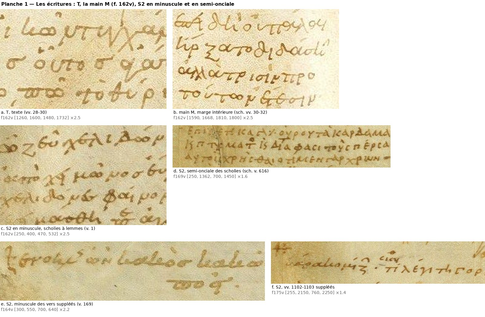
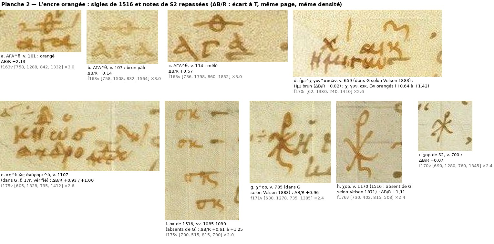

# Chapitre 1 — Les mains et les encres

*Étude graphologique de R (Ravenne, Biblioteca Classense, ms. 429, olim 137, 4, A), Thesmophories, ff. 162v–177r (vv. 1–1231).*

> **Statut** : rédaction du 28 octobre 2026. Sources : les trente inventaires de page (`../folios/fXXX.md`, `../folios/fXXX.jsonl`, environ 2 200 observations, et les relevés détaillés `fXXX_texte.jsonl`, `f173v_marges.jsonl`), les résumés `../resume_pages.json`, le dossier de littérature `recherche/ravennas_dossier.md`, et des contrôles nouveaux sur les images à pleine résolution (`dossier_ravennas_thesmophories/folios_individuels_ff162v-177r/`), sur l'apographe G (Monac. gr. 492, numérisation BSB `bsb00108707`, dans `.sources/`, non versionné). Je distingue toujours ce que j'observe (« sur l'image », « mesuré ») de ce qu'affirment les auteurs.
>
> **Illustrations.** Planches de ce chapitre : `planches/1_pl1_ecritures.jpg`, `planches/1_pl2_encre_orangee.jpg` ; planche du groupe à l'encre brun-noir du chapitre 4 : `planches/4_groupe_Rn.png`. Spécimens (≤ 600 px, régénérables, dossier ignoré par git) : `../specimens/ch1/`. Outil de mesure : `outils/graphologie/encres_mesure_uniforme.py`. Données : `donnees/1_encres_pages.json` (T et S2, page par page) et `donnees/1_ecarts_observations.tsv` (écart à T de chaque observation des inventaires). Vues de contrôle, non versionnées : `.travail/ch1/vues/`.
>
> **Conventions.** l. = ligne réglée de la colonne (1 à 43) ; v. = vers (numérotation de l'édition) ; « fXXX #n » = n-ième observation (à partir de 0) du JSONL de la page. G = Monac. gr. 492 (XVe s.), apographe de R ; Junt. = *editio princeps* de Florence (28 janvier 1516), composée sur R. Les étiquettes de mains sont définies au § 9 (tableau final).

## Conclusions principales

1. **Une seule main pour le texte (T = R1)**, d'une encre brune homogène sur les trente pages. Ses propres corrections (R1c) se font en écrivant ou en relisant, à la même encre. Le titre de la pièce et celui de l'hypothesis de l'*Assemblée* sont aussi de T, en majuscule de distinction.
2. **Toutes les scholies et presque toutes les gloses sont de S2 (R2)**, qui est aussi le correcteur ancien principal. Il écrit en semi-onciale inclinée ses scholies, ses gloses et ses sigles. Il écrit en minuscule, d'une part une série de scholies à lemmes au f. 162v, d'autre part les vers et les lettres qu'il ajoute au texte. Son encre ne se sépare pas de celle de T : en moyenne elle est à peine plus jaune (écart médian +0,14 du rapport B/R à densité égale), mais l'écart varie d'une note à l'autre et disparaît pour des notes écrites dans la colonne même.
3. **Une troisième main ancienne, en minuscule ronde et droite (M = Rsch)**, a écrit les deux scholies de la marge intérieure du f. 162v (vv. 27 et 30–32). C'est la « troisième main » d'Orsini, et non une minuscule de S2 comme le voulait Allen. Elle est proche de la minuscule de T.
4. **Un correcteur ancien à l'encre brun-noir (R3)** a récrit des mots sur grattage (vv. 493, 646, 939, sans doute 874) et ajouté quelques accents et esprits. Son encre est nettement plus neutre que celle de T et de S2 à densité égale. Il est antérieur à G. Les sources l'attribuent à S2, et l'hypothèse d'une campagne distincte de S2 n'est pas exclue. Je l'identifie au R³ « paullo recentior » que la préface de Velsen 1883 annonce sans l'employer.
5. **Toute l'encre orangée appartient à une seule campagne, celle de 1516 (Rrec).** Cette campagne a écrit les sigles « imprimables », des corrections, des signes d'insertion et des barres d'annulation. Elle a aussi **repassé** des notes de S2 pâlies. C'est pourquoi des notes de la forme de S2, que G reproduit déjà, sont aujourd'hui orangées. Preuves : sur une même page, trois sigles ΑΓΑ^θ identiques de S2 sont l'un brun pâli, l'autre orangé, le troisième mêlé (f. 163v) ; une même note de S2 est brune au début et orangée ensuite (f. 170r, v. 659) ; les vers suppléés par S2 sont repassés là où G les lisait mal (chap. 4). L'hypothèse d'une « seconde encre » orangée de S2 n'est donc pas nécessaire. Les « deux correcteurs à l'encre rougeâtre » de Clark s'expliquent ainsi : son premier correcteur, antérieur à G, correspond aux notes de S2 repassées.
6. **La même campagne de 1516 emploie une seconde matière, grise et neutre** : une pointe métallique (plomb probable) pour les repères de pages de la Juntine, et une fois pour barrer une paragraphos. Il faut y ajouter des empreintes grises d'imprimeur.
7. **Interventions modernes (Rmod).** Elles comprennent deux foliotations : l'une à l'encre, dans l'angle intérieur, ancienne ; l'autre au crayon de graphite, dans l'angle extérieur, celle de la Classense, décalée de +2. S'y ajoutent la signature « 22 » (f. 167r), qui est à l'encre brune et non au crayon. On relève encore des taches de réactif bleu-vert sur les débuts de scholies de douze pages (XIXe s. probable), des traits de crayons rouge et bleu, et des restaurations au tulle et à la pièce de peau.
8. **Le témoignage de l'encre a des limites.** Les rapports absolus varient d'une ouverture à l'autre, selon la prise de vue : pour T, le rapport B/R vaut 2,3–2,45 aux ouvertures f. 163v–164r, 165v–166r, etc., et 2,0–2,2 aux autres. Les traits fins mesurent « gris », quelle que soit la main. Une auréole d'humidité jaunit les mesures. Seuls les écarts à T mesurés sur la même page et à densité égale sont comparables. Ils ne sont décisifs que pour trois oppositions : orangé contre brun, gris neutre (plomb, graphite) contre encre, brun-noir contre brun sur des lettres entières. Ailleurs, la forme seule tranche.

---

## 1. Sources, méthode, limites

### 1.1 Corpus

Les trente inventaires couvrent toutes les pages (ff. 162v–177r). Chacun donne une synthèse (`fXXX.md`) et un relevé ligne à ligne (`fXXX.jsonl`), dont chaque observation porte une catégorie, une ligne, un vers, une description, une main, des critères, une certitude, une boîte et un spécimen. Les résumés structurés de `../resume_pages.json` donnent, pour chaque page, les mains reconnues, les faits saillants et les doutes. Je les ai tous lus. Les attributions des inventaires ne lient pas ce chapitre : j'ai repris les points décisifs sur l'image (§ 11.1) et je signale les corrections au § 11.2.

### 1.2 Une mesure unique pour toute la pièce

Les inventaires mesurent l'encre de deux façons :

- en **rapports d'absorbance** relatifs au fond (A_G/A_R et A_B/A_R, notés G/R et B/R ; T ≈ 1,2–1,4 et 1,8–2,4), pour la plupart des pages ;
- en **rapports de réflectance** (valeurs RVB du trait ; T ≈ 0,83–0,87 et 0,50–0,56), pour les ff. 173r, 173v, 175r et 177r, et en partie pour les ff. 174r et 174v.

Les deux séries ne se comparent pas directement. J'ai donc repris **toutes** les observations munies d'une boîte (2 002, dont 1 926 mesurables) avec un protocole unique (`outils/graphologie/encres_mesure_uniforme.py`) :

1. les pixels de trait sont isolés par le masque d'encre brune de `outils/images/recadrer_facsimile.py` (fonction `masque_encre`), puis érodés d'un pixel (« cœur ») ;
2. le fond local est estimé canal par canal par une convolution normalisée qui exclut les pixels d'encre. Une simple moyenne floue, qui assombrit le fond dans les zones denses, n'est pas employée ;
3. je calcule l'absorbance A = −log10(I/fond) par canal, puis les rapports G/R et B/R ;
4. **référence T de la même page** : je prends la médiane du rapport B/R de T par tranche de densité A_R de 0,02, sur toutes les lignes de la colonne, hors zone des sigles et hors blocs de scholies. L'**écart à T**, noté ΔB/R, est la médiane, sur les pixels de l'objet, de la différence entre son B/R et celui de T à la même densité.

Un ΔB/R positif signale une encre plus jaune-orangée que T, un ΔB/R négatif une encre plus neutre ou plus noire. Pour T lui-même, ΔB/R reste dans la fourchette −0,16 / +0,10 (déciles des 629 observations attribuées à T). Dans une même page, la variation de position (gauche ou droite de la colonne, haut ou bas) ne dépasse pas ±0,03 (contrôle sur sept pages).

### 1.3 Quatre limites, qui commandent l'interprétation

**(a) La prise de vue.** Les rapports absolus de T changent d'une ouverture à l'autre, et ils sont égaux pour les deux pages d'une même ouverture (tableau 1). Les ouvertures f. 163v–164r, 165v–166r, 167v–168r, 169v–170r, 171v–172r, 173v–174r et 175v donnent pour T un B/R de 2,32–2,45 (tranche 0,10–0,20). Les ouvertures f. 162v–163r, 164v–165r, 166v–167r, 168v–169r, 170v–171r, 172v–173r, 174v–175r, 176r et 176v–177r donnent 2,03–2,23. C'est une affaire de photographie (balance des couleurs propre à chaque cliché de double page), non d'encre. Il s'ensuit qu'**aucune fourchette absolue ne vaut d'une page à l'autre**. Les fourchettes des inventaires ne sont comparables qu'à l'intérieur d'une même page. Quand un inventaire écrit que S2 « se sépare » de T (f. 168r) ou se confond avec l'encre de 1516 (f. 163v), il faut le relire à la lumière de cette limite.

**(b) Les traits fins.** Les images sont des JPEG à chrominance sous-échantillonnée (4:2:0, vérifié). Un point, un accent ou un trait de deux pixels mêle sa couleur à celle du fond et mesure « gris ». Les dicola et les petites paragraphoi de T descendent ainsi jusqu'à ΔB/R −0,4 / −0,55 (ff. 163v l. 34, 169v l. 17, 171v l. 9 et 21). Une teinte neutre mesurée sur un petit signe ne prouve donc jamais une autre encre. De même, les petites corrections de 1516 mesurent souvent comme T (médiane +0,04 pour les « interventions » de cette main, contre +0,60 pour ses sigles).

**(c) Le fond.** Dans les marges jaunies ou tachées, toutes les encres glissent vers l'orangé. Sur 386 notes de S2, l'écart à T croît avec le jaunissement du fond (corrélation 0,34) : il vaut +0,09 sur un fond semblable à celui de la colonne et +0,22 sur un fond jauni.

**(d) Les cartes pixel par pixel.** Sur une carte de l'écart B/R, le bord des traits paraît toujours plus neutre que leur cœur, pour la raison donnée en (b). C'est vrai aussi des sigles de 1516 eux-mêmes (`.travail/ch1/vues/f175v_sk_x5.png`). Des « bords bruns autour d'un cœur orangé » ne prouvent donc pas un repassage. Seules les médianes par boîte, comparées à des témoins de la même page, sont probantes.

**Règle d'usage.** L'encre ne décide que dans trois cas :
- orangé contre brun : ΔB/R ≥ +0,4 sur un objet d'au moins une centaine de pixels de cœur ;
- matière grise neutre (plomb, graphite) contre encre ;
- brun-noir contre brun : ΔB/R ≤ −0,3 sur des lettres entières et assez denses.

Pour tout le reste (T ou S2, lettre isolée, accent), seule la forme tranche, ou l'attribution reste indécise.

**Tableau 1 — Encre de T et des scholies de S2, page par page** (mesure unique ; cœur des traits ; B/R médian par tranche de densité A_R).

| Ouverture | Page | T : B/R (A_R 0,10–0,20) | T : B/R (A_R 0,20–0,30) | Scholies de S2 : B/R (0,10–0,20) | Δ S2 − T (0,10–0,20) | Δ S2 − T (0,20–0,30) |
|---|---|---|---|---|---|---|
| f162v–f163r | f162v | 2,19 | 2,13 | 2,34 | +0,15 | +0,14 |
|  | f163r | 2,17 | 2,08 | 2,21 | +0,04 | +0,02 |
| f163v–f164r | f163v | 2,42 | 2,37 | 2,77 | +0,34 | +0,17 |
|  | f164r | 2,44 | 2,42 | 2,65 | +0,20 | +0,11 |
| f164v–f165r | f164v | 2,17 | 2,11 | 2,34 | +0,17 | +0,06 |
|  | f165r | 2,12 | 2,05 | 2,25 | +0,13 | +0,10 |
| f165v–f166r | f165v | 2,32 | 2,29 | 2,61 | +0,28 | +0,23 |
|  | f166r | 2,35 | 2,28 | 2,53 | +0,18 | +0,18 |
| f166v–f167r | f166v | 2,14 | 2,05 | 2,29 | +0,15 | +0,19 |
|  | f167r | 2,19 | 2,10 | 2,43 | +0,25 | +0,25 |
| f167v–f168r | f167v | 2,41 | 2,36 | 2,78 | +0,37 | +0,29 |
|  | f168r | 2,39 | 2,30 | 2,70 | +0,31 | +0,32 |
| f168v–f169r | f168v | 2,17 | 2,10 | 2,30 | +0,13 | +0,10 |
|  | f169r | 2,15 | 2,10 | 2,25 | +0,09 | +0,07 |
| f169v–f170r | f169v | 2,35 | 2,30 | 2,61 | +0,27 | +0,25 |
|  | f170r | 2,42 | 2,35 | 2,62 | +0,20 | +0,17 |
| f170v–f171r | f170v | 2,17 | 2,07 | 2,24 | +0,07 | +0,06 |
|  | f171r | 2,12 | 2,02 | 2,24 | +0,12 | +0,06 |
| f171v–f172r | f171v | 2,43 | 2,32 | 2,53 | +0,10 | +0,11 |
|  | f172r | 2,39 | 2,30 | 2,58 | +0,19 | +0,20 |
| f172v–f173r | f172v | 2,12 | 2,07 | 2,31 | +0,19 | +0,16 |
|  | f173r | 2,10 | 2,01 | 2,30 | +0,20 | +0,18 |
| f173v–f174r | f173v | 2,32 | 2,24 | 2,53 | +0,21 | +0,20 |
|  | f174r | 2,32 | 2,19 | 2,56 | +0,24 | +0,18 |
| f174v–f175r | f174v | 2,12 | 2,02 | 2,25 | +0,13 | +0,12 |
|  | f175r | 2,11 | 2,00 | 2,17 | +0,05 | +0,09 |
| f175v–f176r | f175v | 2,44 | 2,35 | 2,85 | +0,41 | +0,25 |
|  | f176r | 2,23 | 2,15 | 2,27 | +0,04 | −0,03 |
| f176v–f177r | f176v | 2,04 | 1,96 | 2,30 | +0,26 | +0,20 |
|  | f177r | 2,03 | 1,96 | 2,09 | +0,06 | +0,05 |

Au f. 175v, la grande auréole d'humidité de la moitié gauche relève à la fois T et S2 : c'est la seule ouverture dont les deux pages diffèrent.

---

## 2. Le copiste du texte, T (R1)

### 2.1 Écriture

C'est une minuscule ronde et liée, dont la hauteur d'x vaut 18–20 px (2,1–2,3 mm), écrite sous la réglure. On y trouve des formes onciales mêlées : Η en H, Ν en N en fin de ligne, grand σ lunaire enveloppant la finale -ος. On y relève aussi le π en ϖ, le β en « u », le κ en « lc », le ν final à jambage plongeant, qui se lit μ, et le second τ de ττ en forme de γ. La ligature ει prend les formes de « q », « 4 » ou « ϥ », et ζ comme ξ s'écrivent en « ʒ ». Le ψ est cruciforme et l'esprit souvent rejeté à gauche de la voyelle. L'inventaire de ces formes et des pièges qu'elles créent relève du chapitre 2. Il concorde avec les descriptions d'Orsini 2011, 325 et d'Allen 1896, 319 (dossier § 3.1).

T écrit aussi la **majuscule de distinction** des titres : au f. 162v, ἀριστοφάνους θεσμοφοριάζουσαι, avec ornement et trait final de la même encre (inventaire f162v #0) ; au f. 177r, le titre ὑπ(όθεσις) ἐκκλησιαζουσῶν ἀριστοφάν(ους) et la ligne ornementale (inv. f177r). Il n'y a ni rubrique, ni liste de personnages, ni souscription.

### 2.2 Encre

L'encre de T est **homogène** sur toute la pièce. D'une page à l'autre, les écarts de B/R de T suivent exactement les ouvertures photographiques (tableau 1). Dans une même page, ils ne dépassent pas ±0,03. Rien ne trahit de changement d'encre ni de plume dans les ff. 162v–177r : les changements signalés par Zacher et Martin (ff. 33/34, 116–117, 143) sont tous antérieurs à la pièce (dossier § 3.1).

### 2.3 Ses marques et ses signaux

- **Marques de changement d'interlocuteur.** T emploie la paragraphos, épaisse à gauche, effilée à droite, posée à mi-hauteur dans la zone des sigles, et le dicolon. Il n'écrit jamais de nom de personnage. L'étude du système (usage antique de la paragraphos, omissions, paragraphoi « fausses ») est au chapitre 5.
- **Signaux au correcteur.** Ce sont des signes marginaux de l'encre du texte. Ils sont rares et plusieurs signes en ont l'apparence sans en être :
  - √ au v. 4 (f. 162v ; Allen 1896, 316, vérifié par l'inventaire) ;
  - ⋎ pointé devant le v. 807, sans correction (f. 172r, l. 12 ; Allen y voit la faute στρατωνίκην) ;
  - ÷ à barre ondulée qui renvoie au v. 647 omis (f. 170r, l. 11–12, encre plus proche de T que de S2) ;
  - le √ du v. 1135 (f. 176r) et le signe du v. 1176 (f. 176v), donnés par Allen, sont probables. Le second mesure plus gris que T, ce qui n'est pas probant pour un trait fin.

  En revanche, les « + » des ff. 165r, 165v, 175r, 175v, 176v et 177r sont des paragraphoi de T barrées par 1516 (§ 6.3). Les ÷ des marges terminent des scholies de S2. Le θ suscrit de αγα^θ et les croix de renvoi appartiennent aux notes de S2.

### 2.4 Les corrections du copiste (R1c)

Elles ont l'encre du texte et se font de deux façons. Le répertoire complet est au chapitre 4.

- **En écrivant.** T biffe ou exponctue le mot qu'il vient d'écrire et poursuit :
  - dittographie ἅπασιν ἅπασιν (f. 170r, l. 34) ;
  - τὸ biffé (f. 171r, v. 754) ;
  - τί biffé et δ barré (f. 171v, l. 5 et 16) ;
  - ligne entière anticipée puis barrée, et ἱστιοφόρον barré (f. 173v, l. 15 et 17) ;
  - ἐξ ⟦ελέγχων⟧ ἔλαχον (f. 175r, l. 28) ;
  - ligne στυγνᾶς ὦσσε exponctuée (f. 176r, l. 17).
- **En relisant.** T suscrit des lettres de même module, et une fois un mot en marge :
  - κ de ἐκ^κλησίαν (f. 166v, l. 39) ;
  - η et κ suscrits, ν sur ἂρ (f. 168v, vv. 512, 514, 549) ;
  - κ et θ suscrits (f. 175v, l. 8 et 22) ;
  - ὢν (f. 164v, v. 170) ;
  - τὼ (f. 176v, v. 1183) ;
  - μέντοι en marge (f. 169v, v. 630 ; cursive liée, attribution « présumée »).

  Quelques accents de même encre sont corrigés de la même manière, par exemple εἰσιὼν (f. 168r) et κακά (f. 167r, v. 388).
- **Limite.** Une lettre suscrite d'une encre « comme T » peut être de S2, dont l'encre se confond souvent avec celle de T (§ 3.3). Sans forme distinctive (Ν oncial, esprit en équerre, semi-onciale), l'attribution à T reste probable, non sûre.

---

## 3. Le scholiaste et correcteur ancien, S2 (R2)

### 3.1 La semi-onciale des scholies

C'est une majuscule inclinée à droite, de 1,6–2 mm, aux lettres disjointes et anguleuses. On y trouve ε et σ lunaires ; Μ, Ν, Η, Κ, Λ et Δ onciaux ; le Κ souvent fait d'une haste et d'un « c ». Les accents sont posés sur les majuscules. Les compendia sont accentués : ϗ, « ʒ » pour δέ ou -αι, lettres suscrites. Les notes sont ouvertes par un tiret et closes par ÷ ou :–. C'est la « coarser and thicker » écriture de B chez Allen 1896, 320 et le S2 d'Orsini 2011, 327, qui écrit toutes les scholies des ff. 111v–191v. Exemple : planche 1, d (f. 169v, scholie au v. 616). Le détail des abréviations est au chapitre 3.

### 3.2 La minuscule de S2

S2 écrit en minuscule dans deux situations.

- **Ajouts au texte.** Il emploie une grande minuscule penchée, à plume fine : le « very large, sloped to the right, and fine » d'Allen 1896, 320. On la trouve dans les vers suppléés : v. 33 (f. 162v, marge droite), v. 169 (f. 164v, marge gauche), v. 647 (f. 170r, marge droite), vv. 1102–1103 (f. 175v, marge inférieure). On la trouve aussi dans des lettres ou mots suscrits : πο (f. 167v, v. 434), περ (f. 173v, v. 938), τινα (f. 172r, v. 833), οι (f. 176r, v. 1127), γ(άρ), κα et θ (f. 164r, vv. 149, 151, 155). Cette minuscule garde des capitales (Ν oncial, Η, Π, Λ), ce qui trahit le scribe de semi-onciale. Exemples : planche 1, e–f.
- **Scholies à lemmes du f. 162v.** C'est une série continue dans les marges supérieure et extérieure (vv. 1–24 ; notice sur la pièce et « προλογίζ(ει) … »), en petite minuscule de 10–15 px, un peu inclinée, aux lettres disjointes. Les **lemmes y sont en semi-onciale** (ΑΚΟΥΕΙΝ, avec Ε lunaire et Ν capital), avec un Ζ capital dans ὦ Ζεῦ (planche 1, c ; `../specimens/ch1/f162v_marge_g_S2_minuscule.png`). La glose ζωνάριον du f. 164r (l. 18), en minuscule à Ζ capital, relève du même usage. J'accepte ici l'attribution d'Allen 1896, 320–321 (« an experiment on the part of B »).

### 3.3 Encre

- **En moyenne**, les scholies de S2 sont à peine plus jaunes que T : ΔB/R médian +0,15 pour 262 scholies (déciles +0,01 / +0,36), +0,13 pour les gloses. La médiane des médianes par page vaut +0,14 sur les trente pages, et l'écart est positif sur vingt-neuf pages (tableau 1).
- **Une part de cet écart vient du fond.** Il croît avec le jaunissement des marges (§ 1.3 c). Les notes que S2 a écrites **dans la colonne même** mesurent comme T. C'est le cas au f. 174v (l. 17 : −0,05 ; l. 20 : −0,13), au f. 163r (χωνεύει, l. 20 : 0,00), au f. 170v (l. 7 : −0,08), au f. 175r (l. 21 : +0,02) et au f. 172r (glose πόρνης ὄνομα, l. 9 : +0,03). D'autres, sur le même fond, sont plus jaunes : f. 174v, l. 33 (+0,41) ; f. 164r, ζωνάριον (+0,38).
- **Les petites corrections de S2 dans le texte** mesurent en médiane comme T (−0,02 pour 64 interventions). Il y a des exceptions nettes, mesurées par les inventaires contre les lettres voisines à densité égale : πο du v. 434 (f. 167v), περ et να des vv. 938 et 954 (f. 173v), seconde boucle de l'ω de ὠόμην au v. 526 (f. 168v).

Il faut donc conclure ainsi : **l'encre de S2 est du même type que celle de T, en séances plus variables**. Elle ne sépare jamais à elle seule S2 de T pour un trait isolé. Les campagnes distinctes que les inventaires ont repérées à l'intérieur de S2 sont réelles, mais il faut les lire selon le § 1.3. Ce sont les gloses de la marge intérieure du f. 168r, à l'encre « de T », la 1re ligne grise d'une scholie au f. 166r (v. 329), et la différence entre marge intérieure et marge extérieure au f. 163v. Les sigles « rougeâtres » de S2 du f. 172v (« groupe A ») sont des sigles repassés (§ 6.4).

### 3.4 Ce que fait S2

- **Scholies et gloses.** Il les écrit toutes, sauf les deux notes de la main M (§ 4). Elles occupent surtout les marges extérieure et intérieure, et parfois les marges supérieure et inférieure ou le blanc des lignes lyriques. Le détail est au chapitre 3.
- **Sigles de personnages.** Ils sont abrégés par lettre suscrite et posés à gauche de la paragraphos de T : μνη^σ, μνησι^λο, κη^δ, ευρι^π, γυ^ν, αγα^θ, κλεισ^θ, σκυ^θ, χ^ο, χ^ρ et le monogramme χορ, τοξ. On les trouve sur presque toutes les pages où le dialogue l'exige (§ 8). Allen écrit, à propos du f. 170v, « nearly all the dram. pers. are by B » : c'est vérifié, avec 8 ou 9 sigles de S2 contre un sûr de 1516.
- **Corrections.** S2 supplée les vers omis : vv. 33, 169, 647, 1102–1103. Il fait des suscriptions et des écrits sur grattage, par exemple -εῖν au v. 370 (f. 166v). Il exponctue (σαλλαβακχοῦσ, v. 805, probable) et corrige ses propres scholies (δαίμων, f. 166r ; ἀμφε sur ⟦ενε⟧, f. 174v). Il ajoute des accents et des esprits, mais ceux que Velsen 1883 lui donne ne sont en général ni visibles ni attribuables sur l'image.
- **Signes de renvoi.** Il en emploie, contre ce qu'écrivent Zacher 1888, 536 et Orsini 2011, 328 :
  - ∈ … ∈, ·϶· et ✕ au f. 164r (vv. 127, 131, 135) ;
  - ·×· au f. 169r (v. 566, scholie déplacée en haut de marge) ;
  - ·✓· au f. 166v ;
  - → au f. 171v (l. 18) ;
  - croix du v. 168 au f. 164v ;
  - « +: » des vv. 1102–1103 au f. 175v. Ce dernier signe est toujours visible, bien qu'Allen 1896, 317 le dise « erased by Giunta ».

### 3.5 Place dans la chronologie

S2 écrit **après T** :

- au f. 163v, l. 35, la base du dernier Α de son ΑΓΑ^θ est la paragraphos de T ;
- au f. 169v, il raccourcit deux lignes de scholie pour ne pas toucher les paragraphoi de T des vv. 617–618 (inv. f169v, corrections 1–2) ;
- partout, ses sigles se logent à gauche de ces paragraphoi.

Il écrit **avant G** : G reproduit ses vers suppléés, ses sigles et ses suscriptions (inv. f164r, vérifié dans G par l'inventaire ; Velsen 1871 et 1883). Les auteurs le jugent contemporain ou presque de T (« fere suppar aetate primae manui », Velsen 1883, 5 ; « nicht viel später », Velsen 1871, 6–7).

---

## 4. La troisième main ancienne, en minuscule (M = Rsch)

**Ce qu'elle a écrit.** Deux scholies de la marge intérieure du f. 162v :

- à la hauteur des l. 28–29 (v. 27) : « λεί^π(ει) τὸ ἔνθα· οἷον σιω(πῶ) | διὰ τὸ θύριον | … » ;
- aux l. 30–33 (vv. 30–32) : « ἐπειδὴ οὐ πάλαι | ἤρξατο διδάσκ(ειν) | ἀλλὰ τρισὶν πρὸ | τούτων ἔτεσιν », selon la lecture de Martin 1882, 196 citée au chapitre 3, que l'image permet.

Voir planche 1, b et `../specimens/ch1/f162v_marge_int_main_M.png`.

**Ce que j'observe** (images à ×2,5–3 et à même échelle que les autres minuscules, planche 1) :

- une minuscule **ronde et droite**, aux lettres espacées et régulières, d'un module voisin de 12–16 px, tracée d'une plume assez épaisse ; δ à boucle haute, θ ovale fermé, ξ à longue queue ;
- elle diffère de la minuscule à lemmes de S2 du même folio (planche 1, c), plus petite, inclinée, irrégulière, au tracé grêle, avec des capitales ;
- elle diffère aussi de la grande minuscule penchée des vers suppléés par S2 (planche 1, e–f), qui est inclinée, étirée et à plume fine ;
- par le style, elle se rapproche de la minuscule de T (planche 1, a), en lettres détachées et en plus petit module. Le chapitre 3 y relève des formes de T (π en ϖ, κ en « lc »).

**Encre.** Note du v. 27 : ΔB/R −0,08, comme T. Note des vv. 30–32 : +0,15, comme les scholies de S2 de la page (+0,13 à +0,21). Les deux notes sont pourtant de la même main : l'encre ne discrimine pas.

**Conclusion.** Ces deux notes ne sont pas de S2. Elles forment la « troisième main contemporaine » qu'Orsini 2011, 327 n. 24 signale expressément pour la scholie au v. 32. Je ne contredis pas Allen sur les autres minuscules du f. 162v. Peut-on l'identifier à T écrivant en petit ? C'est possible, mais l'image seule ne suffit pas. Il faudrait la confronter aux ajouts marginaux sûrs de T dans d'autres pièces (Ploutos 271 et 1129–1130, ff. 4r et 14r) et à la scholie à Ploutos 509 (f. 6v) qu'Orsini donne à la même main. Ces pages ne sont pas dans le dépôt. Étiquette : **Rsch** (« main M »), avec la mention « T ? ».

---

## 5. Le correcteur ancien à l'encre brun-noir (R3)

Le chapitre 4 (§ 2.3 ; planche `planches/4_groupe_Rn.png`, « Rⁿ ») a réuni ces interventions et mesuré leur encre. Je l'ai remesurée indépendamment, avec le protocole du § 1.2.

| Page, l. | v. | Intervention | ΔB/R (ce chapitre) | Δ (chap. 4) | Valeur |
|---|---|---|---|---|---|
| f. 170r, l. 11 | 646 | ἥκει πάλιν sur grattage (`../specimens/ch1/f170r_v646_hekei_palin.png`) | −0,44 (186 px, A_R 0,25) | −0,41 | sûre (mots entiers) |
| f. 173v, l. 22 | 939 | υ de ἀποδύσαντα sur grattage (`…/f173v_v939_upsilon.png`) | −0,46 (57 px, A_R 0,33) | −0,56 | sûre (lettre dense) |
| f. 168r, l. 28 | 493 | κιν- sur grattage, Κ majuscule en deux traits | −0,21 / −0,28 | −0,31 | sûre |
| f. 172v, l. 41 | 874 | ι de ποίου, σ gratté | non isolé ici | −0,53 | probable |
| f. 163r, l. 17 | 54 | grave sur le second τάδε (`…/f163r_v54_grave_brun_noir.png`) | −0,53 (34 px, A_R 0,24) | −0,44 | probable (petit signe dense) |
| f. 176r, l. 24 | 1149 | esprit rude « ⊢ » de ἅλσος (`…/f176r_v1149_esprit_noir.png`) | −0,39 (48 px, A_R 0,28) | −0,35 | probable |
| f. 170r, l. 14 | 650 | aigu ajouté au grave de ἐγὼ | −0,27 (143 px) | −0,43 | possible |

**Ce qui est établi.** Sur des lettres entières et denses, l'encre est nettement plus neutre et plus sombre que celle de T et que celle des scholies de S2, à densité égale. ΔB/R vaut −0,2 à −0,5, alors que T reste au-dessus de −0,16 et que les scholies de S2 restent au-dessus de +0,01 (déciles inférieurs). Les écrits sur grattage ne suffisent pas à l'expliquer : d'autres récritures sur grattage ont l'encre de T, comme γα de τ' ἄργα (f. 172r, −0,03) et εῖ de ἐπιζεῖν (f. 168r, −0,09). L'εῖ de ἐπιζεῖν n'appartient donc pas au groupe (accord avec le chap. 4, contre l'inv. f168r).

**Écriture.** ἥκει πάλιν est en semi-onciale droite, d'un module un peu supérieur à celui des scholies. Elle n'est pas inclinée comme celle de S2. Κ, Π, Λ et Ν y sont majuscules. Le κιν du f. 168r a un Κ majuscule en deux traits, forme que S2 emploie dans ses sigles. L'esprit en équerre du v. 1149 rappelle l'esprit anguleux de S2.

**Date.** Cette encre est **antérieure à G** : G a ἥκει πάλιν (f. 10v, contrôlé par le chap. 4), et Velsen 1883 donne κινώμεθα « in codd. ». La position relative par rapport à S2 est inconnue, faute de superposition observée.

**Attribution.**
- Allen 1896, 316 (B) et Velsen 1883 (R²) donnent ces corrections à S2. Velsen 1871 donne le grave du v. 54 à la « 2 m. », ce que l'encre exclut.
- L'écart d'encre et l'écriture droite plaident pour une campagne distincte, peut-être d'une autre main.
- Velsen 1883, 5 annonce un R³ « paullo recentior » qu'il n'emploie jamais dans l'apparat des *Thesmophories*. Clark 1871, 154 parle d'une main « à l'encre plus noire » (XIVe ou début du XVe s.), surtout dans les Nuées. Je ne peux établir ni l'une ni l'autre identification.

**Étiquette.** **R3**, définie par l'encre (« correcteur ancien à l'encre brun-noir, antérieur à G ; R² ipse ? »). Le groupe comprend les trois interventions sûres et les cas probables. Les accents isolés n'y entrent que lorsque l'écart est grand et dense.

---

## 6. La campagne de 1516 (Rrec)

### 6.1 Identification

Velsen 1871, 6–7 décrit une « 2 m. » propre à la *Lysistrata* et aux *Thesmophories*, « viel später » (XVe ou XVIe s.). Ses sigles « imprimables » sont ceux de la Juntine et manquent dans G (Velsen 1871, 7–8, liste des cas « bezeichnend »). Les traits et chiffres de la même campagne renvoient aux pages des cahiers de la Juntine (Velsen 1871, 3–6). R. Schöll l'a identifiée à Euphrosynus Boninus, et l'identification a été reprise depuis (Velsen 1883, 5 ; Martin 1882, xiii ; Prato 2001, xxxii ; Scotti 2024, 462 : dossier § 6.3). **Aucune comparaison avec un autographe de Bonini n'a été publiée.** Le seul autographe signalé est un manuscrit de 1493 de la collection Theodorou, sans reproduction (dossier § 6.3). J'emploie donc « main de 1516 », non « Boninus ».

### 6.2 Encre

L'encre est **orangée**, et c'est le seul critère d'encre vraiment discriminant de la pièce.

- 235 sigles attribués à cette main par les inventaires donnent un ΔB/R médian de +0,60 (quartiles +0,24 / +0,92). La médiane des médianes par page vaut +0,62 sur 19 pages.
- En valeurs absolues, les inventaires donnent G/R 1,36–1,91 et B/R 2,2–4,0 selon l'ouverture (§ 1.3 a), et une teinte « rouge-orangé » en décorrélation Lab.
- La signature est la même sur toutes les pages.
- Les petites corrections de cette main (accents, virgules, traits) mesurent souvent comme T (médiane +0,04), pour la raison donnée au § 1.3 b. Pour elles, il faut s'appuyer sur la liste de Velsen 1871 et sur la forme.

### 6.3 Écriture et façons de faire

**Formes** (relevées dans les inventaires, contrôlées sur les planches) :

- Γ en grand crochet à longue haste, souvent greffé sur le dicolon ou la paragraphos de T (Γϋ, Γυ) ;
- μ à premier jambage descendant ;
- ν suscrit en V, η suscrit en Η capital (μν^η) ;
- κ en croix ou en x ;
- εὐ en Є barré ou cursif ;
- σκ à longue queue, Ηχ à Η capital et grand χ ;
- tréma sur υ et point abréviatif.

Le module des sigles est **grand** (30–45 px). Le « viel kleiner » de Velsen 1871 vaut pour les corrections dans le texte, non pour les sigles (inv. f165r, f167v).

**Ce que fait cette main :**

1. **Sigles imprimables** en tête de vers et dans les vers, sur les marques de T ou dans ses blancs. Il y en a environ 300. Ils font défaut aux ff. 166v, 170r, 171v, 172r et 174r, et sont rares aux ff. 166r, 167r, 167v, 168r, 168v, 169v et 170v (§ 8.2).
2. **Sigle en marge et signe d'insertion « ^ » ou « √ » dans la ligne**, quand T n'a rien marqué (f. 165r, l. 8, 14, 16 ; f. 176v, vv. 1179 et 1187, avec deux attributions fausses). Au v. 552, elle place une croix et un chevron dans le texte (f. 169r).
3. **Annulation des paragraphoi** jugées fausses, par une haste verticale qui forme un « + » :
   - vv. 232, 234, 246 (f. 165r) ;
   - vv. 264, 273, 274 et parépigraphe (f. 165v) ;
   - vv. 1093, 1095 (f. 175v) ;
   - vv. 1184, 1194, 1195, 1204 (f. 176v) ;
   - v. 1221 (f. 177r).

   Au v. 1076, elle barre une fois au trait gris (f. 175r, l. 35 ; Velsen 1871 : « I m. del. 2 m. »).
4. **Grattage de sigles anciens**, puis récriture :
   - κήρυξ sur le κη^ρυ de S2 que G a encore (f. 166r, v. 295) ;
   - Γυνὴ τίς sur un sigle antérieur que G reproduit (f. 167r, v. 380) ;
   - vv. 34 et 25 (?) (f. 162v), v. 173 (f. 164v), v. 466 (f. 168r), l. 31–32 (f. 173r), l. 31–33 (f. 175v).

   Elle gratte aussi des paragraphoi après la copie de G (f. 176v, v. 1200, où G a encore la paragraphos).
5. **Corrections du texte et de la ponctuation** à l'encre orangée, conformes à la liste de la « 2 m. » de Velsen 1871, 25–26 :
   - grave de παρὰ annulé (v. 803) et grave ajouté sur πρὸς (v. 806) au f. 172r ;
   - seconde boucle de ὀλίγων (v. 443, f. 167v) ;
   - grave de καὶ (v. 1097, f. 175v) ;
   - σκ ὸ tiré de ο ο ο (v. 1191, f. 176v) ;
   - virgules transformant un point en « ; » (vv. 193, 222, 252 ; ff. 164v, 165r, 165v).

   **Ne sont pas de cette encre**, contre Velsen 1871 :
   - le grave du v. 54 (R3, § 5) ;
   - l'αι de λαικάζει (v. 57 : brun dense, type S2) ;
   - ἔφραζον (v. 1173 : brun, déjà dans G, donc S2) ;
   - le β de κύβδ' (v. 489 : déjà dans G) ;
   - l'ι de ναυσιμάχη (v. 804).

   Le λ de ἄλ^λως (v. 290, f. 165v) est d'une encre pâle presque neutre, celle des repères de pages (§ 6.5). C'est le seul cas où le « viel blasser » de Velsen convient à une correction.
6. **Imitation des formes de S2.**
   - Le grand monogramme χορ du v. 1170 (f. 176v) a la forme exacte des monogrammes de S2 (planche 2, h et i). Velsen 1871 le range pourtant parmi les sigles de 1516 que G ignore, et son encre est orangée (+1,11).
   - La note « ὡς περσεύς » du v. 871 (f. 172v), imprimée par la Juntine (« Εὐρ. ὡς περσεύς »), reprend la formule de la note de S2 au v. 1098 (f. 175v), où Euripide entre en Persée. Au v. 871, Euripide entre en Ménélas : la note y est fausse.

   La forme de S2 ne suffit donc pas à exclure la main de 1516.

### 6.4 Le repassage des notes de S2

Plusieurs notes et sigles **de la forme de S2** sont aujourd'hui orangés. J'ai réuni tous les cas (planche 2 et spécimens `../specimens/ch1/`) :

| Page | v. | Note | ΔB/R | G (apographe) |
|---|---|---|---|---|
| 162v | 5, 19, 39 | ευ^ρ, μνη^σι, θερά^π (lettres suscrites restées brunes) | +0,06 (boîte mêlée à la paragraphos de T) ; +0,62 ; +1,11 | sigles de S2 dans G (Velsen 1871 : « überzogen von 2 m. ») |
| 162v | 33 | vers suppléé par S2, lignes (b)–(c) repassées (chap. 4) | — | vers omis par G |
| 163r | 45b–46 | μνησί^λο, εὐ, θερ : λό brun, le reste orangé | +0,81 / +0,92 | Velsen 1883 : R² |
| 163v | 101, 104, 114, 117 | ΑΓΑ^θ, χορ (à côté de ΑΓΑ^θ v. 107 et χ^ο v. 111 restés bruns) | +2,13 ; +0,81 ; +0,57 ; +0,99 (contre −0,14 et −0,43) | — |
| 164v | 169 | début du vers suppléé (ὁ δ᾽ αὖ ξενο-), que G lisait mal (chap. 4) | — | blanc dans G |
| 168v | 533 | γυ^νη τίς, intermédiaire entre κη^δ de S2 (v. 540, −0,01) et Γυνη de 1516 (v. 544, +1,01) | +0,41 | van Leeuwen 1904 : « manus recens » |
| 169r | 574, 592 | κλει brun + σ θενησ orangés ; κη^δ | +0,69 ; +1,04 | Velsen 1883 : R² (v. 592) |
| 170r | 655, 659 | χ^ρ ; ἡμι^χ γυν^αικῶν : Ημι brun (−0,02), χ, γυν, αικ, ῶν orangés (+0,64 à +1,42) | +0,99 ; voir ci-contre | dans G selon Velsen 1883 |
| 170v | 689 | γυ^ν(η) sur la paragraphos, cœur orangé | — | — |
| 171r | 730 | μνη^σι | +1,11 | Velsen 1883 : R² |
| 171v | 785 | χ^ορ | +0,96 | χορ̊ dans G selon Velsen 1883 |
| 172v | 846, 852, 855, 871 | μνη^σ, γυ^ν, tiret, εὐρι^π (« groupe A » de l'inventaire) | +0,50 à +0,97 | — |
| 173v | 936, 939 | μνη^σ, ΠΡΥ | +1,29 ; +1,15 | — |
| 174r | 1001 | τοξ(ότης) | +1,47 | Velsen 1883 : R² |
| 175r | 1063b | μνη en interligne | — | Velsen 1883 : R² |
| 175v | 1083, 1098, 1107, 1108 | ηχω ; εὐρι^π ὡς περσεύς ; κη^δ ὡς ἀνδρομε^δ ; σκυ^θ | +0,85 ; +0,95 / +1,10 ; +0,93 / +1,00 ; +0,87 | **dans G, f. 17r, vérifié** pour vv. 1098 (εὐρ… περσ) et 1107 (κη^δ ἀνδρο·) (`../specimens/ch1/G_f17r_vv1098-1107.png`, non versionné) |
| 176v | 1207 | κη^δ | +1,09 | dans G (Velsen 1883) ; Velsen 1871, 35 : main des scholies |

**Deux explications avaient été proposées** (inv. f170r, f171v, f175v, f176v ; chap. 3 § 2.6 ; chap. 4 § 2.4) : une seconde encre de S2, devenue orangée, ou un repassage de 1516. **Les faits tranchent pour le repassage.**

1. **L'encre est la même.** Sur les mêmes pages, ces notes ne se distinguent pas des sigles de 1516 : au f. 175v, κη^δ ὡς ἀνδρομε^δ mesure +0,93 / +1,00, et les σκ de 1516 aux vv. 1085–1089 mesurent +0,61 à +1,25.
2. **Des sigles identiques de S2, sur une même page, ont des encres différentes.** Au f. 163v, ΑΓΑ^θ est brun pâli au v. 107, mêlé au v. 114, franchement orangé au v. 101 (planche 2, a–c). S2 a écrit ces trois sigles dans la même séance. Un repasseur, lui, a pu choisir.
3. **Une même note est brune au début et orangée ensuite.** Au f. 170r, v. 659, Ημι est brun et la suite orangée (planche 2, d). On ne s'arrête pas d'écrire après ἡμι pour changer d'encre. En revanche, on repasse ce qui a pâli.
4. **La main de 1516 repasse ailleurs de façon certaine** : les sigles des vv. 5, 19 et 39 (Velsen 1871, « überzogen »), les vers suppléés 33 et 169, précisément là où G lisait mal (chap. 4).
5. **Le témoignage de G porte sur le texte des notes, non sur leur encre** : un sigle de S2 copié par G au XVe s. et repassé en 1516 est attendu dans G.

**Conséquences.**
- Ces notes sont de S2 pour le contenu et de la main de 1516 pour l'encre visible.
- Les « deux correcteurs à l'encre rougeâtre » de Clark 1871, 159–160 trouvent ici leur explication. Clark voit une copie de G faite « après le premier, avant le second ». Son « premier correcteur » correspond aux notes de S2 repassées, présentes dans G par leur contenu. Son « second », qui « imite le premier », correspond aux sigles imprimables de 1516, qui imitent parfois S2 (§ 6.3, 6).
- **Règle d'attribution** pour un tracé orangé :
  - de forme S2 et attesté par G : R2, repassé par Rrec ;
  - absent de G : Rrec, même s'il a la forme de S2 (v. 1170) ;
  - G non consulté : à contrôler sur la numérisation locale de G.
- Une réserve demeure : un repassage intégral a pu altérer une lettre. Pour le texte exact des notes de S2, G et l'original sous UV restent les témoins de contrôle.

### 6.5 La seconde matière : la pointe grise des repères de pages

Les repères de la Juntine sont tracés dans une **matière gris neutre, sans charge d'encre**. Leurs valeurs (G/R ≈ 0,97–1,16 ; B/R ≈ 1,2–1,6) sont celles du crayon de la foliotation moderne (f. 167r, « 169 » : 1,01 / 1,34). Sur une image en couleurs, on ne peut distinguer graphite et pointe de plomb. La date de 1516 rend vraisemblable un stylet de plomb, le crayon de graphite ne se répandant que plus tard au XVIe s. (connaissance générale, non vérifiée sur ce manuscrit). Les chiffres sont humanistiques (4 ouvert : ff. 170r, 171v). Ces repères ont été relevés par les inventaires et confrontés à la liste de Velsen 1871, 5–6 :

- **Retrouvés** :
  - a 12 (v. 178, f. 164v), a 14 (v. 231, f. 165r), a 15 et a 16 (vv. 258, 284, f. 165v) ;
  - b 1 (f. 166r), b 2/b 3 (v. 363, f. 166v, découvert à la reprise), b 6 (v. 440, f. 167v, longue ligne tirée à la règle), b 7 (v. 491, f. 168r), b 9 (v. 543, f. 168v, probable) ;
  - b 12 (« 12 » très pâle en haut du f. 169v, douteux), b 13 (trait après le v. 618, f. 169v), b 14 et b 15 (vv. 644, 670, f. 170r), b 16 (v. 695, f. 170v) ;
  - c 1 (v. 721, f. 171r), c 3 (?) et c 4 (vv. 775/776 et 795, f. 171v), c 5 (f. 172r), c 6 et c 7 (f. 172v), c 8 (?) et c 9 (f. 173r), c 10 (f. 173v), c 11 et c 12 (f. 174r), c 13 et c 14 (f. 174v), c 15 (f. 175r), c 16 (f. 175v) ;
  - d 4 (v. 1191, f. 176v), d 5 (?) (f. 177r).
- **Non retrouvés** : a 11 (v. 150, f. 164r), b 4 et b 5 (vv. 388, 414, f. 167r), d 3 (v. 1167, f. 176r), le trait de b 12 au bas du f. 169r, et les chiffres « 15 » (f. 170r), « 3 » (f. 171v), « 13 », « 14 » (f. 174v).
- **Variantes de matière** : plusieurs repères sont d'une encre pâle presque neutre plutôt que de la pointe grise (ff. 165v, 170r, 170v, 171v ; c 1 « ocre pâle » au f. 171r). Celui de c 13 est même à l'encre orangée (f. 174v). La même campagne employait donc indifféremment pointe, encre diluée ou encre des sigles.
- **Empreintes d'atelier** : des empreintes digitales grises à stries, de signature « carbone » (encre d'imprimerie), sont visibles au f. 173v (l. 26–27), au f. 176v (l. 31, probable) et au bas du f. 173r (douteux). Ce sont les candidates à la « printer's black thumb-mark » de Clark 1871, 159, qui ne la situe pas.

### 6.6 Une main ou deux au XVIe siècle ?

- **Velsen 1871** voit une seule « 2 m. », « viel kleiner und mit einer viel blasseren Tinte ».
- **Clark 1871** voit « one if not two » mains à l'encre rougeâtre, la seconde imitant la première (dossier §§ 5.1, 10.1).
- **Sur l'image**, toute l'encre orangée a une seule signature, et le « premier correcteur » de Clark se ramène aux repassages (§ 6.4). Il n'y a donc **qu'une campagne d'encre orangée**.
- Le « viel blasser » de Velsen convient aux repères gris, à l'encre pâle du λ du v. 290 et à quelques corrections, non aux sigles.
- Les repères de pages relèvent de la préparation de la composition (calibrage des pages), les sigles et les corrections de la révision du texte : rien n'empêche que deux personnes de l'atelier aient travaillé sur le manuscrit. Une même fonction (barrer une paragraphos) s'exerce pourtant avec les deux matières (ff. 175r et 175v). Je retiens donc **une campagne, deux matières, une main probable**, sous une seule étiquette Rrec, avec un attribut d'instrument pour les repères (§ 9).

---

## 7. Les interventions modernes (Rmod)

### 7.1 Foliotations et signature

- **Foliotation à l'encre**, dans l'angle supérieur intérieur, en chiffres italiques, souvent cachée par le pli. On la voit aux ff. 166r (« 166 »), 167r (« (1)67 »), 170r (« 170 »), 172r (« 172 »), 175r (« [1]75 »), 176r (« [17]6 ») et 177r (« …77 »). Son encre est neutre et sombre (f. 167r : G/R 1,11 ; B/R 1,68, `../specimens/ch1/f167r_foliotation_encre_67.png`). Ce sont les numéros de l'index de Martini sur la garde (« 162. verso », « 177. verso » ; dossier § 6.1) : elle existait au plus tard au XVIIIe s. C'est la foliotation de la littérature (Orsini 2011, 322 n. 3).
- **Foliotation au crayon de graphite** de la Classense, dans l'angle supérieur extérieur, sur les seuls rectos et décalée de +2 (« 165 » au f. 163r … « 179 » au f. 177r ; f. 167r : 1,01 / 1,34, `…/f167r_foliotation_crayon_169.png`). Elle compte les gardes ; Martin 1882, x la connaît déjà. Aux ff. 164r et 171r, les deux numéros sont au crayon (inv. f164r, f171r).
- **Signature « 22 »** au centre de la marge inférieure du f. 167r, premier feuillet du cahier XXII. Elle est **à l'encre brun pâle, non au crayon** (G/R 1,27 ; B/R 1,98, contre 1,01 / 1,34 pour le crayon voisin ; `…/f167r_signature_22.png`). Cela confirme l'inventaire du f. 167r et corrige le dossier (§ 1 : « au crayon »). Aucun « 23 » n'est visible au f. 175r. Martin 1882, x dit les signatures modernes emportées par la rognure : celle-ci a survécu.

### 7.2 Le réactif bleu-vert

Des traînées bleu-vert ou gris-bleu couvrent exactement les débuts de lignes pâlis de scholies, et une fois une ligne entière. On les relève aux ff. 162v, 164v, 165r, 165v, 166v, 168v, 170v, 171r, 174v, 176v et 177r. Au f. 176r, la tache a traversé le parchemin depuis le f. 176v. Leurs rapports d'absorbance sont inversés (G/R < 1 : 0,73–0,87 au f. 162v, 0,75–0,80 au f. 176v ; B/R ≈ 0,65 au f. 168v), ce qu'aucune encre ne donne. Les lettres touchées sont noircies et auréolées (f. 168v) : il ne faut y voir ni une autre encre ni une autre main.

C'est le traitement d'un lecteur qui voulait raviver les scholies pâlies. Une réaction du fer de l'encre, du type des teintures du XIXe s., est vraisemblable. L'opérateur et la date ne sont pas documentés ; la « teinture de Gioberti » citée par certains inventaires reste une hypothèse. Le « perished, and been partly revived » qu'Allen 1896, 316 dit du v. 28, et qui convient au v. 33, peut viser le repassage orangé de 1516 (chap. 4) autant qu'un réactif. Il ne date donc pas celui-ci.

### 7.3 Crayons, restaurations, mains de lecteurs

- **Crayon rouge** soulignant la parépigraphe ὀλολύζεις γέρων (f. 164r, l. 8). Traits de crayons rouge vermillon et bleu-gris au bord de la marge extérieure du f. 173r.
- **Traits de graphite** de fonction inconnue : f. 164r (après κωτῶι), f. 166v (l. 14 et 26), f. 168r (sous ἐρειδόμην), f. 169v (traînée des l. 30–34).
- **Restaurations** : pièces de tulle sur la fente de la marge extérieure et dans la marge supérieure du f. 165v ; pièces de peau aux ff. 169r et 171r ; coins restaurés aux ff. 174r, 176r et peut-être 175v. Aucune n'empiète sur le texte de T.

### 7.4 Deux ajouts discutés : κατα (v. 60) et καί (v. 306)

- **κατα suscrit au v. 60** (f. 163r, l. 24 ; `../specimens/ch1/f163r_v60_kata.png`). Velsen 1871, 43 et 1883 le donnent à la main des scholies. Austin 1987, 71 en fait une conjecture moderne, parce qu'il manque dans G et dans la Juntine et qu'Invernizi l'imprime le premier (dossier §§ 5.4, 11). **Sur l'image**, c'est une petite minuscule légère, penchée, avec un κ byzantin en « u » à haste gauche montante, comme dans les ajouts de S2. Son encre est brune (ΔB/R −0,14, trait mince, non probant) et ne ressemble à aucune encre moderne de la page. L'argument d'Austin ne prouve rien : G omet aussi le v. 33, ajout ancien sûr, et la Juntine le γάρ suscrit du v. 149, que G a pourtant lu (chap. 4 § 1.3). **Attribution : S2 probable ; rien n'indique une main moderne.**
- **καί suscrit au v. 306** (f. 166r, l. 13). Il est petit et pâle, et absent de G comme de la Juntine. Velsen 1871 le donne à la « 2 m. », mais il n'est pas orangé (1,41 / 2,23, plage de S2 sur cette page) : **R?**.

---

## 8. Chronologie relative et répartition par page

### 8.1 Superpositions et repères de datation

| Relation observée | Lieu | Conclusion |
|---|---|---|
| La base du dernier Α du sigle ΑΓΑ^θ de S2 est la paragraphos de T | f. 163v, l. 35 | S2 après T |
| S2 raccourcit deux lignes de scholie devant les paragraphoi de T | f. 169v, vv. 617–618 | S2 après T |
| Sigles de S2 logés à gauche des paragraphoi de T | passim | S2 après T |
| Ajouts de S2 (γ(άρ), κα, θ ; vers suppléés ; sigles) présents dans G | f. 164r ; passim | S2 avant le XVe s. |
| ἥκει πάλιν et κινώμεθα de R3 présents dans G | ff. 170r, 168r | R3 avant le XVe s. (ordre S2 / R3 inconnu) |
| Sigles de 1516 posés sur la paragraphos ou le dicolon de T | passim | 1516 après T |
| μν de 1516 écrit par-dessus la fin d'une note de S2 | f. 175r, l. 21 | 1516 après S2 |
| Sigle de 1516 sur le grattage d'un sigle que G reproduit | ff. 166r (v. 295), 167r (v. 380) | grattage et récriture après G |
| Notes de S2 repassées en orangé, présentes dans G | § 6.4 | repassage après G |
| Paragraphos grattée que G a encore | f. 176v, v. 1200 | grattage après G (1516 probable) |
| Junt. imprime ἧν ἅλισθ' ἥμιν, lisant comme un ν le μ suscrit | f. 166v, v. 376 | μ suscrit avant 1516 |
| Junt. imprime des sigles aujourd'hui illisibles (vv. 48b–51b, 57b, 58) | f. 163r, l. 9–15 | effacement après 1516 ? (hypothèse de l'inv. f163r) |
| Repères gris aux coupures des pages de la Juntine | § 6.5 | atelier de 1516 |
| Foliotation à l'encre = index de Martini ; crayon de la Classense qui compte les gardes | gardes ; passim | encre : au plus tard au XVIIIe s. ; crayon : après la reliure actuelle |
| Réactif sur les scholies pâlies | § 7.2 | date inconnue (XIXe s. probable) |

**Séquence.**
1. T (milieu du Xe s. selon Orsini 2011, 326), avec ses corrections ; la main M peut-être dans le même temps.
2. S2 : scholies, sigles, corrections, vers suppléés. R3 se place à une date indéterminée par rapport à S2, mais avant G.
3. G (XVe s.).
4. Campagne de 1516 : encre orangée et pointe grise ; sigles, corrections, grattages, repassages.
5. Impression (28 janvier 1516).
6. Effacements éventuels de sigles de 1516.
7. Ravenne (1712) : foliotation à l'encre (au plus tard au XVIIIe s.), signature, foliotation au crayon ; réactif, crayons et restaurations, de dates inconnues.

### 8.2 Répartition par page

D'après les inventaires et mes contrôles. Les nombres de sigles sont des ordres de grandeur. Tous les cas « S2 repassé » sont détaillés au § 6.4. T écrit le texte de toutes les pages et S2 toutes les scholies, sauf les deux notes de M au f. 162v.

| Folio (vv.) | S2 : sigles et corrections notables | 1516 (Rrec) : sigles ; autres | S2 repassé en orangé | R3 | Repères de 1516 (matière grise) | Moderne (Rmod) et divers |
|---|---|---|---|---|---|---|
| 162v (1–42) | μνη^σι, μ·, ευ^ρ, ευ·, θερά^π ; v. 33 suppléé ; minuscule à lemmes ; **main M** (2 scholies) | Εὐ, Μν(η) en tête de 12 vers et dans 12 vers ; α β δ (vv. 27–30) ; grattages vv. 34, 25 (?) ; « ; » vv. 32–33 | vv. 5, 19, 39 ; v. 33 (b–c) | — | aucun attendu | réactif (marge g.) |
| 163r (43–79) | 19 scholies et gloses ; λό (v. 45b) ; κατα (v. 60, S2 prob.) ; αι (v. 57) | εὐ, θε·, μ^ν (vv. 64–78) ; paragraphos barrée (v. 75) | vv. 45b–46 | grave v. 54 | — | crayon « 165 » |
| 163v (80–122) | ΑΓΑ^θ ×3, χορ ×3 | μ^ν, ευ(ρ), αγ (vv. 81 ?–100, 120) | vv. 101, 104, 114, 117 | — | — | — |
| 164r (123–164) | ΜΝΗΣΙ^λο (v. 130), ἀγά^θ (v. 146) ; γρ. (v. 141) ; γ(άρ), κα, θ ; renvois ∈ ·϶· ✕ ; ζωνάριον | μν^η (vv. 153, 157), ἀγ (vv. 154, 159) | — | — | a 11 non retrouvé | crayon rouge (parépigraphe) ; foliotations « 166 » et « 164 » au crayon |
| 164v (165–208) | μνη^σ, ευ^ρ, αγα^θ (vv. 200–203) ; v. 169 suppléé + croix | 23 sigles ; trait prolongeant la croix ; « ; » v. 193 | v. 169 (début) | — | a 12 (gris) | réactif (marge sup.) |
| 165r (209–251) | ευ^ρ (v. 249) | ≈ 37 sigles ; 3 signes d'insertion ; 3 paragraphoi barrées ; « ; » v. 222 | μνη^σ (v. 210) | — | a 14 | traces de réactif |
| 165v (252–293) | ν suscrit (v. 263) | 29 sigles ; 4 paragraphoi barrées ; « ; » v. 252 ; λ de ἄλ^λως (encre pâle) | — | — | a 15, a 16 (encre pâle) | tulle ; réactif |
| 166r (294–336) | χ^ρ (v. 312) | κήρυξ sur grattage (v. 295), esprit de εὐφημί, κηρ (v. 331) | — | — | b 1 | καί suscrit (v. 306) : R? ; foliotations « 168 » (crayon), « 166 » (encre) |
| 166v (337–379) | χ^ο (v. 352), κη^ρ (v. 372) ; -εῖν sur grattage (v. 370) ; μ suscrit (v. 376) | aucun sigle | — | — | b 2/b 3 | traits de graphite ; réactif |
| 167r (380–422) | καλλιλεξία γυ^ν (v. 383) | Γυνὴ τίς sur grattage (v. 380) | — | — | b 4, b 5 non retrouvés | « 169 » (crayon), « (1)67 » (encre), signature « 22 » (encre) |
| 167v (423–465) | πο suscrit, χ^ο (v. 434), χ^ρ (v. 459) | ἑτ(έρα) γυνή (v. 443) ; ὀλίγων (v. 443) | — | — | b 6 | — |
| 168r (466–508) | βοώιη (v. 506) ; gloses de la marge int. | κηδ· ευ· sur grattage (v. 466) | — | κιν (v. 493) | b 7 | trait de graphite ; « 170 » |
| 168v (509–550) | χ^ρ (v. 520), κη^δ (v. 540) ; ὠόμην (v. 526) | Γυνη (v. 544), κηδ (v. 549) | γυ^νη τίς (v. 533) | — | b 9 (prob.) | réactif |
| 169r (551–592) | χ^ο (v. 571), κλει (v. 574) ; renvoi ·×· ; τα (v. 557) | sigles à presque chaque réplique ; + et ʌ (v. 552) | σ θενησ (v. 574), κη^δ (v. 592) | — | trait de b 12 non retrouvé | pièce de restauration |
| 169v (593–635) | 13 sigles (κλεισ^θ, χ^ρ, κη^δ, γυ^ν μία, μνη^σ) | κλ, κη (v. 604), κλ (v. 608) | — | (aigu de ἐγώ ?) | b 12 (?), b 13 | traînée de graphite |
| 170r (636–678) | μνη^σ, κλεισ^θ, γυ^ν (bruns) ; v. 647 suppléé | — | χ^ρ (v. 655), ἡμι^χ γυν^αικῶν (v. 659) | ἥκει πάλιν (v. 646), aigu de ἐγώ (v. 650), καιρός (?) | b 14, b 15 (encre pâle) | « 172 » (crayon), « 170 » (encre) |
| 170v (679–720) | 8–9 sigles (μνη^σ, γυ^ν, χορ) ; Η suscrit (v. 693) | Γυ (v. 710) ; Κ et zigzag (v. 709) | γυ^ν(η) (v. 689) | — | b 16 (encre pâle) | réactif |
| 171r (721–763) | πρὸ(ς) τ(ὰς) γυναῖκας (v. 726), ἄλλη γυ(νή) (v. 760) ; χ, σι suscrits | 11 Γυ/Γϋ (vv. 739–751) | μνη^σι (v. 730) | — | c 1 (ocre pâle) | réactif ; pièce |
| 171v (764–800) | μνη^σ (v. 765) ; renvoi → | aucun sigle | χ^ορ (v. 785) | — | c 3 (?), c 4 (encre pâle) | — |
| 172r (801–834) | exponctuation (v. 805) ; τινα (v. 833) | graves de παρὰ et πρὸς (vv. 803, 806) | — | (grave de εἰσὶν ?) | c 5 | « 174 » (crayon), « 172 » (encre) |
| 172v (835–876) | αἷσιν | 11 sigles ; « ὡς περσεύς » (v. 871) | μνη^σ, γυ^ν, εὐρι^π (« groupe A ») | ι de ποίου (v. 874) | c 6, c 7 | — |
| 173r (877–919) | 12 sigles | 16 sigles (2 sur grattage) | — | — | c 8 (?), c 9 | crayons rouge et bleu ; grattages d'accents (R?) |
| 173v (920–958) | ευρι^π, μνη^σ, ·ΠΡΥΤΑΝΙϹ, χ^ρ ; περ, ν α, υ de ὀλίγου | 7 sigles ; δί' | μνη^σ (v. 936), ΠΡΥ (v. 939a) | υ de ἀποδύσαντα (v. 939) | c 10 | empreinte grise (l. 26–27) |
| 174r (959–1001) | 5 scholies, 3 gloses | — | τοξ (v. 1001) | — | c 11, c 12 | « 176 » ; coin restauré |
| 174v (1002–1044) | μνη, ΕΥΡΙ^Π, μνη^σ ; ν suscrit | τοξ ×3, μν ×3 | — | — | c 13 (orangé), c 14 (gris) | réactif |
| 175r (1045–1081) | ὁ μνησίλ(ο)χ(ος) ὡς ἀνδρομέδα, ηχω, εὐρι(πίδης) ἠχώ | μν / Ηχ (« roux ») | μνη (v. 1063b) | — | c 15 (gris) ; paragraphos barrée au gris (v. 1076) | « 177 » (crayon), « [1]75 » (encre) |
| 175v (1081–1126) | σκυ^θ brun ; vv. 1102–1103 suppléés + « +: » | σκ, Ηχ, μν, εὐ ; paragraphoi barrées ; grattages | ηχω, εὐρι^π ὡς περσεύς, κη^δ ὡς ἀνδρομε^δ, σκυ^θ | — | c 16 | coin (restauration ?) |
| 176r (1127–1168) | σκυ^θ, μνη^σ, χ^ορ, ευρι^π, χ^ρ ; οι suscrit | σκ, μν, εὐ | — | esprit de ἅλσος (v. 1149) | d 3 non retrouvé | « 178 » ; coin restauré ; réactif traversant |
| 176v (1169–1210) | σκυ^θ, ευρι^π ὡσ γραῦσ, κη^δ ; ἔφραζον (v. 1173) | ≈ 27 sigles ; χορ (v. 1170) ; 4 paragraphoi barrées ; grattages (vv. 1193, 1200) | κη^δ (v. 1207) | — | d 4 | réactif ; empreinte (l. 31 ?) |
| 177r (1211–1231) | χορ (l. 9, S2 ?) | σκ ×5, χο ×3, χορ ×2 ; paragraphos barrée (v. 1221) | — | — | d 5 (?) | « 179 » (crayon), « …77 » (encre) |

---

## 9. Étiquettes définitives : sigles et couleurs

### 9.1 Tableau des mains

Les étiquettes reprennent celles de `ravennas/FORMAT_TRANSCRIPTION.md` et de `edition/CONVENTIONS.md` (§ 2.3), qui attendaient l'étude graphologique. Leur contenu est maintenant fixé.

| Étiquette (DiploXML) | Sigle imprimé | Main | Ce qui en relève | Critères décisifs | Correspondances |
|---|---|---|---|---|---|
| `R1` | R | T, copiste (milieu du Xe s.) | texte, titres, parépigraphes, paragraphoi, dicola, ponctuation, accents de première main, signaux √ ⋎ ÷ | minuscule ronde liée (§ 2.1) ; encre brune de référence | T (Allen), I m. (Velsen 1871) |
| `R1c` | R^pc (R¹) | T qui se corrige | biffures et exponctuations en écrivant ; lettres et mots suscrits de même module et de même encre ; μέντοι (v. 630) | même main, même encre ; sinon `R?` | — |
| `R2` | R² | S2, scholiaste et correcteur ancien | scholies, gloses, sigles à lettre suscrite, vers suppléés, suscriptions en minuscule penchée, renvois, corrections des scholies ; κατα (v. 60) | semi-onciale inclinée ; minuscule penchée à capitales ; abréviations de S2 | S2 (Orsini), B (Allen), R² (Velsen 1883, Martin 1882), schol. m. (Velsen 1871), « corrector » (van Leeuwen) |
| `R2` + `repasse="Rrec"` | R² (rep. R^XVI) | contenu de S2, encre de 1516 | notes et sigles de S2 repassés en orangé (§ 6.4), vers 33 et 169 en partie | forme de S2 + encre orangée + présence dans G | « premier correcteur rougeâtre » de Clark ; « manus recens » de van Leeuwen (vv. 533, 592, 1107, 1207) |
| `R3` | R³ | correcteur ancien à l'encre brun-noir, antérieur à G (S2 dans une autre campagne ?) | vv. 493, 646, 939 (sûrs) ; 874, 54, 1149 (probables) ; 650 (possible) | ΔB/R ≤ −0,3 sur lettres entières (§ 5) | Rⁿ (chap. 4) ; B / R² (Allen, Velsen 1883) ; « R³ paullo recentior » (Velsen 1883, préface), défini ici par l'encre |
| `Rsch` | R^M | main M, troisième main ancienne en minuscule | les deux scholies de la marge intérieure du f. 162v (vv. 27, 30–32) | minuscule ronde et droite, lettres détachées (§ 4) | 3e main d'Orsini 2011, 327 n. 24 ; B pour Allen ; T ? |
| `Rrec` | R^XVI | campagne de 1516 (« Boninus » non démontré) | sigles imprimables, corrections et « ; » orangés, signes d'insertion, paragraphoi barrées, grattages de sigles et de paragraphoi, imitations de S2 (v. 1170, v. 871) | encre orangée (ΔB/R ≥ +0,4) ; absence dans G ; présence dans la Juntine | 2 m. (Velsen 1871), manus recens (van Leeuwen), second correcteur rougeâtre (Clark) |
| `Rrec` + `instrument="mine"` | (sans sigle dans l'apparat) | atelier de 1516 | repères de pages de la Juntine (traits, chiffres), paragraphos barrée au v. 1076, empreintes d'imprimeur | matière grise neutre (G/R ≈ 1,0–1,2) ; chiffres humanistiques ; coïncidence avec les pages de la Juntine | « faint pencil marks » (Clark) |
| `Rmod` | R^mod | mains modernes | foliotations (encre ; crayon de la Classense), signature « 22 », crayons rouge et bleu, traits de graphite | matière et formes modernes | — |
| `R?` | R^? | main indéterminée | accents isolés, grattages sans contexte, lettres « T ou S2 », καί du v. 306 | — | — |

### 9.2 Ce qui ne relève d'aucune main

Il faut le noter comme **état matériel**, non comme intervention d'une main :

- le réactif bleu-vert ;
- les auréoles d'humidité, qui font virer les encres à l'orangé ;
- les décalques et transparences, comme les scholies du f. 176v imprimées en miroir au f. 177r ou celles du f. 172v au f. 173r ;
- les pièces de restauration.

### 9.3 Règles d'attribution, dans l'ordre

1. Un tracé orangé (ΔB/R ≥ +0,4 sur un objet suffisant) ou absent de G relève de `Rrec`. Un tracé orangé de forme S2 et attesté par G relève de `R2` avec `repasse="Rrec"`.
2. Une matière grise neutre sans charge d'encre relève de `Rrec` avec `instrument="mine"` si elle coïncide avec une coupure de la Juntine, de `Rmod` sinon.
3. Une encre brun-noir sur des lettres entières (ΔB/R ≤ −0,3) relève de `R3`.
4. Sinon, on décide par la forme : semi-onciale, Ν oncial, esprit en équerre, minuscule penchée à capitales → `R2` ; même module et même ductus que le texte → `R1c` ; minuscule ronde détachée de la marge intérieure du f. 162v → `Rsch`.
5. À défaut : `R?`, avec l'attribution de la littérature en note (« R² Velsen »). On n'adopte jamais une attribution de Velsen 1883 que l'image ne permet pas de contrôler.

### 9.4 Couleurs proposées

Les couleurs actuelles de `edition/thesmo.cls` (« à ajuster après l'étude graphologique ») sont lisibles, mais trois paires posent problème. R1c #6B5235 et Rsch #6B4E16 sont deux bruns voisins (ΔE 15 en vision normale). R2 et Rsch d'une part, R3 et Rrec d'autre part, se confondent en deutéranopie (ΔE 7). R1c et R2 se confondent en protanopie (ΔE 10). Je propose la palette suivante. Elle donne un contraste d'au moins 5 : 1 sur blanc (lisible en petit corps, à l'écran comme à l'impression) et un écart ΔE ≥ 18 entre les mains fréquentes (R1, R2, Rrec), y compris en deutéranopie et en protanopie simulées (matrices de Machado 2009 ; calcul refait ici).

| Étiquette | Couleur | Hex | Contraste sur blanc | Remarque |
|---|---|---|---|---|
| `R1` | noir d'encre | #161616 | 18 : 1 | inchangée |
| `R1c` | vert-de-gris foncé | #4F5D2F | 7,1 : 1 | remplace #6B5235, trop proche de Rsch et confondu avec le rouge en protanopie |
| `R2` | rouge carmin | #B2182B | 6,9 : 1 | proche de l'actuelle #A4161A |
| `R3` | violet | #7A3E9D | 7,0 : 1 | inchangée |
| `Rsch` | sarcelle | #00727A | 5,7 : 1 | remplace #6B4E16 (main M, deux notes) |
| `Rrec` | orange brûlé | #A85400 | 5,3 : 1 | remplace #1D4E89 ; rappelle l'encre orangée de 1516 ; les repères à la mine se rendent dans la même couleur, en trait pointillé |
| `Rmod` | bleu | #1D4E89 | 8,4 : 1 | remplace #2D6A4F |
| `R?` | gris | #707070 | 5,0 : 1 | inchangée |

**Paires faibles qui subsistent**, et comment on les compense :

- R3 et Rmod (ΔE 7 en deutéranopie) : les deux étiquettes sont rares et ne se rencontrent jamais au même endroit (texte contre marges).
- Rsch et R? (ΔE 9 en protanopie) : Rsch n'existe qu'au f. 162v.
- R1c et R2 (ΔE 12 en protanopie) : la notation de la correction, R^pc ou R², reste toujours écrite dans la transcription.

**Rendus combinés.**
- Une note de S2 repassée en 1516 se rend dans la couleur de R2, soulignée d'un pointillé orange brûlé.
- Une écriture sur grattage garde le fond `fondras` déjà prévu.
- En impression monochrome, les sigles imprimés (R¹, R², R³, R^M, R^XVI) suffisent.

---

## 10. Confrontation avec la littérature

Les affirmations des auteurs viennent du dossier `recherche/ravennas_dossier.md` (chapitres et pages entre parenthèses). Le verdict porte sur ce que montrent les images.

| Affirmation | Source | Ce que montre l'image | Verdict |
|---|---|---|---|
| Une seule main pour le texte des onze pièces | Zacher 1888, 535 ; Allen 1896, 311 ; Orsini 2011, 325 | une seule main et une seule encre dans les ff. 162v–177r (§ 2) | accord |
| Encre de couleur différente pour le texte et les scholies | Clark 1871, 154 | S2 à peine plus jaune en moyenne (+0,14), surtout dans les marges jaunies ; notes de S2 dans la colonne identiques à T (§ 3.3) | accord faible : différence de séance, non critère de main |
| Toutes les scholies des *Thesmophories* sont de S2 | Orsini 2011, 327 ; Martin 1882, xiv | oui, sauf les deux notes de la marge intérieure du f. 162v (§ 4) | accord, avec une exception |
| Les minuscules du f. 162v sont « an experiment on the part of B » | Allen 1896, 320–321 | vrai pour la minuscule à lemmes (marges supérieure et gauche) ; faux pour la marge intérieure | accord partiel |
| Une troisième main contemporaine écrit la scholie au v. 32 | Orsini 2011, 327 n. 24 | minuscule ronde et droite, distincte des deux minuscules de S2, proche de T (§ 4) | accord |
| S2 n'emploie ni lemmes ni signes de renvoi | Zacher 1888, 536 ; Orsini 2011, 328 | lemmes au f. 162v ; renvois aux ff. 164r, 164v, 166v, 169r, 171v, 175v (§ 3.4) | désaccord pour les renvois |
| S2 ajoute les vers omis et les noms de personnages, en minuscule « very large, sloped, fine » | Zacher 1888, 536 ; Allen 1896, 316–320 | vv. 33, 169, 647, 1102–1103 et suscriptions en minuscule penchée à capitales (planche 1, e–f) | accord |
| « Nearly all the dram. pers. are by B » (f. 170v) | Allen 1896, 316 | 8–9 sigles de S2, un seul sûr de 1516 | accord |
| Le v. 28 est omis par T et ajouté en marge par B | Allen 1896, 316 | le v. 28 est dans la colonne, transposé ; ordre rétabli par α β δ (orangés) et γ (brun) | désaccord (déjà au dossier § 11) |
| Le renvoi des vv. 1102–1103 « has been erased by Giunta » | Allen 1896, 317 | le « +: » est visible aux deux bouts | désaccord |
| ἥκει πάλιν (v. 646), κιν (v. 493) sont de B / R² | Allen 1896, 316 ; Velsen 1883 | encre brun-noir distincte de S2 et de T, antérieure à G (§ 5) | réserve : R3 (S2 dans une autre campagne ?) |
| R³ « paullo recentior » | Velsen 1883, 5 (préface ; jamais employé dans l'apparat) | candidat unique : le groupe à l'encre brun-noir | identification proposée, non démontrée |
| Une seule main moderne, « viel kleiner », « viel blasser » | Velsen 1871, 6–7 | une seule campagne d'encre orangée ; sigles de grand module ; « blasser » vrai seulement des repères gris et de quelques corrections | accord sur l'unité ; désaccord sur la description |
| Une ou deux mains à l'encre rougeâtre, la seconde imitant la première ; G copié entre les deux | Clark 1871, 154, 159–160 | le « premier » correcteur répond aux notes de S2 repassées par 1516 ; le second (1516) imite S2 (§ 6.4, 6.6) | désaccord d'interprétation ; observation de Clark expliquée |
| Main de 1516 = Euphrosynus Boninus | Schöll chez Velsen 1871, 6–7, puis Velsen 1883, Martin, White, Prato, Scotti | aucun autographe confronté | non vérifié |
| Corrections de la « 2 m. » (liste des vv. 11 … 1191) | Velsen 1871, 25–26 | confirmées à l'encre orangée pour les vv. 443, 803, 806, 1097, 1191 ; non orangées aux vv. 54 (R3), 57, 489, 804, 1173 (S2, déjà dans G) ; v. 290 d'encre pâle | accord partiel |
| κηδ des vv. 592, 1107, 1207 de la « manus recens » | van Leeuwen 1904, 1 n. 2 | encre de 1516, mais contenu de S2 (G a les vv. 1107 et 1207) | accord sur l'encre, désaccord sur l'auteur |
| μνησι^λο du v. 130 écrit par le copiste | van Leeuwen 1904, 1 n. 2 (contre R² de Velsen 1883) | majuscule et encre des scholies (inv. f164r) | Velsen a raison |
| κατα (v. 60) est une conjecture moderne | Austin 1987, 71 | κ byzantin, minuscule penchée de S2, encre brune ; silence de G et de la Juntine non probant (§ 7.4) | désaccord : S2 probable |
| Corrections d'accents et d'esprits de R² (nombreux « corr. ex ») | Velsen 1883 | souvent invisibles à cette résolution ; jamais attribuables par l'encre (traits fins) | à ne pas reprendre sans contrôle sur l'original |
| Foliotation savante à l'encre (1–191) ; foliotation au crayon (1–193) depuis la première garde | Orsini 2011, 322 n. 3 ; Martin 1882, x | encre dans l'angle intérieur ; crayon de graphite décalé de +2 dans l'angle extérieur (§ 7.1) | accord |
| Signature moderne « 22 » au f. 167r | Orsini 2011, 322 n. 4 ; dossier § 1 (« au crayon ») | encre brun pâle, non graphite | accord avec Orsini ; correction du dossier |
| « Faint pencil marks » et « printer's black thumb-mark » | Clark 1871, 159 | repères gris (pointe métallique) ; empreintes grises de signature « carbone » aux ff. 173v, 176v (§ 6.5) | accord |

---

## 11. Contrôles faits pour ce chapitre, et corrections

### 11.1 Points décisifs revus sur l'image

Les vues de travail sont dans `.travail/ch1/vues/`, les spécimens dans `../specimens/ch1/`.

1. Les écritures, à la même échelle : T, main M, minuscule à lemmes de S2, minuscule des vers suppléés, semi-onciale (planche 1 ; `planche_minuscules_x3.png`, `f162v_margeint.png`).
2. Les mesures uniformes de T et de S2 sur les 30 pages (tableau 1 ; `donnees/1_encres_pages.json`), et de toutes les observations des inventaires (`donnees/1_ecarts_observations.tsv`). J'ai aussi testé l'effet de la position et du fond.
3. Les notes de S2 écrites dans la colonne (f. 174v, l. 17, 20, 33 ; `f174v_l17.png`, `f174v_l33.png`).
4. Les sigles du chœur de S2 et de 1516 (`planche_chorus.png`), les ΑΓΑ^θ du f. 163v (`planche_f163v_sigles.png`), la note du v. 659 (`f170r_659_x5.png`), le χ^ορ du v. 785 (`f171v_785_x5.png`), le κη^δ du v. 1207 (`f176v_1207_x5.png`), et les notes du f. 175v comparées aux σκ de 1516 (`f175v_1107_x5.png`, `f175v_sk.png`, `f175v_sk_x5.png`).
5. Dans G, f. 17r (BSB `bsb00108707_0037`) : présence des notes des vv. 1098 et 1107 (`G_0037_a.png`, `G_0037_b.png`).
6. Le groupe à l'encre brun-noir (`planche_encre_noire.png`) et le grave du v. 54 (mesure serrée).
7. κατα du v. 60 (`f163r_kata.png`) ; foliotations et signature du f. 167r (`controle_folio.png`).

### 11.2 Corrections aux inventaires et au dossier

1. **Comparaisons d'une page à l'autre.** Les fourchettes absolues des inventaires dépendent de la prise de vue (§ 1.3 a). Les jugements « S2 séparable de T » (f. 168r) ou « S2 non séparable de 1516 » (f. 163v) sont à relire comme des effets de page.
2. **Deux conventions de mesure.** Les ff. 173r, 173v, 175r, 177r (et en partie 174r, 174v) donnent des rapports de réflectance (G/R ≈ 0,8). Ils ne se comparent pas aux rapports d'absorbance des autres pages (§ 1.2).
3. **Preuve du repassage par les bords des traits** (inv. f168v, v. 533). Les bords mesurent toujours plus neutre, y compris sur les sigles de 1516 (§ 1.3 d). La conclusion tient pourtant, par la médiane intermédiaire (+0,41) entre les témoins de S2 et de 1516 de la même page.
4. **f. 163v.** Les sigles ΑΓΑ^θ des vv. 101 et 114 et les χορ des vv. 104 et 117 sont de S2 pour la forme, mais repassés en orangé. Les ΑΓΑ^θ du v. 107 et χ^ο du v. 111 sont restés bruns. L'inventaire les donnait tous à S2 sans distinguer l'encre.
5. **Notes orangées de forme S2** (ff. 163r, 169r, 170r, 171r, 171v, 172v, 173v, 174r, 175r, 175v, 176v). Les inventaires hésitaient entre une seconde encre de S2 et un repassage. Il faut retenir le repassage par 1516 (§ 6.4). Le « groupe A » du f. 172v ne prouve pas une seconde encre de S2.
6. **f. 162v, marge intérieure.** Les deux scholies sont de la main M, non de S2 (§ 4). Cela confirme la piste ouverte par l'inventaire.
7. **f. 168r, εῖ de ἐπιζεῖν (v. 468).** Il a l'encre de T à densité égale. Il n'appartient pas au groupe brun-noir de κιν (accord avec le chap. 4).
8. **Dossier § 1, signature « 22 ».** Elle est à l'encre brun pâle, non au crayon (§ 7.1). L'inventaire du f. 167r l'avait vu.
9. **Dossier § 5.4 et § 12, κατα (v. 60).** L'image ne soutient pas l'hypothèse d'une main moderne (§ 7.4).
10. **Velsen 1871, « 2 m. ».** Plusieurs corrections qu'il lui donne ne sont pas de son encre (§ 6.3, 5). Il faut les rendre à R3, à S2 ou à R?.

---

## 12. Questions ouvertes et examens à demander sur l'original

Les images disponibles sont des JPEG en couleurs à environ 0,116 mm par pixel, dont la chrominance est sous-échantillonnée. Elles ne permettent pas de trancher les questions suivantes. Il faudrait une imagerie multispectrale (UV, IR), une lumière rasante et, pour les encres, une fluorescence X (rapport fer/cuivre/zinc, qui distingue des lots d'encre ferro-gallique).

1. **R3 et S2.** Le groupe brun-noir est-il S2 dans une autre campagne ou une autre main ? Il faudrait comparer par fluorescence X ἥκει πάλιν (v. 646), κιν (v. 493) et l'υ du v. 939 avec les scholies de S2 de la même page, et chercher une superposition entre R3 et S2.
2. **Le repassage de 1516.** Faut-il chercher un premier tracé brun sous l'orangé ? Les points de contrôle seraient les vv. 785 (f. 171v), 1098 et 1107 (f. 175v), 1001 (f. 174r) et 101 (f. 163v), en UV et en IR. Il faudrait aussi contrôler dans G (images locales) chaque note orangée de forme S2 dont la présence n'est connue que par Velsen : vv. 655, 659, 730, 785, 846–871, 936, 939, 1001.
3. **La main M.** Il faudrait la comparer avec les ajouts marginaux sûrs de T (Ploutos 271 et 1129–1130, ff. 4r et 14r) et avec la scholie à Ploutos 509 (f. 6v), qu'Orsini attribue à la même troisième main. Ces pages ne sont pas dans le dépôt : il faut se procurer les images.
4. **Boninus.** Il faudrait obtenir des reproductions du manuscrit de 1493 de la collection Theodorou et d'autres autographes, pour les comparer avec les sigles et les chiffres de la campagne de 1516.
5. **La pointe grise.** Plomb ou graphite ? La fluorescence X le dirait (plomb). Il faut aussi relever en lumière rasante les repères non retrouvés : a 11, b 4, b 5, trait de b 12, d 3.
6. **Le réactif.** Quelle est sa nature (ferrocyanure ? sulfure ?), et qui l'a appliqué, quand ? Il faudrait dépouiller les collations du XIXe s. (Bekker 1818, Miller 1837, Velsen 1866–1867, Martin 1880, Holzinger 1881, Graeven) pour y trouver une mention.
7. **Les attributions d'accents de Velsen 1883 à R².** Elles sont à reprendre une à une en lumière rasante. Sur l'image, elles restent `R?` (§ 9.3, 5).
