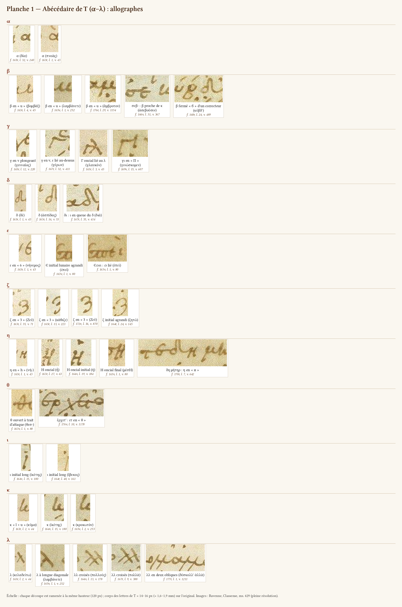
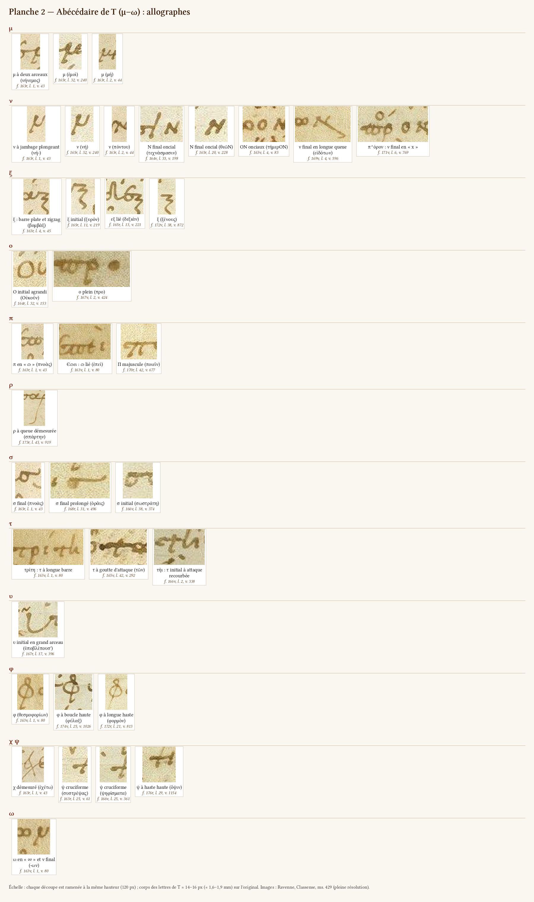
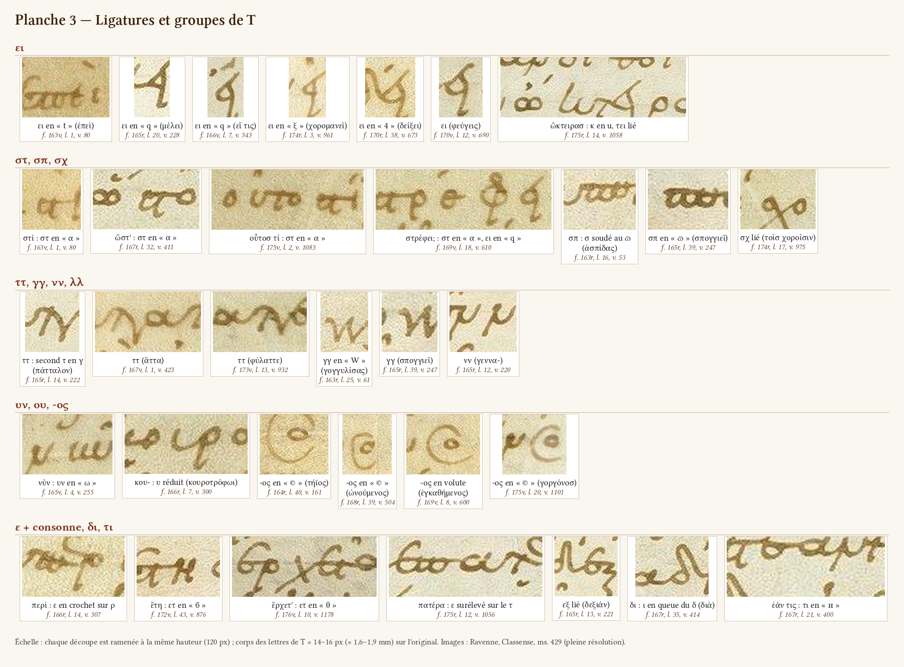
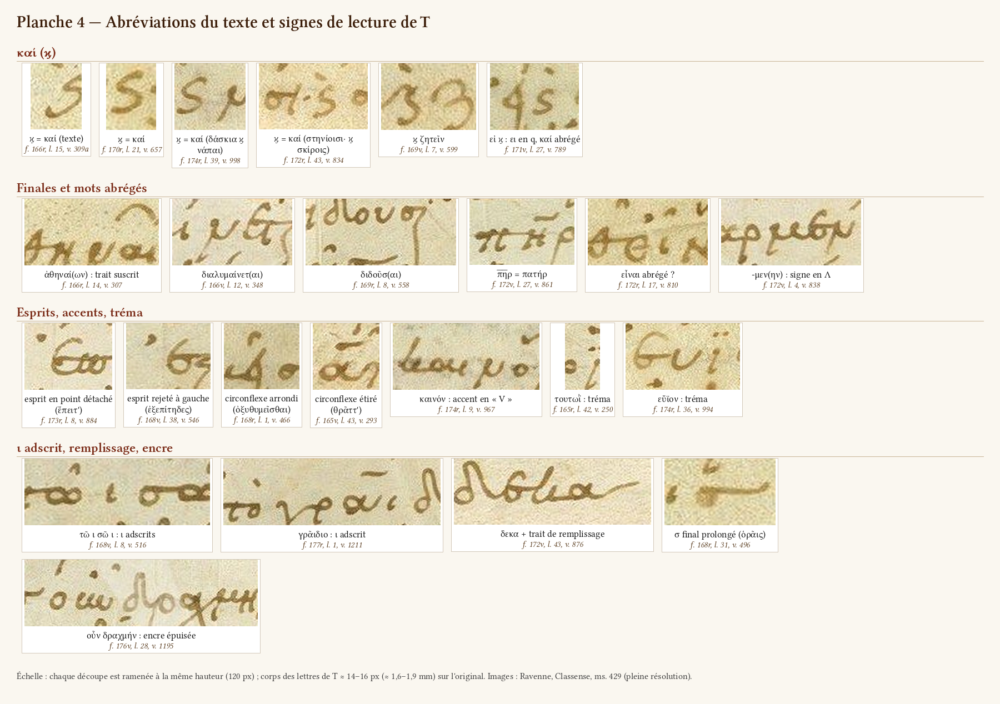
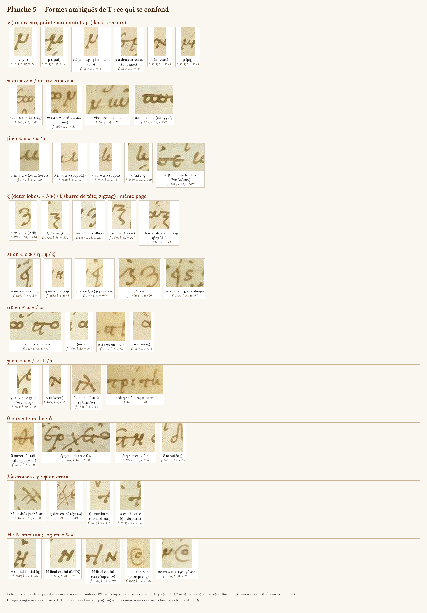

# Chapitre 2 — L'écriture du copiste : alphabet, ligatures, abréviations du texte

> **État** : rédigé le 28 oct. 2026 à partir des 30 inventaires de page et de vérifications sur les images. Les points restés ouverts sont réunis au § 10.
>
> **Sources** :
> - les 30 inventaires de page (`ravennas/graphologie/folios/fXXX.md` et `fXXX.jsonl`, 2 203 observations, dont 157 « formes » et 519 « pièges ») et leurs relevés détaillés de lignes (`fXXX_texte.jsonl`) ;
> - les résumés des pages (`ravennas/graphologie/resume_pages.json`) ;
> - le dossier documentaire (`recherche/ravennas_dossier.md`), pour la littérature ;
> - mes propres contrôles sur les images à pleine résolution (`dossier_ravennas_thesmophories/folios_individuels_ff162v-177r/`, 1 px ≈ 0,116 mm), faits sur des agrandissements ×2 à ×8 avec grille de coordonnées.
>
> **Conventions** :
> - « l. » = ligne de la colonne de texte, numérotée comme dans les inventaires ; « v. » = vers, numérotation du texte de l'auteur (`edition/donnees/travaux_anterieurs/texte_grec.tsv`) ; coordonnées en pixels de l'image pleine résolution.
> - « T » = copiste du texte ; « S2 » = scholiaste des *Thesmophories* (B d'Allen, R² de Velsen 1883) ; « main de 1516 » = sigles et retouches à l'encre orangée (« 2 m. » de Velsen 1871).
> - Je sépare toujours trois choses : ce que j'ai vu moi-même (« je vois », « vérifié ») ; ce que rapportent les inventaires (« inv. f. 165r ») ; ce qu'affirment les auteurs (référence entre parenthèses, d'après `recherche/ravennas_dossier.md`).
> - Les spécimens du chapitre (`ravennas/graphologie/specimens/ch2/<id>.png`) sont cités par leur identifiant entre crochets, par exemple [n_2]. Leurs coordonnées sont dans `ravennas/graphologie/planches/specimens_ch2.tsv`. Les planches et les spécimens se régénèrent avec `outils/graphologie/planches_ecriture.py`.

## Sommaire

1. Objet et méthode
2. Vue d'ensemble : type, module, ductus, inclinaison, rapport à la réglure
3. L'alphabet de T, lettre par lettre
4. Réminiscences onciales
5. Ligatures et groupes
6. Abréviations du texte
7. Signes de lecture de T utiles au déchiffrement
8. Formes ambiguës : table des confusions
9. Corrections apportées aux inventaires de page
10. Questions ouvertes
11. Planches et spécimens

---

## 1. Objet et méthode

Ce chapitre décrit l'écriture du seul copiste du texte, T, sur les 30 pages des *Thesmophories* (ff. 162v–177r). Il sert deux buts :
- caractériser la main, pour la situer parmi les minuscules du Xe siècle et pour attribuer les petites interventions ;
- donner aux transcripteurs un répertoire de toutes les formes de lettres, qui prévienne les mélectures.

Les mains des scholies, des sigles et des corrections ne sont abordées ici que lorsqu'elles se confondent avec T dans la colonne de texte.

Méthode :
1. J'ai relu les 30 synthèses de page (sections « Mains » et « Formes et pièges ») et toutes les observations « forme » et « piège » attribuées à T dans les JSONL.
2. J'ai vérifié sur l'image les points décisifs : le critère ν/μ, le critère ζ/ξ, le σ final, le β, le κ oncial, les formes de π, les ligatures ει et στ, les abréviations ϗ, πατήρ, -αι, -ειν.
3. J'ai découpé 128 spécimens (outil `outils/graphologie/planches_ecriture.py`) et composé cinq planches.
4. J'ai mesuré le module sur toutes les lignes des 30 pages (`outils/graphologie/mesures_ecriture.py`, résultats dans `ravennas/graphologie/chapitres/mesures_ecriture.json`).

Limites :
- La résolution (1 px ≈ 0,116 mm) suffit pour les formes des lettres, mais non pour les plus petits signes. Les points, les esprits et les accents corrigés restent souvent indécidables.
- Les comparaisons avec d'autres manuscrits (Laur. plut. 32.9, Marc. gr. 201, Vat. gr. 1591) n'ont pas été faites sur des images. Ce que je dis du rapport aux minuscules du Xe siècle vient donc de la littérature ; mes observations ne servent qu'à le confronter.

## 2. Vue d'ensemble : type, module, ductus, inclinaison, rapport à la réglure

### 2.1 Une seule main, homogène sur les 30 pages

Les 30 inventaires attribuent tout le texte, la ponctuation, les esprits, les accents, les paragraphoi et les dicola à une seule main. Aucun ne relève de changement de copiste, de plume ou d'encre dans la pièce.
- **Encre.** Partout brun moyen. Les mesures des inventaires varient avec la méthode et la page : rapports RVB G/R ≈ 1,2–1,4 et B/R ≈ 1,8–2,4 ; ou bien absorbances relatives A_G/A_R 1,24–1,38 et A_B/A_R 1,91–2,32 (f. 174r, f. 174v). Ces valeurs sont stables à l'intérieur de chaque page. Elles recouvrent celles de S2 : l'encre ne sépare donc jamais T de S2, et seule l'écriture les distingue (inv. f. 162v à f. 177r, section « Mains »). Elle sépare en revanche toujours T de la main de 1516, orangée.
- **Accidents d'encre.** Ils sont locaux et ne trahissent pas une autre main. Une plume fraîchement rechargée donne un tracé plus dense (πρ et Η de προΐῃ, f. 163r l. 33, v. 69). Une plume épuisée donne un tracé gris et fin, puis T reprend de l'encre ([D_ink] : οὖν δρ|αχμήν, f. 176v l. 28, v. 1195, vérifié).
- **Littérature.** Elle est unanime : une seule main pour les onze pièces (Zacher 1888, 535 ; Allen 1896, 311 ; van Leeuwen 1908, 270 ; Orsini 2011, 325). Les changements d'encre et de plume signalés par Zacher et Martin (ff. 33–34, 116–117, 143r) précèdent tous les *Thesmophories*. Les mesures des inventaires montrent qu'il n'y en a pas d'autre dans les ff. 162v–177r.

### 2.2 Type d'écriture

**Ce que je vois.** C'est une minuscule ronde, liée et rapide, à petit corps et à longues hampes. On la reconnaît à quatre traits.

1. **Un corps rond.** α, ε, ο, σ, ω et les panses de φ et de β sont arrondis. Les angles sont rares : ils apparaissent dans la ligature ει « en q » [L_ei_q2], dans le ξ en zigzag [x_4] et dans les esprits triangulaires (f. 162v l. 2).
2. **Des liaisons par le haut.** Le trait de tête de beaucoup de lettres sert de ligature : barre du τ, barre du π en ϖ, langue de l'ε, trait d'attaque du θ, trait supérieur du σ fermé. Ces barres se prolongent d'une lettre à l'autre et dessinent, à hauteur de tête, une chaîne continue. C'est la cause des « fausses biffures » que relèvent presque toutes les pages : εὔχεσθε, f. 166r l. 4, 17, 38 ; πεπύσμην, f. 169v l. 4 ; Παλλάδα, πότνιαι, θεσμοφόρω, f. 176r l. 10, 24, 31.
3. **Des traits descendants très longs.** Ils se croisent d'une ligne à l'autre : premier jambage du ν et du μ, diagonale du λ, ρ, ι initial, γ, χ, φ, ψ, queues de ζ et de ξ. Le corps n'occupe qu'environ le tiers de l'interligne (§ 2.3), ce qui laisse de la place à ces traits ; aux dernières lignes de page, ils deviennent démesurés ([r_q] : σπάρτην, f. 173r l. 43, v. 919 ; ξ de λέξεις, f. 170v l. 43 ; φ de φορμὸν, f. 172r l. 21, v. 813, [f_3]).
4. **Un mélange de formes minuscules et onciales** (§ 4). La base reste minuscule. Les formes onciales tiennent à la place de la lettre : début ou fin de mot, fin de ligne, initiale de réplique.

**Ce qu'en disent les auteurs.**
- Allen 1896, 319 : « a firm and free hand, rounded, ligatured, and very connected together, with a tendency to notch and finish off letters ».
- Orsini 2011, 325 : « minuscola informale con una certa pretesa alla formalità », de module carré et de stylisation arrondie, au ductus tantôt posé, tantôt cursif. Ces deux descriptions s'accordent avec ce que je vois.
- Orsini ajoute trois détails :
  - Le second τ de ττ a la forme d'un γ : c'est constant dans la pièce (§ 5.4).
  - ρ et φ se lient peu à la voyelle suivante : je le vérifie. Exceptions : υρ lié dans κυρκανᾶισ (f. 172v l. 18).
  - α et ε sont simplement accolés à ζ et à ξ, sans ligature : c'est à nuancer. Dans δεξιάν (f. 165r l. 13, v. 221, [x_3]) et ἔξεστ' (f. 166r l. 1), la barre de tête du ξ part de la langue de l'ε. Sur l'image, c'est une liaison graphique, même si la forme du ξ n'est pas altérée.

### 2.3 Module

Je l'ai mesuré sur toutes les lignes de texte des 30 pages. Le profil horizontal du masque d'encre donne deux valeurs (fichier `mesures_ecriture.json`) :
- **Corps des lettres** (bande où la densité dépasse la moitié du maximum) : médiane par page de 14 à 16 px, soit **1,6–1,9 mm**, sur 27 pages. Trois pages donnent des valeurs aberrantes : f. 165v (35 px), f. 166v (20 px) et f. 167r (17 px). Ce sont des artefacts des boîtes de ligne de la segmentation, qui y englobent des morceaux de deux lignes ; je ne les retiens pas.
- **Hauteur totale des lettres rondes**, traits compris (seuil au quart du maximum) : médiane par page de 18 à 24 px, soit **2,1–2,8 mm**. Les « 18–20 px (2,3–2,5 mm) » de l'inv. f. 162v et les « 15–20 px » de l'inv. f. 166v correspondent à cette mesure.
- **Valeurs locales des inventaires** pour le ο : ≈ 13 px (f. 167v l. 2) et 15–18 px (f. 164r).
- **Interligne** (pas de la segmentation) : 41,9–43,8 px, soit **4,9–5,1 mm**, pour 43 lignes par page.
  - Le f. 162v compte 42 lignes, dont le titre.
  - Le f. 175v compte 43 lignes, plus les vv. 1102–1103 ajoutés en marge inférieure.
  - Le f. 177r est la fin de la pièce.

Le corps des lettres vaut donc à peu près le tiers de l'interligne.

Le module est **constant** d'une page à l'autre. Il ne varie qu'à l'intérieur des lignes :
- lettres plus serrées et lettres finales surélevées dans les lignes trop longues : ἀγορεύ^ει, ἅπαν^τα, ἐπιθυμ^εῖ (f. 171v l. 23, 24, 39) ;
- initiales agrandies (§ 4.2).

### 2.4 Ductus et tracé

- **Rapide et continu.** Les mots sont souvent tracés d'un seul mouvement, avec des chaînes de ligatures du type ε-ϖ-ει (ἐπεὶ, f. 163v l. 1, v. 80, [L_ei_t]) ou σ-ϖ (ἀσπίδας, f. 163r l. 16, v. 53, [L_sp1]). Le copiste coupe pourtant volontiers les mots composés (§ 7.6).
- **Attaques et sorties.**
  - Goutte d'encre à l'attaque du τ ([tau_g] : τῶν, f. 165v l. 42, v. 292). Elle passe pour un point (inv. f. 165v, f. 167r, f. 167v).
  - Long trait d'attaque horizontal du θ et du π ([t_1] : θεσ-, f. 163v l. 1).
  - Allongement de la dernière lettre en fin de ligne, en trait de remplissage : σ, ε ou α ([s_bar] : ὁρᾶις, f. 168r l. 31 ; [D_fill] : δεκα, f. 172v l. 43, v. 876).
- **Plume.** Elle est assez large et donne un contraste modéré entre pleins et déliés. Les traits horizontaux sont plus épais que les obliques montantes.
- **Corrections en écrivant.** Elles sont rares, faites à la même encre. Exemples : υ refait sur ι (ἐμοῦ, f. 162v l. 22) ; δ barré corrigé en θ (δέξασθε, f. 171v l. 16) ; surcharge et biffure (f. 170r l. 34, 36). Ce sont les indices d'un copiste attentif à son modèle, mais rapide.

### 2.5 Inclinaison

**Ce que je vois.** Le corps des lettres est droit. Les hampes de φ, ρ, ι long et κ penchent légèrement vers la droite : je l'estime à l'œil à 5–15° sur les spécimens [f_1], [f_3], [i_j1], [i_j2], [r_q], [k_lc]. Les jambages plongeants du ν et du μ et la diagonale du λ sont des obliques de construction, non une pente de l'écriture.

**Limite de la mesure.** J'ai tenté une mesure automatique : axes des composantes allongées au-dessus et au-dessous du corps des lettres. Elle n'est pas utilisable. Elle est dominée par les accents aigus, inclinés à 30–45°, et par les obliques de construction des lettres. Je ne donne donc pas de chiffre.

### 2.6 Rapport à la réglure

Martin 1882, xiii et Allen 1896, 301 décrivent une écriture « au-dessous de la ligne ». Les inventaires voient la réglure à la pointe sèche par endroits :
- lignes horizontales du texte (inv. f. 165r, profil de luminance) ;
- trait fin dans l'interstice au-dessus des lettres (f. 172v l. 25, y ≈ 1442, au-dessus de lettres posées vers y ≈ 1450–1474).

Ces deux indices s'accordent avec une écriture suspendue sous la réglure. Je n'ai pas refait de relevé systématique.

### 2.7 Place parmi les minuscules du Xe siècle (littérature et observations)

**Ce qu'affirment les auteurs** (détails dans `recherche/ravennas_dossier.md`, § 2–3).
- **Datation.** Elle est aujourd'hui fixée vers le milieu du Xe siècle (Orsini 2011, 321 et 326 ; Wilson 2007, I, v ; Scotti 2024, 462), après les datations des XIXe–XXe s. au XIe siècle (Martin 1882, xiii ; Velsen 1883, 5 ; Zacher 1888, 530).
- **Comparaisons d'Orsini** : Marc. gr. 201, copié par Éphrem en 954, et certaines expressions graphiques de Basile, copiste du Vat. gr. 1591 en 964 (Orsini 2011, 326).
- **Laur. plut. 32.9.** Les uns y voient la même main ou une main très proche (Bekker 1829, v ; van Leeuwen 1908, 270 n. 2), les autres une main différente (Allen 1896, 321–322 ; Orsini 2011, 326).
- **Critères de Martin pour le XIe siècle** : écriture suspendue, esprits souvent anguleux, fréquence des formes onciales Γ, Η, Κ, Λ, Ν (Martin 1882, xiii). Orsini ne les retient pas.

**Ce que mes observations permettent d'en dire.**
1. **Esprits.** T emploie à la fois des esprits anguleux (petits triangles pleins, f. 162v l. 2, [D_spir1] pour un esprit en point) et des esprits ronds ou ponctiformes (f. 167r, f. 172v, f. 173r). L'« esprit anguleux » n'est donc pas un trait exclusif de la main.
2. **Formes onciales.** Η et Ν sont très fréquents, Γ, Є, C, Ο et Π occasionnels. Je n'ai trouvé **aucun Κ oncial de T** (§ 4.1). Le Λ ne se distingue pas : le λ minuscule de T a déjà la forme du lambda majuscule. La liste de Martin ne se vérifie donc qu'en partie dans les *Thesmophories*.
3. **Usage des formes onciales.** Elles sont réglées par la position (initiales, finales, fin de ligne, initiales de réplique) plus que par le hasard.
4. **Conclusion.** Rien de ce que j'observe ne contredit la datation au milieu du Xe siècle. Je ne peux pas la confirmer par moi-même sans comparer les images des manuscrits datés.

## 3. L'alphabet de T, lettre par lettre

Planches : [Planche 1 (α–λ)](../planches/ch2_pl1_abecedaire_1.png), [Planche 2 (μ–ω)](../planches/ch2_pl2_abecedaire_2.png).

Pour chaque lettre, je donne :
- les allographes, du plus fréquent au plus rare ;
- leur place dans le mot ;
- les confusions qu'ils provoquent ;
- les spécimens, entre crochets.

### α
- **Forme courante** : α minuscule à panse ronde fermée, avec un court trait vertical à droite qui sert de départ à la ligature ([a_dia] : δία, f. 165r l. 32, v. 240 ; [a_pnoas] : πνοὰς, f. 163r l. 1, v. 43).
- **En fin de ligne**, la sortie de l'α s'allonge en trait de remplissage, jusqu'au bord de la colonne :
  - δεκα, f. 172v l. 43, v. 876 [D_fill] ;
  - τάλαντα, f. 172r l. 18 ;
  - αἰτιώμεθα et μασώμεθα, f. 168r l. 8 et 29.

  Parfois elle descend en paraphe jusqu'à deux lignes plus bas (πόδα, f. 170r l. 24, inv.). Ce n'est ni un tiret ni un renvoi.
- **Titre de la pièce** (majuscule de distinction, f. 162v l. 1) : α en forme de « d » (inv. f. 162v).
- **Confusion.** La ligature στ prend l'aspect d'un α accentué (§ 5.2).

### β
- **Forme unique de T : β en « u ».** Ce sont deux jambages arrondis ouverts en haut, le gauche un peu plus haut, sans boucle supérieure fermée. Exemples : βομβάξ, f. 163r l. 4, v. 45 [b_u1] ; λαμβάνετε, f. 165v l. 1, v. 252 [b_u2] ; ἄμβροτον, f. 176r l. 29, v. 1154 [b_u3]. Je n'ai vu aucun β fermé de la main de T.
- **Le β fermé « ϐ » est celui des correcteurs.**
  - κύβδ' (f. 168r l. 24, v. 489 [b_corr]) est une correction de κύνδ' (Velsen 1871).
  - Le supplément βοώιη (f. 168r l. 41) a le même β (inv. f. 168r).
  - Le premier β de βάρβιτος est un B oncial de correction (f. 164r l. 16, inv.).

  La forme du β est donc un critère d'attribution : un β fermé dans la colonne n'est pas de T.
- **Confusions** (inv. de presque toutes les pages) :
  - υ, ι + ι, κ : « uάδιζε » ; βραχὺ lu « ἱεραχύ », f. 173v l. 21 ; ἀσεβοῦσιν, f. 166v l. 31 [b_k] ;
  - μ : « λαμμάνετε », f. 165v l. 1 ; « ὑμρίζειν », f. 168v l. 27.

  Critère de l'inv. f. 175r : le β a la haste gauche basse, le κ la haste haute (βάρβαρον, l. 7).

### γ
Trois allographes :
1. **γ minuscule en « v » plongeant**, dont la branche gauche descend sous la ligne ([g_v] : γενναῖος, f. 165r l. 12, v. 220).
   - Il se lit ν : ὀχληρά γ' lu ὀχληρὰν (f. 175r l. 34) ; σύ γε lu σὺν (f. 172v l. 31).
   - Quand l'ε lui est lié au-dessus, il ressemble à γ^ε, une abréviation, ou à un τ ([g_ge] : γέρων, f. 167r l. 32, v. 411).
2. **Γ oncial**, à barre horizontale.
   - Il est attesté à l'initiale : γλαυκόν, f. 163r l. 3, v. 45 [g_G], où la barre se lie au λ ; γέροντ', f. 177r l. 2.
   - Il entre dans la ligature γι « en Π », où la barre du Γ va jusqu'à l'ι : γινώσκεθ', γινώσκομεν, f. 169v l. 14, 15, 22, v. 606–607 [g_gi]. Lectures fautives : *πνώσκομεν*, *τινώσκομεν*.
   - Le Γ se confond avec τ.
3. **γγ en « W »** : deux v liés ([L_gg1] : γογγυλίσας, f. 163r l. 25, v. 61 ; [L_gg2] : σπογγιεῖ, f. 165r l. 39, v. 247). On le lit ψ, ш ou ψψ.

### δ
- **δ minuscule** : petite panse ronde, hampe qui revient vers la gauche en crosse ([d_1] : δὲ, f. 163r l. 1 ; [d_2] : ἀσπίδας, f. 163r l. 16, v. 53).
- **Variantes** :
  - panse basse et petite, à hampe oblique, qu'on lit λ (μὴ δαμῶς, f. 165r l. 20, inv.) ;
  - dans δι, l'ι forme la queue du δ ([L_di] : διὰ, f. 167r l. 35, v. 414). On lit δ' ἀ, δη ou δγ (διάρριψον, δικαίως, f. 170r l. 30, 40).
- **Confusion avec le θ ouvert.** La hampe du θ s'incurve vers la droite, celle du δ revient vers la gauche (inv. f. 164v).

### ε
1. **ε minuscule à boucle haute, en « 6 » ou en « б ».** C'est la forme la plus fréquente. L'ε se lie presque toujours à la lettre suivante par sa langue ([e_6] : νήνεμος, f. 163r l. 1, v. 43). Dans les ligatures, il prend des formes très diverses (§ 5.3).
2. **Є lunaire oncial agrandi**, en tête de mot et souvent en tête de vers : ἐπεὶ, f. 163v l. 1, v. 80 [e_E] ; Ἔπειτα, f. 164v l. 23, 25, « grand Є lié au ϖ » (inv.) ; ἐξαπατᾶι, ἑταῖρα, ἐκκλησίαν, f. 166v (inv.).
- **Confusions** :
  - ε fermé lu σ (φερε σε, f. 173r l. 39) ;
  - ε fermé barré lu θ (οὐπώποτ' εἶπεν, f. 168r l. 32) ;
  - ε lu β (εὐριπίδου lu « βυριπίδου », f. 167r l. 8).
- **La langue prolongée de l'ε** fait un trait de remplissage en fin de ligne (πώποτε, f. 170r l. 6 ; γε, f. 172r l. 15 ; ἐὲ, f. 174v l. 41) ou une fausse biffure à l'intérieur (εὔχεσθε, f. 166r).

### ζ
- **ζ en « 3 »** : deux lobes arrondis superposés, le supérieur ouvert à gauche, et une queue sous la ligne. Exemples : Ζεῦ, f. 163r l. 35, v. 71 [z_1] ; κάθιζε, f. 165r l. 13, v. 221 [z_2] ; Ζεῦ, f. 172v l. 36, v. 870 [z_3].
- **À l'initiale, ζ agrandi** (ζητῶ, f. 164r l. 24, v. 145 [z_4]).
- **Dans le titre** (f. 162v l. 1), ζ de majuscule de distinction en « Ƶ », à queue revenant à gauche (inv.).
- **Critère ζ/ξ** : voir ξ et le § 8.

### η
Deux formes, souvent dans la même ligne :
1. **η minuscule en « h »** ([h_h] : νή-, f. 163r l. 1, v. 43). On le lit κ, ιι, « l + ι », et même « καί » (η 'στί, f. 177r l. 6, inv.).
2. **Η oncial**, à barre médiane. Il est très fréquent :
   - à l'initiale : ἦ, f. 163r l. 27, v. 63 [h_H1] ; ἡ, f. 164v l. 19, v. 184 [h_H2] ; ἢ en tête de vers huit fois au f. 166v ;
   - à la finale : μέσΗ, f. 163v l. 1, v. 80 [h_H3] ; πάσΗ, προΐΗ, f. 163r l. 29, 33 ;
   - dans ΤΗ de τῆι (f. 166v l. 36–37, inv.).
- **Variante étroite « н »**, qui se lie à la lettre précédente : δη μήτηρ, f. 170r l. 7, v. 642 [L_demeter] ; R y soude δὲ (écrit δη) à μήτηρ.
- **Confusions.** Le Η oncial se lit Ν : la Juntine imprime βοῶν pour βοώιη (f. 168r l. 41, inv.). Il se confond aussi avec le Η suscrit des sigles μν^η de 1516. Le « h » ressemble à la ligature ει « en q » (§ 5.1).

### θ
- **θ cursif ouvert**, couché, précédé d'un long trait d'attaque horizontal ([t_1] : θεσ-, f. 163v l. 1, v. 80). Parfois il prend une forme en « 4 » (ἀποθανουμένῳ, κροκῶθ', θεαῖν, f. 173v, inv.). Sa barre se poursuit sur la lettre suivante : fausse biffure (ἔλθετον, ἀντόμεθ', f. 176r l. 30).
- **θ fermé ovale**, à barre prolongée, dans le titre (f. 162v l. 1, inv.).
- **Confusions** : δ, ψ, et la ligature ετ, qui ressemble à θ (§ 5.3, [L_et2]). θ cursif lié à l'ο lu « τὸ » : ταῦθ' ὁρᾶις lu « ταυτὸ », f. 168r l. 31.

### ι
- **ι court**, simple trait.
- **ι initial long, en « j »** : il descend loin sous la ligne, parfois jusqu'à la ligne suivante. Exemples : ἱκέτης, f. 164v l. 15, v. 180 [i_j1] ; ἴβυκος, f. 164r l. 40, v. 161 [i_j2] ; ἰὴ, f. 166r l. 18 ; ἰδεῖν, ἰδέσθαι, f. 171v l. 40, 43. Ce n'est ni un signe marginal ni une paragraphos verticale (inv. f. 166r, f. 171r).
- **ι adscrit** : § 7.3.

### κ
- **Forme unique de T : κ minuscule en deux temps.** C'est une haste suivie d'une panse en « u » bouclé ou en « c », liée à la voyelle suivante ([k_lu] : κῦμα, f. 163r l. 2, v. 44 ; [k_lc] : ἱκέτης, f. 164v l. 15, v. 180 ; [k_2] : κροκωτὸν, f. 165v l. 2, v. 253). On le lit « lc », « ιc », « lu », « ις », ιε, λυ, ου, ιι : κροκωτοῖς lu « ἱεροκωτοῖς », f. 173v l. 24 ; κεκό lu « lιblo », f. 176r l. 1 [L_kekopsoi].
- **Pas de Κ oncial chez T** (§ 4.1). Le seul Κ oncial de la colonne, en deux traits disjoints (« Ι< »), est celui de κιν récrit sur grattage par un correcteur ancien (f. 168r l. 28, v. 493, inv.).

### λ
- **λ à très longue diagonale**, qui descend sous la ligne vers la gauche. La lettre suivante s'attache au sommet ([l_1] : κελαδείτω, f. 163r l. 2 ; [l_2] : λαμβάνετε, f. 165v l. 1, v. 252). Sans haste montante visible, il se lit ρ ou μ : λαθεῖν lu « μαθεῖν », f. 167r l. 29, v. 408, contrôlé à ×5,5 par l'inventaire.
- **λ + ι** ressemble à μ (πολιός, f. 164v l. 25 ; ἠλιθίου, f. 165v l. 40).
- **λλ** : deux variantes, voir § 5.4.

### μ
- **μ minuscule** : premier jambage plongeant sous la ligne, puis **deux arceaux**, le second terminé par un crochet ([m_1] : νήνεμος, f. 163r l. 1 ; [m_2] : ἐμοὶ, f. 165r l. 32, v. 240 ; [m_3] : μὴ, f. 163r l. 2, v. 44).
- **Confusions** avec ν (voir ν) et, dans le groupe μβ, avec β.

### ν
La lettre la plus trompeuse de la main.
1. **ν minuscule** : premier jambage plongeant sous la ligne, comme celui du μ, puis **un seul arceau** terminé par une pointe montante ([n_1] : νή-, f. 163r l. 1, v. 43 ; [n_2] : νὴ, f. 165r l. 32, v. 240 ; [n_3] : πόντου, f. 163r l. 2, v. 44).
   - **Critère vérifié** sur f. 163r l. 1–2 et f. 165r l. 32 : le μ a deux arceaux, le second fermé en crochet ; le ν a un arceau, puis une pointe.
   - **Limite.** Dans l'écriture rapide, ou quand la lettre suivante s'attache à la pointe du ν (νη, νυ, νο), seul le nombre d'arceaux reste. D'où les mélectures en série que relèvent toutes les pages : νὴ lu « μὴ » ; νῦν lu « μῶ » ; τὸν νοῦν lu « τὸμ μοῦν » ; διδόναι lu « διδόμαι » ; πλυνεῖ lu « πλυμεῖ » ; μόνην lu « μόμημ » ; ἐλιννύειν lu « ἐλιμμύειν ».
   - **Règle pratique** : lire d'abord ν à toute finale, puis trancher par le contexte.
2. **Ν oncial** en fin de mot, surtout en fin de ligne : τεχνάσμασιΝ, f. 164v l. 33, v. 198 [n_N1] ; θεῶΝ, f. 165r l. 20, v. 228 [n_N2] ; λύχνοΝ, f. 165r l. 30 ; λέγουσιΝ, f. 166v l. 28. Il se combine avec un Ο oncial dans τήμερΟΝ (f. 163v l. 4, v. 83 [n_ON]).
3. **Ν réduit en « н »**, qu'on lit η ou κ (ἅπασιν, f. 170r l. 34, inv.). Ν et Η onciaux ont le même gabarit (inv. f. 174v).
4. **ν final en longue queue oblique** en fin de vers ([n_q] : εἰδότων, f. 169v l. 4, v. 596 ; κοθωκιδῶν, l. 28). Ce n'est ni un λ ni un trait de renvoi.
5. **ν final en « x »** : πόρον, f. 171v l. 6, v. 769 [n_x], avec ο suscrit ; πάρεστιν, l. 42 (inv.). Ne pas lire χ.

### ξ
- **ξ** : trait de tête plat, parfois amorcé par un petit crochet et souvent lié à la lettre précédente, puis un zigzag de deux ou trois angles et une longue queue sous la ligne. Exemples : βομβάξ, f. 163r l. 4, v. 45 [x_1] ; ξυρόν, f. 165r l. 11, v. 219 [x_2] ; δεξιάν, f. 165r l. 13, v. 221 [x_3] ; ξένους, f. 172v l. 38, v. 872 [x_4].
- **Critère vérifié** sur les ff. 163r, 165r, 172v et 177r :
  - ζ = deux lobes ronds (« 3 ») ;
  - ξ = barre de tête et zigzag (« Ƶ », « ʒ »).

  Ce critère est formulé, en des termes différents, par les inv. f. 165r, f. 166v, f. 172v, f. 174v, f. 175v et f. 176v (« ζ à deux étages, ξ à trois »). Il permet de lire ἀρτομουξία (f. 176v l. 34), ἀρ ταμουξία (f. 177r), ὀτότυζε (f. 175v l. 1, contre ὀτότυξε chez Velsen 1883) et οἰμώζετ' (f. 165r l. 40).
- **Ce n'est qu'une forte tendance.** En fin de ligne et en grand module, le ζ peut prendre une tête plate. C'est le cas du ζ de βαδίζ(ειν) (f. 177r l. 20, v. 1228), que l'inventaire juge de même forme que le ξ.
- **Confusion propre à la ligature ει à ι descendant**, qui prend l'aspect d'un ξ (§ 5.1).

### ο
- **ο petit et rond** ; il est parfois **plein**, en disque de la taille d'une lettre ([o_plein] : προ, f. 167v l. 2, v. 424). On le prend alors pour un point.
- **Ο agrandi** en tête de vers ([o_O] : Οὐκοῦν, f. 164r l. 32, v. 153, deux fois le module ; Ὅταν, l. 36, en saillie ; οὐπώποτ', f. 168v l. 40).

### π
1. **π en « ϖ »** : deux boucles sous une barre. C'est la forme normale, attestée par plus de quinze exemples par page ([p_varpi] : πνοὰς, f. 163r l. 1, v. 43 ; [p_varpi2] : ἐπεὶ, f. 163v l. 1).
   - On le lit ω si la barre est pâle ou absorbée par la ligature : ὅπως lu « ὅωως » ; τὸ πόπανον lu « τὸ ωόωανον », f. 165v l. 35 ; ἀπο- lu « αὐτο- », f. 173v l. 21.
   - Sa barre déborde souvent à gauche et passe alors pour une paragraphos (f. 162v vv. 4, 22, 38 ; f. 164v l. 8 ; f. 171v l. 6, 9, 14, 37).
   - Elle se prolonge aussi à droite en fausse biffure (πε- à longue barre, f. 174r l. 40–42 ; f. 174v l. 14, 26, 28, 31, 36).
   - Inversement, le ω de ῥήτωρ prend la forme d'un ϖ (f. 168v l. 22, inv.).
2. **Π majuscule à barre de tête plate**, rare ([p_Pi] : ποιεῖν, f. 170r l. 42, v. 677 ; -ποις, l. 29, inv.).

### ρ
- **ρ à longue hampe**, presque verticale. Elle devient démesurée sur les dernières lignes de page : σπάρτην, f. 173r l. 43, v. 919 [r_q], jusqu'à 90 px sous la ligne ; ἄρα, f. 175v l. 43 ; προεδρίαν et σκίροις, f. 172r l. 43.
- **Sortie du ρ** en petite virgule sous la ligne, qu'on prend pour une ponctuation (f. 167r l. 34, 37, inv., douteux).
- **ρ peu lié** à la voyelle suivante (Orsini 2011, 325, vérifié).

### σ
1. **σ rond, fermé par un trait supérieur horizontal** qui sert de ligature ([s_init] : σωστράτη, f. 166v l. 38, v. 374). Fermé, il se lit ο : σκάφιον lu « οικάφιον », f. 169v l. 41 ; σῶσον lu « σῶων », f. 174v l. 13 ; σὺ κισσοφόρε lu « οὐ », f. 174r l. 30.
2. **σ final = σ médial.**
   - Je n'ai trouvé **aucun ς** dans la main de T. Exemples vérifiés : πνοὰς, f. 163r l. 1, v. 43 [s_fin] ; ὁρᾶις, f. 168r l. 31, v. 496 [s_bar] ; μείρακας, f. 167r l. 31, v. 410.
   - Les « ς final prolongé » des inv. f. 168r et f. 167r sont en réalité des σ ronds dont le trait supérieur s'allonge en remplissage (§ 9).
   - Transcrire σ, sans normaliser.
3. **σ final détaché** du mot (γεγηθὼ σ, f. 168v l. 2 ; ταύτη σ, l. 30) ou **lié au mot suivant**.
   - τί σ ἐμὸν se lit « τί σεμὸν » (f. 175r l. 4). L'inventaire y voit l'origine probable de τὶ σεμνὸν dans G.
   - στ chevauche la coupure des mots : αὐτός τε lu « αὐτὸ πτε », f. 164v l. 1 ; διώκοις lié à ταυτηΐ, f. 177r l. 13.
4. **C lunaire** :
   - dans la ligature -ος de fin de ligne (§ 5.5) ;
   - dans le « grand sigma lunaire » qui monte au-dessus de la ligne (ἐπουρίσασ, f. 177r l. 19, inv.) ;
   - dans les titres.

### τ
- **τ à barre de tête très longue** (≈ 25 px, inv. f. 163v), souvent lancée par une **goutte d'attaque** isolée ([tau_g] : τῶν, f. 165v l. 42, v. 292). La goutte imite un point médian : « ἐπισμῆι· τῶν », « ὑγιές : τὰς », f. 167r l. 10, 15 ; « τω·τέχνηι », f. 167v l. 8, 10, 11. La barre prolongée à gauche imite une paragraphos (f. 163r l. 13, 37 ; f. 171r l. 13).
- **τ sans fût apparent**, réduit à une barre qui sort du σ et croise l'ι (τρίτη στί, f. 163v l. 1, v. 80 [tau_1]).
- **τ initial à attaque recourbée** ([tau_b] : τῆι, f. 166v l. 2, v. 338), qu'on lit « στῆι ». **τ à pied recourbé** vers la droite, proche de ρ ou de γ (f. 170r l. 29, 43, inv.).
- **ττ** : § 5.4.

### υ
- **υ en « u »** ou en « v », souvent étroit. Il se lit alors ι : δρυόχους, f. 163r l. 15, que la Juntine lit δρυόχοις ; τοὺς, f. 166v l. 23 ; σύ γε, f. 172v l. 31.
- **υ initial en grand arceau** parti de haut à gauche, qui déborde dans la bande des sigles ([u_init] : ὑποβλέπουσ', f. 167r l. 17, v. 396 ; ὑπὸ, l. 7).
- **Υ « ϒ » à boucle** (ὑμῶν, f. 171v l. 42, inv.).
- **Ligatures** : ου à υ réduit, υν en « ω » (§ 5.5).

### φ
- **φ à grande panse ronde et longue hampe** ([f_1] : θεσμοφορίων, f. 163v l. 1, v. 80).
- **φ à boucle haute** : la hampe se termine en haut par une petite boucle fermée posée sur la panse ([f_2] : φύλαξ, f. 174v l. 25, v. 1026 ; ἀποφυγὼν, ἐφέστηκ', ὑφηλίκων, ψῆφον). On le lit δο ou θ (inv. f. 174v).
- **Hampe démesurée** ([f_3] : φορμὸν, f. 172r l. 21, v. 813, sur trois lignes ; φήσει, f. 170r l. 37).

### χ
- **χ à longues diagonales**, parfois démesuré, qui traverse l'interligne ([c_1] : ἐχέτω, f. 163r l. 1, v. 43, où l'ε est absorbé par le χ ; μοιχὸς, χθροῖς, f. 166v ; χρή, f. 170r l. 19 ; f. 172v l. 37). On le prend pour une biffure ou une croix.

### ψ
- **ψ cruciforme** : haste haute, traversée par une courbe ou par une barre ([y_1] : συστρέψας, f. 163r l. 25, v. 61 ; [y_2] : ψηφίσματα, f. 166v l. 25, v. 361 ; [y_3] : ὄψιν, f. 176r l. 29, v. 1154).
- **Confusions** : τ (ὄψιν lu « ὄτιν »), « + », †, le signal « + » du copiste.
- **ψ réduit**, dont la haste se lit ι (ἐξέθρεψε lu « ἐξέθρει χώρα », f. 168v l. 14).

### ω
- **ω minuscule à deux boucles fermées**, en « ∞ » ([w_1] : -ων, f. 163v l. 1). Il est très large à l'initiale (ὦ, f. 162v l. 2). Réduit à deux petites boucles, il se lit οο (f. 172v l. 17, 20, 37).
- **Confusion avec ϖ** dans les deux sens (voir π).

## 4. Réminiscences onciales

### 4.1 Inventaire

| Forme onciale | Fréquence chez T | Place | Spécimens / exemples |
|---|---|---|---|
| **Η** | très fréquent, à côté du « h » | initiale (ἢ, ἡ, ἦ), finale (-Η), τῆι (ΤΗ) | [h_H1], [h_H2], [h_H3] ; « н » : [L_demeter] |
| **Ν** | fréquent | finale, surtout en fin de ligne ; « н » | [n_N1], [n_N2], [n_ON] |
| **Γ** | occasionnel | initiale ; ligature γι « en Π » | [g_G], [g_gi] |
| **Є** lunaire | fréquent à l'initiale | initiale agrandie, souvent en tête de vers | [e_E] ; Ἔπειτα (f. 164v l. 23, 25) |
| **Ο** agrandi | occasionnel | initiale de vers | [o_O], [n_ON] |
| **C** lunaire | dans des positions fixes | ligature -ος de fin de ligne ; « grand sigma » (f. 177r l. 19) | [L_os1]–[L_os4] |
| **Π** à barre plate | rare | dans le mot | [p_Pi] |
| **Υ** (ϒ) | rare | initiale | ὑμῶν (f. 171v l. 42) |
| **Κ** | **non observé chez T** | — | le Κ « Ι< » de κιν (f. 168r l. 28) est un correcteur |
| **Λ** | indiscernable | — | le λ minuscule de T a la forme du lambda majuscule |

### 4.2 Ce que règle l'usage

1. **L'initiale.** Les lettres initiales sont souvent agrandies et prennent alors volontiers la forme onciale : Є, Η, Ο, Γ, et aussi ζ et ι longs. L'inv. f. 164r se demandait si T agrandit l'initiale d'une nouvelle réplique (Οὐκοῦν, l. 32 ; Ὅταν, l. 36). Les autres pages répondent : l'agrandissement est fréquent en tête de vers, **qu'il y ait ou non changement d'interlocuteur**.
   - Changement d'interlocuteur : f. 164r l. 32 et 36 ; f. 168v l. 25 et 36.
   - Pas de changement : ὑποβλέπουσ', f. 167r l. 17, v. 396.
   - Début de section : Ἡμεῖς, en tête de la parabase, f. 171v l. 22.

   Ce n'est donc pas un critère de changement d'interlocuteur.
2. **La fin de mot en fin de ligne** : Ν, ΟΝ, -ος en « © ». Ces formes gagnent de la place, ou ferment la ligne contre la marge.
3. **Des ligatures fixes** : γι en « Π », ΤΗ.
4. **Les titres**, en « majuscule de distinction » mêlée.
   - Titre des *Thesmophories* (f. 162v l. 1) : σ et ε lunaires, Ν, ζ en « Ƶ », θ ovale, α en « d » (inv.).
   - Titre de l'*Assemblée* (f. 177r l. 25) : ε lunaire, κ, λ, η en « н », σ lunaire, α oncial, ζ en « Z », ω minuscule (inv.).

   La forme Κ n'apparaît, chez T, que dans cette écriture de titre.

### 4.3 Portée

Martin tirait de la fréquence des onciales Γ, Η, Κ, Λ, Ν un argument pour le XIe siècle (Martin 1882, xiii). Dans les *Thesmophories*, la liste se réduit à Η, Ν et, plus rarement, Γ. Ces formes sont réglées par la position. Je n'en tire aucun argument chronologique : la question relève de la comparaison avec des manuscrits datés (§ 2.7).

Pour la transcription, elles n'ont pas de valeur propre : Η = η, Ν = ν. Il faut seulement les distinguer :
- des **sigles** de S2 et de 1516 : H suscrit de μν^η, Κη ;
- des **lettres suscrites** de correction : ν suscrit en Ν (f. 165v l. 12) ; Η suscrit de ἀφῆτ' (f. 170v l. 16).

## 5. Ligatures et groupes

### 5.1 ει : la ligature la plus polymorphe

Je compte au moins six formes, relevées sur toutes les pages. Elles sont décisives pour la lecture :

| Forme | Description | Exemples | Lectures fautives |
|---|---|---|---|
| en « t » | ε dont la langue rejoint un ι montant | ἐπεὶ, f. 163v l. 1, v. 80 [L_ei_t] | — |
| en « q » | boucle triangulaire, haste descendant à gauche | μέλει, f. 165r l. 20 [L_ei_q1] ; εἴ τις, f. 166v l. 7, v. 343 [L_ei_q2] ; εἴπερ, f. 171v l. 27, 32 | α, ο, σ, φ, ψ, ᾳ ; **avec accent ou esprit : ἢ, ἡ** (εἴπερ lu ἤπερ ; εἶτα lu ἢ τα ; εἶδεσ lu « ἦδεσ », f. 177r l. 10) |
| en « ξ » ou « ζ » | ι descendant sous la ligne en zigzag | χορομανεῖ, f. 174r l. 3, v. 961 [L_ei_xi] ; παίζει ; ἥξει, κλύεισ, f. 174v | ξ, ζ, ϙ, φ |
| en « 4 » | ε anguleux et ι croisé | δείξει, f. 170r l. 38, v. 673 [L_ei_4] ; ποιεῖν ; εἰσὶν, f. 172r l. 29 | chiffre 4 |
| ε fermé en boucle, ι montant puis redescendant avec un pied | | φεύγεις, f. 170v l. 12, v. 690 [L_ei_v] | η (**φεύγης**) : le η de T est toujours un « h » ou un Η, jamais cette forme |
| en « α à crochet », en « ἕ » | | κλεισθένης, προτείνειν, ἀφείλετ', f. 173v l. 10, 17, 20 | α, ἀφ' ἕλετ' |
| ι long oblique, montant au-dessus de la ligne | | εἰσὶν, f. 167r l. 12 | accent (« ἔσὶν ») |

Dans les ligatures, τει et σει prennent des formes propres :
- ὤκτειρασ, lu « ὤιιτλρασ » (f. 175r l. 14, v. 1058 [L_oktiras]) ;
- φύσει, ποήσεις, σ + ει en crochet (f. 164v l. 3, 43) ;
- λεύσειν, où σει à ι descendant ressemble à un α à queue (f. 175r l. 8) ;
- δράσει, lu « δράος » (f. 177r l. 7).

**Règle de lecture** : devant un signe en « q » ou en « 4 » surmonté d'un accent, penser d'abord à ει.

### 5.2 στ, σπ, σχ, σο

- **στ en « α »**. Le σ ouvert se prolonge dans la barre du τ, et le tout a l'aspect d'un α accentué au trait oblique montant. Exemples : στί, f. 163v l. 1, v. 80 [L_st_a1] ; ὥστ', lu « ὥ ἀ », f. 167r l. 32, v. 411 [L_st_a2] ; οὗτοσ τί, lu « οὗτο αἰ », f. 175v l. 2, v. 1083 [L_st_a3] ; στρέφει, lu « ἀρέφει », f. 169v l. 18, v. 610 [L_strephei] ; νηστεύωμεν, lu « μὴ ἀθεο μεν », f. 174r l. 26, v. 984 [L_nesteuomen] ; ὑστέραν lu « ὑαβραν », τῆσ τὸν lu « τῆ ἀὸν », f. 172v l. 4–5.
- **Autres formes de στ** :
  - en « ϛ » dans ἐστιν (f. 164v l. 18, 32, 37) ;
  - en « q », boucle et haste, dans 'στί et πέπυσται (f. 177r l. 6, 20) ;
  - εστ en « δα » : ἐστιν lu « δαιμ » (f. 173r l. 28).
- **σπ** : le σ est soudé au ϖ, et l'on voit « trois panses sous une barre » ([L_sp1] : ἀσπίδας, f. 163r l. 16, v. 53 ; [L_sp2] : σπογγιεῖ, f. 165r l. 39, v. 247 ; σπονδὰς, f. 176r l. 36). Le σ peut aussi se réduire à un point appuyé et à une barre soudée au π : σπέος lu « πέος », f. 164r l. 21. R a σπέος (Velsen 1883), et G πέος.
- **σχ** : le σ final est une boucle soudée au χ ([L_sch] : τοῖσ χοροῖσιν, f. 174r l. 17, v. 975, lu « τοῖ χοροῖσιν »).
- **σο** : deux petites boucles, qu'on lit σσ ou οο (εἰσορᾶν, f. 176r l. 26). Dans κάρισοσ οὐ, il prend l'aspect du ϖ (f. 176v l. 28).

### 5.3 ε + consonne ; δι, τι, γι

- **ετ** :
  - en « б » (ἔτη, f. 172v l. 43, v. 876 [L_et1]) ;
  - ε à grande boucle soudé au τ, qui se lit θ ([L_et2] : ἔρχετ', f. 176v l. 10, v. 1178 ; ἔτι, l. 35).
- **τε** : l'ε est surélevé au-dessus de la barre du τ (πατέρα, f. 175r l. 12, v. 1056 [L_ete_patera]). Ce n'est pas une abréviation πατρ(ά) : le mot est écrit en entier.
- **ερ** : ε en crochet posé sur le ρ (περὶ, f. 166r l. 14, v. 307 [L_peri], lu « πρὶ » ou « πάρι ») ; ε à boucle haute lié au ρ, qui se lit βρ (f. 172v l. 4).
- **εσ** : haste montante qui imite un aigu (θεσμο-, μεση, f. 163v l. 1).
- **επ** : en « G » ou en θ (ἐπ' ἀναφύσα, δ' ἐπὶ lu « δθὶ », f. 176v l. 7, 14) ; en ε barré (ἐπειδή, f. 164r l. 24).
- **εγ, γε, εμ** : ligatures en forme de β (ἄγε lu « ἀβ », ἐμοὶ lu « βμοὶ », f. 165r). Avec εγ, en forme de δ : « δκυκλον », f. 165v l. 4.
- **εκ** : longue barre horizontale (ἕκαστος, f. 172r l. 6).
- **εξ** : la barre de tête du ξ part de la langue de l'ε ([x_3] : δεξιάν).
- **δι** : l'ι fait la queue du δ ([L_di]).
- **τι** en « н » : ἐάν τις, lu « ἐάνη », f. 167r l. 21, v. 400 [L_ti].
- **γι** en « Π » ([g_gi]).

### 5.4 Lettres doubles

- **ττ** : le premier τ est réduit à sa barre, le second a la forme d'un γ ([L_tt1] : πάτταλον, f. 165r l. 14, v. 222 ; [L_tt2] : ἄττα, f. 167v l. 1, v. 423 ; [L_tt4] : φύλαττε, lu « φύλαγε », f. 173v l. 13, v. 932 ; μολοττικοὺς, f. 167r l. 37). La forme est constante dans la pièce. Orsini (2011, 325) la donne déjà comme caractéristique de la main.
  - Elle explique le « πράγττοιτο » de Velsen (f. 172v l. 9, inv.) et des lectures fautives comme « ἀγατα » pour ἀττατα (f. 165r).
- **λλ** : deux variantes, parfois sur la même page.
  - Deux λ croisés en « XX », qu'on lit χχ ou ψ ([ll_X1] : πολλοὺς, f. 164v l. 13, v. 178 ; [ll_X2] : πολλὰ, f. 167r l. 9, v. 388).
  - Deux longues obliques parallèles, qu'on lit μ, μμ ou une biffure ([ll_obl] : δύσκολλ' ἀλλὰ, f. 177r l. 1, v. 1211).
  - Le premier λ peut être recourbé et se lire ζλ (f. 168v l. 35).
  - Chez S2, c'est l'inverse : λλ s'écrit en « Μ » (f. 177r, scholie).
- **νν** : deux jambages plongeants, qu'on lit μμ ([L_nn] : γεννα-, f. 165r l. 12, v. 220).
- **γγ** : en « W » ([L_gg1], [L_gg2]).

### 5.5 υν, ου, -ος

- **υν** : double arceau qui se lit ω ([L_un] : νῦν, f. 165v l. 4, v. 255). D'où νῦν lu « μῶ », οὖν lu « οω », τοίνυν lu « τοίμω », ἁ νῦν lu « ἀμῶ » (f. 176r l. 43).
- **ου** : l'υ est réduit à un petit trait après l'ο (κουροτρόφωι, f. 166r l. 7, v. 300 [L_ou], lu « κοιρο- »). Ailleurs, l'υ est haut et sinueux (μ' οὖσαν, f. 174r l. 6).
- **-ος de fin de ligne en « © »**. Un petit ο, parfois plein, est inscrit dans un grand C lunaire ou dans une spirale.
  - Exemples : τήϊος, f. 164r l. 40, v. 161 [L_os1] ; ὠνούμενος, f. 168r l. 39, v. 504 [L_os2] ; ἐγκαθήμενος, f. 169v l. 8, v. 600 [L_os3] ; γοργόνοσ, f. 175v l. 20, v. 1101 [L_os4]. Autres : ἠξώπιος, f. 173r l. 5 et 8 ; αἴτιος, f. 171v l. 3 ; ἀπεψωλημένοσ, f. 176v l. 20 ; ἀποκεκρυμμένος, f. 167r l. 18 (inv., probable).
  - À l'intérieur de la ligne, T écrit -ος en deux lettres (f. 169v l. 1, 8, inv.).
  - **Piège majeur** : ce n'est ni un signe de renvoi ⊙ ni un sigle. L'inv. f. 164r avait d'abord lu un renvoi au v. 161, puis s'est corrigé.

### 5.6 Autres groupes

- μπ et πτ en ligature serrée (χρέμπτεται, f. 167r l. 2).
- σκ : le σ rond est lié au κ, qui a une haste haute ; on lit ολ ou οι (σκεῦος, f. 167r l. 23).
- σι : ὁσια (f. 170v l. 1), qu'il ne faut pas lire « ὁ σχ… ».
- φ et ρ restent presque toujours séparés de la lettre suivante.

## 6. Abréviations du texte

T abrège **très peu**. C'est conforme à Allen 1896, 324, qui signale comme rares, dans le texte, les compendia de ἀνήρ et de -ευς ; je n'en ai trouvé aucun dans la pièce. Le copiste écrit καί en toutes lettres des centaines de fois. Le relevé complet des abréviations de T dans les *Thesmophories* se réduit aux cas suivants.

### 6.1 Le compendium de καί (ϗ)

**Forme.** C'est un « S » ou un « ʒ » couché, à queue descendante, parfois accentué. On ne doit le lire ni ζ ni ς ([A_kai1]–[A_kai4]).

**Sept occurrences** dans le texte de T, sur les 30 pages :

| Page, ligne | Vers | Contexte | Spécimen | Contrôle |
|---|---|---|---|---|
| f. 166r l. 15 | 309a | en tête de ligne : ϗ τὸν τῶν γυναικῶν | [A_kai1] | vu |
| f. 169v l. 7 | 599 | ϗ ζητεῖν, ϗ suivi d'un ζ « en 3 » de forme voisine | [A_kaizeta] | vu |
| f. 170r l. 21 | 657 | ἐσεληλυθεν ϗ περὶθρέξαι | [A_kai2] | vu |
| f. 170r l. 22 | 658 | σκηνὰς ϗ τὰς | — | inventaire |
| f. 171v l. 27 | 789 | εἰ ϗ κακὸν, ει en « q » puis ϗ | [L_ei_kai] | vu |
| f. 172r l. 43 | 834 | dernière ligne de la page | [A_kai4] | vu |
| f. 174r l. 39 | 998 | δάσκια ϗ νάπαι | [A_kai3] | vu |

**Ce qu'on en tire.** Le ϗ n'est pas réservé à la fin de ligne : il apparaît en tête de ligne et au milieu du vers. Il est sporadique. On peut y voir une habitude du copiste ou un reflet du modèle ; rien ne permet de trancher.

### 6.2 Suspensions et compendia de finale, en fin de ligne

Tous les cas sont en **fin de ligne**, là où la place manque. Ce sont des abréviations de mise en page plutôt que des habitudes d'écriture.

| Mot | Page, ligne, vers | Signe | Spécimen | Certitude |
|---|---|---|---|---|
| ἀθηναί(ων) | f. 166r l. 14, v. 307 | trait courbe « ⌒ » au-dessus de -αι | [A_on] | sûre (vue) |
| διαλυμαίνετ(αι) | f. 166v l. 12, v. 348 | crochet ondulé au bout de la barre du τ | [A_ai1] | probable (vue) |
| διδοῦσ(αι) | f. 169r l. 8, v. 558 | long trait courbe après le σ | [A_ai2] | probable (vue) |
| βαδίζ(ειν) | f. 177r l. 20, v. 1228 | long trait oblique montant après un grand ζ | spécimen de l'inventaire (ci-dessous) | probable |
| εἶ(ναι) | f. 172r l. 17, v. 810 | ε, ι, puis un signe en X | [A_einai] | probable (vue) |
| ἀποκεκαρμέν(ην) | f. 172v l. 4, v. 838 | signe en Λ après -μεν | [A_men] | possible (renvoi ?) |
| ἀποδύσ(ας) | f. 170r l. 20, v. 656 | σ final prolongé | — | possible (inventaire) |

Le spécimen de βαδίζ(ειν) est celui de l'inventaire : `../specimens/f177r/f177r_l20_badiz.jpg`.

### 6.3 Une contraction de type *nomen sacrum* : π̅η̅ρ

Au f. 172v l. 27 (v. 861, πατὴρ ἐκεῖνός ἐστι;), T écrit **π̅η̅ρ** : π, η et ρ, avec un trait suscrit sur πη ([A_pater], vu). C'est la contraction des *nomina sacra* appliquée à un père profane (Tyndare). La ligne précédente (f. 172v l. 26, v. 860, πατὴρ δὲ Τυνδάρεως) porte **ϖατὴρ en toutes lettres** (vérifié).

L'abréviation est isolée. μήτηρ est écrit en entier au v. 642 (δη μήτηρ, f. 170r l. 7). Les formes de θεός et d'ἄνθρωπος que j'ai rencontrées dans la colonne sont toutes pleines. Dans les scholies, au contraire, S2 contracte ἄνθρωποι (ἀνοι surligné, f. 170v, inv.).

### 6.4 Ce qui n'est pas une abréviation

Quelques graphies prennent l'aspect d'abréviations sans en être :
- **lettres finales surélevées** dans les lignes serrées (ἀγορεύ^ει, ἅπαν^τα, ἐπιθυμ^εῖ, f. 171v) ;
- **ligature τε à ε surélevé** (πατέρα, [L_ete_patera]) ;
- **γ^ε** de γέρων ([g_ge]) ;
- **blanc intérieur** de γρ αμματέως (f. 167v l. 10), qu'il ne faut pas prendre pour γρ(άφεται) ;
- **traits de remplissage** de fin de ligne (§ 7.5) ;
- **circonflexe étiré** de θρᾶττ', « θρ̄ᾶττ' » chez Velsen ([D_circ2], f. 165v l. 43, v. 293).

**Pour l'édition.** Les abréviations de S2 dans les scholies (lettres suscrites, ʒ = δέ ou -αι, ·/· = ἐστί, φ^η = φησί, etc.) relèvent du chapitre sur les scholies. On ne les rencontre dans la colonne que dans les gloses et les sigles. **Le ʒ de S2 vaut δέ ou -αι, alors que le ϗ de T vaut καί** : la confusion des deux signes est un piège réel dans la bande des sigles.

## 7. Signes de lecture de T utiles au déchiffrement

Ces signes appartiennent à l'écriture de T et produisent beaucoup de mélectures. Leur système (paragraphoi, dicola, colométrie) est traité ailleurs. Je n'en retiens ici que la forme.

### 7.1 Esprits

- **Forme.** Petits coins anguleux, triangles pleins, ou points ronds (f. 162v l. 2 ; [D_spir1] : ἔπειτ', f. 173r l. 8, v. 884). On distingue rarement le doux du rude.
  - L'inv. f. 167r l'a vérifié sur les crases ἀνὴρ, ἀδελφὸς, ἄνδρες (vv. 403, 405, 409) : l'esprit est un point ou un point à peine crochu.
  - Consigne : noter « esprit indistinct » plutôt que restituer les crases des éditions.
- **Position.** Rejetés à gauche de l'initiale, parfois loin dans la bande des sigles ([D_spir2] : ἐξεπίτηδες, f. 168v l. 38, v. 546 ; f. 167r l. 20, 28, 35, 42 ; f. 166v l. 15 ; f. 167v l. 5–7). On les prend pour des points, des paragraphoi ou des sigles.
- **Omissions fréquentes** : περὶ εμοῦ, f. 163v l. 4, vérifié par l'inventaire ; εποίησεν, f. 168v l. 40 ; αλιμέδον, f. 166r l. 30.

### 7.2 Accents

- **Aigus et graves** : traits courts, souvent déportés à droite (νήνεμος, αἰθήρ, f. 163r).
- **Circonflexe**, trois formes :
  - crochet arrondi « ◠ » ou « ͻ » : forme de référence ([D_circ1] : ὀξυθυμεῖσθαι, f. 168r l. 1, v. 466) ;
  - angulaire « ^ » ;
  - trait plat (τᾶι, βοᾶι, f. 164r l. 3–4).

  Il est parfois réduit à un point (φῶς, δεῖ, ποῦ, f. 164r ; πρᾶο, νῦν, f. 177r l. 1, 19), qu'il ne faut pas prendre pour une ponctuation. Il est parfois étiré ([D_circ2]).
- **Accent « en V »** (aigu et grave) : c'est une correction, non un circonflexe ni le signal √ ([D_accV] : καινόν, f. 174r l. 9, v. 967 ; ἀεί, f. 169r l. 27 ; δυσμενήσ, f. 171r l. 37).
- **Signes de la ligne suivante** qui remontent dans le blanc de fin de ligne : voir f. 168v l. 14 et 20 ; f. 172v l. 17 ; f. 177r l. 4, 8, 14, 16.

### 7.3 Iota adscrit et tréma

- **ι adscrit écrit sur la ligne**, de module plein ou en trait court.
  - Exemples : τῶ ι σῶ ι, f. 168v l. 8, v. 516 [D_iota1] ; γρᾶιδιο, f. 177r l. 1, v. 1211 [D_iota2] ; τῆι, πλούτωι, δοκίμωι, βοᾶι, ὤιμοι, δρᾶισ, ὁρᾶισ, κυρκανᾶισ, ἐφ' ὧι τ' (f. 176r l. 37, non signalé par Velsen).
  - Il est parfois détaché (ταυτῶ ι χωρίω ι, f. 175r l. 16).
  - Il est parfois brisé en deux touches, d'où de faux dicola : πάσΗ:, f. 163r l. 29 ; κλοπῆι, τῆι, f. 173r l. 18, 41 ; γᾶι, f. 163v l. 31.
  - Il n'est pas systématique : τραγωδῶ, λάθρα, f. 163v ; ταύτη, f. 177r l. 10.
  - **Transcrire mot par mot, sans normaliser.**
- **Tréma** sur ι et υ : τουτωῒ, f. 165r l. 42, v. 250 [D_trema1], que Velsen omet pour R ; εὔϊον, f. 174r l. 32 et 36, v. 994 [D_trema2] ; ὕμνοισ, συῒ, f. 174r ; ἴβϋκος, τηΐος, f. 164r l. 40 ; ϊκρίων, f. 167r l. 16 ; ὠϋριπίδη, f. 162v l. 5.

### 7.4 Apostrophe et coupe des mots

- **Apostrophe** :
  - souvent absente (λέξουσ, ποοῦσ, f. 167r l. 3, 5 ; ὧδ, f. 168v l. 17) ;
  - **parasite après οὐκ** (« οὐκ' ») : c'est une habitude du copiste (Martin 1882, xiii). Exemples : οὐκ' οὖν, f. 165r l. 18 ; f. 168v l. 18 et 41 ; κ' οὐκ' ἐκύησα, f. 170r l. 6 ; κ' οὐκ' ἔστιν, f. 173v ;
  - parfois après d'autres consonnes (ῥήτωρ᾽, f. 168v l. 22).
- **Préverbes séparés** (Austin 1987, 79) : ὑπερ ἀποκρίνῃ, f. 164v l. 21 ; περί θου, ἀν ἔστην, f. 167r l. 1 et 5 ; ἀν αλί σκοισ, f. 176r l. 5 ; ἀν ἔτι κτε, f. 175r l. 3.
- **Mots soudés** : ἀλλουγὰρ, διατοῦτο, f. 168v ; ἐπαυτὸν, f. 171v l. 6 ; ταύτηγ' οἴχεται, f. 177r l. 10.
- **Blancs intérieurs** : γρ αμματέως, f. 167v l. 10 ; καθῆ σθαι, f. 172v l. 6.
- **Signe d'union** (ὑφέν ?) sous certaines coupes : virgule sous καθῆ σθαι, f. 172v l. 6 ; deux virgules sous ἐν ἱ ερῶ, f. 174r l. 6.
- **Trait d'union en fin de ligne** : μεταβαλοῦ-|σ', f. 171r l. 3.

**Pour la transcription diplomatique**, garder les blancs, les coupes et les apostrophes tels qu'ils sont.

### 7.5 Ponctuation et traits de remplissage

- **Ponctuation** :
  - point haut ou médian, souvent détaché loin à droite du mot ;
  - « ; » fait d'un point et d'une virgule, qui ne marque pas toujours une question (f. 167v l. 13) ;
  - virgule basse sous la ligne, valeur de pause ou d'hypodiastole (f. 172v l. 6, 12, 19, 25 ; f. 173v l. 2, 4) ;
  - dicolon : deux points égaux superposés, qui ne marquent pas toujours un changement d'interlocuteur (f. 170r l. 22, 30, 34 ; f. 174v l. 1–5).
- **Traits de remplissage** : la dernière lettre de la ligne se prolonge en long trait horizontal. C'est la langue de l'ε, le trait supérieur du σ ou la sortie de l'α ([s_bar], [D_fill] ; λόγους, f. 176r l. 2 ; ἄνδρασ, f. 174r l. 6). Ce n'est ni un tiret, ni une biffure, ni une abréviation, ni un renvoi.

## 8. Formes ambiguës : table des confusions

La table va de ce que l'on croit voir à ce qu'il faut lire, avec le critère discriminant et des exemples tirés des inventaires et vérifiés pour la plupart.

| On croit voir | Il peut s'agir de | Critère | Exemples |
|---|---|---|---|
| μ | **ν** | ν : un arceau et une pointe montante ; μ : deux arceaux, le second en crochet | νὴ lu « μὴ » (f. 165r l. 32 ; f. 164v l. 41) ; νῦν lu « μῶ » ; [n_2]/[m_2] |
| ω | **π (ϖ)** ; **υν** | barre du ϖ, même pâle ; υν : arceau ouvert à gauche | ὅπως lu « ὅωως » ; οὖν lu « οω » ; [p_varpi], [L_un] |
| υ, κ, ιι, μ | **β** | β : deux jambages, sans haste montante ; κ : haste haute | λαμβάνετε lu « λαμμάνετε » ; βραχὺ lu « ἱεραχύ » ; [b_u2], [k_lu] |
| ζ | **ξ** | ξ : barre de tête et zigzag ; ζ : deux lobes ronds | ἔξεστι lu « ἔζεστι » ; [z_3]/[x_4] (même page) |
| ξ, ζ, φ, q, ἢ | **ει** | accent ou esprit au-dessus ; contexte | εἴπερ lu ἤπερ ; φεύγεις lu φεύγης ; [L_ei_q2], [L_ei_xi] |
| α (accentué) | **στ** | trait oblique montant du τ | ὥστ' lu « ὥ ἀ » ; στρέφει lu « ἀρέφει » ; [L_st_a2] |
| ν | **γ** | γ : v plongeant, sans arceau | σύ γε lu σὺν ; [g_v] |
| τ | **Γ** ; **ψ** | Γ : barre plus courte, liée à la lettre suivante ; ψ : courbe sur la haste | γινώσκομεν lu *τινώσκομεν* ; ὄψιν lu « ὄτιν » ; [g_gi], [y_3] |
| θ | **ετ** ; **δ** | ετ : boucle de l'ε au-dessus de la barre ; δ : hampe vers la gauche | ἔρχετ', ἔτι ; [L_et2], [d_2] |
| χχ, ψ, μμ, biffure | **λλ** | deux diagonales de même longueur | πολλοὺς ; δύσκολλ' ἀλλὰ ; [ll_X1], [ll_obl] |
| ρ, μ | **λ** | diagonale descendante à gauche | λαθεῖν lu « μαθεῖν » (f. 167r l. 29) ; [l_2] |
| ο | **σ** fermé | trait supérieur qui se lie à la lettre suivante | σκάφιον lu « οικάφιον » ; σὺ lu « οὐ » |
| κ, Ν | **Η** | barre médiane horizontale | βοώιη lu βοῶν (Juntine) ; [h_H2]/[n_N2] |
| ι, paragraphos verticale | **ι long** initial | continuité avec le mot | ἱκέτης, ἴβυκος ; [i_j1] |
| ⊙, ©, renvoi | **-ος** de fin de ligne | position en fin de ligne, mot incomplet sans lui | τήϊος, γοργόνοσ ; [L_os1], [L_os4] |
| ζ, ς | **ϗ** (καί) | forme en S couché, contexte | ϗ ζητεῖν ; [A_kaizeta] |
| point, ponctuation | goutte d'attaque du **τ** ; **ο** plein ; circonflexe réduit ; esprit rejeté | position au contact de la lettre | [tau_g], [o_plein], [D_spir2] |
| biffure | barre de **τ, π, θ** ou langue de l'**ε** prolongée | continuité avec la lettre | εὔχεσθε (f. 166r) ; f. 176r passim |
| paragraphos | barre de **π** ou de **τ** débordant à gauche ; fin de scholie ; esprit rejeté | position (bande des sigles, mi-hauteur) | f. 162v vv. 4, 22, 38 ; f. 163r l. 13 |
| dicolon | ι adscrit brisé ; ι accentué ; point + accent de la ligne suivante | égalité et superposition exacte des deux points | f. 163r l. 29 ; f. 173r l. 18 ; f. 170r l. 18 |
| « + », crux | **ψ** cruciforme ; paragraphos barrée par 1516 ; accent biffé | encre (orangée = 1516) ; contexte | [y_1] ; f. 165r l. 24 |

## 9. Corrections apportées aux inventaires de page

J'ai vérifié sur l'image ces points, sur lesquels je m'écarte d'un ou de plusieurs inventaires.

1. **ν/μ (inv. f. 165r, observation #54).** L'inventaire écrit que « le vrai μ n'est pas distinguable par la seule forme sur cette page ». Or, sur la même page, l. 32 (ἐμοὶ μελήσει νὴ δία, v. 240), le μ de ἐμοὶ et de μελ- a deux arceaux, le second terminé en crochet, et le ν de νὴ un seul arceau suivi d'une pointe montante ([m_2], [n_2]). La distinction existe ; elle est seulement fragile dans l'écriture rapide.
2. **σ final (inv. f. 168r, observation #18, et inv. f. 167r, « Pièges propres à la page »).** Ce qu'ils appellent « ς final prolongé » (ὁρᾶις, f. 168r l. 31) et « ς final de μείρακας, à longue queue » (f. 167r l. 31) sont des **σ ronds de forme médiale**, dont le trait supérieur s'allonge en remplissage ([s_bar] ; μείρακας vérifié). T n'emploie pas de ς. Les inv. f. 163r et f. 165r le disent déjà (« σ final identique au σ médial »).
3. **Κ oncial de T (inv. f. 165v, tableau des mains : « onciales Η, Ν, Κ fréquentes »).** Je ne trouve aucun Κ oncial de T, ni sur cette page (καὶ de la l. 15, κροκωτὸν de la l. 2 : κ minuscule [k_2]) ni ailleurs. Dans la colonne, le seul Κ oncial est un correcteur (κιν, f. 168r l. 28). Le Κ de forme onciale est par ailleurs celui de S2 (scholies) et des sigles de 1516 (Κη). Le tableau du f. 165v est à corriger.
4. **ζ/ξ (inv. f. 172v, tableau des formes : « ξ en ʒ (petite boucle initiale), ζ en З (barre droite) »).** Sur l'image, le ζ de Ζεῦ (l. 36, v. 870) a la tête arrondie en « 3 », et le ξ de ξένους (l. 38, v. 872) a une barre de tête plate et un zigzag ([z_3], [x_4]). Le critère est donc le même que sur les autres pages ; seule la mention « barre droite » attribuée au ζ est erronée, puisque la barre droite est celle du ξ. Les glyphes « ʒ » et « З » de l'inventaire sont trompeurs.
5. **Module (inv. f. 162v : « hauteur d'x de 18–20 px (2,3–2,5 mm) »).** C'est la hauteur totale des lettres rondes, traits compris. Le corps des lettres, mesuré à mi-densité, fait 14–16 px (1,6–1,9 mm) sur 27 pages (§ 2.3). Les deux valeurs sont justes, mais ne mesurent pas la même chose.
6. **Initiales agrandies (inv. f. 164r, observation #57 : « critère à vérifier »).** Elles ne signalent pas une nouvelle réplique : on en trouve aussi sans changement d'interlocuteur (ὑποβλέπουσ', f. 167r l. 17), § 4.2.
7. **Rapport à la remarque d'Orsini sur ζ et ξ** (§ 2.2). Ce n'est pas une correction d'inventaire, mais une nuance à la littérature : la barre de tête du ξ part souvent de l'ε précédent ([x_3]).

## 10. Questions ouvertes

1. **Inclinaison.** Une mesure fiable demande d'isoler les hampes de φ, ρ, ι et κ, par exemple par une détection des lettres. L'estimation visuelle (5–15° vers la droite) reste à chiffrer.
2. **Κ et Λ onciaux.** Il faudrait vérifier dans d'autres pièces du manuscrit, sur lesquelles se fondait Martin, si T emploie un Κ oncial hors des titres.
3. **ϗ et καί.** Le compte exact des καί en toutes lettres face aux 7 ϗ attend la transcription complète. Il faudra aussi chercher si les ϗ correspondent à des lieux où le modèle abrégeait : fautes voisines, place dans la page.
4. **Abréviations de fin de ligne.** Les signes de εἶ(ναι) (f. 172r l. 17), de -μεν(ην) (f. 172v l. 4) et de ἀποδύσ(ας) (f. 170r l. 20) sont à contrôler sur l'original ou sur un meilleur cliché.
5. **π̅η̅ρ.** Il faudra rechercher, sur la transcription complète, toute autre contraction de type *nomen sacrum* dans le texte de T : θεός, ἄνθρωπος, οὐρανός, μήτηρ, πατήρ.
6. **β « en 6 »** (inv. f. 177r, διέβαλλε, l. 5) : je ne l'ai pas contrôlé. Si la forme se confirme, ce serait le seul β non « u » de T.
7. **Comparaison paléographique** avec le Laur. plut. 32.9 (main 1) et avec les manuscrits datés invoqués par Orsini (Marc. gr. 201 ; Vat. gr. 1591), sur images. C'est la seule façon de discuter la datation et la thèse de l'identité des mains par l'observation et non par la seule autorité.
8. **ζ/ξ en grand module ou en fin de ligne** (βαδίζ(ειν), f. 177r l. 20). Il faudra dresser une liste complète des ζ et des ξ de la pièce pour mesurer les exceptions au critère.

## 11. Planches et spécimens

Planches (dans `ravennas/graphologie/planches/`) :
- [ch2_pl1_abecedaire_1.png](../planches/ch2_pl1_abecedaire_1.png) : abécédaire α–λ, allographes ;
- [ch2_pl2_abecedaire_2.png](../planches/ch2_pl2_abecedaire_2.png) : abécédaire μ–ω, allographes ;
- [ch2_pl3_ligatures.png](../planches/ch2_pl3_ligatures.png) : ligatures et groupes ;
- [ch2_pl4_abreviations_signes.png](../planches/ch2_pl4_abreviations_signes.png) : abréviations du texte, esprits, accents, tréma, ι adscrit, remplissage, encre ;
- [ch2_pl5_formes_ambigues.png](../planches/ch2_pl5_formes_ambigues.png) : formes ambiguës.

Spécimens :
- 128 découpes de ce chapitre dans `ravennas/graphologie/specimens/ch2/` (`<id>.png`, 600 px de large au plus, agrandies au plus ×4). La liste, avec les coordonnées dans l'image pleine résolution, la page, la ligne, le vers et la légende, est dans [specimens_ch2.tsv](../planches/specimens_ch2.tsv).
- Spécimens des inventaires cités : `../specimens/f165r/forme_zeta_xi.jpg` (ζ/ξ), `../specimens/f165r/forme_nu_comme_mu.jpg` (ν/μ), `../specimens/f168r/f168r_cmp_beta_T_correcteur.jpg` (β de T et β du correcteur), `../specimens/f177r/f177r_l20_badiz.jpg` (βαδίζ(ειν)), `../specimens/f169v/f169v_l08_enkathemen_os_ligature.jpg` (-ος en volute), `../specimens/f174v/f174v_forme_xi_ei.png` (ξ et ει).

Outils :
- `outils/graphologie/planches_ecriture.py` régénère les spécimens et les planches à partir de `specimens_ch2.tsv` ; avec `--controle`, il produit des planches de contrôle des découpes dans `.travail/ch2/`.
- `outils/graphologie/mesures_ecriture.py` mesure le module et l'interligne sur les 30 pages.
