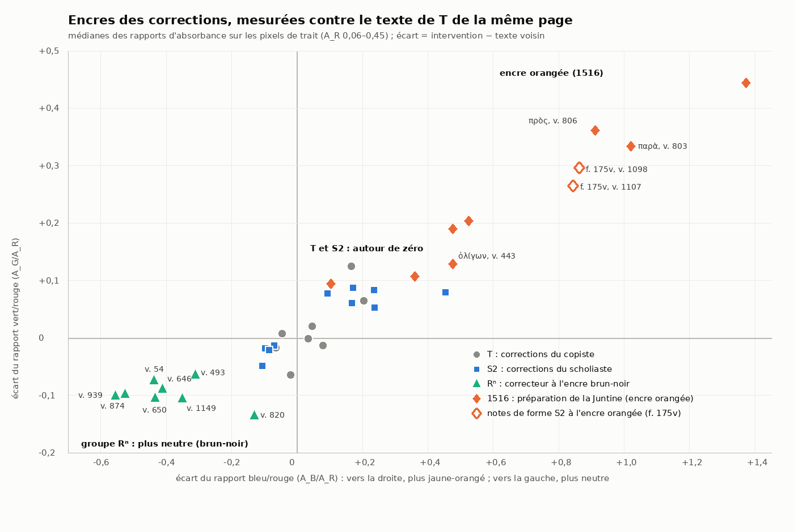
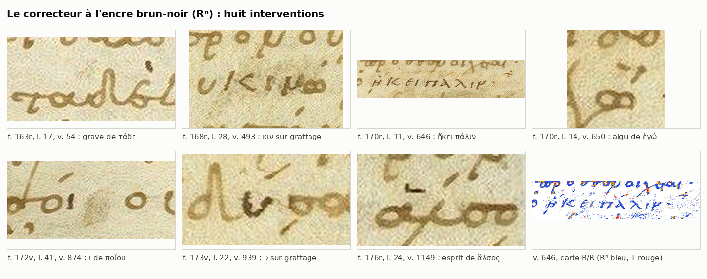
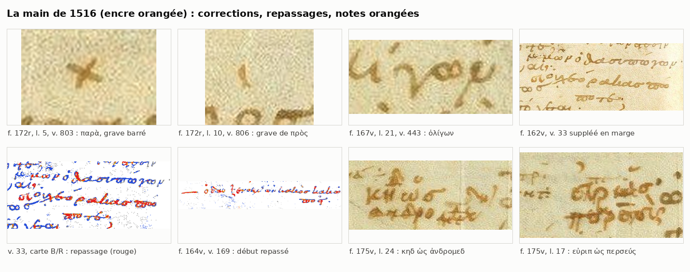
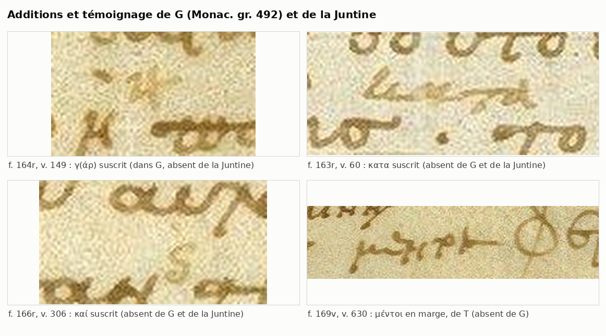

# Chapitre 4 — Corrections, grattages et interventions : répertoire et stratigraphie

> **Statut** : première rédaction complète, 28 oct. 2026.
>
> **Sources.** Les 30 inventaires de page (`ravennas/graphologie/folios/fXXX.md` et `fXXX.jsonl`, 2 203 observations, dont 325 de la catégorie « intervention »), les relevés détaillés (`fXXX_texte.jsonl`), les spécimens (`ravennas/graphologie/specimens/fXXX/`) et mes propres contrôles sur les images à pleine résolution (spécimens `ravennas/graphologie/specimens/chap4/`, planches `ravennas/graphologie/chapitres/planches/4_*.png`). Pour dater, j'ai consulté l'apographe G (Monac. gr. 492, XVe s., numérisation BSB `bsb00108707`) et la Juntine de 1516 (BSB `bsb10912207`). La littérature vient de `recherche/ravennas_dossier.md` et du répertoire critique (`edition/donnees/repertoire_critique/velsen1883_*.jsonl`). Je la cite à part : ce qu'affirment Velsen, Allen ou Austin n'est jamais donné comme observé.
>
> **Abréviations.** l. = ligne réglée de la page ; v. = vers (numérotation usuelle) ; T = copiste du texte ; S2 = scholiaste (« B » d'Allen, R² de Velsen) ; Rⁿ = correcteur ancien à l'encre brun-noir défini au § 2.3 ; 1516 = main de la préparation de l'*editio princeps* (« 2 m. » de Velsen 1871, attribuée sans preuve à Euphrosynus Boninus) ; G = Monac. gr. 492 ; Junt. = Juntine de 1516. Les mesures d'encre sont des rapports d'absorbance A_G/A_R et A_B/A_R (écrits « G/R » et « B/R »), calculés sur le cœur des traits et rapportés au fond local. Un « Δ » est l'écart à l'encre de T mesurée sur les lignes voisines, à densité égale.

## Sommaire

1. Objet, sources et méthode
2. Les mains et les encres des interventions
3. Typologie
4. Répertoire page par page
5. Stratigraphie
6. Conséquences pour l'apparat critique
7. Contrôles sur l'image : confirmations et rectifications des inventaires
8. Questions ouvertes

---

## 1. Objet, sources et méthode

### 1.1 Ce que couvre le répertoire

Le répertoire du § 4 recense **toutes les interventions sur le texte et ses marges** que relèvent les inventaires de page. Je les ai reprises de leurs tableaux « Interventions » (351 entrées ; une entrée peut grouper deux lignes ou plusieurs accents du même type). Chaque entrée a été revue, reclassée par procédé et par main, et rapprochée de son spécimen. Trois tableaux complètent ce répertoire :

- **B** : les interventions sur les marques de locuteur (sigles grattés, récrits ou repassés, paragraphoi barrées ou grattées). Les sigles simplement *ajoutés* relèvent du chapitre 5, § 4 (*notae personarum* ; 457 observations de la catégorie « sigle » dans les inventaires) ; je ne retiens ici que ce qui modifie ou détruit une marque antérieure.
- **C** : les repères de l'impression de 1516.
- **D** : les interventions modernes (réactif, restaurations, crayons).

### 1.2 Ce que j'ai vérifié moi-même

Les inventaires sont mon point de départ, non une autorité. J'ai revu sur l'image les points qui décident de la stratigraphie ou d'une leçon (§ 7). Pour comparer les encres, j'ai repris une mesure unique sur toute la pièce (outil `outils/graphologie/encres_interventions.py`) :

- **Pixels de trait.** Je retiens les pixels nettement plus sombres que le fond local, sans condition de teinte, pour ne pas exclure les encres neutres, puis leur cœur.
- **Absorbances.** Je calcule, canal par canal, les absorbances relatives au fond local.
- **Densité égale.** Les tracés très chargés mesurent mécaniquement plus « neutre » : les inventaires des ff. 164r et 169v l'avaient noté. Je compare donc l'intervention et le texte de T **à densité égale**, par classes d'absorbance rouge (0,10–0,15 ; 0,15–0,20 ; 0,20–0,25 ; 0,25–0,32 ; 0,32–0,45). Le texte de référence est pris sur les lignes voisines de la même page.

Ce protocole répond à deux pièges relevés par les inventaires :

- les petits signes (points, accents de moins de 25 px) mesurent « gris » quelle que soit la main, à cause du sous-échantillonnage de la chrominance du JPEG (inventaire du f. 169v) ;
- dans les auréoles d'humidité des marges, toutes les encres glissent vers l'orangé (inventaires des ff. 170r, 175v).

Je n'attribue donc aucun accent isolé sur la seule foi de l'encre, sauf quand l'écart, mesuré à densité égale, est grand et va dans le même sens qu'ailleurs.

### 1.3 Repères de datation

- **G**, copié au XVe s. sur R, donne un *terminus ante quem* pour toute correction dont il a la leçon. Il est fiable pour les lettres et les mots, et peu sûr pour les accents. Il a omis un ajout marginal de T lui-même, μέντοι au v. 630 (Velsen 1883, d'après le répertoire critique ; marge de R contrôlée), ainsi que le v. 33 suppléé par S2. Son silence ne prouve donc rien à lui seul.
- **La Juntine de 1516** a été composée sur R (Velsen 1871, 3–6 ; Clark 1871, 159, d'après le dossier). Elle donne un *terminus ante quem* pour ce qu'elle imprime. Elle n'est pas fiable pour ce qu'elle omet : elle saute le γάρ suscrit du v. 149, que G a pourtant lu (inventaire du f. 164r, vérifié dans G et dans la Juntine).
- **Invernizi 1794** imprime le κατα du v. 60 « ita liber noster » (Austin 1987, 71, d'après le dossier) : c'est un *terminus ante quem* pour cet ajout.

---

## 2. Les mains et les encres des interventions

### 2.1 Tableau des mains

| Main | Sigle proposé (§ 6) | Écriture des corrections | Encre (écart à T, à densité égale) | Ce qu'elle fait | Datation |
|---|---|---|---|---|---|
| **T** (copiste) | R, R^ac/R^pc | minuscule ronde et liée du texte ; lettres suscrites de même module | référence : Δ ≈ 0 (de −0,06 à +0,12 en G/R ; de −0,06 à +0,20 en B/R ; 8 mesures) | corrections en écrivant (biffure, puis le bon mot à la suite) ; relecture (lettres et mots suscrits, μέντοι en marge) ; lacune laissée au v. 506 ; signaux marginaux pour le correcteur | milieu du Xe s. (consensus rapporté par le dossier, § 0) |
| **S2** (scholiaste) | R² | semi-onciale inclinée (sigles, notes, -εῖν du v. 370) ; minuscule penchée de grand module pour les vers suppléés (« very large, sloped to the right, and fine », Allen 1896, 320) ; esprit rude anguleux « ⊢ » ; circonflexe en « ^ » | souvent un peu plus roux que T : Δ G/R de −0,05 à +0,09, Δ B/R de −0,11 à +0,45 (10 mesures) ; plages qui recouvrent celles de T | vers omis suppléés en marge ; lacune comblée ; suscriptions ; écrits sur grattage ; exponctuations ; accents et esprits ; corrections de ses propres scholies ; sigles abrégés ; signes de renvoi | Xe s., campagne « ultérieure mais rapprochée » (Orsini 2011, 328, d'après le dossier) ; antérieur à G |
| **Rⁿ** (correcteur à l'encre brun-noir) | R³ redéfini, ou Rⁿ | semi-onciale droite d'assez grand module (ἥκει πάλιν, v. 646) ; Κ majuscule en deux traits (κιν, v. 493) ; ailleurs lettres isolées et accents | **plus neutre et plus sombre que T** : Δ G/R de −0,06 à −0,13, Δ B/R de −0,13 à −0,56 (8 mesures) ; hors des plages de T et de S2 | écrits sur grattage (vv. 493, 646, 874, 939) ; aigus ajoutés sur des oxytons (vv. 650, 661 ?) ; grave (vv. 54, 820 ?) ; esprit rude (v. 1149) | **antérieur à G** : G a ἥκει πάλιν (v. 646, f. 10v de G, contrôlé) ; position relative par rapport à S2 inconnue |
| **1516, encre orangée** | R^rec | cursive humanistique ; sigles « imprimables » (εὐ, μν, ἀγ, Γυ, κηδ, σκ, χο…) ; Η capital suscrit ; tréma sur υ | **plus jaune-rouge** : Δ G/R de +0,09 à +0,44, Δ B/R de +0,10 à +1,37 (8 mesures ; les plus faibles viennent de sigles posés sur une paragraphos de T, qui mêlent les deux encres) | sigles ; repassage de sigles et de vers suppléés de S2 pâlis ; grattage de sigles anciens ; paragraphoi barrées ; signes d'insertion ; « ; » ; quelques accents et lettres (vv. 443, 803, 806, 1097, 1180, 1191) | préparation de l'édition achevée le 28 janv. 1516 (Velsen 1871, 2–3 ; Clark 1871, 157, d'après le dossier) |
| **1516, mine ou encre pâle grise** | — | traits fins, chiffres arabes humanistiques | gris neutre : G/R ≈ 1,0–1,1 ; B/R ≈ 1,2–1,5 (inventaires) | repères de pages de la Juntine ; barre grise d'une paragraphos au f. 175r (v. 1076a) | 1516 (les « faint pencil marks » de Clark 1871, 159) |
| **Mains postérieures à G** | R^rec | petite minuscule cursive très légère (κατα, v. 60) ; compendium de καί (v. 306) | brune, non distinctive (κατα) ; trop pâle pour une mesure par classes (καί) | κατα (v. 60) et καί (v. 306) suscrits ; effacement après coup de sigles de 1516 (f. 163r) ; paragraphoi grattées après G (vv. 1193 ?, 1200) | entre G (XVe s.) et 1794 pour κατα |
| **Modernes** | — | — | crayon rouge, graphite, réactif bleu-vert | soulignement (f. 164r, l. 8) ; traits de crayon ; taches de réactif sur les débuts de scholies ; pièces de restauration ; foliotations | XIXe–XXe s. (réactif, restaurations) |

Planche des encres : `ravennas/graphologie/chapitres/planches/4_encres_corrections.png`, avec les données dans `ravennas/graphologie/chapitres/4_mesures_encres.json`.



Je ne trouve dans la pièce aucune trace d'un correcteur du XIIIe ou du XIVe s. du type que Martin ou Clark signalent ailleurs dans le manuscrit (dossier, § 5.1). Le « R³ » de la préface de Velsen 1883 (« paullo recentior ») n'apparaît pas dans son apparat des *Thesmophories*. Le groupe Rⁿ est le seul candidat que l'image fasse apparaître pour une troisième main ancienne (§ 2.3).

### 2.2 Ce que l'encre permet, et ce qu'elle ne permet pas

1. **T et S2 ne se séparent pas par l'encre sur la plupart des pages.** Les plages se recouvrent (inventaires des ff. 162v, 164r, 164v, 166r, 168v, 169r, 169v, 170v, 171r, 176r, 176v, 177r). Quelques pages font exception : aux ff. 168r, 173r, 173v et 174v (et pour les sigles au f. 172v), l'encre de S2 est un peu plus rousse dans une même zone, et mes mesures à densité égale le confirment au f. 173v (περ du v. 938 : Δ +0,09/+0,17 ; υ de ὀλίγου au v. 935 : Δ +0,08/+0,09). Pour une lettre ou un accent isolés, l'attribution entre T et S2 repose donc sur la forme (semi-onciale, Ν majuscule, esprit en équerre, circonflexe en « ^ » chez S2) ou reste indécise. C'est la raison des 35 entrées « T ou S2 » du répertoire.
2. **La main de 1516 se sépare toujours de T** par l'encre orangée. Elle ne se sépare pas de certaines notes de forme S2, également orangées (§ 2.4).
3. **Le groupe Rⁿ se sépare de T et de S2** dans l'autre sens : plus neutre, plus sombre (§ 2.3).
4. **Les grattages ne gardent pas d'encre.** Leur main est presque toujours indéterminée, d'où les 39 grattages seuls rangés en « indét. » (§ 3). Seuls le contexte (sigle de 1516 écrit sur le grattage), la chronologie (leçon de G) ou une série homogène permettent de les rattacher à une campagne.

### 2.3 Le correcteur à l'encre brun-noir (Rⁿ)

**Constat.** Les inventaires ont isolé, page par page, plusieurs interventions d'une encre « plus neutre » ou « brun-noir » sans les relier entre elles :

- f. 163r, grave du second τάδε (v. 54) ;
- f. 168r, κιν sur grattage (v. 493) ;
- f. 170r, ἥκει πάλιν sur grattage (v. 646) et aigu de ἐγώ (v. 650) ;
- f. 172r, grave de εἰσὶν (v. 820) ;
- f. 173v, υ de ἀποδύσαντα sur grattage (v. 939) ;
- f. 176r, esprit rude « noir » de ἅλσος (v. 1149).

L'inventaire du f. 176r proposait déjà de les comparer. Je les ai remesurés avec le même protocole, à densité égale, contre le texte de T des lignes voisines. J'y ajoute l'ι de ποίου (v. 874), que l'inventaire du f. 172v donnait à S2.

| Page, l. | v. | Intervention | n px | G/R ; B/R | T voisin | Δ G/R ; Δ B/R |
|---|---|---|---|---|---|---|
| f. 163r, l. 17 | 54 | grave sur le second τάδε | 33 | 1,19 ; 1,51 | 1,26 ; 1,94 | −0,07 ; −0,44 |
| f. 168r, l. 28 | 493 | κιν sur grattage | 615 | 1,25 ; 1,95 | 1,32 ; 2,26 | −0,06 ; −0,31 |
| f. 170r, l. 11 | 646 | ἥκει πάλιν sur grattage | 1 390 | 1,23 ; 1,85 | 1,32 ; 2,27 | −0,09 ; −0,41 |
| f. 170r, l. 14 | 650 | aigu ajouté sur ἐγὼ | 52 | 1,22 ; 1,83 | 1,32 ; 2,27 | −0,11 ; −0,43 |
| f. 172r, l. 29 | 820 | grave ajouté sur εἰσίν | 37 | 1,18 ; 2,12 | 1,32 ; 2,25 | −0,13 ; −0,13 |
| f. 172v, l. 41 | 874 | ι de ποίου, σ gratté | 58 | 1,20 ; 1,56 | 1,29 ; 2,08 | −0,10 ; −0,53 |
| f. 173v, l. 22 | 939 | υ de ἀποδύσαντα sur grattage | 169 | 1,22 ; 1,72 | 1,32 ; 2,28 | −0,10 ; −0,56 |
| f. 176r, l. 24 | 1149 | esprit rude de ἅλσος | 26 | 1,13 ; 1,64 | 1,24 ; 1,99 | −0,11 ; −0,35 |

Par classes de densité, l'écart se maintient à chaque niveau : pour ἥκει πάλιν, par exemple, 1,22–1,26 / 1,82–1,90 contre 1,29–1,32 / 2,25–2,38 pour T. Ce n'est donc pas un effet de la densité. L'aigu de καιρός (v. 661) va dans le même sens (Δ −0,05/−0,31), mais sur 11 px seulement. En revanche, l'εῖ récrit sur grattage de ἐπιζεῖν (v. 468), que l'inventaire du f. 168r rapprochait de κιν, a l'encre de T à densité égale (1,26–1,28 / 2,03–2,21 contre 1,26–1,30 / 2,16–2,22) : je ne l'inclus pas dans le groupe.

Planche : `ravennas/graphologie/chapitres/planches/4_groupe_Rn.png`.



**Ce que fait ce correcteur.** Il gratte et récrit des lettres ou des mots (vv. 493, 646, 874, 939). Il ajoute aussi des accents : un aigu sur un oxyton devant une pause (v. 650), un grave (vv. 54, 820), un esprit rude (v. 1149). Son écriture, là où elle est assez étendue pour être jugée, est une semi-onciale : ἥκει πάλιν est en lettres espacées, droites, avec Κ, Π, Λ, Ν majuscules, d'un module un peu supérieur à celui des scholies (inventaire du f. 170r, vu) ; κιν a un Κ majuscule en deux traits (inventaire du f. 168r, vu).

**Date.** G lit ἀλλὰ δεῦρ᾽ ἥκει πάλιν au v. 646 (Monac. gr. 492, f. 10v, image BSB `bsb00108707_0024`, contrôlée). Velsen 1883 ne signale pas non plus de divergence de G pour κινώμεθα (v. 493) ni pour ποίου (v. 874). Ces écrits sur grattage sont donc **antérieurs au XVe s.** Pour les accents, G ne tranche pas : il garde le grave de ἐγὼ (v. 650) et le τάδε sans accent nouveau (v. 54). Son copiste a pu ignorer une correction d'accent.

**Identité.** Deux hypothèses restent ouvertes :

- S2 dans une autre campagne, avec une autre encre : les formes de semi-onciale sont les siennes, et Allen (1896, 316) comme Velsen 1883 donnent ἥκει πάλιν et κιν à B / R² ;
- une troisième main ancienne, ce que suggère l'écart d'encre. Ce serait le seul candidat au « R³ paullo recentior » de la préface de Velsen 1883.

Je n'ai observé aucune superposition entre une intervention de Rⁿ et une intervention de S2 : leur ordre relatif est inconnu. Velsen 1871 donne le grave du v. 54 à la « 2 m. » (1516), mais l'encre n'est pas orangée, et c'est celle du groupe.

### 2.4 L'encre orangée : ce qu'elle prouve et ce qu'elle ne prouve pas

**La main de 1516.** L'encre orangée signe d'abord la main de 1516. Ses sigles « imprimables » manquent dans G et passent dans la Juntine, avec leurs erreurs : fausses attributions aux vv. 173, 206 et 208 (inventaire du f. 164v). Ses corrections du texte ont la même encre :

- le grave de παρὰ barré au v. 803 (Δ +0,33/+1,02, contrôlé) ;
- le grave ajouté sur πρὸς au v. 806 (Δ +0,36/+0,91, contrôlé) ;
- la seconde boucle de ὀλίγων au v. 443 (Δ +0,13/+0,48, contrôlé) ;
- le grave de καὶ au v. 1097 ;
- les accents de κατὰ τὸ au v. 1180 ;
- σκ tiré de ο ο ο au v. 1191.

Velsen 1871 donne à sa « 2 m. » celles des vv. 443, 803, 806, 1097 et 1180 (d'après les inventaires).

**Le repassage.** Cette main repasse aussi des écritures anciennes pâlies. Velsen 1871 le dit des sigles de S2 aux vv. 5, 19 et 39 (« schol. m. überzogen von 2 m. », d'après l'inventaire du f. 162v, où les lettres suscrites de S2 sont restées brunes). Je le vois sur deux vers suppléés par S2 :

- **v. 33** (f. 162v). La ligne (a), μῶν ὁ δασυπώγων, est brune. Les lignes (b) et (c), οὐχ ἑόρακας πώ|ποτε, ainsi que le δ de δασυπώγων, sont repassées en orangé. L'εὐ et le « ; » sont ajoutés (spécimens `ravennas/graphologie/specimens/chap4/f162v_v33_marge.png` et `…/f162v_v33_marge_carte_BR.png`). G omet ce vers (Velsen 1883 : « versum omm. RG »). La Juntine l'imprime : « Μν· μῶν ὁ δασυπώγων ; Εὐ· οὐχ ἑώρακας πώποτε ; » (f. a iii v°, contrôlé), avec précisément les sigles et la ponctuation de 1516.
- **v. 169** (f. 164v). Le début, « — ὁ δ᾽ αὖ ξενο- », est plus orangé que la suite (`ravennas/graphologie/specimens/chap4/f164v_v169_marge_carte_BR.png`). Or G a laissé un blanc à la place de δ᾽ αὖ, ajouté ensuite en marge (Velsen 1883 : « ὁ spat. rel. ξενοκλῆς et in margine δ᾽ αὖ G »).

Les parties repassées en 1516 sont donc celles que G, un siècle plus tôt, lisait mal ou pas du tout. Allen décrivait déjà un vers « perished, and been partly revived » ; sa notice vise le v. 28, mais elle ne convient qu'au v. 33 (inventaire du f. 162v).

**Les notes orangées attestées par G.** Des notes de forme S2 sont à l'encre orangée alors que G les reproduit déjà :

- f. 175v : ηχω (v. 1083), εὐριπ ὡς περσεύς (v. 1098), κηδ ὡς ἀνδρομεδ (v. 1107), σκυθ (v. 1108) ;
- f. 176v : κη^δ (v. 1207) ;
- f. 174r : τοξ (v. 1001) ;
- f. 173v : μνη^σ et ΠΡΥ (vv. 936, 939a), à en juger par la forme.

J'ai contrôlé les deux notes du f. 175v (`ravennas/graphologie/specimens/chap4/f175v_l17_v1098_note_orangee.png`, `f175v_l24_v1107_note_orangee.png`) : leur encre est celle des sigles de 1516 (Δ +0,30/+0,86 et +0,26/+0,84). Deux explications sont possibles :

- S2 aurait eu une encre qui a viré à l'orangé ;
- la main de 1516 aurait repassé des notes que G avait déjà copiées.

La seconde est la plus économique : elle applique à ces notes la pratique attestée aux vv. 5, 19, 39, 33 et 169. L'inventaire du f. 176v voit d'ailleurs des pixels bruns sur les contours du κη^δ du v. 1207. Elle n'est pas prouvée.

Planche : `ravennas/graphologie/chapitres/planches/4_main_1516.png`.



**Règle pratique.** Une marque orangée absente de G est de 1516. Une marque orangée présente dans G est un texte ancien, d'ordinaire S2, peut-être repassé en 1516. Pour l'apparat, c'est le texte ancien qui compte.

### 2.5 La mine de plomb de 1516

Les repères des pages de la Juntine (tableau C) sont des traits fins et des chiffres gris neutres. C'est de la mine de plomb ou une encre très diluée, les « faint pencil marks » de Clark 1871, 159. Deux exceptions :

- au f. 174v, le repère de la p. c 13 est un trait **orangé** ;
- au f. 171r, celui de c 1 est ocre pâle.

Au f. 175r, la paragraphos du v. 1076a est barrée d'un trait gris, et non orangé. La préparation de 1516 a donc employé au moins deux matériaux. La distinction ne se laisse pas réduire à « sigles à l'encre, repères à la mine ». Il peut s'agir d'une seule main en plusieurs passes ou de deux mains (questions ouvertes des inventaires des ff. 165v et 175r).

### 2.6 Ajouts postérieurs à G

Deux suscriptions de mots manquent à la fois dans G et dans la Juntine :

- **v. 60, κατα suscrit** (f. 163r, l. 24 ; `ravennas/graphologie/specimens/chap4/f163r_l24_v60_kata_suscrit.png`). G lit « τοῦ καλλιεποῦς τοῦ θριγκοῦ » sans κατά (f. 2r, image `bsb00108707_0007`, contrôlée). L'écriture est une très petite minuscule cursive, légère, penchée, et l'encre brune n'est pas distinctive à la mesure (G/R 1,24 ; B/R 2,03 contre 1,28 ; 1,97). Velsen 1871 et 1883 l'attribuent à la main des scholies ; Austin 1987, 71 y voit une conjecture moderne, imprimée d'abord par Invernizi en 1794 (d'après le dossier).
- **v. 306, compendium de καί suscrit** (f. 166r, l. 13 ; `ravennas/graphologie/specimens/chap4/f166r_l13_v306_kai_suscrit.png`). G lit « καὶ τὴν δρῶσαν τὴν ἀγορεύουσαν » sans second καί (f. 5v, image `bsb00108707_0014`, contrôlée). Le signe est très pâle et n'est pas orangé. Velsen 1871 le donne à la « 2 m. » (« superscripsit 2 m. R om. Junt. (om. Aug.) »).

Ces deux absences ne prouvent pas la date, mais elles pèsent. Le copiste de G a recopié les petites suscriptions anciennes du f. 164r (γάρ, κα, θ aux vv. 149, 151, 155) ; la Juntine, à l'inverse, en a omis une (γάρ). Pour κατα et καί, l'absence simultanée dans G et dans la Juntine fait **présumer un ajout postérieur à 1516**. Ce serait l'œuvre d'un lecteur de R entre 1516 et 1794, et c'est la thèse d'Austin pour κατα. Comme G omet aussi μέντοι (v. 630), ajout marginal de T, je donne cette conclusion comme une présomption.

Planche : `ravennas/graphologie/chapitres/planches/4_additions_G_Juntine.png`.



---

## 3. Typologie

### 3.1 Bilan chiffré

Le tableau croise le procédé et la main pour les 351 entrées du répertoire A. Une entrée qui associe deux procédés est comptée au premier dans l'ordre du tableau. Les colonnes « T + S2 » et « S2 + 1516 » réunissent les cas où deux mains interviennent sur le même objet : par exemple, une biffure de T avec les points d'exponctuation de S2, ou un vers suppléé par S2 et repassé en 1516. La colonne « S2 (Velsen seul) » regroupe les attributions à R² que l'image ne permet ni de confirmer ni d'exclure.

| Procédé | T | T + S2 | T ou S2 | S2 | S2 + 1516 | S2 (Velsen seul) | Rⁿ | 1516 | post-G | moderne | indét. | Total |
|---|---|---|---|---|---|---|---|---|---|---|---|---|
| ajout marginal (vers, mot, lacune) | 2 | · | · | 3 | 2 | · | · | · | · | · | · | 7 |
| ajout suprascrit | 7 | 1 | 7 | 18 | · | 3 | · | · | 2 | · | 2 | 40 |
| grattage + récriture | 4 | 1 | 2 | 6 | · | 2 | 4 | · | · | · | 2 | 21 |
| grattage seul | 1 | · | 2 | 5 | · | 6 | · | · | · | · | 39 | 53 |
| surcharge (sans grattage) | 5 | 1 | 8 | 9 | · | 5 | · | 2 | · | · | 5 | 35 |
| biffure, exponctuation, frottis | 9 | 3 | 1 | 4 | · | 2 | · | 1 | · | · | 3 | 23 |
| accent, esprit (sans grattage) | 10 | · | 12 | 14 | · | 18 | 5 | 6 | · | · | 32 | 97 |
| ponctuation | · | · | · | · | · | · | · | 4 | · | · | 1 | 5 |
| signes (renvois, insertion, signal) | 2 | · | 3 | 1 | 3 | · | · | 5 | · | · | 4 | 18 |
| marques de locuteur (dans les tableaux d'interventions) | 2 | · | · | · | 2 | · | · | 22 | · | · | 3 | 29 |
| repères d'impression, lecteurs | · | · | · | · | · | · | · | 3 | · | 2 | · | 5 |
| correction de Velsen non visible | 2 | · | · | · | · | 1 | · | · | · | · | 15 | 18 |
| **Total** | **44** | **6** | **35** | **60** | **7** | **37** | **9** | **43** | **2** | **2** | **106** | **351** |

Par objet, les accents et les esprits représentent 142 entrées, autant que les lettres et les mots (142). Viennent ensuite les marques de locuteur (29), les signes (18), les vers et lignes entières (6), la ponctuation (5), les repères (5) et les scholies (4). Sur les 351 entrées, 51 ne reposent que sur Velsen : la correction qu'il signale ne se voit pas sur la photographie, même si le signe actuel est visible.

### 3.2 Les corrections de T

**En écrivant.** Une biffure suivie du bon mot sur la même ligne prouve la correction *currente calamo*. On en trouve sept exemples :

- ἐξ ⟦ἐλέγχων⟧ ἔλαχον (v. 1071a, f. 175r) ;
- ⟦τί⟧ φέρε (v. 768, f. 171v) ;
- ⟦τὸ⟧ δὸς (v. 754, f. 171r) ;
- la dittographie ἅπασιν ⟦ἅπασιν⟧ (v. 669, f. 170r) ;
- κρο⟦τ⟧κωτῶι et ψό⟦ι⟧γον (vv. 138, 146, f. 164r) ;
- δέξασ⟦δ⟧θε (v. 779, f. 171v).

Au f. 172v (v. 855), le δ superflu de νειλου δ μὲν est effacé, probablement par un frottis à l'encre encore fraîche. Trois anticipations du texte suivant sont abandonnées :

- la ligne « παῖ᾽ ἦν προσήει τίς » au f. 173v (l. 15, v. 934) ;
- ἱστιοφόρον au v. 935, le bon mot ἱστιορράφος étant copié à la ligne suivante ;
- παυ, amorce de Παύσων au v. 948.

La biffure est de T pour les deux premières. Pour παυ, comme pour γε au v. 942, la barre a une encre de type S2 (inventaire du f. 173v). Les points d'exponctuation des deux premières sont de S2 selon Velsen 1883 (pour ἱστιοφόρον : « quod delevit R, expunxit R² »).

**En relecture.** T ajoute au-dessus de la ligne la lettre ou le mot omis, dans son module et son encre :

- τ de τιτθία (v. 143) ; ὢν (v. 170) ; κ de ἐκ^κλησίαν (v. 375) ;
- η sur ει de εἰσέφερε, avec grattage du σ (v. 512) ;
- κ sur le γ de ἔγμαγμα (v. 514) ; ν sur le ρ de ἂρ (v. 549) ;
- ν de ἀποστερουμένη^ν (v. 698) ; κ de κα^κ^κάσκι (v. 1089) ; θ de πα^θ^ρνον (v. 1105).

Il écrit aussi en marge : μέντοι au v. 630, dans sa minuscule et son encre (contrôlé ; `ravennas/graphologie/specimens/chap4/f169v_l38_v630_mentoi_T.png`) ; τὼ ajouté en tête du v. 1183, hors justification.

**Lacune et signaux.** Au v. 506, T laisse un blanc que S2 comble par βοώιη. Il laisse aussi des **signaux** au correcteur, sans corriger lui-même :

- signe incliné à crochet après ὠϋριπίδη au v. 4 (f. 162v) ;
- « ⋎ » arrondi devant le v. 807, au f. 172r (la faute présumée est στρατωνίκην, Allen 1896, 317) ;
- « √ » pointé au v. 1135, au f. 176r ;
- trait oblique en « √ » au v. 1176, au f. 176v (main probable).

Ce sont les seuls signaux de T dans la pièce. Tous les autres « + » des bandes de sigles sont des paragraphoi barrées (tableau B).

### 3.3 Les corrections de S2

**Vers omis.** S2 supplée en marge les quatre omissions de vers entiers, en minuscule penchée de grand module. Deux sont des sauts du même au même : le v. 169 et les vv. 1102–1103 (d'après les inventaires) :

| v. | Page | Remarque |
|---|---|---|
| 33 | f. 162v, marge droite | sigle μ· de S2 ; repassé en partie en 1516, qui ajoute εὐ et « ; » |
| 169 | f. 164v, marge extérieure | croix de renvoi de S2 prolongée par un trait de 1516 ; début repassé en 1516 |
| 647 | f. 170r, marge droite | encadré par des ÷ de renvoi ; ἰσθμὸν corrigé (ο sur une trace abrasée) |
| 1102–1103 | f. 175v, marge inférieure | signe de renvoi « —+:— » / « +: » ; jargon du Scythe normalisé (γοργόνος, κεφαλῆ) |

**Suscriptions.** S2 rétablit des lettres et des mots :

- γ(άρ) (v. 149), κα (v. 151), θ (v. 155) ;
- ν de ὀῦ^ν (v. 263) ; πο de οὐπώ^πο^τε (v. 434) ; μ de ἧ ^μ ἄλισθ᾽ (v. 376) ;
- τα de ἔπει^τα (v. 557) ; ν de φράσω^ν (v. 579) ; Η de ἀφῆτ᾽ (v. 693) ;
- χ de χρῆν (v. 726) ; σι de περ^σι^κὰς (v. 734) ;
- τινα au-dessus de ποτε barré (v. 833) ; περ de καί^περ (v. 938) ; ν et α de ποσί^ν ^ἄ^γ᾽ (v. 954) ;
- ν de κακοδαίμω^ν (v. 1006) ; οι de ἀποκεκόψοι (v. 1127) ; σι de ἀνθρώποι^σι (v. 1116) ; ζ de ἔφρα^ζ^ον (v. 1173).

**Écrits sur grattage.**

- αι de λαικάζει (v. 57b) ;
- Β onciale de βάρβιτος (v. 137), récrite sur une autre lettre ;
- -εῖν onciale de παραστατεῖν (v. 370 ; G a « ατ in correct. », d'après Velsen 1883) ;
- υ de ὀλίγου (v. 935) ;
- τ de στεριπὸ (v. 1185 ; « στεριπὸ est in G ») ;
- πόψετ de ἐπόψεται (v. 1049, attribution de Velsen).

**Exponctuations.** Le second λ de σαλλαβακχοῦσ (v. 805) ; la ligne « στυγνᾶς ὦσσε », écrite par T dans la colonne après le v. 1142 et exponctuée (selon Velsen 1883, par R²).

**Ses propres scholies.** S2 y corrige au fil de la plume : δαίμων tiré de δαίμον (sch. 299), ἀμφ- au-dessus de ⟦ενε⟧ (sch. 1044), προ et ν suscrits (f. 175r), rature dans ἱερεί[..]αις (sch. 758).

Les leçons de G montrent que ces corrections sont antérieures au XVe s. : τάδ᾽ (v. 355), καὶ περ (v. 938), ποσὶν ἄγ᾽ (v. 954), ἀποκεκοψο (v. 1127), το κεπαλῆς (v. 1126), στεριπὸ (v. 1185), d'après Velsen 1883.

### 3.4 Les accents : une correction de grammairien

Les accents et les esprits forment 40 % du répertoire (142 entrées sur 351), autant que les lettres et les mots. Trois séries se dégagent.

1. **L'« accent en V » : un aigu ajouté au grave, sans grattage.** Il touche les oxytons devant une pause ou un enclitique :
   - θεώ, σύ, ἐγώ (vv. 594, 603, 604, f. 169v) ;
   - ἐγώ et καιρός (vv. 650, 661, f. 170r) ;
   - ἀεί (v. 576) ; κακόν (v. 335) ; δυσμενής (v. 757) ;
   - καινόν, ἁγνήν, εἰκός (vv. 967, 971, 974, f. 174r) ;
   - en croix : κακόν (v. 195), σεαυτόν (v. 234), πόντου (v. 44), τουτί (v. 73).

   Le correcteur applique la règle de l'oxyton à la pause et laisse visible le grave de T. La main n'est identifiable qu'aux vv. 650 et 661, où l'aigu a l'encre de Rⁿ. Ailleurs, on reste entre T relisant, S2 et Rⁿ.
2. **Le sens inverse : un grave ajouté contre l'aigu de T.** C'est le cas de εἰσὶν (v. 820, encre de type Rⁿ) et de στρατηγὸν (v. 833).
3. **Accents grattés.** Un grave ou un circonflexe est supprimé sur les enclitiques et les monosyllabes : εἰμι (v. 190), ἐστιν (vv. 904, 1172), γαρ (v. 898), νη (v. 745 ; v. 623 selon Velsen seul), ὁς (v. 621, selon Velsen seul). Un second accent est supprimé : ἀνταυγεῖς (v. 902), ὕμνων (v. 124), ἀπόλλω (v. 748), τιμοκλεῖ (v. 373), ἡμῖν changé en ἥμιν (v. 376). Ces grattages ne gardent pas d'encre. Le correcteur est indéterminé, mais la correction est systématique et de même esprit que la série 1 : une normalisation grammaticale de l'accentuation de T.

À cela s'ajoutent des accents et des esprits simplement **ajoutés** sur des mots que T n'accentuait pas : huit au f. 174r, plusieurs aux ff. 173r, 173v, 174v, 176v. Velsen 1883 les donne à R². Ils sont minces, souvent hauts placés, et l'encre ne tranche pas (§ 2.2).

### 3.5 Ponctuation, signes, marques de locuteur

**Ponctuation.** La main de 1516 transforme le point en « ; » par une virgule orangée aux vv. 193, 222 et 252, et ajoute le « ; » du v. 33. Le dicolon du v. 32 est gratté, probablement par elle.

**Signes.** Les renvois de S2 entre le texte et les scholies (∈, ·϶·, ✕ au f. 164r ; ·×· au f. 169r ; ·✓· au f. 166v ; flèche au f. 171v) contredisent l'absence de renvois que la littérature prête à S2 (Orsini 2011, 328 ; Zacher 1888, 536, d'après le dossier). La main de 1516 ajoute des signes d'insertion (« ^ », « √ ») qui renvoient à ses sigles marginaux : vv. 216, 222, 224, 1179, 1187.

**Marques de locuteur.** Voir le tableau B. La main de 1516 y est l'agent principal :

- sigles écrits sur les sigles grattés de S2 (vv. 34, 173, 211, 295, 380, 466, 907–908) ;
- repassages ;
- paragraphoi barrées d'une haste quand la Juntine ne veut pas de changement de locuteur (vv. 232, 234, 246, 264, 273, 274, 1076a, 1078a, 1092b, 1093, 1095, 1184, 1194, 1195, 1204, 1221).

Une partie de ces barres est fausse : au v. 608, le changement de locuteur est réel.

---

## 4. Répertoire page par page

### 4.A Interventions dans le texte et les marges

Chaque tableau reprend, abrégée, la description de l'inventaire de la page. J'ai ajouté, en gras, mes propres contrôles et rectifications.

- **Colonnes.** Procédé : « add. supra » = ajout suprascrit ; « add. marg. » = ajout marginal ; « ras. » = grattage ; « ras. + écr. » = écrit sur grattage ; « surch. » = surcharge sans grattage ; « biff. » = biffure ; « expunct. » = exponctuation ; « acc. » = accent ou esprit ; « loc. » = marque de locuteur ; « impr. » = repère d'impression. La colonne « Cert. » reprend la certitude de l'inventaire ; « Velsen seul » signale une correction que seule l'édition de Velsen atteste.
- **Mains.** « T/S2 » = T ou S2 ; « S2 (Velsen) » = attribution de Velsen 1883 que l'image ne départage pas ; « S2 + 1516 » = écrit par S2, retouché en 1516 ; « tardive ? » = postérieure à G.
- **Spécimens.** Le nom de fichier renvoie au dossier `ravennas/graphologie/specimens/<page>/`, indiqué en tête de chaque page.

#### f162v

Spécimens : `ravennas/graphologie/specimens/f162v/`.

| l. | v. | Intervention | Procédé | Objet | Main | Cert. | Spécimen |
|---|---|---|---|---|---|---|---|
| 5 | 4 | marge droite après ὠϋριπίδη — signal ÷ incliné à crochet (le « √ » d'Allen), sans correction | signe | signe | T | moyenne | f162v_l05_signal_obele.jpg |
| 7 | 6 | παρεστώς — aigu à tête épaissie ; « corr. ex -ὼς » (Velsen) non démontrable | acc. | accent/esprit | T | faible ; Velsen seul | f162v_l07_parestos_accent.png |
|  | 6-7 | interligne 7/8, milieu de la colonne — marque « ·ʃ· » (chiffre 5 encadré de points ? renvoi ?) | signe | signe | indét. | faible | f162v_l07_08_marque_interlineaire.png |
| 13 | 12 | ἴσθ᾽ — ι final surchargé en croix, devenu apostrophe | surch. | lettre/mot | T/S2 | moyenne | f162v_l13_isth_corr.png |
| 17 | 16 | ᾧ — petit esprit rude ajouté à gauche du circonflexe | acc. | accent/esprit | S2 | moyenne | f162v_l17_omega_esprit.png |
| 21 | 20 | τουτὶ — circonflexe gratté sur -ου- | ras. | accent/esprit | indét. | haute (grattage) | f162v_l21_touti_rasura.png |
| 23 | 22 | ἐμοῦ — υ refait sur ι, accent récrit (« corr. ex ἐμοί ») | surch. | lettre/mot | T | moyenne | f162v_l23_emou_corr.png |
| 24 | 23 | ἐξεύροιμ᾽ — changement d'esprit (Velsen) non vérifiable | acc. | accent/esprit | indét. | faible ; Velsen seul | f162v_l24_exeuroim_esprit.png |
| 26 | 25 | tête du vers — sigle gratté (Velsen) : fond rugueux, sans encre | loc. | locuteur | 1516 ? | faible | f162v_l26_tete_rasura.png |
| 26 | 25 | ἰδού — correction de grave en aigu (Velsen) non visible | acc. | accent/esprit | T | faible ; Velsen seul | f162v_l26_mnh_idou.png |
| 28-31 | 27-30 | marge droite — lettres numérales α, γ, δ, β rétablissant l'ordre des vers | signe | signe | S2 + 1516 | moyenne | f162v_numerales_alpha_delta.png |
| 33 | 32 | entre τις· et οὐχ᾽ — dicolon gratté | ponct. | ponctuation | 1516 | moyenne | f162v_l33_dicolon_rasura.png |
|  | 33 | marge droite — vers suppléé en 3 lignes, en partie repassé ; εὐ et « ; » ajoutés **[Contrôle : lignes (b)-(c) et δ repassés en orangé ; v. 33 absent de G, imprimé par la Juntine avec Μν·/Εὐ· et « ; ».]** | add. marg. | vers/ligne | S2 + 1516 | moyenne | f162v_v33_marge.png |
| 34 | 34 | καὶ μέγ᾽ — ι gratté (Velsen) : trace grise | ras. | lettre/mot | indét. | faible | f162v_l34_kai_rasura.png |
| 35 | 35 | βεβίνηκας — β refait sur α (Velsen) ? tracé un peu plus dense | surch. | lettre/mot | T | faible | f162v_l35_bebinekas.png |
| 36 | 36 | πτήξωμεν — finale -μεν récrite sur -μαι | surch. | lettre/mot | T/S2 | moyenne | f162v_l36_ptexomen.png |
| 40 | 40 | συγκλείσας — aigu épais en coin sur un circonflexe | acc. | accent/esprit | S2 | moyenne | f162v_l40_synkleisas_accent.png |

#### f163r

Spécimens : `ravennas/graphologie/specimens/f163r/`.

| l. | v. | Intervention | Procédé | Objet | Main | Cert. | Spécimen |
|---|---|---|---|---|---|---|---|
| 1 | 43 | πνοὰσ — grave épais ; trace angulaire pâle au-dessus (circonflexe gratté ?) | ras. | accent/esprit | indét. | incertaine | f163r_l01_pnoas_accent.jpg |
| 2 | 44 | πόντου — accents croisés : l'état πὸντού est corrigé en πόντου | acc. | accent/esprit | T/S2 | probable | f163r_l02_ponto_accents_corriges.jpg |
| 5 | 45c | λέγει — rasure de la fin du mot ; seuls des résidus bruns y restent | ras. | lettre/mot | indét. | probable (rasure) | f163r_l05_legei_grattage.jpg |
| 6 | 46 | κατακοιμάσθω — grave gratté sur κατα ? | ras. | accent/esprit | indét. | incertaine | f163r_l06_kata_grave_gratte_bleu.jpg |
| 17 | 54 | 1er τάδε — grave sur δε | acc. | accent/esprit | T/S2 | incertaine | f163r_l17_tade_grave.jpg |
| 17 | 54 | 2e τάδε — grave brun-noir sur δε ; hachures sur l'α (aigu gratté ?) **[Contrôle : encre brun-noir, Δ −0,07/−0,44 à densité égale : groupe Rⁿ.]** | acc. | accent/esprit | Rⁿ | probable (encre distincte) | f163r_l17_tade2_grave_sombre.jpg |
| 21 | 57b | λαικάζει — αι sur rasure (état premier λεκ- ?) | ras. + écr. | lettre/mot | S2 | probable | f163r_l21_ai_sur_grattage.jpg |
| 24 | 60 | καλλιεποῦσ ^κατα^ τοῦ — κατα suscrit en petite minuscule **[Contrôle : encre non distincte de T ; κατα absent de G (f. 2r, contrôlé) et de la Juntine.]** | add. supra | lettre/mot | tardive ? | incertaine (attribution) | f163r_l24_kata_suscrit.jpg |
| 27 | 63 | ὢν — accent empâté par surcharge (ὧν → ὢν) | surch. | accent/esprit | S2 | probable | f163r_l27_on_accent.jpg |
| 33 | 69 | πρ-, Η de προΐῃ — encre plus dense | surch. | lettre/mot | T | incertaine | f163r_l33_encre_dense.jpg |
| 37 | 73 | τουτί — grave et aigu superposés en V | acc. | accent/esprit | indét. | probable | f163r_l37_touti_accents.jpg |
| 39 | 75 | paragraphos — biffure ondulée | loc. | locuteur | 1516 | probable | f163r_l39_42_sigles_XVIe.jpg |
| 9–15, 21, 22, 27, 41 | 48b–52, 57b, 58, 63, 77 | sigles — effacements : lavage aux ll. 9–15, grattage aux ll. 21 et 41 | loc. | locuteur | indét. (1516 ?) | probable ; incertaine pour les ll […] | f163r_l09_15_sigles_effaces_ds.jpg |

#### f163v

Spécimens : `ravennas/graphologie/specimens/f163v/`.

| l. | v. | Intervention | Procédé | Objet | Main | Cert. | Spécimen |
|---|---|---|---|---|---|---|---|
| 9 | 88 | τραγωδωδιδάσκαλον corrigé en τραγωδο- : seconde boucle de l'ω comblée ou surchargée | surch. | lettre/mot | S2 ? | correction certaine ; main probable | f163v_l09_tragodo_correction_hyphen.png |
| 9 | 88 | long trait ondulé sous τραγωδο\|διδάσκαλον, écrit en deux mots (trait de liaison, ὑφέν ?) | signe | signe | T/S2 | probable | f163v_l09_tragodo_correction_hyphen.png |
| 15 | 94 | πυραμούς → πυραμοῦς : circonflexe ajouté, aigu biffé d'un petit trait (x) | biff. | accent/esprit | indét. | correction certaine | f163v_l15_pyramous_accent.png |
| 17 | 96 | esprit de οὑκ- en amas très dense, sans doute repassé (doux → rude ?) | surch. | accent/esprit | indét. | possible | f163v_l17_esprit_oukk.png |
| 18 | 97 | τυφλός → τυφλὸς et μὲν → μέν (Velsen 1883) | acc. | accent/esprit | indét. | douteuse | f163v_l18_tyflos_men.png |
| 28 | 107 | blanc d'environ 80 px avant ἄγε : ἀλλ᾽ gratté selon Velsen 1883 | ras. | lettre/mot | indét. | grattage probable ; texte gratté […] | f163v_l28_blanc_avant_age.png |
| 16 | 95 | μ^ν suscrit dans l'interligne au-dessus de -γα τί | loc. | locuteur | 1516 | certain (compté aussi en c) | f163v_l16_mu_nu_suscrit_v95.png |

#### f164r

Spécimens : `ravennas/graphologie/specimens/f164r/`.

| l. | v. | Intervention | Procédé | Objet | Main | Cert. | Spécimen |
|---|---|---|---|---|---|---|---|
| 2 | 124 | ὕμνων : deux points pâles au-dessus de -νω-, restes d'un circonflexe gratté (corr. ex ὑμνῶν, Velsen 1883) | ras. | accent/esprit | T/S2 | possible | f164r_l02_hymnon_circonflexe_gratte.jpg |
| 8 | parép. | soulignement rouge pâle sous « -ζεις γέρων » | lecteur | repère | moderne | certaine (trait) | f164r_l08_trait_rouge_ds.jpg |
| 13 | 134 | ε de εἴ repassé, plus dense (« ε in εἴ ex corr. ») | surch. | lettre/mot | T/S2 | probable | f164r_l13_ei_correction.jpg |
| 16 | 137 | βάρβιτος : premier β en B onciale récrit sur une lettre (σ selon Velsen) ; le second β est le β « en u » de T | ras. + écr. | lettre/mot | S2 | probable | f164r_l16_barbitos_B_corrige.jpg |
| 17 | 138 | κρο⟦τ⟧κωτῶι : lettre biffée en croix dans un blanc | biff. | lettre/mot | T | probable | f164r_l17_kro_tau_biffe.jpg |
| 17 | 138 | κεκρυφάλωι : αι de καί récrit en ε, empâtement ; aigu résiduel de καί | surch. | lettre/mot | S2 | probable | f164r_l17_kekryphalo_surcharge.jpg |
| 22 | 143 | τιτθία : τ suscrit | add. supra | lettre/mot | T | probable | f164r_l22_titthia_tau_suscrit.jpg |
| 25 | 146 | ψό⟦ι⟧γον : ι biffé d'un trait (aspect de croix ou de ψ) | biff. | lettre/mot | T | probable | f164r_l25_psogon_iota_biffe.jpg |
| 28 | 149 | χρὴ ^γ(ὰρ) ποητὴν : compendium suscrit pâle (γ prolongé d'un trait horizontal) ; absent de la Juntine, présent dans G **[Contrôle : signe très pâle ; γάρ présent dans G, absent de la Juntine.]** | add. supra | lettre/mot | S2 | probable | f164r_l28_gar_suscrit.jpg |
| 30 | 151 | αὐτί^κα : κα suscrit en minuscule ; accents de γυναικεῖ' ἢν (Velsen : R²) non attribuables à l'œil | add. supra | lettre/mot | S2 | probable | f164r_l30_ka_suscrit.jpg |
| 34 | 155 | τοῦ^θ' ἃ δ' οὐ : θ suscrit et apostrophe | add. supra | lettre/mot | S2 | probable | f164r_l34_touth_theta_suscrit.jpg |
| 37 | 158 | ἐγώ : aigu à tête épaissie (corr. ex ἐγὼ selon Velsen), sans grave visible | acc. | accent/esprit | indét. | possible | f164r_l37_ego_accent.jpg |
| 38 | 159 | ἄλλ' ως (corr. ex ὡς) et ἐστι (corr. ex ἐστιν) selon Velsen | non visible | lettre/mot | indét. | non visibles ; Velsen seul | f164r_l38_allos.jpg |

#### f164v

Spécimens : `ravennas/graphologie/specimens/f164v/`.

| l. | v. | Intervention | Procédé | Objet | Main | Cert. | Spécimen |
|---|---|---|---|---|---|---|---|
| 2 | 166 | sigle gratté (Velsen 1883) ; zone abrasée, résidus ponctuels | loc. | locuteur | 1516 | possible | l02_zone_grattee_166.jpg |
| 4 | 168–169 | renvoi : croix « × » pointée après ποεῖ·, prolongée par un long trait | signe | signe | S2 + 1516 | probable | l04_signe_renvoi.jpg |
| marge, l. 5–6 | 169 | vers omis par T (saut du même au même), suppléé : ὁ δ᾽ αὖ ξενοκλῆς ὢν κακὸς κακῶς / ποεῖ· **[Contrôle : le début (— ὁ δ᾽ αὖ ξενο-) est repassé à l'encre orangée, là où G laisse un blanc.]** | add. marg. | vers/ligne | S2 + 1516 | écriture S2 probable ; repassage […] | mg_v169.jpg |
| 5 | 170 | ὢν omis, ajouté au-dessus de la ligne | add. supra | lettre/mot | T | probable | l05_on_supra.jpg |
| 8 | 173 | sigle gratté, remplacé par ἀγ | loc. | locuteur | 1516 | certain | l08_sigle_ag_rasura.jpg |
| 23 | 188 | παρών : aigu (corr. ex παρὼν, Velsen) ; aucune trace du grave | acc. | accent/esprit | T/S2 | possible | l23_parwn_accent.jpg |
| 25 | 190 | εἰμὶ → εἰμι : accent grave gratté au-dessus du ι final (résidu pâle) | ras. | accent/esprit | indét. | probable | l25_eimi_accent_gratte.jpg |
| 28 | 193 | « ; » final : virgule orangée ajoutée sous un point | ponct. | ponctuation | 1516 | probable | l28_point_interrogation_1516.jpg |
| 30 | 195 | κακὸν → κακόν : aigu tracé sur le grave (accent en croix) | acc. | accent/esprit | T/S2 | probable | l30_kakon_accent_corrige.jpg |
| 30 | 195 | grattage d'une lettre ou d'un signe entre ἐλπίσης et τὸ | ras. | lettre/mot | indét. | probable | l30_rasura_elpises.jpg |

#### f165r

Spécimens : `ravennas/graphologie/specimens/f165r/`.

| l. | v. | Intervention | Procédé | Objet | Main | Cert. | Spécimen |
|---|---|---|---|---|---|---|---|
| 2 | 210 | marge des sigles — sigle μνη^σ (lettres superposées) repassé ou récrit | loc. | locuteur | S2 + 1516 | possible | l02_sigle_mnes.jpg |
| 3 | 211 | marge des sigles — εὐ écrit sur une plage grattée | loc. | locuteur | 1516 | probable | l03_eu_sur_grattage.jpg |
| 8 | 216 | ἀφεύειν ^ ἀλλὰ — signe d'insertion | signe | signe | 1516 | probable | l08_signe_insertion.jpg |
| 12 | 220 | εἶ — circonflexe pointu au-dessus de la ligature ει | acc. | accent/esprit | S2 (Velsen) | possible | l12_eis_circonflexe.jpg |
| 14 | 222 | κέκραγας ; — virgule ajoutée au point inférieur du dicolon, qui devient « ; » | ponct. | ponctuation | 1516 | probable | l14_kekragas_point_interrogation.jpg |
| 14 | 222 | ὤιμοι √ τί — signe d'insertion en coche | signe | signe | 1516 | probable | l14_signe_insertion_v.jpg |
| 16 | 224 | θεῖσ ^ εἰσ — signe d'insertion | signe | signe | 1516 | probable | l16_signe_insertion_zoom.jpg |
| 24, 26, 38 | 232, 234, 246 | bande des sigles — paragraphos de T barrée d'un trait vertical | loc. | locuteur | 1516 | probable | l24_paragraphos_barree.jpg |
| 26 | 234 | σεαυτόν — accent en croix : grave changé en aigu | surch. | accent/esprit | T/S2 | possible | l26_seauton_accent_corrige.jpg |
| 27 | 235 | ὁρᾶι^σ — petit σ suscrit ajouté | add. supra | lettre/mot | T/S2 | probable | l27_horais_sigma_suscrit.jpg |
| 37 | 245 | ἰοὺ — grave traversé (reste du circonflexe ?) | acc. | accent/esprit | S2 | possible | l37_ious_accent_corrige.jpg |
| 40 | 248 | marge intérieure — long trait horizontal (x ≈ 15–133) | signe | signe | 1516 | probable (fonction inconnue) | l40_trait_marginal.jpg |
| 23–24 | 231/232 | marge intérieure — chiffre « 14 » | impr. | repère | 1516 | probable | l23_chiffre_14_mine.jpg |

#### f165v

Spécimens : `ravennas/graphologie/specimens/f165v/`.

| l. | v. | Intervention | Procédé | Objet | Main | Cert. | Spécimen |
|---|---|---|---|---|---|---|---|
| 1 | 252 | après λάβω — virgule orangée sous le point : « ; » | ponct. | ponctuation | 1516 | moyenne | f165v_l01_virgule_1516.jpg |
| 6 | 257 | δεῖ — δε → δεῖ selon Velsen 1871 (« 2 m. ») et 1883 (« aut R² aut Euphrosynus Boninus ») | non visible | lettre/mot | indét. | basse ; Velsen seul | f165v_l06_dei.jpg |
| 7 | 258 | ἣν — ἧν → ἣν selon Velsen 1871 (« 2 m. ») | non visible | accent/esprit | indét. | basse ; Velsen seul | f165v_l07_hn.jpg |
| 10 | 261 | ἐγκυκλον — grattage probable de l'ι (εγκύκλιον), « corr. R² » chez Velsen 1883 | ras. | lettre/mot | indét. | basse | f165v_l10_egkyklon.jpg |
| 10 | 261 | κλινίδος — courbe finale du σ prolongée autour des scholies intérieures : renvoi ? | signe | signe | T/S2 | basse | f165v_l10_kliniDos_courbe.jpg |
| 12 | 263 | ου → ὀῦ^ν — ν suscrit (N onciale), esprit et circonflexe ajoutés | add. supra | lettre/mot | S2 | moyenne | f165v_l12_oun_correction.jpg |
| 13, 22, 23, 26 | 264, 273, 274, parép. | zone des sigles — paragraphos de T barrée d'un trait vertical | loc. | locuteur | 1516 | haute | f165v_l22_26_croix.jpg |
| 13 | 264 | δέει — second ε récrit sur une autre lettre (δέηι selon Velsen 1883) | ras. + écr. | lettre/mot | T | moyenne | f165v_l13_deei.jpg |
| 19 | 270 | ὀμόσης, ἐμοὶ — « corr. ex ὀμόσεις », « ex ἐμοί » (Velsen 1883) | non visible | lettre/mot | indét. | basse ; Velsen seul | f165v_l19_omoses_emoi.jpg |
| 21 | 272 | διός — aigu épais, peut-être grave transformé (Velsen 1883 : « ex διὸς ») | acc. | accent/esprit | T | basse | f165v_l21_dios.jpg |
| 27 | 277 | ταχέως — « corr. ex ταχεῶς » (Velsen 1883) | non visible | accent/esprit | indét. | basse ; Velsen seul | f165v_l22_26_croix.jpg |
| 30 | 280 | θέασαι — point au-dessus de l'α : reste d'un accent gratté (θεάσαι) ? | ras. | accent/esprit | T | basse | f165v_l30_theasai.jpg |
| 32 | 282 | δέξασθέ — « corr. ex δέξασθαί » (Velsen 1883) | non visible | lettre/mot | indét. | basse ; Velsen seul | f165v_l32_dexasthe_me.jpg |
| 39 | 289 | θυγατέρα. — ν final gratté, point conservé | ras. | lettre/mot | indét. | moyenne | f165v_l39_rasura_renfort.png |
| 39 | 289 | δοκεῖν τυχεῖν — δοκεῖν biffé d'un trait continu ; τυχεῖν poussé en marge, d'une écriture plus posée (ε lunaire, Ν onciale) | biff. | lettre/mot | 1516 | moyenne | f165v_l39_dokein_biffe_tychein.jpg |
| 40 | 290 | ἄλ^λως — λ ajouté à ἄλως **[Contrôle : à densité égale, encre non distincte de T à ma mesure.]** | add. supra | lettre/mot | indét. | moyenne | f165v_l40_allos_renfort_lab.jpg |

#### f166r

Spécimens : `ravennas/graphologie/specimens/f166r/`.

| l. | v. | Intervention | Procédé | Objet | Main | Cert. | Spécimen |
|---|---|---|---|---|---|---|---|
| 2 | 295 | marge gauche — sigle gratté, puis κήρυξ écrit sur le grattage | loc. | locuteur | 1516 | certaine | f166r_l02_sigle_kerux.jpg |
| 2 | 295 | εὐφημί (1er) — esprit doux ajouté, encre orangée (G/R 1,55 ; B/R 2,67) | acc. | accent/esprit | 1516 | probable | f166r_l02_esprit_eu_orange.jpg |
| 13 | 306 | δρῶσαν ^ τὴν — compendium de καί suscrit (signe en « ς ») **[Contrôle : compendium très pâle, non orangé ; καί absent de G (f. 5v, contrôlé) et de la Juntine.]** | add. supra | lettre/mot | tardive ? | présence certaine ; main incertaine | f166r_l13_kai_suscrit.jpg |
| 23 | 316 | ὃς — ο large et repassé, sur un ω, sans grattage visible | surch. | lettre/mot | indét. | probable | f166r_l23_hos_surcharge.jpg |
| 23 | 316 | ἱεράν — accent corrigé ? (seul un aigu est visible) | acc. | accent/esprit | indét. | douteuse | f166r_l23_hieran_accent.jpg |
| 25 | 318 | γλαυκῶπι — ο complété en ω, circonflexe ? (même encre que la ligne) | surch. | lettre/mot | S2 (Velsen) | douteuse | f166r_l25_glaukopi_omega.jpg |
| 27 | 320 | θηροφόνε — boucle droite d'un ω grattée : il reste ο, et une boucle fantôme | ras. | lettre/mot | indét. | probable | f166r_l27_therophone_omega_gratte.jpg |
| 31 | 324 | οἰστροδόνητον — petit tiret au-dessus de οι (esprit ajouté ?) | acc. | accent/esprit | S2 (Velsen) | douteuse | f166r_l31_oi_esprit.jpg |
| 34 | 327 | χρυσέα — accent corrigé ? | acc. | accent/esprit | indét. | douteuse | f166r_l34_chrusea_accents.jpg |
| 42 | 335 | κακόν — accent en « V » : l'aigu, plus gris, a été ajouté sans effacer le grave | acc. | accent/esprit | indét. | probable | f166r_l42_kakon_accent_V.jpg |
| 43 | 336 | κ^η^υρυκεύεται — petit η en « н » écrit au-dessus de l'υ, qui reste visible | add. supra | lettre/mot | T/S2 | probable | f166r_l43_eta_suscrit.jpg |
| 6 (scholie) | 299 | δαίμων (marge droite) — ο fermé changé en ω par l'ajout d'une boucle à droite, sans grattage ; même encre (1,39 / 2,25–2,37) | surch. | lettre/mot | S2 | probable | f166r_l06_scholie_daimon_omega_ex_o.jpg |

#### f166v

Spécimens : `ravennas/graphologie/specimens/f166v/`.

| l. | v. | Intervention | Procédé | Objet | Main | Cert. | Spécimen |
|---|---|---|---|---|---|---|---|
| 9 | 345 | γυνή : aigu long à tête épaissie, peut-être un grave transformé (« corr. ex γυνὴ R », Velsen 1883) ; aucun grattage | acc. | accent/esprit | T/S2 | possible | f166v_l09_gyne_aigu.jpg |
| 19 | 355 | τάδ' : ο changé en α par un trait oblique appuyé qui part trop haut (« τόδ' R corr. in τάδ' R² ») | surch. | lettre/mot | S2 | probable | f166v_l19_tad_alpha.jpg |
| 34 | 370 | παραστατεῖν : -εῖν en onciale (Ε lunaire empâté, Ν majuscule, circonflexe « ^ ») sur grattage ; mêmes formes que la glose συμμαχεῖν ; leçon primitive illisible (-ῆν selon Velsen) | ras. + écr. | lettre/mot | S2 | probable (main), certain (grattage) | f166v_l34_parastatein.jpg |
| 37 | 373 | τι μόκλει : résidu gris en étoile au-dessus de λε, reste du circonflexe gratté de τιμοκλεῖ ; aigu fin sur ό, d'encre brune | ras. | accent/esprit | indét. | probable | f166v_l37_timoklei.jpg |
| 39 | 375 | ἐκ^κλησίαν : second κ suscrit, en minuscule ; même encre et même forme que le κ de la ligne | add. supra | lettre/mot | T | certain (ajout) | f166v_l39_kappa_suscrit.jpg |
| 40 | 376 | ἧ ^μ ἄλισθ' : μ minuscule suscrit (encre 1,33 ; 2,26) ; aigu fin sur ἄ, de la main des scholies selon Velsen ; la Juntine imprime « ἧν ἅλισθ' » | add. supra | scholie | S2 | certain (ajout) | f166v_l40_mu_suscrit.jpg |
| 40 | 376 | ἥμιν : circonflexe gratté sur ι (résidu gris, même aspect qu'à la l. 37) et aigu ajouté sur Η (« corr. in ἥμιν R² ») ; correction antérieure à 1516 (la Juntine a ἥμιν) | ras. | accent/esprit | S2 | probable | f166v_l40_hemin.jpg |
| 42 | 378 | ἐκεῖνον· : point simple ; le dicolon de Velsen 1883 n'est pas visible (point supérieur gratté ?) | ponct. | ponctuation | indét. | question | f166v_l42_ekeinon_point.jpg |

#### f167r

Spécimens : `ravennas/graphologie/specimens/f167r/`.

| l. | v. | Intervention | Procédé | Objet | Main | Cert. | Spécimen |
|---|---|---|---|---|---|---|---|
| 1 | 380 | marge intérieure — grattage d'un sigle (γυνή τις, à en juger par G), puis récriture « Γυνὴ τίς. » | loc. | locuteur | 1516 | moyenne | f167r_l01_sigle_gyne_tis_1516.jpg |
| 9 | 388 | κακά — grave changé en aigu (Velsen 1883 : « corr. ex κακὰ R ») ; l'aigu est haut placé et empâté à son pied | surch. | accent/esprit | T | moyenne | f167r_l09_kaka_accent.jpg |
| 15 | 394 | ἀνδράσι — circonflexe changé en aigu : une petite croix, l'aigu long coupant le reste de la branche descendante | surch. | accent/esprit | S2 | moyenne | f167r_l15_andrasi_accent_croix.jpg |

#### f167v

Spécimens : `ravennas/graphologie/specimens/f167v/`.

| l. | v. | Intervention | Procédé | Objet | Main | Cert. | Spécimen |
|---|---|---|---|---|---|---|---|
| 6 | 428 | τούτω — ο changé en ω par une boucle ajoutée | surch. | lettre/mot | T | moyenne | f167v_l06_toutw_correction.jpg |
| 11 | 434 | οὐπώ^πο^ τε — « πο » suscrit entre ώ et τε, sans doute avec l'aigu de ώ ; τε non effacé | add. supra | lettre/mot | S2 | haute | f167v_l11_chi_po_S2.jpg |
| 17 | 439 | διεζητημένους — trait court de l'encre de T au-dessus de l'ε ; correction « ex διἔζ- » (Velsen 1883) non visible | non visible | accent/esprit | indét. | basse ; Velsen seul | f167v_l17_diezetemenous.jpg |
| 18–20 | 440 | trait diagonal — trait de mine, de x≈430 (milieu des scholies) à x≈1670 (fin de la l. 20) ; coupe scholies et texte | impr. | repère | 1516 (mine) | moyenne | f167v_l18_trait_graphite.jpg |
| 21 | 443 | ὀλίγον → ὀλίγων — seconde boucle ajoutée à droite de l'ο **[Contrôle : boucle droite orangée, Δ +0,13/+0,48.]** | surch. | lettre/mot | 1516 | moyenne | f167v_l21_oligwn_contraste.jpg |
| 27 | 449 | τέως — correction « ex τεὼς » (Velsen 1883) non visible : aigu sur ε, pas de grave ni de grattage sur ω | ras. | accent/esprit | indét. | basse ; Velsen seul | f167v_l27_teos.jpg |
| 34 | 456 | αὐτοστραφεὶς — esprit anguleux en croix sur l'υ, d'encre de type S2 (1,49 ; 2,83) | acc. | accent/esprit | T/S2 | basse | f167v_l34_esprit_croix.jpg |
| 36 | 458 | σὐνθηματιαίους — σ très foncé et épais, fond éclairci autour de συ (grattage probable) ; l'esprit resté sur l'υ trahit l'ancienne leçon οὐν- | ras. | lettre/mot | S2 ? | moyenne | f167v_l36_syn_grattage.jpg |

#### f168r

Spécimens : `ravennas/graphologie/specimens/f168r/`.

| l. | v. | Intervention | Procédé | Objet | Main | Cert. | Spécimen |
|---|---|---|---|---|---|---|---|
| 3 | 468 | ἐπιζεῖν : εῖ (x ≈ 752–780) récrit sur grattage ; circonflexe anguleux **[Contrôle : à densité égale, encre de T ou de S2 : pas le groupe Rⁿ.]** | ras. + écr. | lettre/mot | S2 ? | reprise certaine ; leçon première […] ; Velsen seul | f168r_l03_zei_rasura_detail.jpg |
| 10 | 475 | δρώσας : aigu épais ; traces pâles d'un circonflexe | acc. | accent/esprit | S2 ? | probable | f168r_l10_drosas_accent.jpg |
| 12 | 477 | ξύνοιδ' : circonflexe gratté sur οι, aigu ajouté sur υ | ras. | accent/esprit | S2 ? | probable | f168r_l12_xynoid_accents.jpg |
| 19 | 484 | ὤνερ : première panse du ω en forme d'α (Velsen : ω corr. ex α) | surch. | lettre/mot | indét. | possible | f168r_l19_onero_omega.jpg |
| 23 | 488 | trait au graphite sous ἐρειδόμην | lecteur | repère | moderne | probable | f168r_l23_crayon_ereid.jpg |
| 24 | 489 | κύβδ' : β fermé « ϐ », peut-être sur un ν | surch. | lettre/mot | indét. | possible | f168r_l24_agyia_kybd.jpg |
| 24 | 489 | ἀγυιᾶ : crochet sur l'α final | acc. | accent/esprit | indét. | incertaine | f168r_l24_agyia_kybd.jpg |
| 28 | 493 | κινώμεθα : κιν récrit sur grattage ; nuage gris et bande oblique de grattage **[Contrôle : Δ −0,06/−0,31 : groupe Rⁿ.]** | ras. + écr. | lettre/mot | Rⁿ | grattage certain ; leçon première […] | f168r_l28_kin_rasura.jpg |
| 30 | 495 | ἵν' : arc d'un η gratté (ἦν > ἶν), la haste restant comme ι | ras. | lettre/mot | S2 (Velsen) | probable | f168r_l30_in_rasura.jpg |
| 30 | 495 | εἰσιὼν : aigu barré (petite croix), grave au-dessus | acc. | accent/esprit | T | probable | f168r_l30_eision_accents.jpg |
| 41 | 506 | βοώιη ajouté dans une lacune laissée par T | suppl. lac. | lettre/mot | S2 | ajout certain | f168r_l41_boie_supplement.jpg |

#### f168v

Spécimens : `ravennas/graphologie/specimens/f168v/`.

| l. | v. | Intervention | Procédé | Objet | Main | Cert. | Spécimen |
|---|---|---|---|---|---|---|---|
| 1 | 509 | ἦτρον : circonflexe en chevron sur η ; ombre d'un aigu gratté sur ο (Velsen 1883 : ητρόν corr. R²) | ras. | accent/esprit | indét. | circonflexe certain ; grattage faible | f168v_l01_hetron.png |
| 4 | 512 | εἰσέφερε → ἡ ἔφερε : σ gratté, η minuscule suscrit sur ει ; esprit (R² selon Velsen) | ras. + add. | lettre/mot | T | correction certaine ; Velsen seul | f168v_l04_hephere_rasura.jpg |
| 6 | 514 | ἔγμαγμα → ἔκμαγμα : κ suscrit sur le γ, point sous le κ (exponctuation ?) | add. supra | lettre/mot | T | certaine | f168v_l06_autekmagma_kappa.jpg |
| 10 | 518 | ἡμεῖς (Velsen : ex ἥμεις R²) : circonflexe plus sombre, aucun grattage visible | acc. | accent/esprit | indét. | non vérifiée ; Velsen seul | f168v_l10_hemeis.jpg |
| 18 | 526 | οἰόμην → ὠόμην : seconde boucle du ω tracée sur l'ancien ι, esprit en point | surch. | lettre/mot | S2 | certaine | f168v_l18_oiomen_omega.jpg |
| 21 | 529 | παλαιάν (Velsen : corr. ex παλαιὰν) | non visible | accent/esprit | indét. | non vérifiée ; Velsen seul | f168v_l21_palaian.jpg |
| 37 | 545 | κακὰ : grave ajouté (Velsen : R²) | acc. | accent/esprit | indét. | possible ; Velsen seul | f168v_l37_kaka_accent.jpg |
| 41 | 549 | ἂρ → ἂν : ν suscrit, ρ ni gratté ni exponctué | expunct. | lettre/mot | T | certaine | f168v_l41_ar_nu_suscrit.jpg |
| 43 | 550 | ἁπαξ ἁπάσας : -ας ajouté par R² selon Velsen ; sur l'image, tracé continu et encre homogène | acc. | accent/esprit | T | faible (à trancher) | f168v_l43_hapasas_finale.jpg |

#### f169r

Spécimens : `ravennas/graphologie/specimens/f169r/`.

| l. | v. | Intervention | Procédé | Objet | Main | Cert. | Spécimen |
|---|---|---|---|---|---|---|---|
| 7 | 557 | τα suscrit sur ἐπεὶ (→ ἔπειτα) | add. supra | lettre/mot | S2 | haute (ajout), moyenne (main) | l07_gy_milieu_vers_et_ta.jpg |
| 9 | 559 | accent de φαμέν (Velsen : corr. ex φαμὲν) | acc. | accent/esprit | indét. | basse, non résolu sur l'image | l09_gy_milieu_vers_phamen.jpg |
| 19 | 568 | φιλίστη : ι sur grattage d'un η | ras. + écr. | lettre/mot | T/S2 | grattage net | l19_philiste_rasura.jpg |
| 21 | 570 | χεσεῖν ποήσω « in ras. » (R², Velsen 1883) | ras. + écr. | lettre/mot | indét. | basse ; Velsen seul | l21_chesein_poeso.jpg |
| 23 | 572 | circonflexe de ὁμοῦ (R², Velsen) | acc. | accent/esprit | indét. | Velsen seul | — |
| 27 | 576 | ἀεί : aigu ajouté sur le grave, accent en V | acc. | accent/esprit | indét. | moyenne | l27_aei_double_accent.jpg |
| 30 | 579 | φράσω^ν (ν suscrit) ; ἀγγελῶν (corr. ex ἀγγέλων, Velsen) | add. supra | lettre/mot | S2 | ν : haute | l30_phrason_nu_suscrit.jpg |

#### f169v

Spécimens : `ravennas/graphologie/specimens/f169v/`.

| l. | v. | Intervention | Procédé | Objet | Main | Cert. | Spécimen |
|---|---|---|---|---|---|---|---|
| 2 | 594 | θεώ : aigu long à départ en crochet, grave transformé en aigu (Velsen : « corr. ex θεὼ ») | acc. | accent/esprit | T/S2 | moyenne | f169v_l02_theo_accent.jpg |
| 11 | 603 | σύ : accent en V, aigu ajouté au grave sans grattage (Velsen : « corr. ex σὺ ») | acc. | accent/esprit | T/S2 | haute (correction) | f169v_l11_su_accent_V.jpg |
| 12 | 604 | ἐγώ· : accent en V (Velsen : « corr. ex ἐγὼ· ») | acc. | accent/esprit | T/S2 | moyenne | f169v_l12_ego_accent_V.jpg |
| 16 | 608 | paragraphos barrée d'un trait vertical fin et pâle | loc. | locuteur | T | moyenne | f169v_l16_kl_1516_croix.jpg |
| 17 | 609 | τίτθην η δι' : traces d'un grave et de points grattés au-dessus de τιτθην et de η (Velsen : « corr. ex τιτθὴν ἥ (vel ἤ) ») | ras. | accent/esprit | indét. | moyenne | f169v_l17_titthen_grattage.jpg |
| 28 | 620 | paragraphos annulée par un petit trait vertical (⊥) | loc. | locuteur | T | haute | f169v_l28_paragraphos_annulee.jpg |
| 29 | 621 | ὁς : grave gratté selon Velsen, invisible sur l'image | ras. | accent/esprit | indét. | faible ; Velsen seul | f169v_l29_poion_esth_o_os.jpg |
| 31 | 623 | νη : grave gratté selon Velsen (« ras. »), invisible sur l'image | ras. | accent/esprit | indét. | faible ; Velsen seul | f169v_l31_ne_dia.jpg |
| 38 | 630 | μέντοι, omis, écrit en marge dans la zone des sigles et relié au vers par un trait **[Contrôle : minuscule et encre de T ; G omet μέντοι.]** | add. marg. | lettre/mot | T | moyenne | f169v_l38_mentoi_marge.jpg |
| 42 | 634 | δεῦρο → δεῦρ' ὦ : point et crochet au-dessus de ρο, ω de deux boucles accolées | non visible | lettre/mot | S2 (Velsen) | faible ; Velsen seul | f169v_l42_deuro_corr.jpg |

#### f170r

Spécimens : `ravennas/graphologie/specimens/f170r/`.

| l. | v. | Intervention | Procédé | Objet | Main | Cert. | Spécimen |
|---|---|---|---|---|---|---|---|
| marge dr., l. 9–10 | 647 | vers omis ajouté : ÷ ἰσ^θμὸν τίν' ἔχ^εις ὤνθρ^ε ἄνω τε καὶ κάτω, suivi d'un petit x **[Contrôle : encre de S2 (Δ +0,08/+0,23).]** | add. marg. | vers/ligne | S2 | certaine | f170r_add647_marge.jpg |
| id. | 647 | ἰσθμὸν : ο d'encre un peu différente, trace pâle et abrasée au-dessus de -ον ; cela s'accorde avec « ἰσθμον ras. corr. ex ἰσθμὶν » (Velsen 1883) | ras. | lettre/mot | S2 | probable | f170r_isthmon_m647.jpg |
| 11 | 646 | ἥκει πάλιν écrit sur un grattage qui dépasse les mots vers la droite (jusqu'à x ≈ 1100) ; leçon grattée illisible **[Contrôle : Δ −0,09/−0,41 à densité égale : groupe Rⁿ ; G a déjà ἥκει πάλιν.]** | ras. + écr. | lettre/mot | Rⁿ | grattage et autre écriture : certains […] | f170r_hekei_palin_l11_clahe.jpg |
| 11, 12, marge | 646–648 | signes de renvoi : ÷ à barre ondulée après la fin de la l. 11 et en tête du v. 647 (formes identiques) ; variante oblique devant la l. 12 | signe | signe | T ? | formes : certaines ; main : hypothèse | f170r_renvois_l12_m647_l11.jpg |
| 14 | 650 | ἐγώ : accent en V. Grave de T et aigu ajouté à l'encre neutre, donc ἐγὼ· corrigé en ἐγώ·. C'est l'inverse de Velsen 1883 (« ἐγὼ· corr. ex ἐγώ· ») ; G a ἐγὼ **[Contrôle : aigu Δ −0,11/−0,43 : groupe Rⁿ.]** | acc. | accent/esprit | Rⁿ | deux accents : certaine […] | f170r_ego_accents_l14.jpg |
| 26 | 661 | καιρός : même V, grave de T et aigu ajouté ; s'accorde avec « corr. ex καιρὸς » (Velsen) **[Contrôle : aigu plus neutre que T (Δ −0,05/−0,31), sur 11 px seulement.]** | acc. | accent/esprit | Rⁿ ? | probable | f170r_kairos_accents_l26.jpg |
| 27 | 662 | ὡς : esprit rude, puis un aigu qui appartient à ὡς ou à τάχιστ'. Aucune trace de grattage : la correction ὣς → ὡς (Velsen) n'est pas vérifiable | acc. | accent/esprit | T | non vérifiable ; Velsen seul | f170r_hos_l27.jpg |
| 29 | 664 | τό‿ποις : blanc d'environ 4 mm et surface abrasée entre τό et π ; π à barre prolongée vers la gauche. Cela s'accorde avec « τούτοις R corr. in τόποις R² » | ras. | lettre/mot | S2 (Velsen) | grattage : probable | f170r_topois_l29_clahe.jpg |
| 29 | 664a | λέλη^θ ὤν : -θεν omis dans la ligne, θ barré suscrit. La segmentation range ce groupe comme glose de la l. 28 | add. supra | lettre/mot | T/S2 | probable | f170r_lelethen_l29.jpg |
| 32 | 668 | ἦν : petit point d'encre plus neutre sous l'esprit, peut-être la trace de la correction ἧν → ἦν (Velsen) | acc. | accent/esprit | indét. | possible | f170r_hen_l32.jpg |
| 34 | 669 | dittographie ἅπασιν ἅπασιν : le second est barré d'un trait horizontal épais et reste lisible ; deux points après lui | biff. | lettre/mot | T | biffure : certaine | f170r_biffure_l34.jpg |
| 36 | 671 | τρόπων : ω surchargé (τρωόπων) ; ἀθέων : aigu sur ε et trait dense sur ω. L'accent sur ω et la surcharge ont la même encre, dense et rouge | surch. | lettre/mot | T/S2 | surcharge : certaine ; même […] | f170r_tropon_l36.jpg |

#### f170v

Spécimens : `ravennas/graphologie/specimens/f170v/`.

| l. | v. | Intervention | Procédé | Objet | Main | Cert. | Spécimen |
|---|---|---|---|---|---|---|---|
| 5 | 683 | accent de ἐστίν : aigu à petit crochet (grave repris ?) ; Velsen : corr. ex ἐστὶν R² | acc. | accent/esprit | indét. | basse | l05_estin_accent.jpg |
| 16 | 693 | ἀφεῖτ' → ἀφῆτ' : la ligature ει reste intacte dans la ligne ; un petit Η onciale est écrit au-dessus, dans l'interligne 15/16, entre deux points. Velsen 1871, 34 : ἀφεῖτ' avec η suscrit dans R, ἀφείητ' dans la Juntine […] | add. supra | lettre/mot | T + S2 | haute (correction) ; moyenne (main) | l16_eta_suscrit.jpg |
| 18 | 695 | ἐγώ : aigu à gros point d'attaque ; Velsen : corr. ex ἐγὼ | acc. | accent/esprit | indét. | basse | l18_ego_accent.jpg |
| 20 | 697 | τρόπαιον : aigu épais sur ρό, pas de circonflexe sur αι. La correction en τροπαῖον signalée par Velsen n'est pas retrouvée | acc. | accent/esprit | indét. | basse | l20_tropaion.jpg |
| 21 | 698 | ἀποστερουμένης → -ην par un ν suscrit au-dessus du σ (Velsen 1871 : a I m.) | add. supra | lettre/mot | T | haute (ajout) | l21_nu_suscrit.jpg |
| 26 | 703 | αὖ ×2 : esprit + crochet ; circonflexe en ʌ. Velsen : corr. ex αὐ R² | acc. | accent/esprit | indét. | basse | l26_au_1.jpg |
| 29 | 706 | ἔχει : aigu fin sans esprit ; Velsen : add. R² | acc. | accent/esprit | indét. | basse | l29_echei_accent.jpg |
| 37 | 714 | ἐπεύχομαι → ἀπεύχομαι par un α suscrit au-dessus de l'ε | add. supra | lettre/mot | T/S2 | haute (correction) | l37_alpha_suscrit.jpg |

#### f171r

Spécimens : `ravennas/graphologie/specimens/f171r/`.

| l. | v. | Intervention | Procédé | Objet | Main | Cert. | Spécimen |
|---|---|---|---|---|---|---|---|
| 2 | 722 | μειψόμεσθ' άσ' → μειψόμεσθά σ' (Velsen 1883) : aigu pâle sur α, point au-dessus du θ | acc. | accent/esprit | indét. | basse | l02_accents_meipsomestha.jpg |
| 6 | 726 | χ suscrit : ῥῆν σ' → χρῆν σ' | add. supra | lettre/mot | S2 | haute (ajout) | l06_chi_sur_rhen.jpg |
| 11 | 731 | τοῦ : plage grattée à droite de l'ο (τῶ → τοῦ, Velsen 1883) | ras. | lettre/mot | S2 (Velsen) | moyenne | l11_tou_grattage.jpg |
| 14 | 734 | σι suscrit : περκὰσ → περσικὰσ | add. supra | lettre/mot | S2 | haute (ajout) | l14_si_suscrit.jpg |
| 21 | 741 | μῆνασ (circonflexe retouché ?) ; ἐγὼ (aigu barré d'un grave ?) | acc. | accent/esprit | indét. | basse | l21_accents_menas_ego.jpg |
| 25 | 745 | νη : trace d'un grave gratté | ras. | accent/esprit | indét. | basse | l25_ne_grave_gratte.jpg |
| 28 | 748 | ἀπόλλω : circonflexe gratté (corr. ex ἀπολλῶ, Velsen 1883) | ras. | accent/esprit | indét. | moyenne | l28_apollo_circonflexe_gratte.jpg |
| 34 | 754 | [τὸ] biffé devant δὸσ | biff. | lettre/mot | T | haute | l34_biffure_to.jpg |
| 34 | 754 | σφαγεῖον : ει sur ι ? Le circonflexe est de la main de 1516 pour Velsen 1871, 34, de R² pour Velsen 1883 | acc. | accent/esprit | T/S2 | basse | l34_sfageion.jpg |
| 37 | 757 | δυσμενήσ : aigu tracé sur un grave (accent en V) | acc. | accent/esprit | indét. | moyenne | l37_dysmenes_accent_V.jpg |
| 40 | 760 | ταλαντάτη : accent effacé sur le premier α | ras. | accent/esprit | indét. | basse | l40_point_dicolon.jpg |
| marge | 758 (sch.) | rature d'une ou deux lettres dans ἱερεί[..]αισ | biff. | lettre/mot | S2 | haute | sch_758_rature_hiereiais.jpg |

#### f171v

Spécimens : `ravennas/graphologie/specimens/f171v/`.

| l. | v. | Intervention | Procédé | Objet | Main | Cert. | Spécimen |
|---|---|---|---|---|---|---|---|
| 5 | 768 | τί biffé devant φέρε, par un trait horizontal médian (Velsen : « φέρε corr. ex τί φέρε ») | biff. | lettre/mot | T | biffure certaine ; main probable | f171v_biffure_ti_l05.jpg |
| 16 | 779 | δ barré entre σ et θ de δέξασθε. Le δ barré a l'aspect d'un θ (Velsen : « deletum est δ ») | biff. | lettre/mot | T | certaine | f171v_delta_biffe_l16.jpg |
| 16 | 779 | circonflexe de σμιλῆς, anguleux, un peu décalé à droite | acc. | accent/esprit | S2 (Velsen) | ajout non vérifiable ; Velsen seul | f171v_circonflexe_smiles_l16.jpg |
| 3 | 766 | -ος de αἴτιος : ο inscrit dans un grand ϲ, d'encre plus jaune que le mot. Velsen ne dit rien | surch. | lettre/mot | T/S2 | possible | f171v_aitios_l03.jpg |
| 18 | 781 | μοχθηρόν : correction d'accent (Velsen : « corr. ex μοχθηρὸν ») non vérifiable, car la zone est encombrée par les hastes de la l. 17. Après le mot, point haut et petit trait oblique (aspect de « ; ») […] | signe | signe | S2 | signes certains ; correction non […] ; Velsen seul | f171v_mochtheron_fleche_l18.jpg |
| 25 | 788 | ἔρ⟦ ⟧ιδες : blanc d'une lettre grattée entre ρ et ι, avec un petit signe pâle en croix ou « = » (Velsen : « littera erasa (ε ut videtur) ») | ras. | lettre/mot | indét. | grattage probable ; lettre illisible | f171v_eridos_l25.jpg |
| 30 | 792 | ἐξέλθη : η épais et surchargé, avec une masse d'encre à sa base, sans doute sur -οι (Velsen : « corr. ex ἐξέλθοι ») | surch. | lettre/mot | T/S2 | surcharge probable | f171v_exelthe_l30.jpg |
| 37 | 796 | περινοστῶν : le grattage de περὶ νοστῶν signalé par Velsen n'est pas visible | non visible | lettre/mot | indét. | non vérifiable ; Velsen seul | f171v_perinoston_l37.jpg |
| 39 | 798 | αἰσχυνθεὶς : ligature ει retouchée, sur η (Velsen 1883 : « corr. ex αἰσχυνθῆσ » ; Velsen 1871 : « corr. I m. ») | surch. | lettre/mot | T/S2 | correction probable ; main à trancher | f171v_aischyntheis_l39.jpg |

#### f172r

Spécimens : `ravennas/graphologie/specimens/f172r/`.

| l. | v. | Intervention | Procédé | Objet | Main | Cert. | Spécimen |
|---|---|---|---|---|---|---|---|
| 3 | 802 | κἀντι‿τιθῶμεν : le second τ est écrit sur une lettre grattée. Un trait pâle oblique reste au-dessus de la barre du τ (x 846–860, y 478–496). Velsen : « alterum τ in rasura est R » | ras. + écr. | lettre/mot | T | grattage probable | f172r_l03_tithomen_rasura.jpg |
| 5 | 803 | παρὰ βάλλουσαι : le grave de παρὰ (encre de T) est barré par un trait orangé qui passe par-dessus, d'où le « × » de x 276–300, y 539–560. La correction donne παραβάλλουσαι. La coupe des mots n'est pas touchée **[Contrôle : barre orangée, Δ +0,33/+1,02.]** | acc. | accent/esprit | 1516 | barre : certaine ; main : probable | f172r_l05_para_grave_barre.jpg |
| 7 | 804 | ναυσ‿μάχη : ι à tréma suscrit au-dessus de σ\|μ (→ ναυσιμάχη) ; trace pâle sur -αυ- (circonflexe gratté de ναῦσ ?) | add. supra | lettre/mot | T/S2 | ajout certain ; main à trancher | f172r_l07_nausimache_iota.jpg |
| 7 | 804 | τ' ἄργα : γα écrit sur grattage ; court trait pâle au-dessus de ρ\|γ = aigu ajouté sur ἄ | ras. + écr. | lettre/mot | T/S2 (+ Rⁿ ? pour l'aigu) | probable | f172r_l07_targa_rasura.jpg |
| 9 | 805 | σαλλαβακχοῦσ : le second λ est exponctué par trois points au-dessus et un ou deux au-dessous (Allen : B ; Velsen : R²) | expunct. | lettre/mot | S2 | certaine | f172r_l09_salla_exponctuation.jpg |
| 10 | 806 | πρὸς (début de ligne) : le grave est ajouté en encre orangée (x 241–250, y 772–789) **[Contrôle : grave orangé, Δ +0,36/+0,91.]** | acc. | accent/esprit | 1516 | probable | f172r_l10_pros_grave_orange.jpg |
| 12 | 807 | ἐγχειρεῖ : le circonflexe est un petit crochet mince et anguleux, différent des circonflexes en vague de T. Velsen : « εγχειρει R corr. in εγχειρεῖ R² » | acc. | accent/esprit | S2 ? | probable | f172r_l12_egcheirei_circonflexe.jpg |
| 29 | 820 | εἰσὶν : l'aigu de T (tache dense « / ») est gardé, et un grave mince « \\ » est ajouté à sa droite. Velsen : « εἰσὶν corr. ex εἰσίν R » **[Contrôle : grave plus neutre en G/R (Δ −0,13), à peine en B/R.]** | acc. | accent/esprit | Rⁿ ? | probable | f172r_l29_eisin_accents.jpg |
| 31 | 822 | τ' ἀντίον : τ pâle, bande claire sur le ν, point au-dessus de τ\|α (Velsen : « corr. ex τ᾽ ἀντίον ») | non visible | accent/esprit | indét. | non vérifiable ; Velsen seul | f172r_l31_tantion.jpg |
| 33 | 824 | ἀνδρασι(ν) : pas d'accent sur le second α ; une trace très faible au-dessus de -ρα-. Velsen : « corr. ex ἀνδρᾶσιν » | acc. | accent/esprit | indét. | possible | f172r_l33_andrasi.jpg |
| 42 | 833 | ποτε barré, τινα suscrit : ποτε est barré d'un trait horizontal épais (x 990–1108) ; τινα est écrit dans l'interligne en petite minuscule inclinée, avec un ν en Ν onciale et un long trait final. Velsen : « τινα] corr. ex ποτε R » | biff. + add. supra | lettre/mot | S2 | biffure et suscription certaines | f172r_l42_pote_tina.jpg |
| 42 | 833 | λαμβάνει(ν) : Velsen donne « λαμβάνει R corr. in λαμβάνειν R² ». Entre ει et τιμὴν, il n'y a qu'un trait oblique serré | non visible | lettre/mot | indét. | non vérifiable ; Velsen seul | f172r_l42_lambanein.jpg |
| 42 | 833 | στρατηγὸν· : l'accent est composite, un long grave terminé par un petit trait montant (reste de l'aigu ?). Velsen : « corr. ex στρατηγόν· » | acc. | accent/esprit | indét. | à contrôler | f172r_l42_strategon_accent.jpg |
| 43 | 834 | τηνίοισι· : marque très pâle au-dessus de η\|ν, reste d'un accent gratté ? (Velsen : « corr. ex τήνιοισι· ») | ras. | accent/esprit | indét. | possible | f172r_l43_stenioisi.jpg |

#### f172v

Spécimens : `ravennas/graphologie/specimens/f172v/`.

| l. | v. | Intervention | Procédé | Objet | Main | Cert. | Spécimen |
|---|---|---|---|---|---|---|---|
| 1 | 835 | αἷσιν — esprit rude anguleux et circonflexe ajoutés sur le début de α ; trace pâle d'un signe gratté sur ι | ras. | accent/esprit | S2 | probable | f172v_l01_aisin_esprit_corrige.png |
| 2 | 836 | ἢν — « corr. ex ἦν » (Velsen) : rien de visible | non visible | accent/esprit | indét. | non confirmée ; Velsen seul | f172v_l02_hn.jpg |
| 4 | 838 | ὑστέραν — accent de υ gratté ; ο → α possible (Velsen : « ὕστερον R corr. R² ») | ras. | accent/esprit | S2 (Velsen) | probable / possible | f172v_l04_usteran.jpg |
| 10 | 844 | τὸδὶ — α exponctué, ο suscrit, grave | expunct. + add. supra | lettre/mot | T/S2 | sûr (main indécidable) | f172v_l10_todi_exponctuation.jpg |
| 10 | 844 | τὰ — grave ajouté (Velsen : R²) | acc. | accent/esprit | indét. | possible | f172v_l10_ta_grave.jpg |
| 11 | 845 | ἀξία — α initial couvert d'une goutte d'encre (ἄξια → ἀξία, Velsen : R²) | surch. | lettre/mot | S2 ? | surcharge sûre, main possible | f172v_l11_axia_alpha_surcharge.jpg |
| 11 | 845 | τεκοῦ^σα — σα suscrit (Velsen : R²) | add. supra | lettre/mot | T/S2 | ajout sûr, main indécise | f172v_l11_tekou_sa_suscrit.jpg |
| 18 | 852 | αὖ — esprit ajouté ? (Velsen : « αῦ R corr. R² ») | acc. | accent/esprit | indét. | possible | f172v_l18_au_esprit.jpg |
| 21 | 855 | νειλου δ μὲν — δ superflu effacé par frottis à l'encre fraîche | frottis | lettre/mot | T | probable | f172v_l21_delta_supprime.jpg |
| 23 | 857 | μέλανο συρμαῖον — long trait fin et ondulé sous συρμαῖον (liaison ?) ; Velsen : « mut. in μέλανο συρμαῖον R² » | signe | signe | T/S2 | à trancher | f172v_l23_trait_ondule_melanosyrmaion.jpg |
| 26 | 860 | σύ τ' — tache floue sous l'υ (σί → σύ ?), υ net | ras. | lettre/mot | indét. | possible | f172v_l26_su_detail.jpg |
| 27 | 861 | μὲν οὖν — petit grave sur μεν (séparation μενοῦν → μὲν οὖν, Velsen : R²) | acc. | accent/esprit | indét. | possible | f172v_l27_men_oun.jpg |
| 41 | 874 | ποίου — σ gratté (plage abrasée x 842–865) et ι ajouté contre l'ο : πόσου → ποίου **[Contrôle : ι brun-noir, Δ −0,10/−0,53 : groupe Rⁿ, non l'encre de S2.]** | ras. + add. | lettre/mot | Rⁿ | grattage et ajout sûrs ; main probable | f172v_l41_poiou_sigma_gratte.jpg |
| 42 | 875 | θεώ / θεὼ — grave épais au pied d'un long trait fin en direction d'aigu (« flèche ») ; Velsen : « θεὼ· corr. ex θεώ· R » | acc. | accent/esprit | T | probable | f172v_l42_theo_accent_fleche.jpg |

#### f173r

Spécimens : `ravennas/graphologie/specimens/f173r/`.

| l. | v. | Intervention | Procédé | Objet | Main | Cert. | Spécimen |
|---|---|---|---|---|---|---|---|
| 22 | 898 | γαρ γηττόθεν : accent grave gratté sur γαρ (Velsen 1883 : « corr. ex γὰρ ») | ras. | accent/esprit | indét. | probable | l22_gar_trace_accent.png |
| 26 | 902 | ἀνταυγεῖς : l'aigu sur υ est gratté, le circonflexe intact (R avait deux accents) | ras. | accent/esprit | indét. | probable | l26_antaugeis_accent_gratte.png |
| 28 | 904 | εστιν : accent grave gratté (εστὶν → εστιν) | ras. | accent/esprit | indét. | probable | l28_estin_accent_gratte_ligature.png |
| 6 | 882 | ναυτιᾶις : trace pâle d'un accent gratté au-dessus du premier ι (Velsen : « corr. ex ναυτίαις ») | ras. | accent/esprit | indét. | possible | l06_nautiais_trace_accent.png |
| 31–32 | 907–908 | Anciennes marques de réplique grattées, remplacées par ευ et μν du XVIe s. | loc. | locuteur | 1516 | probable | l31-32_sigles_XVIe_sur_grattage.png |
| 16 | 892 | αὐτὸν → αὖτὸν : petit signe anguleux au-dessus de υ | acc. | accent/esprit | S2 (Velsen) | possible | l16_auton_signe_triangulaire.png |
| 20 | 896 | κακορροθοῦσά : circonflexe anguleux, différent des circonflexes ondulés de T | acc. | accent/esprit | S2 ? | possible | l20_kakorrothousa_circonflexe.png |
| 29, 31 | 905, 907 | εἶ : petit esprit doux en point, à gauche du circonflexe | acc. | accent/esprit | S2 (Velsen) | possible | l29_ei_esprit.png |
| 36 | 912 | ἐσχάρας : aigu fin sur α | acc. | accent/esprit | S2 (Velsen) | possible | l36_escharas_accent.png |
| 17 | 893 | ξένε : aigu, encre de T | acc. | accent/esprit | S2 (Velsen) | non démontrable ; Velsen seul | l17_xene_accent.png |
| 1 | 877 | ποίαν (Velsen : ποῖαν corrigé par R²) : aucune trace de grattage | non visible | accent/esprit | indét. | non confirmée ; Velsen seul | l01_poian_accent.png |
| 33 | 909 | ἑλένης : esprit rude qui serait une correction du XVIe s. (Velsen 1871) ; encre de T, aucune retouche visible | acc. | accent/esprit | indét. | non confirmée ; Velsen seul | l33_sigle_eu_XVIe_helenes.png |
| 3 | 879 | Petit signe gris en z entre τί et τῶι (le vers omet τούτῳ) | signe | signe | indét. | signe sûr, sens inconnu | l03_ti_signe_gris.png |
| 16 | 892 | Petit signe en z après ἐξαπατᾶι | signe | signe | indét. | signe sûr, sens inconnu | l16_signe_z_apres_apata.png |
| 15 | 891 | Trait et tiret gris après λέχος | signe | signe | indét. | fonction inconnue | l15_trait_final_lexos.png |

#### f173v

Spécimens : `ravennas/graphologie/specimens/f173v/`.

| l. | v. | Intervention | Procédé | Objet | Main | Cert. | Spécimen |
|---|---|---|---|---|---|---|---|
| 15 | (934) | ligne entière annulée (« παῖ' ἦν προσήει τίς ») : trait de biffure ; points au-dessus (exponctuation selon Velsen) | biff. + expunct. | vers/ligne | T + S2 | sûre ; probable | f173v_l15_ligne_biffee.png |
| 15–16 | 934 | grattage au-dessus de νη (résidu brun) ; accent et apostrophe de δί' | ras. | accent/esprit | indét. + 1516 | sûre ; probable | f173v_l16_di_signes_1516.png |
| 17 | 935 | ὀλίγου : υ écrit sur le grattage de deux lettres (la Juntine lit ὀλίγον) **[Contrôle : encre de S2 (Δ +0,08/+0,09).]** | ras. + écr. | lettre/mot | S2 | probable | f173v_l17_oligou_upsilon_S2.png |
| 17 | 935 | ἱστιοφόρον barré, points sous les lettres ; mot juste à la l. 18 | biff. + expunct. | lettre/mot | T + S2 | sûre ; probable | f173v_l17_histiophoron_biffe.png |
| 17 | 935 | ἀφείλετ' : grattage après τ (Velsen : ο effacé ?) | ras. | lettre/mot | indét. | non confirmé ; Velsen seul | f173v_l17_apheilet.png |
| 7, 17 | 926, 935 | paragraphoi barrées d'un trait vertical | loc. | locuteur | 1516 ? | probable | f173v_l07_paragraphos_barree.png |
| 21 | 938 | καί^περ^ : περ suscrit (T avait καὶ) **[Contrôle : encre de S2 (Δ +0,09/+0,17).]** | add. supra | lettre/mot | S2 | sûre ; probable | f173v_l21_kaiper_S2.png |
| 22 | 939 | ἀποδύσαντα : υ sur grattage, très sombre ; grave de ἀπὸ resté visible (« ο corr. ex ὸ R ») **[Contrôle : υ brun-noir, Δ −0,10/−0,56 : groupe Rⁿ.]** | ras. + écr. | lettre/mot | Rⁿ | probable ; main incertaine | f173v_l22_apo_signe.png |
| 25 | 942 | γε biffé après παρέχω (T avait παρέχω γε τοῖς) | biff. | lettre/mot | T + S2 ? | sûre ; probable | f173v_l25_ge_biffe.png |
| 33 | 948 | παυ commencé puis biffé (anticipation de Παύσων) | biff. | lettre/mot | S2 ? | sûre ; probable | f173v_l33_pau_biffe.png |
| 34–35 | 949–950 | premières lettres empâtées, plus rousses (repassées ?) | surch. | lettre/mot | indét. | incertaine | f173v_l34-35_debuts_empates.png |
| 39 | 954 | ποσί^ν^ ^ἄ^γ' : ν (onciale) et α ajoutés (T : ποσί. γεσ) | add. supra | lettre/mot | S2 | sûre ; probable | f173v_l39_posin_ag_S2.png |
| 13 | 932 | προσιέναι : αι petit et serré (« in ras. R² ») ; έ de μηδένα (« in ras. ») | ras. + écr. | lettre/mot | S2 (Velsen) | probable ; non vérifié ; Velsen seul | f173v_l13_prosienai_medena.png |
| 10, 11, 14, 21, 40 | 929, 930, 933, 938, 955 | accents que Velsen 1883 attribue à R² : κλεισθένης, δῆσον, μάστιγ', ἀποθανουμένῳ, σύναπτε χεῖρα | acc. | accent/esprit | S2 (Velsen) | incertaine (rien de visible) ; Velsen seul | f173v_l40_synapte_accents.png |

#### f174r

Spécimens : `ravennas/graphologie/specimens/f174r/`.

| l. | v. | Intervention | Procédé | Objet | Main | Cert. | Spécimen |
|---|---|---|---|---|---|---|---|
| 9, 13, 16 | 967, 971, 974 | καινόν, ἁγνήν, εἰκός : accent en « ✓ ». Un grave court et épais est prolongé par un aigu mince ajouté, sans grattage. Velsen : « corr. ex καινὸν / ἁγνὴν / εἰκὸς R » | acc. | accent/esprit | T/S2 | probable | f174r_l09_kainon_accent.png |
| 36 | 994 | ἀν^α^χορεύων : α suscrit entre ν et χ (ανχορεύων corrigé) ; petit esprit doux sur l'α initial | add. supra | lettre/mot | T/S2 | correction certaine ; main incertaine | f174r_l36_ana_alpha_suscrit.png |
| 43 | 1001 | αἰτρίαν : τ « in ras., corr. ex θ, ut videtur R ». Sur l'image, τ plus sombre que ses voisines (contraste 105 contre 80–86), même teinte que T, aucune trace de θ | ras. + écr. | lettre/mot | T (Velsen) | incertaine ; Velsen seul | f174r_l43_aitrian_tau.png |
| 8 | 966 | χρὴ : « accentu in ras. correcto R » ; accent un peu plus gris, rasure non visible | acc. | accent/esprit | T (Velsen) | incertaine ; Velsen seul | f174r_l08_chrh_accent.png |
| 14, 25, 26, 27, 30, 31, 37, 39 | 972, 983, 984, 985, 987–988, 989, 995, 997 | accents ou esprits ajoutés sur des mots non accentués par T : ἑκάεργε, παίσωμεν, δὲ, πάλλ', βάκχειε, σὲ, ἀμφὶ, ὄρη. Tous visibles, minces, souvent hauts ; l'accent de δὲ est déporté au-dessus du π de πάντωσ | acc. | accent/esprit | S2 (Velsen) | présence certaine ; main incertaine | f174r_l14_hekaerge_gamma.png |
| marge g. 43 | 1001 | sigle τοξ(ότης) ajouté | loc. | locuteur | S2 + 1516 ? | main incertaine | f174r_l43_sigle_toxotes.png |

#### f174v

Spécimens : `ravennas/graphologie/specimens/f174v/`.

| l. | v. | Intervention | Procédé | Objet | Main | Cert. | Spécimen |
|---|---|---|---|---|---|---|---|
| 5 | 1006 | κακοδαίμω + ν suscrit | add. supra | lettre/mot | S2 | probable | f174v_l05_nu_suscrit_geron_gratte.png |
| 5 | 1006 | γέρ⟦ω⟧ον : partie droite d'un ω grattée, ce qui laisse un faux « α » | ras. | lettre/mot | indét. | probable (grattage) | f174v_l05_nu_suscrit_geron_gratte.png |
| 6 | 1007 | πυλάξι : aigu mince placé très haut | acc. | accent/esprit | S2 | incertaine | f174v_l06_pylaxi_accent.png |
| 11 | 1012 | ἀνδρομέδαν : plage grattée au-dessus du second α et du ν ; α « in ras. » | ras. + écr. | lettre/mot | indét. | probable (grattage) ; main incertaine | f174v_l11_andromedan_grattage.png |
| 11 | 1012 | πάντως : aigu ajouté, détaché | acc. | accent/esprit | S2 | probable (ajout) ; main incertaine | f174v_l11_pantos_accent.png |
| 13 | 1014 | σῶσον : aigu complété en circonflexe par un crochet | surch. | accent/esprit | T + S2 (Velsen) | possible | f174v_l13_soson_accent.png |
| 18 | 1019 | προσαιδοῦσσαι : circonflexe fin et pâle | acc. | accent/esprit | S2 | possible | f174v_l18_prosaidoussai_accent.png |
| 34 | 1035 | δε → δὲ : grave fin, haut, décalé à droite | acc. | accent/esprit | S2 | possible | f174v_l34_desmioi_de_grave.png |
| 38 | 1039 | αλλαν → ἀλλὰν : esprit fin et pâle | acc. | accent/esprit | S2 | possible | f174v_l38_allan_esprit.png |
| 39 | 1040 | λιτομεναν → λιτομέναν : aigu long et mince, très haut, petit point dessous | acc. | accent/esprit | S2 | possible | f174v_l39_litomenan_accent.png |
| 42 | 1043 | ἀπεξύρησε : grattage au-dessus du υ, avec restes de tracé ; υ d'une encre plus pâle et moins saturée que ses voisines ; aigu posé sur la zone grattée | ras. | lettre/mot | T/S2 | probable (grattage) ; mains incertaines | f174v_l42_apexyrese_grattage.png |
| 43 | 1044 | ὁσεμὲ → ὃσ ἐμὲ : petit signe gris au-dessus de σε (esprit ?) | acc. | accent/esprit | S2 | à vérifier | f174v_l43_enedusen_ponct.png |
| marge g., l. 42-43 | sch. 1044 | ΕΝΕ barré, « ἀμφε » écrit au-dessus, trait oblique vers le point d'insertion : ἀμφέδυσεν | add. supra | lettre/mot | S2 | probable | f174v_sch1044_marge_g_l42-43_correction.png |

#### f175r

Spécimens : `ravennas/graphologie/specimens/f175r/`.

| l. | v. | Intervention | Procédé | Objet | Main | Cert. | Spécimen |
|---|---|---|---|---|---|---|---|
| 4 | 1049 | ἐπόψεται : πόψετ écrit sur une surface grattée (nuage granuleux, tracés plus chargés d'encre) ; αι rejeté sous la ligne avec un long paraphe | ras. + écr. | lettre/mot | S2 (Velsen) | probable ; premier état illisible | f175r_l04_epopsetai.png |
| 15 | 1059 | ἐπικοκκάστρ(ε)ϊα : deux points au-dessus du ε, qui est épais ; le tréma de T est sur le ι. Lecture corrigée : ἐπικοκκάστρια (Velsen : « corr. ex ἐπικοκκάστρεια ») | expunct. | lettre/mot | indét. | exponctuation probable | f175r_l15_epikokkastreia.png |
| 19 | 1063b | μνη· en interligne, après le dicolon de T | loc. | locuteur | 1516 | main à trancher | f175r_sigle_l19_mne.png |
| 21 | 1065 | μν roux écrit sur la fin de la note de S2 | loc. | locuteur | 1516 | probable | f175r_sigle_l21_mn_sur_S2.png |
| 23 | 1067 | διφρεου : petit υ accentué suscrit, d'où διφρεύου(σ') | add. supra | lettre/mot | S2 (Velsen) | probable ; Velsen seul | f175r_l23_diphreuou_corr.png |
| 23 | 1067 | ἀστεροειδέα : petit trait pâle au-dessus de ει (accent gratté ?) | ras. | accent/esprit | indét. | incertaine | f175r_l23_diphreuou_corr.png |
| 28 | 1071a | ἐξ ⟦ελέγχων⟧ ἔλαχον : biffure continue, puis le bon mot écrit à la suite | biff. | lettre/mot | T | sûre | f175r_l28_biffure_T.png |
| 32 | 1073 | στωμυ[λ]λωμένη : trace oblique grise d'un λ gratté (Velsen : « corr. ex στωμυλλωμένη ») | ras. | lettre/mot | indét. | probable | f175r_l32_rasure_lambda.png |
| 35 | 1076a | paragraphos de T devant λίαν barrée d'un trait fin gris (Velsen 1871 : « — I m. del. 2 m. ») | loc. | locuteur | 1516 (gris) | probable | f175r_l35_paragraphos_barree.png |
| 39 | 1078a | paragraphos de T devant le premier παῦσαι barrée d'un trait vertical | loc. | locuteur | 1516 ? | probable | f175r_l39_paragraphos_barree.png |
| 39 | 1078a | circonflexe anguleux « ^ » sur le α du premier παῦσαι ; T met un circonflexe arrondi sur le υ du second (Velsen : « παυσαι R corr. in παῦσαι R² ») | acc. | accent/esprit | S2 (Velsen) | probable | f175r_l39_pausai_accents.png |
| marge g., l. 27 | — | dans une note de S2, προ ajouté au-dessus de λόγου | add. supra | scholie | S2 | probable | — |
| marge d., l. 10 | — | dans une scholie, ν ajouté au-dessus de δαιμο-ων | add. supra | scholie | S2 | probable | f175r_sch_d_l10.png |

#### f175v

Spécimens : `ravennas/graphologie/specimens/f175v/`.

| l. | v. | Intervention | Procédé | Objet | Main | Cert. | Spécimen |
|---|---|---|---|---|---|---|---|
| 2 | 1083 | λαλεῖσ (×2) : Velsen « λαλεῖς R corr. in λαλίς R² » ; ligature ει intacte, petits signes suscrits. La scholie de la l. 1, « χωρὶς τοῦ ε γράφεται », vise cette correction (ε supprimé, par exponctuation ?) | expunct. | scholie | S2 (Velsen) | présence probable ; nature incertaine | f175v_l02_lalis_corr.jpg |
| 5 | 1086 | πρῶτε → π(ρ)ωτε (×2) : ρ gratté sans trace, place comblée par un trait de liaison | surch. | lettre/mot | S2 (Velsen) | probable | f175v_l05_pr_ote_rasure.jpg |
| 8 | 1089 | κα^κ^κάσκι : κ suscrit (1re occurrence) ; 2e occurrence κακκάσκι écrite en entier (Velsen : corrigée en κακάσκι, rien de visible) | add. supra | lettre/mot | T | probable / incertaine ; Velsen seul | f175v_l08_kappa_suscrit.jpg |
| 11 (milieu), 12, 13 | 1092b, 1093, 1095 | paragraphoi barrées en « + » | loc. | locuteur | 1516 | probable | f175v_l12_13_paragraphoi_biffees.jpg |
| 16 | 1097 | accent grave de καὶ ajouté (Velsen 1871 : « καί I m. καὶ 2 m. » ; l'Augustanus est sans accent) ; accent de γύναικο non concluant | acc. | accent/esprit | 1516 | probable / incertaine | f175v_l16_accent_kai_tardif.jpg |
| 17 | 1098 | accent gratté sur le 1er α de βαρβάρων (Velsen) : rien de visible | ras. | accent/esprit | indét. | non vérifiée ; Velsen seul | f175v_l17_barbaron.jpg |
| 20 | 1101 | ναυτολων → ναυτολῶν (circonflexe ; Velsen) | acc. | accent/esprit | S2 (Velsen) | non vérifiée ; Velsen seul | f175v_l20_ligature_os.jpg |
| 20 et marge inf. | 1101-1103 | signe de renvoi « —+:— » / « +: » (Allen : signe « erased by Giunta » ; ici visible) | signe | signe | S2 ou 1516 | probable | f175v_l20_signe_renvoi.jpg |
| marge inf. | 1102-1103 | vers omis (saut du même au même τὸ Γοργόνος / τὴν Γοργόνος) suppléés en minuscule : κάρα κομίζ(ων)· σκυ^θ τί λέγι τῆ γοργόνος πέρι· / τὸ γραμματέο σὺ τῆ κεφαλῆ· τὴν γοργόνο(ς)· — jargon du Scythe normalisé (γοργόνος, κεφαλή) **[Contrôle : minuscule de S2 ; encre non distincte de la marge voisine.]** | add. marg. | vers/ligne | S2 | probable | f175v_margeinf_ajout_1102_1103.jpg |
| 22 | 1105 | πάρνον avec θ suscrit : πα^θ^ρνον | add. supra | lettre/mot | T | probable | f175v_l22_parthenon_theta_suscrit.jpg |
| 24, 25 | 1107, 1108 | accent de ξένε, circonflexe de λῦσον (Velsen) | acc. | accent/esprit | S2 (Velsen) | non vérifiées ; Velsen seul | — |
| 31-33 | 1114-1116 | marques de locuteur grattées (§ 3) | loc. | locuteur | 1516 ? | probable | f175v_l31_33_marques_grattees.jpg |
| 33 | 1116 | ἄνθρωποι → ἀνθρώποισι : σι suscrit | add. supra | lettre/mot | S2 (Velsen) | probable | f175v_l33_si_suscrit.jpg |
| 39, 40 | 1122, 1123 | ἔσθ' → ἔστ', ἐπιθυμεῖς → ἐπιτυμεῖς (Velsen) : aucun θ visible dessous | surch. | lettre/mot | S2 (Velsen) | incertaine ; Velsen seul | f175v_l39_41_corrections.jpg |
| 41 | 1124 | πρωκτισον → πρώκτισον (aigu visible) | acc. | accent/esprit | S2 (Velsen) | probable (accent) | f175v_l39_41_corrections.jpg |
| 43 | 1126 | « : καὶ παλῆς » → « τὸ κεπαλῆσ » : τὸ ajouté, de petit module ; αι réduit à ε ; trait de liaison | add. + surch. | lettre/mot | S2 (Velsen) | probable | f175v_l43_to_kepales.jpg |
| glose 12 | 1094 | χ de χαιρήσεις repassé ou écrit sur une autre lettre | surch. | lettre/mot | S2 | incertaine | f175v_l12_glose_ou_chairesis.jpg |

#### f176r

Spécimens : `ravennas/graphologie/specimens/f176r/`.

| l. | v. | Intervention | Procédé | Objet | Main | Cert. | Spécimen |
|---|---|---|---|---|---|---|---|
| 1 | 1127 | ἀποκέκοιψ' → ἀποκεκόψοι : οι suscrit en minuscule après ψ, aigu déplacé sur κό, trace pâle d'un ι gratté (Velsen 1883) | add. supra | lettre/mot | S2 | probable | f176r_l01_apokekopsoi.jpg |
| 9 | 1135 | μαστηγᾶν → μαστιγαν : ι à haste anormale, trace rose du η dessous ; circonflexe sur αν barré en croix (Velsen 1871 : « ι est a schol. m. … ~ super αν delevit I m. »). Allen 1896 écrit « μαστιγων → μαστιγῶν » : l'image montre un α | ras. + surch. | lettre/mot | T + S2 (Velsen) | probable | f176r_l09_mastigan.jpg |
| 11 | 1137 | καλᾶν → καλεῖν (Velsen) : point dense sur l'ε, aucun α visible | non visible | lettre/mot | T ? | non vérifiable ; Velsen seul | — |
| 15 | 1141 | κρατὸς → κράτος (R² selon Velsen) | non visible | accent/esprit | indét. | non vérifiable ; Velsen seul | f176r_l15_kratos.jpg |
| 17 | après 1142 | ligne « στυγνᾶς ὦσσε » exponctuée : une rangée de points court au-dessus des lettres | expunct. | vers/ligne | S2 (Velsen) | exponctuation sûre | f176r_l17_exponctuation.jpg |
| 19 | 1144 | στυγνοὺσ → στυγοῦσ : délié du γ à l'ο à la place du ν, circonflexe anguleux | acc. | accent/esprit | S2 | probable | f176r_l19_stygous.jpg |
| 19 | 1144 | apostrophe de στυγοῦσ' : trait court, plus jaune (1,35 ; 2,31) | acc. | accent/esprit | 1516 ? | ajout probable ; main possible | f176r_l19_apostrophe.jpg |
| 23 | 1148 | ευφρονες → εὔφρονες (R² selon Velsen) | non visible | accent/esprit | indét. | non vérifiable ; Velsen seul | f176r_l23_euphrones.jpg |
| 24 | 1149 | ἀλσος → ἅλσος : esprit rude anguleux ⊢ à l'encre presque noire **[Contrôle : esprit noir, Δ −0,11/−0,35 : groupe Rⁿ.]** | acc. | accent/esprit | Rⁿ | ajout et encre distincte sûrs […] | f176r_l24_halsos_esprit_noir.jpg |
| 25 | 1150 | ἀνδρασιν → ἀνδράσιν (R² selon Velsen) : aigu de la couleur de T | acc. | accent/esprit | indét. | non vérifiable ; Velsen seul | f176r_l25_andrasin_queue_lambda.jpg |
| 27 | 1152 | ὅργια → ὄργια (Velsen, correcteur non précisé) : esprit en pâté dense, plus foncé que les lettres, de la même teinte | acc. | accent/esprit | T/S2 | retouche possible | f176r_l27_orgia_esprit.jpg |
| 35 | 1160 | βούλεσθαι → βούλεσθε : ε final très chargé (A_R 0,38 contre 0,19–0,25), trait de remplissage dans la place de -αι | surch. | lettre/mot | S2 (Velsen) | probable | f176r_l35_boulesthe.jpg |
| 43 | 1168 | ἀνδρᾶσιν → ἀνδράσιν (R² selon Velsen) : aigu dans l'interligne, au-dessus du σ, de la couleur des lettres ; aucun circonflexe visible | acc. | accent/esprit | indét. | non vérifiable ; Velsen seul | f176r_l43_andrasin.jpg |

#### f176v

Spécimens : `ravennas/graphologie/specimens/f176v/`.

| l. | v. | Intervention | Procédé | Objet | Main | Cert. | Spécimen |
|---|---|---|---|---|---|---|---|
| 4 | 1172 | ἐμὸν γ' : γ' supprimé selon Velsen (« del. I m. ») ; rien de visible | non visible | lettre/mot | T (Velsen) | incertaine ; Velsen seul | f176v_l04_emon_gamma.jpg |
| 4 | 1172 | ἐστιν : accent grave gratté (trace pâle au-dessus du ι) | ras. | accent/esprit | indét. | incertaine | f176v_l04_ergon_estin_rasure.jpg |
| 5 | 1173 | ἔφρον → ἔφραζον : trait et ζ suscrits, encre brune ; déjà dans G | add. supra | lettre/mot | S2 | probable | f176v_l05_ephrazon_zeta.jpg |
| 6 | 1174 | κ' ἀνακόλπασον, accent supprimé selon Velsen : signes suscrits, sans rasure visible | add. supra | accent/esprit | indét. | incertaine | f176v_l06_kanakolpason.jpg |
| 11 | 1179 | ὀρχῆσι → ὀρκῆσι : trace pâle d'un jambage sous le κ | surch. | lettre/mot | S2 (Velsen) | incertaine | f176v_l11_orkesi.jpg |
| 11 | 1179 | trait d'insertion orangé entre μελετῆσι et οὐ, renvoyant au σκ marginal | signe | signe | 1516 | probable | f176v_l11_trait_insertion.jpg |
| 12 | 1180 | ἐλαμπρὸσ → ἐλαπρὸσ : μ gratté, reste de jambage | ras. | lettre/mot | S2 (Velsen) | probable | f176v_l12_elapros_mu_gratte.jpg |
| 12 | 1180 | κατὰ τὸ : deux accents graves minces | acc. | accent/esprit | 1516 | probable | f176v_l12_kata_to_accents.jpg |
| 14 | 1182 | ἐπι → ἐπὶ : accent séparé, encre de T | acc. | accent/esprit | S2 (Velsen) | incertaine | f176v_l14_epi_ligature.jpg |
| 15 | 1183 | τὼ ajouté en tête, hors justification | add. (ligne) | lettre/mot | T | probable | f176v_l15_to_ajoute.jpg |
| 15 | 1183 | προτεινον → πρότεινον : accent décalé au-dessus du ρ | acc. | accent/esprit | S2 (Velsen) | incertaine | f176v_l15_proteinon_accent.jpg |
| 15 | 1183 | ναί(κι) : κι gratté en fin de ligne | ras. | lettre/mot | indét. | certaine | f176v_l15_nai_rasure_ki.jpg |
| 17 | 1185 | σπεριπο → στεριπὸ : τ récrit sur un π gratté | ras. + écr. | lettre/mot | S2 | probable | f176v_l17_steripo_tau_rasure.jpg |
| 19 | 1187 | γυ orangé et trait d'insertion entre πυγή et κλαυσῖ | loc. + signe | locuteur | 1516 | certaine | f176v_l19_gy_insertion.jpg |
| 21 | 1188 | (σ)ποστίον : σ gratté devant le π | ras. | lettre/mot | indét. | probable | f176v_l21_postion_rasure_sigma.jpg |
| 24 | 1191 | ο ο ο → σκ ὸ : deux ο transformés en σκ ; deux points bruns sur le 3e ο (exponctuation ?) | surch. | lettre/mot | 1516 | probable | f176v_l24_ooo_corrige_sk.jpg |
| 26 | 1193 | paragraphos grattée | loc. | locuteur | indét. (post-G) | probable | f176v_l26_paragraphos_grattee.jpg |
| 26 | 1193 | τι → τί : accent non séparable du ι | acc. | accent/esprit | S2 (Velsen) | incertaine | f176v_l26_ti_accent.jpg |
| 27 | 1194 | γενοιτ' → γένοιτ' : accent mince et grisâtre (1,11 ; 1,77) | acc. | accent/esprit | S2 (Velsen) | probable | f176v_l27_genoit_accent.jpg |
| 28 | 1195 | rasure d'environ deux lettres entre ἐμοὶ et κάρισο | ras. | lettre/mot | indét. | certaine | f176v_l28_rasure_emoi_kariso.jpg |
| 31 | 1198 | κωμίζεις → κομίζεις par rasure (Velsen) : rien de visible | ras. | lettre/mot | indét. | incertaine ; Velsen seul | f176v_l31_komizeis.jpg |
| 33 | 1200 | paragraphos grattée (G l'a encore) | loc. | locuteur | indét. (post-G) | probable | f176v_l33_paragraphos_grattee.jpg |
| 39 | 1206 | την → τὴν : accent de même encre que T | acc. | accent/esprit | S2 (Velsen) | incertaine | f176v_l39_ten_accent.jpg |
| 41 | 1208 | λέλυσον → λέλυσο : ν noyé sous une tache d'encre étoilée (ni rasure ni barre) ; déjà dans G | tache | lettre/mot | indét. (ante-G) | probable | f176v_l41_lelyso_nu_biffe.jpg |
| 43 | 1210 | τυγάθριον → τυγάτριον : restes gris au-dessus du τ (boucle de θ grattée) | ras. | lettre/mot | indét. | probable | f176v_l43_tygatrion_rasure.jpg |
| 16, 27, 28, 37 | 1184, 1194, 1195, 1204 | paragraphoi barrées d'une haste orangée (« + ») | loc. | locuteur | 1516 | certaine | f176v_l16_paragraphos_barree.jpg |

#### f177r

Spécimens : `ravennas/graphologie/specimens/f177r/`.

| l. | v. | Intervention | Procédé | Objet | Main | Cert. | Spécimen |
|---|---|---|---|---|---|---|---|
| 2 | 1212 | ἀπόλωλο : petit trait suscrit sur le ο final, et signe « ; » après le mot. Velsen 1871 y voit une apostrophe « effacée par la 1re main », que la Juntine a lue ν (ἀπόλωλον). Velsen 1883 : « corr. ex ἀπόλωλ' » […] | signe suscrit | accent/esprit | T (Velsen) | tracé sûr ; nature incertaine | f177r_l02_apololo.jpg |
| 2 | 1212 | ἐντευ[θ/τ]ενί : zone claire et granuleuse au-dessus de la lettre qui précède -ενί ; encre un peu plus rousse. Velsen 1883 : « ἐντευθενί R corr. in ἐντευτενί » | ras. | lettre/mot | S2 (Velsen) | grattage possible | f177r_l02_enteutheni.jpg |
| 3 | 1213 | οὐκ ἐπαινῶ : Velsen 1883 signale une correction (« corr. ex ἐπ' αἰνῶ ») que je ne vois pas : aucun grattage, aucune apostrophe effacée. Les signes suscrits sont de l'encre de T | acc. | accent/esprit | indét. | non vérifiable à l'image ; Velsen seul | f177r_l03_oukepaino.jpg |
| 7 | 1216 | γρᾶ́διο : double accent sur α, une barre (circonflexe, plus pâle à l'œil) et un aigu au-dessus. Encres indiscernables de T. L'apparat antérieur de l'auteur ne retient que l'aigu | acc. | accent/esprit | T ? | tracés sûrs ; ordre et main incertains | f177r_l07_gradio_double_accent.jpg |
| 10–19 | 1218–1226 | Sigles roux, dont deux χο écrits sur les dicola de T (l. 10, 12) | loc. | locuteur | 1516 | sûre | f177r_sigles_sk_l10-14.jpg |
| 13 | 1221 | Paragraphos de T barrée d'un trait vertical (Velsen 1871 : « — I m. del. 2 m. ») | loc. | locuteur | 1516 | probable | f177r_l13_paragraphos_barree.jpg |
| 19 | 1226 | τρέχε : Velsen 1883 signale une correction d'accent (τρεχὲ → τρέχε). Je ne vois qu'un aigu, sans grattage | acc. | accent/esprit | indét. | non vérifiable à l'image ; Velsen seul | f177r_l19_treche.jpg |
| marge dr., l. 7–8 | après 1216 | Trace grise fine (arc et branche descendante) : marque de la page d 5 de la Juntine, ou pli ? | impr. | repère | 1516 ? | incertaine | f177r_imprimeur_v1216.jpg |

### 4.B Interventions sur les marques de locuteur

Je ne retiens ici que les marques **modifiées ou détruites** : sigles grattés, récrits ou repassés, paragraphoi barrées ou grattées. Les sigles ajoutés sans toucher une marque antérieure relèvent du chapitre 5 (§ 4). Sources : sections « Système des sigles » des inventaires, entrées `sigle` des JSONL, Velsen 1871 et 1883 tels que les inventaires les citent.

| Page | l. | v. | Intervention | Main | Témoins, remarques |
|---|---|---|---|---|---|
| f162v | 6 | 5 | ευ^ρ de S2 repassé en orangé | S2, puis 1516 | Velsen 1871, 8 : « schol. m. überzogen von 2 m. » |
| f162v | 20 | 19 | μνη^σι de S2 : μνη repassé en orangé, σι resté brun | S2, puis 1516 | même formule chez Velsen 1871 |
| f162v | 39 | 39 | θερά^π de S2 repassé | S2, puis 1516 | id. |
| f162v | 34 | 34 | sigle gratté ; μ^ν écrit sur le grattage | 1516 | Velsen 1871 : « μν 2 m. in rasura » ; 1883 : « erasa est nota personae » |
| f162v | 26 | 25 | sigle gratté selon Velsen 1883 ; fond rugueux, sans encre | 1516 ? | faible |
| f162v | 33 | 32 | dicolon de T gratté entre τις· et οὐχ᾽ | 1516 probable | — |
| f163r | 4 | 45b | μνησί^λο : μνησι repassé en orangé, λό brun | S2, puis 1516 | « deux encres dans le même sigle » |
| f163r | 9–15 | 48b–52 | sigles effacés par lavage (nuage brun-gris, points orangés) | effacement : postérieur aux sigles de 1516 | la Juntine imprime Μν·, Θε·, Μν·, Εὐ·, Θε· : sigles de 1516 effacés après la composition, ou repentir du préparateur |
| f163r | 21 | 57b | sigle de 1516 gratté (point orangé résiduel) | effacement après 1516 ? | Velsen 1871, 20 : « personae nota a 2 m. praefixa erasa est R Μν. Junt. » |
| f163r | 22, 27 | 58, 63 | sigles effacés (rasure invisible au v. 58 ; traces faibles au v. 63) | ? | Velsen 1883 : « erasa est » ; la Juntine imprime Θε· au v. 58, rien au v. 63 |
| f163r | 41 | 77 | sigle gratté (résidus orangés) | effacement après 1516 ? | Velsen 1883 : « erasa est ante versum nota pers. » |
| f163r | 39 | 75 | paragraphos de T biffée d'un trait ondulé orangé (le « petit μ couché ») | 1516 | Velsen 1871 : « — I m. del. 2 m. » |
| f164v | 2 | 166 | sigle gratté ; zone abrasée | 1516 ? | Velsen 1883 : « ras. deleta est nota pers. » |
| f164v | 8 | 173 | sigle antérieur gratté ; ἀγ écrit dessus | 1516 | fausse attribution (le vers est d'Euripide), imprimée par la Juntine |
| f165r | 2 | 210 | μνη^σ (de S2 ?) repassé à l'encre de 1516 | S2 ?, puis 1516 | Velsen 1883 : « corr. R² » |
| f165r | 3 | 211 | εὐ écrit sur une plage grattée | 1516 | Velsen 1871 : « in rasura » |
| f165r | 24, 26, 38 | 232, 234, 246 | paragraphoi de T barrées d'un trait vertical (« + ») | 1516 | Velsen 1871 : « — I m. delevit 2 m. » |
| f165v | 13, 22, 23, 26 | 264, 273, 274, parépigraphe | paragraphoi de T barrées (« + ») | 1516 | haste orangée sur paragraphos brune |
| f166r | 2 | 295 | sigle gratté ; κήρυξ écrit en toutes lettres sur le grattage | 1516 | G, copié avant le grattage, a κη^ρυξ, forme de S2 (Velsen 1871, 10) |
| f167r | 1 | 380 | sigle gratté ; « Γυνὴ τίς. » écrit dessus | 1516 | G a γυνή τις (inventaire) |
| f168r | 1 | 466 | note grattée ; κηδ· ευ· écrit sur le grattage | 1516 | Velsen 1883 : « erasa est nota personae » |
| f168v | 25 | 533 | sigle de S2 (γυ^νη τίς) repassé ou complété en orangé ; trait oblique au-dessus | S2, puis 1516 | hypothèse de l'inventaire |
| f169r | 25 | 574 | κλει de S2 complété en orangé (σ, θενησ) | S2, puis 1516 | — |
| f169r | 33, 35 | 582, 584 | restes bruns grattés sous le χ^ο de 1516 (v. 582) ; κλ « in rasura » (v. 584) | 1516 | Velsen 1883 (v. 582), Velsen 1871 (v. 584) |
| f169r | 43 | 592 | κη^δ : encre actuelle de 1516, sur un sigle de S2 ? | S2 ?, puis 1516 | — |
| f169v | 16 | 608 | paragraphos barrée, alors que le changement Coryphée → Clisthène est réel | T, puis main pâle (T ou S2 ?) | Velsen 1871 : « ipsa I m. delevit » |
| f169v | 28 | 620 | paragraphos annulée par un petit trait vertical (annulation juste) | T, puis T ou S2 | — |
| f170r | 24 | 659 | paragraphos repassée sous ἡμι^χ γυν^αικῶν orangé | 1516 | — |
| f170v | 11 | 689 | sigle repassé (cœur des traits orangé) | S2 ?, puis 1516 | — |
| f170v | 32 | 709 | μνη de S2 couvert d'un zigzag orangé, Κ au-dessus | S2, puis 1516 | biffure ou repassage ; rien chez Velsen |
| f171r | 10 | 730 | μνη^σι : encre actuelle de 1516 | S2 ?, puis 1516 | — |
| f173r | 31–32 | 907–908 | anciennes marques grattées ; ευ et μν écrits dessus | 1516 | Velsen 1883 : « erasa est nota personae » |
| f173v | 7, 17 | 926, 935 | paragraphoi barrées d'un trait vertical | 1516 selon Velsen 1871 (v. 935) ; v. 926 indéterminé | — |
| f173v | 19, 22 | 936, 939a | μνη^σ et ΠΡΥ de forme S2 à l'encre orangée | S2, repassé en 1516 ? | Velsen 1883 : « πρυ. add. R² » |
| f174r | marge g., 43 | 1001 | τοξ(ότης) de forme S2 à l'encre orangée | S2, repassé en 1516 ? | R² selon Velsen 1883 |
| f175r | 27–43 | 1070–1081 | μν de 1516 bâtis sur les paragraphoi de T, repassées en roux | 1516 | Velsen 1871 : « — I m. μν. 2 m. » |
| f175r | 35, 39 | 1076a, 1078a | paragraphoi barrées (trait gris au v. 1076a) | 1516 | Velsen 1871 : « — I m. del. 2 m. » |
| f175r | 19, 21 | 1063b, 1065 | μνη· interlinéaire roux ; μν roux sur la fin d'une note de S2 | 1516 | Velsen 1883 attribue le μνη· à R² |
| f175v | 11, 12, 13 | 1092b, 1093, 1095 | paragraphoi barrées d'une haste orangée | 1516 | — |
| f175v | 31–33 | 1114–1116 | grattage de la paragraphos de T (v. 1114), d'une *nota* (v. 1115) et de l'εὐ de 1516 (v. 1116) | 1516 ou plus tard | Velsen 1871 : εὐ « sed erasum » ; seule la marque du v. 1116 était fausse |
| f175v | 2, 17, 24, 25 | 1083, 1098, 1107, 1108 | notes de forme S2 à l'encre orangée (ηχω ; εὐριπ ὡς περσεύς ; κηδ ὡς ἀνδρομεδ ; σκυθ) | S2, repassé en 1516 ? | G les reproduit déjà (Velsen 1883) ; § 2.4 |
| f176v | 16, 27, 28, 37 | 1184, 1194, 1195, 1204 | paragraphoi barrées d'une haste orangée | 1516 | la Juntine imprime pourtant Εὐ. au v. 1204 |
| f176v | 26, 33 | 1193, 1200 | paragraphoi grattées | après G (v. 1200) | G a encore la paragraphos du v. 1200 (Velsen 1883) |
| f176v | 40 | 1207 | κη^δ de S2 à l'encre orangée, pixels bruns sur les contours | S2, repassé en 1516 | G la reproduit (Velsen 1871, 35) |
| f177r | 13 | 1221 | paragraphos barrée d'un trait vertical roussâtre | 1516 | Velsen 1871 : « — I m. del. 2 m. » |
| f177r | 10, 12 | 1218, 1220 | χο de 1516 écrits sur les dicola de T | 1516 | — |

Bilan :

- **Sigles grattés puis récrits par 1516** : 10 cas sûrs ou probables (vv. 34, 173, 211, 295, 380, 466, 582, 584, 907, 908) et 3 possibles (vv. 25, 166, et 1084, où Velsen voit le σκυ^θ « in ras. »). G permet de lire deux des marques grattées : au v. 295, κη^ρυξ, forme abrégée de S2 « inutilisable pour l'imprimeur » (Velsen 1871, 8 et 10, d'après le dossier et l'inventaire) ; au v. 380, γυνή τις.
- **Sigles de S2 repassés en orangé** : une douzaine de cas, sans compter les notes orangées attestées par G.
- **Paragraphoi barrées** : 22, toutes par 1516 sauf peut-être celles des vv. 608, 620 et 926.
- **Effacements après coup** de sigles de 1516 ou de marques que G avait encore : ff. 163r, 175v, 176v. C'est la trace d'une campagne de **nettoyage postérieure** à la pose des sigles de 1516. Elle est peut-être immédiate (repentir) ; elle est en tout cas postérieure à la composition pour les sigles du f. 163r que la Juntine imprime.

### 4.C Repères de l'impression de 1516 (pages de la Juntine)

Coupures données par Velsen 1871, 5–6 (d'après les inventaires) ; leur présence sur R a été vérifiée page par page par les inventaires. Les coupures « vérifiées » l'ont été sur l'exemplaire numérisé de la Juntine (BSB `bsb10912207`).

| Page de R | Coupure de la Juntine | Marque visible sur R | Matériau |
|---|---|---|---|
| f164r | a 11 (v. 150/151) | non retrouvée ; trait brun isolé après le v. 149, sans rapport probable | — |
| f164v | a 12 (v. 178/179) | trait fin et « 1[2] » dans la marge intérieure | gris neutre |
| f165r | a 14 (v. 231/232) | « 14 » | mine grise |
| f165v | a 15 (v. 258/259) ; a 16 (v. 284/285) | traits fins ; « 16 » très pâle | gris neutre |
| f166r | b 1 (v. 311/312) | traits horizontaux très pâles ; trait sous la l. 43, douteux | crayon gris |
| f166v | b 3 (v. 363/364) | trait de mine fin devant χθροῖς | mine |
| f167r | b 4 (v. 388), b 5 (v. 414) | rien ; une empreinte du trait du verso traverse les ll. 18–20 | — |
| f167v | b 6 (v. 440) | long trait diagonal à la règle (ll. 18–20) | mine |
| f168r | b 7 (v. 491/492) | trait fin, gris et courbe | graphite |
| f168v | b 9 (v. 543) | touche gris ardoise en fin de vers | mine ? |
| f169r | b 12 (après le v. 592) | non retrouvée ; traits pâles indéterminés | neutre |
| f169v | b 12 (v. 593) ; b 13 (v. 618/619) | « 12 » très pâle ; trait et reste de chiffre | gris |
| f170r | b 14 (v. 644/645) ; b 15 (v. 670/671) | « 14 » et trait ; trait (« 15 » non retrouvé) | gris pâle |
| f170v | b 16 (v. 695/696) | trait très fin | neutre |
| f171r | c 1 (v. 721/722) ; c 2 (v. 747) | trait oblique ocre pâle, peut-être un « c » ; c 2 : trace grise douteuse | ocre pâle ; mine ? |
| f171v | c 3 (v. 778 selon Velsen) ; c 4 (v. 795/796) | trait dans l'interligne 12/13 (v. 775/776, décalé) ; « 4 » et trait | gris pâle |
| f172r | c 5 (v. 812/813) | trait et « 5 » | crayon |
| f172v | c 6 (v. 837/838) ; c 7 (v. 863/864) | trait et « 6 » ; trait | gris |
| f173r | c 8 (v. 888/889) ; c 9 (v. 914/915) | petit trait ; « 9 » | gris |
| f173v | c 10 (v. 938/939) | trait et « 10 » | gris neutre |
| f174r | c 11 (v. 964/965) ; c 12 (v. 989/990) | « 11 » ; petite croix | crayon |
| f174v | c 13 (v. 1014/1015) ; c 14 (v. 1040) | trait **orangé** à crochet ; rien pour c 14 (coupure vérifiée sur la Juntine) ; croix grise hors coupure (v. 1029/1030) | orangé ; mine |
| f175r | v. 1066/1067 | trait gris dans la bande des sigles | gris |
| f175v | c 16 (v. 1090/1091) | « 16 » | crayon |
| f176r | d 3 (v. 1167) | non retrouvée | — |
| f176v | d 4 (v. 1191/1192) | « 4 » et trait | crayon |
| f177r | d 5 (v. 1216) | non retrouvée ; trace grise douteuse | — |

Ces repères confirment que R a servi de copie d'impression. La Juntine reproduit aussi la colométrie, les coupes et la ponctuation de R (contrôle de l'inventaire du f. 174v sur la p. c 13).

### 4.D Interventions modernes

| Nature | Pages, lieu | Remarques |
|---|---|---|
| Taches bleu-vert ou gris-vert alignées sur les débuts ou les fins de lignes de scholies | f162v (marge g., l. 7–28) ; f164r et f164v (marge sup.) ; f165r (l. 12–30) ; f165v (l. 25–30) ; f166v (l. 12) ; f168v (sch. 516, 533) ; f170v (l. 9–10) ; f174v (sch. 1044) ; f176r (l. 4–5) ; f176v (l. 3–6) ; f177r (l. 5, 9) | rapports d'absorbance inversés (G/R < 1) ; probablement un réactif appliqué pour raviver l'encre des scholies pâlies (XIXe s. ?). Il ne touche jamais la colonne de texte |
| Pièces de restauration | tulle : f163v (coin inf.), f165v (fente de la marge ext., marge sup.) ; parchemin : f169r (coin sup.), f173r (marge dr.), f174r, f175v, f176r (coins inf.) | aucune n'atteint le texte |
| Crayon rouge | f164r, l. 8 (soulignement de la parépigraphe « -ζεις γέρων ») ; f173r (traits vermillon et bleu-gris au bord) | lecteurs modernes |
| Graphite | f168r, l. 23 (trait sous ἐρειδόμην) ; f166v (deux traits fins) ; foliotations au crayon (165–179) | — |
| Foliotations et signature à l'encre | « 167 », « 170 », « 172 »… ; signature « 22 » (f167r) | — |

---

## 5. Stratigraphie

### 5.1 Les relations de recouvrement observées

La chronologie relative ne repose que sur ce que l'image montre : une main écrit sur une autre, sur son grattage ou à côté. Les témoins datés (G, la Juntine, Invernizi) servent ensuite de bornes.

| Relation | Exemples (page, v.) | Valeur |
|---|---|---|
| S2 écrit sur T : suscription, écrit sur grattage, exponctuation | λαικάζει (f163r, 57b) ; παραστατεῖν (f166v, 370) ; ὀλίγου (f173v, 935) ; σαλλαβακχοῦσ (f172r, 805) | certaine |
| S2 comble une lacune laissée par T | βοώιη (f168r, 506) | certaine |
| Rⁿ écrit sur un grattage du texte de T | κιν (f168r, 493) ; ἥκει πάλιν (f170r, 646) ; ποίου (f172v, 874) ; ἀποδύσαντα (f173v, 939) | certaine |
| Rⁿ ajoute un accent à côté de l'accent de T | ἐγώ (f170r, 650) ; εἰσὶν (f172r, 820) | certaine |
| 1516 écrit sur la paragraphos ou le dicolon de T | sigles bâtis sur la paragraphos (ff. 165r, 165v, 169r, 172v, 175r) ; Γ et χο sur le dicolon (ff. 176v, 177r) | certaine (deux encres sur un même tracé) |
| 1516 repasse des écritures de S2 | sigles des vv. 5, 19, 39 ; vers 33 et 169 en partie | certaine pour les sigles (lettres suscrites restées brunes) ; probable pour les vers |
| 1516 gratte des sigles de S2 et récrit dessus | κήρυξ (f166r, 295 ; G a la forme de S2) ; vv. 34, 173, 211, 380, 466, 907–908 | certaine pour le v. 295 |
| Effacement de sigles de 1516 | f163r (vv. 48b–52, 57b, 77) ; f175v (εὐ du v. 1116) | certaine (résidus orangés) |

Aucune superposition n'a été observée entre S2 et Rⁿ, ni entre Rⁿ et 1516.

### 5.2 Les phases

**Phase 1 — T, en écrivant et en relisant (milieu du Xe s.).** Le copiste corrige au fil de la plume ses anticipations et ses dittographies : biffure suivie du bon mot (§ 3.2), frottis à l'encre fraîche (v. 855), surcharges dans la même encre (τρόπων, ἀθέων, v. 671). En relisant, il ajoute au-dessus de la ligne les lettres et les mots omis, et deux additions marginales (μέντοι, v. 630 ; τὼ, v. 1183). Il laisse une lacune (v. 506) et quatre signaux pour le correcteur (vv. 4, 807, 1135, 1176). Ce système de signaux est celui qu'Allen décrit pour l'ensemble du manuscrit (dossier, § 5.2). Dans les *Thesmophories*, aucun signal n'est suivi d'une correction certaine au même endroit, sauf au v. 1135 (μαστιγαν, ι de S2 selon Velsen 1871).

**Phase 2 — S2, le correcteur du livre (Xe s.).** S2 annote toute la pièce et la corrige :

- quatre vers suppléés en marge (vv. 33, 169, 647, 1102–1103) ;
- la lacune du v. 506 comblée ;
- une vingtaine de suscriptions ;
- des écrits sur grattage et des exponctuations ;
- des accents et des esprits anguleux ;
- des sigles abrégés et des renvois.

Ses corrections sont antérieures à G, qui en a les leçons (§ 3.3). La forme seule (semi-onciale, minuscule penchée de grand module) les identifie à coup sûr. Pour une lettre ou un accent isolés, on ne peut souvent pas choisir entre S2 et T relisant (35 entrées « T ou S2 »).

**Phase 3 — Rⁿ, le correcteur à l'encre brun-noir (avant le XVe s.).** Ce correcteur récrit sur grattage quatre passages et ajoute quelques accents d'une encre plus neutre que celle de T et de S2 (§ 2.3). Il est antérieur à G (v. 646). Sa place par rapport à S2 est inconnue : il peut s'agir de S2 dans une autre campagne, ou d'une troisième main ancienne. Je le range après S2 par convention, sans preuve.

**Phase 4 — Grammairien(s) des accents (date indéterminée, avant 1516 pour une partie).** Les séries d'accents en V et de grattages d'accents (§ 3.4) normalisent l'accentuation de T. Certaines sont de Rⁿ (vv. 650, 661 ?, 820). Les autres ne gardent pas d'encre attribuable. Il est plausible, sans plus, qu'une même campagne de relecture grammaticale soit à l'œuvre aux ff. 169v–174r.

**Phase 5 — La préparation de l'*editio princeps* (Florence, achevée le 28 janv. 1516).** Le préparateur pose les sigles « imprimables », en grattant ou en repassant ceux de S2. Il repasse les vers suppléés par S2 qui avaient pâli : le v. 33, que G avait omis, passe ainsi dans la Juntine. Il barre les paragraphoi que l'édition ne retient pas, ajoute des signes d'insertion et des « ; ». Il corrige quelques accents (παρὰ barré, πρὸς, καὶ, κατὰ τὸ) et deux formes (ὀλίγων, v. 443 ; σκ tiré de ο ο ο, v. 1191). Il marque les pages de la Juntine à la mine de plomb, et une fois à l'encre orangée. L'identification de cette main avec Euphrosynus Boninus reste une conjecture de Schöll (Velsen 1871, 6–7, d'après le dossier), jamais vérifiée sur un autographe.

**Phase 6 — Après la composition de 1516.** Plusieurs gestes sont postérieurs aux sigles de 1516 ou à G :

- l'effacement, par lavage ou grattage, de sigles de 1516 que la Juntine imprime (f. 163r) ;
- le grattage de l'εὐ de 1516 au v. 1116 et de paragraphoi que G avait encore (v. 1200) ;
- très probablement, les suscriptions κατα (v. 60) et καί (v. 306), que n'ont ni G ni la Juntine ; κατα est dans R en 1794 (Invernizi, « ita liber noster », d'après Austin 1987, 71).

**Phase 7 — Interventions modernes (XIXe–XXe s.).** Elles ne touchent jamais la lettre du texte : réactif bleu-vert sur les scholies pâlies, restaurations, soulignement au crayon rouge, traits de graphite, foliotations (tableau 4.D).

### 5.3 Schéma

```
Xe s.     T  ── corrections en écrivant, relecture, signaux, lacune (v. 506)
           │
           ├─ S2 ── vers suppléés (33, 169, 647, 1102-1103), suscriptions, grattages + récriture,
           │        exponctuations, accents, sigles abrégés, renvois
           │
  ? ─────  ├─ Rⁿ ── encre brun-noir : κιν (493), ἥκει πάλιν (646), ποίου (874), ύ (939),
           │        accents (54, 650, 661 ?, 820 ?), esprit (1149)          [ordre S2 / Rⁿ inconnu]
           │
XVe s.    G (Monac. gr. 492) copie R : terminus ante quem pour S2 et Rⁿ (lettres et mots)
           │
1516      Préparation de la Juntine : sigles, repassages (33, 169, sigles de S2), grattages de sigles,
           │        paragraphoi barrées, « ; », accents (803, 806, 1097, 1180), ὀλίγων (443), σκ (1191),
           │        repères de pages (mine, une fois encre orangée)
           │
après     effacement de sigles de 1516 (f. 163r), grattages après G (1116, 1200),
1516      κατα (60) et καί (306) suscrits ; κατα attesté en 1794 (Invernizi)
           │
XIXe-XXe  réactif sur les scholies, restaurations, crayon rouge, graphite, foliotations
```

---

## 6. Conséquences pour l'apparat critique

### 6.1 Sigles proposés

Le dossier (§ 5.1) a montré que R¹, R², R³ n'ont pas le même sens d'un éditeur à l'autre. Je propose des sigles **définis par la main**, avec la règle de citer la main seulement quand l'image l'établit. Cette proposition est à harmoniser avec les étiquettes du chapitre 1 (§ 9).

| Sigle | Définition | Quand l'employer |
|---|---|---|
| **R** | le texte de T | leçon de première main ; pour une correction de T faite en écrivant, citer seulement le texte final, et noter la biffure si elle a un intérêt textuel (anticipations, dittographies) |
| **R^ac / R^pc** | avant / après correction, correcteur non identifiable | règle par défaut pour les accents et les lettres isolés (T relisant, S2 ou Rⁿ) : 35 entrées « T ou S2 », 37 entrées « S2 (Velsen) », 106 entrées « indét. » |
| **R²** | S2, identifié par la forme ou par l'encre de ses scholies | vers suppléés, suscriptions et écrits sur grattage en semi-onciale ou en minuscule penchée de grand module, esprits « ⊢ », circonflexes « ^ » ; ne pas reprendre sans contrôle le R² de Velsen 1883 |
| **R³** (redéfini) ou **Rⁿ** | correcteur ancien à l'encre brun-noir (§ 2.3), antérieur à G | vv. 54, 493, 646, 650, 874, 939, 1149 ; vv. 661 et 820 avec « ut vid. » |
| **R^rec** | toute main postérieure à G : la préparation de 1516 et les mains plus tardives | à citer comme une conjecture ancienne, sans autorité ; préciser « (1516) » quand l'encre orangée ou la Juntine l'établit, « (post 1516 ?) » pour κατα et καί |

Si l'auteur préfère garder le chiffre 3 pour une main de date connue, Rⁿ (ou R^c) évite toute confusion avec le R³ de Velsen 1881 et de Martin 1882, qui désigne d'autres mains dans d'autres pièces.

G et la Juntine ne sont pas des témoins. Ils servent à dater une correction, et on peut les nommer dans ce rôle : « (iam G) », « (om. G Junt.) ».

### 6.2 Règles de notation

1. **Accent en V** (aigu ajouté au grave, sans grattage) : R^ac porte le grave, R^pc l'aigu. Il n'y a pas lieu de choisir un seul accent « de R ». La correction est grammaticale, et l'édition l'adopte d'ordinaire : il suffit de la signaler dans l'apparat de l'accentuation, ou dans l'introduction, en une notice collective plutôt qu'à chaque vers.
2. **Grattage sans leçon première lisible** : noter « in ras. R^pc (ou R², R³) ». Ne pas tirer un R^ac de l'« ut videtur » de Velsen sans l'en créditer (« R^ac ut vid. Velsen »).
3. **Corrections que seul Velsen atteste** (51 entrées) : ne pas les donner pour un fait. Écrire « sec. Velsen », ou mieux, les contrôler sur l'original, sous lumière rasante ou UV.
4. **Vers suppléés** : « om. R, add. R² in mg. » (vv. 33, 169, 647, 1102–1103). Pour le v. 33, ajouter « partim refictum R^rec (1516) ; om. G ». Pour μέντοι (v. 630) : « in textu om., in mg. add. R » (main de T ; G l'omet).
5. **Lignes annulées** : la ligne « στυγνᾶς ὦσσε » après le v. 1142 (exponctuée) et la ligne « παῖ᾽ ἦν προσήει τίς » au v. 934 (biffée par T ; points de S2 selon Velsen). Elles ne font pas partie du texte, mais les signaler documente le modèle de T, qui lui a fait anticiper ou répéter.
6. **Interventions de 1516** : ce sont des conjectures d'éditeur, à citer comme R^rec (= Junt.) quand elles touchent le texte : vv. 443, 803, 806, 1097, 1180, 1191. Les sigles et les barres de paragraphoi de 1516 n'ont aucune autorité pour les attributions : seuls comptent les signes de T (paragraphos, dicolon) et, comme interprétation médiévale, les notes de S2.
7. **Encre orangée présente dans G** (notes de forme S2 aux ff. 174r, 175v, 176v) : citer R², car le texte est antérieur au XVe s. ; le repassage éventuel ne change pas la leçon.

### 6.3 Formulations proposées pour les cas décisifs

Ce sont des propositions de notation, non des choix de texte : l'établissement du texte reste à l'éditeur.

| v. | Formulation proposée | Fondement |
|---|---|---|
| 33 | om. R (et G), in mg. suppl. R², partim refictum R^rec (1516) | f162v ; § 2.4 |
| 54 | τάδε alterum : τὰ δὲ R³ (gravis atramento fusco-nigro) ; τάδε G | f163r, l. 17 ; groupe Rⁿ |
| 60 | κατα s.l. add. R^rec (post 1516 ?) ; om. G Junt. | f163r, l. 24 ; G contrôlé ; § 2.6 |
| 149 | γάρ s.l. add. R² ; habet G, om. Junt. | f164r, l. 28 |
| 169 | om. R, in mg. add. R² (initium refictum R^rec) | f164v ; § 2.4 |
| 306 | καί s.l. add. R^rec (post 1516 ?) ; om. G Junt. | f166r, l. 13 ; G contrôlé |
| 443 | ὀλίγων R^rec (1516) : ὀλίγον R G | f167v, l. 21 |
| 468 | ἐπιζεῖν : εῖ in ras. R^pc (R² Velsen, B Allen) | f168r, l. 3 ; encre de T ou S2 |
| 493 | κιν- in ras. R³ | f168r, l. 28 |
| 506 | βοῴη lacuna relicta om. R, suppl. R² | f168r, l. 41 |
| 630 | μέντοι in mg. add. R ; om. G | f169v, l. 38 |
| 646 | ἥκει πάλιν in ras. longiore R³ ; iam G | f170r, l. 11 ; G contrôlé |
| 647 | om. R, in mg. add. R² | f170r |
| 650 | ἐγώ· R³ : ἐγὼ· R^ac (contra Velsen 1883, qui inverse le sens) | f170r, l. 14 |
| 803 | παραβάλλουσαι R^rec (1516 ; gravis deletus) : παρὰ βάλλουσαι R | f172r, l. 5 |
| 806 | πρὸς R^rec (1516) : προς R | f172r, l. 10 |
| 874 | ποίου R³ (σ eraso, ι add.) : πόσου R^ac ut vid. | f172v, l. 41 |
| 939 | ἀποδύσαντα : ύ in ras. R³ | f173v, l. 22 |
| 1102–1103 | om. R, in mg. inf. add. R² | f175v |
| après 1142 | στυγνᾶς ὦσσε in col. scripsit R, expunxit R^pc (R² Velsen) | f176r, l. 17 |
| 1149 | ἅλσος R³ (spiritus asper atramento nigro) : ἀλσος R | f176r, l. 24 |

---

## 7. Contrôles sur l'image : confirmations et rectifications des inventaires

| Point | Inventaire | Mon contrôle | Verdict |
|---|---|---|---|
| ἥκει πάλιν sur grattage (f170r, v. 646) | autre écriture, encre neutre ; grattage plus long que les mots | écriture semi-onciale espacée, surface lisse et marbrée jusqu'à x ≈ 1100 ; à densité égale, Δ −0,09/−0,41 ; G a ἀλλὰ δεῦρ᾽ ἥκει πάλιν (f. 10v) | **confirmé** ; datation avant G **établie** |
| aigu de ἐγώ (f170r, v. 650) | aigu ajouté, encre neutre ; état premier ἐγὼ | aigu olive à droite d'un grave brun ; Δ −0,11/−0,43 | **confirmé** |
| κιν sur grattage (f168r, v. 493) | correcteur ancien, encre neutre | Κ en deux traits, nuage d'abrasion ; Δ −0,06/−0,31 | **confirmé**, rattaché au groupe Rⁿ |
| εῖ de ἐπιζεῖν (f168r, v. 468) | même correcteur que κιν, écart plus faible | à densité égale, encre de T ou de S2 | **rectifié** : pas le groupe Rⁿ |
| grave du second τάδε (f163r, v. 54) | encre brun-noir unique dans la colonne | grave très sombre ; Δ −0,07/−0,44 | **confirmé**, rattaché au groupe Rⁿ |
| υ de ἀποδύσαντα (f173v, v. 939) | encre brun noir, autre main que S2 ? | Δ −0,10/−0,56 | **confirmé**, rattaché au groupe Rⁿ |
| ι de ποίου (f172v, v. 874) | S2 (« ι très dense ») | grattage du σ visible ; ι brun-noir, Δ −0,10/−0,53, hors de la plage de S2 | **rectifié** : groupe Rⁿ, non S2 |
| esprit de ἅλσος (f176r, v. 1149) | correcteur à l'encre noire | esprit « ⊢ » noir ; Δ −0,11/−0,35 | **confirmé**, rattaché au groupe Rⁿ |
| grave de παρὰ barré, grave de πρὸς (f172r, vv. 803, 806) | encre orangée de 1516 | Δ +0,33/+1,02 et +0,36/+0,91 | **confirmé** |
| ὀλίγων (f167v, v. 443) | seconde boucle plus pâle et rosée, 1516 probable | boucle droite Δ +0,13/+0,48 | **confirmé** (probable) |
| λ de ἄλ^λως (f165v, v. 290) | encre pâle presque neutre du XVIe s. | à densité égale, pas d'écart net avec T (la diagonale croise d'autres tracés) | **non confirmé** : main indéterminée |
| κατα (f163r, v. 60) | S2 (Velsen) ou main moderne (Austin) | petite minuscule légère, encre non distinctive ; **absent de G** (f. 2r, contrôlé) et de la Juntine | présomption d'ajout **postérieur à 1516** |
| καί (f166r, v. 306) | main postérieure à T ; la Juntine l'ignore | compendium très pâle, non orangé ; **absent de G** (f. 5v, contrôlé) | présomption d'ajout **postérieur à 1516** |
| v. 33 (f162v) | S2, en partie repassé en 1516 | lignes (b)-(c) et δ orangés ; la Juntine imprime le vers avec Μν·, Εὐ· et « ; » (f. a iii v°, contrôlé) ; G l'omet | **confirmé** ; le repassage a servi l'impression |
| v. 169 (f164v) | S2 ; début orangé, repassage hypothétique | « — ὁ δ᾽ αὖ ξενο- » plus orangé que la suite ; G a laissé un blanc pour δ᾽ αὖ | **renforcé** : repassage de ce que G ne lisait plus |
| notes orangées de forme S2 (f175v, vv. 1098, 1107) | antérieures à 1516 (G les a) ; encre ne séparant pas S2 et 1516 | encre uniformément orangée, Δ +0,30/+0,86 et +0,26/+0,84 | **confirmé** ; repassage en 1516 probable (§ 2.4) |
| μέντοι en marge (f169v, v. 630) | T | minuscule liée et encre de T | **confirmé** ; l'omission de G n'a donc pas valeur de preuve |
| ποίου, grattage du σ (f172v, v. 874) | grattage sûr | plage abrasée claire entre πο et ου | **confirmé** |

Une remarque de méthode s'ajoute à ce tableau. Mes mesures à densité égale confirment, pour le f. 173v, que l'encre de S2 y est un peu plus rousse que celle de T (περ, v. 938 ; υ de ὀλίγου, v. 935). Elles ne valent pas pour les autres pages, où S2 et T se confondent. Plusieurs corrections de S2 sont même légèrement plus neutres que T : le ν et l'α du v. 954, -εῖν au v. 370, χ au v. 726, σι au v. 734. L'encre n'est donc pas un critère de main pour S2.

---

## 8. Questions ouvertes

1. **Qui est Rⁿ ?** Faut-il y voir S2 dans une autre campagne, ou une troisième main ancienne ? Il faudrait chercher la même encre dans les autres pièces annotées par S2 (*Lysistrata*, *Acharniens*, *Guêpes*, *Assemblée*), et examiner sous UV ou en imagerie multispectrale les huit interventions du § 2.3. Il faudrait aussi comparer la semi-onciale de ἥκει πάλιν à celle des scholies, lettre à lettre.
2. **Les accents en V et les grattages d'accents** sont-ils d'une seule campagne ? L'encre de Rⁿ n'est démontrée qu'aux vv. 650 et 820, et probable au v. 661. Pour les autres, une mesure sur l'original (spectrométrie) serait nécessaire.
3. **Les notes orangées de forme S2** (ff. 173v, 174r, 175v, 176v) : repassage de 1516 ou encre propre de S2 ? Il faut chercher sous forte résolution des contours bruns sous l'orangé, comme au v. 1207.
4. **κατα (v. 60) et καί (v. 306)** : de quand datent ces ajouts ? Il faudrait contrôler les éditions qui ont pu utiliser R entre 1516 et 1794, comme la Juntine de 1525 ou Grynaeus 1532 (dossier, § 6.3), pour voir si κατά et le second καί y apparaissent.
5. **Les effacements après coup du f. 163r** (sigles de 1516 imprimés par la Juntine) : repentir du préparateur, ou nettoyage plus tardif ? La même question se pose pour les grattages postérieurs à G (vv. 1116, 1200).
6. **La barre de ποτε au v. 833** (f172r) a, selon l'inventaire, une encre « plus orangée » (1,49 ; 2,91) que τινα, écrit au-dessus dans une minuscule de type S2. Est-ce une biffure de 1516 sur une variante de S2 ? Je ne l'ai pas remesurée.
7. **Les 51 corrections attestées par Velsen seul**, surtout des accents, sont à vérifier sur l'original. Pour l'apparat, elles restent « sec. Velsen ».
8. **Les signaux de T** (vv. 4, 807, 1135, 1176) : leur forme (crochet, « ⋎ », « √ ») et leur rapport aux corrections voisines sont à confronter au système décrit par Allen 1896, 312–317 pour les autres pièces.

---

### Fichiers produits

- Chapitre : `ravennas/graphologie/chapitres/4_interventions.md`.
- Planches : `ravennas/graphologie/chapitres/planches/4_encres_corrections.png`, `4_groupe_Rn.png`, `4_main_1516.png`, `4_additions_G_Juntine.png`.
- Spécimens de mes contrôles (≤ 600 px) : `ravennas/graphologie/specimens/chap4/`.
- Outil de mesure : `outils/graphologie/encres_interventions.py`.
- Données : `ravennas/graphologie/chapitres/4_repertoire.json` (tableau maître du répertoire A : page, ligne, vers, procédé, objet, main, certitude, spécimen, renvoi à l'observation `fXXX#n` du JSONL) ; `ravennas/graphologie/chapitres/4_mesures_encres.json` (mesures de la planche des encres).
- Fichiers de travail, non versionnés : `.travail/chap4/`. Ils contiennent les vues de contrôle `verif/`, dont les vues de G et de la Juntine. Ces dernières viennent de numérisations de la BSB et ne sont pas reproduites dans le dépôt.
